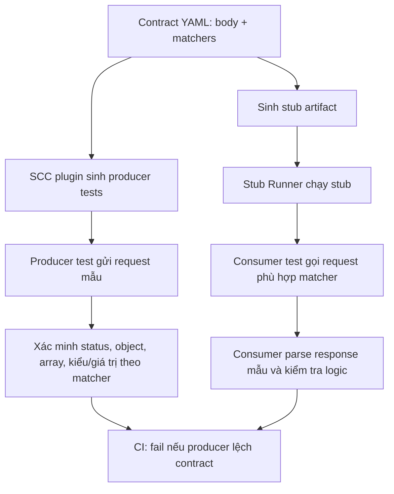

# JSON object, mảng, số, boolean và chuỗi

## 1. Dữ liệu JSON là một phần của hợp đồng giữa producer và consumer

Trong hệ thống nhiều dịch vụ, **producer** cung cấp HTTP API hoặc phát thông điệp; **consumer** gọi API hoặc tiếp nhận thông điệp. Hai bên không chỉ thống nhất đường dẫn và mã HTTP mà còn phải thống nhất **hình dạng và ý nghĩa dữ liệu**. Nếu producer thay `isPaid: false` bằng `isPaid: "false"`, đổi `items` từ mảng sang object, hoặc trả tổng tiền dưới dạng chuỗi, consumer có thể giải mã sai dù response vẫn mang `200 OK`.

**Spring Cloud Contract (SCC)** cho phép mô tả những tương tác này bằng **Groovy DSL hoặc YAML DSL**. Từ hợp đồng, công cụ có thể sinh **producer verification tests** để kiểm tra response thật và tạo **stub** để consumer kiểm thử thông qua **Stub Runner**. CI có thể chặn thay đổi không tương thích nếu các bài test tương ứng được thực thi trên đúng mã và artifact.

Bài thuộc chương **Dữ liệu hợp đồng**, tập trung vào năm cấu trúc thường gặp trong JSON:

- **Object**: tập các trường `key: value`, có thể chứa object khác.
- **Array**: danh sách phần tử có thứ tự, có thể rỗng hoặc chứa object.
- **Number**: số nguyên/số thập phân, khác với chuỗi số.
- **Boolean**: đúng/sai ở dạng `true`/`false`.
- **String**: chuỗi ký tự, kể cả chuỗi trông giống số, ngày hoặc boolean.

Sau bài này, bạn có thể chuyển JSON thành YAML body của Spring Cloud Contract, phân biệt rõ kiểu dữ liệu ở hai phía, dùng matcher khi dữ liệu thay đổi, chọn assertion phù hợp cho mảng và object lồng nhau, cũng như nhận diện các lỗi tương thích dữ liệu trong quá trình phát hành stub và chạy CI.

> Hợp đồng không tự động bảo vệ mọi thuộc tính của JSON. Chỉ những trường, kiểu dữ liệu, giá trị, cấu trúc và trường hợp mà công cụ sinh test/stub **thực sự ràng buộc và thực thi** mới có bằng chứng được kiểm tra.

## 2. Năm kiểu dữ liệu trong JSON và cách biểu diễn bằng YAML

JSON mô tả dữ liệu bằng object, array, string, number, boolean và một giá trị đặc biệt `null`. YAML DSL của Spring Cloud Contract có thể biểu diễn cấu trúc JSON thông qua map, sequence và scalar. Cách ghi YAML ảnh hưởng đến **kiểu dữ liệu mà parser hiểu**.

| Kiểu JSON | Ví dụ JSON | Cách ghi tương ứng trong YAML | Cần phân biệt |
|---|---|---|---|
| Object | `{"customer":{"id":"C-7"}}` | `customer:` xuống dòng, rồi `id: "C-7"` | Object khác chuỗi chứa JSON |
| Array | `{"items":[1,2]}` | `items:` rồi các dòng `- 1`, `- 2` | Mảng khác object có key `0`, `1` |
| Number | `{"quantity":2}` | `quantity: 2` | Số `2` khác chuỗi `"2"` |
| Decimal | `{"price":99.5}` | `price: 99.5` | Không suy ra được tiền tệ/đơn vị |
| Boolean | `{"active":true}` | `active: true` | Boolean `true` khác chuỗi `"true"` |
| String | `{"sku":"BOOK-1"}` | `sku: "BOOK-1"` | Chuỗi giữ nguyên định dạng |
| Null (để đối chiếu) | `{"note":null}` | `note: null` | `null` khác key vắng mặt và chuỗi `"null"` |

**Không nhầm cú pháp YAML với JSON:** dấu `-` ở đầu phần tử biểu diễn **sequence**, không phải dấu trừ gắn vào giá trị. Trong `quantity: -2`, dấu trừ đi kèm số và biểu diễn số âm; trong một dòng `- quantity: 2`, dấu trừ biểu diễn một phần tử object trong mảng.

Ví dụ JSON đầy đủ:

```json
{
  "customer": {
    "id": "CUS-42",
    "vip": true
  },
  "items": [
    { "sku": "BOOK-1", "quantity": 2, "unitPrice": 99000 },
    { "sku": "PEN-2", "quantity": 3, "unitPrice": 10000 }
  ],
  "couponCodes": [],
  "totalAmount": 228000,
  "currency": "VND",
  "paid": false,
  "reference": "000042"
}
```

Biểu diễn tương ứng bằng YAML:

```yaml
customer:
  id: "CUS-42"
  vip: true
items:
  - sku: "BOOK-1"
    quantity: 2
    unitPrice: 99000
  - sku: "PEN-2"
    quantity: 3
    unitPrice: 10000
couponCodes: []
totalAmount: 228000
currency: "VND"
paid: false
reference: "000042"
```

Hai cách biểu diễn mô tả **cùng hình dạng dữ liệu** khi được chuyển đúng kiểu. Tổng tiền `228000` ở ví dụ này bằng `2 × 99000 + 3 × 10000`. Tuy nhiên, phép tính và ngữ nghĩa tiền tệ phải được kiểm thử ở lớp phù hợp; một contract khớp `totalAmount` không tự chứng minh toàn bộ logic giảm giá, thuế hay giao dịch cơ sở dữ liệu.

## 3. Object: tên trường, cấu trúc lồng nhau và ý nghĩa

Một JSON object gồm các cặp `key-value`. Với Spring Cloud Contract YAML DSL, object được viết bằng **mapping** với thụt lề nhất quán:

```yaml
response:
  status: 200
  headers:
    Content-Type: application/json
  body:
    orderId: "ORD-42"
    customer:
      id: "CUS-7"
      profile:
        displayName: "Nguyễn An"
        verified: true
    shipping:
      address:
        city: "Hà Nội"
        country: "VN"
```

Phần `response.body` tương ứng với một object JSON, trong đó `customer` và `shipping` cũng là object. Các trường `displayName`, `verified`, `city` không cùng cấp với `orderId`.

Trong hợp đồng này, consumer có thể cần:

1. `orderId` để điều hướng đến chi tiết đơn hàng.
2. `customer.profile.displayName` để hiển thị tên.
3. `customer.profile.verified` để quyết định có hiện biểu tượng xác minh.
4. `shipping.address.city` để hiển thị nơi nhận.

Nếu producer chuyển `shipping.address.city` lên thành `shipping.city`, consumer đang đọc đường dẫn cũ có thể lỗi. Đây là **thay đổi cấu trúc**, dù tên trường `city` và kiểu string vẫn giữ nguyên.

### 3.1. Đường dẫn JSONPath cho object lồng nhau

Khi cần matcher động, Spring Cloud Contract dùng đường dẫn **JSONPath** trong phần `matchers`. Ví dụ:

| Đường dẫn | Phần dữ liệu được chọn |
|---|---|
| `$.orderId` | Trường `orderId` ở cấp ngoài |
| `$.customer.id` | ID ở object `customer` |
| `$.customer.profile.verified` | Boolean lồng hai cấp |
| `$.shipping.address.city` | Thành phố trong object `address` |

Với key chứa dấu chấm theo nghĩa **tên key thật**, không được tự viết dạng đường dẫn phân cấp. Chẳng hạn JSON có key `"customer.id"` thì cần JSONPath dạng `$['customer.id']` (đúng cú pháp escape của DSL), khác với `$.customer.id`.

**Thứ tự các key trong JSON object không mang ngữ nghĩa thứ tự của mảng.** Tuy nhiên, khả năng so khớp có bỏ qua trường phụ hay không phụ thuộc cách engine sinh assertion/stub mapping và matcher. Không tự tuyên bố rằng contract luôn chấp nhận mọi trường mới hoặc luôn cấm trường lạ; hãy kiểm tra generated test và hành vi deserializer của consumer.

## 4. Array: danh sách, thứ tự và số phần tử

Trong YAML, JSON array được viết thành **sequence** với các mục bắt đầu bằng `-`:

```yaml
response:
  status: 200
  headers:
    Content-Type: application/json
  body:
    orderId: "ORD-42"
    items:
      - sku: "BOOK-1"
        quantity: 2
      - sku: "PEN-2"
        quantity: 3
    couponCodes: []
```

JSON tương ứng có:

- `items` là array gồm **hai object**, mỗi object có `sku` và `quantity`.
- `couponCodes` là array **rỗng**, không phải `null` hoặc trường không tồn tại.
- Các phần tử của array có thứ tự; consumer có thể quan tâm thứ tự này nếu API cam kết sắp xếp.

Nếu producer trả:

```json
{
  "orderId": "ORD-42",
  "items": { "sku": "BOOK-1", "quantity": 2 },
  "couponCodes": null
}
```

thì `items` đã chuyển từ **array** thành **object**, `couponCodes` đã chuyển từ **array rỗng** thành **null**. Một consumer lặp qua `items` như danh sách hoặc giả định `couponCodes` luôn là list có thể gặp lỗi.

### 4.1. Truy cập phần tử của mảng bằng JSONPath

| JSONPath | Diễn giải |
|---|---|
| `$.items` | Toàn bộ array |
| `$.items[0].sku` | `sku` của phần tử đầu tiên |
| `$.items[1].quantity` | `quantity` của phần tử thứ hai |
| `$.items[*].sku` | Các giá trị `sku` của mọi phần tử phù hợp |

Trong YAML matcher, đường dẫn phải trỏ tới **phần tử có thật trong body mẫu**. Nếu khai báo `$.items[1].quantity` nhưng body chỉ có một phần tử, contract có thể không chuyển đổi hoặc xác minh như mong muốn. Một array có thể chứa number, boolean, string hoặc object; cần chọn đúng JSONPath theo hình dạng dữ liệu.

### 4.2. Kiểm tra kiểu mảng và số phần tử

Để kiểm tra **kiểu** của field, YAML có matcher `by_type`. Ví dụ contract response:

```yaml
response:
  status: 200
  body:
    items:
      - sku: "BOOK-1"
        quantity: 2
    active: true
  matchers:
    body:
      - path: $.items
        type: by_type
      - path: $.items[0].quantity
        type: by_type
```

Ý nghĩa dự kiến: generated producer test kiểm tra `items` là collection phù hợp với kiểu mẫu, và `quantity` ở vị trí được chọn là kiểu số tương ứng. Khi thêm matcher, những assertion cho phần dữ liệu đó có thể thay đổi so với so khớp giá trị cố định; cần đọc generated test để biết chính xác ràng buộc cuối cùng.

YAML matcher cũng có tham số `minOccurrence` và `maxOccurrence` cho `by_type`:

```yaml
response:
  status: 200
  body:
    items:
      - sku: "BOOK-1"
        quantity: 2
  matchers:
    body:
      - path: $.items
        type: by_type
        minOccurrence: 1
        maxOccurrence: 5
```

**Giới hạn quan trọng:** tài liệu Spring Cloud Contract hiện hành nêu **xác minh kích thước JSON array là tính năng thử nghiệm và mặc định tắt**. Một số phiên bản yêu cầu bật `spring.cloud.contract.verifier.assert.size=true` hoặc cấu hình plugin `assertJsonSize`. Vì vậy, **không mặc định rằng chỉ cần khai báo min/max là mọi build đều kiểm tra kích thước**. Phải xác minh generated assertions và kết quả test với phiên bản, plugin và đường dẫn JSONPath đang dùng.

Với collection lồng nhau, cách đếm có thể khác kỳ vọng do flattening; nếu cần bảo đảm số phần tử chính xác hoặc quy tắc thứ tự quan trọng, hãy dùng assertion bổ sung có chủ đích và test trực tiếp. Đừng thay matcher cho từng phần tử bằng một `by_type` bao quát rồi tin rằng cấu trúc của mọi phần tử đều đã được bảo vệ.

### 4.3. Mảng rỗng và thiếu field là hai trường hợp khác

Đối với consumer, những phản hồi dưới đây có thể không tương đương:

```json
{"items":[]}
```

```json
{"items":null}
```

```json
{}
```

Trường hợp đầu cho biết một danh sách rỗng; trường hợp thứ hai có key nhưng giá trị null; trường hợp thứ ba không có key. Nếu API cam kết luôn trả list để consumer không cần kiểm tra null, phải xác định rõ quy tắc đó và bảo vệ bằng contract/assertion phù hợp, thay vì chỉ kiểm tra tên field ở một mẫu thành công.

## 5. Number: số nguyên, số thập phân và rủi ro mất ý nghĩa

JSON có kiểu **number**, không có các kiểu Java tách biệt như `int`, `long`, `BigDecimal` trong chính cú pháp JSON. Trong ứng dụng thực tế, thư viện Jackson, Gson, JSONPath, JavaScript hoặc thư viện của ngôn ngữ khác có thể ánh xạ number sang kiểu cụ thể.

Trong YAML DSL:

```yaml
response:
  status: 200
  body:
    quantity: 2
    totalAmount: 228000
    discountRate: 0.15
    balanceAdjustment: -5000
```

Những giá trị trên đều được viết theo dạng số. Ngược lại:

```yaml
response:
  status: 200
  body:
    quantity: "2"
    totalAmount: "228000"
    discountRate: "0.15"
```

đang mô tả **string**. Nếu consumer giải mã `quantity` thành số nguyên, việc producer trả `"2"` có thể gây lỗi ánh xạ hoặc làm quy tắc so sánh hoạt động sai.

### 5.1. Chọn số hay chuỗi cho ID

Giả sử mã khách hàng là `"000042"`, có số không ở đầu. Nếu ghi:

```yaml
customerId: 000042
```

parser YAML có thể hiểu khác dự định hoặc làm mất số không ở đầu, tùy phiên bản/parser. Để biểu diễn **mã định danh**, nên dùng chuỗi có dấu nháy:

```yaml
customerId: "000042"
```

ID dùng để định danh thường là **chuỗi**, kể cả khi chỉ gồm chữ số. Chọn number chỉ khi API thật sự cam kết ý nghĩa số học và consumer cần tính toán với giá trị đó.

### 5.2. Number không tự nói về tiền tệ và độ chính xác

`totalAmount: 228000` có thể là 228.000 VND hoặc một đơn vị nhỏ hơn tùy thiết kế API. Một matcher kiểm tra “đây là số” **không biết** đơn vị, quy tắc làm tròn, thuế hay mức trần thanh toán.

Với dữ liệu tài chính, nhóm cần thỏa thuận rõ:

- Đơn vị tiền và field `currency`.
- Dùng số nguyên ở **đơn vị nhỏ nhất** hay giá trị decimal.
- Quy tắc làm tròn và độ chính xác.
- Phạm vi giá trị, âm/dương, có cho phép bằng 0 hay không.

JSON number cũng cần cân nhắc **độ chính xác giữa ngôn ngữ**: các số nguyên lớn hơn khoảng chính xác an toàn của kiểu number trong JavaScript có thể bị mất độ chính xác. Nếu API truyền ID hoặc số nguyên rất lớn, hãy thống nhất rõ cách biểu diễn và test với consumer thật.

### 5.3. Matcher cho number

Giả sử producer tự tính tổng tiền. Có thể kiểm tra **kiểu số** bằng `by_type` thay vì bắt buộc đúng một giá trị fixture:

```yaml
response:
  status: 200
  body:
    totalAmount: 228000
  matchers:
    body:
      - path: $.totalAmount
        type: by_type
```

Với field có định dạng đặc biệt, SCC hỗ trợ `by_regex` và `regexType` trong YAML, ví dụ dạng số nguyên:

```yaml
response:
  status: 200
  body:
    attemptCount: 3
  matchers:
    body:
      - path: $.attemptCount
        type: by_regex
        value: "[0-9]+"
        regexType: as_integer
```

Matcher regex thường kiểm tra **định dạng**, còn matcher kiểu kiểm tra **kiểu JSON**. Không thay thế mọi kiểm tra nghiệp vụ bằng `[0-9]+`: biểu thức này không tự giới hạn số lần thử, số tiền tối đa hay giá trị được phép trong một quy trình.

**Lưu ý:** `regexType` và tập kiểu được hỗ trợ phải đối chiếu tài liệu của phiên bản Spring Cloud Contract đang dùng. Khi cần quy tắc giá trị phức tạp như số tiền bằng tổng các dòng, có thể cần test nghiệp vụ hoặc custom assertion ngoài matcher kiểu đơn giản.

## 6. Boolean: đúng/sai là dữ liệu có kiểu, không phải từ ngữ tự do

Trong JSON, boolean chỉ có **`true` hoặc `false`**, viết thường và **không có dấu nháy**. YAML thường biểu diễn tương ứng:

```yaml
response:
  status: 200
  body:
    paid: false
    verified: true
    refundable: false
```

Trong response JSON, các trường trên là boolean. Hai cách viết sau **khác nghĩa**:

```yaml
paid: false        # boolean false
paidText: "false"   # string "false"
```

Consumer có thể dùng một nhánh nghiệp vụ như `if (order.paid)`. Nếu producer trả chuỗi `"false"`, cách xử lý phụ thuộc ngôn ngữ/framework; một số cách ép kiểu khiến logic bị sai. Vì vậy, **kiểu boolean là điều kiện tương thích quan trọng**, không chỉ vấn đề trình bày.

### 6.1. Không nới lỏng boolean khi giá trị cụ thể là cam kết

Giả sử hợp đồng cho đơn hàng **chưa thanh toán** cần `paid: false`. Nếu đặt matcher `by_type`, generated test có thể chỉ xác minh đây là boolean mà chấp nhận cả `true`. Điều đó làm mất ý nghĩa của tình huống.

Hợp đồng nên giữ:

```yaml
response:
  status: 200
  body:
    paid: false
```

Nếu yêu cầu chỉ là “field `paid` tồn tại và là boolean” cho nhiều tình huống, một matcher kiểu có thể phù hợp:

```yaml
response:
  status: 200
  body:
    paid: false
  matchers:
    body:
      - path: $.paid
        type: by_type
```

Ở ví dụ thứ hai, **không nên suy ra** test sẽ bảo đảm giá trị `false`. Phải xác định đúng mức ràng buộc consumer cần.

### 6.2. Cẩn thận với cú pháp YAML cho boolean

Để giữ ý nghĩa rõ ràng và tránh sai khác giữa các parser YAML, hãy dùng **`true` và `false` viết thường, không nháy** cho boolean. Những từ như `yes`, `no`, `on`, `off` có thể bị hiểu khác nhau giữa các phiên bản quy tắc YAML và parser. Nếu muốn một **string** đúng bằng `"on"` hoặc `"off"`, hãy đặt trong dấu nháy.

Boolean `false`, `null` và trường không tồn tại là **ba trạng thái khác nhau** trong nhiều API. Một API cho phép ba trạng thái cần quy ước rõ; boolean không tự diễn đạt “chưa biết” trừ khi thiết kế thêm giá trị null hoặc field khác.

## 7. String: mã, ngày giờ, Unicode và escaping

String trong JSON là dãy ký tự. Trong YAML DSL, nên thêm dấu nháy khi nội dung có thể gây hiểu nhầm kiểu hoặc chứa ký tự đặc biệt:

```yaml
response:
  status: 200
  body:
    sku: "BOOK-1"
    customerCode: "000042"
    createdAt: "2026-11-24T10:30:00+07:00"
    note: "Giao trước 18:00"
    activeText: "true"
    emptyText: ""
```

Tất cả giá trị trên là **string**. `activeText: "true"` không phải boolean; `emptyText: ""` là chuỗi rỗng, khác `null`. Các ký tự Unicode trong string có thể được dùng bình thường khi tài liệu lưu UTF-8.

Với regex, cần đặc biệt chú ý cú pháp nháy của YAML. Ví dụ:

```yaml
response:
  status: 200
  body:
    orderId: "ORD-42"
  matchers:
    body:
      - path: $.orderId
        type: by_regex
        value: 'ORD-[0-9]+'
```

Dấu nháy đơn giúp giữ nguyên ký tự `\` của regex khi có escape; dấu nháy kép trong YAML có quy tắc escape riêng. Điều quan trọng là matcher phải được kiểm tra trên **công cụ và phiên bản thực tế**, không giả định rằng regex được parser YAML hiểu giống cú pháp Java string hoặc JavaScript string.

### 7.1. Đừng thay mọi string bằng regex quá rộng

Nếu consumer chỉ hiểu các trạng thái `PENDING`, `PAID` và `FAILED`, việc dùng `by_type` cho string chỉ kiểm tra *kiểu*, không bảo vệ tập giá trị. Nếu muốn ràng buộc enum, có thể dùng matcher cụ thể:

```yaml
response:
  status: 200
  body:
    state: "PAID"
  matchers:
    body:
      - path: $.state
        type: by_regex
        value: 'PENDING|PAID|FAILED'
```

Nhưng nếu hợp đồng đang mô tả **đơn đã thanh toán**, yêu cầu `state: "PAID"` chính xác thường phù hợp hơn. Không mở rộng matcher chỉ để tạo cảm giác test ít thất bại; hãy ưu tiên bảo vệ hành vi consumer thật sự phụ thuộc.

### 7.2. String trông giống JSON vẫn là string

Hai payload sau khác nhau:

```json
{"metadata":{"source":"WEB"}}
```

```json
{"metadata":"{\"source\":\"WEB\"}"}
```

Payload thứ nhất có `metadata` là **object**. Payload thứ hai có `metadata` là **string chứa văn bản JSON**. Consumer parse `metadata.source` trực tiếp chỉ làm việc với trường hợp thứ nhất. Khi thiết kế contract, tránh mã hóa object thành string một cách vô tình; nếu giao diện thật dùng chuỗi JSON, phải ghi rõ consumer có trách nhiệm parse thêm lần nữa.

## 8. Từ dữ liệu JSON sang hợp đồng Spring Cloud Contract YAML hoàn chỉnh

Giả sử ứng dụng `checkout-ui` cần tạo đơn hàng qua producer `order-service`. Consumer gửi thông tin khách hàng, các mặt hàng và lựa chọn tặng quà. Producer trả ID đơn, tổng tiền, trạng thái thanh toán và danh sách mặt hàng. Những giá trị sau là **giao diện ví dụ cần hai bên thống nhất**, không phải endpoint do SCC tự tạo.

File `create-order.yml`:

```yaml
name: create_order
description: "Tạo đơn hàng với object, array, number, boolean và string"
request:
  method: POST
  url: /api/orders
  headers:
    Content-Type: application/json
    Accept: application/json
  body:
    customer:
      id: "CUS-42"
      verified: true
    items:
      - sku: "BOOK-1"
        quantity: 2
        unitPrice: 99000
      - sku: "PEN-2"
        quantity: 3
        unitPrice: 10000
    giftWrapped: false
    note: "Giao giờ hành chính"
  matchers:
    body:
      - path: $.customer.id
        type: by_regex
        value: 'CUS-[0-9]+'
response:
  status: 201
  headers:
    Content-Type: application/json
  body:
    orderId: "ORD-1001"
    totalAmount: 228000
    currency: "VND"
    paid: false
    items:
      - sku: "BOOK-1"
        quantity: 2
      - sku: "PEN-2"
        quantity: 3
    couponCodes: []
  matchers:
    body:
      - path: $.orderId
        type: by_regex
        value: 'ORD-[0-9]+'
      - path: $.totalAmount
        type: by_type
```

### 8.1. Điều gì là giá trị cố định?

Trong request mẫu, producer verification test có thể dùng `customer.id: CUS-42`, `verified: true`, danh sách hàng và `giftWrapped: false` để gọi API. Trừ những phần được cấu hình matcher, dữ liệu mẫu thể hiện kỳ vọng cụ thể của tình huống.

Trong response mẫu, stub có thể trả `orderId: ORD-1001` và `totalAmount: 228000` để consumer kiểm thử. Các trường `currency: VND`, `paid: false` và phần tử trong `items` vẫn mang ngữ nghĩa cụ thể cần giữ, trừ khi nhóm thiết kế thêm matcher phù hợp.

### 8.2. Điều gì được phép thay đổi?

- **Request matcher** ở `$.customer.id` giúp stub nhận các mã khách hàng phù hợp `CUS-[0-9]+`. Producer test vẫn có một giá trị mẫu để gửi.
- **Response matcher** ở `$.orderId` cho phép producer trả ID khác `ORD-1001`, miễn là đúng định dạng.
- **Response matcher** ở `$.totalAmount` chủ yếu bảo vệ **kiểu số**; nó không tự kiểm chứng tổng tiền bằng đúng công thức nghiệp vụ.

Nếu consumer cần tin rằng `totalAmount` **chính xác bằng** `228000` trong fixture đã cho, nên bỏ matcher kiểu ở trường đó hoặc bổ sung assertion nghiệp vụ tương ứng. Matcher linh hoạt làm giảm sự phụ thuộc vào dữ liệu ngẫu nhiên nhưng cũng có thể làm suy yếu ràng buộc nếu dùng thiếu cân nhắc.

### 8.3. Thử hình dung hai đầu chạy



Việc sinh test/stub phụ thuộc cấu hình Gradle/Maven plugin, test base, fixture và task CI. Một file YAML hợp lệ **không đủ** để bảo đảm producer test đã chạy hay consumer thực sự gọi stub.

## 9. Groovy DSL: cùng dữ liệu với map và list

YAML là cách khai báo thuận tiện, nhưng Spring Cloud Contract cũng có **Groovy DSL**. Trong Groovy, một object JSON thường được biểu diễn bằng **map**, mảng bằng **list**, số bằng literal số, boolean bằng `true`/`false` và string bằng chuỗi.

Ví dụ rút gọn:

```groovy
import org.springframework.cloud.contract.spec.Contract

Contract.make {
    name 'order_data_shapes'

    request {
        method POST()
        url '/api/orders'
        headers {
            contentType(applicationJson())
        }
        body(
            customer: [
                id: 'CUS-42',
                verified: true
            ],
            items: [
                [sku: 'BOOK-1', quantity: 2],
                [sku: 'PEN-2', quantity: 3]
            ],
            giftWrapped: false
        )
    }

    response {
        status CREATED()
        headers {
            contentType(applicationJson())
        }
        body(
            orderId: 'ORD-1001',
            paid: false,
            totalAmount: 228000,
            items: [
                [sku: 'BOOK-1', quantity: 2]
            ]
        )
        bodyMatchers {
            jsonPath('$.orderId', byRegex('ORD-[0-9]+'))
        }
    }
}
```

Điểm cần nhớ:

- Groovy map `[id: 'CUS-42']` tạo cấu trúc object; list `[[sku: 'BOOK-1']]` tạo array object.
- Các giá trị boolean, number và string vẫn phải đúng kiểu.
- Trong Groovy DSL có thể dùng **`value(consumer(...), producer(...))`** hoặc `bodyMatchers` cho dữ liệu động.
- **YAML DSL** thể hiện dữ liệu mẫu trong `body` và dùng `request.matchers`/`response.matchers` cho các giá trị cần kiểm tra linh hoạt; không nhét cú pháp Groovy vào trường YAML rồi mong nó được thực thi.

Với JSON lồng nhau phức tạp, cách viết map/list giúp tránh việc nhúng JSON vào chuỗi Groovy có escaping khó đọc. Khi chuyển qua lại giữa YAML và Groovy, hãy kiểm tra **JSON output và assertion được sinh**, không chỉ đối chiếu cú pháp nhìn giống nhau.

## 10. Kiểm thử dữ liệu với producer và consumer: hai bằng chứng khác nhau

### 10.1. Producer verification bảo vệ điều gì?

Từ hợp đồng, Spring Cloud Contract có thể sinh test để gửi request đã khai báo và kiểm tra response. Ví dụ producer vô tình sửa:

```json
{
  "orderId": "ORD-1001",
  "totalAmount": "228000",
  "paid": "false",
  "items": {"sku": "BOOK-1", "quantity": 2}
}
```

Các trường này thay đổi đáng kể:

- `totalAmount` từ **number** sang **string**.
- `paid` từ **boolean** sang **string**.
- `items` từ **array** sang **object**.

Nếu contract/test ràng buộc các trường và kiểu tương ứng, producer test có thể báo lỗi. Tuy nhiên, nếu test bỏ qua phần đó, matcher quá rộng hoặc chỉ chạy với fixture không chạm tới nhánh mới, không thể nói lỗi chắc chắn được phát hiện.

### 10.2. Consumer test với Stub Runner bảo vệ điều gì?

Consumer dùng stub artifact để gọi một endpoint mô phỏng. Nếu stub trả:

```json
{
  "orderId": "ORD-1001",
  "totalAmount": 228000,
  "paid": false,
  "items": [{"sku":"BOOK-1","quantity":2}]
}
```

thì consumer test có thể kiểm tra:

1. DTO nhận `totalAmount` như một kiểu số phù hợp.
2. Logic xử lý `paid` như boolean, không dùng so sánh chuỗi.
3. Giao diện lặp qua `items` như danh sách và hiển thị số lượng.
4. Consumer có thể xử lý danh sách rỗng nếu tồn tại contract/stub riêng cho tình huống đó.

Nhưng **stub là dữ liệu mô phỏng từ contract**. Consumer test xanh với stub cũ không chứng minh producer phiên bản mới trả đúng dữ liệu. CI cần chạy producer verification trên mã đang phát hành, phát hành stub có phiên bản và kiểm thử consumer với đúng artifact.

### 10.3. Ma trận lỗi dữ liệu và tín hiệu

| Thay đổi từ producer | Consumer có thể bị ảnh hưởng như thế nào? | Ràng buộc hợp đồng nên có |
|---|---|---|
| `items`: array → object | Vòng lặp/deserialize danh sách lỗi | Kiểu collection và cấu trúc phần tử |
| `paid`: boolean → string | Nhánh điều kiện sai hoặc parse lỗi | Kiểu boolean, giá trị cố định khi quan trọng |
| `totalAmount`: number → string | Lỗi ánh xạ hoặc tính toán | Kiểu number và ngữ nghĩa đơn vị |
| `reference`: `"000042"` → `42` | Mất số không ở đầu mã | String và định dạng mã |
| `status`: `"PAID"` → `"DONE"` | Enum của consumer không còn nhận diện | Giá trị enum được hỗ trợ, không chỉ `by_type` |
| `items` đổi thứ tự | UI hoặc thuật toán dựa vào vị trí sai | Thỏa thuận thứ tự; assertions khi thứ tự quan trọng |
| `couponCodes`: `[]` → `null` | Consumer đọc list bị lỗi | Phân biệt array rỗng, null và field vắng mặt |
| `customer.profile` đổi vị trí | JSONPath/DTO không tìm thấy trường | Object lồng nhau và đường dẫn key |

**Khả năng phát hiện thực tế** phụ thuộc bộ hợp đồng, matcher, generated code và test được thực thi. Dù hợp đồng có đúng kiểu, lỗi nghiệp vụ như tính sai tiền, quyền truy cập sai hoặc dữ liệu lưu sai vẫn cần các lớp kiểm thử bổ sung.

## 11. Các lỗi hay gặp khi viết YAML body và matcher

| Sai lầm | Ví dụ | Cách sửa |
|---|---|---|
| Dùng string thay vì boolean | `paid: "false"` | Dùng `paid: false` nếu giao diện thật quy định boolean |
| Dùng string thay vì number | `quantity: "2"` | Dùng `quantity: 2` nếu client cần số |
| Viết mảng thành object | `items: {sku: BOOK-1}` | Dùng sequence `items:` + `- sku: ...` |
| Không nháy mã có số không đầu | `reference: 000042` | Dùng `reference: "000042"` |
| Đặt ngày giờ dưới dạng scalar có thể bị ép kiểu | `createdAt: 2026-11-24` | Dùng string `"2026-11-24"` |
| Dùng `by_type` cho trạng thái cố định | `state: PAID` nhưng matcher chỉ kiểm kiểu | Giữ equality hoặc regex enum đủ hẹp |
| Matcher chỉ chọn một phần tử mảng | `$.items[0].sku` | Xác định các phần tử còn lại cần kiểm tra gì |
| Cho rằng `minOccurrence` luôn hoạt động | Chưa bật tùy chọn kiểm tra size | Xác minh version, `assertJsonSize` và generated test |
| Matcher trỏ field không có trong mẫu | `$.customer.address.zip` nhưng không có `address` | Sửa JSONPath/mẫu; matcher phải nhắm phần tử thực |
| Tin rằng mọi number đều an toàn giữa JS/Java | ID rất lớn bằng số | Quyết định kiểu dữ liệu phù hợp, test client |
| Dùng null để thay danh sách rỗng | `items: null` | Thỏa thuận nullability; thường ưu tiên `[]` khi API cam kết list |
| Chỉ sinh stub nhưng không chạy producer test | Consumer vẫn thấy response mẫu | Bắt buộc producer verification và CI gate |

Đặc biệt, hai biểu thức sau không tương đương:

```yaml
response:
  body:
    items: []
```

```yaml
response:
  body:
    items: {}
```

Một consumer nhận `items` kiểu `List<Item>` không thể coi `{}` là danh sách rỗng. Trong contract, những thay đổi kiểu dù chỉ một ký hiệu vẫn có thể là thay đổi phá vỡ tương thích.

## 12. Thực hành: thiết kế hợp đồng cho danh sách đơn hàng

**Bối cảnh:** consumer `inventory-ui` cần lấy các mặt hàng còn có thể bán từ producer `catalog-service`. Producer trả một object có các field:

- `warehouseId`: **string**, ví dụ `"WH-001"`.
- `available`: **boolean** cho biết kho đang hoạt động.
- `products`: **array** gồm các object có `sku` (string), `stock` (number nguyên), `unitPrice` (number).
- `tags`: **array string**, có thể rỗng.
- `totalProducts`: **number** đếm số sản phẩm theo quy ước hai bên.

### 12.1. Yêu cầu

1. Viết YAML contract cho `GET /api/warehouses/WH-001/products`, trả HTTP `200` và `Content-Type: application/json`.
2. Đặt `available: true` là boolean, không phải string; `tags: []` là array rỗng.
3. Tạo ít nhất hai phần tử trong `products`: một mặt hàng có stock `12`, một mặt hàng có stock `0`.
4. Chỉ cho `warehouseId` thay đổi theo pattern `WH-[0-9]+` ở **response**, nhưng không nới lỏng `available` nếu ca sử dụng chỉ dành cho kho hoạt động.
5. Giải thích vì sao `stock: "12"`, `products: {}` và `tags: null` có thể phá vỡ consumer.
6. Nêu cách xác minh kích thước array nếu API cam kết số phần tử tối thiểu, và giải thích giới hạn của tính năng này trong SCC.

### 12.2. Đáp án YAML tham khảo

```yaml
name: available_warehouse_products
description: "Kho đang hoạt động trả danh sách sản phẩm"
request:
  method: GET
  url: /api/warehouses/WH-001/products
  headers:
    Accept: application/json
response:
  status: 200
  headers:
    Content-Type: application/json
  body:
    warehouseId: "WH-001"
    available: true
    products:
      - sku: "BOOK-1"
        stock: 12
        unitPrice: 99000
      - sku: "PEN-2"
        stock: 0
        unitPrice: 10000
    tags: []
    totalProducts: 2
  matchers:
    body:
      - path: $.warehouseId
        type: by_regex
        value: 'WH-[0-9]+'
```

**Giải thích:** `products` là array gồm hai object; `stock` và `unitPrice` là number; `available` là boolean; `warehouseId` và `sku` là string; `tags` là array rỗng. Matcher chỉ thay đổi cách kiểm tra `warehouseId` ở phía producer, còn stub có thể dùng mẫu `WH-001`.

Nếu cần bảo đảm số phần tử tối thiểu trong `products`, nhóm có thể nghiên cứu `by_type` với `minOccurrence` và bật tính năng kiểm tra kích thước mảng được hỗ trợ trong đúng phiên bản plugin. Bắt buộc xác minh generated tests thực sự assert size; nếu yêu cầu chặt hơn về tính nhất quán `totalProducts == products.size()`, cần assertion bổ sung hoặc test nghiệp vụ.

### 12.3. Gợi ý mở rộng

Hãy bổ sung một contract thứ hai cho **kho không có sản phẩm**:

```yaml
name: empty_warehouse
request:
  method: GET
  url: /api/warehouses/WH-002/products
response:
  status: 200
  headers:
    Content-Type: application/json
  body:
    warehouseId: "WH-002"
    available: true
    products: []
    tags: []
    totalProducts: 0
```

Hai contract đại diện cho **hai tình huống khác nhau**. Consumer test cần xác minh cách hiển thị danh sách có dữ liệu và danh sách rỗng. Producer test cần fixture cho kho `WH-001` có hàng và `WH-002` không có hàng.

## 13. Checklist trước khi phê duyệt dữ liệu hợp đồng

- [ ] Với mỗi field, đã xác định đúng **object, array, number, boolean hoặc string**.
- [ ] Đã phân biệt `false`, `null`, chuỗi rỗng và field vắng mặt.
- [ ] Những ID có số không đầu, ngày giờ, trạng thái và enum được biểu diễn như string khi đó là thiết kế giao diện.
- [ ] Mảng được viết đúng YAML sequence; các phần tử object lồng nhau có thụt lề chính xác.
- [ ] Nếu consumer phụ thuộc vào thứ tự/độ dài danh sách, có contract và assertion kiểm tra điều đó.
- [ ] Dữ liệu tài chính có quy ước đơn vị, tiền tệ, độ chính xác và quy tắc làm tròn.
- [ ] Matcher dùng đúng JSONPath và không quá rộng so với nhu cầu consumer.
- [ ] Các giá trị ví dụ nằm trong `body`; matcher YAML nằm đúng `request.matchers` hoặc `response.matchers`.
- [ ] Generated producer tests được tạo **và thực thi** với fixture phù hợp; kết quả fail làm CI dừng.
- [ ] Stub artifact có version rõ ràng; consumer test với Stub Runner có assertion cho các kiểu và nhánh quan trọng.
- [ ] Đã kiểm tra giới hạn/cấu hình array size nếu dùng `minOccurrence` hoặc `maxOccurrence`.
- [ ] Có test bổ sung cho logic nghiệp vụ, lưu dữ liệu, bảo mật và các tương tác không thuộc phạm vi contract.

## 14. Ghi nhớ và tài liệu tham khảo

**Object, array, number, boolean và string là những cam kết kiểu dữ liệu thực tế giữa producer và consumer.** `[]` không tương đương `{}`; `false` không tương đương `"false"`; `228000` không tương đương `"228000"`; ID `"000042"` không nên bị biến thành số `42`. Một thay đổi nhỏ ở kiểu dữ liệu có thể gây lỗi giải mã, sai nhánh điều kiện hoặc mất ý nghĩa nghiệp vụ.

Trong Spring Cloud Contract, có thể mô tả JSON dưới `request.body` và `response.body` bằng YAML map/sequence/scalar hoặc Groovy map/list. Dùng `matchers` để cho phép những phần thực sự biến động, đồng thời giữ nguyên ràng buộc mà consumer phụ thuộc. Producer verification kiểm tra implementation trong test; stub và Stub Runner giúp consumer kiểm thử với dữ liệu mô phỏng. CI có ích khi hai phía dùng đúng hợp đồng/phiên bản và **thực sự chạy các bài test**.

Nguồn chính thức nên đối chiếu theo phiên bản Spring Cloud Contract của dự án:

- [Spring Cloud Contract — Dynamic Properties và YAML matchers](https://docs.spring.io/spring-cloud-contract/reference/project-features-contract/dsl-dynamic-properties.html).
- [Spring Cloud Contract — Contract DSL và giới hạn xác minh kích thước array](https://docs.spring.io/spring-cloud-contract/reference/project-features-contract.html).
- [Spring Cloud Contract — YML Schema](https://docs.spring.io/spring-cloud-contract/reference/yml-schema.html).
- [Spring Cloud Contract — HTTP Contracts](https://docs.spring.io/spring-cloud-contract/reference/project-features-contract/http.html).
