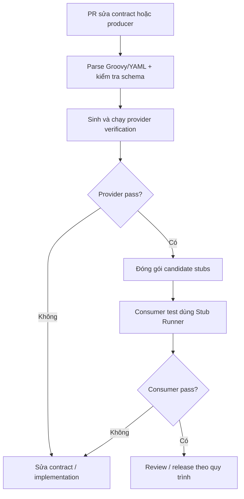

# Ngày giờ, múi giờ và độ chính xác dữ liệu số trong Spring Cloud Contract

Trong hệ thống phân tán, một trường `createdAt` có thể biểu thị **thời điểm tuyệt đối**, còn `deliveryDate` chỉ là **ngày theo lịch nghiệp vụ**. Một số tiền `12.30` có thể được truyền dưới dạng JSON number, chuỗi thập phân hoặc số nguyên 1.230 đơn vị nhỏ nhất. Nếu producer và consumer hiểu khác nhau về múi giờ, đơn vị thời gian hay cách làm tròn, API vẫn có thể trả HTTP 200 nhưng dữ liệu lại sai về nghiệp vụ.

**Spring Cloud Contract (SCC)** cho phép ghi những cam kết dữ liệu ấy bằng **Groovy DSL hoặc YAML DSL**, sinh test kiểm chứng producer và tạo stub để consumer chạy bằng **Stub Runner**. Bài thuộc chương **Dữ liệu hợp đồng** này tập trung vào hai nhóm dễ phát sinh lỗi tương thích: **ngày giờ/múi giờ** và **độ chính xác dữ liệu số**. Các ví dụ dùng dịch vụ `order-producer` và `order-consumer`, từ định nghĩa contract đến kiểm thử CI.

Sau bài học, bạn cần phân biệt được `Instant`, local date, offset và timezone; chọn biểu diễn JSON và quy tắc matcher phù hợp; xử lý tiền tệ bằng kiểu số chính xác; và chứng minh generated producer tests cùng consumer tests phát hiện thay đổi gây sai dữ liệu.

## 1. Vì sao ngày giờ và số cần hợp đồng chặt chẽ?

Xét phản hồi:

```json
{
  "orderId": 1001,
  "createdAt": "2026-11-24T03:15:30.123Z",
  "scheduledDate": "2026-11-25",
  "timeZone": "Asia/Ho_Chi_Minh",
  "amountMinor": 1230,
  "currency": "USD",
  "exchangeRate": "1.234567"
}
```

Các trường có những ngữ nghĩa khác nhau:

| Trường | Kiểu biểu diễn | Cam kết cần thống nhất |
| --- | --- | --- |
| `createdAt` | Chuỗi ISO 8601 có `Z` | Một thời điểm tuyệt đối, được chuẩn hóa UTC, có mili giây |
| `scheduledDate` | Chuỗi `YYYY-MM-DD` | Ngày theo lịch, chưa phải thời điểm |
| `timeZone` | Zone ID kiểu IANA | Múi giờ áp dụng cho lịch nghiệp vụ |
| `amountMinor` | Số nguyên JSON | Giá trị theo **đơn vị nhỏ nhất** đã thỏa thuận |
| `currency` | Chuỗi mã tiền tệ | Đơn vị của `amountMinor`; ví dụ USD |
| `exchangeRate` | Chuỗi thập phân | Giữ đúng chữ số và quy tắc độ chính xác đã quy định |

Nếu consumer tự coi `createdAt` là giờ Việt Nam thay vì UTC, thời gian hiển thị lệch bảy giờ. Nếu producer đổi `amountMinor: 1230` sang `amount: 12.30` mà không cập nhật consumer, số tiền có thể bị diễn giải sai 100 lần. Nếu tỷ giá được parse bằng floating point rồi làm tròn thiếu kiểm soát, sai số có thể tích lũy.

Mục tiêu của contract là làm **ngữ nghĩa của dữ liệu và định dạng truyền tải trở nên kiểm chứng được**, không chỉ kiểm tra rằng một trường có mặt.

## 2. Xác định đúng loại dữ liệu thời gian

Không có một kiểu thời gian phù hợp cho mọi bài toán. Cần phân biệt:

| Khái niệm | Java thường dùng | Biểu diễn JSON ví dụ | Khi nào dùng |
| --- | --- | --- | --- |
| Thời điểm tuyệt đối | `Instant` | `2026-11-24T03:15:30.123Z` | Sự kiện đã xảy ra, audit, timestamp |
| Thời điểm kèm UTC offset | `OffsetDateTime` | `2026-11-24T10:15:30.123+07:00` | Client cần biết offset xuất hiện trong dữ liệu |
| Ngày theo lịch | `LocalDate` | `2026-11-25` | Ngày giao hàng, ngày sinh, ngày đáo hạn theo lịch |
| Giờ địa phương | `LocalTime` | `09:00:00` | Giờ mở cửa, khung giờ hằng ngày |
| Ngày giờ địa phương | `LocalDateTime` | `2026-11-25T09:00:00` | Lịch tường minh nhưng **chưa có timezone** |
| Múi giờ theo quy tắc vùng | `ZoneId` | `Asia/Ho_Chi_Minh` | Áp dụng quy tắc giờ địa phương, kể cả DST ở vùng có DST |
| Ngày giờ gắn vùng | `ZonedDateTime` | Có offset/zone theo định dạng đã chọn | Khi cần giữ thông tin vùng và quy tắc chuyển đổi |
| Khoảng thời gian | `Duration` | Ví dụ `PT15M` | Timeout, thời hạn chờ, thời lượng tính bằng thời gian |

`Z` là ký hiệu UTC, tương đương offset `+00:00`. Offset `+07:00` cho biết chênh lệch so với UTC tại thời điểm đó; còn `Asia/Ho_Chi_Minh` là **mã vùng** để hệ thống suy ra offset theo quy tắc múi giờ. **Offset không tương đương Zone ID**: một vùng có thể thay đổi offset theo thời gian do quy tắc daylight saving time (DST).

### 2.1. Hai chuỗi có thể chỉ cùng một thời điểm

```text
2026-11-24T03:15:30.123Z
2026-11-24T10:15:30.123+07:00
```

Hai giá trị chỉ **cùng một instant**. Tuy nhiên chúng **khác chuỗi ký tự**. Contract cần quyết định producer bắt buộc **chuẩn hóa UTC** hay được trả **bất kỳ offset hợp lệ nào biểu thị đúng instant**.

- Nếu cam kết công khai là `createdAt` luôn có `Z`, test exact string hoặc matcher theo định dạng UTC có thể phù hợp.
- Nếu cam kết chỉ là cùng thời điểm, consumer nên parse thành `Instant` rồi so sánh giá trị thời gian, không so sánh chuỗi.
- Nếu consumer cần giữ offset nguyên bản để hiển thị, một phép chuyển sang UTC có thể đánh mất thông tin biểu diễn mà consumer dựa vào.

Trước khi chọn matcher, hãy xác định điều gì là **hành vi ổn định đã thỏa thuận**, điều gì chỉ là dữ liệu ví dụ.

### 2.2. Ngày theo lịch không phải timestamp UTC

Ví dụ lời hẹn “giao lúc 09:00 ngày 25/11 theo giờ Việt Nam”:

```json
{
  "deliveryDate": "2026-11-25",
  "deliveryTime": "09:00:00",
  "timeZone": "Asia/Ho_Chi_Minh"
}
```

Nếu chuyển thành instant theo vùng đó, tại thời điểm ví dụ ta có:

```text
2026-11-25T09:00:00+07:00
= 2026-11-25T02:00:00Z
```

Không được tự thêm `Z` vào `2026-11-25T09:00:00`; thao tác đó sẽ đổi nghĩa thành 09:00 UTC, muộn hơn giờ Việt Nam bảy giờ.

Ngày sinh hay ngày hạch toán theo lịch cũng không nên tùy tiện chuyển thành timestamp rồi áp dụng timezone; làm vậy có thể gây lệch **ngày** ở consumer thuộc múi giờ khác.

## 3. Timezone và DST: nguồn lỗi tiềm ẩn

### 3.1. Offset cố định và múi giờ theo vùng

Phân biệt:

```text
+07:00               # UTC offset
Asia/Ho_Chi_Minh     # Zone ID
America/New_York     # Zone ID, có quy tắc DST
```

Một UTC offset chỉ mô tả chênh lệch tại một thời điểm. Với lịch đặt hẹn trong tương lai, dùng offset cố định thay cho Zone ID có thể làm sai giờ nếu vùng thay đổi quy tắc. Khi nghiệp vụ quy định “09:00 giờ New York”, nên lưu **local date/time + Zone ID** hoặc giữ thêm instant đã tính toán cùng chính sách xử lý DST.

### 3.2. Giờ không tồn tại và giờ trùng lặp

Ở một số vùng dùng DST, có những giờ địa phương **không tồn tại** khi đồng hồ nhảy tiến và **xuất hiện hai lần** khi đồng hồ quay lùi.

Ví dụ với `America/New_York` trong năm 2026:

| Dữ liệu địa phương | Vấn đề |
| --- | --- |
| `2026-03-08T02:30:00` | Giờ này nằm trong khoảng chuyển DST mùa xuân, không tồn tại tại New York |
| `2026-11-01T01:30:00` | Giờ này xảy ra hai lần khi chuyển DST mùa thu, có thể ứng với hai instant khác nhau |

Nếu chỉ truyền `"2026-11-01T01:30:00"` mà không có offset hoặc Zone ID kèm chính sách chọn lần thứ nhất/thứ hai, consumer không thể xác định một instant duy nhất.

Một hợp đồng dành cho **lịch hẹn** nên làm rõ:

1. Ai quyết định timezone của lịch hẹn: producer, consumer hay tài khoản người dùng?
2. Khi giờ địa phương không tồn tại, API từ chối, dịch sang giờ hợp lệ hay yêu cầu người dùng chọn lại?
3. Khi giờ bị trùng, API yêu cầu offset hoặc một quy tắc chọn nhất quán?
4. Sau khi tạo lịch, API giữ nguyên **giờ địa phương theo vùng** hay giữ nguyên **instant** khi quy tắc timezone thay đổi?

Contract HTTP kiểm tra payload và hành vi trong các kịch bản đã viết; để bao quát đầy đủ lịch DST, cần bổ sung các ca kiểm thử nghiệp vụ với vùng và thời điểm đại diện.

### 3.3. UTC để lưu sự kiện, Zone ID để biểu diễn lịch

Một chiến lược thường dễ kiểm soát:

- Sự kiện đã xảy ra: trả `Instant` chuẩn UTC, ví dụ `2026-11-24T03:15:30.123Z`.
- Lịch theo vùng: trả ngày/giờ địa phương và Zone ID, hoặc thêm instant đã được giải quyết.
- Thời lượng: dùng đơn vị có tên rõ ràng (`timeoutMillis`, `retryAfterSeconds`) hoặc định dạng duration đã thỏa thuận.
- Luôn ghi rõ định dạng, mức chính xác và cách xử lý timezone ở API documentation lẫn contract test.

## 4. Định dạng và độ chính xác timestamp

### 4.1. ISO 8601 và số chữ số phần giây

Các biểu diễn dưới đây khác nhau về mức chi tiết:

```text
2026-11-24T03:15:30Z            # độ chính xác đến giây
2026-11-24T03:15:30.123Z        # ba chữ số phần giây: mili giây
2026-11-24T03:15:30.123456Z     # sáu chữ số phần giây: micro giây
2026-11-24T03:15:30.123456789Z  # chín chữ số phần giây: nano giây
```

Nếu API cam kết chính xác ba chữ số sau dấu chấm, producer tự đổi sang sáu chữ số có thể làm hỏng consumer dùng parser hoặc regex quá chặt. Ngược lại, nếu cam kết chỉ yêu cầu **timestamp ISO hợp lệ** và consumer chấp nhận độ dài phần giây thay đổi, không nên khóa cứng ba chữ số vì cách serializer đang cấu hình.

**Độ chính xác và độ phân giải không hoàn toàn giống nhau**: một timestamp in ra ba chữ số phần giây không đảm bảo đồng hồ đo được thời điểm với sai số dưới 1 mili giây. Cần phân biệt yêu cầu định dạng truyền tải với độ chính xác thực tế của nguồn thời gian.

### 4.2. Epoch seconds và epoch milliseconds

Nếu truyền timestamp bằng số nguyên epoch, phải nêu rõ **đơn vị**:

```json
{
  "eventEpochSeconds": 1730000000,
  "eventEpochMillis": 1730000000000
}
```

Hai số trên biểu diễn cùng một mốc thời gian nhưng khác nhau hệ số **1.000**. Một contract có field chung chung `"timestamp": 1730000000` dễ tạo nhầm lẫn về đơn vị.

Nên dùng tên `createdAtEpochMillis`, `expiresAtEpochSeconds` hoặc tài liệu schema tường minh; tránh đổi từ chuỗi ISO sang số epoch mà không có kế hoạch tương thích. Ngoài ra, nhiều hệ thống JavaScript dùng `Number` cho JSON number nên cần đánh giá giới hạn số nguyên an toàn nếu epoch có độ phân giải micro/nano giây hoặc các ID lớn.

### 4.3. Parse thành giá trị thời gian, không nối chuỗi

Java:

```java
import java.time.Instant;
import java.time.OffsetDateTime;

Instant utc = Instant.parse("2026-11-24T03:15:30.123Z");
OffsetDateTime vietnam =
    OffsetDateTime.parse("2026-11-24T10:15:30.123+07:00");

assert utc.equals(vietnam.toInstant());
```

Biểu thức `equals` ở đây so sánh **instant**. So sánh trực tiếp hai chuỗi ISO sẽ cho kết quả khác nhau dù thời điểm trùng nhau. Trong consumer test, hãy dùng đúng kiểu parser mà ứng dụng thật sử dụng.

## 5. Ví dụ Groovy DSL: thời điểm, lịch và tiền tệ trong một contract

Giả sử consumer tạo lịch xử lý đơn hàng bằng endpoint `POST /api/orders/scheduled`. Nhóm đã thỏa thuận:

- Consumer gửi `scheduledDate` và `scheduledTime` theo vùng `Asia/Ho_Chi_Minh`.
- Producer trả `scheduledAt` là instant UTC đã tính từ lịch.
- `createdAt` là UTC có ba chữ số phần giây trong ví dụ cố định.
- Số tiền lưu theo **đơn vị nhỏ nhất của USD**, `amountMinor: 1230` tương ứng 12,30 USD.
- `exchangeRate` được truyền dưới dạng **decimal string**, có sáu chữ số phần thập phân theo contract mẫu.

Tệp `src/test/resources/contracts/http/post-scheduled-order.groovy`:

```groovy
import org.springframework.cloud.contract.spec.Contract

Contract.make {
    description 'Tạo lịch đơn hàng và trả thời điểm UTC cùng dữ liệu tiền tệ'

    request {
        method POST()
        url '/api/orders/scheduled'
        headers {
            contentType(applicationJson())
        }
        body(
            scheduledDate: '2026-11-25',
            scheduledTime: '09:00:00',
            timeZone: 'Asia/Ho_Chi_Minh',
            amountMinor: 1230,
            currency: 'USD'
        )
    }

    response {
        status CREATED()
        headers {
            contentType(applicationJson())
        }
        body(
            orderId: 1001,
            createdAt: '2026-11-24T03:15:30.123Z',
            scheduledAt: '2026-11-25T02:00:00Z',
            amountMinor: 1230,
            currency: 'USD',
            exchangeRate: '1.234567'
        )
    }
}
```

Response JSON được mô phỏng:

```json
{
  "orderId": 1001,
  "createdAt": "2026-11-24T03:15:30.123Z",
  "scheduledAt": "2026-11-25T02:00:00Z",
  "amountMinor": 1230,
  "currency": "USD",
  "exchangeRate": "1.234567"
}
```

**Điều cần kiểm tra:**

| Field | Quy tắc nghiệp vụ | Lỗi tương thích điển hình |
| --- | --- | --- |
| `scheduledDate` | Ngày theo lịch địa phương | Producer coi ngày này là ngày UTC |
| `scheduledTime` | Giờ địa phương | Consumer bỏ qua `timeZone` |
| `timeZone` | Zone ID IANA | Producer coi Zone ID như offset cố định |
| `scheduledAt` | Instant UTC đúng ngày/giờ được yêu cầu | Chuyển sang UTC sai, lệch múi giờ |
| `createdAt` | Instant sự kiện đã tạo | Đổi định dạng, precision hoặc timezone |
| `amountMinor` | Số nguyên trong đơn vị nhỏ nhất của USD | Gửi số tiền đơn vị chính nhưng giữ tên field cũ |
| `exchangeRate` | Decimal string theo độ chính xác đã định | Đổi sang JSON floating number hoặc làm tròn thiếu chữ số |

Ví dụ này dùng thời điểm **cố định** để học cách khai báo và kiểm chứng. Trong một producer thật, `createdAt` thường được sinh theo đồng hồ runtime; nên dùng đồng hồ cố định trong test hoặc matcher phù hợp, thay vì yêu cầu mọi request production phải có đúng thời gian trong ví dụ.

## 6. Hợp đồng tương đương bằng YAML DSL

Tệp `src/test/resources/contracts/http/post-scheduled-order.yml`:

```yaml
description: "Tạo lịch đơn hàng và trả thời điểm UTC cùng dữ liệu tiền tệ"
request:
  method: POST
  url: /api/orders/scheduled
  headers:
    Content-Type: application/json
  body:
    scheduledDate: "2026-11-25"
    scheduledTime: "09:00:00"
    timeZone: Asia/Ho_Chi_Minh
    amountMinor: 1230
    currency: USD
response:
  status: 201
  headers:
    Content-Type: application/json
  body:
    orderId: 1001
    createdAt: "2026-11-24T03:15:30.123Z"
    scheduledAt: "2026-11-25T02:00:00Z"
    amountMinor: 1230
    currency: USD
    exchangeRate: "1.234567"
```

Hai tệp Groovy và YAML minh họa **cùng một tình huống**. Trong bài thực hành, chỉ chọn một bản để đặt vào đường dẫn contract mà build đang quét; nếu đưa cả hai vào có thể sinh hai provider tests và hai stubs trùng kịch bản.

**Chú ý YAML scalar:** luôn đặt dấu nháy cho timestamp và giờ dạng chuỗi, đặc biệt khi có dấu `:`, phần ngày hoặc số 0 đứng đầu. YAML parser có quy tắc diễn giải scalar; nếu `exchangeRate: 1.234567` không có dấu nháy, biểu diễn có thể trở thành kiểu số thay vì **decimal string** đã cam kết. Việc YAML đọc đúng cú pháp chưa đủ: cần xem **JSON và matcher cuối cùng** được sinh vào stub và provider test.

## 7. Dữ liệu động: matcher và test clock

### 7.1. Khi nào khóa cứng, khi nào dùng matcher?

| Trường dữ liệu | Giá trị mẫu | Nên kiểm tra bằng |
| --- | --- | --- |
| Ngày nghiệp vụ cố định trong ca thử | `2026-11-25` | Exact value nếu dùng ca test cụ thể |
| Timezone yêu cầu | `Asia/Ho_Chi_Minh` | Exact value nếu contract chỉ xét vùng đó |
| `createdAt` do đồng hồ hệ thống tạo | `2026-11-24T03:15:30.123Z` | Test clock cố định **hoặc** matcher theo format kết hợp assertion ngữ nghĩa |
| `orderId` do database sinh | `1001` | Matcher kiểu/định dạng nếu không cam kết ID cụ thể |
| `amountMinor` tính từ dữ liệu cố định | `1230` | Exact value sau tính toán nghiệp vụ |
| `exchangeRate` lấy từ nguồn động | `1.234567` | Matcher định dạng **và** test riêng về quy tắc tỷ giá |

Không nên áp dụng regex `.*` cho timestamp, ID hay tỷ giá chỉ để test qua. Một regex chỉ kiểm tra hình dạng chuỗi có thể cho phép ngày không tồn tại, precision không đúng hoặc giá trị tiền vô lý. Khi logic nghiệp vụ phụ thuộc chính xác vào thời điểm/số tiền, cần assertion bổ sung.

### 7.2. Matcher cho timestamp có định dạng ổn định

Ví dụ Groovy DSL nếu producer được phép trả bất kỳ thời điểm UTC hợp lệ có **chính xác ba chữ số mili giây**:

```groovy
response {
    status CREATED()
    headers {
        contentType(applicationJson())
    }
    body(
        orderId: 1001,
        createdAt: '2026-11-24T03:15:30.123Z'
    )
    bodyMatchers {
        jsonPath(
            '$.createdAt',
            byRegex('^\\d{4}-\\d{2}-\\d{2}T\\d{2}:\\d{2}:\\d{2}\\.\\d{3}Z$')
        )
    }
}
```

**Giải thích:** `body` cung cấp giá trị mẫu để tạo stub, trong khi `bodyMatchers` chỉ định cách kiểm tra trường JSON của response producer theo quy tắc matcher. Mẫu regex ở đây **chỉ kiểm tra hình dạng** `YYYY-MM-DDTHH:mm:ss.SSSZ`, không xác minh tháng/ngày hợp lệ, thời điểm có đúng logic nghiệp vụ, hay timestamp gần đồng hồ hiện tại hay không. Để kiểm tra ngữ nghĩa, parse bằng `Instant` và thực hiện assertion theo quy tắc nghiệp vụ.

Nếu API cho phép các phần giây dài 0–9 chữ số hoặc offset khác `Z`, phải điều chỉnh matcher **theo cam kết thật**. Không coi regex trên là chuẩn ISO 8601 tổng quát.

Với YAML DSL, các phiên bản SCC hỗ trợ cấu trúc `matchers` trong response. Ví dụ minh họa cùng ý định:

```yaml
response:
  status: 201
  headers:
    Content-Type: application/json
  body:
    orderId: 1001
    createdAt: "2026-11-24T03:15:30.123Z"
  matchers:
    body:
      - path: $.createdAt
        type: by_regex
        value: '^\d{4}-\d{2}-\d{2}T\d{2}:\d{2}:\d{2}\.\d{3}Z$'
```

Cú pháp matcher và cách sinh test/stub phải được xác nhận bằng **phiên bản Spring Cloud Contract thực tế** của dự án. Nếu muốn exact value thay vì regex, giữ literal trong body và không thêm matcher.

### 7.3. Dùng đồng hồ cố định trong producer test

Với các hợp đồng yêu cầu thời điểm đúng chính xác, thiết kế producer để lấy giờ qua `java.time.Clock` thay vì gọi `Instant.now()` rải rác:

```java
import java.time.Clock;
import java.time.Instant;

class OrderService {
    private final Clock clock;

    OrderService(Clock clock) {
        this.clock = clock;
    }

    Instant createdAt() {
        return Instant.now(clock);
    }
}
```

Trong test configuration có thể cung cấp:

```java
import java.time.Clock;
import java.time.Instant;
import java.time.ZoneOffset;

Clock fixedClock = Clock.fixed(
    Instant.parse("2026-11-24T03:15:30.123Z"),
    ZoneOffset.UTC
);
```

Khi generated producer tests chạy trong context sử dụng `fixedClock`, giá trị `createdAt` sẽ ổn định. Đây là lựa chọn tốt khi cần kiểm tra **chính xác sự chuyển đổi thời gian hoặc phép tính từ một mốc cố định**. Matcher phù hợp hơn nếu chỉ kiểm tra định dạng hoặc loại giá trị nhưng không cần xác định một instant cụ thể.

**Không phụ thuộc vào timezone mặc định của máy CI.** Tránh `ZoneId.systemDefault()` trong logic nghiệp vụ nếu timezone phải là một phần contract; cấu hình rõ UTC hoặc Zone ID được truyền vào.

## 8. Độ chính xác số: JSON number không đồng nghĩa số thập phân chính xác

### 8.1. IEEE 754 và sai số floating point

Ví dụ trong nhiều ngôn ngữ:

```text
0.1 + 0.2 có thể cho biểu diễn gần 0.30000000000000004
```

`float` và `double` lưu giá trị nhị phân gần đúng, nên không phù hợp khi yêu cầu **tính tiền chính xác theo số thập phân** mà không có quy tắc làm tròn và chuyển đổi.

Trong Java, `BigDecimal` hỗ trợ tính toán thập phân chính xác theo chữ số đã truyền vào. Nên khởi tạo từ chuỗi:

```java
import java.math.BigDecimal;

BigDecimal unitPrice = new BigDecimal("12.30");
BigDecimal quantity = new BigDecimal("2");
BigDecimal total = unitPrice.multiply(quantity); // 24.60
```

Tránh cách sau khi muốn biểu diễn chính xác số thập phân `0.1`:

```java
BigDecimal risky = new BigDecimal(0.1); // nhận giá trị double gần đúng
BigDecimal exact = new BigDecimal("0.1");
```

Một contract nên kiểm tra không chỉ “đây là số”, mà còn **đơn vị, quy tắc scale và cách truyền JSON** nếu consumer phụ thuộc vào chúng.

### 8.2. Số JSON và chuỗi thập phân

So sánh:

```json
{
  "amountNumber": 12.30,
  "amountText": "12.30",
  "amountMinor": 1230
}
```

| Cách biểu diễn | Ưu điểm | Rủi ro/cam kết cần nêu |
| --- | --- | --- |
| JSON number `12.30` | Tự nhiên cho số, client có thể tính trực tiếp | Một số parser chuyển thành binary floating point; cách xuất `12.30` thành `12.3` có thể mất thông tin scale khi so sánh chuỗi |
| Decimal string `"12.30"` | Bảo toàn biểu diễn chữ số và scale | Consumer phải parse theo quy tắc decimal, không dùng parse kiểu float bừa bãi |
| Integer minor units `1230` | Tính toán chính xác với phép toán nguyên | Phải có `currency` và quy tắc số chữ số đơn vị nhỏ nhất; tránh overflow |

Các biểu diễn này **không tương thích tự động**. Đổi `amountMinor` thành `amountNumber` hoặc đổi kiểu string sang number phải được xem là thay đổi giao diện để producer/consumer cùng kiểm thử.

Với JSON number, `12.30`, `12.3` và `1.23e1` có cùng giá trị số học theo toán học; nhưng có thể khác ở biểu diễn văn bản, scale của decimal parser và hành vi serializer. Nếu số chữ số thập phân chính là yêu cầu nghiệp vụ, nên diễn đạt rõ bằng **decimal string** hoặc quy ước scale riêng thay vì trông cậy vào biểu diễn number.

### 8.3. Giới hạn số nguyên an toàn ở một số consumer

JavaScript `Number` chỉ biểu diễn chính xác mọi số nguyên trong khoảng từ `-(2^53 - 1)` đến `2^53 - 1`, tức `9,007,199,254,740,991\) theo trị tuyệt đối. Nếu producer trả ID 64-bit vượt khoảng này dưới dạng JSON number, consumer dùng `Number` có thể mất chữ số.

Với **identifier** lớn, cân nhắc truyền chuỗi đã thống nhất trong API:

```json
{
  "orderId": "9223372036854775807"
}
```

Điều này khác với money decimal, nhưng cùng minh họa nguyên tắc: **kiểu lưu trữ ở producer không đảm bảo consumer đọc được chính xác cùng giá trị**. Khi đổi từ number sang string, phải cập nhật contract và xác minh consumer parse đúng.

## 9. Quy tắc làm tròn, scale và đơn vị tiền tệ

### 9.1. Rounding là hành vi nghiệp vụ

Ví dụ:

```java
import java.math.BigDecimal;
import java.math.RoundingMode;

BigDecimal value = new BigDecimal("10.005");

BigDecimal halfUp = value.setScale(2, RoundingMode.HALF_UP);
// 10.01

BigDecimal halfEven = value.setScale(2, RoundingMode.HALF_EVEN);
// 10.00
```

Hai kết quả đều hợp lệ theo **hai quy tắc khác nhau**; contract cần phản ánh quy tắc nghiệp vụ được chọn. Nếu producer âm thầm đổi `HALF_UP` thành `HALF_EVEN`, consumer có thể thấy tổng tiền hoặc khoản thuế khác, dù field JSON không đổi.

Đối với phép chia `BigDecimal`, không nên mặc định mọi thương số có biểu diễn thập phân hữu hạn. Hãy chỉ định scale/precision và `RoundingMode` khi nghiệp vụ yêu cầu.

### 9.2. Minor units cần đi cùng currency

```json
{
  "amountMinor": 1230,
  "currency": "USD"
}
```

Trong ví dụ này `1230` là **1.230 cent = 12,30 USD** theo quy ước 100 cent/1 USD. Không thể mặc định mọi đồng tiền đều có hai chữ số phần thập phân; số đơn vị nhỏ nhất tùy tiền tệ và quy ước thanh toán đang áp dụng. Nếu hệ thống dùng “minor units”, phải có quy tắc chuyển đổi rõ ràng cho từng loại tiền và phiên bản dữ liệu.

Không nên đổi `currency` nhưng giữ `amountMinor` và tưởng giá trị kinh tế không đổi.

### 9.3. Tỷ giá và phép tính trung gian

Tỷ giá `1.234567` có thể cần sáu chữ số thập phân, trong khi số tiền cuối cùng chỉ cần số đơn vị nhỏ nhất của tiền tệ. Quyết định:

1. Lưu và trao đổi tỷ giá với **precision/scale** nào?
2. Làm tròn ở **từng bước** hay chỉ ở **kết quả cuối**?
3. Áp dụng `RoundingMode` nào và cho đồng tiền nào?
4. API trả kết quả tính toán, dữ liệu đầu vào hay cả hai để consumer kiểm tra?
5. Khi sửa thuật toán, những consumer nào dựa vào kết quả đã làm tròn cũ?

Một contract cố định cho phép kiểm tra ví dụ tính toán quan trọng, còn unit/property tests có thể kiểm tra nhiều giá trị biên. Contract không thay thế toàn bộ bài kiểm thử thuật toán tài chính.

## 10. Viết hợp đồng cho decimal string bằng Groovy và YAML

Giả sử producer trả giá trị tiền thập phân dạng **chuỗi** để giữ scale:

```json
{
  "currency": "USD",
  "amount": "12.30"
}
```

Groovy DSL:

```groovy
import org.springframework.cloud.contract.spec.Contract

Contract.make {
    description 'Giá trị USD được truyền dạng chuỗi với hai chữ số lẻ'

    request {
        method GET()
        url '/api/orders/1001/amount'
    }

    response {
        status OK()
        headers {
            contentType(applicationJson())
        }
        body(
            currency: 'USD',
            amount: '12.30'
        )
        bodyMatchers {
            jsonPath('$.amount', byRegex('^-?\\d+\\.\\d{2}$'))
        }
    }
}
```

Matcher này chỉ đảm bảo chuỗi **có hai chữ số thập phân**, chưa đảm bảo số tiền không âm (vì có `-?`) hay nằm trong khoảng cho phép. Nếu chỉ cho phép giá trị không âm, hãy bỏ `-?` và bổ sung test miền giá trị khi cần.

YAML DSL minh họa:

```yaml
description: "Giá trị USD dạng chuỗi với hai chữ số lẻ"
request:
  method: GET
  url: /api/orders/1001/amount
response:
  status: 200
  headers:
    Content-Type: application/json
  body:
    currency: USD
    amount: "12.30"
  matchers:
    body:
      - path: $.amount
        type: by_regex
        value: '^-?\d+\.\d{2}$'
```

**Cần xác nhận với bản SCC đang chạy:** bản mẫu dùng matcher response body theo JSONPath. Khi build, kiểm tra provider test có so khớp regex đã khai báo và stub consumer trả giá trị mẫu `"12.30"`. Nếu việc giữ nguyên scale là yêu cầu bắt buộc cho mọi response, regex phù hợp; nếu chỉ cần giá trị số học, quy tắc parse `BigDecimal` và so sánh số có thể phù hợp hơn.

### 10.1. Đừng dùng matcher kiểu số để bỏ qua chênh lệch tiền

Nếu producer trả `12.31` thay vì `12.30` do làm tròn sai, matcher “là chuỗi có hai số lẻ” vẫn **pass**. Đối với kịch bản tính tiền cố định, contract nên xác minh **giá trị mong đợi chính xác** hoặc bổ sung bài test tính toán trong producer.

Tương tự, matcher “`id` là number” không chứng minh được ID có ý nghĩa hay quan hệ đúng với resource đang truy vấn.

## 11. Đồng bộ ngày giờ giữa request, response và message

Các trường thời gian thường xuất hiện cả trong HTTP lẫn messaging. Một producer có thể tạo đơn bằng HTTP rồi phát event:

```json
{
  "eventType": "ORDER_SCHEDULED",
  "orderId": 1001,
  "occurredAt": "2026-11-24T03:15:30.123Z",
  "scheduledAt": "2026-11-25T02:00:00Z",
  "amountMinor": 1230,
  "currency": "USD"
}
```

Contract Groovy cho thông điệp minh họa:

```groovy
import org.springframework.cloud.contract.spec.Contract

Contract.make {
    description 'Phát sự kiện đặt lịch đơn hàng với thời điểm UTC và số tiền nguyên'
    label 'order_scheduled_v1'

    input {
        triggeredBy('publishOrderScheduled()')
    }

    outputMessage {
        sentTo('orders.scheduled')
        headers {
            messagingContentType(applicationJson())
        }
        body(
            eventType: 'ORDER_SCHEDULED',
            orderId: 1001,
            occurredAt: '2026-11-24T03:15:30.123Z',
            scheduledAt: '2026-11-25T02:00:00Z',
            amountMinor: 1230,
            currency: 'USD'
        )
    }
}
```

Để verify phía producer, lớp base cần cung cấp `publishOrderScheduled()` và cấu hình message verifier/binder thích hợp. Phía consumer, **Stub Runner** có thể phát message theo label `order_scheduled_v1`; consumer test cần assertion sau khi listener nhận sự kiện.

Những điểm cần thống nhất giữa hai kênh:

- `occurredAt` là lúc sự kiện được tạo; `scheduledAt` là thời điểm thực hiện theo lịch. Hai timestamp có thể khác nhau hàng giờ hoặc nhiều ngày.
- Không đổi `occurredAt` từ UTC string sang epoch milliseconds trong event v1 mà không kiểm tra consumer.
- Nếu consumer dùng event để tính tổng tiền, `amountMinor` và `currency` phải giữ cùng ý nghĩa như HTTP contract, hoặc có ánh xạ/phiên bản rõ ràng.
- Khi schema event chuyển `v1` sang `v2`, cần xác nhận các consumer group, replay, DLQ và phiên bản stub trước khi ngừng hỗ trợ v1.

## 12. Producer verification và Stub Runner phát hiện lỗi nào?

Giả sử contract HTTP yêu cầu:

```json
{
  "createdAt": "2026-11-24T03:15:30.123Z",
  "amountMinor": 1230,
  "currency": "USD"
}
```

Nếu producer trả:

```json
{
  "createdAt": "2026-11-24T10:15:30.123Z",
  "amountMinor": 12.30,
  "currency": "USD"
}
```

thì đã có hai thay đổi nghiêm trọng:

1. `createdAt` được gắn `Z` nhưng giữ giờ địa phương, tạo **instant lệch bảy giờ**.
2. `amountMinor` từ số nguyên 1.230 chuyển thành decimal 12,30 trong cùng field, **đổi đơn vị**.

Nếu provider contract kiểm tra exact value hoặc matcher đủ chặt, generated producer test có thể phát hiện. Nếu matcher chỉ yêu cầu `createdAt` là chuỗi và `amountMinor` là number, các lỗi ngữ nghĩa trên có thể **lọt qua**. Đây là lý do phải kết hợp kiểm tra kiểu, đơn vị, giá trị và quy tắc tính toán.

Ở consumer, Stub Runner tạo response mẫu từ contract để kiểm tra code parse thời gian và tiền. Ví dụ test logic:

```java
import static org.junit.jupiter.api.Assertions.assertEquals;

import java.math.BigDecimal;
import java.time.Instant;
import org.junit.jupiter.api.Test;

class ContractDataConsumerTest {
    @Test
    void parsesContractValues() {
        // Trong test tích hợp thực tế, các giá trị này được lấy
        // từ HTTP client gọi Stub Runner, không hardcode trực tiếp.
        String createdAt = "2026-11-24T03:15:30.123Z";
        String amount = "12.30";

        assertEquals(
            Instant.parse("2026-11-24T03:15:30.123Z"),
            Instant.parse(createdAt)
        );
        assertEquals(
            new BigDecimal("12.30"),
            new BigDecimal(amount)
        );
    }
}
```

Đoạn code trên **minh họa cách parse và assert**, không phải một consumer test hoàn chỉnh vì chưa khởi động Stub Runner. Với bài thực hành thật, cấu hình `spring-cloud-starter-contract-stub-runner`, dùng stubs JAR đúng version và gọi client ứng dụng vào endpoint stub. Cần kiểm tra client thực sự parse `createdAt` thành `Instant` và `amount` thành `BigDecimal`.

### 12.1. Contract test không thay thế test nghiệp vụ

| Bài kiểm tra | Bảo vệ điều gì? |
| --- | --- |
| HTTP provider contract test | Producer trả field/kiểu/định dạng/giá trị theo contract |
| Message provider contract test | Producer phát payload và destination theo contract |
| Consumer test với Stub Runner | Consumer parse và xử lý được giá trị mẫu/matcher từ contract |
| Unit test tính tiền | Quy tắc scale, rounding, overflow, số âm, ranh giới |
| Unit/integration test ngày giờ | DST, timezone database, lịch định kỳ, calendar anomalies |
| End-to-end/observability | Hành vi qua gateway, serializer, broker, dữ liệu và môi trường thật |

**Một stub đúng contract có thể vẫn chạy xanh khi producer thực sai.** Luôn chạy cả generated producer tests; đối với thay đổi quan trọng, thêm consumer contract tests và kiểm thử tích hợp theo rủi ro.

## 13. Thiết kế CI để kiểm soát thay đổi dữ liệu

Pipeline đơn giản:



Trong dự án Maven đã cấu hình Spring Cloud Contract Verifier và plugin tương ứng:

```bash
mvn clean verify
```

Lệnh này chỉ có ý nghĩa nếu **generated tests được sinh và chạy**; cần kiểm tra log và cấu hình test mode. Để consumer kiểm tra candidate stubs, đảm bảo stub artifact đúng version và test thật sự sử dụng artifact mới, không dùng bản cache cũ.

Những trường hợp CI nên thử phá vỡ có chủ đích:

| Thay đổi thử nghiệm | Kết quả mong đợi |
| --- | --- |
| Đổi `createdAt` UTC thành chuỗi local thiếu timezone | Test kiểm tra format/semantics phải fail |
| Chuyển mili giây sang giây khi đổi epoch | Contract hoặc consumer test dùng đơn vị cũ phải fail |
| Đổi `amountMinor: 1230` thành `12.30` | Provider verification phải phát hiện nếu ràng buộc value/type đủ mạnh |
| Đổi JSON decimal string sang number | Consumer test parse theo kiểu đã cam kết phải fail |
| Thay `HALF_UP` thành `HALF_EVEN` ở ca `10.005` | Test nghiệp vụ xác minh rounding phải fail |
| Đổi `ZoneId` thành offset cố định cho lịch có DST | Test lịch DST phải phát hiện |
| Bỏ precision trong timestamp | Test format hoặc parser consumer phải phát hiện nếu đó là cam kết |

Không nên nghĩ rằng mọi dòng trong bảng được một contract duy nhất bao phủ. Muốn các trường hợp thực sự fail, phải viết **đúng test và assertion** tương ứng.

## 14. Các lỗi thường gặp

**“Timestamp có `Z` nên chắc chắn đúng UTC.”** Chuỗi có `Z` chỉ biểu diễn UTC theo cú pháp. Nếu ứng dụng lấy giờ địa phương rồi gắn `Z` mà không chuyển đổi, instant vẫn sai. Kiểm tra phép chuyển bằng `ZoneId` và `Instant`.

**“`+07:00` chính là `Asia/Ho_Chi_Minh`.”** Offset mô tả chênh lệch, Zone ID chứa quy tắc theo vùng. Với lịch tương lai ở nơi có DST, chỉ lưu offset có thể thiếu thông tin.

**“Nếu parser chấp nhận ISO, không cần kiểm tra đơn vị hay precision.”** Có parser hỗ trợ nhiều độ dài phần giây, nhưng contract vẫn cần nói rõ yêu cầu nghiệp vụ. Thay đổi precision có thể tác động đến so sánh, sắp xếp, lưu trữ.

**“Epoch timestamp nào cũng là mili giây.”** Epoch seconds và epoch milliseconds khác nhau hệ số 1.000. Đặt tên trường hoặc schema rõ đơn vị.

**“`12.30` và `12.3` giống nhau nên không vấn đề.”** Về số học có thể bằng nhau, nhưng scale, định dạng hiển thị, serialization và consumer parse có thể khác. Xác định hợp đồng cần giá trị hay cả biểu diễn chữ số.

**“Dùng `double` là đủ cho mọi phép tính tiền.”** Floating point nhị phân có sai số biểu diễn. Dùng integer minor units hoặc `BigDecimal` với quy tắc rounding rõ.

**“Tất cả tiền tệ đều có hai số lẻ.”** Quy ước đơn vị nhỏ nhất khác nhau; luôn ghi đơn vị và currency.

**“Dùng regex để timestamp là đủ kiểm tra ngày hợp lệ.”** Regex định dạng có thể chấp nhận tháng 99 hoặc ngày 32. Nếu nghiệp vụ cần tính chính xác ngày giờ, parse bằng thư viện thời gian và kiểm tra quy tắc.

**“Stub Runner pass chứng minh producer tính đúng.”** Stub tự trả dữ liệu theo contract; nó không xác minh tính toán producer thực. Cần provider verification và test nghiệp vụ.

**“Chỉ chạy test trên máy cá nhân là đủ.”** Máy CI có thể dùng timezone mặc định khác. Test nên cấu hình clock/ZoneId rõ ràng và kiểm chứng trong pipeline.

## 15. Bài thực hành và tiêu chí tự đánh giá

Tạo hoặc mở dự án `order-producer` và `order-consumer` đã tích hợp Spring Cloud Contract. Chọn **một DSL chính** cho kịch bản trong thư mục build và dùng DSL còn lại để so sánh ở nhánh thử nghiệm.

1. Viết contract HTTP cho `POST /api/orders/scheduled` như ví dụ, gửi lịch `09:00` theo `Asia/Ho_Chi_Minh` và yêu cầu response `scheduledAt: 2026-11-25T02:00:00Z`.
2. Dùng `java.time` để chuyển local date/time + `ZoneId` thành `Instant`. Viết assertion chứng minh hai biểu diễn UTC và `+07:00` chỉ cùng thời điểm.
3. Bổ sung `createdAt` do `Clock` sinh. Thử test clock cố định rồi thử matcher định dạng; so sánh phần nào mỗi cách kiểm chứng được.
4. Thêm contract cho số tiền theo `amountMinor` và `currency`, sau đó thử đổi sang decimal string. Ghi nhận đây có phải thay đổi tương thích với client hiện tại không.
5. Viết unit test dùng `BigDecimal("10.005")` để phân biệt `HALF_UP` và `HALF_EVEN`. Bảo vệ kết quả làm tròn theo nghiệp vụ đã chọn.
6. Viết các ca DST cho `America/New_York`: `2026-03-08T02:30` không tồn tại và `2026-11-01T01:30` bị trùng. Xác định chính sách API sẽ áp dụng cho từng ca.
7. Tạo contract message `orders.scheduled` với `occurredAt`, `scheduledAt`, `amountMinor`, `currency`. Kiểm thử producer publish và consumer parse message qua Stub Runner.
8. Đóng gói candidate stubs, chạy consumer tests và thử thay đổi có chủ đích: epoch seconds/millis, string/number, timezone, decimal scale. Ghi lại test nào báo lỗi.
9. Đưa các bước provider verification, consumer Stub Runner và test nghiệp vụ quan trọng vào CI với stub version được pin.

Bảng tự đánh giá:

| Năng lực | Minh chứng |
| --- | --- |
| Phân biệt instant và local date/time | Không gắn `Z` tùy tiện; chuyển đổi đúng bằng Zone ID |
| Hiểu timezone/DST | Xử lý được giờ không tồn tại và giờ trùng theo chính sách |
| Kiểm soát timestamp | Có quy định format, precision và epoch unit |
| Kiểm soát dữ liệu số | Phân biệt JSON number, decimal string và minor units |
| Tính toán chính xác | Dùng `BigDecimal`/số nguyên và quy tắc rounding rõ |
| Hợp đồng Groovy/YAML đúng ý nghĩa | Provider test kiểm tra dữ liệu quan trọng theo contract |
| Consumer xử lý được stub | Stub Runner được dùng với artifact version đúng và assertion thực |
| CI phát hiện thay đổi không tương thích | Thay đổi dữ liệu có ý nghĩa khiến test phù hợp fail |

**Ghi nhớ:** với dữ liệu hợp đồng, **kiểu dữ liệu và định dạng chỉ là lớp bên ngoài; timezone, đơn vị, precision và quy tắc làm tròn mới quyết định ý nghĩa**. Định nghĩa rõ những cam kết này bằng Groovy/YAML DSL, kiểm chứng producer thật với Contract Verifier, thử consumer bằng Stub Runner và đưa các trường hợp biên quan trọng vào CI sẽ giúp phát hiện sớm lỗi giao tiếp dù API vẫn trả HTTP thành công.
