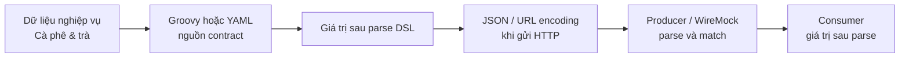
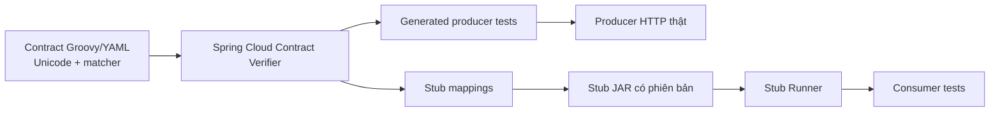

# Ký tự Unicode, ký tự đặc biệt và escape

## 1. Vì sao Unicode và escape quan trọng đối với hợp đồng?

Trong **Spring Cloud Contract**, một hợp đồng mô tả những request/response HTTP hoặc thông điệp mà **producer** cam kết cung cấp cho **consumer**. Hợp đồng viết bằng **Groovy DSL** hoặc **YAML DSL** có thể sinh kiểm thử phía producer và tạo stub để **Stub Runner** phục vụ kiểm thử phía consumer. Nếu dữ liệu có tiếng Việt, dấu nháy, backslash, emoji hoặc ký tự điều khiển, các tầng biểu diễn khác nhau có thể khiến cùng một giá trị bị hiểu sai.

Xét các giá trị sau:

```text
Tên khách hàng: Nguyễn Ánh
Ghi chú:      Cà phê & trà
Từ khóa:      C++
Đường dẫn:    C:\docs\receipt.pdf
Thông điệp:   Dòng 1\nDòng 2
```

Dòng cuối ở trên có thể được hiểu là **hai ký tự `\` và `n`** hoặc **một ký tự xuống dòng thật**, tùy lớp parser đã xử lý nó hay chưa. Đây là nguyên nhân phổ biến dẫn đến test thất bại giả, hợp đồng quá rộng hoặc stub mô phỏng sai producer.

Bài học thuộc chương **Dữ liệu hợp đồng**, giúp bạn:

- Phân biệt Unicode, UTF-8, escape trong Groovy/YAML/JSON và URL percent-encoding.
- Viết contract giữ nguyên giá trị tiếng Việt, emoji, dấu nháy, backslash, tab và xuống dòng.
- Thiết kế matcher Unicode và regex mà không nhầm ký tự đặc biệt.
- Kiểm tra producer thực tế, stub và consumer trên CI khi API chứa dữ liệu phức tạp.

## 2. Một giá trị đi qua nhiều lớp biểu diễn



| Tầng | Biểu diễn minh họa | Quy tắc |
|---|---|---|
| Giá trị gốc | `Cà phê & trà` | Nội dung nghiệp vụ |
| Groovy/YAML string | `'Cà phê & trà'` | Được parser của ngôn ngữ nguồn diễn giải |
| JSON string | `"Cà phê & trà"` | Được JSON serializer/decoder diễn giải |
| Query string mã hóa | `q=C%C3%A0%20ph%C3%AA%20%26%20tr%C3%A0` | Được URL decoder diễn giải |
| Assertion | So sánh `name` với `Cà phê & trà` | Xác minh dữ liệu đã parse có đúng cam kết |

**Không sao chép escape của tầng này sang tầng khác theo cảm tính.** Ví dụ, `\"` trong JSON là biểu diễn dấu nháy kép; sau khi parse, giá trị chỉ còn dấu `"`. Một regex có dấu `\.` để khớp dấu chấm không đồng nghĩa JSON cần chứa ký tự backslash.

## 3. Unicode, UTF-8 và chuẩn hóa ký tự

### 3.1. Ký tự hiển thị khác byte và đơn vị mã

**Unicode code point** là một số định danh ký tự; **UTF-8** mã hóa code point thành 1–4 byte; **UTF-16** có thể cần hai code unit cho một code point ngoài BMP. Phương thức `String.length()` của Java đếm **code unit UTF-16**, không đếm grapheme mà người dùng nhìn thấy.

| Ví dụ | Điểm cần nhớ |
|---|---|
| `A` | ASCII, một byte UTF-8 |
| `à` | Chữ có dấu dựng sẵn, thường hai byte UTF-8 |
| `đ` | Là ký tự chữ riêng, không thuộc tập ASCII `[A-Za-z]` |
| `🧪` | Một code point emoji, bốn byte UTF-8 và hai code unit UTF-16 |
| `e` + dấu kết hợp `◌́` | Hai code point có thể trông như một chữ `é` |

Vì thế, giới hạn “30 ký tự” cần nêu rõ đang tính theo **byte**, **code point** hay **grapheme cluster**. Nếu producer giới hạn byte còn consumer hiển thị ký tự, một tên tiếng Việt hoặc chuỗi emoji có thể bị từ chối bất ngờ.

### 3.2. NFC và NFD có thể nhìn giống nhau nhưng khác nhau

```text
NFC: "café"   - chữ é dựng sẵn U+00E9
NFD: "café"   - e U+0065 và dấu U+0301
```

Hai chuỗi có thể giống nhau trên màn hình nhưng không bằng nhau theo so sánh Java thông thường. Ví dụ:

```java
import java.text.Normalizer;

String composed = "café";
String decomposed = "cafe\u0301";

System.out.println(composed.equals(decomposed)); // false

String a = Normalizer.normalize(composed, Normalizer.Form.NFC);
String b = Normalizer.normalize(decomposed, Normalizer.Form.NFC);
System.out.println(a.equals(b)); // true
```

Contract phải phản ánh **chính sách normalization của API**. Nếu API coi hai dạng tương đương, producer cần xử lý nhất quán và có test chứng minh. Nếu dữ liệu được ký chữ ký, hash hoặc so sánh byte chính xác, không được âm thầm chuẩn hóa và thay đổi nội dung.

## 4. Escape trong JSON: biểu diễn khác giá trị

JSON string phải nằm trong dấu nháy kép. Các ký tự điều khiển nhất định và dấu nháy/backslash cần được escape.

| Ký tự thực | Cách biểu diễn trong JSON string | Sau parse |
|---|---|---|
| Dấu nháy kép `"` | `\"` | Dấu nháy kép |
| Backslash `\` | `\\` | Một backslash |
| Newline (LF) | `\n` | Một LF |
| Tab | `\t` | Một tab |
| Carriage return | `\r` | Một CR |
| Backspace | `\b` | Một ký tự backspace |
| Dấu slash `/` | `/` hoặc `\/` | Một dấu slash |
| Chữ `é` | `é` hoặc `\u00E9` | Chữ `é` |

Ví dụ JSON hợp lệ:

```json
{
  "customerName": "Nguyễn Ánh",
  "message": "Cô ấy nói: \"Chào bạn!\"\nDòng hai.",
  "path": "C:\\docs\\receipt.pdf",
  "emoji": "🧪"
}
```

Khi JSON được parse, `message` chứa một ký tự LF; `path` chứa một backslash tại mỗi dấu phân cách. JSON được mã hóa UTF-8 có thể chứa trực tiếp chữ Unicode, không cần đổi mọi chữ có dấu thành `\uXXXX`. Nếu chọn Unicode escape cho ký tự ngoài BMP, quy tắc JSON yêu cầu cặp UTF-16 surrogate tương ứng.

**Lỗi escape hai lần:** nếu producer trả nội dung `"Dòng 1\\nDòng 2"` thì consumer nhận hai ký tự `\` và `n`, không nhận LF như `"Dòng 1\nDòng 2"`. Hãy so sánh **giá trị sau parse**, không đoán bằng cách nhìn JSON raw.

## 5. Groovy DSL: literal string và nội suy

### 5.1. Ví dụ contract có tiếng Việt và ký tự đặc biệt

```groovy
import org.springframework.cloud.contract.spec.Contract

Contract.make {
    description 'Tạo ghi chú chứa Unicode và ký tự đặc biệt'

    request {
        method POST()
        url '/api/notes'
        headers {
            contentType(applicationJson())
        }
        body(
            customerName: 'Nguyễn Ánh',
            quote: 'Lan nói: "Đã thanh toán"',
            filePath: 'C:\\docs\\receipt.pdf',
            lines: 'Dòng 1\nDòng 2',
            emoji: '🧪'
        )
    }

    response {
        status 201
        headers {
            contentType(applicationJson())
        }
        body(
            result: 'CREATED',
            customerName: 'Nguyễn Ánh'
        )
    }
}
```

Trong **nguồn Groovy**, `'C:\\docs\\receipt.pdf'` chứa hai ký tự backslash mỗi chỗ để tạo **một backslash trong giá trị**. `'Dòng 1\nDòng 2'` tạo LF thật. Khi sinh JSON, serializer sẽ biểu diễn LF thành `\n` trong văn bản trên đường truyền.

So sánh một vài dạng literal:

| Nguồn Groovy | Ý nghĩa |
|---|---|
| `'Nguyễn Ánh'` | Chuỗi tĩnh có Unicode |
| `'Lan nói: "Chào"'` | Dấu nháy kép trong chuỗi nháy đơn |
| `'It\'s paid'` | Escape dấu nháy đơn |
| `'C:\\temp'` | Giá trị có một backslash |
| `'Dòng 1\nDòng 2'` | Giá trị có một LF |
| `'$.customer.name'` | JSONPath literal, dollar không bị nội suy |
| `"Hello, $name"` | GString có nội suy biến `name` nếu biến tồn tại |

Nếu chỉ cần giá trị cố định, single-quoted string thường dễ kiểm soát hơn double-quoted GString. Triple-quoted string hỗ trợ văn bản nhiều dòng nhưng **các dấu xuống dòng thực trong nguồn** có thể đi vào dữ liệu. Đừng dùng tùy tiện khi API cam kết một chuỗi một dòng hoặc phải giữ chính xác newline cuối.

### 5.2. Phân biệt dữ liệu JSON object và chuỗi chứa JSON

```groovy
// Object JSON có trường message:
body(message: 'Xin chào')

// Một Groovy string trông như JSON; không nên nhầm hai kiểu dữ liệu:
body('{"message":"Xin chào"}')
```

Khi API mong một **JSON object**, hãy ưu tiên khai báo body bằng Map/List của DSL. Một chuỗi trông giống JSON có thể được xử lý theo quy tắc body/template khác nhau và gây nhầm lẫn khi refactor.

### 5.3. Ký hiệu dollar trong dữ liệu

Trong Groovy DSL, `$(consumer(...), producer(...))` và `value(...)` là helper cho giá trị động; dấu dollar trong dữ liệu không tự kích hoạt helper.

```groovy
response {
    status OK()
    body(priceLabel: '$12.00', currency: 'USD')
}
```

Giá trị `'$12.00'` đơn thuần là string. Khi dùng **regex**, dollar lại có thể là anchor cuối chuỗi; muốn khớp ký hiệu dollar thật, phải escape theo quy tắc regex và thêm một tầng escape của Groovy nếu cần.

## 6. YAML DSL: dấu nháy, escape và loại giá trị

YAML có **plain scalar**, **single-quoted** và **double-quoted** scalar. Chúng không xử lý backslash giống nhau.

| Cú pháp YAML | Ý nghĩa |
|---|---|
| `name: Nguyễn Ánh` | Chuỗi thông thường nếu không vướng cú pháp đặc biệt |
| `path: 'C:\temp\notes'` | Backslash giữ nguyên trong single-quoted string |
| `message: "Dòng 1\nDòng 2"` | Double-quoted string diễn giải `\n` thành LF |
| `name: "caf\u00E9"` | Unicode escape thành `café` |
| `label: 'Phần A: #1'` | Giữ literal dấu `:` và `#` |
| `code: '0012'` | Giữ số 0 đầu và kiểu string |

Ví dụ:

```yaml
description: "Tạo ghi chú có Unicode"
request:
  method: POST
  url: /api/notes
  headers:
    Content-Type: application/json
  body:
    customerName: "Nguyễn Ánh"
    message: "Dòng 1\nDòng 2"
    quote: 'Lan nói: "Đã thanh toán"'
    apostrophe: 'It''s ready'
    path: 'C:\temp\notes'
    hashtag: '#đã-xác-nhận'
    orderCode: '0012'
response:
  status: 201
  headers:
    Content-Type: application/json
  body:
    result: CREATED
    customerName: "Nguyễn Ánh"
```

Trong YAML **single-quoted**, dấu nháy đơn bên trong chuỗi được viết **gấp đôi**: `'It''s ready'`. Dấu `\` được giữ nguyên. Trong **double-quoted**, `\n`, `\t`, `\uXXXX` được parser diễn giải. Nếu muốn truyền hai ký tự `\` và `n`, đừng viết `"\\n"` nhầm với `"\n"`.

YAML parser cũng có thể suy ra giá trị thành boolean, số, null hoặc ngày tháng tùy phiên bản/cấu hình. Nếu API cam kết **string**, hãy quote rõ ràng các giá trị giống số, ngày hoặc từ khóa boolean. Đặc biệt, `'0012'` và `12` không có cùng giá trị và kiểu.

### 6.1. Xuống dòng và chomp trong YAML

```yaml
# Literal block: giữ xuống dòng; mặc định thường có LF cuối.
message: |
  Dòng thứ nhất
  Dòng thứ hai

# Không giữ newline cuối.
exactMessage: |-
  Dòng thứ nhất
  Dòng thứ hai

# Folded block: nhiều dòng có thể được gộp thành dấu cách.
summary: >
  Mô tả được viết
  trên hai dòng.
```

`|`, `|-` và `>` không tương đương. Nếu consumer so sánh chính xác message, cần kiểm tra cả newline **cuối chuỗi** sau khi YAML parse. Đừng sửa dữ liệu multiline chỉ để bài test nhìn đẹp hơn.

## 7. Regex và Unicode: có thêm một tầng escape

Regex là **ngôn ngữ mẫu**, nên nhiều ký tự mang nghĩa điều khiển:

| Ký tự trong regex | Ý nghĩa | Khớp literal |
|---|---|---|
| `.` | Bất kỳ ký tự theo cấu hình regex | `\.` |
| `+` | Lặp một hoặc nhiều lần | `\+` |
| `*` | Lặp không hoặc nhiều lần | `\*` |
| `?` | Tùy chọn/quantifier | `\?` |
| `( )` | Nhóm/capture | `\( \)` |
| `[ ]` | Character class | `\[ \]` |
| `$` | Neo cuối chuỗi | `\$` |
| `\` | Bắt đầu escape | `\\` |

Giả sử mã tài liệu có dạng `INV-0042.pdf`. Pattern phải khớp **dấu chấm thật**:

```groovy
request {
    method GET()
    url value(
        consumer(regex('/api/invoices/INV-[0-9]{4}\\.pdf')),
        producer('/api/invoices/INV-0042.pdf')
    )
}
```

Tại **nguồn Groovy single-quoted**, `\\.` là cách biểu diễn `\.` cho regex. Nếu viết `INV-[0-9]{4}.pdf`, dấu chấm regex có thể khớp một ký tự khác `.`.

### 7.1. Matcher cho chữ tiếng Việt

Regex `[A-Za-z]+` chỉ bao phủ chữ Latin ASCII. Java regex hỗ trợ các lớp ký tự Unicode:

- `\p{L}`: ký tự thuộc nhóm Letter.
- `\p{M}`: dấu kết hợp thuộc nhóm Mark.
- `\p{N}`: ký tự thuộc nhóm Number.

Ví dụ Groovy DSL:

```groovy
response {
    status OK()
    body(
        displayName: $(
            consumer('Đặng Minh Ánh'),
            producer(regex('[\\p{L}\\p{M} .-]+'))
        )
    )
}
```

Nguồn Groovy `[\\p{L}\\p{M} .-]+` tạo regex `[\p{L}\p{M} .-]+`. `\p{M}` hữu ích cho tên chứa dấu Unicode ở dạng NFD. Mẫu chỉ minh họa cú pháp: tên người thực có thể chứa dấu nháy, nhiều hệ chữ và quy tắc khác. **Hãy chọn matcher theo hợp đồng nghiệp vụ**, không coi mẫu trên là bộ xác thực tên hoàn chỉnh.

### 7.2. Regex rộng có thể che mất lỗi API

Nếu producer phải trả `state: PAID` mà contract dùng `regex('.*')`, thay đổi sang `INVALID` có thể vẫn qua test. Hãy dùng exact equality cho các trạng thái, mã lỗi, đơn vị tiền và giá trị nghiệp vụ đã cam kết; dùng regex cho định dạng thật sự biến thiên như mã giao dịch, UUID hoặc timestamp.

## 8. URL: percent-encode Unicode và ký tự cấu trúc

Trong URI, `?` mở query, `&` ngăn cách tham số, `=` ngăn tên và giá trị, `#` mở fragment. Vì thế, không ghép trực tiếp đầu vào người dùng vào URL rồi kỳ vọng producer nhận đúng.

Ví dụ:

```text
Giá trị: Cà phê & trà
Query:   q=C%C3%A0%20ph%C3%AA%20%26%20tr%C3%A0
```

Nếu ghép thô `?q=Cà phê & trà`, dấu `&` có thể bị parser hiểu thành tham số mới. Dùng URL builder hoặc HTTP client để encode **giá trị của từng query parameter**. Ví dụ:

```bash
curl --get 'http://localhost:8080/api/search' \
  --data-urlencode 'q=Cà phê & trà'
```

Trong Groovy DSL, có thể mô tả query tại mức logic:

```groovy
request {
    method GET()
    urlPath('/api/search') {
        queryParameters {
            parameter 'q': 'Cà phê & trà'
        }
    }
}
```

Khi đó cần xác minh matcher của stub và generated test đối chiếu đúng **giá trị query sau khi request được phân tích**, thay vì phụ thuộc một biểu diễn percent-encoding cụ thể.

### 8.1. Dấu cộng không luôn là dấu cộng

Với quy ước form-encoded query, dấu `+` thường được giải mã thành **dấu cách**. Nếu cần tìm `C++`, cách mã hóa thông dụng là `q=C%2B%2B`. `q=C++` có thể bị hiểu thành `C  `. Khoảng trắng có thể được mã hóa bằng `+` hoặc `%20` tùy encoder; chúng có thể tương đương về giá trị query đã parse nhưng không tương đương về **byte URL gốc**, đặc biệt khi ký chữ ký cho request.

### 8.2. Path, slash mã hóa và fragment

Đừng coi `%2F` tương đương an toàn với dấu slash trong mọi API path: proxy, server và cấu hình bảo mật có thể hạn chế encoded slash. `#` đặt trong URL thô thường mở fragment ở client, không được gửi như một phần query value. Với Unicode trong path, cần thống nhất percent-encoding và normalization trước khi so khớp ID hoặc ký chữ ký.

## 9. Value động của Spring Cloud Contract và Unicode

Groovy DSL hỗ trợ `value(consumer(...), producer(...))` và `$(...)`. Trong **request**, phía consumer xác định điều kiện match của stub, còn phía producer cho input mẫu của generated producer test. Trong **response**, phía consumer là dữ liệu mẫu mà stub trả, còn phía producer là điều kiện kiểm tra ứng dụng thật.

Ví dụ:

```groovy
import org.springframework.cloud.contract.spec.Contract

Contract.make {
    description 'Biên nhận chứa tên Unicode và mã tài liệu động'
    request {
        method GET()
        url '/api/receipts/42'
    }
    response {
        status OK()
        headers {
            contentType(applicationJson())
        }
        body(
            customerName: 'Nguyễn Ánh',
            status: 'PAID',
            reference: $(
                consumer('INV-0042.pdf'),
                producer(regex('INV-[0-9]{4}\\.pdf'))
            )
        )
    }
}
```

| Trường | Stub trả cho consumer | Producer test xác minh |
|---|---|---|
| `customerName` | `Nguyễn Ánh` | Đúng chuỗi đã cam kết |
| `status` | `PAID` | Chính xác `PAID` |
| `reference` | `INV-0042.pdf` | Đúng định dạng `INV-` + bốn số + `.pdf` |

Không thay matcher tên người thành `.*` chỉ để bỏ qua lỗi mất dấu; cũng không khóa mã tham chiếu vào đúng một giá trị nếu producer được phép sinh mã khác hợp lệ.

**Giữ kiểu JSON:** `{"orderId":42,"paid":true}` khác `{"orderId":"42","paid":"true"}`. Khi chuyển Groovy/YAML sang JSON, contract cần giữ number/boolean là đúng kiểu thay vì đổi thành string do tiện escape.

## 10. Messaging, HTTP header và ký tự điều khiển

Hợp đồng về **thông điệp** cũng có thể chứa tiếng Việt và emoji trong payload. Tuy nhiên, serializer, schema, broker và charset thực tế phải tương thích. Contract mô tả body không mặc nhiên bảo đảm toàn bộ đường vận chuyển message bảo toàn byte.

```json
{
  "eventType": "OrderConfirmed",
  "customerName": "Đỗ Thị Mai",
  "note": "Giao hàng trước 17:00"
}
```

**HTTP header** có quy tắc ký tự khác JSON body. Không giả định có thể đặt bất kỳ Unicode nào vào header. Đặc biệt, CR (`\r`) và LF (`\n`) không được dùng tự do trong giá trị header vì có thể làm sai cú pháp hoặc gây header injection. Nếu cần gửi tên người dùng, ghi chú hoặc đoạn văn Unicode, ưu tiên JSON body hoặc cơ chế encoding được chuẩn/protocol quy định.

Các tầng escape có nhiệm vụ khác nhau: JSON escaping cho cú pháp JSON; URL encoding cho URI; regex escaping cho matcher; HTML/XML escaping cho ngữ cảnh hiển thị; SQL parameter binding cho truy vấn database. **Escape JSON không thay thế HTML escaping** khi consumer đưa nội dung vào HTML, và escape JSON cũng không thay thế query parameter binding của SQL.

## 11. Kiểm thử từ producer đến stub và CI



Ma trận kiểm thử gợi ý:

| Trường hợp | Dữ liệu mẫu | Lỗi cần phát hiện |
|---|---|---|
| Unicode tiếng Việt | `Nguyễn Ánh` | Mất dấu, lỗi charset |
| Normalization | `café` và `cafe\u0301` | So sánh/chuẩn hóa không nhất quán |
| Dấu nháy/backslash | `"Đã nhận"`, `C:\temp` | Escape thiếu hoặc thừa |
| Xuống dòng | `Dòng 1\nDòng 2` | Hai ký tự `\` + `n` thay vì LF |
| Emoji | `🧪` | Cắt chuỗi hoặc encoding sai |
| Query đặc biệt | `C++`, `Cà phê & trà` | Percent-encoding sai |
| Loại JSON | Số `42` khác string `"42"` | Consumer deserialize sai |
| Input không hợp lệ | Ký tự điều khiển bị cấm | Producer không thực hiện quy tắc từ chối |

**Producer verification** phải gửi hoặc nhận dữ liệu cụ thể và kiểm tra kết quả sau parse. Nếu producer trả mất dấu hoặc lỗi newline, test phải phát hiện. **Stub Runner** dùng artifact có phiên bản để consumer kiểm tra đúng logic của client ứng dụng, gồm deserialize tiếng Việt, newline, emoji và giá trị đã escape. Không thể chỉ xác minh stub khởi động mà kết luận consumer hiểu đúng dữ liệu.

Ở CI, cần chạy generated producer tests trước khi phát hành stub, sau đó chạy consumer tests với phiên bản stub mục tiêu. Để kết quả tái lập được, nên dùng UTF-8 thống nhất cho contract source, compiler/resource processing và môi trường chạy. Nếu một test chỉ fail trong CI, kiểm tra **mã hóa nguồn, serialization, line endings và normalization** trước khi nới lỏng matcher.

### 11.1. Assertion phía consumer

Giả sử consumer test đã được cấu hình gọi Stub Runner:

```java
@Test
void shouldReadUnicodeAndEscapedText() {
    NoteDto note = noteClient.findById(42);

    assertThat(note.customerName()).isEqualTo("Nguyễn Ánh");
    assertThat(note.message()).isEqualTo("Dòng 1\nDòng 2");
    assertThat(note.path()).isEqualTo("C:\\docs\\receipt.pdf");
}
```

Đây là ví dụ phần assertion; các class `NoteDto`, `noteClient`, cách cấu hình Stub Runner và thư viện assertion phải tồn tại trong dự án consumer. `assertThat` đang so sánh **giá trị Java sau khi JSON parse**, không so sánh văn bản JSON raw.

## 12. Lỗi thường gặp và cách khắc phục

| Biểu hiện | Nguyên nhân | Cách xử lý |
|---|---|---|
| Tên tiếng Việt biến thành ký tự lạ | Encoding nguồn, serializer hoặc database không nhất quán | Kiểm tra UTF-8 qua các tầng |
| Hai tên nhìn giống mà test fail | NFC và NFD khác code point | Xác nhận quy tắc normalization |
| Nhận `\\n` thay vì xuống dòng | Escape hai lần | So sánh giá trị sau parse và sửa đúng literal |
| Groovy không compile | Sai nháy đơn hoặc backslash | Kiểm tra nguồn Groovy và escape |
| YAML đổi `0012` thành số | Scalar được suy luận kiểu | Quote `'0012'` |
| Regex loại tên tiếng Việt | Chỉ dùng `[A-Za-z]` | Dùng Unicode classes khi phù hợp |
| Regex dấu chấm quá rộng | Viết `.` thay vì `\.` | Escape regex và escape Groovy |
| `C++` trở thành `C  ` | Dấu cộng không được percent-encode | Để URI builder encode giá trị |
| `&` làm tách query value | Tự nối URL thô | Dùng query builder |
| Test CI khác local | Charset, line ending, cấu hình build khác | Chuẩn hóa nguồn và test |
| JSON đúng ký tự nhưng sai kiểu | Number/boolean thành string | Dùng đúng kiểu trong DSL và assertion |
| Stub test xanh, producer không tương thích | Chỉ chạy consumer với stub cũ | Chạy test producer và stub phiên bản mới |

## 13. Bài thực hành: tạo biên nhận có Unicode và dấu đặc biệt

**Bối cảnh:** producer có `POST /api/receipts`. Consumer gửi tên có dấu và ghi chú gồm dấu nháy kép, một LF thật. Producer trả `201` với mã tham chiếu `INV-` + bốn chữ số + `.pdf`.

Hợp đồng Groovy:

```groovy
import org.springframework.cloud.contract.spec.Contract

Contract.make {
    description 'Tạo biên nhận có tiếng Việt và newline'
    request {
        method POST()
        url '/api/receipts'
        headers {
            contentType(applicationJson())
        }
        body(
            customerName: 'Nguyễn Ánh',
            note: 'Đã nhận "hóa đơn"\nCảm ơn!'
        )
    }
    response {
        status 201
        headers {
            contentType(applicationJson())
        }
        body(
            customerName: 'Nguyễn Ánh',
            status: 'CREATED',
            reference: $(
                consumer('INV-0042.pdf'),
                producer(regex('INV-[0-9]{4}\\.pdf'))
            )
        )
    }
}
```

Các bước thực hành:

1. Lưu contract tại vị trí được verifier quét; chuẩn bị fixture trong base test cho request mẫu.
2. Sinh và chạy producer tests; xác minh `note` chứa LF thật và tên vẫn có dấu.
3. Đóng gói stub artifact có phiên bản, chạy consumer test thông qua Stub Runner.
4. Trong consumer test, xác nhận DTO đọc đúng `customerName`, `status` và `reference`.
5. Cố ý đổi producer trả `INV-0042Xpdf`; generated producer test phải phát hiện sai ký tự `.`.
6. Cố ý đổi producer trả `Nguyen Anh`; test phải phát hiện mất dấu nếu tên chính xác là cam kết API.
7. Nếu ứng dụng có tìm kiếm, thêm kịch bản `C++` và `Cà phê & trà` để kiểm tra URL encoding.

**Tự kiểm tra:**

- `"caf\u00E9"` trong JSON và `"café"` có thể parse thành cùng một chuỗi không? **Có**, nếu hai dạng biểu diễn cùng code point.
- `"cafe\u0301"` có tự động bằng `"café"` trong Java không? **Không**, nếu không có quy tắc chuẩn hóa.
- Tại sao Groovy dùng `'INV-[0-9]{4}\\.pdf'`? Vì có **hai tầng**: Groovy diễn giải `\\` thành `\`; regex dùng `\.` để khớp dấu chấm literal.
- Có nên dùng `regex('.*')` cho tên người nhận? **Không** nếu giá trị chính xác phải được bảo vệ.
- Escape JSON có làm nội dung an toàn khi render HTML không? **Không**; HTML có quy tắc encoding riêng tại nơi hiển thị.

## 14. Checklist review

- [ ] File hợp đồng Groovy/YAML và pipeline dùng encoding nhất quán, ưu tiên UTF-8.
- [ ] Đã phân biệt giá trị gốc với escape ở Groovy, YAML, JSON, regex và URL.
- [ ] Có kịch bản với tiếng Việt/Unicode mà consumer thực sự cần hỗ trợ.
- [ ] Có quy tắc NFC/NFD nếu API so sánh hoặc chuẩn hóa chuỗi.
- [ ] Escape nháy đơn, nháy kép, backslash, tab và newline đúng tầng.
- [ ] Regex không vô tình cho phép ký tự khác hoặc loại dấu Unicode hợp lệ.
- [ ] URL encode các query/path component, đặc biệt `&`, `+`, `#` và chữ có dấu.
- [ ] Giữ đúng JSON types; không đổi string/number/boolean vì tiện biểu diễn.
- [ ] Không đưa raw CR/LF hoặc Unicode tùy ý vào HTTP header.
- [ ] Generated producer tests chạy với fixture tái lập được; stub đúng phiên bản; consumer test kiểm tra dữ liệu sau parse.
- [ ] CI phát hiện thay đổi làm mất dấu, thay đổi escape hoặc phá vỡ tương thích với consumer.

**Ghi nhớ:** Khi review Spring Cloud Contract, hãy hỏi **“Giá trị sau khi parse có đúng điều consumer cần hay không?”**. Câu hỏi này giúp phân biệt escape phục vụ cú pháp với dữ liệu nghiệp vụ và giữ test hữu ích khi producer, stub và consumer cùng phát triển.
