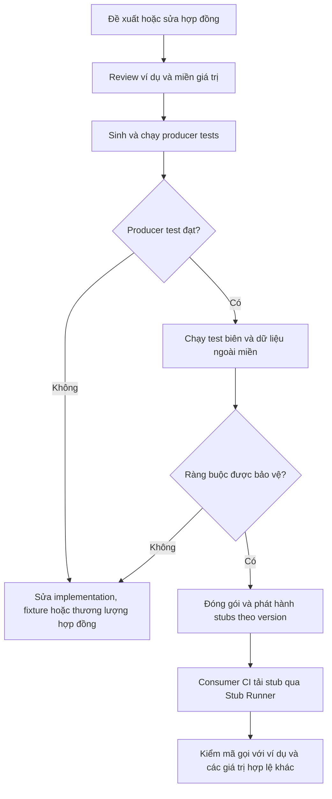

# Phân biệt giá trị mẫu với miền giá trị hợp lệ trong dữ liệu hợp đồng

Trong **Spring Cloud Contract**, một hợp đồng có thể chứa giá trị cụ thể như `"CUST-1042"` hoặc một quy tắc chấp nhận nhiều giá trị như `CUST-[1-9][0-9]{3}`. Hai cách biểu diễn này có mục đích khác nhau. **Giá trị mẫu** giúp kiểm thử tạo ra một yêu cầu hoặc phản hồi cụ thể, có thể chạy lại được; **miền giá trị hợp lệ** cho biết những giá trị nào được chấp nhận đối với tương tác đã thống nhất. Nếu nhầm lẫn hai khái niệm, nhóm có thể vô tình buộc producer trả về một ID cố định hoặc tạo stub chấp nhận mọi chuỗi, không phát hiện được thay đổi API gây lỗi consumer.

Bài thuộc chương **Dữ liệu hợp đồng** của mô-đun **SPRING_CLOUD_CONTRACT**. Mô-đun học kiểm thử hợp đồng giữa producer và consumer qua **Groovy/YAML DSL**, sinh test phía producer, phát hành stub, chạy **Stub Runner** và tích hợp CI để phát hiện thay đổi API không tương thích. Ở đây, chúng ta tập trung vào cách lựa chọn **ví dụ cụ thể**, **matcher** và **trường hợp biên** để cả test được sinh lẫn stub cùng mô tả đúng điều mà hai bên cam kết.

## 1. Một giá trị mẫu không phải toàn bộ miền hợp lệ

Giả sử **Order Service** (producer) nhận yêu cầu tạo đơn hàng từ **Checkout Service** (consumer):

```http
POST /api/orders
Content-Type: application/json

{"customerId":"CUST-1042","quantity":2}
```

Producer trả về:

```http
HTTP/1.1 201 Created
Content-Type: application/json

{"orderId":"ORD-9001","status":"CREATED"}
```

Các chuỗi `CUST-1042` và `ORD-9001`, số `2` đều là **giá trị mẫu** của một tương tác. Nhưng yêu cầu nghiệp vụ có thể cho phép nhiều customer ID, số lượng đặt hàng từ 1 đến 10 và các order ID khác nhau cho mỗi đơn mới.

| Trường | Giá trị mẫu | Miền giá trị mong muốn | Điều mẫu **không chứng minh** |
| --- | --- | --- | --- |
| `customerId` | `"CUST-1042"` | Chuỗi có tiền tố `CUST-` và bốn chữ số, chữ số đầu từ 1 đến 9. | Không chứng minh mọi ID theo mẫu đều tồn tại trong cơ sở dữ liệu. |
| `quantity` | `2` | Số nguyên từ **1 đến 10** theo quy tắc ví dụ. | Không chứng minh producer từ chối 0, 11, số thực hay chuỗi. |
| `orderId` | `"ORD-9001"` | Chuỗi có tiền tố `ORD-` và bốn chữ số. | Không chứng minh ID được cấp phát duy nhất hoặc không trùng lặp. |
| `status` | `"CREATED"` | Một giá trị trong tập trạng thái API đã định nghĩa, ví dụ `CREATED`, `REJECTED`. | Không chứng minh mọi trạng thái đều hợp lệ trong mọi phản hồi. |

Có thể diễn đạt về mặt tập hợp:

\[
\text{Giá trị mẫu } e \in D,\quad D = \text{miền giá trị hợp lệ}.
\]

Nếu `D` là các customer ID theo mẫu `CUST-[1-9][0-9]{3}`, `CUST-1042` chỉ là **một phần tử** của `D`. Biểu thức chính quy mô tả **định dạng** nhưng chưa xác nhận customer có tồn tại, thuộc tenant đúng hoặc có quyền đặt hàng hay không. Miền **hợp lệ về cú pháp** và miền **hợp lệ về nghiệp vụ** có thể khác nhau.

Trong hợp đồng, cần biết rõ *đâu là giá trị dùng để chạy một bài test cụ thể* và *đâu là ràng buộc phải được giữ đúng với mọi giá trị producer/consumer có thể trao đổi*.

## 2. Giá trị mẫu được dùng để làm gì?

Một **example value** là dữ liệu cụ thể, xác định được, giúp công cụ và con người quan sát hành vi dự kiến.

- Với **request**, generated producer test cần gửi một yêu cầu thực sự, chẳng hạn `customerId=CUST-1042`, để kiểm tra producer thực thi đúng hợp đồng.
- Với **response**, HTTP stub thường cần trả một phản hồi cụ thể, chẳng hạn `orderId=ORD-9001`, để consumer test có dữ liệu nhận và giải mã.
- Khi đọc hoặc review hợp đồng, ví dụ cho biết **một tương tác có ý nghĩa**: hai dịch vụ sẽ gửi gì và nhận gì.
- Dữ liệu mẫu nhất quán giúp build có thể tái lập, tránh test phụ thuộc ngẫu nhiên hoặc dữ liệu từ môi trường bên ngoài.

Đặt giá trị mẫu trong một body **không tự động tạo ra ràng buộc tổng quát**. Nếu chỉ viết:

```groovy
body(
    customerId: 'CUST-1042',
    quantity: 2
)
```

thì bạn đã mô tả hai giá trị **cụ thể**. Không thể suy ra rằng mọi `CUST-xxxx` đều được phép hay `quantity` từ 1 đến 10 đều hợp lệ. Muốn thể hiện một **miền giá trị**, bạn phải đặt matcher/ràng buộc thích hợp và kiểm chứng công cụ sử dụng matcher đó đúng ở phía cần thiết.

**Một giá trị mẫu tốt** phải phù hợp miền đã công bố, dễ hiểu về nghiệp vụ, không chứa thông tin nhạy cảm và ổn định trong test. Ví dụ, nếu ràng buộc yêu cầu `CUST-[1-9][0-9]{3}`, dùng `CUST-1042` tốt hơn `CUST-0000` vì chuỗi thứ hai **nằm ngoài miền**; ví dụ ngoài miền làm hợp đồng mâu thuẫn ngay từ nguồn.

## 3. Miền giá trị hợp lệ có thể gồm những loại ràng buộc nào?

Không phải mọi miền đều biểu diễn tốt bằng một regex. Trước khi chọn matcher Spring Cloud Contract, hãy nhận diện ràng buộc thực sự.

| Loại ràng buộc | Ví dụ | Cách xác minh phù hợp |
| --- | --- | --- |
| **Bằng đúng** | `status` phải là `"CREATED"` trong response tạo đơn thành công. | So sánh giá trị cụ thể. |
| **Định dạng chuỗi** | `customerId` khớp `CUST-[1-9][0-9]{3}`. | Regex đúng phạm vi và các phép thử không khớp. |
| **Kiểu dữ liệu** | `quantity` là số nguyên; `active` là boolean. | Matcher theo kiểu và kiểm tra serialization JSON. |
| **Khoảng giá trị** | `1 <= quantity <= 10`. | Ràng buộc nghiệp vụ/validation và test biên; matcher kiểu đơn thuần không đủ. |
| **Danh sách cho phép** | `status` thuộc `CREATED`, `REJECTED`. | Matcher tập giá trị hoặc hợp đồng riêng cho từng tình huống quan trọng. |
| **Cấu trúc** | Body có `customerId`, `quantity`; không chấp nhận null nếu schema yêu cầu giá trị. | Body matcher, schema/validation và test cho thiếu hoặc null. |
| **Quan hệ giữa các trường** | `totalPrice = quantity * unitPrice`. | Kiểm thử nghiệp vụ producer có dữ liệu thích hợp. |
| **Miền theo trạng thái hệ thống** | ID khách hàng phải tồn tại và thuộc tài khoản đang gọi. | Fixture, kiểm tra phân quyền và integration/business test. |

Spring Cloud Contract có thể diễn đạt một phần đáng kể các ràng buộc bằng **DSL matchers**; những quy tắc cần trạng thái ứng dụng hoặc phép tính sâu vẫn phải được xác minh bởi mã nghiệp vụ và các lớp kiểm thử bổ sung. Hợp đồng không biến một regex thành bộ kiểm chứng toàn bộ luật doanh nghiệp.

## 4. Hai chiều dữ liệu và vai trò của matcher trong Groovy DSL

Spring Cloud Contract cần xử lý **hai môi trường khác nhau** từ cùng một hợp đồng:

1. **Generated producer test** chạy với producer thật; nó phải gửi request cụ thể và kiểm response thực.
2. **Stub** mô phỏng producer cho consumer; nó phải nhận diện những request phù hợp và trả một response cụ thể.

Vì thế, DSL có thể cần **giá trị cụ thể ở một phía** và **matcher ở phía còn lại**. Trong Groovy DSL, cấu trúc `$(consumer(...), producer(...))` (còn có dạng `value(...)`) dùng để khai báo hai góc nhìn này.

| Nơi định nghĩa | Phần hướng tới consumer / stub | Phần hướng tới producer test |
| --- | --- | --- |
| **Request** | `consumer(regex(...))`: matcher giúp stub nhận các request hợp lệ của consumer. | `producer('CUST-1042')`: dữ liệu mẫu mà generated producer test gửi tới producer thực. |
| **Response** | `consumer('ORD-9001')`: giá trị cụ thể mà stub trả cho consumer test. | `producer(regex(...))`: matcher để generated producer test chấp nhận response thực phù hợp. |

Đây là điểm rất dễ đảo ngược: **request** dùng matcher tại phía consumer và ví dụ tại phía producer; **response** dùng ví dụ tại phía consumer và matcher tại phía producer. “Consumer” và “producer” chỉ **phía sử dụng giá trị đó trong quy trình kiểm thử**, không ngụ ý chỉ consumer hoặc chỉ producer mới được quyết định giá trị hợp lệ.

Ví dụ, consumer có thể gửi nhiều customer ID đúng định dạng; stub nên nhận các ID đó. Nhưng bài test producer được sinh cần một ID cụ thể, để fixture của producer chuẩn bị được dữ liệu. Ngược lại, producer thật có thể tạo nhiều order ID khác nhau; generated test nên kiểm đúng **định dạng hợp lệ**, còn stub cần trả một ID ổn định để consumer test có thể assert.

## 5. Ví dụ Groovy DSL đầy đủ: mẫu và miền cho từng phía

Trong producer, lưu tệp `src/test/resources/contracts/orders/create_order.groovy`:

```groovy
import org.springframework.cloud.contract.spec.Contract

Contract.make {
    name 'shouldCreateOrderWithValidCustomer'
    description 'Tạo đơn hàng với ID khách hàng có định dạng hợp lệ'

    request {
        method 'POST'
        url '/api/orders'
        headers {
            contentType(applicationJson())
        }
        body(
            customerId: $(consumer(regex('CUST-[1-9][0-9]{3}')),
                          producer('CUST-1042')),
            quantity: 2
        )
    }

    response {
        status 201
        headers {
            contentType(applicationJson())
        }
        body(
            orderId: $(consumer('ORD-9001'),
                       producer(regex('ORD-[0-9]{4}'))),
            status: 'CREATED'
        )
    }
}
```

Trong hợp đồng này:

- **`CUST-1042`** là request example cho **generated producer test**. Test sinh ra dùng giá trị này để gọi API thật.
- **`CUST-[1-9][0-9]{3}`** là request matcher dành cho stub, cho phép thử những customer ID khác có cùng **định dạng đã thống nhất**.
- **`ORD-9001`** là response example mà **stub trả về cho consumer**.
- **`ORD-[0-9]{4}`** là response matcher để kiểm `orderId` thực của producer có định dạng phù hợp.
- `quantity: 2` và `status: 'CREATED'` hiện được mô tả bằng **giá trị cụ thể**. Hợp đồng này **chưa diễn đạt khoảng `quantity` 1–10** hay toàn bộ những trạng thái có thể xuất hiện.

Đừng hiểu ví dụ thành lời hứa rằng mọi customer ID đúng regex đều là khách hàng đã tồn tại. Trong thực tế, nếu endpoint chỉ nhận ID có trong cơ sở dữ liệu, hãy chuẩn bị fixture tương ứng trong test producer; khi dùng stub, xác định rõ liệu consumer đang kiểm định dạng request hay đang kiểm một trạng thái nghiệp vụ cụ thể.

### 5.1. Kỳ vọng ở generated producer test

Phần producer test được sinh sẽ có ý nghĩa tương đương:

```text
GỬI POST /api/orders
Body: {"customerId":"CUST-1042","quantity":2}

KIỂM response:
  HTTP status = 201
  Content-Type = application/json
  orderId phù hợp regex ORD-[0-9]{4}
  status = CREATED
```

Đây là **mô tả logic kiểm thử**, không phải mã Java nguyên văn được sinh. Tên lớp, thư viện HTTP test và cách biểu diễn matcher phụ thuộc cấu hình Spring Cloud Contract Verifier. Quan trọng là producer có thể trả `ORD-2178` hoặc `ORD-9001` mà vẫn đạt **ràng buộc định dạng**, miễn các điều kiện khác khớp.

### 5.2. Kỳ vọng ở stub cho consumer

HTTP stub sinh ra từ hợp đồng được sử dụng theo cách:

```text
NHẬN POST /api/orders
Body: {"customerId":"CUST-2356","quantity":2}
  -> customerId khớp CUST-[1-9][0-9]{3}
  -> quantity khớp giá trị mô tả trong hợp đồng

TRẢ response:
  HTTP status = 201
  Body: {"orderId":"ORD-9001","status":"CREATED"}
```

`CUST-2356` **khác giá trị mẫu `CUST-1042`**, nhưng phù hợp với miền định dạng ở phía consumer của hợp đồng. Stub vẫn trả `ORD-9001` vì đó là **giá trị mẫu response**, không phải một bộ sinh ID có trạng thái. Điều này giúp consumer test chạy độc lập, nhưng **không thể dùng để kiểm tính duy nhất của order ID hoặc dữ liệu được ghi thật**.

**Hãy xem mapping thực tế được sinh**: công cụ chuyển DSL thành request matcher/stub theo phiên bản đang dùng. Tình huống khó như body JSON có trường bổ sung, null hay matcher phức tạp cần được kiểm bằng cả request khớp và request không khớp, thay vì chỉ suy từ mã Groovy.

## 6. Viết hợp đồng tương tự bằng YAML DSL

Nếu dự án thống nhất dùng **YAML DSL**, có thể biểu diễn giá trị mẫu trong `body` và quy tắc bằng `matchers`. Ví dụ tại `src/test/resources/contracts/orders/create_order.yml`:

```yaml
description: Tạo đơn hàng với ID khách hàng hợp lệ
request:
  method: POST
  url: /api/orders
  headers:
    Content-Type: application/json
  body:
    customerId: CUST-1042
    quantity: 2
  matchers:
    body:
      - path: $.customerId
        type: by_regex
        value: 'CUST-[1-9][0-9]{3}'
response:
  status: 201
  headers:
    Content-Type: application/json
  body:
    orderId: ORD-9001
    status: CREATED
  matchers:
    body:
      - path: $.orderId
        type: by_regex
        value: 'ORD-[0-9]{4}'
```

Ở cấu trúc YAML này, `request.body.customerId` là **mẫu** để producer test có dữ liệu gửi; `request.matchers.body` biểu diễn **quy tắc khớp** cho request của stub. Phần `response.body.orderId` cung cấp **response mẫu** cho stub; `response.matchers.body` mô tả **điều kiện mà response producer phải đạt**. `path` dùng JSONPath để chỉ rõ trường được áp dụng matcher.

Đây là ví dụ theo cú pháp YAML DSL phổ biến của Spring Cloud Contract; nhóm cần đối chiếu với **phiên bản plugin và release train thực tế**. Dùng `mvn verify` hoặc task tương ứng để xác nhận parser đọc được hợp đồng và kiểm thử/stub sinh ra có ngữ nghĩa mong muốn. YAML hợp lệ về cú pháp **chưa đủ** để kết luận matcher đã được áp dụng đúng.

Để tránh tạo hợp đồng trùng, trong một lượt build thông thường chỉ nên đặt **một phiên bản Groovy hoặc YAML có hiệu lực** cho tình huống `POST /api/orders` này trong thư mục được plugin quét. Nếu đặt cả hai tệp với request/response tương đương, bạn có thể sinh ra test/mapping trùng, gây nhầm lẫn khi chúng bị sửa lệch nhau.

## 7. Không dùng một matcher rộng hơn miền nghiệp vụ

Một matcher có thể **đúng cú pháp** nhưng sai nghiệp vụ. Xét các ràng buộc ID khách hàng sau:

| Matcher | Có thể chấp nhận | Rủi ro |
| --- | --- | --- |
| `.*` | Hầu như mọi chuỗi, kể cả chuỗi rỗng. | Không bảo vệ tiền tố và định dạng ID. |
| `CUST-.*` | Chuỗi bắt đầu bằng `CUST-`, kể cả `CUST-ABC`. | Không bảo vệ phần số. |
| `CUST-[0-9]{4}` | `CUST-0000`, `CUST-1042`, ... | Không loại `0000` nếu nghiệp vụ cấm. |
| `CUST-[1-9][0-9]{3}` | `CUST-1000` đến `CUST-9999`. | Bảo vệ định dạng, nhưng không kiểm tồn tại và quyền sử dụng ID. |

Khi dùng regex, hãy xác định rõ matcher áp dụng cho **toàn bộ chuỗi** hay có thể khớp một phần trong cơ chế kiểm tra cụ thể; không dựa vào suy đoán về chế độ match của thư viện. Kiểm bằng các chuỗi đáng lẽ **không được chấp nhận** như `X-CUST-1042`, `CUST-1042-extra` hoặc `CUST-ABC`. Nếu cần, dùng neo đầu/cuối hoặc API matcher thích hợp của phiên bản được sử dụng, rồi xác minh đầu ra test/stub.

Đối với `quantity`, một matcher chỉ kiểm **kiểu số** không đảm bảo khoảng `1..10`. Ví dụ, `0`, `11`, `-2` vẫn có thể là số nguyên hợp lệ về cú pháp. Để bảo vệ ràng buộc này, hãy viết các hợp đồng hoặc test validation cho các trường hợp biên; khi DSL có matcher phù hợp cho khoảng, vẫn phải đảm bảo producer thực xử lý đúng.

**Không dùng regex để thay thế toàn bộ validation.** Một regex khớp hình dạng ID chưa kiểm ID đó tồn tại, thuộc user hiện tại, không bị khóa, hoặc có đủ điều kiện tạo đơn.

## 8. Các trường hợp biên cần có ngoài một giá trị mẫu

Hợp đồng ví dụ đầu tiên bảo vệ một tình huống chính. Để xác nhận miền số lượng `1..10`, nên bổ sung các tương tác quan trọng với producer. Ví dụ chính sách API giả định:

| Trường hợp | Request `quantity` | Kết quả dự kiến | Mục đích |
| --- | --- | --- | --- |
| Giá trị nhỏ nhất | `1` | `201` nếu các điều kiện khác đúng. | Phát hiện lỗi loại nhầm biên dưới. |
| Giá trị giữa miền | `2` | `201`. | Bảo đảm happy path. |
| Giá trị lớn nhất | `10` | `201` nếu các điều kiện khác đúng. | Phát hiện lỗi loại nhầm biên trên. |
| Dưới biên | `0` | `400` hoặc `422`, theo chính sách API. | Phát hiện thiếu validation biên dưới. |
| Trên biên | `11` | `400` hoặc `422`, theo chính sách API. | Phát hiện thiếu validation biên trên. |
| Sai kiểu | `"2"` (chuỗi JSON) | Từ chối hoặc quy định chuyển kiểu rõ ràng. | Tránh vô tình chấp nhận dữ liệu sai schema. |
| Thiếu trường | Không có khóa `quantity` | Xử lý theo quy định về required. | Phân biệt missing với giá trị mặc định. |
| Null | `"quantity": null` | Xử lý theo chính sách nullable. | Phân biệt explicit null với thiếu trường. |

HTTP status `400` hay `422` **không có giá trị mặc định bắt buộc** cho mọi API; hai nhóm cần thống nhất và mô tả đúng hợp đồng của mình. Không tự thêm một tình huống trả `400` vào DSL rồi mong ứng dụng tự sinh ra logic từ chối. **Spring Cloud Contract tạo test để xác minh triển khai**, không tự cài đặt validation cho producer.

Khi nhiều tình huống có cùng method và path nhưng khác body, hãy bảo đảm **request matchers của stub phân biệt chúng**. Nếu mapping cho happy path quá rộng, request `quantity=0` có thể vô tình nhận `201` từ stub, dù producer thực từ chối. Đây là lý do phải thử cả **positive match** và **negative match** trên artifact stub được sinh.

## 9. Miền hợp lệ của response khác một phản hồi được đóng gói trong stub

Đối với trường `orderId`:

- Hợp đồng có thể yêu cầu producer trả một chuỗi theo mẫu `ORD-[0-9]{4}`.
- Generated producer test kiểm response thực có phù hợp mẫu trong **lần chạy test cụ thể**.
- Stub thường trả `ORD-9001` cho các request đã match, vì đây là **giá trị mẫu consumer nhận trong test**.

Do đó, nếu consumer gọi hai lần và đều nhận `ORD-9001` từ stub, **không** được kết luận producer tạo ID trùng lặp. Stub không tự thực hiện thuật toán cấp ID hoặc duy trì trạng thái đơn hàng thật. Kiểm tính duy nhất, tính nhất quán liên yêu cầu, phân quyền, transaction và tính bền dữ liệu cần test phù hợp với producer và hạ tầng thật.

Ngược lại, chỉ vì generated producer test chấp nhận `ORD-1234` theo regex **không có nghĩa** producer có thể trả `null`, `""` hay `ord-1234` nếu chúng nằm ngoài ràng buộc đã thống nhất. Khi kiểu dữ liệu, casing hoặc cách đặt prefix là một phần API mà consumer phụ thuộc, matcher cần đủ chặt để bảo vệ chúng.

### 9.1. Trường hợp giá trị trả về phụ thuộc request

Giả sử producer phải phản hồi `customerId` **giống hệt** request đã gửi. Một response example cố định không thể chứng minh quan hệ đó cho mọi ID. Cần xem xét tính năng DSL hỗ trợ ràng buộc phụ thuộc request (nếu phù hợp phiên bản), hoặc bổ sung kiểm thử producer có nhiều bộ dữ liệu và assertion quan hệ giữa các trường.

Ví dụ, test producer với `CUST-1042` rồi nhận `CUST-1042` chỉ là **một quan sát**. Để bảo vệ quy tắc tổng quát, test thêm `CUST-2356` và các trường hợp sai quan hệ có ý nghĩa. Nếu chỉ dùng matcher `CUST-[1-9][0-9]{3}` cho cả request/response, producer trả `CUST-9999` vẫn có thể **đúng định dạng nhưng sai khách hàng**.

## 10. Stub Runner: kiểm xem consumer có thật sự sử dụng miền đã mô tả không

Sau khi producer verification đạt, producer đóng gói hợp đồng thành artifact stub theo version, ví dụ:

```text
com.acme:order-service:1.0.0:stubs
```

Ở consumer, Spring Cloud Contract **Stub Runner** tải artifact, chạy HTTP stub server rồi cho phép bài test gọi mã HTTP client thật. Ví dụ cấu hình JUnit 5:

```java
import org.junit.jupiter.api.Test;
import org.springframework.beans.factory.annotation.Autowired;
import org.springframework.boot.test.context.SpringBootTest;
import org.springframework.cloud.contract.stubrunner.spring.AutoConfigureStubRunner;
import org.springframework.cloud.contract.stubrunner.spring.StubRunnerProperties;

import static org.assertj.core.api.Assertions.assertThat;

@SpringBootTest(properties = "orders.base-url=http://localhost:8089")
@AutoConfigureStubRunner(
    ids = "com.acme:order-service:1.0.0:stubs:8089",
    stubsMode = StubRunnerProperties.StubsMode.LOCAL
)
class OrderClientStubTest {

    @Autowired OrderClient orderClient;

    @Test
    void exampleCustomerIdIsAccepted() {
        OrderReceipt receipt = orderClient.create("CUST-1042", 2);
        assertThat(receipt.status()).isEqualTo("CREATED");
        assertThat(receipt.orderId()).isEqualTo("ORD-9001");
    }

    @Test
    void anotherValidCustomerIdMatchesTheSameContract() {
        OrderReceipt receipt = orderClient.create("CUST-2356", 2);
        assertThat(receipt.status()).isEqualTo("CREATED");
        assertThat(receipt.orderId()).isEqualTo("ORD-9001");
    }
}
```

Đây là **phần test minh họa**, giả định:

- Consumer đã có `OrderClient.create(String customerId, int quantity)` thực sự gửi `POST /api/orders` cùng JSON, lấy base URL từ thuộc tính `orders.base-url`.
- `OrderReceipt` là DTO/record của consumer, chứa `String orderId` và `String status`.
- Test đã khai báo `spring-cloud-starter-contract-stub-runner`, Spring Boot Test và AssertJ.
- Artifact `com.acme:order-service:1.0.0:stubs` đã được cài vào Maven local (chế độ `LOCAL`); nếu dùng artifact đã publish trong CI, hãy cấu hình `REMOTE` và repository thích hợp.

Với stub matcher sinh đúng theo DSL, cả `CUST-1042` và `CUST-2356` có thể nhận cùng **response mẫu** `ORD-9001`. Test consumer cho thấy client tạo request tương thích với định dạng được công bố và giải mã được phản hồi; nó **không kiểm chứng customer ID tồn tại hoặc order ID thực duy nhất**.

Hãy thử thêm request `customerId="CUST-ABC"`. Nếu stub trả 404 do không có mapping khớp, đó là **dấu hiệu request không được stub nhận diện**, chưa chắc là response `404` nghiệp vụ của producer. Để kiểm xử lý lỗi nghiệp vụ 404/400/422, cần hợp đồng riêng với body lỗi xác định như `code: INVALID_CUSTOMER_ID` và assert mã lỗi đó.

## 11. Kiểm producer: ví dụ khớp có thể che lỗi với giá trị khác

Giả sử producer có logic:

```java
if (customerId.equals("CUST-1042")) {
    return createdOrder();
}
return badRequest();
```

Một generated producer test duy nhất gửi `CUST-1042` có thể **đạt**, dù consumer hợp lệ gửi `CUST-2356` bị từ chối. Request matcher của stub có thể vẫn chấp nhận `CUST-2356`, nên consumer test với stub **cũng đạt**. Khi đó hợp đồng mô tả một miền định dạng rộng hơn thực tế implementation được test, và cả hai nhánh chưa chứng minh đầy đủ tính đúng của producer trên miền đó.

Để giảm rủi ro:

1. **Đặt quy tắc miền ở đúng tầng** (validation/domain logic) của producer.
2. **Thêm test biên hoặc test tham số hóa** cho các giá trị đại diện khác nhau, không chỉ request example được sinh.
3. **Kiểm ngược bằng giá trị sai** để chứng minh API thực từ chối đúng.
4. **Không đánh đồng định dạng với điều kiện nghiệp vụ**: customer ID hợp mẫu nhưng không tồn tại cần có fixture/hành vi tương ứng.
5. **Duy trì các contract còn được consumer dùng**, đặc biệt khi thay đổi enum, regex, kiểu hoặc giới hạn giá trị.

Ví dụ ý tưởng test tham số hóa cho format request (không phải một test class đầy đủ):

```java
@ParameterizedTest
@ValueSource(strings = {"CUST-1000", "CUST-1042", "CUST-2356", "CUST-9999"})
void acceptsStructurallyValidCustomerIds(String id) {
    // Chuẩn bị customer/fixture thích hợp cho từng id.
    // Gọi producer thật và kiểm kết quả theo hợp đồng.
}
```

Điểm quan trọng là **bài test có các assert thực tế** và chuẩn bị fixture phù hợp; chỉ viết annotation không đủ để kiểm miền. Giá trị `CUST-1000` và `CUST-9999` là biên của **định dạng ID ví dụ**, không bảo đảm chúng tồn tại trong dữ liệu thật.

## 12. Không nhầm kiểu, null và sự có mặt của trường với giá trị mẫu

Tập hợp các giá trị hợp lệ còn phụ thuộc vào **kiểu JSON** và **tính bắt buộc**:

| Request JSON | Có giống `quantity: 2` không? | Điều cần quyết định trong hợp đồng/API |
| --- | --- | --- |
| `{"quantity":2}` | Có, số JSON `2`. | Giá trị mẫu hợp lệ. |
| `{"quantity":"2"}` | Không, chuỗi `"2"`. | API có cho chuyển kiểu không, hay phải từ chối? |
| `{"quantity":2.5}` | Không, số thập phân. | Có cho phép số thực hay bắt buộc số nguyên? |
| `{"quantity":null}` | Không, giá trị JSON null. | Null có được phép không? |
| `{}` | Không có trường `quantity`. | Trường bắt buộc hay có giá trị mặc định? |

Một matcher theo **kiểu** có thể xác nhận đầu ra là number nhưng chưa kiểm `quantity` là **integer 1–10**. Ngược lại, một ví dụ `quantity: 2` không nói rõ policy đối với `null` hay thiếu trường.

Khi bài toán cần phân biệt **không có trường** với **có trường nhưng bằng null**, phải quy định và kiểm cả hai trường hợp. Với Jackson, `JsonNode.has("quantity")` kiểm sự hiện diện của khóa; `hasNonNull("quantity")` đòi khóa có giá trị khác null. Một DTO Java chỉ có `Integer quantity` có thể đánh đồng missing và null nếu không theo dõi sự hiện diện của trường. Vì vậy, ngoài matcher giá trị, test nên quan sát JSON request thực sự được serialize.

## 13. Đưa ràng buộc dữ liệu vào CI và quản lý thay đổi tương thích

Một chuỗi CI phù hợp cho hợp đồng dữ liệu:



Khi review một thay đổi, hãy hỏi:

- Mẫu mới có **thuộc miền hợp lệ** mà hợp đồng đang công bố không?
- Đổi mẫu nhưng giữ matcher có phải chỉ thay dữ liệu kiểm thử, hay đã đổi hành vi consumer trông đợi?
- Regex/kiểu/khoảng đã được **nới rộng hoặc thu hẹp**? Điều đó có ảnh hưởng consumer cũ?
- Stub được sinh có thực sự nhận các request hợp lệ và từ chối request không hợp lệ quan trọng không?
- Generated producer test có assert đúng matcher response, thay vì chỉ so giá trị tĩnh?
- Bộ test biên có bao phủ điều kiện nghiệp vụ mà matcher không diễn đạt được không?
- Artifact stub đã được publish đúng version và consumer CI có ghim version để kết quả tái lập không?

Ví dụ, producer đổi miền `CUST-[1-9][0-9]{3}` sang `CUST-[0-9]{4}` là **nới định dạng** chấp nhận `CUST-0000`; nếu đó là giá trị bị cấm theo nghiệp vụ, mở rộng này có thể là lỗi. Ngược lại, đổi từ `CUST-[0-9]{4}` sang `CUST-[1-9][0-9]{3}` là **thu hẹp miền**, có thể phá consumer đang gửi `CUST-0000` nếu trước đó hợp lệ. Xóa một contract cũ hoặc đổi matcher cho khớp triển khai mới **không tự chứng minh** consumer cũ vẫn tương thích.

Khi kiểm tương thích, phải xét không chỉ hình dạng JSON mà cả **ý nghĩa nghiệp vụ của tập giá trị**: enum bị bỏ, giới hạn độ dài giảm, range bị thu hẹp hoặc null không còn được chấp nhận đều có thể là breaking change ngay cả khi tên field không đổi.

## 14. Sai lầm thường gặp và cách nhận biết

| Sai lầm | Biểu hiện | Cách xử lý |
| --- | --- | --- |
| Chỉ ghi một ví dụ và hiểu đó là cả miền. | Producer chỉ nhận đúng `CUST-1042`; ID khác bị từ chối dù hợp lệ theo API. | Ghi rõ matcher và kiểm nhiều giá trị đại diện với producer. |
| Đặt regex response vào phía stub thay vì phía producer test. | Stub cố mô phỏng giá trị động không đúng ý, trong khi generated test chỉ so một ID cố định. | Xem lại hai chiều `consumer(...)`/`producer(...)` của request và response. |
| Dùng `.*` cho mọi string. | Chuỗi rỗng, sai prefix hoặc sai định dạng đều có thể được nhận. | Chọn regex đủ chặt và thử các giá trị phản ví dụ. |
| Dùng matcher kiểu để bảo vệ khoảng số. | `quantity=0` hoặc `11` vẫn được xem là number. | Thêm validation và test biên/ràng buộc khoảng. |
| Để ví dụ không thuộc miền đã quy định. | Generated test gửi `CUST-0000` nhưng matcher chỉ chấp nhận `CUST-[1-9][0-9]{3}`. | Chọn mẫu hợp lệ, kiểm tính nhất quán trước khi sinh test. |
| Cho rằng stub tạo ID thật hoặc giữ trạng thái. | Hai lần gọi stub trả cùng `ORD-9001` rồi coi đó là lỗi cấp phát. | Nhớ response stub chủ yếu là ví dụ; test tính duy nhất trên producer thật. |
| Consumer test chỉ assert status `201`. | Sai cấu trúc JSON hoặc giá trị enum không bị phát hiện. | Assert các trường consumer thực sự đọc và ý nghĩa của chúng. |
| Dựa vào HTTP 404 của stub để kết luận producer validate đúng. | Request không match mapping cũng trả 404. | Tách lỗi no-match khỏi response nghiệp vụ có mã lỗi/body được đặc tả. |
| Producer test chỉ kiểm happy path. | Cập nhật `quantity` 0 hoặc 11 không bị phát hiện. | Bổ sung test âm tính và trường hợp biên. |
| Publish stub dù producer test thất bại. | Stub mô tả lời hứa chưa được implementation xác minh. | CI chặn publish cho đến khi verification đạt. |

## 15. Bài thực hành: chứng minh mẫu và miền là hai thứ khác nhau

Trên một dự án Spring Boot có Spring Cloud Contract Verifier và một consumer có Stub Runner, hãy thực hiện theo trình tự:

1. **Tạo hợp đồng `POST /api/orders`** như ví dụ Groovy hoặc YAML ở trên, dùng mẫu `CUST-1042`, `quantity=2`, `ORD-9001`; matcher cho customer ID và order ID.
2. **Cài đặt producer** trả `201`, `status=CREATED` và một order ID có định dạng phù hợp. Chạy generated producer test, xác nhận bài test **thực sự chạy** và PASS.
3. **Thử một order ID khác**, chẳng hạn `ORD-2178`, không đổi hợp đồng. Generated test cho response ID vẫn nên PASS nếu producer thỏa matcher.
4. **Thử một order ID sai**, chẳng hạn `order-2178` hoặc một chuỗi không có đủ bốn chữ số. Generated test phải FAIL nếu matcher response đang được áp dụng đúng.
5. **Cài/publish artifact stubs**, chạy consumer test với `CUST-1042` và `CUST-2356`; xem cả hai request có khớp cùng mapping, và stub trả response mẫu `ORD-9001` hay không.
6. **Thử ID ngoài miền**, chẳng hạn `CUST-ABC` hoặc `CUST-0000`; xem stub có từ chối mapping thành công không. Đừng nhầm phản hồi no-match với lỗi nghiệp vụ được producer đặc tả.
7. **Kiểm khoảng số lượng** bằng các input `1`, `10`, `0`, `11`. Bổ sung test producer hoặc hợp đồng lỗi tương ứng, giải thích vì sao mẫu `2` và matcher kiểu số không bảo vệ được cả khoảng.
8. **Mô phỏng breaking change**: đổi matcher `CUST-[1-9][0-9]{3}` thành định dạng ngắn hơn hoặc đổi enum `CREATED` thành `DONE`. Xác định consumer nào cần nâng cấp và bộ test nào phải chạy trước khi phát hành.

**Tiêu chí đạt:** bạn giải thích được **ví dụ nào được gửi vào producer test**, **matcher nào dùng để xác minh producer**, **request nào được stub chấp nhận**, **response mẫu nào stub trả về**, và **vì sao vẫn cần test biên/validation** ngoài matcher để bảo vệ miền nghiệp vụ.

## 16. Câu hỏi tự kiểm tra

1. Nếu `customerId=CUST-1042` là mẫu trong contract, có thể kết luận mọi `CUST-xxxx` đều hợp lệ không? Vì sao?
2. Trong request Groovy DSL, vì sao `consumer(regex(...))` thường đi với `producer('giá-trị-mẫu')`?
3. Trong response Groovy DSL, vì sao `consumer('ORD-9001')` thường đi với `producer(regex(...))`?
4. Một regex `ORD-[0-9]{4}` có bảo đảm order ID duy nhất và được lưu vào database không?
5. Tại sao `quantity=2` và một matcher số nguyên chưa đủ bảo vệ khoảng giá trị từ 1 đến 10?
6. Stub chấp nhận `CUST-2356` trong khi producer chỉ nhận `CUST-1042`. Bạn cần bổ sung những kiểm thử nào?
7. Vì sao chỉ thấy consumer test đạt với stub `ORD-9001` chưa chứng minh producer thật luôn tạo đúng ID?
8. Thu hẹp miền từ `CUST-[0-9]{4}` xuống `CUST-[1-9][0-9]{3}` có thể phá tương thích trong tình huống nào?

**Ghi nhớ:** **giá trị mẫu là một trường hợp cụ thể**, còn **miền giá trị hợp lệ là tập các giá trị mà hợp đồng và nghiệp vụ cho phép**. Trong Spring Cloud Contract, hãy đặt mẫu và matcher đúng phía của request/response, kiểm generated producer tests, xem stub mapping thực tế, chạy consumer test qua Stub Runner và bổ sung test biên cho các ràng buộc matcher không đủ sức biểu đạt. Quy trình CI có giá trị khi cả producer lẫn consumer kiểm đúng **hành vi đã cam kết**, không chỉ kiểm một mẫu tình cờ chạy được.
