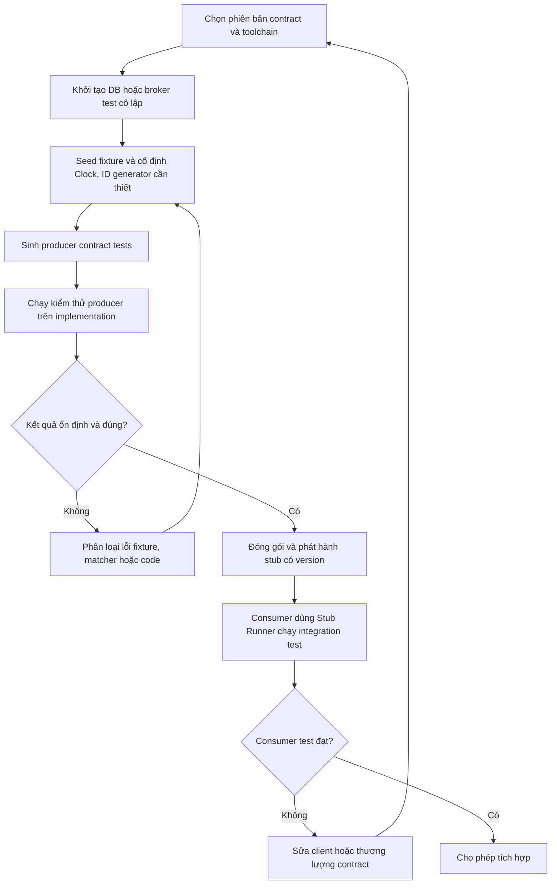

# Tránh dữ liệu ngẫu nhiên khiến kiểm thử không lặp lại được

Trong kiểm thử hợp đồng giữa **producer** và **consumer**, một bài kiểm thử chỉ đáng tin cậy nếu cùng phiên bản mã nguồn, hợp đồng và điều kiện đầu vào dẫn tới kết quả có thể dự đoán. Một lỗi phổ biến là viết contract dựa trên ID ngẫu nhiên, thời điểm hiện tại, bản ghi còn sót trong database, token sắp hết hạn hoặc thứ tự dữ liệu không được bảo đảm. Bài test có thể **xanh ở máy cá nhân nhưng đỏ trong CI** dù API không hề thay đổi.

**Spring Cloud Contract** cho phép mô tả hành vi HTTP hoặc thông điệp qua **Groovy/YAML DSL**, sinh kiểm thử phía producer và tạo stub để consumer chạy qua **Stub Runner**. Công cụ giúp phát hiện thay đổi API không tương thích, nhưng không tự động tạo dữ liệu nghiệp vụ ổn định hoặc cô lập database cho mọi dự án.

Bài học thuộc chương **Dữ liệu hợp đồng** của lộ trình **SPRING_CLOUD_CONTRACT**. Mục tiêu là biết lựa chọn giữa **fixture cố định, bộ sinh dữ liệu được điều khiển và matcher phù hợp**, thiết kế producer test có thể tái hiện, rồi duy trì tính ổn định khi phát hành stub và chạy CI.

## 1. Thế nào là kiểm thử lặp lại được?

Một test có tính lặp lại (*deterministic/reproducible*) nếu được chạy lại trong cùng điều kiện được kiểm soát thì tiếp tục đưa ra cùng kết luận đúng/sai. Ví dụ, Checkout gọi:

```http
GET /api/orders/ORDER-42
Accept: application/json
```

Nếu hợp đồng mong đợi `200 OK` với đơn hàng đã thanh toán, môi trường kiểm thử producer phải luôn tạo được bản ghi `ORDER-42` đúng trạng thái. Nếu hôm nay bản ghi tồn tại trên database cá nhân nhưng ngày mai không có trong CI, test chuyển thành `404` mà nguyên nhân là **dữ liệu**, chưa đủ bằng chứng API bị thay đổi.

Tính lặp lại có **hai điều kiện**:

1. **Đầu vào và trạng thái test được kiểm soát:** bản ghi database, đồng hồ, bộ tạo ID, quyền truy cập, dịch vụ ngoài, broker và thứ tự chạy không làm kết quả biến động ngoài dự kiến.
2. **Kỳ vọng so khớp đúng cam kết:** không khóa cứng một giá trị vốn được phép thay đổi, nhưng cũng không nới matcher rộng đến mức không phát hiện lỗi nghiệp vụ.

Một test luôn xanh với matcher `.*` chưa chắc tốt; nó có thể chấp nhận cả giá trị rỗng hoặc sai kiểu. Một test luôn đỏ vì timestamp chênh vài mili giây cũng có thể đang kiểm tra quá chặt. **Ổn định và có giá trị phát hiện lỗi phải đi cùng nhau.**

## 2. Các nguồn dữ liệu bất định cần nhận diện

| Nguồn | Ví dụ | Lỗi thường thấy |
|---|---|---|
| ID tự tăng | Sequence sinh `1001` rồi `1002` | Hợp đồng chờ ID cũ, response khác |
| UUID | `UUID.randomUUID()` | Mỗi request trả ID mới |
| Thời gian | `Instant.now()`, `LocalDateTime.now()` | Sai timestamp, timezone hoặc độ chính xác |
| Token | JWT có `exp` | Hôm nay `200`, sau vài ngày `401` |
| DB chia sẻ | Test khác sửa `ORDER-42` | Test phụ thuộc thứ tự chạy |
| Dữ liệu vắng mặt | ID dùng cho `404` bất ngờ được tạo | Kịch bản lỗi trở thành thành công |
| Danh sách không có thứ tự | Query thiếu `ORDER BY` | JSON array đảo vị trí |
| Random seed | `new Random(123)` | Thứ tự/số lần gọi đổi khi chạy song song |
| Service ngoài | Tỷ giá, catalog, identity provider | Response thay đổi hoặc timeout |
| Broker/cache | Message tồn dư, cache chưa xóa | Nhận nhầm sự kiện/giá trị cũ |
| Locale/timezone | `ZoneId.systemDefault()` | Ngày tháng, đơn vị hoặc format đổi theo môi trường |

Không phải mọi giá trị biến động đều là vấn đề. ID mới hoặc timestamp giao dịch được phép thay đổi nếu API đã định nghĩa như vậy. Sai sót xuất hiện khi **contract không phân biệt giá trị cần chính xác với giá trị chỉ cần đáp ứng một quy tắc**.

## 3. Chiến lược cho từng loại dữ liệu hợp đồng

Trước khi viết DSL, hỏi với từng trường: **Consumer phụ thuộc giá trị chính xác, kiểu dữ liệu, định dạng hay mối quan hệ nào?**

| Dữ liệu | Chiến lược | Giải thích |
|---|---|---|
| Method, URL, status code | Thường kiểm tra chính xác | Đây là giao diện giao tiếp đã cam kết |
| `status=PAID` | Giá trị chính xác hoặc tập trạng thái hợp lệ | Consumer có thể điều hướng theo trạng thái |
| `totalAmount=125000` | Fixture cố định nếu hợp đồng kiểm tra tổng tiền cụ thể | Matcher chỉ là số có thể che lỗi tính toán |
| ID dùng để tìm tài nguyên | Chọn ID fixture cố định | Generated producer request có dữ liệu để truy cập |
| ID do server sinh mới | Matcher định dạng hoặc bộ sinh ID có kiểm soát | Giá trị chính xác thường không thuộc cam kết |
| Timestamp động | Freeze Clock hoặc matcher + assertion ngữ nghĩa | Không phụ thuộc thời điểm chạy |
| Correlation ID | Giá trị do test cấp hoặc matcher kèm kiểm tra echo | Quan trọng là tính tương quan, không phải mã tùy ý |
| Danh sách có thứ tự cam kết | Kiểm tra thứ tự | Việc đảo thứ tự có thể phá vỡ consumer |
| Danh sách không cam kết thứ tự | So khớp tập phần tử | Tránh phụ thuộc iteration order |
| Token bảo mật | Test identity/token riêng, có kiểm soát hạn dùng | Không dùng secret production |

Ba công cụ thực tế bổ sung cho nhau:

- **Fixture:** một tập bản ghi và cấu hình có thể khởi tạo, reset, truy vết từ source.
- **Nguồn sinh dữ liệu có thể điều khiển:** `Clock`, `IdGenerator`, test server hoặc mock dependency.
- **Matcher:** diễn đạt ràng buộc của kiểu dữ liệu, regex, header, body hoặc quan hệ mà không buộc các chi tiết được phép biến động phải cố định.

## 4. Ví dụ xuyên suốt: Order Service phục vụ Checkout

Giả sử Checkout cần biết đơn hàng đã thanh toán để cho phép xuất hóa đơn. Bộ dữ liệu test được thống nhất:

| Trường | Giá trị fixture |
|---|---|
| `id` | `ORDER-42` |
| `customerId` | `CUSTOMER-7` |
| `status` | `PAID` |
| `totalAmount` | `125000` |
| `currency` | `VND` |
| `createdAt` | `2026-01-15T09:30:00Z` |
| ID không tồn tại | `ORDER-MISSING` |

Những giá trị này chỉ dùng trong **môi trường kiểm thử**, không phụ thuộc đơn hàng hay khách hàng thật.

### 4.1. Groovy DSL với dữ liệu cố định

```groovy
import org.springframework.cloud.contract.spec.Contract

Contract.make {
    name 'checkout_get_paid_order_200'
    description 'Checkout lấy đơn hàng đã thanh toán'

    request {
        method GET()
        url '/api/orders/ORDER-42'
        headers {
            header 'Accept', 'application/json'
        }
    }

    response {
        status OK()
        headers {
            contentType(applicationJson())
        }
        body(
            id: 'ORDER-42',
            customerId: 'CUSTOMER-7',
            status: 'PAID',
            totalAmount: 125000,
            currency: 'VND',
            createdAt: '2026-01-15T09:30:00Z'
        )
    }
}
```

Khi producer contract test chạy, mã nguồn của Order Service phải trả dữ liệu tương ứng với bản ghi fixture. Một test xanh chứng minh implementation đáp ứng **kịch bản đã viết**; nó không chứng minh mọi đơn hàng thực tế đều có cùng dữ liệu.

### 4.2. YAML DSL tương đương

```yaml
name: checkout_get_paid_order_200
description: Checkout lấy đơn hàng đã thanh toán
request:
  method: GET
  url: /api/orders/ORDER-42
  headers:
    Accept: application/json
response:
  status: 200
  headers:
    Content-Type: application/json
  body:
    id: ORDER-42
    customerId: CUSTOMER-7
    status: PAID
    totalAmount: 125000
    currency: VND
    createdAt: '2026-01-15T09:30:00Z'
```

Dấu nháy ở `createdAt` giúp giữ timestamp dưới dạng **chuỗi**; YAML có thể có quy tắc suy luận kiểu ngày giờ khác với kỳ vọng JSON. `totalAmount` vẫn là số nguyên. Nếu giữ cả Groovy và YAML như **hai hợp đồng cùng kịch bản** trong cùng tập nguồn được plugin quét, có thể sinh test/mapping trùng; khi thực hành hãy chọn **một** bản làm nguồn chính.

### 4.3. Kịch bản không tồn tại cũng cần fixture

```yaml
name: checkout_get_missing_order_404
description: Checkout lấy đơn hàng không tồn tại
request:
  method: GET
  url: /api/orders/ORDER-MISSING
response:
  status: 404
  headers:
    Content-Type: application/json
  body:
    code: ORDER_NOT_FOUND
```

Không được chỉ “chọn ID rất lớn để chắc không có”. Bộ setup phải bảo đảm `ORDER-MISSING` **thực sự vắng mặt** ở thời điểm test. Đây là **fixture âm tính**: trạng thái không tồn tại cũng được quản lý rõ ràng.

## 5. Seed và cô lập trạng thái producer test

Spring Cloud Contract plugin sinh kiểm thử từ DSL nhưng không tự suy ra cách tạo bảng database hay dữ liệu `ORDER-42`. Producer phải chuẩn bị fixture, thường bằng test base class, `@Sql`, repository helper, Testcontainers hoặc một database test được khởi tạo từ migration.

| Cách chuẩn bị | Thường dùng khi | Lưu ý |
|---|---|---|
| SQL script hoặc `@Sql` | Một số bản ghi cố định | Kiểm tra rollback, thứ tự seed, ràng buộc khóa ngoại |
| `@BeforeEach` + repository/JdbcTemplate | Cần reset trước mỗi kịch bản | Không làm hỏng test song song |
| Testcontainers | Muốn database gần production hơn | Container/schema cô lập, tăng chi phí chạy |
| Database in-memory | Nghiệp vụ đơn giản, không lệ thuộc đặc tính DB cụ thể | Có thể khác engine production |
| Mock repository/service | Muốn tập trung HTTP contract ở lớp biên | Không chứng minh persistence thật |
| Namespace/tenant test riêng | Chạy song song nhiều bộ test | Tránh đụng bản ghi và cache |

Ví dụ seed minh họa cho một **database kiểm thử** đã có schema tương ứng:

```sql
DELETE FROM orders
WHERE id IN ('ORDER-42', 'ORDER-MISSING');

INSERT INTO orders
    (id, customer_id, status, total_amount, currency, created_at)
VALUES
    ('ORDER-42', 'CUSTOMER-7', 'PAID', 125000, 'VND',
     '2026-01-15T09:30:00Z');
```

Cú pháp timestamp cần chỉnh theo engine DB; không chạy đoạn xóa trên database dùng chung ngoài phạm vi kiểm thử. Thay đổi dữ liệu của người khác để “làm test xanh” là nguyên nhân gây flakiness mới.

### 5.1. Vai trò của test base class

Generated producer tests cần một nơi chung để khởi động ứng dụng và chuẩn bị fixture. Pseudocode Java minh họa:

```java
abstract class OrderContractTestBase {

    @BeforeEach
    void prepareContractData() {
        testData.resetOrdersForContractTests();

        testData.insertOrder(
            "ORDER-42",
            "CUSTOMER-7",
            "PAID",
            125000,
            "VND",
            Instant.parse("2026-01-15T09:30:00Z")
        );

        testData.ensureOrderAbsent("ORDER-MISSING");
    }
}
```

`testData` là **helper do dự án tự hiện thực**; đoạn trên chỉ diễn tả cách tổ chức setup, không phải lớp có thể copy và chạy ngay. Dự án cần cấu hình plugin dùng đúng base class và chọn test mode phù hợp (ví dụ MockMvc hoặc RestAssured).

**Lưu ý transaction:** rollback của test không phải lúc nào cũng rollback một HTTP request chạy trên luồng/transaction khác. Với test khởi động server trên cổng riêng, phải xem rõ transaction và cleanup thực tế.

### 5.2. Vì sao chạy song song dễ sinh lỗi?

Giả sử bài test A kiểm tra đơn hàng `ORDER-42` đang `PAID`, trong khi bài test B hủy chính đơn hàng ấy. Nếu chúng chia sẻ dữ liệu, kết quả phụ thuộc test nào chạy trước. Cách xử lý:

1. Cấp schema/database hoặc namespace độc lập nếu chạy song song.
2. Tránh dùng chung ID trong những bài test **có ghi dữ liệu**.
3. Reset fixture ở thời điểm an toàn và rõ ràng.
4. Nếu dùng transaction rollback, xác minh nó thực sự bao phủ thao tác cần rollback.
5. Chạy thử **mỗi test riêng lẻ**, cả suite và các nhóm chạy song song để phát hiện phụ thuộc thứ tự.

Không nên chữa nguyên nhân bằng `@TestMethodOrder` để ép một thứ tự tình cờ: contract test đúng phải có trạng thái đầu vào đủ rõ để chạy độc lập.

## 6. ID động: dùng matcher hay bộ tạo cố định?

Phân biệt hai nhóm ID:

- **ID tra cứu** trong `GET /api/orders/ORDER-42`: nên gắn với fixture cố định.
- **ID sinh mới** trong `POST /api/orders`: producer có thể dùng UUID hoặc sequence; consumer thường quan tâm định dạng và việc có ID để sử dụng ở request tiếp theo.

Ví dụ POST tạo đơn hàng trả:

```http
HTTP/1.1 201 Created
Content-Type: application/json

{"id":"ORD-9F3A","status":"CREATED"}
```

Nếu producer sinh `ORD-9F3A` chỉ một lần rồi lưu cứng vào contract, lần chạy tiếp theo có thể trả ID khác. Có hai hướng:

**Hướng A – bộ tạo ID điều khiển được.** Trong test profile, tiêm một `IdGenerator` trả `ORD-FIXED-1`. Dùng khi logic kiểm thử cần kiểm tra chính xác ID, liên kết header `Location` hoặc thực hiện request tiếp theo.

**Hướng B – matcher.** Để stub phát một ID mẫu ổn định, còn producer contract test chỉ yêu cầu ID đúng định dạng mà consumer sử dụng. Dùng khi giá trị cụ thể không thuộc cam kết.

### 6.1. Groovy DSL: phân biệt giá trị ở consumer và producer

Spring Cloud Contract Groovy DSL hỗ trợ **dual values** để mô tả giá trị/điều kiện ở hai phía. Với response, có thể để consumer nhận một giá trị mẫu còn producer test dùng matcher:

```groovy
import org.springframework.cloud.contract.spec.Contract

Contract.make {
    name 'checkout_create_order_201'

    request {
        method POST()
        url '/api/orders'
        headers {
            contentType(applicationJson())
        }
        body(
            sku: 'SKU-1',
            quantity: 2
        )
    }

    response {
        status 201
        headers {
            contentType(applicationJson())
        }
        body(
            id: value(
                consumer('ORD-EXAMPLE-1'),
                producer(regex('ORD-[A-Z0-9-]+'))
            ),
            status: 'CREATED'
        )
    }
}
```

**Ý nghĩa:** Stub cho consumer có thể trả `ORD-EXAMPLE-1`, còn kiểm thử producer chấp nhận một ID phù hợp pattern. Cần kiểm tra **cú pháp và output thực tế của đúng phiên bản Spring Cloud Contract đang dùng** vì matcher/helper có thể khác giữa các bản. Đừng chỉ xem source DSL: hãy xem generated producer test và WireMock mapping.

Regex ví dụ chỉ bảo vệ một phần format. Nó **không chứng minh** ID là duy nhất, được lưu trong DB hoặc header `Location` trỏ đúng resource. Nếu consumer phụ thuộc vào các quy tắc này, cần bổ sung assertion thích hợp hoặc kiểm thử tích hợp khác.

### 6.2. Tại sao `Random(123)` vẫn có thể gây flakiness?

`new Random(123)` tạo một dãy có thể lặp lại **nếu số lần gọi và thứ tự gọi như nhau**. Nhưng concurrency hoặc sửa code làm thay đổi thứ tự có thể khiến test nhận số khác. Trong những tình huống cần ID chính xác, một **test supplier cố định cho từng test** thường dễ kiểm soát hơn phụ thuộc vào toàn bộ dãy random.

Không vô hiệu hóa cơ chế sinh số ngẫu nhiên bảo mật ở production chỉ để test dễ. Với token/session ID, sử dụng test setup riêng và các bài kiểm thử bảo mật phù hợp.

## 7. Thời gian hiện tại, timezone và định dạng ngày giờ

Một contract chứa `createdAt = 2026-01-15T09:30:00Z` sẽ không khớp với `Instant.now()` nếu hệ thống dùng đồng hồ thật. Có thể:

- **Cố định đồng hồ trong test** để producer sinh thời điểm xác định.
- **Dùng matcher cho timestamp** khi API cho phép thay đổi, kết hợp kiểm tra dạng ISO-8601 và ý nghĩa nghiệp vụ.

### 7.1. Thiết kế có thể bơm `Clock`

```java
import java.time.Clock;
import java.time.Instant;

public class OrderService {
    private final Clock clock;

    public OrderService(Clock clock) {
        this.clock = clock;
    }

    public Instant createdAt() {
        return Instant.now(clock);
    }
}
```

Với Spring Boot test context, có thể cung cấp bean Clock chỉ dành cho test:

```java
import java.time.Clock;
import java.time.Instant;
import java.time.ZoneOffset;
import org.springframework.boot.test.context.TestConfiguration;
import org.springframework.context.annotation.Bean;
import org.springframework.context.annotation.Primary;

@TestConfiguration
class ContractClockConfig {
    @Bean
    @Primary
    Clock testClock() {
        return Clock.fixed(
            Instant.parse("2026-01-15T09:30:00Z"),
            ZoneOffset.UTC
        );
    }
}
```

Muốn hoạt động, test context phải import cấu hình này và production code phải **thật sự dùng bean Clock**. Nếu ứng dụng vẫn gọi `Instant.now()` trực tiếp, bean Clock không tự làm thời gian đứng yên.

### 7.2. Khi nào matcher thời gian là phù hợp?

Nếu API cam kết timestamp ISO-8601 nhưng không cam kết giá trị cụ thể, matcher có thể kiểm tra dạng chuỗi. Dù vậy, regex chỉ kiểm tra cấu trúc, không nhất thiết chứng minh ngày có thật, timezone đúng hoặc `updatedAt >= createdAt`.

Cần chốt rõ:

1. API dùng UTC `Z`, offset hay local datetime?
2. Chính xác đến giây, mili giây hay nano giây?
3. Consumer cần so sánh timestamp với mốc trong request không?
4. Có yêu cầu thời gian tăng, hết hạn hoặc nằm trong một cửa sổ cụ thể không?

Nếu thông tin thời gian là một phần logic nghiệp vụ, kết hợp **fixture Clock cố định** và assertion ngữ nghĩa. Tránh để cách format phụ thuộc `ZoneId.systemDefault()` hoặc `Locale.getDefault()` giữa máy cá nhân và CI.

## 8. Dữ liệu ngẫu nhiên xuất hiện trong request

Không chỉ response, **request do generated producer test gửi** cũng phải có giá trị phù hợp với trạng thái đã tạo. Nếu request mang một UUID được sinh tùy ý mà database không chứa tài nguyên ấy, test trả `404` dù API đúng.

Ví dụ không nên viết:

```groovy
import org.springframework.cloud.contract.spec.Contract

// Ví dụ phản diện: URL được tạo ngẫu nhiên khi DSL được đánh giá.
Contract.make {
    request {
        method GET()
        url '/api/orders/' + java.util.UUID.randomUUID().toString()
    }
    response {
        status 200
    }
}
```

Khi plugin đọc DSL tại các lần build khác nhau, URL có thể thay đổi. Một stub cũ và generated producer test mới sẽ mô tả request khác nhau, còn database test chưa chắc có ID ngẫu nhiên đó.

Cách an toàn là **chọn ID fixture ổn định** hoặc dùng matcher kết hợp **giá trị mẫu cho phía producer** đã có trong dữ liệu test. Cú pháp dual value cụ thể cần theo phiên bản DSL đã ghim.

### 8.1. Header xác thực và token

Header `Authorization` cũng có thể không ổn định nếu contract chứa JWT lấy thủ công từ trình duyệt. Token sẽ hết hạn hoặc bị thu hồi. Hãy dùng:

- Test token/identity fixture chỉ hợp lệ trong môi trường kiểm thử.
- Bộ tạo JWT với test key và clock có thể kiểm soát khi phải đi qua decoder thật.
- Trường hợp `401` và `403` có dữ liệu/quyền riêng, không lấy ngẫu nhiên một token không rõ nguồn gốc.

Không ghi token/credentials production trong DSL, generated tests, stub artifact hay log CI.

## 9. Danh sách, phân trang và thứ tự phần tử

Giả sử `GET /api/orders` trả hai đơn hàng:

```json
[
  {"id": "ORDER-42", "status": "PAID"},
  {"id": "ORDER-43", "status": "CREATED"}
]
```

Nếu truy vấn DB thiếu `ORDER BY`, response có thể đảo thành `ORDER-43` rồi `ORDER-42`. Contract chỉ nên kiểm tra thứ tự **khi API cam kết thứ tự ấy**.

| Điều kiện | Chiến lược |
|---|---|
| API cam kết `sort=createdAt,desc` | Seed các timestamp khác nhau; kiểm tra thứ tự thật |
| API trả một tập hợp không có thứ tự | Kiểm tra sự hiện diện/giá trị của từng phần tử, tránh phụ thuộc index |
| Có phân trang `page`/`size` | Seed đúng số bản ghi; kiểm tra thứ tự ổn định để trang không trôi |
| Có filter theo user/tenant | Seed quyền sở hữu và query context cố định |
| Có cache | Xóa cache test hoặc dùng cache namespace riêng |

Một matcher bỏ qua thứ tự **không phù hợp** nếu UI consumer đang dựa vào thứ tự mới nhất trước. Khi đó thay đổi thứ tự thực sự là lỗi hợp đồng.

## 10. Thông điệp bất đồng bộ cũng cần dữ liệu xác định

Spring Cloud Contract hỗ trợ kiểm thử hợp đồng message. Một sự kiện thường có `eventId`, `orderId`, `occurredAt`, type, headers và destination. Ví dụ:

```json
{
  "eventId": "EVENT-42",
  "type": "ORDER_PAID",
  "orderId": "ORDER-42",
  "occurredAt": "2026-01-15T09:30:00Z"
}
```

Với message contract, cần làm rõ:

- `type=ORDER_PAID` là giá trị nghiệp vụ bắt buộc.
- `orderId` phải trỏ đúng bản ghi fixture hoặc đúng request trước đó.
- `eventId` được phép động hay phải cố định trong bài tập?
- `occurredAt` là thời gian tạo sự kiện hay thời gian xử lý ở consumer?
- Consumer có cần thứ tự message hay hệ thống chỉ bảo đảm giao hàng ít nhất một lần?
- Message được gửi tới topic/queue nào và có header/correlation key nào?

Khi dùng Stub Runner để **trigger message contract**, nhãn `label` của kịch bản nên ổn định, ví dụ `billing_order_paid_v1`, không ghép ngẫu nhiên UUID/timestamp vào tên. Nếu label thay đổi mỗi build, consumer có thể không tìm được message để kích hoạt.

Ở broker test thật, các sự kiện tồn dư từ suite trước hoặc consumer group dùng chung có thể làm test nhận nhầm message. Cần namespace, queue/topic hoặc correlation ID riêng và cleanup rõ ràng. Không chỉ tăng `Thread.sleep` để che vấn đề.

## 11. Stub Runner ổn định không đồng nghĩa producer ổn định

Stub Runner nạp **stub mappings** từ artifact rồi mô phỏng producer. Nếu một hợp đồng response động được cấu hình dual value, stub có thể phát giá trị ví dụ **ổn định**, còn producer test dùng matcher để kiểm tra response thật.

| Bước | Dữ liệu đang được kiểm tra | Bằng chứng |
|---|---|---|
| Producer contract tests | Implementation thật với fixture producer | Producer đáp ứng kịch bản hợp đồng |
| Consumer tests qua Stub Runner | Response từ mapping/stub artifact | Consumer xử lý được tương tác đã mô tả |
| Integration/E2E | DB, network, broker, identity provider và dịch vụ thật | Hệ thống phối hợp hoạt động phù hợp |

Nếu consumer test xanh vì stub luôn trả `ORD-EXAMPLE-1`, chưa thể kết luận implementation producer đang dùng đúng ID generator hay DB. Producer verification vẫn phải chạy với môi trường test được kiểm soát.

Ví dụ cấu hình stub version cố định ở phía consumer:

```java
import org.springframework.cloud.contract.stubrunner.spring.AutoConfigureStubRunner;
import org.springframework.cloud.contract.stubrunner.spring.StubRunnerProperties;

@AutoConfigureStubRunner(
    ids = "com.example:order-service:1.3.0:stubs:8085",
    stubsMode = StubRunnerProperties.StubsMode.LOCAL
)
class CheckoutContractIntegrationTest {
    // Consumer cần có Spring test context, client thật và phương thức @Test.
}
```

Đây chỉ là cấu hình minh họa: giả sử stub artifact đã cài ở Maven local repository và cổng 8085 đang rảnh. Trong pipeline chạy song song, có thể dùng cổng động. Tránh chọn `+` hoặc “latest” cho version stub trong CI cần tái lập; **ghim artifact version** và truy vết tới hợp đồng/build producer đã kiểm chứng.

## 12. Tích hợp tính lặp lại vào CI

Một chuỗi kiểm tra phù hợp:



Các điều kiện cần duy trì:

1. **Cùng toolchain:** JDK, Maven/Gradle Wrapper, Spring Boot và Spring Cloud Contract plugin tương thích và đã ghim.
2. **Source dữ liệu kiểm thử được version:** migrations, SQL seed, fixture helper, clock/test token.
3. **Isolation rõ ràng:** database/schema, cache, file tạm và broker giữa các job không chia sẻ vô tình.
4. **Timezone/locale được chốt:** nhất quán với định dạng API.
5. **Dependency ngoài được kiểm soát:** service ảo/mock hoặc môi trường thử nghiệm có dữ liệu xác định.
6. **Producer tests được chạy thật:** không bỏ qua generated contract tests bằng `skipTests`/exclude.
7. **Stub artifact có nguồn gốc:** consumer dùng đúng version, không tự lấy bản mới nhất mỗi lần.
8. **Báo cáo đủ dữ kiện:** khi fail ghi tên contract, fixture ID, request/response đã che bí mật và phiên bản plugin/stub.

### 12.1. Retry để tìm lỗi, không để che lỗi

Chạy test nhiều lần hoặc đảo thứ tự chạy có thể giúp **phát hiện** flakiness. Nhưng retry đến khi xanh **không sửa nguyên nhân**. Nếu test thất bại không ổn định, thu thập:

- Contract nào thất bại và test nào chạy đồng thời?
- Database/schema/namespace nào được dùng?
- Fixture trước khi gửi request là gì?
- Clock/timezone và timestamp thực tế?
- Generated request có đúng path/header/body không?
- Response sai **giá trị nghiệp vụ** hay chỉ sai dữ liệu động?
- Stub mapping nào được chọn và artifact/version nào đang chạy?

Hãy xử lý race, dữ liệu thiếu, matcher quá chặt hoặc trạng thái bị dùng chung trước khi kết luận thay đổi API phá vỡ tương thích.

## 13. Phân biệt lỗi dữ liệu và lỗi implementation

Giả sử hợp đồng yêu cầu `status=PAID` cho `ORDER-42` nhưng producer trả `CREATED`. Có ít nhất hai khả năng:

- **Fixture sai:** seed chưa chạy hoặc một test khác đã đổi trạng thái.
- **Implementation sai:** business logic trả status khác dù dữ liệu trước request đã đúng.

Trình tự điều tra:

1. Chạy riêng test trong môi trường cô lập và ghi log trạng thái test **trước** request.
2. Kiểm tra ID, dữ liệu seed, quyền truy cập và clock.
3. Kiểm tra generated producer request, bao gồm query/header/body.
4. So sánh response với từng điều kiện contract.
5. Phân biệt **cam kết consumer cần** với **chi tiết động hợp lệ**.
6. Sửa fixture, matcher hoặc implementation đúng nguyên nhân; nếu phải đổi cam kết, cần producer và consumer cùng review.
7. Chạy lại producer verification và consumer test với stub đúng phiên bản.

| Triệu chứng | Nghi ngờ chính | Cách xử lý |
|---|---|---|
| `200` lúc được lúc `404` | Bản ghi vắng mặt hoặc bị ghi/xóa | Seed/reset, isolate DB |
| `id` đổi sau mỗi POST | UUID/sequence | Matcher phù hợp hoặc fixed generator |
| Timestamp lệch giây/múi giờ | Clock/timezone | Clock cố định hoặc UTC + matcher |
| Array đảo vị trí | Không có ordering contract | Xác minh cam kết, sửa query/test |
| Chỉ flaky khi chạy song song | Dữ liệu/cổng/cache dùng chung | Namespace/cô lập |
| `401` xuất hiện sau nhiều ngày | Test token hết hạn | Tạo token test/clock có kiểm soát |
| Stub trả `404` | Request không khớp mapping | Kiểm tra mapping, không nhầm `404` của stub với nghiệp vụ |
| Test xanh dù đổi kiểu `amount` | Matcher quá lỏng | Thu hẹp assertion, xác nhận producer tests thực sự chạy |

**Đừng đổi assertion `totalAmount=125000` thành “bất kỳ số nào” chỉ để làm xanh test** nếu consumer đang phụ thuộc chính xác vào tổng tiền được tính. Một contract đáng tin phải phát hiện được lỗi nghiệp vụ thật.

## 14. Các ngộ nhận thường gặp

**“Dữ liệu càng ngẫu nhiên càng giống thực tế.”** Random có ích trong fuzzing/property-based testing, nhưng contract test bảo vệ kỳ vọng cụ thể ở ranh giới giữa dịch vụ. Có thể kiểm thử dữ liệu ngẫu nhiên riêng, đồng thời giữ bộ fixture contract cốt lõi có thể tái lập.

**“Chỉ cần `Random(123)` là mọi thứ ổn định.”** Không. Khi thay đổi số lần gọi, thứ tự thực thi hoặc concurrency, kết quả vẫn có thể thay đổi.

**“Regex `.*` giải quyết toàn bộ flaky test.”** Nó có thể bỏ qua trường rỗng, sai định dạng hoặc thay đổi gây lỗi cho consumer. Hãy chọn matcher đủ chặt và giữ các ràng buộc nghiệp vụ.

**“Producer contract test xanh với stub là đủ.”** Phải kiểm chứng **implementation producer** bằng generated producer tests. Consumer test dùng Stub Runner kiểm tra client với hành vi mô phỏng.

**“Chỉ cần seed dữ liệu thành công một lần.”** Nếu suite có các test ghi vào cùng DB, bản ghi có thể bị sửa. Cần cô lập và reset trạng thái phù hợp.

**“Chỉ có dữ liệu cần tồn tại mới phải seed.”** Một contract `404` phải bảo đảm dữ liệu tương ứng **không tồn tại**. Dữ liệu âm tính cũng là fixture.

**“Tăng thời gian chờ sẽ hết lỗi event test.”** Nếu message không đúng correlation key hoặc queue có dữ liệu cũ, ngủ lâu hơn không sửa được. Hãy cô lập message và chờ theo điều kiện quan sát được.

## 15. Bài thực hành: sửa bộ contract không lặp lại được

Bối cảnh: Order Service cung cấp API cho Checkout. Ban đầu có ba lỗi được cố ý tạo:

1. `GET /api/orders/ORDER-42` phụ thuộc bản ghi còn sót trong DB dùng chung.
2. `POST /api/orders` trả `UUID.randomUUID()` nhưng contract chốt ID từ một lần chạy trước.
3. `createdAt` dùng `Instant.now()` trong khi contract kiểm tra chuỗi timestamp cụ thể.

### Giai đoạn A – chẩn đoán

1. Chạy từng producer contract test riêng lẻ rồi chạy cùng suite.
2. Kiểm tra bản ghi trước mỗi request và thống kê nguyên nhân `200`/`404`.
3. Xác định nơi sinh UUID, timestamp và phần dữ liệu consumer thật sự dùng.
4. Xem generated producer tests và stub mappings để biết matcher đang áp dụng đúng phía hay chưa.

### Giai đoạn B – chuẩn hóa dữ liệu

1. Seed `ORDER-42` với `customerId=CUSTOMER-7`, `status=PAID`, `totalAmount=125000`.
2. Bảo đảm `ORDER-MISSING` không tồn tại.
3. Cô lập DB/schema và dọn state khi test kết thúc; tránh tác động giữa tests chạy song song.
4. Chạy lại cả hợp đồng `200` và `404` với nhiều thứ tự khác nhau.

### Giai đoạn C – xử lý giá trị động

1. Thử tiêm `Clock.fixed(...)` cho timestamp và xác nhận producer test đạt.
2. Với ID mới, thử test generator trả cố định hoặc matcher `ORD-[A-Z0-9-]+`.
3. Giữ `status` và `totalAmount` chính xác khi chúng là cam kết nghiệp vụ.
4. Nếu producer trả header `Location`, bổ sung kiểm tra liên hệ với ID body nếu consumer cần.

### Giai đoạn D – Stub Runner và CI

1. Sinh lại tests/stubs từ DSL, chạy producer verification thật.
2. Đóng gói artifact từ build đã qua kiểm tra.
3. Cho Checkout dùng Stub Runner với version đã ghim; kiểm tra client thực sự parse response.
4. Đưa fixture setup, test execution, artifact version và log chẩn đoán vào CI.
5. Cố ý đổi `totalAmount` thành chuỗi hoặc `status` thành `UNKNOWN` để xác minh bộ test **vẫn phát hiện thay đổi phá vỡ hợp đồng**.

**Tiêu chí hoàn thành:** producer test có thể chạy lại ổn định trên môi trường độc lập; dữ liệu động được kiểm soát hoặc so khớp đúng; stub có thể truy vết; consumer test dùng đúng artifact; thay đổi nghiệp vụ không tương thích vẫn làm test thất bại.

## 16. Tự kiểm tra kiến thức

1. **Vì sao `GET /api/orders/ORDER-42` có thể lúc `200` lúc `404` dù code không đổi?** Vì fixture có thể thiếu hoặc bị test khác thay đổi.
2. **Có cần cố định mọi UUID do producer sinh không?** Không. Có thể dùng matcher khi consumer chỉ cần định dạng, hoặc generator có kiểm soát khi cần giá trị/mối quan hệ chính xác.
3. **`Random(123)` có chắc ổn định khi chạy song song không?** Không, vì thứ tự/số lần gọi có thể khác.
4. **Vì sao không nên dùng `.*` để kiểm tra trạng thái đơn hàng?** Vì nó có thể chấp nhận trạng thái rỗng hoặc sai mà consumer không xử lý được.
5. **Contract `404` có cần fixture không?** Có. Phải bảo đảm ID được gọi không tồn tại.
6. **Timestamp lệch giữa laptop và CI nên kiểm tra gì?** Clock, timezone, locale, precision và cách format/serialize.
7. **Nếu API không cam kết thứ tự phần tử, có nên luôn kiểm tra mảng theo index không?** Không. Kiểm tra tập phần tử theo ngữ nghĩa.
8. **Consumer test xanh với Stub Runner đã chứng minh producer tuân thủ chưa?** Chưa. Cần producer contract tests chạy trên implementation.
9. **Retry nhiều lần rồi lấy kết quả xanh có giải quyết flaky test không?** Không. Phải sửa nguyên nhân dữ liệu/race/matcher.
10. **Làm sao vừa ổn định vừa phát hiện lỗi?** Cố định fixture và nguồn động cần kiểm soát; dùng matcher vừa đủ cho chi tiết được phép thay đổi; giữ kỳ vọng chính xác cho cam kết nghiệp vụ.

## Kết luận

**Dữ liệu ngẫu nhiên không được kiểm soát khiến Spring Cloud Contract tests trở nên khó tin cậy**, nhất là khi nhiều nhóm producer và consumer chạy CI song song. Để kiểm thử lặp lại được, hãy quản lý cả dữ liệu tồn tại và không tồn tại, cô lập database/broker, kiểm soát `Clock` và ID generator, xác định thứ tự/timezone, và dùng matcher có chủ đích thay vì khóa cứng hoặc bỏ qua mọi giá trị động. Khi generated producer tests chạy trên fixture có thể tái tạo, stub artifact có version rõ ràng và consumer test dùng **Stub Runner** đúng phiên bản, bộ hợp đồng vừa ổn định vừa phát hiện sớm thay đổi API không tương thích.
