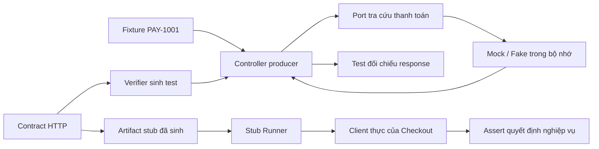
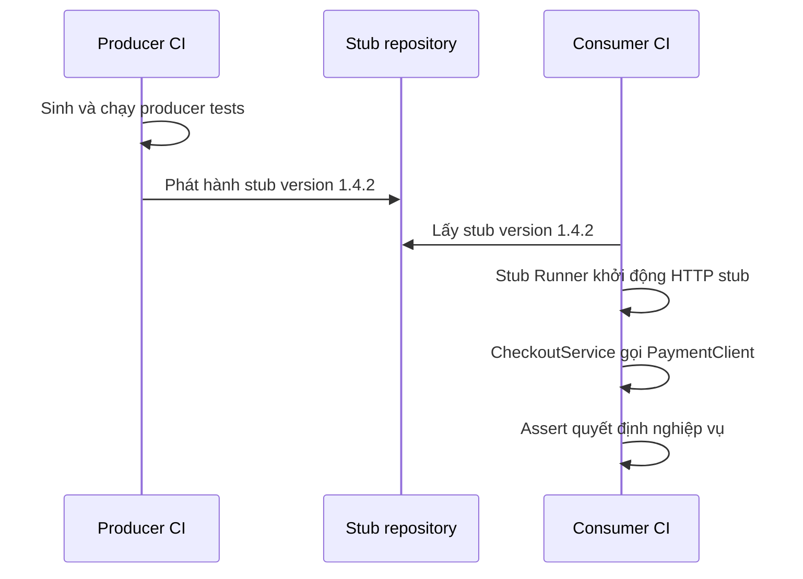
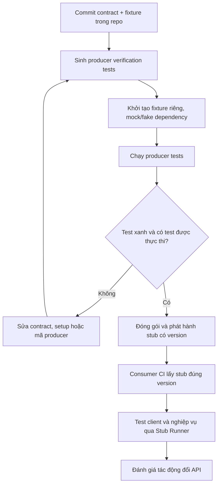

# Giữ fixture độc lập với cơ sở dữ liệu hoặc dịch vụ ngoài

## 1. Vì sao fixture cần độc lập?

Giả sử `checkout-service` (consumer) gọi `payment-service` (producer) để tra cứu trạng thái thanh toán trước khi xác nhận đơn hàng. Hôm nay, kiểm thử chạy xanh vì cơ sở dữ liệu dùng chung có bản ghi `PAY-1001` ở trạng thái `PAID`. Ngày mai, một công việc khác cập nhật bản ghi đó thành `REFUNDED` và cùng bài kiểm thử thất bại, dù mã nguồn API không thay đổi. Một lần khác, kiểm thử bị treo vì dịch vụ ngân hàng giả lập trong môi trường tích hợp không phản hồi.

Đây là vấn đề về **fixture và ranh giới phụ thuộc của bài kiểm thử**: kết quả phụ thuộc vào dữ liệu và hệ thống mà bài test không kiểm soát. Trong **Spring Cloud Contract**, hợp đồng mô tả cách producer phải phản hồi các request hoặc phát thông điệp; công cụ sinh producer verification tests, tạo stub cho consumer sử dụng qua **Stub Runner**, và hỗ trợ đưa các bước vào CI để phát hiện thay đổi API không tương thích. Nếu fixture không ổn định, những lợi ích đó bị giảm đáng kể.

**Fixture** là tập trạng thái, đối tượng và dữ liệu đầu vào được sắp xếp để một test có thể chạy và xác minh hành vi. Nó có thể bao gồm một thanh toán mẫu, một đơn hàng, một phản hồi từ cổng ngân hàng, một thời điểm cố định hoặc một sự kiện trong hàng đợi. Fixture **khác contract**: contract ghi *hai bên cam kết điều gì*; fixture chuẩn bị *điều kiện cụ thể để kiểm tra cam kết đó*.

Mục tiêu của bài:

- Tạo fixture có ý nghĩa nghiệp vụ nhưng không phụ thuộc một bản ghi đang tồn tại trong database dùng chung.
- Cô lập API producer khỏi dịch vụ bên ngoài trong producer verification khi phù hợp.
- Dùng test double, in-memory repository, mock hoặc stub mà vẫn kiểm tra **đường đi HTTP thật của producer**.
- Tách contract test khỏi những integration test cần cơ sở dữ liệu, broker hoặc hạ tầng thực.
- Thiết lập stub consumer có phiên bản xác định, chạy lặp được trên máy phát triển và trong CI.

**Độc lập** ở đây không có nghĩa không bao giờ dùng database. Nó có nghĩa test **tự kiểm soát và tái tạo được trạng thái cần thiết**; database thật nếu cần thì phải được cấp riêng, nạp dữ liệu rõ ràng và dọn sạch. Test không được phụ thuộc ngầm vào dữ liệu production, môi trường staging hoặc dịch vụ ngoài đang thay đổi.

## 2. Phân biệt contract, fixture, mock, fake và stub

| Khái niệm | Vai trò trong bài kiểm thử | Ví dụ |
| --- | --- | --- |
| **Contract** | Định nghĩa request/response hoặc thông điệp phải được hỗ trợ. | `GET /api/payments/PAY-1001` trả `200` cùng `status: PAID`. |
| **Fixture** | Tạo trạng thái dữ liệu tiền đề để kịch bản xác định. | Có giao dịch `PAY-1001` gắn `ORD-2001`, số tiền `250000 VND`. |
| **Mock** | Đối tượng giả lập hành vi/call theo cấu hình trong test; có thể kiểm tra tương tác. | Mockito trả một `PaymentView` khi controller gọi `PaymentQuery.findById(...)`. |
| **Fake** | Bản triển khai đơn giản nhưng có hoạt động thực, thường chạy trong bộ nhớ. | `InMemoryPaymentRepository` lưu các thanh toán trong `Map`. |
| **Stub** | Trả kết quả định trước khi có đầu vào phù hợp. | Stub Runner chạy WireMock stub từ contract, trả JSON `PAID` khi consumer gọi API. |
| **Producer verification** | Chạy test sinh từ contract trên producer để xác nhận ứng dụng thực hiện đúng cam kết. | Gọi `PaymentController` và đối chiếu status, header, body. |
| **Consumer test** | Xác minh mã client/logic consumer khi nói chuyện với stub. | Checkout chỉ xác nhận đơn nếu client nhận `PAID`. |

Chú ý **fixture của producer** và **stub của consumer** ở hai phía khác nhau. Producer test cần chạy trên mã producer và kiểm tra phản hồi của nó; consumer test có thể dùng stub của producer thay cho dịch vụ thật. Không được dùng stub trả đúng JSON rồi tự kết luận producer đã được xác minh.

## 3. Một kịch bản thanh toán làm ví dụ xuyên suốt

Hai nhóm thống nhất:

```http
GET /api/payments/PAY-1001 HTTP/1.1
Accept: application/json
```

Phản hồi phải là:

```http
HTTP/1.1 200 OK
Content-Type: application/json

{
  "paymentId": "PAY-1001",
  "orderId": "ORD-2001",
  "status": "PAID",
  "amount": 250000,
  "currency": "VND"
}
```

Những giá trị này được chọn có chủ đích: `PAY-1001` thuộc `ORD-2001`; `status = PAID` cho phép xác nhận đơn; `amount = 250000` chỉ có ý nghĩa cùng `currency = VND`. Chúng là dữ liệu giả lập, không chứa thông tin khách hàng thật.

Sơ đồ phân ranh giới:



Trong nhánh **producer verification**, controller, định tuyến, status HTTP và tuần tự hóa JSON vẫn là mã của producer. Chỉ cổng lấy dữ liệu được thay bằng mock/fake độc lập. Trong nhánh **consumer**, Stub Runner thay việc gọi Payment thật, còn client và logic Checkout vẫn chạy.

## 4. Mô tả contract bằng Groovy DSL

Ví dụ tệp contract phía `payment-service`:

```groovy
import org.springframework.cloud.contract.spec.Contract

Contract.make {
    name 'get_paid_payment'
    description 'Tra cứu giao dịch đã thanh toán để xác nhận đơn'

    request {
        method 'GET'
        urlPath '/api/payments/PAY-1001'
        headers {
            header 'Accept': 'application/json'
        }
    }

    response {
        status 200
        headers {
            contentType(applicationJson())
        }
        body([
            paymentId: 'PAY-1001',
            orderId: 'ORD-2001',
            status: 'PAID',
            amount: 250000,
            currency: 'VND'
        ])
    }
}
```

Contract chỉ mô tả tương tác. **Nó không tạo bản ghi `PAY-1001` trong cơ sở dữ liệu**, không tự sinh đối tượng `PaymentView` trong controller và không tự khởi động ngân hàng giả lập. Đó là việc của lớp cấu hình test/fixture.

Với **YAML DSL**, nội dung tương đương:

```yaml
description: Tra cứu giao dịch đã thanh toán để xác nhận đơn
name: get_paid_payment
request:
  method: GET
  urlPath: /api/payments/PAY-1001
  headers:
    Accept: application/json
response:
  status: 200
  headers:
    Content-Type: application/json
  body:
    paymentId: PAY-1001
    orderId: ORD-2001
    status: PAID
    amount: 250000
    currency: VND
```

Hai đoạn là **hai cách biểu diễn của cùng một kịch bản**; nên chọn một file làm nguồn sự thật. Những ví dụ dưới đây giả định đã chọn bản Groovy. Ý nghĩa fixture độc lập **không phụ thuộc** hợp đồng được viết bằng Groovy hay YAML.

## 5. Producer verification không cần database đang hoạt động bên ngoài

### 5.1. Đặt ranh giới ở một port

Giả sử controller của Payment phụ thuộc vào interface `PaymentQuery`. Khi chạy production, interface này có thể được triển khai bởi adapter dùng JPA và database. Khi chạy contract test, thay adapter bằng mock/fake.

```java
// Các kiểu trong ví dụ là mã ứng dụng minh họa.
public interface PaymentQuery {
    PaymentView findById(String paymentId);
}
```

Một kiểu dữ liệu chỉ phục vụ ví dụ:

```java
public record PaymentView(
    String paymentId,
    String orderId,
    String status,
    long amount,
    String currency
) {}
```

Ứng dụng producer có controller xử lý request:

```java
@RestController
@RequestMapping("/api/payments")
class PaymentController {
    private final PaymentQuery paymentQuery;

    PaymentController(PaymentQuery paymentQuery) {
        this.paymentQuery = paymentQuery;
    }

    @GetMapping("/{id}")
    PaymentView getPayment(@PathVariable String id) {
        return paymentQuery.findById(id);
    }
}
```

Đây là mã **tối giản để minh họa**: controller thực tế phải xử lý `404`, lỗi quyền truy cập, xác thực, v.v. theo API đã thỏa thuận. Tách interface đọc dữ liệu giúp test dùng hành vi ổn định mà không cần liên hệ database thật.

### 5.2. Base test class với Mockito và RestAssuredMockMvc

Spring Cloud Contract Verifier thường được cấu hình một **base class** cho các producer verification tests được sinh. Với JUnit 5, Spring MVC và chế độ MockMvc, một phương án cô lập controller là:

```java
package com.example.payment.contract;

import io.restassured.module.mockmvc.RestAssuredMockMvc;
import org.junit.jupiter.api.BeforeEach;
import org.mockito.Mockito;

public abstract class ContractBase {

    @BeforeEach
    void setupPaymentFixture() {
        PaymentQuery query = Mockito.mock(PaymentQuery.class);

        Mockito.when(query.findById("PAY-1001")).thenReturn(
            new PaymentView(
                "PAY-1001", "ORD-2001", "PAID", 250000L, "VND"
            )
        );

        RestAssuredMockMvc.standaloneSetup(
            new PaymentController(query)
        );
    }
}
```

Giả định `PaymentQuery`, `PaymentView` và `PaymentController` là các kiểu ứng dụng như ví dụ trước, có thể truy cập từ package của `ContractBase`; ví dụ cần import hoặc điều chỉnh quyền truy cập cho đúng cấu trúc dự án. Thư viện Mockito, RestAssuredMockMvc, JUnit Jupiter và Spring MVC test phải có trên test classpath. Cách trên phù hợp khi bản Spring Cloud Contract đang dùng sinh test HTTP qua **RestAssuredMockMvc**. Nếu dùng `WEBTESTCLIENT` hoặc chế độ HTTP thật, base class phải được thiết lập tương ứng.

Ưu điểm:

1. **Không cần khởi động database**: query được đáp ứng bằng Mockito trong mỗi test.
2. **Không phụ thuộc dữ liệu còn lại**: luôn lấy cùng đối tượng `PAY-1001`.
3. **Vẫn kiểm tra endpoint producer**: request chạy qua ánh xạ controller và cơ chế xử lý HTTP MockMvc.
4. **Lỗi dễ chẩn đoán**: nếu producer đổi trường `status` thành `state` trong JSON, contract vẫn có thể làm test thất bại.

Giới hạn cần nhận thức: một mock trả sẵn `PaymentView` không phát hiện lỗi query SQL/JPA hoặc cách adapter lưu và đọc dữ liệu. **Đó là công việc của integration test** trong lớp kiểm thử khác. Contract test này cũng không đảm bảo các bean/filter được thiết lập ngoài `standaloneSetup` đều đã được kiểm tra. Khi hợp đồng phụ thuộc security filter, message converter, exception handler hoặc cấu hình Spring thật, hãy chọn test context phù hợp thay vì lược bỏ chúng.

### 5.3. Dùng Spring context khi cần nhiều thành phần thật hơn

Một cách khác là khởi động Spring TestContext, dùng `@SpringBootTest`/`@AutoConfigureMockMvc` và thay **bean ở ranh giới ngoại vi** bằng mock trong phạm vi test. Annotation tạo mock bean đã thay đổi theo các đời Spring Boot/Spring Framework (ví dụ `@MockBean` trong các dự án cũ và `@MockitoBean` ở hệ sinh thái mới); hãy chọn đúng phiên bản thay vì trộn tùy ý. Đối với test context đầy đủ, cũng cần kiểm tra auto-configuration: một datasource vẫn có thể được khởi tạo dù repository đã bị mock, trừ khi profile hoặc cấu hình test vô hiệu hóa phụ thuộc đó.

Đây là sự đánh đổi giữa **độ rộng phần mã thực được kiểm tra** và **khả năng cô lập**:

| Cách thiết lập | Kiểm tra tốt | Cần lưu ý |
| --- | --- | --- |
| `standaloneSetup(controller, ...)` + mock port | Route/controller và HTTP response trong setup tối thiểu. | Không tự bao phủ toàn bộ Spring Security, filter, cấu hình hoặc database. |
| Spring TestContext + mock bean ở ranh giới ngoài | Nhiều thành phần Spring thật hơn cùng controller/serializer. | Có thể vẫn khởi tạo dependency ngoài; cần cấu hình test profile chặt. |
| Test ứng dụng + database được cấp riêng | Controller, service, repository và persistence. | Chậm hơn; phải tự cấp môi trường, migrate schema, seed và dọn trạng thái. |

Không có một lựa chọn tối ưu cho mọi ứng dụng. Với contract về shape HTTP, response/status và vài quy tắc cụ thể, mock một port là cách đơn giản và có giá trị. Với contract phụ thuộc thực sự vào security, validation hoặc persistence, có thể cần test context rộng hơn và **integration test độc lập** để tăng mức tin cậy.

## 6. Fixture trong bộ nhớ: khi nào dùng fake thay vì mock?

Mockito tiện khi chỉ cần một hoặc hai phương thức. Khi nghiệp vụ cần tạo, cập nhật và đọc nhiều giao dịch trong cùng kịch bản, một **fake repository trong bộ nhớ** có thể dễ hiểu hơn:

```java
final class InMemoryPaymentRepository {
    private final Map<String, PaymentView> payments =
        new HashMap<>();

    void seed(PaymentView payment) {
        payments.put(payment.paymentId(), payment);
    }

    PaymentView find(String id) {
        return payments.get(id);
    }

    void reset() {
        payments.clear();
    }
}
```

Trong test, tạo **instance mới ở mỗi lần thiết lập fixture** hoặc gọi `reset()` theo vòng đời rõ ràng. Không lưu một `static Map` chung cho hàng trăm test chạy song song, vì kết quả sẽ phụ thuộc thứ tự chạy.

Fake không phải bản thay thế hoàn toàn database:

- Nó có thể không mô phỏng đúng transaction, isolation level hoặc ràng buộc unique của database thật.
- Nó có thể xử lý tìm kiếm/sắp xếp khác SQL thực tế.
- Nó có thể bỏ qua migration, kiểu dữ liệu, precision và lỗi kết nối.

Vì vậy dùng fake để cô lập **hợp đồng bên ngoài**, đồng thời có integration test với database được cấp riêng cho **độ đúng của adapter**.

## 7. Nếu contract buộc phải dùng database thì vẫn phải độc lập

Đôi khi hành vi HTTP không thể xác minh đáng tin nếu không chạy qua query thực hoặc mapping JPA. Trong trường hợp đó, yêu cầu “độc lập với database” nên được hiểu là **không phụ thuộc database dùng chung**, thay vì cấm mọi database.

Một quy trình an toàn cho database test:

1. Tạo database hoặc schema **dành riêng cho test** (ví dụ container tạm thời bằng Testcontainers), không dùng staging/production.
2. Chạy migration cần thiết trước khi kiểm thử; tránh dựa vào trạng thái đã được thiết lập thủ công.
3. Nạp fixture bằng SQL hoặc builder với **mã định danh do test kiểm soát**, ví dụ `PAY-1001`.
4. Xác định rõ thời điểm commit để HTTP request từ application context khác vẫn nhìn thấy dữ liệu.
5. Dọn dữ liệu sau mỗi test hoặc tái tạo môi trường; không giả định test sẽ chạy theo thứ tự.
6. Nếu chạy parallel, dùng namespace, schema hoặc instance cô lập để các test không ghi đè nhau.

Ví dụ **phác thảo fixture SQL** trong database thử riêng:

```sql
INSERT INTO payments (
    payment_id, order_id, status, amount, currency
) VALUES (
    'PAY-1001', 'ORD-2001', 'PAID', 250000, 'VND'
);
```

Đoạn SQL là ví dụ minh họa; schema thực tế cần khớp với migration và ràng buộc của ứng dụng. Nếu test chạy lại, phải đảm bảo dữ liệu cũ được dọn hoặc quá trình setup idempotent.

**Chú ý transaction:** rollback của test method không phải lúc nào cũng rollback được thay đổi do request HTTP đi qua thread, connection hoặc transaction khác. Cần hiểu ranh giới transaction trong chế độ test đang dùng. Không chạy `DELETE FROM` hay `TRUNCATE` lên cơ sở dữ liệu ngoài môi trường test.

## 8. Cô lập các dịch vụ bên ngoài

Một producer có thể gọi cổng thanh toán, hệ thống thuế hoặc một dịch vụ định danh để tạo response. Nếu producer verification trực tiếp gọi endpoint live, test sẽ phụ thuộc mạng, quota, token, dữ liệu bên thứ ba và thời gian phản hồi.

### 8.1. Chọn ranh giới đúng

Giả sử `payment-service` có luồng:

```text
PaymentController
    -> PaymentApplicationService
        -> BankGateway (HTTP tới bên thứ ba)
```

Khi xác minh response HTTP của `PaymentController`, có thể thay `BankGateway` bằng fake/mock trong test để luôn trả `APPROVED` cho một payment ID cụ thể. Phần routing, validation, mapping DTO và xử lý trạng thái của producer vẫn chạy như bình thường.

Kịch bản nên kiểm soát được:

| Tình huống | Fake gateway trả | Producer phải phản hồi theo hợp đồng |
| --- | --- | --- |
| Cấp phép thành công | `APPROVED` cho `PAY-1001` | `200`/`201` với trạng thái chính xác đã thống nhất. |
| Giao dịch bị từ chối | `DECLINED` cho `PAY-1002` | Mã trạng thái và payload từ chối đúng hợp đồng. |
| Gateway timeout | Một ngoại lệ/timeout giả lập được kiểm soát | API trả lỗi hoặc retry theo chính sách đã cam kết. |
| Gateway trả dữ liệu thiếu | Payload sai được tạo có chủ đích | Mapping/validation của producer xử lý đúng hoặc báo lỗi. |

Không mặc định `DECLINED` phải trả HTTP `400` hay timeout phải trả `503`: đó là quyết định API cần được hai bên thống nhất trong contract.

### 8.2. Khi cần kiểm tra lớp HTTP client của producer

Nếu muốn xác minh rằng adapter `BankGatewayHttpClient` thực sự tạo request HTTP đúng, dùng **stub server nội bộ** như WireMock/MockWebServer hoặc công cụ tương ứng để trả phản hồi ổn định. Trỏ client đến endpoint localhost/port do test cấp; không gọi bank live.

Đây là integration test cho **outbound HTTP adapter**, khác với producer contract test kiểm tra API **inbound**. Có thể cùng một dự án sử dụng cả hai, nhưng cần đặt mục tiêu và ranh giới kiểm thử rõ để không vô tình biến mỗi producer contract test thành bài end-to-end chạy qua tất cả microservices.

### 8.3. Chặn cuộc gọi ngoài ý muốn

Đừng chỉ mock endpoint chính rồi để các call phụ (dịch vụ token, config, analytics, email, feature flag) thoát ra mạng. Trong CI, một bài test cô lập tốt nên có cấu hình test profile chỉ kết nối được tới dependency nội bộ do test kiểm soát; với những thành phần không cần thiết, có thể thay bằng fake/no-op và xác minh không có side effect.

Nếu test cần secret thật hoặc tài khoản ngân hàng sandbox dùng chung để chạy, đó là dấu hiệu test không còn độc lập với bên ngoài. Những bài test như vậy nên được đánh dấu riêng, không trộn vào vòng producer verification chạy trên mọi pull request.

## 9. Consumer độc lập với producer thật nhờ Stub Runner

Producer có thể sinh stub từ chính contract đã xác minh và phát hành artifact phiên bản hóa. Khi kiểm thử `checkout-service`, ta **không cần chạy payment-service thật**: Stub Runner khởi động stub và trả dữ liệu theo contract.

Ví dụ minh họa Spring Boot test sử dụng stub có phiên bản cụ thể đã được cài vào local Maven repository:

```java
@SpringBootTest(properties = {
    "payment.base-url=http://localhost:6565"
})
@AutoConfigureStubRunner(
    ids = "com.example:payment-service:1.4.2:stubs:6565",
    stubsMode = StubRunnerProperties.StubsMode.LOCAL
)
class CheckoutPaymentClientTest {

    @Autowired
    CheckoutService checkoutService;

    @Test
    void confirmsOrderWhenPaymentIsPaid() {
        assertThat(checkoutService.canConfirm("ORD-2001"))
            .isTrue();
    }
}
```

Đoạn mã là ví dụ rút gọn, cần import, test dependencies, `CheckoutService` và cấu hình ứng dụng thực tế. Test chỉ có ý nghĩa nếu `CheckoutService` **gọi PaymentClient thật** đã được cấu hình trỏ tới `localhost:6565` và gửi request `GET /api/payments/PAY-1001`. Nếu client gọi đường dẫn khác, stub sẽ không khớp; cần sửa mã hoặc contract tùy đúng cam kết.

`LOCAL` nghĩa là dùng artifact stub đã có trong local Maven repository; trong CI có thể dùng chế độ `REMOTE` với artifact repository khi được cấu hình đầy đủ. **Pin version `1.4.2`** giúp tái hiện kết quả. Chọn một version động như `+` có thể khiến CI tự lấy stub mới khác với lần chạy trước.

Quan hệ quan trọng:



Stub từ producer không đảm bảo client tự đúng: test consumer cần kiểm tra cả việc parse response, xử lý mã lỗi, map trạng thái và quyết định giao hàng. Tương tự, consumer test xanh với stub **không đủ thay thế** producer verification.

## 10. Messaging cũng cần fixture độc lập

Spring Cloud Contract có thể mô tả tương tác **thông điệp**, không chỉ HTTP. Giả sử `payment-service` phát event `PaymentCaptured` và `fulfillment-service` tiêu thụ nó.

Payload mẫu:

```json
{
  "eventId": "EVT-1001",
  "eventType": "PaymentCaptured",
  "orderId": "ORD-2001",
  "paymentId": "PAY-1001",
  "amount": 250000,
  "currency": "VND",
  "occurredAt": "2026-01-15T09:00:00Z"
}
```

Fixture nên chuẩn bị giao dịch đã capture và một đồng hồ cố định; hành vi phát event cần được test qua messaging verifier hoặc test binder/in-memory transport tùy cấu hình Spring Cloud Contract được hỗ trợ. Không nên bắt mỗi pull request kết nối vào Kafka/RabbitMQ dùng chung chỉ để xác nhận payload.

Một Groovy DSL **phác thảo** cho hợp đồng thông điệp:

```groovy
import org.springframework.cloud.contract.spec.Contract

Contract.make {
    name 'payment_captured_event'

    input {
        triggeredBy('emitCapturedPayment()')
    }

    outputMessage {
        sentTo('payments.captured')
        body([
            eventId: 'EVT-1001',
            eventType: 'PaymentCaptured',
            orderId: 'ORD-2001',
            paymentId: 'PAY-1001',
            amount: 250000,
            currency: 'VND',
            occurredAt: '2026-01-15T09:00:00Z'
        ])
    }
}
```

Ví dụ này yêu cầu base test định nghĩa trigger `emitCapturedPayment()` và cấu hình cơ chế gửi/nhận thông điệp phù hợp. Không phải cứ có file contract là verifier tự khởi động broker. Nếu ứng dụng dùng Kafka/RabbitMQ thật trong production, vẫn nên có integration test riêng cho serializer, routing, partition, acknowledgment hoặc retry; fixture độc lập ở bài contract không chứng minh toàn bộ hạ tầng messaging.

## 11. Đảm bảo fixture xác định và có ý nghĩa nghiệp vụ

Fixture độc lập còn phải **deterministic**: cùng kịch bản, cùng điều kiện, kết quả lặp lại được. Các nguồn thay đổi phổ biến:

| Nguồn thay đổi | Ví dụ gây flaky test | Cách kiểm soát |
| --- | --- | --- |
| **Đồng hồ hệ thống** | `capturedAt = Instant.now()` nên mỗi lần body khác. | Inject `Clock.fixed(...)` hoặc matcher thời gian có ràng buộc. |
| **Mã định danh ngẫu nhiên** | Tạo `UUID.randomUUID()` nhưng contract đòi `PAY-1001`. | Seed ID cố định hoặc dùng matcher định dạng với giá trị stub mẫu. |
| **Dữ liệu lưu trữ dùng chung** | Test khác chuyển `PAY-1001` thành `REFUNDED`. | Dùng mock/fake riêng hoặc database được tạo riêng. |
| **Thứ tự không xác định** | Truy vấn DB không có `ORDER BY` nhưng test so sánh danh sách theo thứ tự cố định. | Chỉ ràng buộc thứ tự khi API cam kết; ngược lại so sánh theo tập/khóa. |
| **Mạng và dịch vụ ngoài** | Gateway chậm, token hết hạn hoặc rate limit. | Thay bằng fake/stub server nội bộ kiểm soát được. |
| **Version stub thay đổi** | Consumer CI lấy bản “mới nhất” sau mỗi lần chạy. | Pin artifact version, cập nhật bằng thay đổi có review. |
| **Thiết lập dùng chung giữa test** | Một test xóa `static Map` mà test khác đang đọc. | Fixture mới theo từng test, tránh shared mutable state. |
| **Múi giờ/locale** | Chuỗi thời gian hoặc dấu phân cách số thay đổi giữa Windows/Linux CI. | Chuẩn hóa UTC/ISO 8601 và định dạng số độc lập locale. |

Ví dụ đồng hồ cố định trong Java:

```java
Clock fixedClock = Clock.fixed(
    Instant.parse("2026-01-15T09:00:00Z"),
    ZoneOffset.UTC
);
```

Sử dụng `fixedClock` làm phụ thuộc của logic tạo sự kiện hoặc thanh toán, thay vì gọi `Instant.now()` trực tiếp. Nếu business rule kiểm tra hạn giao dịch, fixture cần thể hiện rõ thời điểm `paidAt`, `expiresAt` và khoảng thời gian hợp lệ, không chỉ dùng một timestamp ngẫu nhiên.

### Các test case nên có

Tối thiểu, hãy chọn các kịch bản mà consumer thật sự phải xử lý:

| Kịch bản | Fixture ổn định | Giá trị cần xác minh |
| --- | --- | --- |
| Thanh toán thành công | `PAY-1001` / `ORD-2001` / `PAID` | HTTP 200, đúng order, status, amount/currency. |
| Đang chờ | `PAY-1002` / `ORD-2002` / `PENDING` | Checkout không xác nhận đơn trước khi thanh toán xong. |
| Không tìm thấy | Không có `PAY-9999` trong fake/test DB | HTTP 404 và payload lỗi nếu đó là cam kết API. |
| Dịch vụ ngoài từ chối | Fake gateway trả `DECLINED` | Producer/consumer xử lý nhánh từ chối đã thỏa thuận. |
| Timeout có kiểm soát | Fake gateway ném timeout exception xác định | Cơ chế báo lỗi/retry theo quy tắc đã công bố. |

Khi viết nhiều contract, đừng dùng một fixture trả `PAID` cho mọi ID; như vậy stub hoặc producer test có thể che lỗi consumer gọi sai tài nguyên. Mỗi nhánh nghiệp vụ cần dữ liệu phù hợp và một lời giải thích rõ tại sao response là đúng.

## 12. Đưa vào CI mà không tạo phụ thuộc ngầm

Một pipeline tiêu biểu:



Ở mỗi pull request, CI nên chạy bài producer verification **không cần mạng ra ngoài** hoặc chỉ cần các endpoint nội bộ do test tạo. Một số test tích hợp thực có thể chạy thành một stage riêng với database/broker được cấp phát tự động. Các bước cần quan sát:

1. Tệp Groovy/YAML contract và fixture được lấy từ **cùng commit**; không tải thủ công JSON từ máy cá nhân.
2. Có generated tests và engine test thực sự chạy chúng; không nhầm build thành công với **0 test được thực thi**.
3. Dữ liệu test được thiết lập lại trước mỗi bài hoặc mỗi suite theo cách không tạo ảnh hưởng giữa các test.
4. Không có lời gọi ngoài ý muốn tới production, staging hay tài khoản bên thứ ba khi producer verification chạy.
5. Stub được phát hành **sau khi producer verification đạt**, có tọa độ và phiên bản rõ ràng.
6. Consumer CI dùng stub đó, đi qua mã client thật và xác minh cả nhánh thành công/lỗi quan trọng.
7. Khi đổi đường dẫn, trường JSON, enum trạng thái hoặc schema event, chạy lại test của các consumer còn được hỗ trợ.

Nếu muốn phát hiện sớm phụ thuộc ngầm, hãy thử chạy cùng bộ producer tests ở môi trường mới không có database đã seed sẵn, không có VPN, không có token dịch vụ ngoài. Test vẫn cần những dependency **cố ý** được chuẩn bị (JDK, build tool, thư viện, service test riêng), nhưng không nên cần những trạng thái không được mô tả trong setup.

## 13. Lỗi thường gặp và cách sửa

| Triệu chứng | Nguyên nhân | Hướng khắc phục |
| --- | --- | --- |
| Local chạy, CI báo `PAY-1001` không tồn tại | Fixture dựa vào bản ghi tự tạo trên máy dev. | Seed fixture trong test hoặc mock port tra cứu. |
| Hôm trước xanh, hôm sau đỏ dù không đổi code | Dữ liệu staging dùng chung, thời gian hoặc version stub đổi. | Cô lập trạng thái, đóng băng thời gian, pin stub version. |
| Producer test bắt buộc có VPN | Đang gọi dịch vụ ngoài hoặc DB không được cấp bởi test. | Đặt fake/stub ở ranh giới outbound; chuyển test tích hợp ngoài sang stage riêng. |
| Contract test xanh nhưng repository JPA lỗi | Mock repository nên persistence không được chạy. | Bổ sung integration test với DB riêng; giữ contract test cho cam kết HTTP. |
| Stub consumer xanh nhưng producer sai | Chỉ chạy consumer test với artifact stub cũ. | Sinh/chạy producer verification và phát hành stub từ bản producer đã được kiểm tra. |
| Test kiểm tra mock trả đúng JSON, không gọi controller | Test chỉ xác minh Mockito, không xác minh route/serialization. | Dùng generated producer test đi qua HTTP layer thật; chỉ mock dependency ngoại vi. |
| Test bị ảnh hưởng khi chạy song song | Fixture lưu trong biến static hoặc chung schema. | Scope dữ liệu theo test, dùng instance/schema riêng hoặc cơ chế cô lập. |
| Kiểm thử lỗi timeout mất nhiều phút | Đợi timeout mạng thật hoặc dùng `Thread.sleep(...)`. | Fake lỗi/clock/scheduler, dùng timeout ngắn và xác định. |
| Event test cần Kafka chung mới chạy | Không thiết lập test binder/messaging verifier cục bộ. | Chọn tích hợp messaging test được hỗ trợ; test broker thật ở tầng riêng. |
| Đã sửa contract nhưng consumer vẫn thấy dữ liệu cũ | Vẫn dùng artifact stub của phiên bản trước. | Sinh và phát hành stub mới, cập nhật version consumer một cách có review. |

### Ba sai lầm thiết kế cần tránh

**1. “Mock tất cả để test luôn xanh.”** Nếu mock cả controller và tự trả JSON mẫu, test không kiểm tra implementation producer. Chỉ thay những ranh giới không cần thiết để xác minh contract; vẫn chạy mã chịu trách nhiệm nhận request và tạo response.

**2. “Không dùng DB nghĩa là không cần test DB.”** Contract test cô lập rất tốt để phát hiện trường JSON hoặc status thay đổi, nhưng không đảm bảo query SQL, migration hay transaction đúng. Vẫn cần test persistence trong môi trường DB độc lập.

**3. “Stub Runner chạy được thì hệ thống tương thích.”** Consumer test xanh với stub chỉ chứng minh consumer xử lý **những ví dụ stub đã mô tả**. Cần producer verification đạt trên cùng phiên bản contract, và các kiểm thử phù hợp khác cho những hành vi ngoài hợp đồng.

## 14. Bài tập thực hành

Hệ thống có `checkout-service`, `payment-service`, PostgreSQL và một `bank-gateway` bên thứ ba. API:

```text
GET /api/payments/{paymentId}
POST /api/payments/{paymentId}/capture
```

Với `PAY-1001`, Checkout cần response `200` chứa `paymentId: PAY-1001`, `orderId: ORD-2001`, `status: PAID`, `amount: 250000` và `currency: VND`. Gateway trả kết quả `APPROVED` khi capture.

**Nhiệm vụ:**

1. Viết Groovy hoặc YAML contract cho `GET /api/payments/PAY-1001`. Chọn các trường phải assert chính xác vì consumer thật sự phụ thuộc chúng.
2. Thiết kế `PaymentQuery` interface và `PaymentController`; tạo một `ContractBase` dùng Mockito hoặc fake repository để test GET **không cần PostgreSQL**.
3. Mô tả cách mock `BankGateway` cho kịch bản `APPROVED` và `DECLINED` khi test POST capture. Nêu rõ mã HTTP/payload mong đợi phải dựa vào contract đã thỏa thuận.
4. Chỉ ra test nào sẽ không phát hiện lỗi SQL/JPA nếu dùng mock và đề xuất integration test với PostgreSQL riêng để bù đắp.
5. Thêm tình huống `PAY-1002` ở trạng thái `PENDING`; bảo đảm fixture của kịch bản này **không** dùng chung dữ liệu thay đổi được của `PAY-1001`.
6. Tạo artifact stub sau khi producer verification đạt, và viết consumer test qua Stub Runner với một version xác định.
7. Chỉ ra cách kiểm tra CI có thực thi test sinh ra, không dùng token bank-gateway thật và không yêu cầu staging database.

**Gợi ý tự kiểm:** kết quả đạt yêu cầu khi contract phản ánh nghiệp vụ, fixture có thể tái tạo từ nguồn test, producer verification vẫn chạy qua controller thực, phụ thuộc ngoại vi được thay bằng đối tượng do test kiểm soát, và có integration test riêng cho database/gateway khi cần.

## 15. Ghi nhớ

- **Contract mô tả cam kết; fixture chuẩn bị điều kiện kiểm thử**. Chúng liên quan nhưng không thay thế nhau.
- Producer verification nên kiểm tra **mã producer thật ở ranh giới API** và cô lập database/dịch vụ ngoài qua mock, fake hoặc môi trường riêng khi phù hợp.
- Không phụ thuộc dữ liệu có sẵn trong database staging/production, endpoint live, thời gian hiện tại hoặc stub version thay đổi ngầm.
- Với dữ liệu động, dùng đồng hồ cố định, ID mẫu có ý nghĩa và matcher đủ chặt; tránh shared mutable state giữa test.
- **Stub Runner** giúp consumer kiểm thử với stub đã phát hành mà không cần producer thật; vẫn phải chạy producer verification để bảo đảm stub phản ánh hợp đồng producer thực hiện.
- Đưa contract, fixture, test generation và stub vào **CI có thể tái hiện**; dành những bài cần database/broker thật cho tầng integration test sử dụng môi trường test được cấp riêng.

### Tài liệu tham khảo

- [Spring Cloud Contract Reference](https://docs.spring.io/spring-cloud-contract/reference/): DSL, producer verification và stub.
- [Spring Cloud Contract — Developing Your First Application](https://docs.spring.io/spring-cloud-contract/reference/getting-started/first-application.html): thiết lập contract và base test class.
- [Spring Cloud Contract — Stub Runner](https://docs.spring.io/spring-cloud-contract/reference/project-features-stubrunner.html): cách consumer dùng stub để kiểm thử.
- [Spring Testing Framework](https://docs.spring.io/spring-framework/reference/testing.html): MockMvc, Spring TestContext và các kỹ thuật cô lập bài kiểm thử.
- [Testcontainers for Java](https://java.testcontainers.org/): cấp phát database/broker tạm thời khi cần integration test độc lập.
