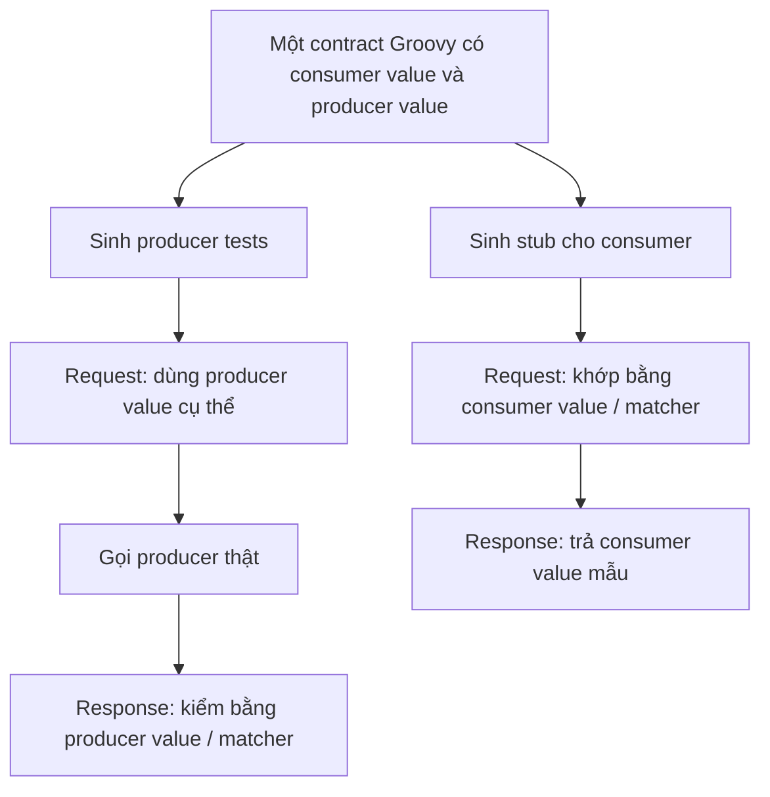
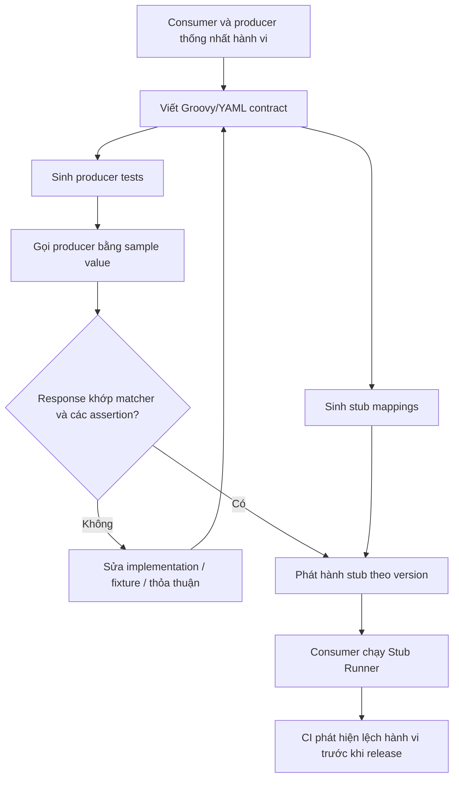

# Mô hình consumer value và producer value

Khi viết hợp đồng bằng **Spring Cloud Contract**, một trường dữ liệu không phải lúc nào cũng có cùng dạng ở cả hai phía. Consumer có thể gửi nhiều mã đơn hàng khác nhau, trong khi bài test phía producer cần một mã cụ thể để tạo dữ liệu kiểm thử. Ngược lại, producer có thể trả về mã giao dịch sinh ngẫu nhiên, nhưng stub của consumer cần một giá trị mẫu ổn định để tiếp tục luồng xử lý.

Đó là lý do Groovy DSL của Spring Cloud Contract có mô hình **consumer value** và **producer value**. Một contract duy nhất có thể mô tả **điều kiện khớp mà consumer cần** và **giá trị/matcher mà producer phải được kiểm tra**. Hai phía cùng dựa vào một thỏa thuận, nhưng các công cụ sử dụng thông tin ấy theo hai cách khác nhau.

Bài học thuộc chương **Giá trị hai phía** của module **Spring Cloud Contract**. Kiến thức này là nền tảng để định nghĩa contract HTTP hoặc message bằng Groovy/YAML DSL, sinh test kiểm chứng producer, phát hành stub, chạy kiểm thử consumer bằng Stub Runner và phát hiện thay đổi API không tương thích trong CI.

Sau bài học, bạn có thể:

- Giải thích `consumer(...)`, `producer(...)`, `value(...)` và `$(...)` trong Groovy DSL.
- Chọn giá trị cố định và biểu thức khớp cho **request** và **response** đúng chiều.
- Theo dấu một contract qua test sinh tự động phía producer và stub dành cho consumer.
- Kiểm soát dữ liệu động như ID, mã đơn hàng, header và Location mà không làm test giòn.
- Nhận biết các matcher quá rộng, fixture sai và những phụ thuộc nghiệp vụ chưa được contract bảo vệ.
- Tổ chức kiểm thử và CI để phát hiện sự lệch nhau giữa hai phía khi API thay đổi.

## 1. Hai phía cùng đọc một contract nhưng dùng nó để làm gì?

Giả sử hệ thống có:

- **Consumer:** `OrderService` cần giữ hàng trước khi xác nhận đơn.
- **Producer:** `InventoryService` cung cấp API `POST /api/v1/reservations`.

Consumer gửi một yêu cầu chứa `orderId`. Trong môi trường thật, các mã `ORD-1001`, `ORD-1002` hoặc `ORD-2048` đều có thể hợp lệ. Nhưng để kiểm thử producer, ta phải biết trước một tình huống có thể dựng dữ liệu, ví dụ `orderId = ORD-1001` với hai sản phẩm `SKU-001` đang có sẵn.

Sau khi xử lý, producer trả về `reservationId`. Trong hệ thống thật, mã này có thể là `RES-701`, `RES-702` hoặc một mã khác được tạo lúc chạy. Nếu generated test buộc producer luôn trả `RES-701`, kiểm thử sẽ thất bại vì một chi tiết động không liên quan đến khả năng đáp ứng giao diện. Trong khi đó, một stub trả `RES-701` là đủ để consumer kiểm tra việc đọc và sử dụng mã giữ hàng.

Ta cần tách **hai mục đích**:

| Mục đích | Đối tượng | Công cụ làm gì? |
| --- | --- | --- |
| Kiểm chứng producer | Ứng dụng producer thật trong môi trường test | Sinh request cụ thể, gọi ứng dụng và so response với các điều kiện đã cam kết |
| Mô phỏng producer cho consumer | Ứng dụng consumer chạy cùng stub | Stub nhận request phù hợp và trả response mẫu để consumer kiểm tra luồng tích hợp |

Điểm cốt lõi là **consumer value và producer value mô tả góc nhìn sử dụng contract**, không đơn giản là “giá trị do consumer gửi” và “giá trị do producer trả”.

## 2. Cú pháp cơ bản của Groovy DSL

Trong Groovy DSL, có thể khai báo một giá trị hai phía bằng:

```groovy
value(consumer(...), producer(...))
```

Cú pháp rút gọn thường thấy:

```groovy
$(consumer(...), producer(...))
```

Các dấu `...` ở đây biểu thị chỗ đặt giá trị/matcher cụ thể, **không phải đoạn Groovy đầy đủ có thể thực thi**.

Hai cách diễn đạt cùng ý tưởng: một bên mô tả cách **consumer-side stub** sử dụng giá trị, bên kia mô tả cách **producer-side generated test** sử dụng nó. Bạn sẽ gặp cả hai trong tài liệu và các repository Spring Cloud Contract.

Ví dụ một đường dẫn động trong **request**:

```groovy
urlPath($(consumer(regex('/api/v1/reservations/[0-9]+')),
          producer('/api/v1/reservations/1042')))
```

Và ví dụ một ID động trong **response**:

```groovy
body([
    reservationId: $(consumer('RES-701'),
                     producer(regex('RES-[0-9]+')))
])
```

Cùng dùng `consumer` và `producer`, nhưng **vị trí của regex và giá trị cụ thể được đảo chiều** giữa request và response.

### Bảng quy tắc cần nhớ

| Đang mô tả | Consumer value thường là | Producer value thường là | Vì sao? |
| --- | --- | --- | --- |
| **Request** | Matcher/regex để stub chấp nhận request của consumer | Giá trị cụ thể để generated test gửi tới producer | Consumer gửi dữ liệu biến thiên; producer test cần đầu vào xác định |
| **Response** | Giá trị cụ thể để stub trả lại cho consumer | Matcher/regex để kiểm tra response thực của producer | Stub cần dữ liệu mẫu; producer có thể trả dữ liệu động |

Đây là **mẫu thiết kế thông dụng**, không phải yêu cầu rằng mọi trường phải có regex. Khi hai phía chỉ cần cùng một giá trị cố định, có thể viết trực tiếp `'HELD'`, `201` hoặc `2`, không cần gói mọi trường vào `$(...)`.

### Sơ đồ luồng dữ liệu



Vì vậy, thứ tự suy nghĩ hữu ích không phải là “ai sở hữu field này?”, mà là “field đang nằm ở **request hay response** và **phía nào cần matcher, phía nào cần giá trị ví dụ**?”.

## 3. Request: consumer value có thể là regex, producer value là ví dụ cụ thể

Giả sử `OrderService` cần gửi mã đơn hàng theo dạng `ORD-` theo sau bởi các chữ số. Ta muốn stub chấp nhận những mã hợp lệ, nhưng producer test chỉ gửi mã đã được chuẩn bị trong fixture.

```groovy
import org.springframework.cloud.contract.spec.Contract

Contract.make {
    name 'create_reservation_order_id_pattern'
    description 'OrderService giữ hàng với orderId theo định dạng đã thỏa thuận'

    request {
        method 'POST'
        url '/api/v1/reservations'
        headers {
            contentType(applicationJson())
        }
        body([
            orderId : $(consumer(regex('ORD-[0-9]+')),
                        producer('ORD-1001')),
            sku     : 'SKU-001',
            quantity: 2
        ])
    }

    response {
        status 201
        headers {
            contentType(applicationJson())
        }
        body([
            reservationId: 'RES-701',
            status       : 'HELD'
        ])
    }
}
```

Contract này nói rằng:

1. **Ở stub:** request có `orderId` thỏa `ORD-[0-9]+` có thể khớp điều kiện của kịch bản, cùng với các điều kiện còn lại như method, URL, `sku` và `quantity`.
2. **Ở producer test:** công cụ dùng `orderId = ORD-1001` để gửi request đến ứng dụng thật.
3. **Ở response:** test ví dụ này vẫn so sánh giá trị cố định `RES-701`; nếu hệ thống sinh ID động, cần đổi field đó sang mô hình response ở phần sau.

Mẫu `ORD-[0-9]+` không tự chứng minh mọi mã đơn tồn tại hoặc được phép giữ hàng. Nó chỉ diễn tả định dạng chấp nhận của request trong contract. Vì vậy, fixture của producer cần có đơn hàng `ORD-1001` hoặc trạng thái nghiệp vụ phù hợp để phản hồi `201`.

### Một matcher rộng đến đâu là đủ?

| Consumer value | Chấp nhận ví dụ | Rủi ro/ý nghĩa |
| --- | --- | --- |
| `regex('ORD-[0-9]+')` | `ORD-1001`, `ORD-55` | Chỉ chấp nhận dạng mã gồm tiền tố và chữ số |
| `regex('ORD-[0-9]{4}')` | `ORD-1001` | Chỉ mã có đúng bốn chữ số |
| `regex('[A-Z0-9-]+')` | `ORD-1001`, `ABC-9` | Rộng hơn; có thể chấp nhận dữ liệu ngoài quy ước |
| `regex('.*')` | Nhiều chuỗi, kể cả rỗng tùy ngữ cảnh | Quá rộng nếu consumer phải gửi order ID hợp lệ |
| `'ORD-1001'` | Chỉ mã cụ thể | Phù hợp khi stub chỉ cần fixture cố định |

Đừng biến một trường có quy tắc rõ ràng thành `.*` chỉ để làm stub “dễ chạy”. Stub có thể nhận request không hợp lệ mà producer thật từ chối, tạo cảm giác tương thích sai.

## 4. Response: producer value là matcher, consumer value là giá trị mẫu

Khi producer tạo reservation, `reservationId` thường được sinh tại thời điểm xử lý. Consumer cần **một ID có định dạng thống nhất** để sử dụng, nhưng generated test không nên yêu cầu mọi lần chạy phải tạo cùng ID.

```groovy
import org.springframework.cloud.contract.spec.Contract

Contract.make {
    name 'create_reservation_dynamic_response_id'
    description 'Producer tạo reservation ID động, consumer nhận ID mẫu từ stub'

    request {
        method 'POST'
        url '/api/v1/reservations'
        headers {
            contentType(applicationJson())
        }
        body([
            orderId : 'ORD-1001',
            sku     : 'SKU-001',
            quantity: 2
        ])
    }

    response {
        status 201
        headers {
            contentType(applicationJson())
        }
        body([
            reservationId: $(consumer('RES-701'),
                             producer(regex('RES-[0-9]+'))),
            status       : 'HELD'
        ])
    }
}
```

Ở **stub**, `consumer('RES-701')` là giá trị có thật trong JSON giả lập. Consumer có thể lấy `reservationId` và tiếp tục kiểm thử việc gọi API xác nhận/hủy lượt giữ.

Ở **producer test**, `producer(regex('RES-[0-9]+'))` yêu cầu giá trị trả về từ producer thật **khớp định dạng**. Nếu ứng dụng trả `reservationId: null`, bỏ field hoặc dùng mã không thỏa regex, test phù hợp phải thất bại.

Việc test khớp regex **không chứng minh** ID là duy nhất, đã được lưu trong database hoặc có thể tra cứu thành công sau đó. Những bảo đảm này cần thêm contract cho request tiếp theo hoặc kiểm thử tích hợp trạng thái.

### Cẩn thận kiểu dữ liệu

JSON phân biệt chuỗi, số, boolean và `null`. Nếu API cam kết `reservationId` là **chuỗi**, nên dùng matcher giữ được yêu cầu về kiểu dữ liệu. Không nên đổi sang một matcher “bất kỳ giá trị nào” rồi vô tình chấp nhận cả JSON number.

Đối với số lượng, giá tiền và thời gian, hãy quy định rõ kiểu JSON, đơn vị và miền giá trị mà consumer thực sự sử dụng. Regex kiểm tra chuỗi số chưa thay thế được các yêu cầu như số nguyên dương, thang tiền tệ hay mốc thời gian hợp lệ.

## 5. Một contract kết hợp giá trị động ở request và response

Ta ghép cả hai chiều vào cùng một kịch bản giữ hàng. Đây là ví dụ xuyên suốt để nhìn thấy đầy đủ cơ chế.

```groovy
import org.springframework.cloud.contract.spec.Contract

Contract.make {
    name 'order_create_reservation_dynamic_values'
    description '''
        OrderService gửi mã đơn hàng hợp lệ để giữ 2 sản phẩm SKU-001.
        InventoryService trả trạng thái HELD cùng reservationId mới.
    '''

    request {
        method 'POST'
        url '/api/v1/reservations'
        headers {
            contentType(applicationJson())
            header('X-Correlation-Id',
                   $(consumer(regex('corr-[0-9]+')),
                     producer('corr-1001')))
        }
        body([
            orderId : $(consumer(regex('ORD-[0-9]+')),
                        producer('ORD-1001')),
            sku     : 'SKU-001',
            quantity: 2
        ])
    }

    response {
        status 201
        headers {
            contentType(applicationJson())
            header('Location',
                   $(consumer('/api/v1/reservations/RES-701'),
                     producer(regex('/api/v1/reservations/RES-[0-9]+'))))
        }
        body([
            reservationId: $(consumer('RES-701'),
                             producer(regex('RES-[0-9]+'))),
            status       : 'HELD'
        ])
    }
}
```

Đây là thỏa thuận HTTP **giả định** để học; đường dẫn, status, tên trường và kiểu ID đều phải được consumer và producer xác nhận trong dự án thực.

Hãy đối chiếu từng field:

| Vị trí | Consumer value | Producer value | Ý nghĩa khi chạy |
| --- | --- | --- | --- |
| Request header `X-Correlation-Id` | `corr-[0-9]+` | `corr-1001` | Stub nhận nhiều correlation ID; test gửi một ID cụ thể |
| Request body `orderId` | `ORD-[0-9]+` | `ORD-1001` | Stub khớp định dạng; test dùng fixture xác định |
| Request body `sku` | `SKU-001` | Cùng giá trị | Không cần matcher nếu kịch bản chỉ xét SKU này |
| Request body `quantity` | `2` | Cùng giá trị | Test yêu cầu giữ đúng hai sản phẩm |
| Response status | `201` | `201` | Stub trả và test kiểm tra status đã thỏa thuận |
| Response header `Location` | `/api/v1/reservations/RES-701` | Matcher path với ID động | Stub cho URI mẫu; test kiểm dạng URI thật |
| Response body `reservationId` | `RES-701` | Matcher `RES-[0-9]+` | Stub cho ID mẫu; test kiểm dạng ID thật |
| Response body `status` | `HELD` | `HELD` | Giá trị nghiệp vụ cố định phải khớp |

**Điểm giới hạn quan trọng:** hai matcher của `Location` và `reservationId` cùng chấp nhận dạng `RES-[0-9]+` nhưng chưa kiểm tra **hai ID có bằng nhau hay không**. Producer có thể trả `Location = .../RES-702` và `reservationId = RES-701` mà cả hai đều khớp regex. Nếu việc đồng nhất ID là cam kết quan trọng, cần assertion liên kết các giá trị hoặc kiểm thử tích hợp phù hợp.

### Producer cần chuẩn bị dữ liệu nào?

Để test thực sự kiểm tra implementation, môi trường kiểm thử producer nên:

1. Chuẩn bị `ORD-1001` và `SKU-001` với số lượng có thể giữ ít nhất bằng hai.
2. Cho phép request có header `X-Correlation-Id: corr-1001`.
3. Gọi controller hoặc HTTP endpoint của producer, không tự trả JSON giống y contract trong base class.
4. Tạo reservation và trả `201`, Location, body với trạng thái `HELD`.
5. Reset fixture hoặc sử dụng dữ liệu riêng cho test để kết quả có thể chạy lại.

Regex của request chỉ định điều kiện matching cho stub; fixture của producer giúp **request mẫu** thực sự dẫn tới nhánh nghiệp vụ mong đợi.

## 6. Giá trị cố định không cần khai báo hai phía

Một sai lầm thường gặp là áp dụng `$(consumer(...), producer(...))` cho *mọi* field, kể cả những field thực tế có cùng giá trị ở hai phía:

```groovy
response {
    status 201
    body([
        status: 'HELD',
        quantityReserved: 2
    ])
}
```

Ở đây `HELD` và `2` là các giá trị cụ thể mà cả stub lẫn producer test cần dùng. Viết đơn giản giúp contract dễ đọc.

Có thể dùng công thức tư duy:

| Bối cảnh | Cách viết |
| --- | --- |
| Hai phía cần cùng literal | Dùng literal trực tiếp |
| Request có nhiều giá trị hợp lệ nhưng producer test cần một ví dụ | `consumer(regex(...))` + `producer(value)` |
| Response của producer có giá trị động nhưng stub cần ví dụ | `consumer(value)` + `producer(regex(...))` |
| Giá trị thay đổi theo request hoặc trạng thái giữa nhiều lời gọi | Cân nhắc dynamic response, matcher liên kết hoặc integration test |

Các regex phải diễn đạt **bảo đảm giao diện**, không phải “cứ match bất cứ thứ gì là pass”. Cũng không nên tạo động trong fixture nếu consumer chỉ cần một hằng nghiệp vụ rõ ràng.

## 7. Áp dụng với path, query parameter và header

Tư duy hai phía có thể dùng cho các thành phần request khác ngoài JSON body.

### Path parameter

```groovy
request {
    method 'GET'
    urlPath($(consumer(regex('/api/v1/reservations/[0-9]+/status')),
              producer('/api/v1/reservations/1042/status')))
}
```

Phần `consumer` cho phép stub nhận những ID số phù hợp. Phần `producer` là URI cố định để generated test gọi producer. ID `1042` phải tồn tại trong fixture nếu response mong đợi là `200`.

Không nhầm chuỗi `/api/v1/reservations/{id}/status` của Spring MVC với cú pháp tự động thay biến trong contract. Khi muốn khớp nhiều URL, cần mô tả matcher thực sự.

### Header

```groovy
request {
    method 'GET'
    url '/api/v1/reservations/1042'
    headers {
        header('X-Correlation-Id',
               $(consumer(regex('corr-[0-9]+')),
                 producer('corr-1001')))
    }
}
```

Trong response cũng có thể dùng giá trị hai phía cho header động, chẳng hạn `Location` như ví dụ ở mục 5. Đừng cố định host và port CI trong Location nếu đó không phải một phần của cam kết với consumer.

### Query parameter

```groovy
request {
    method 'GET'
    urlPath('/api/v1/orders') {
        queryParameters {
            parameter 'externalId',
                      $(consumer(regex('ORD-[0-9]+')),
                        producer('ORD-1001'))
        }
    }
}
```

Đưa query parameter vào khối `queryParameters` giúp phân biệt nó với path và tránh matcher không cần thiết trên toàn bộ URL. Khi dùng DSL cụ thể, cần xác minh cách generator tạo matcher cho query ở phiên bản Spring Cloud Contract của dự án.

## 8. Matcher ở request không có nghĩa producer chấp nhận vô hạn trường hợp

Hãy xem contract thành công có request `orderId` khớp regex `ORD-[0-9]+`.

Stub có thể nhận `ORD-1001` hoặc `ORD-9999`, nhưng producer thật có thể trả `404` với `ORD-9999` nếu đơn hàng chưa tồn tại. Điều này không mâu thuẫn về cú pháp, mà là một **khoảng cách giữa dữ liệu đầu vào và trạng thái nghiệp vụ**.

Để tránh stub gây hiểu nhầm:

- Giới hạn matcher ở những điều kiện consumer cần và producer có thể cam kết.
- Dùng fixture cụ thể cho producer test và tài liệu rõ về điều kiện thành công.
- Tạo contract riêng cho đầu vào hợp lệ về định dạng nhưng thất bại về nghiệp vụ.
- Nếu một stub chứa nhiều mapping, thiết kế các điều kiện request không chồng chéo một cách mâu thuẫn.
- Khi cần stub có trạng thái, cân nhắc các cơ chế được phiên bản Spring Cloud Contract/Stub Runner hỗ trợ và kiểm chứng mapping sinh ra.

Ví dụ, một contract thành công với `orderId = ORD-1001` và một contract không tìm thấy với `orderId = ORD-9999` có thể dùng **hai giá trị cố định** trong stub để tránh xung đột. Regex rộng có thể phù hợp cho trường hợp chỉ cần kiểm luồng xử lý dữ liệu động, nhưng không thay thế cho các trạng thái nghiệp vụ khác nhau.

## 9. Response matcher chỉ kiểm được điều kiện đã khai báo

Giả sử `reservationId` có matcher `RES-[0-9]+`. Các phản hồi sau sẽ cần được đánh giá riêng:

| Response thực tế | Có thỏa mẫu ID không? | Có đủ để kết luận hợp đồng đúng không? |
| --- | --- | --- |
| `"RES-701"` | Có | Còn phải kiểm status, field khác và ngữ nghĩa |
| `"RES-8503"` | Có | Còn phải kiểm trạng thái nghiệp vụ |
| `"reservation-701"` | Không | Vi phạm định dạng đã cam kết |
| `null` | Không | Không có ID hợp lệ |
| Không có field `reservationId` | Không | Thiếu dữ liệu consumer yêu cầu |
| `"RES-701"` nhưng Location chứa `RES-999` | Mỗi field có thể khớp regex | Chưa chứng minh chúng tham chiếu cùng tài nguyên |

Khi consumer dựa vào ID để xác nhận hoặc hủy lượt giữ, cần thêm test cho hành vi đọc/cập nhật theo ID, không chỉ kiểm tra phản hồi đầu tiên. Một generated test từ một tương tác HTTP **không tự động chứng minh** tính duy nhất, tính bền vững của dữ liệu, tính nguyên tử hay idempotency.

### Regex không thay thế kiểu JSON

Ví dụ response body:

```json
{
  "reservationId": "RES-701",
  "quantityReserved": 2,
  "expiresAt": "2026-11-24T05:00:00Z"
}
```

Ba trường có ý nghĩa khác nhau:

- `reservationId` là chuỗi định danh, có thể kiểm bằng mẫu chuỗi.
- `quantityReserved` là số nguyên, cần kiểm kiểu và miền giá trị nếu consumer dựa vào chúng.
- `expiresAt` là thời điểm, cần thống nhất UTC/offset, định dạng và ngữ nghĩa hết hạn.

Một regex cho định dạng thời gian không chứng minh reservation chưa hết hạn. Một regex chỉ chứa các chữ số cũng chưa chứng minh `quantityReserved` lớn hơn 0 hoặc là JSON number. Chọn matcher có ý nghĩa đối với từng loại dữ liệu.

## 10. Dữ liệu động trong YAML DSL

Spring Cloud Contract hỗ trợ cả **Groovy DSL** và **YAML DSL**. Hai cách viết cùng nhắm đến hành vi producer/consumer nhưng không dùng cùng cú pháp cho giá trị động.

Ví dụ YAML **chỉ sử dụng literal**:

```yaml
name: create_reservation_literal
description: OrderService giữ hai sản phẩm bằng dữ liệu kiểm thử cố định
request:
  method: POST
  url: /api/v1/reservations
  headers:
    Content-Type: application/json
  body:
    orderId: ORD-1001
    sku: SKU-001
    quantity: 2
response:
  status: 201
  headers:
    Content-Type: application/json
  body:
    reservationId: RES-701
    status: HELD
```

Ví dụ YAML này mô tả **cùng dữ liệu cụ thể cho hai phía**. Nếu muốn `orderId` có matcher ở stub và `reservationId` có matcher ở generated producer test, hãy dùng cấu trúc matcher của **YAML DSL đúng phiên bản**, thay vì dán nguyên chuỗi Groovy `$(consumer(...), producer(...))` vào YAML.

Một tài liệu hoặc codebase có thể dùng các khối matcher YAML cho request/response, còn Groovy sử dụng `consumer(...)` và `producer(...)`. Khi chuyển đổi định dạng, phải kiểm tra cả **generated test** lẫn **stub mapping**, vì đổi cú pháp không bảo đảm ngữ nghĩa matcher được giữ nguyên.

## 11. Áp dụng tư duy hai phía với message contract

Spring Cloud Contract còn mô tả giao tiếp bằng **thông điệp**. Ví dụ `PaymentService` phát event thành công để `OrderService` tiêu thụ. Producer có thể sinh `paymentId` động, trong khi consumer cần một payload mẫu ổn định trong stub.

Một ví dụ contract message:

```groovy
import org.springframework.cloud.contract.spec.Contract

Contract.make {
    name 'payment_completed_event_dynamic_id'
    description 'OrderService nhận sự kiện thanh toán có paymentId hợp lệ'
    label 'payment_completed'

    input {
        triggeredBy('emitPaymentCompleted()')
    }

    outputMessage {
        sentTo('payments.completed')
        headers {
            header('contentType', 'application/json')
        }
        body([
            orderId  : 'ORD-1001',
            paymentId: $(consumer('PAY-701'),
                         producer(regex('PAY-[0-9]+'))),
            status   : 'COMPLETED'
        ])
    }
}
```

Ở đây `outputMessage` gần với **response phía producer**: test cần kiểm message producer phát ra, trong khi stub cần dữ liệu mẫu cho consumer. Tuy nhiên, message contract còn có cách kích hoạt, nơi phát và cơ chế thu thập message. Producer phải cấu hình message verification phù hợp và cài đặt phương thức `emitPaymentCompleted()` trong môi trường kiểm thử.

**Không suy diễn mọi phần của message DSL là HTTP request/response.** Với message, đầu vào có thể là trigger hoặc message tới, và mục đích so khớp phụ thuộc mô hình tương tác. Hãy xác định đường phát/nhận thực tế và kiểm tra mã test sinh ra khi áp dụng các giá trị động.

## 12. Những sai lầm thường gặp

| Sai lầm | Hậu quả | Cách xử lý |
| --- | --- | --- |
| Hiểu `consumer` luôn là “dữ liệu do consumer gửi” | Đảo chiều value trong response | Xác định phía sử dụng: stub consumer hay producer test |
| Đặt regex ở producer value của request nhưng không có giá trị test cụ thể | Generated test có thể không có đầu vào phù hợp | Request động thường dùng consumer matcher + producer sample |
| Cố định ID phản hồi ngẫu nhiên ở producer test | Test giòn, fail dù API có thể đúng | Response dùng consumer sample + producer matcher |
| Đặt regex quá rộng như `.*` | Stub khớp sai request; test chấp nhận response thiếu ý nghĩa | Chọn matcher sát định dạng, kiểu và miền dữ liệu |
| Producer sample không khớp consumer regex | Test và stub không đại diện cùng một lớp dữ liệu | Đối chiếu giá trị mẫu với pattern |
| Dữ liệu mẫu không tồn tại trong fixture | Producer trả lỗi hợp lệ nhưng contract mong thành công | Chuẩn bị fixture hoặc thay kịch bản |
| Hai stub cùng khớp một request nhưng trả response mâu thuẫn | Consumer test phụ thuộc thứ tự/ưu tiên mapping | Thu hẹp matcher hoặc phân biệt trạng thái |
| Chỉ kiểm ID và Location bằng hai regex riêng | Không phát hiện ID giữa hai nơi khác nhau | Bổ sung assertion liên kết hoặc integration test |
| Cho rằng regex bảo đảm validation nghiệp vụ | Bỏ sót kiểm thử quyền, trạng thái, idempotency | Thêm contract nhánh lỗi và test tích hợp phù hợp |
| Dán cú pháp Groovy `$(...)` vào YAML | Matcher có thể không được hiểu | Dùng schema YAML của đúng phiên bản |
| Không xem test/stub thực tế được sinh | Khó phát hiện chiều value hoặc matcher bị cấu hình sai | Kiểm tra generated tests, stub mappings và chạy thử |

## 13. Đưa cơ chế hai phía vào quy trình CI

Mô hình consumer/producer chỉ phát huy tác dụng khi contract được **kiểm chứng tự động** và stub được **phát hành từ phiên bản producer đã xác minh**.



Trong dự án Maven đã cấu hình Spring Cloud Contract Verifier:

```bash
mvn -B -ntp clean verify
```

Để một kết quả `BUILD SUCCESS` đáng tin cậy, cần xác nhận:

1. Contract của bài thực sự được generator đọc; có generated tests tương ứng.
2. Producer test **được chạy**, gửi đúng dữ liệu mẫu phía `producer` và kiểm được giá trị/matcher của response.
3. Stub artifact chứa matcher request phía `consumer` và response mẫu đúng với contract.
4. Consumer test dùng **đúng phiên bản stub** và các nhánh xử lý nghiệp vụ liên quan.
5. CI chặn phát hành khi producer không còn đáp ứng hợp đồng; thay đổi contract có người phụ trách consumer/producer review.

Một build có **0 contract tests** có thể vẫn xanh nhưng không bảo vệ API. Một stub có regex quá rộng cũng có thể làm consumer test xanh trong tình huống producer thật sẽ từ chối request. Vì vậy, khi thêm matcher mới, hãy kiểm tra **cả producer test và stub**, không chỉ nhìn cú pháp DSL.

## 14. Checklist chọn consumer value và producer value

- [ ] Đã xác định trường nằm ở **request** hay **response**.
- [ ] Biết consumer nào cần dữ liệu và producer cam kết bảo đảm gì.
- [ ] Với request động: consumer matcher có phạm vi chính xác.
- [ ] Với request động: producer sample thỏa matcher và có fixture hợp lệ.
- [ ] Với response động: consumer sample đủ thực tế để chạy stub.
- [ ] Với response động: producer matcher kiểm đúng định dạng và kiểu cần thiết.
- [ ] Các field cố định không bị gói phức tạp vào `$(...)` nếu không cần.
- [ ] Regex không làm stub khớp nhầm nhánh lỗi hoặc endpoint khác.
- [ ] Những quan hệ giữa các field, như ID trong body và Location, được kiểm thêm nếu cần.
- [ ] Không nhầm cú pháp Groovy và matcher YAML.
- [ ] Đã xem test và stub được sinh, chạy thử một input hợp lệ và một input không nên khớp.
- [ ] Đã đưa producer verification và consumer test với Stub Runner vào quy trình CI.

### Bài tập thực hành

Giả sử `BillingService` là producer và `OrderService` là consumer. Khi tạo hóa đơn, consumer gửi:

```http
POST /api/v1/invoices
Content-Type: application/json
X-Correlation-Id: corr-812

{"orderId":"ORD-812","currency":"VND"}
```

Producer trả:

```http
HTTP/1.1 201 Created
Content-Type: application/json
Location: /api/v1/invoices/INV-9001

{"invoiceId":"INV-9001","status":"ISSUED"}
```

Yêu cầu:

1. Viết contract Groovy có `name` và `description` rõ consumer cùng mục đích nghiệp vụ.
2. Trong **request**, cho `orderId` nhận mẫu `ORD-[0-9]+` và `X-Correlation-Id` nhận `corr-[0-9]+` ở stub, còn producer test dùng `ORD-812` và `corr-812`.
3. Trong **response**, cho stub trả `invoiceId = INV-9001`, còn producer test kiểm ID thật khớp `INV-[0-9]+`.
4. Áp dụng cách tương tự cho `Location`, sau đó giải thích vì sao hai matcher riêng vẫn chưa bảo đảm ID trong Location trùng `invoiceId`.
5. Giữ `currency = VND` và `status = ISSUED` làm các giá trị cố định, giải thích vì sao không nhất thiết cần `consumer/producer` cho chúng.
6. Chuẩn bị fixture cho `ORD-812`, sinh producer test và quan sát request thật được gửi đến producer.
7. Dùng Stub Runner thử `ORD-813` và `ORD-ABC` để kiểm tra phạm vi matcher; giải thích rằng stub khớp ID đúng mẫu chưa chứng minh producer đã tạo hóa đơn được cho mọi mã.
8. Cố tình làm producer trả `invoiceId = null` hoặc `status = PENDING` và kiểm tra generated test fail theo điều khoản nào.
9. Đưa test vào CI; chỉ phát hành stub sau khi producer test cùng các kiểm tra bắt buộc khác đều đạt.

**Tiêu chí hoàn thành:** bạn có thể nhìn một biểu thức `$(consumer(...), producer(...))` và nói rõ **stub sẽ dùng phần nào, generated producer test sẽ dùng phần nào, giá trị nào phải cố định, giá trị nào cần matcher và giới hạn kiểm chứng của contract đang nằm ở đâu**.

## Tài liệu tham khảo

- [Spring Cloud Contract — Dynamic Properties](https://docs.spring.io/spring-cloud-contract/reference/project-features-contract/dsl-dynamic-properties.html): các giá trị consumer/producer và đặc tả động.
- [Spring Cloud Contract — HTTP Contracts](https://docs.spring.io/spring-cloud-contract/reference/project-features-contract/http.html): cấu trúc request/response và các loại matcher HTTP.
- [Spring Cloud Contract — Messaging](https://docs.spring.io/spring-cloud-contract/reference/project-features-messaging.html): hợp đồng thông điệp và bước xác minh message.
