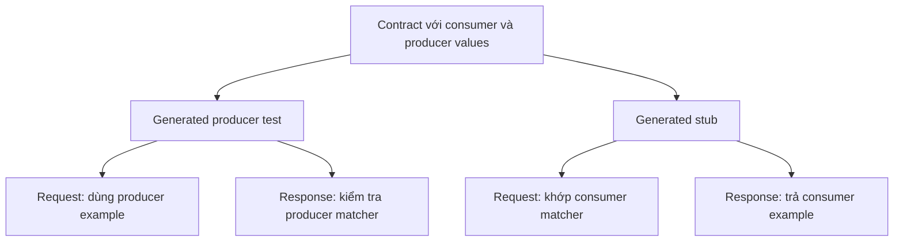
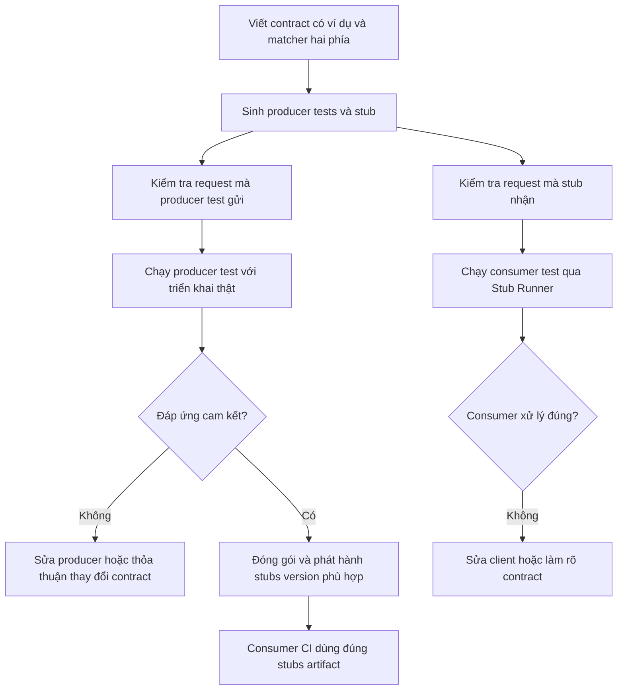

# Vai trò của từng phía trong request và response

## 1. Vì sao Spring Cloud Contract cần giá trị của hai phía?

Trong **Spring Cloud Contract**, một hợp đồng (*contract*) mô tả những hành vi mà dịch vụ cung cấp API (**producer**) cam kết với dịch vụ gọi API (**consumer**). Với HTTP, hợp đồng định nghĩa request và response bằng Groovy hoặc YAML DSL; công cụ có thể sinh kiểm thử xác minh producer, tạo stub cho consumer chạy bằng **Stub Runner**, rồi tích hợp các bước này vào CI để phát hiện thay đổi API không tương thích.

Một vấn đề thường gặp là **cùng một trường dữ liệu cần được sử dụng theo hai cách**. Ví dụ, khi consumer gửi `customerId`, stub phải nhận mọi ID hợp lệ như `cust-123` hoặc `cust-987`; nhưng generated producer test chỉ cần gửi một giá trị cụ thể, có thể tái lập. Ngược lại, khi producer trả mã đơn hàng mới, producer test cần chấp nhận một mã được sinh động theo quy tắc, còn stub cần trả một mã mẫu ổn định để consumer kiểm thử logic của mình.

Groovy DSL của Spring Cloud Contract có các khái niệm **`consumer(...)`** và **`producer(...)`** (thường cũng được diễn đạt bằng tên `client` và `server` trong tài liệu hoặc DSL tương ứng). Chúng cho phép một trường mô tả cả **giá trị/matcher phía consumer** và **giá trị/matcher phía producer**. Điểm dễ nhầm nhất: ý nghĩa của hai phía **không hoán đổi theo hướng HTTP**, nhưng **nơi dùng để so khớp và nơi cần ví dụ cụ thể lại đảo chiều giữa request và response**.

Sau bài này, người học sẽ:

1. Giải thích đúng vai trò của `consumer` và `producer` ở request và response.
2. Chọn bên nào cần **matcher** và bên nào cần **giá trị mẫu** để sinh test/stub.
3. Viết một hợp đồng HTTP với giá trị động và dự đoán hành vi kiểm thử sinh ra.
4. Nhận diện lỗi “đảo hai phía”, matcher quá rộng và ví dụ không hợp lệ.
5. Kiểm tra bằng producer tests, stub, Stub Runner và CI thay vì chỉ nhìn DSL.

## 2. Bảng bốn trường hợp cần ghi nhớ

Ở đây, **producer** là dịch vụ triển khai API thật; **consumer** là dịch vụ gửi request hoặc đọc response. **Producer test** là test được sinh để gọi API thật, còn **stub** là server giả lập được sinh từ contract cho consumer sử dụng.

| Vị trí hợp đồng | Phía `consumer(...)` | Phía `producer(...)` |
| --- | --- | --- |
| **Request** | **Matcher/điều kiện mà stub dùng để nhận request từ consumer** | **Giá trị cụ thể mà generated producer test gửi tới producer** |
| **Response** | **Giá trị cụ thể mà stub trả về cho consumer** | **Matcher/điều kiện mà generated producer test dùng để kiểm tra response thật** |

Đọc bảng theo luồng dữ liệu thực tế:



Trong trường hợp **không cần động**, giá trị cố định giống nhau cho cả hai phía là đủ, ví dụ HTTP `POST`, status `201` hoặc trường `state: CREATED`. Các khái niệm hai phía đặc biệt hữu ích khi request/response có UUID, timestamp, token, mã đơn hàng hoặc dữ liệu khác thay đổi hợp lệ giữa các lần gọi.

> **Quy tắc nhanh:** Ở **request**, consumer “đưa vào stub một điều kiện để khớp”, producer “đưa vào test một ví dụ để gửi”. Ở **response**, consumer “nhận từ stub một ví dụ”, producer “được test theo điều kiện cần giữ”.

## 3. Ví dụ Groovy DSL xuyên suốt: tạo đơn hàng

Giả sử `order-service` có API `POST /api/orders`. Consumer gửi một `customerId` có dạng `cust-` và ba chữ số, cùng `quantity` bằng 2 trong kịch bản này. Khi tạo đơn thành công, producer trả HTTP `201`, trạng thái `CREATED` và một `orderId` được sinh theo định dạng `ord-` + chữ số.

Một tệp hợp đồng tại `src/test/resources/contracts/orders/create-order.groovy` có thể viết:

```groovy
import org.springframework.cloud.contract.spec.Contract

Contract.make {
    description 'Tạo đơn hàng cho khách hàng hợp lệ'

    request {
        method POST()
        url '/api/orders'
        headers {
            contentType(applicationJson())
        }
        body([
            customerId: $(consumer(regex('cust-[0-9]{3}')),
                          producer('cust-123')),
            quantity  : 2
        ])
    }

    response {
        status CREATED()
        headers {
            contentType(applicationJson())
        }
        body([
            orderId: $(consumer('ord-501'),
                       producer(regex('ord-[0-9]+'))),
            state  : 'CREATED'
        ])
    }
}
```

Đây là **một kịch bản cụ thể**, không phải đặc tả toàn bộ API tạo đơn. Ví dụ chỉ chứng minh `customerId` có dạng đã chọn, `quantity = 2` và `orderId` có dạng cần kiểm chứng. Nếu nghiệp vụ yêu cầu mã khách hàng có độ dài khác, giới hạn số lượng, mã đơn hàng phải duy nhất hoặc dữ liệu trả về phải liên kết với request, cần thêm các ràng buộc và kịch bản tương ứng.

### Ý nghĩa chính xác của bốn giá trị

| Biểu thức | Nằm ở đâu? | Dùng để làm gì? |
| --- | --- | --- |
| `consumer(regex('cust-[0-9]{3}'))` | Request | Stub chấp nhận `customerId` khớp định dạng này |
| `producer('cust-123')` | Request | Generated producer test gửi đúng `cust-123` đến API thật |
| `consumer('ord-501')` | Response | Stub trả `ord-501` cho consumer khi request khớp |
| `producer(regex('ord-[0-9]+'))` | Response | Generated producer test kiểm tra `orderId` thật theo regex |

**Các giá trị mẫu phải thỏa mãn matcher của cùng trường.** Ở đây, `cust-123` khớp `cust-[0-9]{3}` và `ord-501` khớp `ord-[0-9]+`. Nếu đặt ví dụ `customerId = user-123` nhưng giữ matcher `cust-[0-9]{3}`, generated producer test có thể sử dụng một request không thuộc tập request mà stub cho là hợp lệ: đây là dấu hiệu contract tự mâu thuẫn.

### Những điều cố định không cần bọc hai phía

Các giá trị `method POST()`, `status CREATED()`, `quantity: 2` và `state: 'CREATED'` không cần `consumer/producer` nếu cùng một giá trị được dùng hợp lý ở cả hai đầu. Chỉ thêm matcher động khi dữ liệu thực sự có nhiều giá trị hợp lệ theo yêu cầu nghiệp vụ.

## 4. Nhìn từ phía generated producer test

Plugin Spring Cloud Contract đọc contract và sinh test phía **producer**. Một đoạn mô tả mang tính minh họa về điều test sẽ làm:

```text
1. Gửi POST /api/orders
   Content-Type: application/json
   Body:
     { "customerId": "cust-123", "quantity": 2 }

2. Kiểm tra response thật của producer:
   HTTP status = 201
   Content-Type = application/json
   JSON field state = "CREATED"
   JSON field orderId khớp /ord-[0-9]+/
```

Generated test **dùng giá trị `producer('cust-123')` để tạo request**: test có dữ liệu xác định để gọi controller/server, không cần tự sinh ID trong mọi lần chạy. Khi kiểm tra response, test **dùng `producer(regex('ord-[0-9]+'))`** để chấp nhận nhiều mã đơn hợp lệ như `ord-501` hoặc `ord-999`.

Một producer trả `orderId = "bad-id"` cần bị phát hiện. Còn một producer trả `orderId = "ord-777"` không nên thất bại chỉ vì mẫu stub là `ord-501`. Tuy nhiên, nếu producer trả sai HTTP `200` hoặc `state = "FAILED"`, test vẫn phải thất bại vì hai điều kiện đó được ràng buộc cố định trong contract.

**Không xem mã giả trên là code generated thực tế.** Cấu trúc lớp Java, framework thử HTTP và assertion tùy plugin/test mode (ví dụ MockMvc hoặc HTTP thật). Khi kiểm tra hành vi, hãy xem mã test được sinh và report test của phiên bản dự án.

## 5. Nhìn từ phía Stub Runner và consumer

Với HTTP, Spring Cloud Contract có thể sinh WireMock mappings/stub từ hợp đồng. Khi consumer test khởi động stub và gửi:

```http
POST /api/orders HTTP/1.1
Content-Type: application/json

{"customerId":"cust-987","quantity":2}
```

Stub sẽ kiểm tra `customerId` theo matcher của **phía consumer ở request** và những điều kiện khác. Nếu request khớp, stub trả dữ liệu mẫu của **phía consumer ở response**:

```http
HTTP/1.1 201 Created
Content-Type: application/json
```

```json
{
  "orderId": "ord-501",
  "state": "CREATED"
}
```

Như vậy request với `cust-987` có thể được stub chấp nhận dù generated producer test chỉ gửi `cust-123`. Ngược lại, stub vẫn trả `ord-501` cho kịch bản ấy dù producer thật có thể tạo `ord-777`. Đây là **chủ đích phân vai**, không phải sự không nhất quán.

Consumer có thể kiểm tra rằng HTTP client của mình đọc response `201`, lấy mã đơn, hiển thị `CREATED` hoặc thực hiện hành vi tiếp theo. Test với Stub Runner xác minh **logic phía consumer trên một response hợp lệ**, còn producer test xác minh **implementation thực tế tuân thủ contract**. Hai loại test bổ sung nhau.

> Stub không tự kiểm tra producer thật. Nếu producer thay đổi mà contract test không chạy, consumer vẫn có thể xanh với một stub cũ. CI cần ghép việc xác minh producer và phát hành đúng version stubs JAR với consumer test.

## 6. Quy tắc chọn giá trị cụ thể và matcher

Trong hợp đồng có hai phía, một giá trị động không có nghĩa “bỏ kiểm tra”. Cần chọn matcher diễn đạt **đúng tập giá trị hợp lệ**, còn phía dùng ví dụ phải có dữ liệu phù hợp với matcher đó.

| Tình huống | Hướng mô tả hợp lý | Nguy cơ khi chọn sai |
| --- | --- | --- |
| `customerId` trong request phải theo format `cust-123` | Request: consumer matcher theo format; producer example xác định | Stub quá dễ dãi hoặc generated test không tạo được request hợp lệ |
| `orderId` trong response được sinh động | Response: consumer example xác định; producer matcher theo format | Producer test khóa ID mẫu nên thất bại khi ID đổi hợp lệ |
| `state` phải đúng `CREATED` trong tình huống thành công | Giá trị cố định, kiểm tra equality | Regex `.*` để lọt giá trị `FAILED` |
| `quantity` phải đúng 2 trong kịch bản | Dữ liệu cố định ở request; có thể thêm kịch bản cho 1, 3, giá trị lỗi | Regex “mọi số” có thể bỏ qua điều kiện nghiệp vụ |
| `createdAt` chỉ cần chuỗi thời gian đúng định dạng | Stub trả timestamp mẫu; producer kiểm tra định dạng hợp lệ | Test trông đợi đúng một timestamp ngẫu nhiên |
| `amount` và `currency` ảnh hưởng tính tiền | Kiểm tra giá trị, kiểu và sự kết hợp có ý nghĩa | Nới toàn bộ field thành regex chung, bỏ sót lỗi tiền tệ |

Matcher kiểu dữ liệu, regex và equality có ý nghĩa khác nhau. `byType` có thể chứng minh đây là chuỗi nhưng không chứng minh đó là mã đơn hợp lệ; regex `ord-[0-9]+` cho biết định dạng nhưng chưa chứng minh ID tương ứng với đúng order đã tạo. Nếu consumer yêu cầu quan hệ giữa request và response, có thể cần kịch bản, state hoặc assertion bổ sung ở mức thích hợp. Một contract đơn lẻ không nhất thiết bảo đảm tính duy nhất toàn hệ thống hoặc mọi bất biến nghiệp vụ.

### Dùng regex khi nào?

Regex phù hợp khi giá trị biến động nhưng có dạng dễ biểu diễn: mã yêu cầu, UUID, mã đơn hàng, timestamp có format. Ví dụ:

```groovy
response {
    status OK()
    body([
        requestId: $(consumer('req-abc123'),
                     producer(regex('req-[A-Za-z0-9]+')))
    ])
}
```

Một regex quá rộng như `.*` làm mất khả năng phát hiện lỗi. Một regex quá chặt như `req-[0-9]{6}` cũng nguy hiểm nếu producer hợp lệ có thể trả chữ cái. Hãy giữ rule phù hợp với giao diện được cam kết, không thiết kế rule theo một giá trị tình cờ thấy trong log.

### Đừng mặc định ví dụ của consumer là dữ liệu production

Trong **response**, `consumer('ord-501')` là **mẫu mà stub trả** cho bài kiểm thử. Nó không có nghĩa producer thật bắt buộc trả `ord-501` hoặc mọi consumer ngoài đời sẽ nhìn thấy mã đó. Trong **request**, `producer('cust-123')` là **input generated test dùng để gọi producer**; không có nghĩa endpoint chỉ nhận duy nhất ID này.

Hai giá trị ví dụ nên có tính quyết định (*deterministic*) để test tái lập được, đồng thời thỏa đúng matcher nghiệp vụ. Không dùng giá trị trông như token thật, thông tin riêng tư hoặc dữ liệu environment phụ thuộc vào bí mật của hệ thống.

## 7. Không chỉ body: request URL, header và response header

Một hợp đồng HTTP có nhiều vị trí chứa dữ liệu động. Dù cùng nguyên tắc consumer/producer, mỗi vị trí có thể yêu cầu cách khai báo khác nhau trong Groovy DSL.

### Request: path, query, header

Ví dụ consumer cần gọi đường dẫn `/api/orders/{id}`, trong đó ID có thể biến đổi. Một số cách khai báo contract cho phép dùng matcher trong URL/path, query hoặc header. Về ý nghĩa:

- **Consumer side của request:** stub dùng để so khớp request thực sự do consumer gửi, ví dụ ID trên path theo regex, header tương ứng hoặc query có giá trị trong miền cho phép.
- **Producer side của request:** generated producer test cần một path/query/header cụ thể để gửi, ví dụ `/api/orders/42` và `Accept: application/json`.

Khi viết DSL, dùng **API đúng cho vị trí dữ liệu**: URL/path matcher khác body JSONPath matcher, còn header có cơ chế matching riêng. Không chép nguyên cú pháp `body` vào `url` rồi mặc định plugin hiểu. Hãy xem stub mapping được sinh và gửi thử một request khớp cùng một request không khớp.

### Response: header sinh động

Header như `X-Request-Id` có thể đổi giữa các request. Nếu consumer chỉ cần nó là mã trace hợp lệ, stub có thể trả `req-abc123` và generated producer test kiểm tra mẫu `req-[A-Za-z0-9]+`. Nếu consumer dựa vào một header cố định như `Content-Type: application/json`, hãy giữ giá trị chính xác hoặc matcher về media type tương ứng với giao thức.

Giá trị dynamic header có thể biểu diễn bằng các biến thể DSL phù hợp theo phiên bản plugin; phần quan trọng vẫn là **stub trả ví dụ của consumer, producer test xác minh theo điều kiện của producer**. Không áp cùng một mẫu matcher lên header `Date`, `Location` hay `ETag` nếu consumer thật sự yêu cầu ngữ nghĩa khác nhau.

### Response: status và lỗi HTTP

Trong ví dụ tạo đơn, HTTP `201` là cam kết cố định. Nếu producer trả `200` nhưng body vẫn có `state: CREATED`, bài kiểm thử phải phát hiện nếu consumer dựa vào `201`. Với lỗi, các status `400`, `404`, `409` cũng là hành vi quan trọng. Những nhánh khác nhau nên được mô tả bằng các contract/kịch bản riêng để consumer kiểm thử cách xử lý HTTP client, không dùng regex “bất kỳ status nào” để hợp thức hóa mọi phản hồi.

## 8. Thể hiện cùng ý nghĩa qua YAML DSL

Groovy `consumer(...)` và `producer(...)` thể hiện rõ hai phía ngay trong một biểu thức. Trong **YAML DSL**, cách biểu đạt phổ biến là đặt **giá trị cụ thể** trong `request.body` hoặc `response.body`, rồi mô tả matcher ở đúng phần `request.matchers` hoặc `response.matchers`.

Một bản YAML minh họa ý nghĩa của contract ở mục 3:

```yaml
description: Tạo đơn hàng cho khách hàng hợp lệ
request:
  method: POST
  url: /api/orders
  headers:
    Content-Type: application/json
  body:
    customerId: "cust-123"
    quantity: 2
  matchers:
    body:
      - path: $.customerId
        type: by_regex
        value: 'cust-[0-9]{3}'
response:
  status: 201
  headers:
    Content-Type: application/json
  body:
    orderId: "ord-501"
    state: "CREATED"
  matchers:
    body:
      - path: $.orderId
        type: by_regex
        value: 'ord-[0-9]+'
```

Ở phần **request**, `body.customerId = cust-123` là ví dụ để generated producer test gửi, còn `request.matchers.body` là điều kiện cho stub khi nhận request consumer. Ở phần **response**, `body.orderId = ord-501` là response mẫu stub trả, còn `response.matchers.body` là điều kiện cho generated producer test kiểm tra response thật.

| Trong Groovy | Trong ý định YAML tương ứng |
| --- | --- |
| Request `consumer(regex(...))` | Matcher đặt ở `request.matchers` |
| Request `producer('cust-123')` | Giá trị `request.body.customerId` |
| Response `consumer('ord-501')` | Giá trị `response.body.orderId` |
| Response `producer(regex(...))` | Matcher đặt ở `response.matchers` |

**Cần kiểm tra schema theo phiên bản Spring Cloud Contract được sử dụng**: danh sách loại matcher, cú pháp và khả năng xử lý JSON number/string có thể khác. Mục tiêu của chuyển định dạng là bảo toàn hành vi sinh test và stub; việc hai DSL cùng parse thành công chưa chứng minh tương đương. Không để cả bản Groovy và YAML trùng cùng kịch bản trong thư mục nguồn chính sau khi hoàn tất chuyển đổi.

## 9. Hai phía trong hợp đồng thông điệp

Spring Cloud Contract không chỉ làm việc với HTTP. Với các hệ thống dùng Kafka, RabbitMQ hoặc cơ chế messaging được tích hợp phù hợp, hợp đồng có thể mô tả message đầu vào, message đầu ra và cách kích hoạt producer.

Về tư duy, vẫn phải hỏi:

- **Phía nào tạo dữ liệu ở thời điểm kiểm thử?** Ví dụ, một consumer gửi message đầu vào vào luồng mà producer xử lý.
- **Phía nào nhận và xác minh dữ liệu?** Ví dụ, consumer nhận event `OrderConfirmed` do producer xuất bản.
- **Đầu ra nào được sinh từ contract?** Producer-side messaging test, stub trigger, payload mẫu hoặc cấu hình gửi/nhận message.
- **Những điều kiện nào là cam kết?** Destination/topic, event type, header, schema, field định danh, nullability, pattern của ID và correlation ID.

Với message đầu ra mang `eventId` sinh động, ý định tương tự response HTTP: producer test cần kiểm tra event ID có dạng hợp lệ, còn consumer test dùng một message mẫu có ID cụ thể và dễ tái lập. Tuy nhiên, đừng tự động coi mọi message là một “HTTP response”: sự kiện một chiều có thể không có request trực tiếp; việc kiểm thử dùng trigger, message input hoặc các cơ chế khác tùy DSL và plugin.

Ví dụ payload event:

```json
{
  "eventId": "evt-701",
  "orderId": "ord-501",
  "eventType": "OrderConfirmed"
}
```

Nếu consumer phân nhánh theo `eventType`, giá trị `OrderConfirmed` cần ổn định; nếu `eventId` chỉ cần đúng định dạng, có thể dùng ví dụ cố định ở stub và matcher phù hợp khi xác minh producer. Nhưng trường `orderId` có thể cần liên hệ với đơn hàng thực tế, không chỉ khớp mẫu regex. Đừng bỏ destination hoặc routing key khi chuyển cùng ý tưởng từ HTTP sang messaging.

## 10. Những lỗi nhầm phía thường gặp

### 10.1. Đảo `consumer` và `producer` trong request

Ví dụ sai về mặt ý định khi muốn stub nhận nhiều `customerId` hợp lệ nhưng lại viết:

```groovy
// SAI VỀ Ý ĐỊNH: đảo matcher và ví dụ ở REQUEST.
customerId: $(consumer('cust-123'),
              producer(regex('cust-[0-9]{3}')))
```

Khi đó phần dùng để match request của stub có nguy cơ bị khóa vào đúng `cust-123`, còn phía producer test lại nhận matcher thay vì một request mẫu cụ thể. Kết quả sinh có thể không hợp lệ hoặc không kiểm tra được luồng mong muốn. Để stub nhận các customer ID phù hợp và producer test có input xác định, phải viết như mục 3:

```groovy
customerId: $(consumer(regex('cust-[0-9]{3}')),
              producer('cust-123'))
```

### 10.2. Đảo hai phía trong response

Nếu mục tiêu là producer có thể sinh nhiều order ID hợp lệ, nhưng stub cần trả một mã mẫu, thì đây là cách viết sai về ý định:

```groovy
// SAI VỀ Ý ĐỊNH: matcher ở consumer side của RESPONSE.
orderId: $(consumer(regex('ord-[0-9]+')),
           producer('ord-501'))
```

Generated producer test có thể bị khóa vào `ord-501`, trong khi stub không có giá trị mẫu cụ thể như đã định. Cách đúng cho kịch bản là:

```groovy
orderId: $(consumer('ord-501'),
           producer(regex('ord-[0-9]+')))
```

### 10.3. Regex làm mất ràng buộc nghiệp vụ

Một matcher `.*` có thể chấp nhận cả chuỗi trống, mã sai định dạng và trạng thái lạ. Nếu `state` chỉ được phép là `CREATED` trong kịch bản, nên giữ equality. Đừng dùng matcher quá rộng chỉ để CI không bị đỏ khi implementation thay đổi.

### 10.4. Ví dụ không thuộc tập matcher

Nếu request định nghĩa `consumer(regex('cust-[0-9]{3}'))` nhưng `producer('usr-999')`, generated producer test dùng input mà stub từ cùng contract không nhận. Quy tắc kiểm tra đơn giản: **mỗi ví dụ cụ thể phải thỏa matcher tương ứng**; CI nên có test hoặc phép kiểm tra phù hợp khi áp dụng giá trị động phức tạp.

### 10.5. Đổi kiểu dữ liệu khi dùng matcher

Một chuỗi ID như `"ord-501"` khác kiểu JSON number như `501`. Nếu body YAML khai báo `orderId: 501` trong khi Groovy gốc dùng `'ord-501'`, hợp đồng không còn tương đương. Với số tiền, ngày giờ và nullability, không nên dùng regex string thay thế kiểm tra kiểu dữ liệu mà consumer phụ thuộc.

### 10.6. Quên phân biệt logic sinh test và logic sinh stub

Một producer test pass với `cust-123` không chứng minh mọi ID khách hàng đều xử lý được; matcher trên request stub có thể rộng hơn tập dữ liệu mà producer test cụ thể dùng. Ngược lại, consumer test pass với `ord-501` không chứng minh producer đã triển khai đúng định dạng ID, vì stub có thể trả giá trị đó ngay cả khi producer thật chưa chạy.

### 10.7. Đặt matcher ở đúng phía nhưng sai vị trí

Matcher JSONPath `$.customerId` dưới response không tương đương matcher cùng đường dẫn dưới request. Phải kiểm tra đúng vùng `request`/`response`, header, URL, body và các metadata cần thiết. Với các DSL có cơ chế so khớp riêng cho query/path/header, cần dùng cấu trúc tương ứng.

## 11. Quy trình thực hành và kiểm chứng trên hai phía



Một quy trình phù hợp cho lab Spring Cloud Contract:

1. **Chọn một contract nhỏ:** như `create-order.groovy` ở mục 3, với một matcher request và một matcher response để quan sát rõ sự khác nhau.
2. **Viết bảng kỳ vọng:** producer test gửi `cust-123`; stub nhận mọi `cust-XYZ` thỏa mẫu; producer test nhận `ord-...` theo regex; stub trả `ord-501`.
3. **Cấu hình producer test base class:** tạo môi trường chạy controller/HTTP server và dữ liệu thử xác định; cần bảo đảm request `cust-123` thực sự được xử lý để trả `201`.
4. **Sinh và chạy producer tests:** với dự án Maven đã cấu hình plugin, ví dụ `./mvnw clean verify`; với Gradle, gọi các task contract-test được plugin phiên bản dự án cung cấp. Xác nhận **generated tests thật sự được chạy**, không chỉ thấy build xanh.
5. **Kiểm tra artifact stub:** xem mapping request có dùng matcher cho `customerId` và response có `ord-501`, `CREATED` đúng mẫu không. Cấu trúc output cụ thể tùy version plugin.
6. **Chạy consumer tests với Stub Runner:** trỏ HTTP client đến stub, gửi ít nhất hai customer ID hợp lệ, kiểm tra code xử lý body trả về; thử một ID sai mẫu để bảo đảm không match nhầm.
7. **Kiểm thử thay đổi không tương thích:** cho producer trả `orderId = "INVALID"` hoặc `state = "FAILED"`; generated producer test phải phát hiện. Cho producer trả `ord-777` đúng regex thì không nên thất bại vì mã ví dụ khác.
8. **Ghim version và CI:** phát hành stubs JAR sau khi producer tests pass, ghi rõ artifact version mà consumer CI dùng để tránh test với một lời hứa cũ.

### Bảng kiểm thử đối chứng

| Thử nghiệm | Producer test | Consumer stub test | Điều được chứng minh |
| --- | --- | --- | --- |
| Producer nhận `cust-123`, trả `ord-777` và `CREATED` | Phải pass nếu đủ điều kiện | Không chạy producer thật | Producer đáp ứng matcher response |
| Producer trả `orderId = bad-id` | Phải fail | Không kiểm chứng producer | Matcher phía producer hoạt động |
| Consumer gửi `cust-987` với `quantity = 2` | Không phải input mặc định của generated producer test | Stub nên match | Matcher phía consumer ở request hoạt động |
| Consumer gửi `customerId = xyz` | Không phải input mặc định | Stub không nên match mapping này | Request matcher đủ chặt |
| Stub trả `ord-501`, `CREATED` | Không xác minh implementation thật | Consumer phải xử lý đúng | Giá trị mẫu response phù hợp |
| Producer đổi `state` sang `FAILED` | Phải fail | Stub cũ vẫn có thể trả `CREATED` | Equality bảo vệ giá trị cố định |

Lưu ý: một request không match mapping có thể nhận HTTP `404` từ WireMock. **Đừng coi HTTP 404 đó là response lỗi nghiệp vụ đã cam kết**, trừ khi có một mapping rõ ràng mô tả chính nhánh lỗi ấy và consumer test kiểm tra đủ mã lỗi/headers/body.

## 12. Bài tập: sửa hợp đồng bị đảo phía

Một nhóm xây API phát hành voucher. Consumer gửi `POST /api/vouchers` với `customerCode` có dạng `C-####`, producer trả `voucherId` dạng `V-####` và `status = ISSUED`. Contract hiện tại:

```groovy
request {
    method POST()
    url '/api/vouchers'
    headers {
        contentType(applicationJson())
    }
    body([
        customerCode: $(consumer('C-0042'),
                        producer(regex('C-[0-9]{4}')))
    ])
}
response {
    status CREATED()
    headers {
        contentType(applicationJson())
    }
    body([
        voucherId: $(consumer(regex('V-[0-9]{4}')),
                     producer('V-0101')),
        status: 'ISSUED'
    ])
}
```

**Yêu cầu:**

1. Xác định hai vị trí đang bị đảo giữa matcher và ví dụ; giải thích tác động lên generated producer test và stub.
2. Viết lại các cặp `consumer/producer` để stub nhận mọi `customerCode` hợp lệ và trả `voucherId` mẫu `V-0101`; producer test gửi `C-0042` và chấp nhận voucher ID đúng định dạng.
3. Nêu vì sao `status: 'ISSUED'` nên là equality cho kịch bản này.
4. Dự đoán kết quả khi producer trả `voucherId = V-9999`, `voucherId = BAD` hoặc `status = CANCELLED`.
5. Kiểm tra bằng mã producer test và WireMock mapping thực tế được sinh, thay vì chỉ đọc cú pháp Groovy.

### Gợi ý đáp án

Hai trường động nên được sửa thành:

```groovy
request {
    method POST()
    url '/api/vouchers'
    headers {
        contentType(applicationJson())
    }
    body([
        customerCode: $(consumer(regex('C-[0-9]{4}')),
                        producer('C-0042'))
    ])
}
response {
    status CREATED()
    headers {
        contentType(applicationJson())
    }
    body([
        voucherId: $(consumer('V-0101'),
                     producer(regex('V-[0-9]{4}'))),
        status: 'ISSUED'
    ])
}
```

Generated producer test gửi `C-0042`, kiểm tra response `201`, `status = ISSUED` và `voucherId` theo regex. Stub nhận request có `customerCode` khớp mẫu `C-[0-9]{4}` và trả mẫu `V-0101`. Do đó `V-9999` là giá trị hợp lệ, còn `BAD` không thỏa quy tắc. `CANCELLED` không phù hợp kịch bản phát hành thành công nên phải bị phát hiện dù `voucherId` có đúng format.

**Mở rộng:** Nếu nghiệp vụ đòi `voucherId` là duy nhất và không thể trùng sau mỗi lần phát hành, chỉ regex chưa đủ. Hãy bổ sung kiểm thử nghiệp vụ hoặc hợp đồng phù hợp để bảo vệ những bất biến cần thiết; không hứa rằng matcher regex tự chứng minh tính duy nhất.

## 13. Checklist trước khi lưu và phát hành hợp đồng hai phía

- [ ] Đã xác định rõ **producer là dịch vụ cung cấp**, **consumer là dịch vụ gọi/tiêu thụ**, không phụ thuộc bên nào lưu file contract.
- [ ] Với **request**, matcher consumer quyết định stub nhận gì; giá trị producer quyết định generated producer test gửi gì.
- [ ] Với **response**, giá trị consumer quyết định stub trả gì; matcher producer quyết định generated producer test chấp nhận gì.
- [ ] Mỗi giá trị ví dụ thỏa matcher tương ứng và có thể tái lập trong môi trường test.
- [ ] Những giá trị cố định có ý nghĩa nghiệp vụ, như HTTP status hoặc `state`, vẫn được kiểm tra chặt.
- [ ] Regex, kiểu dữ liệu, header, path, query và nullability phản ánh đúng điều consumer cần.
- [ ] Những matcher trên YAML/Groovy được khai báo đúng phần request/response theo version plugin đang sử dụng.
- [ ] Đã kiểm tra mã producer test và stub được sinh, chạy thử cả request hợp lệ và không hợp lệ.
- [ ] Producer test pass với giá trị động hợp lệ và fail với thay đổi phá vỡ; consumer test dùng Stub Runner hoạt động đúng.
- [ ] CI chỉ phát hành stubs JAR của hợp đồng đã được producer xác minh và consumer dùng đúng phiên bản.

**Ghi nhớ:** `consumer(...)` và `producer(...)` chỉ tên **phía tham gia hợp đồng**. Trong **request**, phía consumer định nghĩa điều kiện cho stub, còn phía producer cung cấp input mẫu cho generated test. Trong **response**, phía consumer cung cấp response mẫu của stub, còn phía producer định nghĩa điều kiện xác minh response thật. Nắm đúng bốn vai trò này giúp viết hợp đồng động đủ chặt để phát hiện API không tương thích mà vẫn đủ linh hoạt cho dữ liệu thay đổi hợp lệ.
