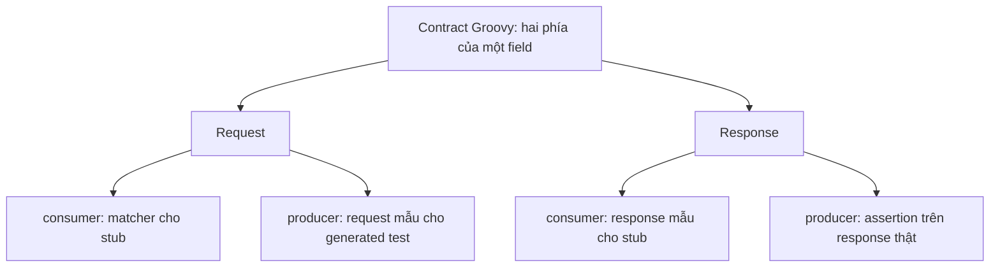
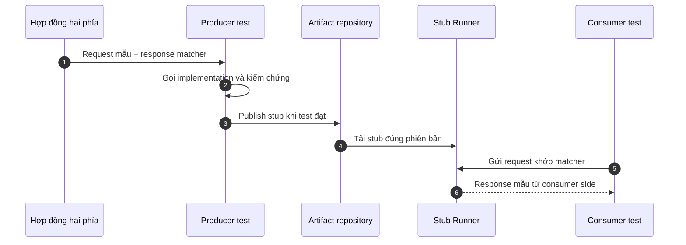

# Biểu diễn value, consumer, producer và các dạng viết gọn

> **Chương:** Giá trị hai phía  
> **Module:** Spring Cloud Contract (`SPRING_CLOUD_CONTRACT`) — kiểm thử hợp đồng giữa producer và consumer bằng Groovy/YAML DSL, sinh test phía cung cấp, phát hành stub, chạy Stub Runner và kiểm soát thay đổi API qua CI.

## Mục tiêu học tập

Sau bài này, bạn có thể:

1. Giải thích ý nghĩa của **giá trị hai phía** trong Spring Cloud Contract và lý do cùng một field có thể cần giá trị khác nhau khi sinh stub và khi sinh test.
2. Phân biệt `consumer(...)` và `producer(...)` trong cả **request** lẫn **response**, không bị nhầm vì chiều dữ liệu HTTP.
3. Viết `value(consumer(...), producer(...))`, `$(consumer(...), producer(...))` cùng các alias `c/p`, `stub/test` và `client/server`.
4. Dùng cách viết gọn một phía và helper `any...()` trong những trường hợp phù hợp.
5. Chuyển một hợp đồng Groovy có giá trị động sang **YAML với matchers**, bảo toàn hành vi.
6. Kiểm tra test producer, stub của consumer và quy trình CI khi API có mã định danh, mã tương quan hoặc dữ liệu khác nhau theo mỗi request.

## 1. Vì sao cần hai giá trị cho cùng một trường?

Giả sử hai dịch vụ trao đổi qua HTTP:

- **`checkout-service` — consumer:** tạo yêu cầu nhận báo giá.
- **`quote-service` — producer:** nhận yêu cầu và trả mã báo giá mới.

Consumer gửi:

```http
POST /api/quotes HTTP/1.1
Content-Type: application/json
Accept: application/json

{
  "clientRequestId": "REQ-0042",
  "sku": "SKU-001",
  "quantity": 2
}
```

Producer trả:

```http
HTTP/1.1 201 Created
Content-Type: application/json

{
  "quoteId": "62bf989a-2c31-49d2-a10d-56d4764088b4",
  "status": "CREATED",
  "amount": 100000
}
```

Ở ví dụ này:

- Mỗi lần consumer tạo yêu cầu, `clientRequestId` có thể thay đổi: `REQ-0042`, `REQ-0103` hoặc `REQ-9999`.
- Producer tự sinh `quoteId`; mỗi lần gọi có thể là một UUID khác.
- Consumer vẫn cần kiểm tra trạng thái `CREATED` và số tiền `100000` cho tình huống đã định.

Nếu contract cố định **request ID** vào `REQ-0042`, Stub Runner chỉ có thể khớp một request trong khi client thật sinh ID mới. Nếu contract cố định **response ID** vào một UUID mẫu, test phía producer có thể thất bại dù producer sinh UUID hợp lệ.

Giải pháp của Spring Cloud Contract là mô tả **cùng một field nhưng có thể có cách biểu diễn riêng cho phía consumer và phía producer**. Cơ chế này đặc biệt hữu ích với UUID, timestamp, mã giao dịch, correlation ID, URL có biến và dữ liệu động.

## 2. Hiểu đúng hai phía trong Spring Cloud Contract

Trong Groovy DSL, một giá trị động có thể viết:

```groovy
value(
    consumer(...),
    producer(...)
)
```

Hai nhánh **không đơn giản có nghĩa là "giá trị request" và "giá trị response"**. Chúng là hai **góc nhìn khi Spring Cloud Contract sinh ra các artifact khác nhau**:

- `consumer(...)`: giá trị hoặc quy tắc cần đưa vào **stub cho consumer dùng**.
- `producer(...)`: giá trị hoặc quy tắc cần đưa vào **test kiểm chứng triển khai của producer**.

Điểm đảo chiều xuất hiện vì:

- Trong **request**, stub cần nhận **nhiều request hợp lệ** từ consumer, còn test producer cần **một request cụ thể** để gửi.
- Trong **response**, stub cần **một response mẫu cụ thể** trả cho consumer, còn test producer thường cần **kiểm tra quy tắc** trên response động.

### 2.1. Ma trận phải nhớ

| Vị trí field trong contract | `consumer(...)` / phía stub | `producer(...)` / phía test |
| --- | --- | --- |
| **Request** | Điều kiện khớp request consumer gửi; có thể là regex | Giá trị cụ thể mà test sinh ra gửi tới producer |
| **Response** | Giá trị cụ thể mà stub trả cho consumer | Giá trị/điều kiện dùng để kiểm chứng response thật của producer |
| **Ví dụ request ID** | `regex('REQ-[0-9]{4}')` | `'REQ-0042'` |
| **Ví dụ response UUID** | `'62bf989a-2c31-49d2-a10d-56d4764088b4'` | `regex('...UUID...')` |

Một cách ghi nhớ: **request: consumer khớp, producer gửi; response: consumer nhận, producer bị kiểm tra**.



### 2.2. Những gì hai nhánh không tự bảo đảm

Một request matcher dạng `REQ-[0-9]{4}` có thể giúp stub nhận `REQ-0731`; nó **không tự chứng minh** rằng API thật cũng chấp nhận mọi mã phù hợp. Producer verification chỉ gửi những request mẫu mà test sinh ra. Nếu hành vi cho nhiều biến thể là yêu cầu, cần thêm test dữ liệu khác hoặc các contract liên quan.

Tương tự, producer response matcher kiểu UUID kiểm tra định dạng, **không chứng minh** hai lần gọi trả UUID duy nhất. Tính duy nhất, tính hợp lệ nghiệp vụ và quan hệ giữa các field cần những bài unit/integration test tương ứng.

## 3. Cú pháp đầy đủ: value(consumer, producer)

Đặt đoạn sau trong khối `request` của một Groovy contract:

```groovy
body(
    clientRequestId: value(
        consumer(regex('REQ-[0-9]{4}')),
        producer('REQ-0042')
    ),
    sku: 'SKU-001',
    quantity: 2
)
```

Cách hiểu:

1. `consumer(regex('REQ-[0-9]{4}'))` làm cho stub chấp nhận các request ID theo mẫu.
2. `producer('REQ-0042')` làm cho producer verification test gửi **giá trị cụ thể** `REQ-0042`.
3. `sku` và `quantity` là các giá trị cố định trong cả hai phía, vì tình huống đang kiểm tra không cần chúng động.

Ở khối `response`, ta làm điều ngược lại:

```groovy
body(
    quoteId: value(
        consumer('62bf989a-2c31-49d2-a10d-56d4764088b4'),
        producer(regex(
            '[0-9a-fA-F]{8}-[0-9a-fA-F]{4}-[0-9a-fA-F]{4}-[0-9a-fA-F]{4}-[0-9a-fA-F]{12}'
        ))
    ),
    status: 'CREATED',
    amount: 100000
)
```

- Stub trả mã `quoteId` cụ thể và ổn định để consumer parse được.
- Producer test cho phép UUID khác giá trị mẫu, miễn thỏa regex.
- `status` và `amount` vẫn phải bằng giá trị kỳ vọng trong contract.

**Vì sao regex trong response nằm ở `producer`?** Vì đây là quy tắc kiểm chứng **response thật do producer tạo ra**. Nếu đặt regex ở nhánh `consumer` của response, bạn đã diễn đạt một giá trị không phù hợp để trả trực tiếp từ HTTP stub cho ứng dụng consumer.

## 4. Dạng viết gọn bằng $()

Trong Groovy DSL, khi viết body theo map notation, `value(...)` có thể rút gọn thành `$(...)`:

```groovy
body(
    clientRequestId: $(
        consumer(regex('REQ-[0-9]{4}')),
        producer('REQ-0042')
    ),
    sku: 'SKU-001',
    quantity: 2
)
```

Đoạn này tương đương về vai trò hai phía với phiên bản `value(...)` trong request ở mục 3.

Response cũng tương tự:

```groovy
body(
    quoteId: $(
        consumer('62bf989a-2c31-49d2-a10d-56d4764088b4'),
        producer(regex(
            '[0-9a-fA-F]{8}-[0-9a-fA-F]{4}-[0-9a-fA-F]{4}-[0-9a-fA-F]{4}-[0-9a-fA-F]{12}'
        ))
    ),
    status: 'CREATED',
    amount: 100000
)
```

`$` ở đây là **một helper của Contract DSL**, không phải ký hiệu biến môi trường hay cú pháp Groovy `GString`. Bọc giá trị bằng `$(...)` giúp giữ cấu trúc của dữ liệu trong map.

Một số project thích dùng `value(...)` để người mới thấy rõ đây là *giá trị DSL*, còn `$(...)` khi có nhiều field để bớt dài. Cả hai cách đều được Spring Cloud Contract hỗ trợ.

## 5. Các alias và dạng ngắn c/p, stub/test, client/server

Spring Cloud Contract hỗ trợ nhiều tên khác nhau cho hai phía:

| Cách viết | Consumer side | Producer side | Ý nghĩa |
| --- | --- | --- | --- |
| Dạng đầy đủ | `consumer(...)` | `producer(...)` | Gọi tên theo vai trò |
| Dạng ngắn | `c(...)` | `p(...)` | Viết gọn cho contract dài |
| Theo artifact | `stub(...)` | `test(...)` | Nhấn mạnh stub và producer test |
| Theo hệ thống | `client(...)` | `server(...)` | Nhấn mạnh HTTP client và server |

Vì vậy, những cách viết sau biểu diễn **cùng một cặp giá trị**:

```groovy
value(consumer('ABC-001'), producer(regex('ABC-[0-9]{3}')))
value(c('ABC-001'), p(regex('ABC-[0-9]{3}')))
value(stub('ABC-001'), test(regex('ABC-[0-9]{3}')))
value(client('ABC-001'), server(regex('ABC-[0-9]{3}')))
```

Và những cách viết này cũng tương đương:

```groovy
$(consumer('ABC-001'), producer(regex('ABC-[0-9]{3}')))
$(c('ABC-001'), p(regex('ABC-[0-9]{3}')))
$(stub('ABC-001'), test(regex('ABC-[0-9]{3}')))
$(client('ABC-001'), server(regex('ABC-[0-9]{3}')))
```

Tất cả các dòng trên là **những biểu thức thay thế nhau** ở một vị trí phù hợp trong contract. Đừng đặt tám biểu thức liên tiếp vào cùng một field; chọn một cách và giữ nhất quán trong repository.

### 5.1. Hai nhầm lẫn về alias

- `test(...)` **không có nghĩa** là "đoạn này chỉ xuất hiện trong mã test viết tay". Nó biểu diễn giá trị/điều kiện của **producer verification test được sinh**.
- `server(...)` **không phải** một lời gọi HTTP tới server ở thời điểm viết contract; nó là alias cho phía `producer(...)`.

`stub` và `client` là alias cho `consumer`; `test` và `server` là alias cho `producer`. Do đó quy tắc request/response ở mục 2 vẫn giữ nguyên khi thay tên alias.

## 6. Ví dụ Groovy hoàn chỉnh: cùng một hợp đồng cho hai phía

Tạo file `src/test/resources/contracts/quote_created.groovy` trong dự án producer:

```groovy
org.springframework.cloud.contract.spec.Contract.make {
    name 'quote_created'

    request {
        method 'POST'
        url '/api/quotes'
        headers {
            contentType(applicationJson())
            header 'Accept': 'application/json'
            header 'X-Correlation-Id': $(
                consumer(regex('corr-[0-9]{4}')),
                producer('corr-0042')
            )
        }
        body(
            clientRequestId: value(
                consumer(regex('REQ-[0-9]{4}')),
                producer('REQ-0042')
            ),
            sku: 'SKU-001',
            quantity: 2
        )
    }

    response {
        status 201
        headers {
            contentType(applicationJson())
        }
        body(
            quoteId: $(
                consumer('62bf989a-2c31-49d2-a10d-56d4764088b4'),
                producer(regex(
                    '[0-9a-fA-F]{8}-[0-9a-fA-F]{4}-[0-9a-fA-F]{4}-[0-9a-fA-F]{4}-[0-9a-fA-F]{12}'
                ))
            ),
            status: 'CREATED',
            amount: 100000
        )
    }
}
```

Contract có một tình huống HTTP: tạo báo giá thành công. Nó thể hiện **cả request lẫn response** có dữ liệu động mà không bỏ đi những kiểm tra quan trọng.

### 6.1. Phía consumer sẽ nhìn thấy gì?

Giả sử Stub Runner khởi động stub từ contract trên. Consumer gọi:

```http
POST /api/quotes HTTP/1.1
Content-Type: application/json
Accept: application/json
X-Correlation-Id: corr-0723

{
  "clientRequestId": "REQ-0234",
  "sku": "SKU-001",
  "quantity": 2
}
```

Stub có thể **khớp** `corr-0723` và `REQ-0234` vì chúng cùng thỏa regex. Response mẫu là:

```http
HTTP/1.1 201 Created
Content-Type: application/json

{
  "quoteId": "62bf989a-2c31-49d2-a10d-56d4764088b4",
  "status": "CREATED",
  "amount": 100000
}
```

Nếu consumer dùng `clientRequestId: "bad"`, stub không khớp matcher cho request đó. Trong WireMock, trường hợp không có mapping khớp thường nhận 404; đó là **hành vi của stub** và không tự khẳng định producer thật phải trả 404 cho giá trị không hợp lệ.

### 6.2. Phía producer verification sẽ nhìn thấy gì?

Test producer được sinh sẽ gửi một request **cụ thể** gần như:

```http
POST /api/quotes HTTP/1.1
Content-Type: application/json
Accept: application/json
X-Correlation-Id: corr-0042

{
  "clientRequestId": "REQ-0042",
  "sku": "SKU-001",
  "quantity": 2
}
```

Sau đó kiểm tra producer trả `201`, `Content-Type: application/json`, body có `status: CREATED` và `amount: 100000`; riêng `quoteId` được kiểm chứng theo regex UUID.

Producer không bị ép trả chính `62bf989a-2c31-49d2-a10d-56d4764088b4`. Nếu ứng dụng tự sinh UUID khác nhưng hợp lệ, contract verification vẫn có thể đạt.

### 6.3. Phần nào vẫn chưa được kiểm chứng?

Dù producer test đạt, ta chưa chứng minh:

- Producer thực sự từ chối **mọi** request ID sai mẫu (vì generated test gửi một mẫu hợp lệ).
- Header `X-Correlation-Id` phải bắt buộc trong mọi đường đi hoặc phải được echo lại ở response.
- Hai lần gọi tạo hai `quoteId` khác nhau.
- `amount` được tính đúng ở mọi tổ hợp SKU và quantity.

Các quy tắc trên cần thêm contract cho trường hợp âm tính, unit/integration test hoặc các tình huống E2E phù hợp.

## 7. Các dạng viết gọn chỉ khai báo một phía

Khi bạn chỉ đưa ra **một phía có regex**, Spring Cloud Contract có thể tự sinh một giá trị phía còn lại **thỏa regex**. Ví dụ trong request Groovy DSL:

```groovy
request {
    method 'GET'
    url value(consumer(regex('/api/quotes/[0-9]{5}')))
}
```

- Phía stub có regex để khớp nhiều URL như `/api/quotes/12345` và `/api/quotes/54321`.
- Phía test producer được công cụ tạo **một URL cụ thể** khớp regex để gọi implementation.

Trong response:

```groovy
response {
    status 200
    body(
        referenceCode: $(producer(regex('Q-[0-9]{5}')))
    )
}
```

- Producer verification kiểm tra mã theo regex `Q-[0-9]{5}`.
- Công cụ có thể tạo một **giá trị mẫu phía consumer/stub** khớp regex.

### 7.1. Khi nào nên dùng cách một phía?

Cách viết này phù hợp khi **giá trị mẫu không mang ý nghĩa đặc biệt**: một mã giả chỉ cần đúng định dạng, một response ID để consumer thử parse hoặc một request path bất kỳ phục vụ test.

Nhưng khi producer test cần **trúng đúng dữ liệu đã chuẩn bị**, hãy khai báo cả hai phía:

```groovy
url value(
    consumer(regex('/api/quotes/[0-9]{5}')),
    producer('/api/quotes/12345')
)
```

Nếu không, test có thể gửi một mã được sinh ra ngẫu nhiên nhưng database test không có bản ghi ấy; response sẽ thành `404` và test đỏ do **dữ liệu kiểm thử**, không phải do contract sai.

Với response, nếu consumer test có assertion so sánh đúng một ID mẫu, cũng nên cung cấp cụ thể:

```groovy
body(
    referenceCode: value(
        consumer('Q-00421'),
        producer(regex('Q-[0-9]{5}'))
    )
)
```

**Lưu ý về regex và sinh dữ liệu:** cơ chế sinh chuỗi khớp regex có giới hạn. Tài liệu Spring Cloud Contract lưu ý tránh dùng `^` và `$` nếu phụ thuộc vào tính năng tự sinh chuỗi. Khi format phức tạp, nên ghi rõ giá trị mẫu và kiểm tra đầu ra sinh test/stub.

## 8. Những helper any...() rút ngắn việc khai báo matcher

Spring Cloud Contract cung cấp nhiều helper cho kiểu dữ liệu phổ biến, ví dụ:

| Helper Groovy | Nhu cầu biểu diễn |
| --- | --- |
| `anyUuid()` | UUID |
| `anyInteger()` | Số nguyên |
| `anyPositiveInt()` | Số nguyên dương |
| `anyNumber()` | Giá trị số |
| `anyAlphaNumeric()` | Chuỗi chữ-số |
| `anyEmail()` | Email |
| `anyUrl()` | URL |
| `anyDate()` | Ngày |
| `anyDateTime()` | Ngày giờ |
| `anyIso8601WithOffset()` | Ngày giờ ISO 8601 có offset |
| `anyNonBlankString()` | Chuỗi không chỉ gồm khoảng trắng |
| `aBoolean()` | Boolean |

Thay vì viết regex UUID dài, bạn có thể dùng:

```groovy
response {
    status 201
    body(
        quoteId: $(anyUuid()),
        amount: $(anyNumber()),
        status: 'CREATED'
    )
}
```

Đây là cú pháp ngắn gọn được hỗ trợ trong Groovy DSL. Tuy nhiên cần kiểm tra **kết quả sinh**: những helper dùng regex/matcher có thể dẫn đến giá trị phía còn lại được tạo tự động. Nếu consumer cần response mẫu ổn định hoặc producer test cần dữ liệu định sẵn, dạng hai phía tường minh thường dễ kiểm soát hơn.

Bên cạnh đó, `anyNumber()` không tự chứng minh **số tiền dương** hay **đúng công thức tính giá**. Nếu hợp đồng cam kết `amount = 100000`, hãy giữ assertion chính xác; nếu cam kết `amount > 0`, cần kiểm tra quy tắc đó bằng matcher/hàm kiểm tra hoặc test nghiệp vụ tương ứng.

## 9. Dùng giá trị hai phía trong header và URL

Cặp `consumer/producer` không giới hạn ở JSON body. Groovy DSL cho phép dùng ở những thành phần khác như URL, request headers hoặc response headers khi biểu diễn giá trị động.

### 9.1. Header request động

```groovy
headers {
    contentType(applicationJson())
    header 'X-Request-Id': value(
        consumer(regex('req-[0-9]{4}')),
        producer('req-0042')
    )
}
```

Phía consumer gửi các request ID đúng mẫu; producer test gửi `req-0042`. Nếu header này là một phần yêu cầu an toàn hoặc phân quyền, test thành công với một giá trị hợp lệ vẫn **không chứng minh** các giá trị bị cấm sẽ bị từ chối.

### 9.2. URL chứa tham số động

```groovy
request {
    method 'GET'
    url $(
        consumer(regex('/api/orders/[0-9]{2}')),
        producer('/api/orders/42')
    )
}
```

Stub có thể khớp đường dẫn khác nhau có hai chữ số. Producer test gọi `/api/orders/42`, phù hợp khi bạn đã tạo sẵn đơn hàng số 42 trong database kiểm thử.

### 9.3. Response header động

```groovy
response {
    status 201
    headers {
        header 'X-Trace-Id': $(
            consumer('TRACE-0042'),
            producer(regex('TRACE-[0-9]{4}'))
        )
    }
}
```

Stub trả `TRACE-0042`; producer test xác minh response header từ server thỏa regex. **Chỉ dùng contract này khi producer thật có trả header đó.** Nó không tự chứng minh header response bằng đúng header request, trừ khi bạn bổ sung quy tắc quan hệ request–response.

## 10. Cùng ý nghĩa bằng YAML DSL

YAML DSL của Spring Cloud Contract **không dùng trực tiếp** biểu thức `value(...)`, `$(...)` hoặc các alias `c/p` như Groovy. Với YAML, cách tương ứng là:

1. Đặt **giá trị mẫu cụ thể** trong `request.body` và `response.body`.
2. Khai báo **request matchers** để stub chấp nhận những request động.
3. Khai báo **response matchers** để producer verification kiểm tra những response động.

Ví dụ YAML tương đương về hành vi với contract Groovy ở mục 6:

```yaml
name: quote_created
request:
  method: POST
  url: /api/quotes
  headers:
    Content-Type: application/json
    Accept: application/json
    X-Correlation-Id: corr-0042
  body:
    clientRequestId: REQ-0042
    sku: SKU-001
    quantity: 2
  matchers:
    headers:
      - key: X-Correlation-Id
        regex: 'corr-[0-9]{4}'
    body:
      - path: $.clientRequestId
        type: by_regex
        value: 'REQ-[0-9]{4}'

response:
  status: 201
  headers:
    Content-Type: application/json
  body:
    quoteId: 62bf989a-2c31-49d2-a10d-56d4764088b4
    status: CREATED
    amount: 100000
  matchers:
    body:
      - path: $.quoteId
        type: by_regex
        predefined: uuid
```

Bảng đối chiếu:

| Groovy DSL | YAML DSL | Mục đích |
| --- | --- | --- |
| `consumer(regex('REQ-[0-9]{4}'))` trong request | `request.matchers.body` tại `$.clientRequestId` | Stub chấp nhận request ID theo pattern |
| `producer('REQ-0042')` trong request | `request.body.clientRequestId: REQ-0042` | Producer test gửi request mẫu |
| `consumer('...UUID...')` trong response | `response.body.quoteId: ...` | Stub trả response mẫu |
| `producer(regex('...UUID...'))` trong response | `response.matchers.body` tại `$.quoteId` | Producer test kiểm tra định dạng UUID |
| Request header `X-Correlation-Id` hai phía | `request.headers` + `request.matchers.headers` | Stub khớp header động, test producer có giá trị mẫu |

**Không chuyển `value(consumer(...), producer(...))` thành một chuỗi YAML:** file YAML có thể parse được nhưng đó chỉ là một chuỗi dữ liệu, không phải lệnh của Groovy Contract DSL.

Với matcher trong YAML, `path` phải tham chiếu đúng trường tồn tại trong body mẫu; `predefined: uuid` là matcher regex dựng sẵn. Nếu giá trị mẫu là `"123"` (chuỗi) nhưng API thật trả `123` (số), kiểu dữ liệu có thể khác ý định; hãy giữ đúng kiểu JSON trong YAML.

### 10.1. Các matcher YAML có cùng vai trò, không nhất thiết có cùng cú pháp

| Loại | Groovy DSL | YAML DSL |
| --- | --- | --- |
| Request body regex | `bodyMatchers { jsonPath('$.id', byRegex('...')) }` | `request.matchers.body` với `type: by_regex` |
| Response body regex | `bodyMatchers { jsonPath('$.id', byRegex('...')) }` | `response.matchers.body` với `type: by_regex` |
| Request header regex | `header 'X-Id': $(c(regex('...')), p('ID-1'))` | `request.headers` + `request.matchers.headers` |
| Response body type | `jsonPath('$.amount', byType())` | `response.matchers.body` với `type: by_type` |

Groovy cho phép hai cách: **đặt giá trị động trực tiếp trong body** hoặc **đặt trong `bodyMatchers`**. YAML chỉ có cơ chế `matchers` cho phần động. Khi chuyển đổi, thứ cần giữ là **điều kiện khớp thực tế**, không phải hình dáng câu lệnh.

## 11. Kết nối với producer test và Stub Runner

Khi build producer với Spring Cloud Contract Verifier:

1. Plugin đọc contract Groovy/YAML.
2. Sinh test dùng **giá trị producer side của request** để gửi vào controller/server của producer.
3. Kiểm tra response thật bằng **giá trị producer side của response**.
4. Sinh stub mapping dùng **giá trị consumer side** để consumer test thực thi.
5. Sau khi verification đạt, đóng gói stub JAR với classifier `stubs` và phát hành theo phiên bản đã xác minh.



Ví dụ test consumer (giả định đã có `QuoteClient`, `QuoteResponse` và cấu hình `quotes.base-url`):

```java
@SpringBootTest(properties = "quotes.base-url=http://localhost:8090")
@AutoConfigureStubRunner(
    ids = "com.example:quote-service:1.0.0:stubs:8090",
    stubsMode = StubRunnerProperties.StubsMode.LOCAL
)
class QuoteClientContractTest {

    @Autowired
    QuoteClient client;

    @Test
    void taoBaoGiaVaDocDuocUuid() {
        QuoteResponse response =
            client.create("REQ-0723", "SKU-001", 2, "corr-0723");

        UUID.fromString(response.quoteId());
        assertEquals("CREATED", response.status());
        assertEquals(100000, response.amount());
    }
}
```

Đây là đoạn minh họa hướng gọi, chưa gồm import và implementation `QuoteClient`. Điểm quan trọng: consumer gửi **request động hợp lệ** đến stub và nhận **response mẫu cụ thể**. Consumer test không cần khởi động producer thật.

Một cấu hình producer Maven thường chạy:

```bash
mvn clean verify
mvn clean install
```

Để dùng `StubsMode.LOCAL` ở consumer, stub phải có sẵn trong Maven local repository từ bước `install`. Trong CI tách job/máy, hãy chuyển artifact hoặc publish lên kho Maven/Nexus/Artifactory rồi dùng `StubsMode.REMOTE` với kho thích hợp. **Không bỏ qua producer verification** rồi coi stub vừa phát hành là bằng chứng implementation đã tuân thủ contract.

## 12. Phân biệt biến thể động với phá vỡ hợp đồng

Đặt contract cho `quoteId` kiểu UUID, `status: CREATED` và `amount: 100000`.

| Producer thay đổi điều gì? | Kết quả mong đợi | Vì sao |
| --- | --- | --- |
| Tạo UUID mới hợp lệ cho từng quote | **PASS** | Producer matcher cho phép định dạng UUID |
| Trả `quoteId: "INVALID"` | **FAIL** | Không thỏa regex UUID |
| Trả `status: "PENDING"` | **FAIL** | Trường bất biến bị đổi |
| Đổi `amount` thành `"100000"` | **FAIL** | Chuỗi khác số trong hợp đồng |
| Đổi `201` thành `200` | **FAIL** | Sai status HTTP |
| Nhận `REQ-0723` ở production | **Chưa được chứng minh** bởi chỉ một producer test | Test producer đã gửi `REQ-0042` |
| Consumer dùng stub cũ vẫn pass sau khi producer mới phá UUID | **Có thể xảy ra** | Consumer test chỉ chạy với stub/version đã chọn |

Cách kiểm chứng này hiệu quả khi **matcher đủ linh hoạt để tránh test giòn, nhưng không nới lỏng những lời hứa consumer thực sự phụ thuộc**.

Đừng dùng `producer(regex('.*'))` cho response chỉ để tất cả producer test xanh. Nếu client cần UUID để parse, regex quá rộng làm mất khả năng phát hiện lỗi tương thích.

## 13. Những lỗi thường gặp

| Triệu chứng/nhầm lẫn | Nguyên nhân | Cách khắc phục |
| --- | --- | --- |
| Stub chỉ nhận `REQ-0042` | Request dùng giá trị cố định ở consumer side | Đặt `consumer(regex(...))` trong request |
| Test producer đỏ vì UUID thay đổi | Response bị cố định ở producer side | Đặt `producer(regex(...))` trong response |
| Test producer gửi một ID không có trong DB | Chỉ viết regex request một phía, công cụ tự tạo giá trị khác | Khai báo `producer('ID đã seed')` tường minh |
| Consumer test cần ID mẫu nhưng lại nhận giá trị khác | Dựa vào tự sinh mẫu từ regex | Khai báo `consumer('ID mẫu')` tường minh |
| Nhầm `client` là request và `server` là response | Đọc alias theo chiều HTTP | Dùng ma trận hai phía ở mục 2 |
| Nhầm `test(...)` là test do mình tự viết | Không hiểu artifact được sinh | `test` là alias của `producer` |
| Groovy regex bị đưa nguyên thành JSON string | Thiếu helper `regex(...)` hoặc sai vị trí `value`/`$(...)` | Kiểm tra DSL và test/stub sinh ra |
| YAML chứa ký tự `$()` như chuỗi | Sao chép cú pháp Groovy sang YAML | Dùng `request/response.matchers` |
| Regex request quá rộng | Stub khớp những request đáng ra không hợp lệ | Chọn mẫu phản ánh giao kèo, thêm negative test |
| Regex response quá rộng | Producer trả dữ liệu sai định dạng vẫn pass | Dùng UUID, kiểu dữ liệu và invariant cụ thể |
| Consumer test xanh nhưng API thật lệch | Stub artifact/version cũ hoặc producer chưa được kiểm chứng | Chạy verifier trước khi publish, kiểm tra version |
| Matcher đúng nhưng quan hệ giữa hai field sai | Chỉ test format từng field | Thêm assertion quan hệ và test nghiệp vụ |

## 14. Thực hành tự kiểm tra

**Bài 1 — Giải thích hai phía.** Đọc:

```groovy
request {
    method 'GET'
    url $(
        consumer(regex('/api/orders/[0-9]{2}')),
        producer('/api/orders/42')
    )
}
```

Hãy trả lời: stub chấp nhận URL nào? Producer test gửi URL nào? Vì sao dùng đúng `/api/orders/42` có lợi khi database test chỉ chứa đơn hàng 42?

**Bài 2 — Chuyển sang dạng ngắn.** Viết lại bằng ba cách `c/p`, `stub/test` và `client/server`:

```groovy
value(
    consumer('Q-00042'),
    producer(regex('Q-[0-9]{5}'))
)
```

Giải thích chúng có làm thay đổi vai trò hai phía khi đặt trong `response` hay không.

**Bài 3 — Dùng một phía.** Hãy viết một `response.body` trong Groovy chỉ dùng `producer(regex('INV-[0-9]{6}'))`, sau đó giải thích rủi ro nếu consumer test cần so đúng mã `INV-001234`.

**Bài 4 — So sánh Groovy và YAML.** Chuyển request field `clientRequestId` có regex `REQ-[0-9]{4}` và test value `REQ-0042` sang YAML. Xác định phải đặt giá trị mẫu ở `request.body` và matcher tại JSONPath nào.

**Bài 5 — Phát hiện breaking change.** Producer chuyển `quoteId` từ UUID sang số tự tăng trong khi consumer vẫn parse UUID. Test nào phải đỏ? Nếu consumer vẫn dùng stub cũ, vì sao test có thể vẫn xanh? Nêu thứ tự xử lý cần thiết trên CI.

**Bài 6 — Kiểm tra giới hạn.** Consumer yêu cầu `status = CREATED` và `amount > 0`. Tại sao `amount: $(anyNumber())` chưa đủ để bảo đảm số tiền dương? Viết thêm điều kiện hoặc test phù hợp.

### Đáp án gợi ý

1. Stub nhận những URL có hai chữ số theo mẫu; producer test gửi chính `/api/orders/42`. Giá trị mẫu cụ thể giữ test khớp dữ liệu seed.
2. Alias không đổi ngữ nghĩa, chỉ đổi tên. `stub/client/c` đều ở consumer side; `test/server/p` đều ở producer side.
3. Có thể viết `body(invoiceId: $(producer(regex('INV-[0-9]{6}'))))`; khi cần mẫu ổn định, cung cấp thêm `consumer('INV-001234')`.
4. `request.body.clientRequestId: REQ-0042` và `request.matchers.body` gồm `path: $.clientRequestId`, `type: by_regex`, `value: 'REQ-[0-9]{4}'`.
5. Producer verification phải thất bại nếu giữ hợp đồng UUID; consumer test với stub cũ không tự quan sát triển khai mới. Thống nhất phiên bản, chuyển contract, test producer, phát hành stub và kiểm tra consumer tương thích.
6. `anyNumber()` chỉ diễn đạt dữ liệu số. Nếu cần dương, dùng matcher phù hợp (ví dụ `anyPositiveInt()` khi số tiền chắc chắn là số nguyên dương) hoặc assertion nghiệp vụ.

## 15. Ghi nhớ

`value(consumer(...), producer(...))` và `$(consumer(...), producer(...))` là hai dạng của **một giá trị có hai góc nhìn** trong Groovy DSL; các alias `c/p`, `stub/test` và `client/server` giữ nguyên ý nghĩa.

Quy tắc cốt lõi:

- **Request:** `consumer` là điều kiện để stub nhận request; `producer` là giá trị test gửi tới producer.
- **Response:** `consumer` là dữ liệu stub trả; `producer` là điều kiện kiểm chứng response thật.

Một số cách viết gọn chỉ cần regex một phía hoặc helper `any...()`, nhưng khi test cần dữ liệu seed hay response mẫu ổn định nên khai báo cả hai phía tường minh. YAML diễn đạt điều tương ứng bằng **body mẫu và matchers**.

Với Spring Cloud Contract, hợp đồng trở nên hữu ích khi **producer verification được chạy**, stub được phát hành từ kết quả đã kiểm chứng, consumer kiểm tra HTTP client bằng Stub Runner và CI chặn thay đổi API không tương thích.

## Tài liệu tham khảo

- [Spring Cloud Contract — Dynamic properties](https://docs.spring.io/spring-cloud-contract/reference/project-features-contract/dsl-dynamic-properties.html): `value`, `$`, alias hai phía, regex và matcher.
- [Spring Cloud Contract — How Can I Provide Dynamic Values to a Contract?](https://docs.spring.io/spring-cloud-contract/reference/howto/how-to-provide-dynamic-values.html): cách hiểu request/response từ hai góc nhìn.
- [Spring Cloud Contract — Contract DSL](https://docs.spring.io/spring-cloud-contract/reference/project-features-contract.html): cấu trúc hợp đồng và DSL.
- [Spring Cloud Contract — Stub Runner Core](https://docs.spring.io/spring-cloud-contract/reference/project-features-stubrunner/stub-runner-core.html): chạy stub ở consumer.
- [Spring Cloud Contract — YML Schema](https://docs.spring.io/spring-cloud-contract/reference/yml-schema.html): cấu trúc YAML và matcher.
