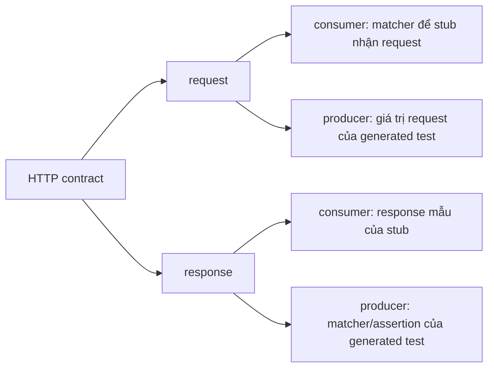
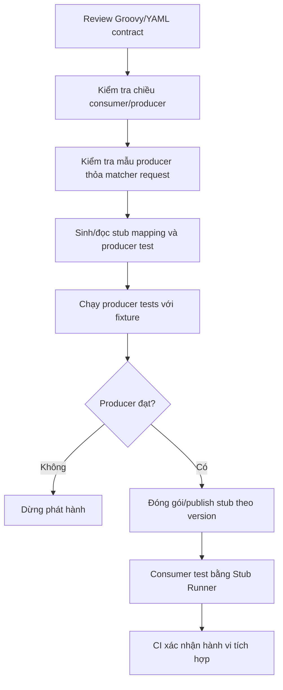

# Matcher dùng khi nhận request và giá trị mẫu dùng khi sinh test

## 1. Một hợp đồng, hai cách sử dụng giá trị

Trong **Spring Cloud Contract** (module `SPRING_CLOUD_CONTRACT`), producer và consumer cùng dựa vào một hợp đồng để thống nhất hành vi HTTP hoặc thông điệp. Hợp đồng được viết bằng **Groovy DSL** hoặc **YAML DSL**; công cụ có thể dùng nó để **sinh kiểm thử phía producer** và **tạo stub cho consumer**. Stub Runner giúp consumer tải, khởi chạy stub theo phiên bản; CI kiểm tra xem các thay đổi API có làm lệch hợp đồng hay không.

Với một HTTP request, có một vấn đề rất thực tế: **consumer không phải lúc nào cũng gửi cùng một giá trị**, trong khi **producer test cần dữ liệu đầu vào cụ thể để chạy ổn định**.

Giả sử `POST /api/orders` yêu cầu header `X-Request-Id` có dạng `req-` theo sau bởi bốn chữ số. Consumer có thể gửi `req-4821` hoặc `req-7360`. Nếu stub chỉ chấp nhận một giá trị cố định, nhiều request hợp lệ sẽ không khớp. Nhưng nếu test producer chỉ mang một biểu thức regex làm dữ liệu đầu vào thì không có một request cụ thể để thực thi.

**Spring Cloud Contract giải quyết hai nhu cầu này bằng giá trị hai phía** (*dual-sided values*): một phía dùng làm quy tắc khớp request của consumer, phía còn lại làm giá trị cụ thể để generated producer test gửi tới ứng dụng thật.

Sau bài này, bạn có thể:

- Phân biệt vai trò của `consumer(...)` và `producer(...)` trong **request** và **response**.
- Viết matcher của request bằng Groovy DSL `$(consumer(regex(...)), producer(...))`.
- Chọn giá trị mẫu cho producer test sao cho **thỏa matcher** và tái lập được.
- Giải thích stub khớp request như thế nào và generated producer test thực sự gửi giá trị nào.
- Tránh matcher quá rộng, các nhánh stub chồng lấp và dữ liệu mẫu không phản ánh hành vi thật.
- Liên hệ với YAML DSL, producer verification, Stub Runner và các bước kiểm tra trong CI.

## 2. Hai chiều dữ liệu cần nhớ

Spring Cloud Contract dùng **consumer** để chỉ phía ứng dụng sử dụng API, và **producer** để chỉ phía cung cấp API. Với hợp đồng HTTP, công cụ nhìn cùng một mô tả theo hai góc:

| Nằm ở đâu? | Phía `consumer(...)` | Phía `producer(...)` |
| --- | --- | --- |
| **Request** | Điều kiện để stub **nhận request** consumer gửi; có thể là regex/matcher | Giá trị **cụ thể** generated producer test sử dụng khi gọi ứng dụng thật |
| **Response** | Giá trị **mẫu** stub trả cho consumer khi request khớp | Điều kiện generated producer test dùng để **kiểm tra response thật**; có thể là regex/matcher |

Đọc bảng theo câu hỏi mà công cụ cần trả lời:

1. **Stub nhận request gì?** Nhìn phần `consumer` của **request**.
2. **Generated test gửi request gì đến producer?** Nhìn phần `producer` của **request**.
3. **Stub trả gì cho consumer?** Nhìn phần `consumer` của **response**.
4. **Generated test chấp nhận response thật ra sao?** Nhìn phần `producer` của **response**.



> **Điểm dễ nhầm:** tên `consumer` và `producer` không có nghĩa “giá trị luôn do bên đó sinh ngẫu nhiên”. Chúng xác định **góc nhìn sử dụng hợp đồng**. Cùng `consumer(...)` nhưng trong request nó có thể chứa matcher; trong response nó thường là một giá trị mẫu để stub phát ra.

## 3. Cú pháp cơ bản trong Groovy DSL

Cú pháp thường gặp:

```groovy
$(consumer(regex('req-[0-9]{4}')), producer('req-1234'))
```

Trong ví dụ này:

- `$(...)` biểu diễn một giá trị có hai phía; có thể gặp cách viết `value(...)` trong tài liệu/ví dụ Groovy DSL.
- `consumer(regex('req-[0-9]{4}'))` yêu cầu stub chấp nhận chuỗi dạng `req-` và bốn chữ số.
- `producer('req-1234')` cung cấp chuỗi mẫu **cụ thể** để producer test gửi.

Không phụ thuộc vào **thứ tự gọi hai phía trong biểu thức** để suy ra vai trò: hãy đọc tên `consumer` và `producer`. Một số tài liệu/phiên bản DSL còn sử dụng thuật ngữ `client` và `server` để chỉ hai phía tương ứng; khi thực hành, nên tuân theo cú pháp mà phiên bản Spring Cloud Contract đang dùng hỗ trợ.

Lựa chọn `req-1234` có chủ đích vì nó **khớp** `req-[0-9]{4}`. Trái lại, `producer('request-abc')` là dữ liệu mẫu không thỏa quy tắc đã đặt: có thể tạo ra bộ test không đại diện cho lớp request mà stub đang phục vụ.

### 3.1. Regex là điều kiện, không phải request được gửi

```text
Matcher: req-[0-9]{4}
  req-0001   -> thuộc lớp hợp lệ
  req-8394   -> thuộc lớp hợp lệ
  req-12     -> không thuộc lớp hợp lệ
  abc-8394   -> không thuộc lớp hợp lệ
```

Regex ở đây là **mẫu so khớp**, không phải chuỗi mà HTTP client phải gửi nguyên văn. Khi generated producer test thực hiện, nó sử dụng `req-1234` từ phía `producer`, chứ không gửi `req-[0-9]{4}` như giá trị header.

Các regex trong bài dùng chuỗi đơn Groovy và lớp ký tự `[0-9]` để dễ đọc. Khi dùng `\d`, dấu gạch chéo ngược có thể cần escape khác nhau tùy cách viết chuỗi và vị trí DSL; nên kiểm tra mã test/mapping được sinh thay vì đoán.

## 4. Ví dụ hoàn chỉnh: request matcher và response mẫu

Giả sử một API tạo đơn hàng nhận `POST /api/orders`:

- Header `X-Request-Id` có định dạng `req-` và bốn chữ số.
- Body chứa `productId = SKU-001` và `quantity = 2`.
- Khi sản phẩm còn hàng, producer trả `201 Created` và JSON chứa `id`, `status = CREATED`.
- ID đơn được tạo động với định dạng `ord-` và bốn chữ số.

Đây là **quy tắc giả định cho bài học**. Fixture của producer test phải tạo được điều kiện sản phẩm còn hàng và response theo nhánh thành công.

### 4.1. Hợp đồng Groovy

File `create_order_dynamic_values.groovy`:

```groovy
import org.springframework.cloud.contract.spec.Contract

Contract.make {
    name 'create_order_dynamic_values'
    description 'Nhận request ID đúng định dạng và tạo đơn có ID động'

    request {
        method POST()
        url '/api/orders'
        headers {
            contentType(applicationJson())
            header 'X-Request-Id': $(consumer(regex('req-[0-9]{4}')), producer('req-1234'))
        }
        body([
            productId: 'SKU-001',
            quantity : 2
        ])
    }

    response {
        status 201
        headers {
            contentType(applicationJson())
        }
        body([
            id    : $(consumer('ord-1001'),
                      producer(regex('ord-[0-9]{4}'))),
            status: 'CREATED'
        ])
    }
}
```

Khi chạy với cấu hình plugin hợp lệ, hợp đồng được dùng theo hai hướng:

**Hướng A — Stub Runner phục vụ consumer:**

1. Stub nhận `POST /api/orders`.
2. Stub kiểm tra `X-Request-Id` theo matcher `req-[0-9]{4}`, cùng method, body, content type đã khai báo.
3. Khi request khớp, stub trả `201` với body mẫu:

```json
{
  "id": "ord-1001",
  "status": "CREATED"
}
```

**Hướng B — Generated producer test kiểm tra ứng dụng thật:**

1. Test gửi `POST /api/orders` với header **`X-Request-Id: req-1234`** và body chứa `SKU-001`, `2`.
2. Test kỳ vọng HTTP status `201` và `Content-Type` đã cam kết.
3. Test kiểm tra response `id` bằng regex `ord-[0-9]{4}`; test không bắt producer luôn trả `ord-1001`.
4. Test kiểm tra `status` bằng giá trị cụ thể `CREATED`.

### 4.2. Ma trận quan sát

| Trường hợp | Stub có khớp request không? | Producer test có gửi request này không? |
| --- | --- | --- |
| `X-Request-Id: req-1234`, body đúng | Có | **Có**, đây là mẫu `producer` |
| `X-Request-Id: req-9876`, body đúng | Có | Không, nhưng vẫn thuộc matcher stub |
| `X-Request-Id: req-12`, body đúng | Không khớp matcher header này | Không |
| `X-Request-Id: abc-1234`, body đúng | Không khớp matcher header này | Không |
| Header hợp lệ nhưng `productId` khác | Không khớp body mẫu đã khai báo, nếu không có matcher thay thế | Không |

Kết quả thực khi request **không khớp mapping** phụ thuộc stub engine và cấu hình: thường là một response không tìm thấy mapping, **không phải** mặc nhiên là lỗi nghiệp vụ `400` từ producer thật. Nếu API công bố nhánh `400 INVALID_REQUEST_ID`, phải viết **hợp đồng riêng** cho nhánh đó để bảo vệ hành vi lỗi.

### 4.3. Tại sao response không dùng cùng phía matcher với request?

Nếu viết nhầm:

```groovy
response {
    status 201
    body([
        id: $(consumer(regex('ord-[0-9]{4}')),
              producer('ord-1001'))
    ])
}
```

thì ý nghĩa sẽ khác mục tiêu ban đầu: phía `producer` hiện là **giá trị cụ thể** `ord-1001` thay vì điều kiện chấp nhận nhiều ID, trong khi phía `consumer` không còn một ID mẫu rõ ràng như dự định. Đây là lỗi **đảo chiều hai phía**; không phải chỉ là thay đổi cách trình bày. Việc converter có chấp nhận một cấu trúc bất kỳ hay không cần được kiểm tra bằng chính phiên bản DSL đang dùng.

Hãy giữ quy tắc **request: matcher cho stub, mẫu cho producer test; response: mẫu cho stub, matcher cho producer test** khi giá trị có thể thay đổi và cần hai phía khác nhau.

## 5. Chọn nơi đặt matcher trong request

Không phải mọi trường đều cần `$(...)`. Chỉ dùng matcher cho phần consumer được phép thay đổi mà **không chuyển sang nhánh hành vi khác**.

### 5.1. Trong header

```groovy
request {
    method POST()
    url '/api/orders'
    headers {
        contentType(applicationJson())
        header 'X-Request-Id': $(consumer(regex('req-[0-9]{4}')), producer('req-1234'))
    }
    body([productId: 'SKU-001', quantity: 2])
}
```

Header là chỗ phù hợp cho request ID hoặc correlation ID. **Không dùng token đăng nhập thật** làm mẫu producer test. Nếu header mang ý nghĩa xác thực, producer test còn cần fixture/security setup đúng thay vì chỉ kiểm tra định dạng một chuỗi.

### 5.2. Trong JSON request body

Ví dụ một endpoint **kiểm tra định dạng mã tham chiếu**, nơi mọi mã hợp lệ có cùng hành vi:

```groovy
request {
    method POST()
    url '/api/references/validate-format'
    headers {
        contentType(applicationJson())
    }
    body([
        reference: $(consumer(regex('REF-[0-9]{6}')),
                     producer('REF-123456'))
    ])
}
response {
    status 200
    headers {
        contentType(applicationJson())
    }
    body([valid: true])
}
```

Đây là ví dụ có nghĩa: endpoint chỉ **kiểm tra định dạng**, nên mọi `REF-######` đều có thể trả cùng response `valid: true`. Nếu API thực tế **tra cứu** mã tham chiếu, không nên mở rộng matcher đến mọi mã, vì có mã tồn tại và mã không tồn tại; hai trường hợp cần stub/contract riêng.

### 5.3. Trong URL/path

Khi nhiều path thuộc cùng một nhánh kết quả, có thể áp dụng matcher vào URL:

```groovy
request {
    method GET()
    url($(consumer(regex('/api/references/REF-[0-9]{6}/format')),
           producer('/api/references/REF-123456/format')))
}
response {
    status 200
    body([valid: true])
}
```

Đây cũng là API **kiểm tra định dạng**, nên response giống nhau cho cả lớp path đã chấp nhận. Đối với `GET /api/orders/{id}` trả dữ liệu đơn cụ thể, dùng một regex phủ nhiều ID trong khi stub luôn trả một đơn duy nhất có thể gây hiểu nhầm. Khi phải hỗ trợ các ID khác nhau, hãy thiết kế mapping/fixture và logic xác thực cho đúng từng lớp hành vi.

Ngoài `url`, DSL có `urlPath` để mô tả riêng path và query parameter. Có thể khai báo matcher cho query nếu API cho phép nhiều giá trị nhưng hành vi vẫn tương đương. Khi dùng query, cần để ý mã hóa URL, kiểu dữ liệu và cú pháp DSL của phiên bản đang dùng.

## 6. Giá trị mẫu producer test phải đủ đại diện

Nhìn vào request:

```groovy
$(consumer(regex('req-[0-9]{4}')), producer('req-1234'))
```

Một giá trị producer tốt phải:

1. **Thỏa điều kiện matcher.** `req-1234` đúng dạng; `req-12` không đúng.
2. **Kích hoạt đúng nhánh nghiệp vụ.** Nếu chỉ test nhánh thành công, fixture phải khiến request này thành công.
3. **Ổn định giữa các lần chạy.** Không phụ thuộc một ID ngẫu nhiên chưa thiết lập hoặc database còn sót từ build trước.
4. **Dễ hiểu trong log.** Tên và giá trị phản ánh ý nghĩa trường, giúp chẩn đoán lỗi.
5. **An toàn khi lưu trong repository.** Không chứa API key, mật khẩu, cookie phiên hay dữ liệu người dùng thật.

| Matcher của request | Mẫu producer tốt | Mẫu không phù hợp | Lý do |
| --- | --- | --- | --- |
| `req-[0-9]{4}` | `req-1234` | `req-1` | Không đủ bốn chữ số |
| `REF-[0-9]{6}` | `REF-123456` | `REF-ABCDEF` | Sai lớp ký tự |
| `SKU-(001|002)` | `SKU-001` | `SKU-999` | Không thuộc danh sách cho phép |
| `[a-z]{2}-[A-Z]{2}` | `vi-VN` | `VI-vn` | Sai định dạng chữ hoa/thường |

**Không nên xem một giá trị mẫu là bằng chứng đã kiểm tra toàn bộ lớp regex.** Generated producer test với `req-1234` chỉ gửi **một request cụ thể**. Nếu quy tắc xử lý có các trường hợp biên quan trọng, thêm unit/parameterized tests hoặc hợp đồng khác khi consumer cần một nhánh quan sát khác.

### 6.1. Khi nào cần thêm hợp đồng thay vì mở rộng regex?

Giả sử `POST /api/orders` trả:

- `201` khi `quantity` hợp lệ và còn hàng.
- `400` khi `quantity = 0`.
- `409` khi `quantity` hợp lệ nhưng hết hàng.

Đừng dùng matcher `quantity: .*` cho một hợp đồng trả `201`. Nó có thể nhận cả request lẽ ra thuộc nhánh lỗi. Thay vào đó, phân nhóm theo **kết quả consumer phải xử lý** và tạo hợp đồng đại diện cho mỗi nhánh có ý nghĩa.

Một stub chỉ khớp request dựa trên dữ liệu được khai báo, không tự tính hàng tồn hay trạng thái database. Matcher càng rộng, bạn càng dễ biến stub thành mô hình sai của producer.

## 7. Response: giá trị mẫu cho stub, matcher cho producer

Ở chiều response, trách nhiệm hai phía được **đảo so với request**:

```groovy
response {
    status 201
    headers {
        contentType(applicationJson())
    }
    body([
        id: $(consumer('ord-1001'),
              producer(regex('ord-[0-9]{4}')))
    ])
}
```

Consumer test luôn nhận một ID mẫu dễ dự đoán từ stub: `ord-1001`. Producer test chấp nhận bất kỳ ID đúng định dạng do producer thật tạo, ví dụ `ord-9832`.

Điều này hữu ích khi API sinh động:

- ID giao dịch/đơn hàng.
- Timestamp hoặc ngày giờ.
- Correlation ID.
- Location hoặc token tạm thời có định dạng đã công bố.

Nhưng **matcher không đồng nghĩa tính đúng của cả nghiệp vụ**. Nếu request tạo đơn có `quantity = 2`, một regex ID không xác minh rằng đơn đó đã tồn tại hay liên kết đúng với sản phẩm. Cần integration test hoặc assertion bổ sung cho các quan hệ dữ liệu quan trọng.

### 7.1. Một ví dụ với `bodyMatchers`

Spring Cloud Contract cũng cung cấp cách mô tả matcher cho response body:

```groovy
response {
    status 200
    headers {
        contentType(applicationJson())
    }
    body([
        id    : 'ord-1001',
        status: 'CREATED'
    ])
    bodyMatchers {
        jsonPath('$.id', byRegex('ord-[0-9]{4}'))
    }
}
```

Ở đây body khai báo **giá trị mẫu** cho stub, còn `bodyMatchers` mô tả cách generated producer test so khớp `$.id`. Cần chọn một cách diễn đạt có chủ đích; không cần đồng thời áp dụng hai matcher trùng nhau lên một trường nếu không có lý do.

Một regex quá rộng như `.*` có thể làm producer test chấp nhận nhiều giá trị không hợp lệ. Regex chỉ nên bảo vệ **định dạng đã cam kết**, còn kiểu, độ dài, nullability và quan hệ giữa các trường phải được xem xét riêng.

### 7.2. Matcher riêng lẻ không tự kiểm tra quan hệ hai trường

Giả sử response có:

```json
{
  "id": "ord-1001",
  "location": "/api/orders/ord-9999"
}
```

Nếu chỉ so khớp regex độc lập cho `id` và `location`, cả hai giá trị có thể **đều đúng định dạng nhưng không đồng nhất**. Khi API cam kết `location` phải trỏ đến chính `id` trong body, cần cơ chế kiểm tra quan hệ (ví dụ test assertion/integration test hoặc khả năng DSL phù hợp) thay vì chỉ dùng hai regex độc lập.

## 8. YAML DSL biểu diễn hai góc nhìn như thế nào?

Trong **YAML DSL**, dữ liệu ví dụ thường nằm trong `request`/`response`, còn các điều kiện so khớp nằm trong các mục `matchers` tương ứng. Cách thể hiện cú pháp khác Groovy nhưng mục tiêu giống nhau: **stub nhận request hợp lệ; generated producer test dùng input mẫu và kiểm tra output thật**.

Ví dụ dưới đây biểu diễn cùng tình huống tạo đơn ở mục 4 bằng YAML (đây là **biểu diễn thay thế**, không thêm đồng thời hai file trùng hành vi vào contracts directory):

```yaml
name: create_order_dynamic_values
request:
  method: POST
  url: /api/orders
  headers:
    Content-Type: application/json
    X-Request-Id: req-1234
  body:
    productId: SKU-001
    quantity: 2
  matchers:
    headers:
      - key: X-Request-Id
        regex: 'req-[0-9]{4}'
response:
  status: 201
  headers:
    Content-Type: application/json
  body:
    id: ord-1001
    status: CREATED
  matchers:
    body:
      - path: '$.id'
        type: by_regex
        value: 'ord-[0-9]{4}'
```

Hãy đọc hai nhóm dữ liệu:

| YAML | Dùng để làm gì? |
| --- | --- |
| `request.headers.X-Request-Id: req-1234` | Giá trị mẫu cho request của generated producer test |
| `request.matchers.headers.regex` | Quy tắc nhận header từ request gửi tới stub |
| `response.body.id: ord-1001` | Giá trị mẫu trong HTTP stub response |
| `response.matchers.body` với `$.id` | Matcher để kiểm tra trường `id` trong response của producer thật |

Cấu trúc trên là cú pháp minh họa của Spring Cloud Contract YAML DSL thông dụng; khi áp dụng cần xác nhận plugin/DSL version đang dùng hiểu mục `matchers` này và đọc lại generated mapping/test. Các phiên bản công cụ có thể khác về khả năng matcher hoặc biểu diễn, nhưng **chiều dữ liệu phải nhất quán**.

## 9. Phân biệt “khớp stub” với “producer xử lý đúng”

Giả sử Stub Runner đang chạy hợp đồng ở mục 4. Một consumer gửi:

```http
POST /api/orders HTTP/1.1
Content-Type: application/json
X-Request-Id: req-9876

{"productId":"SKU-001","quantity":2}
```

Stub trả `201` với `id = ord-1001` vì header khớp regex. Việc stub trả `201` **không chứng minh** producer thật đã xử lý `req-9876` thành công. Nó chỉ chứng minh request đó khớp kịch bản **đã khai báo trong hợp đồng**.

Generated producer test lại gửi đúng mẫu `req-1234`. Nếu producer thật trả `201` và ID `ord-9201`, test đạt với regex `ord-[0-9]{4}`; nếu trả `id = abc`, test phải thất bại khi matcher được áp dụng.

| Nhìn thấy trong kết quả test | Kết luận có thể đưa ra | Chưa được chứng minh |
| --- | --- | --- |
| Stub nhận `req-9876` | Request đó phù hợp mapping stub | Producer thật nhận mọi ID thuộc regex |
| Generated producer test gửi `req-1234` và đạt | Producer xử lý đúng mẫu test, trả response khớp hợp đồng | Mọi chuỗi `req-0000` đến `req-9999` đều xử lý đúng |
| Consumer test xử lý `ord-1001` thành công | Logic consumer xử lý được payload mẫu | Consumer xử lý được mọi ID ở runtime |
| Producer test chấp nhận `ord-9201` | ID producer có định dạng phù hợp | ID là duy nhất, tồn tại trong DB hoặc khớp `Location` |

Muốn bảo vệ thêm các yêu cầu này, kết hợp hợp đồng với unit test, parameterized test, integration test và hành vi consumer test thực tế. **Độ rộng matcher phải tương ứng với phạm vi kết luận được phép rút ra.**

## 10. Các lỗi thường gặp khi viết giá trị hai phía

| Sai sót | Hệ quả | Cách sửa |
| --- | --- | --- |
| Đảo matcher sang `producer` ở **request** | Producer test không còn giá trị mẫu đúng như dự kiến; stub có thể không nhận request theo quy tắc mong muốn | Đặt `consumer(regex(...))` và `producer('giá trị mẫu')` ở request |
| Đảo giá trị mẫu sang `producer` ở **response** khi cần ID động | Generated producer test có thể buộc giá trị cố định ngoài ý muốn | Đặt `consumer('id-mẫu')` và `producer(regex(...))` ở response |
| Mẫu producer không khớp request matcher | Test kiểm tra một trường hợp nằm ngoài lớp request được stub công bố | Chọn mẫu hợp lệ và kiểm tra lại regex |
| Matcher `.*` cho mọi trường | Stub bắt nhầm nhánh hoặc test bỏ lọt sai lệch | Giới hạn regex theo kiểu/format cụ thể |
| Nhiều mapping cùng khớp một request nhưng trả response khác | Stub trả nhánh không ổn định, khó chẩn đoán | Tách request theo method, path, body, query, header phù hợp |
| Lấy giá trị mẫu response làm khẳng định producer phải trả chính xác | Test thất bại khi ID/timestamp sinh động nhưng hợp lệ | Dùng matcher producer side cho trường động |
| Chỉ assert ID đúng regex | Không kiểm tra tính duy nhất, quan hệ body/header hoặc dữ liệu lưu | Bổ sung integration/assertion thích hợp |
| Dùng fixture có mã bí mật hoặc dữ liệu thật | Artifact stub có thể lộ dữ liệu | Dùng giá trị giả, có thể tái lập |
| Sửa matcher để test xanh mà không xem yêu cầu nghiệp vụ | Hợp đồng mất sức phát hiện lỗi | Đối chiếu thỏa thuận API và consumer trước |

### 10.1. Chẩn đoán khi stub không khớp

Kiểm tra theo thứ tự:

1. **Method và path** có giống mapping không?
2. **Header `Content-Type`** có đúng như hợp đồng khai báo không?
3. **Header/body/query dùng matcher** có giá trị thực thỏa regex không?
4. **Có mapping khác** đang nhận cùng request không?
5. **Đúng stub version** được Stub Runner nạp chưa?
6. Stub mapping được sinh có thực sự chứa matcher dự kiến không?

Ví dụ một client gửi `X-Request-Id: req-12345` (năm chữ số). Với matcher `req-[0-9]{4}`, request đó không thuộc lớp hợp lệ; không nên đổi regex thành `.*` chỉ để nó khớp. Cần xác định hợp đồng muốn nhận đúng bốn hay nhiều chữ số và cập nhật cả producer/consumer khi có thay đổi yêu cầu.

### 10.2. Chẩn đoán khi generated producer test thất bại

Nếu test thất bại vì producer trả `id = order-1001` trong khi matcher kỳ vọng `ord-[0-9]{4}`:

- Kiểm tra producer có thực sự đổi định dạng ID hay không.
- Xác định định dạng mới đã được consumer đồng ý chưa.
- Nếu thay đổi là có chủ đích, cập nhật hợp đồng và thêm consumer test phù hợp trước khi triển khai.
- Nếu không có chủ đích, sửa producer và giữ hợp đồng làm lớp bảo vệ.

Nếu test thất bại vì request `req-1234` không được chấp nhận, kiểm tra test fixture, filter xác thực, validation, cấu hình header và việc chuẩn bị tồn kho. Không tự coi mọi lỗi từ generated test là lỗi matcher.

## 11. Quy trình kiểm chứng trong CI



Một quy trình thực tế:

1. **Review hợp đồng:** kiểm tra các giá trị dynamic, hướng `consumer/producer` và nhánh tương tác. Chốt khi nào chấp nhận nhiều giá trị và khi nào cần cố định.
2. **Kiểm tra DSL/generator:** plugin phải đọc được hợp đồng và tạo đúng stub/test. Xem mapping được sinh để bảo đảm regex đã trở thành request matcher, không bị biến thành một chuỗi literal.
3. **Chạy producer verification:** test base chuẩn bị dữ liệu để request mẫu `req-1234` thật sự thuộc nhánh thành công. Test xác minh `201`, body và matcher ID.
4. **Đóng gói artifact:** phát hành stub có version, ví dụ `com.example:orders-producer:1.4.2:stubs`, sau khi producer tests đạt.
5. **Chạy consumer tests:** Stub Runner tải version mong muốn; consumer test gửi ít nhất request mẫu và một request hợp lệ khác như `req-9876` khi phạm vi kiểm tra đòi hỏi, rồi khẳng định logic consumer xử lý response mẫu đúng.
6. **Bảo vệ nhánh lỗi:** với request không hợp lệ hoặc đơn hết hàng, bổ sung contract/test riêng thay vì dựa vào việc stub không có mapping.

Đối với CI cần tái lập, nên **ghim phiên bản stub**. Một bản `SNAPSHOT` hoặc version động có thể thay đổi nội dung khi mã consumer vẫn giữ nguyên, làm việc tìm nguyên nhân khó hơn.

## 12. Bài thực hành: matcher request và mẫu test cho giao dịch

Giả sử `POST /api/payments` nhận JSON:

```json
{
  "clientReference": "PAY-2026-123456",
  "amount": 50000
}
```

API yêu cầu `clientReference` đúng dạng `PAY-2026-` cộng sáu chữ số; với dữ liệu hợp lệ, producer trả `202 Accepted`, JSON chứa `paymentId` với dạng `pmt-` cộng sáu chữ số và `status = PENDING`.

### 12.1. Yêu cầu

1. Viết hợp đồng Groovy `create_payment_accepted.groovy`.
2. Ở request, dùng `consumer(regex('PAY-2026-[0-9]{6}'))` và chọn mẫu `producer('PAY-2026-123456')`.
3. Ở response, dùng mẫu `consumer('pmt-100001')` cho stub và `producer(regex('pmt-[0-9]{6}'))` cho generated producer test.
4. Giữ `amount = 50000` cố định nếu đây là giá trị đại diện cho cùng một nhánh hợp lệ.
5. Giải thích điều gì xảy ra nếu stub nhận `PAY-2026-999999`, và vì sao producer test vẫn chỉ gửi `PAY-2026-123456`.
6. Nêu cách kiểm tra giao dịch bất hợp lệ nếu `amount = 0` trả `400`: hợp đồng riêng và dữ liệu mẫu đúng nhánh lỗi.

### 12.2. Lời giải tham khảo

```groovy
import org.springframework.cloud.contract.spec.Contract

Contract.make {
    name 'create_payment_accepted'

    request {
        method POST()
        url '/api/payments'
        headers {
            contentType(applicationJson())
        }
        body([
            clientReference: $(consumer(regex('PAY-2026-[0-9]{6}')),
                               producer('PAY-2026-123456')),
            amount: 50000
        ])
    }

    response {
        status 202
        headers {
            contentType(applicationJson())
        }
        body([
            paymentId: $(consumer('pmt-100001'),
                         producer(regex('pmt-[0-9]{6}'))),
            status   : 'PENDING'
        ])
    }
}
```

**Diễn giải:** Stub có thể nhận nhiều `clientReference` đúng dạng và trả một `paymentId` mẫu. Generated test chỉ gửi `PAY-2026-123456` và kiểm tra ID do producer thật trả bằng regex. Tên và định dạng ID là giả định của bài; doanh nghiệp phải thay bằng thỏa thuận API và fixture thật khi thực hành.

### 12.3. Tự kiểm tra

| Câu hỏi | Đáp án |
| --- | --- |
| Request stub chấp nhận `PAY-2026-654321` không? | Có, nếu các điều kiện request khác đều khớp |
| Generated producer test gửi chuỗi nào? | `PAY-2026-123456` |
| Stub trả `paymentId` nào? | `pmt-100001` |
| Producer thật trả `pmt-654321` thì matcher có chấp nhận không? | Có, nếu response còn đáp ứng những cam kết khác |
| Producer thật trả `payment-654321` thì sao? | Không khớp regex `pmt-[0-9]{6}` |
| Stub không khớp `amount = 0` có chứng minh producer trả `400`? | Không; phải có hợp đồng và kiểm thử riêng cho nhánh lỗi |

### Checklist trước khi chốt giá trị hai phía

- [ ] Biết rõ đang xử lý **request** hay **response**.
- [ ] Matcher request nằm ở góc **consumer**; giá trị producer test nằm ở góc **producer**.
- [ ] Stub response có giá trị mẫu **consumer**; generated producer test có matcher **producer** cho trường động.
- [ ] Giá trị mẫu của producer thỏa matcher request và kích hoạt đúng nhánh.
- [ ] Regex đủ chặt để phân biệt nhánh và không nhận request sai.
- [ ] Các trường cố định vẫn được kiểm tra theo giá trị đã cam kết.
- [ ] Đã xem stub mapping và generated producer test sau khi sinh.
- [ ] Fixture có thể tái lập; dữ liệu giả không chứa bí mật.
- [ ] Producer tests, consumer tests và CI sử dụng đúng phiên bản hợp đồng/stub.

**Ghi nhớ:** với **request**, dùng matcher phía consumer để stub nhận các giá trị hợp lệ và dùng giá trị mẫu phía producer để generated test gửi một request xác định. Với **response**, stub cần một giá trị mẫu phía consumer, còn producer test có thể dùng matcher phía producer để kiểm tra dữ liệu động. Hiểu đúng hai chiều giúp bộ hợp đồng vừa linh hoạt cho consumer, vừa đủ chính xác để phát hiện thay đổi không tương thích.
