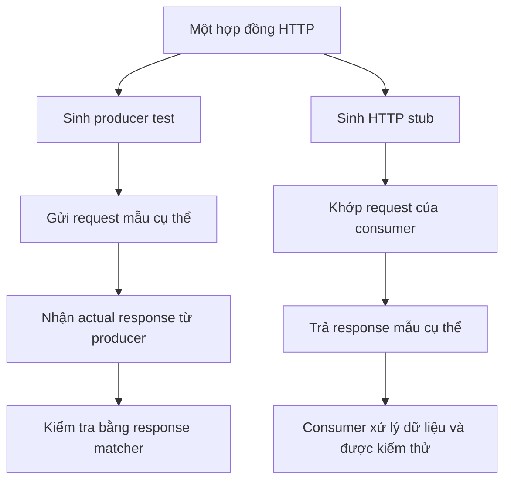
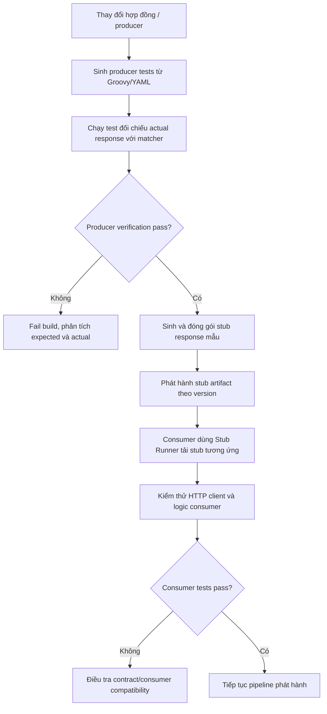

# Matcher dùng khi xác minh response và giá trị trả về trong stub

## 1. Bài toán: producer trả dữ liệu động, consumer cần một phản hồi dùng được

Trong hệ thống nhiều dịch vụ, response HTTP thường chứa những giá trị được tạo tại thời điểm xử lý: mã giao dịch, mã biên lai, thời gian thanh toán, số thứ tự hoặc định danh tương quan. Nếu hợp đồng yêu cầu producer trả **đúng một chuỗi ID và timestamp cố định** trong mọi lần chạy, kiểm thử sẽ thất bại ngay cả khi API vẫn đáp ứng nhu cầu của consumer.

Ngược lại, khi `Order Service` (consumer) chạy kiểm thử với stub của `Payment Service` (producer), nó cần nhận **một JSON cụ thể** để giải mã và đưa ra quyết định, chứ không thể nhận một biểu thức regex làm giá trị JSON.

Ví dụ, phản hồi thanh toán thực tế có thể là:

```json
{
  "receiptId": "RC-84721",
  "status": "PAID",
  "amount": 125000,
  "currency": "VND"
}
```

Ở môi trường khác, producer trả `receiptId = "RC-90118"`; cả hai đều hợp lệ nếu định dạng được thỏa thuận là `RC-` theo sau bởi chữ số. Nhưng consumer test có thể dùng phản hồi mẫu `"RC-42"` để xác minh logic ánh xạ.

**Spring Cloud Contract** giải quyết mâu thuẫn này bằng **giá trị hai phía** trong Groovy DSL và **response matchers** trong YAML DSL. Hợp đồng vừa hỗ trợ sinh kiểm thử xác minh producer, vừa sinh stub phục vụ consumer qua Stub Runner. Khi tích hợp CI, các kiểm thử bảo vệ tương thích API mà không khóa các dữ liệu thay đổi hợp lệ.

Sau bài học, bạn sẽ biết:

1. Phân biệt **response value dùng trong stub** với **response matcher dùng trong producer verification**.
2. Hiểu ý nghĩa `consumer`/`producer`, các tên viết tắt và alias của chúng.
3. Viết hợp đồng Groovy/YAML có dữ liệu mẫu và điều kiện kiểm chứng riêng.
4. Kiểm tra trường, kiểu dữ liệu, định dạng và ngữ nghĩa mà không nhầm matcher với giá trị trả về.
5. Chẩn đoán khi producer test pass nhưng consumer test fail, hoặc ngược lại.

## 2. Hai phía trong hợp đồng không phải hai HTTP response độc lập

Một hợp đồng mô tả **cùng một tương tác**, nhưng được sử dụng theo hai hướng khi sinh thành phẩm:

| Phần của hợp đồng | Phía producer | Phía consumer |
| --- | --- | --- |
| HTTP `request` | Test cần **giá trị request cụ thể** để gọi ứng dụng thật | Stub cần **điều kiện khớp request**, có thể là regex |
| HTTP `response` | Test cần **điều kiện kiểm tra actual response**, có thể là regex hoặc theo kiểu | Stub cần **giá trị response cụ thể** để trả cho consumer |

Đây là điểm dễ nhầm nhất: với **request**, biểu thức linh hoạt thường phục vụ **stub matching**; với **response**, biểu thức linh hoạt thường phục vụ **producer verification**.



Một stub thường trả **mẫu response** được ghi trong hợp đồng; regex của producer không tự trở thành một trường JSON chứa regex. Còn producer test không buộc actual response phải giống hệt mẫu nếu matcher đã cho phép một phạm vi giá trị.

### 2.1. Ví dụ đối chiếu nhanh

Giả sử hợp đồng muốn bảo vệ quy tắc `receiptId` đúng mẫu `RC-[0-9]+`:

| Trường hợp | Giá trị | Kết luận |
| --- | --- | --- |
| Stub trả cho consumer | `"RC-42"` | Giá trị cụ thể, consumer đọc như chuỗi bình thường |
| Producer thực trả | `"RC-84721"` | Hợp lệ vì khớp regex |
| Producer thực trả | `"RECEIPT-A"` | Vi phạm regex |
| Producer thực bỏ `receiptId` | Không có trường | Vi phạm nếu trường được cam kết là bắt buộc |

**Matcher không sinh ra giá trị của producer.** Producer tự trả dữ liệu từ controller/service thực; matcher chỉ giúp kiểm tra dữ liệu đó có thỏa hợp đồng không.

## 3. Cú pháp `consumer` và `producer` trong Groovy DSL

Spring Cloud Contract Groovy DSL hỗ trợ biểu thức hai phía dưới dạng:

```groovy
value(consumer(...), producer(...))
value(c(...), p(...))
value(stub(...), test(...))
value(client(...), server(...))
```

Khi dùng Groovy map cho body, có thể viết ngắn gọn:

```groovy
$(consumer(...), producer(...))
$(c(...), p(...))
$(stub(...), test(...))
$(client(...), server(...))
```

Các tên `consumer`, `c`, `stub`, `client` chỉ **cùng phía tiêu thụ**, còn `producer`, `p`, `test`, `server` chỉ **cùng phía cung cấp/kiểm thử producer**. Chúng là các cách diễn đạt cùng vai trò, không phải bốn loại công cụ khác nhau.

Ví dụ riêng một trường trong **response body**:

```groovy
receiptId: $(consumer('RC-42'), producer(regex('RC-[0-9]+')))
```

Cách đọc đúng:

- `consumer('RC-42')` cung cấp **giá trị cụ thể trong stub response**.
- `producer(regex('RC-[0-9]+'))` cung cấp **điều kiện xác minh response do producer thực trả**.

Có thể viết tương đương:

```groovy
receiptId: $(c('RC-42'), p(regex('RC-[0-9]+')))
```

**Không suy từ tên `consumer` rằng consumer sẽ thực thi matcher này.** Với một trường thuộc response, consumer nhận dữ liệu mẫu; việc kiểm tra response thực theo regex diễn ra trong producer test.

## 4. Hợp đồng Groovy hoàn chỉnh: mẫu stub và matcher producer

Giả sử Payment Service cung cấp `GET /api/payments/42` và cam kết:

- HTTP status `200`, `Content-Type: application/json`.
- `receiptId` là chuỗi dạng `RC-` rồi đến chữ số.
- `status` phải đúng `PAID`.
- `amount` là số, có thể thay đổi trong các dữ liệu kiểm thử.
- `currency` phải đúng `VND`.

Hợp đồng Groovy:

```groovy
import org.springframework.cloud.contract.spec.Contract

Contract.make {
    description 'Tra cuu thanh toan da hoan tat'

    request {
        method GET()
        url '/api/payments/42'
    }

    response {
        status OK()
        headers {
            contentType(applicationJson())
        }
        body(
            receiptId: $(consumer('RC-42'),
                         producer(regex('RC-[0-9]+'))),
            status: 'PAID',
            amount: 125000,
            currency: 'VND'
        )
        bodyMatchers {
            jsonPath('$.amount', byType())
        }
    }
}
```

Hợp đồng kết hợp hai cách thiết kế dữ liệu động trong Groovy:

1. **Inline two-sided value** ở `receiptId`: một nhánh cung cấp response mẫu cho stub, nhánh còn lại mô tả producer matcher.
2. **`response.bodyMatchers`** ở `amount`: body chứa giá trị mẫu `125000`, nhưng producer test kiểm tra kiểu số thay vì bắt đúng một giá trị.

`status` và `currency` vẫn là giá trị cố định. Điều này có chủ đích: nếu consumer chỉ hiểu `PAID` trong tình huống này và cần `VND`, không nên biến hai trường thành regex rộng chỉ để test dễ vượt qua.

### 4.1. Hai sản phẩm sinh ra có gì khác nhau?

**Phía Stub Runner/WireMock**, response được mô phỏng theo dữ liệu cụ thể:

```http
HTTP/1.1 200 OK
Content-Type: application/json

{
  "receiptId": "RC-42",
  "status": "PAID",
  "amount": 125000,
  "currency": "VND"
}
```

**Phía producer test**, kiểm thử gọi API thật rồi đối chiếu:

| Điều kiện | Kiểm tra actual response |
| --- | --- |
| HTTP status | Phải là `200` |
| Media type | Phải phù hợp điều kiện `Content-Type` trong hợp đồng |
| `receiptId` | Phải khớp `RC-[0-9]+` |
| `status` | Phải là `PAID` |
| `amount` | Phải thuộc kiểu phù hợp dữ liệu mẫu theo `byType()` |
| `currency` | Phải là `VND` |

Ví dụ producer trả `"receiptId":"RC-84721"` với `"amount":130000` có thể thỏa các matcher trên. Tuy nhiên, nếu consumer cần bảo đảm `amount` đúng số tiền của giao dịch, kiểm tra **chỉ kiểu dữ liệu** là chưa đủ; cần thêm điều kiện nghiệp vụ hoặc kiểm thử khác phù hợp.

**Chú ý:** Ví dụ trên là mô tả DSL. Để chạy được, dự án cần Spring Cloud Contract Verifier, plugin Maven/Gradle, test base class và fixture dữ liệu cho thanh toán `42`.

## 5. YAML DSL: giá trị mẫu trong `body`, matcher dưới `response.matchers`

Trong YAML DSL, Spring Cloud Contract sử dụng phần `matchers` thay cho cú pháp nhúng `$(consumer(...), producer(...))` trực tiếp vào scalar của body.

Hợp đồng YAML biểu đạt cùng chính sách như ví dụ Groovy:

```yaml
description: Tra cuu thanh toan da hoan tat
request:
  method: GET
  url: /api/payments/42
response:
  status: 200
  headers:
    Content-Type: application/json
  body:
    receiptId: "RC-42"
    status: "PAID"
    amount: 125000
    currency: "VND"
  matchers:
    body:
      - path: '$.receiptId'
        type: by_regex
        value: 'RC-[0-9]+'
      - path: '$.amount'
        type: by_type
```

Đọc theo từng phần:

- `response.body.receiptId: "RC-42"` là **mẫu response dùng để dựng stub**.
- `response.matchers.body[0]` với JSONPath `$.receiptId` là **điều kiện producer test dùng khi kiểm tra trường đó**.
- `response.matchers.body[1]` với `by_type` yêu cầu `amount` có kiểu dữ liệu phù hợp với mẫu.
- `status` và `currency` không có matcher riêng, nên giá trị cố định trong hợp đồng tiếp tục là kỳ vọng.

**Quy tắc bắt buộc:** JSONPath trong `response.matchers` phải trỏ tới trường tồn tại trong `response.body` của mẫu hợp đồng. Không thể chỉ khai báo matcher cho `$.receiptId` rồi bỏ luôn trường `receiptId` trong body mẫu và mặc nhiên mong công cụ tự biết giá trị trả về cho stub.

### 5.1. Vì sao YAML không ghi `consumer` và `producer` giống Groovy?

Groovy cho phép nhúng giá trị động vào body bằng biểu thức của DSL; YAML dùng một định dạng dữ liệu tĩnh nên Spring Cloud Contract thiết kế phần `matchers` riêng. Không phải YAML không hỗ trợ dữ liệu động: cùng một mẫu body và matcher vẫn có thể tạo ra **stub response cụ thể** và **producer assertion linh hoạt**.

Nếu dự án có yêu cầu riêng về cú pháp của từng matcher, cần đối chiếu đúng phiên bản Spring Cloud Contract và YAML schema đang sử dụng; tránh sao chép nguyên `bodyMatchers { ... }` từ Groovy vào YAML.

## 6. Sự đảo chiều giữa request và response

Một hợp đồng có thể vừa cần **request linh hoạt ở stub** vừa cần **response linh hoạt ở producer test**. Đó là hai vấn đề khác nhau, nhưng cả hai đều dùng khái niệm hai phía.

Xét một endpoint tra cứu theo path:

```groovy
import org.springframework.cloud.contract.spec.Contract

Contract.make {
    description 'Tra cuu theo ma thanh toan'

    request {
        method GET()
        url $(consumer(regex('/api/payments/[0-9]+')),
              producer('/api/payments/42'))
    }

    response {
        status OK()
        headers {
            contentType(applicationJson())
        }
        body(
            receiptId: $(consumer('RC-42'),
                         producer(regex('RC-[0-9]+'))),
            status: 'PAID'
        )
    }
}
```

Trong **request**:

- `consumer(regex('/api/payments/[0-9]+'))`: stub có thể khớp URL của các request từ consumer phù hợp regex.
- `producer('/api/payments/42')`: generated test cần một đường dẫn **cụ thể** để gọi API thật.

Trong **response**:

- `consumer('RC-42')`: stub trả response cụ thể để client xử lý.
- `producer(regex('RC-[0-9]+'))`: producer test cho phép những ID thực tế phù hợp định dạng.

| Hướng | Dữ liệu cụ thể | Matcher linh hoạt |
| --- | --- | --- |
| Request | Producer test | Consumer-side stub matching |
| Response | Consumer-side stub response | Producer verification |

**Cảnh báo về phạm vi:** Ví dụ request regex khớp nhiều ID nhưng stub trả cùng một response mẫu `RC-42`. Nó phù hợp để kiểm tra client giải mã dữ liệu khi hợp đồng chỉ cần một phản hồi đại diện, **không** có nghĩa stub đang mô phỏng quan hệ một-một giữa mỗi `paymentId` và một `receiptId` riêng. Nếu client phụ thuộc quan hệ đó, cần hợp đồng riêng hoặc response templating phù hợp.

## 7. Chọn đúng kiểu matcher khi kiểm chứng response

Spring Cloud Contract hỗ trợ nhiều dạng matcher cho response. Dùng matcher đúng giúp kiểm thử vừa linh hoạt vừa đủ chặt để phát hiện thay đổi nguy hiểm.

| Matcher trong Groovy | YAML tương ứng | Thích hợp cho |
| --- | --- | --- |
| `byEquality()` | `by_equality` | Bảo đảm giá trị thực bằng dữ liệu mẫu |
| `byRegex('...')` | `by_regex` | Định dạng ID, tập trạng thái, chuỗi có cấu trúc |
| `byType()` | `by_type` | Kiểu dữ liệu, ví dụ number/string/boolean |
| `byDate()` | `by_date` | Chuỗi ngày theo định dạng được hỗ trợ |
| `byTime()` | `by_time` | Chuỗi thời gian |
| `byTimestamp()` | `by_timestamp` | Chuỗi ngày giờ |
| `byNull()` | `by_null` | Giá trị JSON `null` được cam kết |
| `byCommand('...')` | Tùy hỗ trợ/version | Điều kiện kiểm tra đặc thù bằng phương thức do project cung cấp |

Tên loại matcher trong YAML và tính năng từng bản có thể thay đổi; bảng trên là định hướng cho các matcher thường gặp. Cần kiểm tra YAML schema và generated tests ở phiên bản đã khóa trong build.

### 7.1. `byRegex`: định dạng phải có ý nghĩa

Ví dụ `status` chỉ thuộc một số giá trị:

```groovy
body(
    status: 'PAID'
)
bodyMatchers {
    jsonPath('$.status', byRegex('PAID|PENDING|FAILED'))
}
```

Đây là **mảnh nằm bên trong `response`**, không phải hợp đồng độc lập. Nếu hợp đồng dùng matcher trên, producer trả `PENDING` vẫn có thể pass điều kiện về `status`. Tuy nhiên, có thể **không phù hợp về nghiệp vụ** nếu request đã được đặt tên là “tra cứu giao dịch đã thanh toán”. Đừng nới matcher chỉ vì có nhiều trạng thái trong toàn hệ thống; hãy xét **ngữ cảnh của từng tình huống**.

### 7.2. `byType`: kiểm tra kiểu, không kiểm tra ý nghĩa

Ví dụ `amount` trong body mẫu là số:

```groovy
body(amount: 125000)
bodyMatchers {
    jsonPath('$.amount', byType())
}
```

Khi đó, `125000` và `130000` có thể đều thỏa kiểu; `"125000"` là chuỗi và có thể bị coi là sai kiểu. Nhưng `-9999` cũng là một số; nếu nghiệp vụ không cho phép âm, cần assertion bổ sung hoặc matcher chuyên biệt.

### 7.3. JSON `null` và trường vắng mặt không phải một

Ba response sau khác nhau:

```json
{"receiptUrl": null}
```

```json
{}
```

```json
{"receiptUrl": ""}
```

Nếu hợp đồng đòi `receiptUrl` có mặt và giá trị bằng `null`, `byNull()` giúp mô tả kỳ vọng đó. Nếu `receiptUrl` **được phép vắng mặt**, cần cân nhắc điều kiện optional thích hợp hoặc tách trường hợp có/không có trường. `byType()` hay `byRegex()` không tự làm trường bắt buộc trở thành tùy chọn.

### 7.4. Các trường hợp mảng và object lồng nhau

Với response:

```json
{
  "receiptId": "RC-42",
  "items": [
    {"sku": "BOOK-01", "quantity": 2},
    {"sku": "PEN-02", "quantity": 1}
  ]
}
```

Các JSONPath như `$.items[0].sku` hoặc `$.items[*].quantity` có thể dùng trong matcher tùy quy tắc cần kiểm chứng. Tuy nhiên, một matcher theo kiểu cho `items[0].quantity` không chứng minh toàn bộ mảng đúng schema, đúng thứ tự hoặc đúng kích thước. Nếu những điều đó quan trọng với consumer, cần thêm điều kiện hoặc kiểm thử riêng.

## 8. Giá trị cụ thể trong stub phải đại diện cho hành vi có thật

Một stub response có mẫu dữ liệu cố định là **chủ đích**, nhưng không có nghĩa bất kỳ dữ liệu mẫu nào cũng tốt. Hãy chọn giá trị giúp consumer kiểm tra đúng hành vi:

- `receiptId` có định dạng thật, ví dụ `RC-42`, thay vì chuỗi `"anything"`.
- `status` đúng trường hợp nghiệp vụ, ví dụ `PAID` cho kịch bản đã thanh toán.
- `amount` có số cụ thể để consumer xác minh ánh xạ sang DTO và phép tính của mình.
- `currency` có giá trị mà consumer hỗ trợ, ví dụ `VND`.
- Thêm hợp đồng riêng cho lỗi hoặc trạng thái khác nếu consumer có nhánh xử lý khác.

### 8.1. Hai tình huống, hai stub

Giả sử consumer cần xử lý cả thanh toán thành công và thất bại:

| Tình huống | Request | Stub response mẫu | Producer phải thỏa |
| --- | --- | --- | --- |
| Thanh toán thành công | `GET /api/payments/42` | `200`, `status=PAID`, `receiptId=RC-42` | Trường bắt buộc, loại dữ liệu, định dạng ID |
| Thanh toán thất bại | `GET /api/payments/43` | `200`, `status=FAILED`, `failureCode=CARD_DECLINED` | Giá trị `FAILED`, mã lỗi phù hợp |

Không nên viết **một** stub luôn trả `PAID` cho mọi tình huống rồi kết luận consumer đã được kiểm tra với `FAILED`. Stub Runner chỉ trả những mẫu/hành vi đã được mô tả và khớp request; consumer tests phải chủ động gọi đúng kịch bản.

### 8.2. Khi nào cần response templating?

Một số API yêu cầu response phản ánh một giá trị trong request (ví dụ echo `correlationId` hoặc `orderId`). Stub trả giá trị cố định có thể chưa đủ để kiểm chứng mối liên hệ này. Spring Cloud Contract có cơ chế tham chiếu giá trị từ request sang response, chẳng hạn `fromRequest()` trong Groovy DSL và biểu thức Handlebars tương ứng trong một số DSL khác.

Đây là nhu cầu **khác** với matcher producer: matcher chỉ kiểm tra một response thực, còn response templating xác định **stub trả dữ liệu động như thế nào** theo request. Chỉ bật templating khi chính sách API đòi quan hệ đó; cần xác minh cấu hình WireMock/Stub Runner và phiên bản DSL tương ứng.

## 9. Đọc kiểm thử được sinh và xác minh producer

Một phản hồi hợp lệ phải đến từ **ứng dụng producer chạy trong môi trường test**. Spring Cloud Contract Verifier đọc hợp đồng, sinh test, gọi API và kiểm tra actual response.

Ví dụ ý nghĩa của một số assertion tương đương trong Spring MVC test:

```java
mockMvc.perform(get("/api/payments/42"))
    .andExpect(status().isOk())
    .andExpect(content()
        .contentTypeCompatibleWith(MediaType.APPLICATION_JSON))
    .andExpect(jsonPath("$.receiptId",
        matchesPattern("RC-[0-9]+")))
    .andExpect(jsonPath("$.status").value("PAID"))
    .andExpect(jsonPath("$.amount").isNumber())
    .andExpect(jsonPath("$.currency").value("VND"));
```

Đây chỉ là **đoạn minh họa về mặt logic**; nó không phải mã Java mà Spring Cloud Contract bảo đảm sẽ sinh ra nguyên văn. Ví dụ cần các import, matcher Hamcrest/JUnit tương ứng và test context đã cấu hình. Cách thực thi phụ thuộc phiên bản plugin và lựa chọn MockMvc/REST Assured.

Để có kết quả tin cậy:

1. Đảm bảo request `GET /api/payments/42` có dữ liệu/fixture trong môi trường test.
2. Chạy generated producer tests trên controller/serialization thực sự, thay vì mock luôn response cuối cùng.
3. Đọc đúng điều kiện được sinh cho `receiptId`, `status`, `amount` và `currency`.
4. Xác minh số lượng contract tests thực tế đã chạy, tránh trường hợp pipeline xanh vì mọi test bị skip.
5. Nếu test fail, đối chiếu actual response và kỳ vọng của consumer trước khi thay đổi DSL.

Ví dụ báo lỗi:

```text
GET /api/payments/42
Expected response matcher: $.receiptId matches RC-[0-9]+
Actual response: {"receiptId":"RECEIPT-42","status":"PAID",
                  "amount":125000,"currency":"VND"}
Result: FAIL
```

Giá trị `"RECEIPT-42"` **có thể là một chuỗi ID hợp lệ theo góc nhìn nội bộ của producer**, nhưng nếu hợp đồng đã công bố `RC-...` và consumer dựa vào định dạng này thì thay đổi có khả năng không tương thích.

## 10. Stub Runner kiểm thử phía consumer như thế nào?

Sau khi producer verification đạt, build có thể đóng gói một stub artifact. Consumer sử dụng Stub Runner lấy đúng phiên bản artifact, chạy stub và gửi request bằng HTTP client của chính mình.

Ví dụ cấu hình thử ở consumer:

```java
@SpringBootTest
@AutoConfigureStubRunner(
    ids = "com.example:payment-service:1.0.0:stubs:8085",
    stubsMode = StubRunnerProperties.StubsMode.LOCAL
)
class PaymentClientContractTest {
    // Gọi PaymentClient tới localhost:8085 rồi kiểm tra:
    // - ánh xạ receiptId thành String;
    // - xử lý status PAID;
    // - đọc amount và currency đúng.
}
```

Đây là mã minh họa; cần import, cấu hình URL của HTTP client và assertion consumer thực tế. `LOCAL` phù hợp nếu stub đã có trong Maven local repository; pipeline CI thường cần kho artifact phù hợp để tải stub.

**Phiên bản `1.0.0` ở trên là version artifact của `payment-service`, không phải phiên bản thư viện Spring Cloud Contract.**

Trong test này, stub có thể trả `receiptId: "RC-42"` mặc dù producer thật chạy ở môi trường khác có thể trả `"RC-84721"`. Điều đó **không phải lỗi** nếu cả hai thuộc miền giá trị đã thỏa thuận. Tuy vậy, consumer test với một mẫu chưa kiểm chứng mọi ID; nếu parsing hoặc logic phụ thuộc biến thể khác, hãy bổ sung test tương ứng.

## 11. Ma trận PASS/FAIL khi producer thực trả dữ liệu

Giả sử hợp đồng mẫu ở mục 4:

- `receiptId`: dạng `RC-[0-9]+`.
- `status`: bằng `PAID`.
- `amount`: có kiểu số.
- `currency`: bằng `VND`.
- HTTP status `200`, body JSON phù hợp.

| Actual producer response | Kết quả kỳ vọng | Giải thích |
| --- | --- | --- |
| `receiptId="RC-42"`, `amount=125000` | PASS | Giống mẫu và đúng matcher |
| `receiptId="RC-84721"`, `amount=130000` | PASS theo matcher đã mô tả | ID đúng mẫu, amount vẫn là số |
| `receiptId="RECEIPT-42"` | FAIL | Không khớp định dạng |
| `receiptId=42` | FAIL | Không phải chuỗi phù hợp regex |
| Thiếu `receiptId` | FAIL | Trường bắt buộc bị xóa |
| `status="PENDING"` | FAIL | Trái kỳ vọng `PAID` trong tình huống này |
| `amount="125000"` | FAIL | String thay vì kiểu số |
| `currency="USD"` | FAIL | Trái kỳ vọng `VND` |
| Trả HTTP `204` | FAIL | Mã phản hồi sai |

Bảng chỉ xét những trường/điều kiện được mô tả. Việc thêm một trường response mới có gây thất bại hay không còn phụ thuộc cơ chế so sánh JSON và cấu hình test được sinh. Nếu không cần bảo vệ trường mới, nên tránh khóa hợp đồng quá chặt; đồng thời bảo đảm client có thể bỏ qua trường thừa.

## 12. Các lỗi thường gặp khi dùng giá trị hai phía

### 12.1. Đặt regex ở phía `consumer` của response rồi mong producer test dùng nó

Sai về ý định:

```groovy
receiptId: $(consumer(regex('RC-[0-9]+')),
             producer('RC-42'))
```

Cú pháp trên đặt điều kiện linh hoạt ở phía dùng cho stub response và giá trị cố định ở phía producer, **ngược mục đích cần đạt**. Với response có ID động, nên dùng:

```groovy
receiptId: $(consumer('RC-42'),
             producer(regex('RC-[0-9]+')))
```

Khi nhầm hướng, producer test có thể bị ràng buộc vào giá trị cứng hoặc stub không đưa ra dữ liệu như dự định. Hãy kiểm tra kết quả generated test và stub mapping thay vì chỉ dựa vào việc Groovy DSL parse thành công.

### 12.2. Cho rằng regex sẽ được gửi cho consumer dưới dạng JSON

Regex là **quy tắc kiểm chứng**, không phải dữ liệu nghiệp vụ. Consumer test cần một mẫu response hợp lệ. Nếu muốn stub trả dữ liệu thay đổi theo request hoặc trạng thái, hãy viết hợp đồng tương ứng hoặc dùng cơ chế templating rõ ràng.

### 12.3. Dùng `byType()` cho trường có miền giá trị nhỏ

Nếu trường `status` chỉ được phép `PAID`, `PENDING`, `FAILED`, việc kiểm tra “đây là string” là quá rộng. Nên giữ giá trị cố định trong từng tình huống hoặc dùng regex giới hạn đúng tập giá trị mà consumer có thể xử lý.

### 12.4. Đổi dữ liệu stub mà không xem xét test consumer

Thay `receiptId` của stub từ `RC-42` sang `RC-43` có thể không thay đổi nghĩa vụ của producer nhưng làm những test consumer đang so sánh giá trị mẫu thất bại. Cần phân biệt **thay đổi fixture** với **thay đổi giao diện**; chỉ điều chỉnh test client nếu dữ liệu mẫu không còn quan trọng, và bảo đảm các tình huống nghiệp vụ vẫn được kiểm tra.

### 12.5. Sinh stub trước khi producer verification pass

Stub mô tả hợp đồng nhưng không trực tiếp đo được actual response. Nếu bỏ qua producer test, consumer có thể làm việc hoàn hảo với `"RC-42"` trong khi producer thật đã bắt đầu trả `"RECEIPT-42"`. Chỉ nên công bố stub như một hợp đồng **đã xác minh** sau khi producer test đạt.

### 12.6. Một matcher quá tổng quát che giấu lỗi nghiệp vụ

Regex `.*` hoặc matcher chỉ theo kiểu đôi khi vẫn PASS khi dữ liệu vô nghĩa. Nên ưu tiên ràng buộc về format, miền giá trị và trường bắt buộc mà consumer thực sự dựa vào.

## 13. Tích hợp CI để hai phía không lệch nhau

Một luồng kiểm thử đề xuất:



Trong CI nên:

1. **Ghim phiên bản** Spring Cloud Contract dependencies/plugin tương thích với Spring Boot/Cloud BOM.
2. **Kiểm tra nguồn contract được đọc**, mã kiểm thử được sinh và số lượng test đã chạy.
3. **Đọc actual response** khi assertion fail, phân biệt thay đổi API thật với dữ liệu fixture thiếu.
4. **Không tự nới matcher** chỉ để build xanh; xác nhận các consumer đang phụ thuộc vào format nào.
5. **Chỉ phát hành stub đã được producer kiểm chứng**, lưu version artifact và cho consumer test đúng version.
6. **Giữ các integration/E2E tests cần thiết** để kiểm tra mạng, bảo mật, cấu hình broker và luồng nghiệp vụ ngoài phạm vi hợp đồng.

Producer test và consumer test bảo vệ hai mặt của cùng thỏa thuận; **một phía PASS không thay thế phía còn lại**.

## 14. Bài thực hành tự kiểm tra

Một hệ thống `Invoice Service` có API `GET /api/invoices/900`, trả JSON:

```json
{
  "invoiceCode": "INV-900",
  "state": "ISSUED",
  "total": 220000,
  "currency": "VND"
}
```

Yêu cầu:

- `invoiceCode` luôn theo regex `INV-[0-9]+`, nhưng producer có thể trả ID khác mẫu.
- `state` của tình huống này phải là `ISSUED`.
- `total` là số; `currency` bằng `VND`.
- Consumer test muốn nhận `invoiceCode = INV-900` làm ví dụ.

Hãy tự làm bốn bước:

1. Trong Groovy DSL, viết `invoiceCode` bằng `$(consumer(...), producer(...))`.
2. Viết `response.bodyMatchers` để kiểm tra `total` theo kiểu.
3. Chuyển hợp đồng sang YAML, giữ giá trị `INV-900` ở `response.body` và thêm `response.matchers.body` cho `invoiceCode`, `total`.
4. Đánh giá phản hồi có `invoiceCode = "INV-A"`, `state = "ISSUED"`: producer test nên PASS hay FAIL? Stub response có nhất thiết đổi theo actual response không?

**Gợi ý Groovy:**

```groovy
body(
    invoiceCode: $(consumer('INV-900'),
                   producer(regex('INV-[0-9]+'))),
    state: 'ISSUED',
    total: 220000,
    currency: 'VND'
)
bodyMatchers {
    jsonPath('$.total', byType())
}
```

Đây là đoạn đặt bên trong `response`, chưa phải tệp hợp đồng đầy đủ. Với actual `INV-A`, producer test **phải thất bại** vì không khớp regex; nhưng stub vẫn có thể trả mẫu `INV-900`. Nếu muốn thay đổi định dạng mã hóa đơn, nhóm cần thống nhất với consumer và cập nhật hợp đồng theo kế hoạch tương thích.

## 15. Checklist trước khi review hợp đồng

- Với từng trường response động, đã phân biệt rõ **giá trị trả trong stub** và **matcher kiểm tra actual producer response**?
- Groovy DSL đặt `consumer(...)` ở nhánh dữ liệu mẫu và `producer(...)` ở nhánh kiểm chứng đúng ngữ cảnh `response`?
- YAML có body mẫu hợp lệ và matcher tham chiếu JSONPath thật sự tồn tại?
- `byRegex`, `byType` hay giá trị cố định có phản ánh yêu cầu thực của consumer không?
- Các trường bắt buộc, trường tùy chọn, `null` và cấu trúc mảng có được kiểm thử theo nghiệp vụ?
- Stub Runner đang dùng stub artifact đúng phiên bản producer đã kiểm chứng?
- CI có chạy đầy đủ generated producer tests trước khi phát hành stub, và consumer có kiểm thử các phản hồi mẫu quan trọng?

**Tài liệu chính thức để đối chiếu cú pháp theo phiên bản:**

- [Spring Cloud Contract — Dynamic properties](https://docs.spring.io/spring-cloud-contract/reference/project-features-contract/dsl-dynamic-properties.html)
- [Spring Cloud Contract — How Can I Provide Dynamic Values to a Contract?](https://docs.spring.io/spring-cloud-contract/reference/howto/how-to-provide-dynamic-values.html)

**Ghi nhớ:** Trong **response**, `consumer` (hay `stub`/`client`) mô tả **giá trị cụ thể mà stub trả về**, còn `producer` (hay `test`/`server`) có thể mô tả **matcher dùng để xác minh response thật**. Với YAML, đặt giá trị mẫu trong `response.body` và matcher trong `response.matchers.body`. Nắm đúng hai phía giúp kiểm thử hợp đồng Spring Cloud Contract vừa phát hiện API không tương thích, vừa cung cấp stub ổn định cho consumer.
