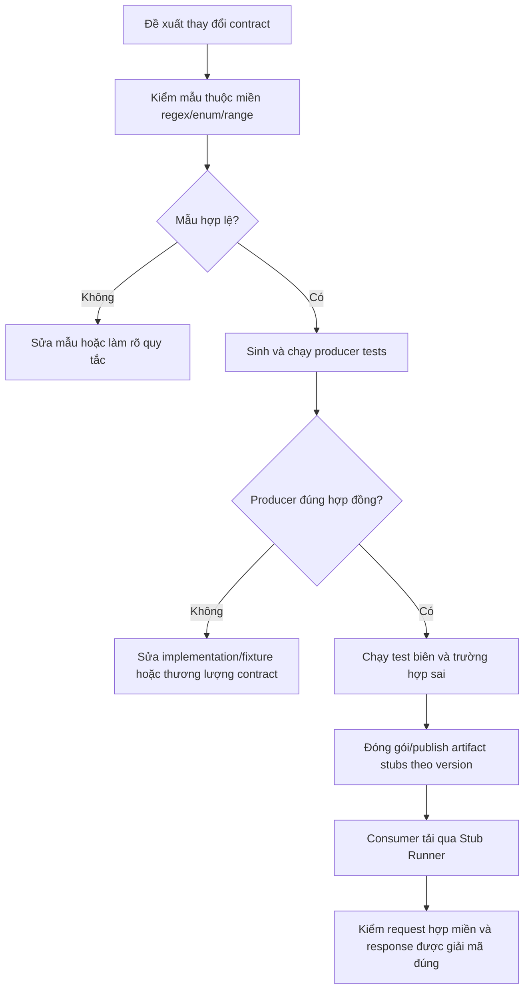

# Chọn giá trị mẫu thỏa mãn biểu thức quy định

Trong **Spring Cloud Contract**, một hợp đồng có thể vừa đưa ra **giá trị mẫu cụ thể** để tạo HTTP request/response, vừa mô tả **biểu thức quy định** (chẳng hạn regular expression) mà dữ liệu của producer hoặc consumer phải thỏa mãn. Hai phần này cần nhất quán: **giá trị mẫu phải thuộc tập giá trị được biểu thức cho phép**. Chẳng hạn, nếu hợp đồng yêu cầu mã khách hàng khớp `CUST-[1-9][0-9]{3}` mà lại chọn mẫu `CUST-0042`, mẫu đã trái với chính quy tắc được công bố.

Bài này thuộc chương **Giá trị hai phía** trong mô-đun **SPRING_CLOUD_CONTRACT**. Mục tiêu là chọn được các giá trị mẫu đáng tin cậy khi mô tả hành vi HTTP bằng **Groovy/YAML DSL**, hiểu nơi nào dùng mẫu và nơi nào dùng matcher trong **generated producer test** và **stub**, rồi đưa quy tắc kiểm tra đó vào quy trình kiểm thử của producer, consumer và CI. Nguyên tắc cũng có thể áp dụng cho payload của hợp đồng thông điệp, dù cách chạy kiểm thử messaging khác HTTP.

## 1. Giá trị mẫu và biểu thức quy định là hai thành phần bổ sung

Giả sử **Order Service** (producer) cung cấp API tạo đơn hàng cho **Checkout Service** (consumer):

```http
POST /api/orders
Content-Type: application/json

{"customerId":"CUST-1042","quantity":2}
```

Phản hồi thành công:

```http
HTTP/1.1 201 Created
Content-Type: application/json

{"orderId":"ORD-9001","status":"CREATED"}
```

Nhóm thống nhất các định dạng ví dụ:

| Trường | Biểu thức/điều kiện quy định | Mẫu **thỏa mãn** | Mẫu **không thỏa mãn** |
| --- | --- | --- | --- |
| `customerId` | `CUST-[1-9][0-9]{3}` | `CUST-1042` | `CUST-0042`, `CUST-ABC` |
| `orderId` | `ORD-[0-9]{4}` | `ORD-9001` | `ORD-91`, `ord-9001` |
| `quantity` | Số nguyên từ 1 đến 10, theo quy tắc nghiệp vụ của ví dụ | `2` | `0`, `11`, `"2"` nếu không cho chuyển kiểu |
| `status` trong phản hồi tạo đơn thành công | Bằng đúng `CREATED` | `CREATED` | `SUCCESS` |

**Giá trị mẫu** trả lời: “Trong một lần kiểm thử cụ thể, ta sẽ gửi/nhận dữ liệu nào?”. **Biểu thức quy định** trả lời: “Những dữ liệu nào được xem là phù hợp với điều đã cam kết?”. Nếu gọi miền phù hợp là `D`, mẫu `e` phải thỏa:

\[
e \in D
\]

Với regex `CUST-[1-9][0-9]{3}`, ví dụ `CUST-1042` thuộc miền theo **định dạng**. Điều đó **không tự chứng minh** khách hàng 1042 tồn tại, được phép đặt hàng hoặc thuộc đúng tài khoản; những điều kiện dựa trên trạng thái hệ thống cần kiểm thử nghiệp vụ và fixture riêng.

Không nên đánh đồng **“một ví dụ đúng”** với **“mọi giá trị trong miền đều hoạt động”**. Một generated producer test chỉ dùng `CUST-1042` có thể đạt ngay cả khi producer vô tình từ chối `CUST-2356`, dù mẫu thứ hai cũng đúng định dạng. Vì vậy, ngoài việc chọn mẫu phù hợp, cần xây dựng test đại diện và test biên khi miền rộng hoặc có ràng buộc nghiệp vụ phức tạp.

## 2. Vì sao Spring Cloud Contract phải biết giá trị ở hai phía?

Spring Cloud Contract sử dụng một hợp đồng cho **hai luồng kiểm tra**:

1. **Kiểm thử producer:** Contract Verifier sinh test chạy với implementation thực. Test cần một **request cụ thể** có thể gửi được và một **quy tắc xác nhận response thực**.
2. **Kiểm thử consumer:** từ hợp đồng, công cụ tạo stub; **Stub Runner** khởi động stub để consumer gọi mã HTTP client thật. Stub cần biết **request nào được chấp nhận** và **response cụ thể nào sẽ trả về**.

Khi dùng **Groovy DSL**, cặp `consumer(...)` và `producer(...)` trong `$(...)` cho phép biểu diễn hai góc nhìn. Cách chọn **mẫu** và **matcher** thường đối xứng như sau:

| Vị trí trong hợp đồng | Góc nhìn `consumer(...)` | Góc nhìn `producer(...)` |
| --- | --- | --- |
| **Request** | Matcher để stub nhận dạng request mà consumer gửi. | Mẫu cụ thể để generated test gửi tới producer thật. |
| **Response** | Mẫu cụ thể để stub trả cho consumer test. | Matcher để generated test đối chiếu response thực của producer. |

Ví dụ:

```groovy
// Bên trong request.body:
customerId: $(consumer(regex('CUST-[1-9][0-9]{3}')),
              producer('CUST-1042'))

// Bên trong response.body:
orderId: $(consumer('ORD-9001'),
           producer(regex('ORD-[0-9]{4}')))
```

Ở đây `CUST-1042` là **mẫu của request producer test**, còn `ORD-9001` là **mẫu response của stub**. Hai chuỗi phải khớp biểu thức nằm ở góc nhìn tương ứng. Nếu tráo mẫu với matcher sai chiều, bạn có thể khiến generated test so sánh một ID cố định mà producer không hứa sẽ trả, hoặc khiến stub không nhận những ID hợp lệ của consumer.

Điều cần nhớ: “consumer” và “producer” là **góc nhìn của dữ liệu trong cơ chế sinh test/stub**, không có nghĩa chỉ một nhóm được phép yêu cầu ràng buộc đó. Hợp đồng phải được cả hai phía thống nhất và review khi sửa.

## 3. Ví dụ Groovy DSL đầy đủ với mẫu hợp lệ

Trong producer, tạo `src/test/resources/contracts/orders/create_order.groovy`:

```groovy
import org.springframework.cloud.contract.spec.Contract

Contract.make {
    name 'shouldCreateOrder'
    description 'Tạo đơn hàng cho customerId đúng định dạng'

    request {
        method 'POST'
        url '/api/orders'
        headers {
            contentType(applicationJson())
        }
        body(
            customerId: $(consumer(regex('CUST-[1-9][0-9]{3}')),
                          producer('CUST-1042')),
            quantity: 2
        )
    }

    response {
        status 201
        headers {
            contentType(applicationJson())
        }
        body(
            orderId: $(consumer('ORD-9001'),
                       producer(regex('ORD-[0-9]{4}'))),
            status: 'CREATED'
        )
    }
}
```

Từ cùng hợp đồng này, hai đầu kiểm thử có ý nghĩa:

- **Generated producer test** gửi `{"customerId":"CUST-1042","quantity":2}`, sau đó kiểm HTTP 201, `orderId` thực khớp `ORD-[0-9]{4}` và `status` là `CREATED`.
- **Stub HTTP** có thể khớp request với `customerId` thuộc định dạng `CUST-[1-9][0-9]{3}` (cùng những điều kiện khác trong contract), rồi trả body mẫu `{"orderId":"ORD-9001","status":"CREATED"}`.

Ở ví dụ này, `quantity: 2` là **một giá trị được ghi trực tiếp**, chưa phải quy tắc “1 đến 10”. Nếu muốn bảo vệ ràng buộc khoảng, cần bổ sung matcher hoặc các test/contract cho trường hợp biên phù hợp với khả năng DSL phiên bản đang dùng. Không được suy từ một giá trị số 2 rằng mọi số nguyên hợp lệ đều sẽ được stub chấp nhận.

### 3.1. Nếu chọn mẫu không khớp matcher thì sao?

Xét phần request bị viết sai:

```groovy
customerId: $(consumer(regex('CUST-[1-9][0-9]{3}')),
              producer('CUST-0042'))
```

`CUST-0042` **không thuộc miền** vì chữ số đầu sau `CUST-` là `0`. Tương tự, phản hồi sau là bất nhất:

```groovy
orderId: $(consumer('ORD-91'),
           producer(regex('ORD-[0-9]{4}')))
```

`ORD-91` chỉ có hai chữ số. Những sai lệch này phải được phát hiện khi review hoặc kiểm tra tự động đối với contract. Tùy phiên bản và đường sinh mã, công cụ có thể báo lỗi khi xử lý một số cặp giá trị mâu thuẫn; **không nên xem việc plugin chạy được là phép kiểm chứng tổng quát rằng mọi mẫu đều đúng miền**. Chủ động xác minh bằng test matcher trước khi phát hành artifact.

Nếu team cần kiểm một giá trị **không hợp lệ**, hãy định nghĩa **tình huống lỗi riêng** với response tương ứng (ví dụ HTTP 400 kèm mã lỗi), thay vì đưa mẫu sai vào một hợp đồng vốn đang mô tả request hợp lệ trả HTTP 201.

## 4. Quy trình sáu bước để chọn mẫu đáng tin cậy

Một cách có thể áp dụng cho từng trường trong hợp đồng:

1. **Xác định ý nghĩa nghiệp vụ:** ví dụ `customerId` là định danh khách hàng hợp lệ về hình dạng; `orderId` do producer sinh; `quantity` là số lượng nguyên.
2. **Xác định miền bằng điều kiện rõ ràng:** kiểu dữ liệu JSON, định dạng, tập enum, khoảng số, khả năng null và trường có bắt buộc hay không.
3. **Chọn một mẫu cụ thể nằm trong miền:** ưu tiên giá trị ổn định, dễ đọc và không chứa dữ liệu khách hàng thật hay bí mật.
4. **Kiểm mẫu với đúng điều kiện:** với regex, dùng phép khớp toàn bộ và thêm phản ví dụ; với khoảng, so biên dưới và biên trên; với enum, kiểm đúng chữ hoa/chữ thường.
5. **Đặt mẫu ở đúng phía trong DSL:** request example phục vụ generated producer test, response example phục vụ stub; matcher ở phía còn lại theo bảng mục 2.
6. **Chạy thực tế cả hai đầu:** quan sát generated producer test, mapping trong artifact `stubs` và consumer test với Stub Runner. Kiểm cả request đáng lẽ khớp và request đáng lẽ không khớp.

Các bước trên giúp giảm trường hợp **hai phía sử dụng hai ý nghĩa khác nhau** cho cùng một trường, hoặc artifact stub chấp nhận dữ liệu rộng hơn hợp đồng nghiệp vụ đã thỏa thuận.

## 5. Kiểm chứng mẫu regex bằng một test nhỏ trước khi viết DSL

Với regex được thiết kế để mô tả **toàn bộ chuỗi**, có thể thử nhanh bằng `java.util.regex.Pattern`. Dưới đây là bài kiểm tra JUnit 5 minh họa, độc lập với Spring Cloud Contract:

```java
import org.junit.jupiter.api.Test;

import java.util.regex.Pattern;

import static org.assertj.core.api.Assertions.assertThat;

class ContractSamplePatternTest {

    private static final Pattern CUSTOMER_ID =
            Pattern.compile("CUST-[1-9][0-9]{3}");

    private static final Pattern ORDER_ID =
            Pattern.compile("ORD-[0-9]{4}");

    @Test
    void requestSampleBelongsToDeclaredFormat() {
        assertThat(CUSTOMER_ID.matcher("CUST-1042").matches()).isTrue();
        assertThat(CUSTOMER_ID.matcher("CUST-2356").matches()).isTrue();
        assertThat(CUSTOMER_ID.matcher("CUST-0042").matches()).isFalse();
        assertThat(CUSTOMER_ID.matcher("CUST-ABC").matches()).isFalse();
        assertThat(CUSTOMER_ID.matcher("X-CUST-1042").matches()).isFalse();
    }

    @Test
    void responseSampleBelongsToDeclaredFormat() {
        assertThat(ORDER_ID.matcher("ORD-9001").matches()).isTrue();
        assertThat(ORDER_ID.matcher("ORD-0000").matches()).isTrue();
        assertThat(ORDER_ID.matcher("ORD-91").matches()).isFalse();
        assertThat(ORDER_ID.matcher("ord-9001").matches()).isFalse();
        assertThat(ORDER_ID.matcher("ORD-9001-extra").matches()).isFalse();
    }
}
```

`matcher(...).matches()` yêu cầu **toàn bộ chuỗi** khớp, khác với `find()` chỉ cần thấy một đoạn khớp. Nếu code test dùng `find()` mà stub dùng chế độ so khớp toàn bộ, có thể dẫn đến kết luận nhầm về một mẫu. Hãy xác nhận ngữ nghĩa matcher thực sự được plugin và WireMock dùng; với những matcher trong DSL phức tạp hơn, cần đối chiếu trực tiếp đầu ra sinh ra từ hợp đồng.

Trong ví dụ, `ORD-0000` đúng **định dạng** `ORD-[0-9]{4}`, dù một quy tắc nghiệp vụ riêng có thể cấm ID toàn số 0. Nếu nghiệp vụ cấm `ORD-0000`, hãy siết điều kiện theo đúng ý nghĩa hoặc thêm kiểm thử validation tương ứng. Đừng suy “đúng regex” thành “hợp lệ trong mọi ngữ cảnh”.

### 5.1. Bộ phản ví dụ làm lộ matcher quá rộng

Đối với mẫu `CUST-1042`, nên thử ít nhất:

| Biến thể | Giá trị | Mục tiêu kiểm |
| --- | --- | --- |
| Thiếu ký tự | `CUST-142` | Bảo vệ độ dài. |
| Thừa ký tự | `CUST-10420` | Bảo vệ độ dài tối đa. |
| Sai tiền tố | `USER-1042` | Bảo vệ namespace ID. |
| Khác chữ hoa/chữ thường | `cust-1042` | Bảo vệ casing nếu API phân biệt. |
| Chữ số đầu không hợp lệ | `CUST-0042` | Bảo vệ quy tắc chữ số đầu từ 1 đến 9. |
| Khoảng trắng | ` CUST-1042 ` | Phát hiện vô tình trim/cho phép whitespace. |
| Dữ liệu sai kiểu | JSON số `1042` | Phân biệt chuỗi với số trong request. |

Kết quả mong muốn phụ thuộc yêu cầu API thực. Nếu API chủ động chuẩn hóa khoảng trắng hoặc casing, nhóm phải ghi rõ điều đó; không tự áp dụng quy tắc nghiêm ngặt chỉ vì ví dụ minh họa đang dùng regex nghiêm ngặt.

## 6. Giá trị mẫu cần phù hợp cả kiểu JSON và biểu thức

Một chuỗi nhìn giống số **không đồng nhất** với một số JSON:

```json
{"quantity": 2}
```

```json
{"quantity": "2"}
```

Với API yêu cầu `quantity` là **integer** từ 1 đến 10, mẫu `2` đúng cả kiểu và miền; mẫu `"2"` chỉ là chuỗi, dù biểu thức `[0-9]+` có thể khớp nội dung dạng text của nó. Nếu API cho phép tự chuyển kiểu, đó là hành vi riêng phải được mô tả và test; không nên dựa vào khả năng Jackson tự ép kiểu mà không có hợp đồng.

Tương tự, mẫu `null`, mẫu rỗng `""` và **trường hoàn toàn vắng mặt** không giống nhau:

```json
{}
```

```json
{"customerId": null}
```

```json
{"customerId": ""}
```

Một matcher kiểu chuỗi không tự xác định API có chấp nhận null hoặc thiếu trường hay không. Nếu đây là tình huống quan trọng, cần hợp đồng rõ ràng cho tính **required/nullable** và các trường hợp lỗi. Đừng dùng mẫu `null` trong hợp đồng thành công nếu định dạng đã quy định `customerId` bắt buộc là một chuỗi không rỗng.

## 7. Chọn mẫu cho thời gian, UUID, enum và mã định danh

Cùng một nguyên tắc áp dụng cho những trường thường gây lỗi khi tích hợp:

| Loại dữ liệu | Mẫu minh họa | Quy tắc có thể cần | Lỗi thường gặp |
| --- | --- | --- | --- |
| UUID dạng chuỗi | `550e8400-e29b-41d4-a716-446655440000` | Đúng mẫu UUID và version nếu API giới hạn. | Dùng giá trị không đủ nhóm, hoặc coi mọi chuỗi 36 ký tự là UUID. |
| Thời điểm UTC | `2026-03-05T08:15:30Z` | ISO 8601 / RFC 3339 theo thỏa thuận, kèm quy tắc offset. | Mẫu có timezone không đúng, thiếu `Z` khi API yêu cầu UTC. |
| Ngày lịch | `2026-03-05` | Chuỗi ngày hợp lệ và định dạng `yyyy-MM-dd`. | Regex chấp nhận `2026-02-31` dù ngày không tồn tại. |
| Enum trạng thái | `CREATED` | Một trong `CREATED`, `PAID`, `CANCELLED`, tùy endpoint. | Dùng `created` khi API phân biệt chữ hoa/chữ thường. |
| Mã tiền tệ | `VND` | Tập mã được hệ thống hỗ trợ, định dạng in hoa. | Matcher `[A-Z]{3}` chấp nhận mã không được hệ thống hỗ trợ. |
| Số tiền | `125000` | Kiểu số và đơn vị (ví dụ VND), khoảng và độ chính xác. | Mẫu mơ hồ giữa đơn vị nguyên và đơn vị nhỏ nhất. |

Đặc biệt với ngày, giờ và UUID, **regex có thể chỉ kiểm hình dạng**, không xác minh toàn bộ tính hợp lệ. Một regex cho ngày tháng có thể cho phép ngày 31 tháng 2; một regex cho UUID có thể bỏ qua version hoặc variant. Để bảo vệ ngữ nghĩa sâu hơn, kết hợp validation và kiểm thử ở producer.

### 7.1. Tránh mẫu ngẫu nhiên không thể tái lập

Giả sử hợp đồng dùng thời gian hiện tại hoặc ID ngẫu nhiên tại thời điểm nạp script. Khi đó generated test, mapping stub và consumer test có thể không cùng nhìn một giá trị, nhất là ở các lần build khác nhau. Với **giá trị mẫu** ở phía cần một response/request xác định, nên dùng giá trị cố định như `ORD-9001`. Với dữ liệu **thực sự được phép thay đổi** ở producer response, dùng matcher đúng trường và chuẩn bị fixture/test không phụ thuộc giá trị cố định đó.

Không sao chép mã định danh, địa chỉ email, token hay số điện thoại của người dùng thật vào contract. Dùng dữ liệu giả hợp lệ theo format và tách những bí mật cần cho kiểm thử vào cấu hình CI bảo mật.

## 8. Viết cùng ý tưởng bằng YAML DSL

Trong **YAML DSL**, giá trị mẫu thường xuất hiện trong `request.body` và `response.body`, còn matcher được khai báo bên dưới `matchers`. Tệp `src/test/resources/contracts/orders/create_order.yml` có thể mô tả cùng hành vi:

```yaml
description: Tạo đơn hàng với customerId đúng định dạng
request:
  method: POST
  url: /api/orders
  headers:
    Content-Type: application/json
  body:
    customerId: CUST-1042
    quantity: 2
  matchers:
    body:
      - path: $.customerId
        type: by_regex
        value: 'CUST-[1-9][0-9]{3}'
response:
  status: 201
  headers:
    Content-Type: application/json
  body:
    orderId: ORD-9001
    status: CREATED
  matchers:
    body:
      - path: $.orderId
        type: by_regex
        value: 'ORD-[0-9]{4}'
```

Trong cấu trúc YAML minh họa, **request example** `CUST-1042` là giá trị cụ thể mà producer test có thể gửi; request matcher `$.customerId` diễn đạt định dạng được stub kiểm khi nhận request của consumer. **Response example** `ORD-9001` là giá trị stub có thể trả; response matcher `$.orderId` là điều kiện generated test dùng để kiểm response thực.

Chú ý:

- Dùng **dấu nháy đơn** quanh regex trong YAML để thể hiện chuỗi rõ ràng và tránh một số quy tắc xử lý escape của dấu nháy kép.
- `path: $.customerId` chỉ trường trong JSON, không phải đường dẫn filesystem; `$.` ở đây là cú pháp JSONPath.
- Một tệp YAML **đúng cú pháp** chưa chắc đã là một hợp đồng hợp lệ theo phiên bản Spring Cloud Contract đang dùng. Cần chạy plugin để xác nhận matcher được nạp và có hiệu lực trong generated test/stub.
- Trong một lượt build, chỉ giữ **một bản hợp đồng có hiệu lực** cho cùng tương tác; không đồng thời đặt Groovy và YAML tương đương vào thư mục được quét chỉ để so sánh cú pháp.

YAML và Groovy là hai cách biểu diễn đặc tả; chúng không miễn trừ yêu cầu **mẫu phải khớp quy tắc**. Nếu đổi mẫu ở `body`, hãy kiểm lại matcher; nếu đổi matcher, hãy kiểm lại những mẫu đang dùng trong contract.

## 9. Vì sao một mẫu đúng chưa đủ chứng minh toàn bộ miền?

Giả sử producer bị triển khai sai:

```java
if ("CUST-1042".equals(request.customerId())) {
    return new OrderResponse("ORD-9001", "CREATED");
}
throw new IllegalArgumentException("Unknown customer");
```

Generated producer test gửi `CUST-1042` có thể **PASS**, và consumer test dùng stub với matcher regex có thể **PASS** khi gửi `CUST-2356`. Nhưng producer thật vẫn không chấp nhận `CUST-2356`. Điều này chứng minh một hợp đồng có matcher không tự động biến generated test thành một phép thử toàn miền.

Hãy phân biệt hai mức bảo đảm:

1. **Producer test từ hợp đồng** xác nhận triển khai đáp ứng **các mẫu cụ thể được sinh** và các điều kiện response được mô tả.
2. **Validation, test tham số hóa và test biên của producer** bảo vệ miền dữ liệu rộng hơn, nhất là khi request matcher cho phép nhiều đầu vào.

Ví dụ test tham số hóa ở producer (phần minh họa, cần triển khai HTTP call và fixture thực tế):

```java
@ParameterizedTest
@ValueSource(strings = {"CUST-1000", "CUST-1042", "CUST-2356", "CUST-9999"})
void acceptsSupportedCustomerIds(String customerId) {
    // Chuẩn bị dữ liệu khách hàng phù hợp cho mỗi mã.
    // Gọi producer thật, kiểm response theo nghiệp vụ đã công bố.
}
```

Nếu customer ID phải **tồn tại**, các test trên cần chuẩn bị khách hàng tương ứng hoặc tách bài test **định dạng** khỏi bài test **tồn tại**. Không nên kỳ vọng mọi chuỗi đúng regex đều tạo được đơn hàng bất kể dữ liệu và quyền truy cập.

## 10. Quan sát stub để xác nhận mẫu và matcher được dùng đúng chiều

Sau khi generated producer tests đạt, producer có thể đóng gói stub cùng phiên bản, ví dụ:

```text
com.acme:order-service:1.0.0:stubs
```

Artifact có thể chứa các mapping WireMock phục vụ HTTP. Ví dụ sau là **minh họa ý nghĩa**, không phải bản JSON được bảo đảm giống nguyên văn đầu ra của plugin:

```json
{
  "request": {
    "method": "POST",
    "url": "/api/orders",
    "bodyPatterns": [
      {
        "matchesJsonPath": {
          "expression": "$.customerId",
          "matches": "CUST-[1-9][0-9]{3}"
        }
      }
    ]
  },
  "response": {
    "status": 201,
    "jsonBody": {
      "orderId": "ORD-9001",
      "status": "CREATED"
    }
  }
}
```

**Đoạn trên không mô tả đầy đủ** điều kiện `quantity=2` hay tất cả header trong hợp đồng; mapping thực tế phải được kiểm từ artifact được sinh. Điểm cần kiểm là request matcher cho `customerId` có áp dụng định dạng phù hợp không và response có trả **mẫu** `ORD-9001` như mong đợi hay không.

Với hai request:

```http
POST /api/orders
Content-Type: application/json

{"customerId":"CUST-1042","quantity":2}
```

và:

```http
POST /api/orders
Content-Type: application/json

{"customerId":"CUST-2356","quantity":2}
```

Stub có matcher được sinh đúng có thể trả cùng một response mẫu. Đây là hành vi **hữu ích cho consumer test**, nhưng chưa chứng minh producer thật sinh ID duy nhất hoặc ghi hai đơn khác nhau vào database.

Thử thêm `CUST-0042`, `CUST-ABC` hoặc `CUST-1042-extra`. Những request ngoài định dạng **không nên khớp mapping thành công này**. Nếu stub trả 404 do **không có mapping phù hợp**, đó là lỗi no-match của stub, chưa phải response lỗi nghiệp vụ 404 do producer thực định nghĩa. Để kiểm lỗi nghiệp vụ, phải có hợp đồng riêng với status và body lỗi rõ ràng.

## 11. Kiểm thử consumer bằng Stub Runner

Trong dự án consumer, HTTP client cần sử dụng base URL cấu hình được; trong test, URL trỏ về cổng của Stub Runner. Đoạn JUnit sau minh họa:

```java
import org.junit.jupiter.api.Test;
import org.springframework.beans.factory.annotation.Autowired;
import org.springframework.boot.test.context.SpringBootTest;
import org.springframework.cloud.contract.stubrunner.spring.AutoConfigureStubRunner;
import org.springframework.cloud.contract.stubrunner.spring.StubRunnerProperties;

import static org.assertj.core.api.Assertions.assertThat;

@SpringBootTest(properties = "orders.base-url=http://localhost:8089")
@AutoConfigureStubRunner(
    ids = "com.acme:order-service:1.0.0:stubs:8089",
    stubsMode = StubRunnerProperties.StubsMode.LOCAL
)
class OrderClientStubTest {

    @Autowired OrderClient orderClient;

    @Test
    void acceptsDeclaredRequestExample() {
        OrderReceipt result = orderClient.createOrder("CUST-1042", 2);
        assertThat(result.orderId()).isEqualTo("ORD-9001");
        assertThat(result.status()).isEqualTo("CREATED");
    }

    @Test
    void acceptsAnotherValueMatchingTheExpression() {
        OrderReceipt result = orderClient.createOrder("CUST-2356", 2);
        assertThat(result.orderId()).isEqualTo("ORD-9001");
        assertThat(result.status()).isEqualTo("CREATED");
    }
}
```

Đây là **minh họa phần test**, giả định consumer đã có:

- `OrderClient.createOrder(String customerId, int quantity)` gửi HTTP `POST /api/orders`, serialize body JSON và đọc base URL từ `orders.base-url`.
- `OrderReceipt` là DTO/record có `orderId` và `status`.
- Dependency Spring Boot Test, AssertJ và `spring-cloud-starter-contract-stub-runner`.
- Artifact `com.acme:order-service:1.0.0:stubs` đã được cài vào Maven local, phù hợp `LOCAL`.

Với artifact **đã công bố lên Maven repository**, consumer CI thường dùng `StubsMode.REMOTE`, cấu hình `repositoryRoot` và quyền truy cập phù hợp. Ghim version cụ thể để kết quả có thể tái lập. Nếu dùng cổng `8089` cố định, phải đảm bảo cổng này trống; khi chạy song song, cấu hình cổng động và đồng bộ URL client với Stub Runner.

Hai test trên cho thấy **mã consumer thật** có thể gửi các request hợp lệ về định dạng và giải mã mẫu response. Không dùng kết quả đó để suy producer chấp nhận mọi customer ID đúng định dạng hoặc sinh order ID duy nhất.

## 12. Khi đổi regex hoặc mẫu, điều gì là thay đổi tương thích?

Một giá trị mẫu thay đổi và một biểu thức quy định thay đổi có thể có tác động rất khác nhau:

| Thay đổi | Ý nghĩa | Cần kiểm |
| --- | --- | --- |
| Đổi request example từ `CUST-1042` sang `CUST-2356`, giữ matcher. | Thường là thay **dữ liệu kiểm thử producer** nếu cả hai đều hợp miền. | Fixture có đủ dữ liệu, test producer có tiếp tục bảo vệ nghiệp vụ? |
| Đổi response example từ `ORD-9001` sang `ORD-9002`, giữ matcher. | Thay **giá trị trả về của stub** cho consumer test. | Consumer có đang phụ thuộc sai vào một ID mẫu cố định không? |
| Thu hẹp request regex từ `CUST-[0-9]{4}` còn `CUST-[1-9][0-9]{3}`. | Có thể loại bỏ dữ liệu trước đây được chấp nhận. | Consumer nào vẫn gửi mã bắt đầu bằng 0? Có kế hoạch chuyển đổi không? |
| Nới regex response từ `ORD-[0-9]{4}` thành `ORD-.*`. | Giảm khả năng phát hiện producer đổi format. | Consumer có cần bốn chữ số hoặc cấu trúc ID ổn định không? |
| Đổi `status` từ `CREATED` thành `DONE`. | Có thể thay đổi hành vi được consumer xử lý. | Consumer cũ parse enum/trạng thái ra sao? |
| Đổi kiểu JSON `quantity` từ number sang string. | Thay đổi schema dù chuỗi nhìn vẫn là số. | DTO/parser và kiểm thử của tất cả consumer có tương thích không? |

Đổi mẫu không phải lúc nào cũng vô hại: consumer test có thể đang assert một giá trị stub cụ thể theo thiết kế bài test, nên cần review tác động đến test. Dù vậy, **đổi miền chấp nhận hoặc ngữ nghĩa trường** thường đáng quan tâm hơn vì ảnh hưởng trực tiếp các request/response mà consumer có quyền kỳ vọng.

Nếu producer và consumer mới cùng sửa hợp đồng để test xanh, điều đó **chưa chứng minh tương thích ngược**. Các hợp đồng còn hiệu lực đối với consumer cũ và chính sách phiên bản API cần được bảo vệ riêng trong quy trình CI/release.

## 13. Đưa kiểm tra giá trị mẫu vào CI

Một pipeline nên kiểm hai lớp nhất quán: **đúng nội bộ hợp đồng** và **đúng khi chạy hai phía**.



Các điểm cần quan sát:

1. **Trước build**, kiểm những mẫu tĩnh quan trọng với regex và phản ví dụ như phần 5. Với khoảng, enum và kiểu JSON, dùng đúng kiểm tra tương ứng; regex không thay thế mọi loại ràng buộc.
2. **Producer CI** phải thực sự sinh và chạy test theo hợp đồng; chỉ thấy `BUILD SUCCESS` mà không có generated test không đủ bằng chứng.
3. **Test biên** kiểm các giá trị quan trọng ngoài request example, nhất là khi request matcher cho phép nhiều giá trị mà generated producer test chỉ gửi một mẫu.
4. **Publish stub** sau khi producer verification đạt. Công cụ có thể sinh stub trước khi mọi test hoàn thành; pipeline chịu trách nhiệm chặn bản phát hành khi chưa đủ điều kiện.
5. **Consumer CI** dùng artifact stub theo version đã chọn, kiểm các request hợp miền và phản hồi được xử lý đúng bằng mã client thật. Test no-match không thay thế hợp đồng lỗi nghiệp vụ.

Với Maven, một producer đã cấu hình Contract Verifier trong lifecycle có thể chạy `mvn verify`; sau khi đạt, các bước phù hợp tạo/cài hoặc phát hành artifact `stubs`. Consumer dùng `mvn test` hay task tương ứng với phiên bản artifact đã sẵn có. Cấu hình thực tế phụ thuộc dự án; bước này không tự chứng minh độ đầy đủ của matcher khi chưa đọc report và thử dữ liệu biên.

## 14. Những lỗi thường gặp

| Lỗi | Dấu hiệu | Cách sửa |
| --- | --- | --- |
| Chọn mẫu ngoài regex. | `producer('CUST-0042')` nhưng matcher bắt đầu bằng `[1-9]`. | Chọn `CUST-1042` hoặc thương lượng lại biểu thức, không tự nới matcher chỉ để qua test. |
| Dùng response mẫu sai chiều. | Stub không có giá trị cụ thể rõ ràng, producer test bị ràng buộc vào một ID tĩnh không cần thiết. | Kiểm lại `consumer(...)` và `producer(...)` ở **response**, phân biệt mẫu stub và matcher producer. |
| Chỉ kiểm một mẫu hợp lệ. | Producer chấp nhận `CUST-1042` nhưng từ chối `CUST-2356` đúng format. | Thêm producer test tham số hóa/test biên và fixture. |
| Regex quá rộng. | `CUST-ABC` hoặc chuỗi rỗng cũng được stub nhận. | Rà lại biểu thức và chạy bộ phản ví dụ. |
| Chỉ dùng matcher kiểu số. | `quantity=0` vẫn được xem là hợp lệ khi nghiệp vụ yêu cầu 1–10. | Thêm validation khoảng và test 0/1/10/11. |
| Không phân biệt JSON number với string. | `"quantity":"2"` được chấp nhận ngoài ý muốn. | Kiểm kiểu JSON trong hợp đồng/test và cấu hình deserialize. |
| Dùng ID/thời gian ngẫu nhiên ngay trong giá trị mẫu. | Build khác nhau tạo request/stub khác nhau, khó tái hiện lỗi. | Dùng example cố định; với giá trị động ở producer, dùng matcher và fixture ổn định. |
| Chỉ nhìn Groovy/YAML mà không xem stub mapping. | Matcher sinh không đúng mong đợi với body phức tạp. | Đọc artifact stub, thử request khớp và request không khớp. |
| Coi 404 no-match của WireMock là validation nghiệp vụ. | Consumer test lỗi vẫn xanh dù thiếu mapping cho response lỗi. | Mô tả contract lỗi riêng và assert body/code nghiệp vụ. |
| Xóa contract cũ khi đổi miền. | Test mới đạt nhưng consumer cũ gặp breaking change. | Duy trì những kỳ vọng còn hiệu lực và lên kế hoạch phiên bản/chuyển đổi. |

## 15. Bài thực hành: chọn mẫu đúng, chứng minh mẫu sai

Trên một dự án Spring Boot dùng Spring Cloud Contract Verifier ở producer và Stub Runner ở consumer, thực hiện:

1. Tạo hợp đồng `POST /api/orders` theo mục 3, chọn `CUST-1042` và `ORD-9001` làm giá trị mẫu; giữ hai regex đã nêu.
2. Viết một test dùng `Pattern.matcher(...).matches()` xác nhận hai mẫu hợp lệ, đồng thời `CUST-0042`, `CUST-ABC`, `ORD-91` không hợp lệ.
3. Tạm đổi request example thành `CUST-0042`; giải thích vì sao mâu thuẫn với matcher. Hoàn nguyên trước khi tạo bản stub tin cậy.
4. Chạy generated producer test với producer đúng hợp đồng, kiểm report xác nhận test thực sự chạy và nhận một `orderId` đáp ứng biểu thức.
5. Thay response ID thực bằng `ord-9001` rồi chạy lại; xác nhận test producer thất bại vì không phù hợp quy tắc chữ hoa/chữ thường.
6. Tạo/cài artifact stub và chạy consumer test với `CUST-1042`, sau đó với `CUST-2356`; hai request hợp miền phải được stub xử lý theo hợp đồng.
7. Thử `CUST-ABC` và `CUST-1042-extra`; xác nhận chúng **không khớp mapping thành công**. Phân biệt lỗi no-match và response lỗi nghiệp vụ.
8. Bổ sung ràng buộc quantity từ 1 đến 10 vào kiểm thử producer: chạy giá trị 0, 1, 10, 11 để chứng minh mẫu `2` không thể đại diện cho toàn bộ quy tắc khoảng.
9. Đề xuất thay regex của `customerId` và mô tả consumer nào có nguy cơ bị ảnh hưởng; chỉ publish stub version mới khi producer tests và các consumer tests liên quan đã đạt.

Kết quả cần ghi lại là **mẫu nào được gửi vào producer test**, **biểu thức nào xác minh response producer**, **mẫu nào stub trả cho consumer**, và **request nào được stub chấp nhận theo matcher**. Đó là bốn quan sát giúp bạn phân biệt đúng “giá trị mẫu” và “miền hợp lệ” của hợp đồng.

## 16. Câu hỏi tự kiểm tra

1. `CUST-0042` có phù hợp `CUST-[1-9][0-9]{3}` không? Giải thích dựa trên từng thành phần của regex.
2. Trong phần **request** của Groovy DSL, vì sao mẫu cụ thể thường đặt ở `producer(...)` còn regex ở `consumer(...)`?
3. Trong phần **response**, vì sao lại dùng `consumer('ORD-9001')` và `producer(regex('ORD-[0-9]{4}'))`?
4. Nếu `ORD-9001` khớp regex nhưng `ORD-0000` bị nghiệp vụ cấm, còn cần kiểm tra gì?
5. `quantity=2` có chứng minh `quantity=10` và `quantity=11` được producer xử lý đúng không?
6. Nếu Stub Runner chấp nhận `CUST-2356` nhưng producer thật chỉ chấp nhận `CUST-1042`, lớp test nào cần bổ sung?
7. Vì sao một mẫu UUID đúng định dạng chưa chứng minh record tương ứng tồn tại hoặc user có quyền truy cập?
8. Trong CI, tại sao phải kiểm **mẫu khớp matcher** trước khi publish artifact `stubs`, rồi vẫn cần chạy producer tests và consumer tests?

**Ghi nhớ:** Giá trị mẫu phải **thỏa mãn biểu thức quy định**, nhưng một mẫu đúng không thay thế kiểm thử cả miền. Trong Spring Cloud Contract, hãy chọn mẫu ổn định cho **request producer test** và **response stub**, đặt matcher đúng chiều cho **request stub** và **response producer test**, kiểm những giá trị sai có chủ đích, rồi xác minh hai phía bằng generated tests và Stub Runner. Khi mẫu và miền nhất quán, hợp đồng mới là nguồn mô tả có thể tin cậy để phát hiện thay đổi API không tương thích.
