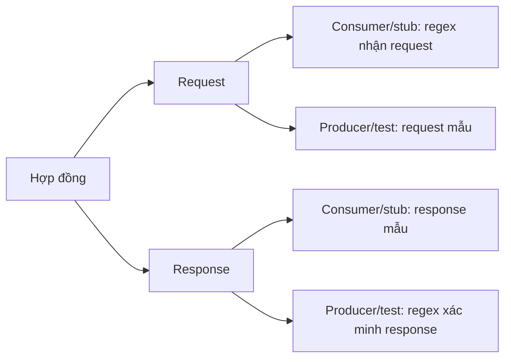
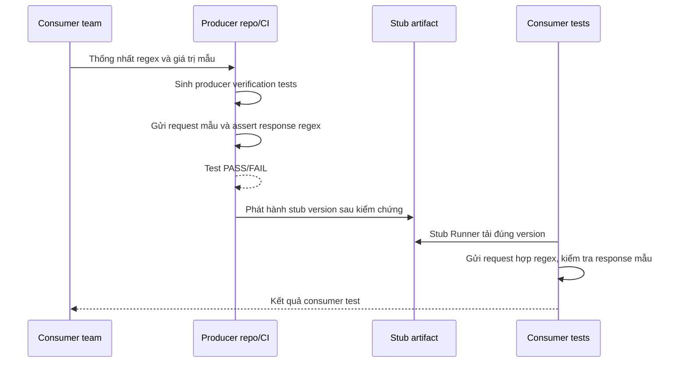

# Dùng regex cho dữ liệu động mà vẫn giữ kỳ vọng rõ ràng

## 1. Khi dữ liệu thay đổi, hợp đồng vẫn phải có ý nghĩa

Trong một hệ thống có **producer** và **consumer**, nhiều giá trị giao tiếp không cố định: mã đơn hàng, mã giao dịch, correlation ID, timestamp, mã theo dõi, địa chỉ callback. Nếu hợp đồng bắt producer luôn trả một ID duy nhất như `PAY-1001`, bài kiểm thử sẽ dễ thất bại khi ứng dụng tạo ID khác dù giao diện vẫn tương thích. Ngược lại, nếu chỉ yêu cầu mọi trường khớp `.*`, hợp đồng có thể bỏ lọt lỗi đổi định dạng, enum hoặc dữ liệu không hợp lệ.

**Regular expression (regex)** giúp mô tả *tập giá trị hợp lệ* thay vì một giá trị duy nhất. Tuy nhiên, regex chỉ hữu ích khi nó bảo vệ đúng điều mà consumer cần: tiền tố, độ dài, tập ký tự, định dạng, kiểu và các điều kiện nghiệp vụ liên quan.

Trong **Spring Cloud Contract (SCC)**, chúng ta có thể viết hợp đồng HTTP hoặc thông điệp bằng **Groovy/YAML DSL**, sinh **producer verification tests**, tạo và phát hành **stub**, dùng **Stub Runner** ở consumer, rồi tích hợp vào CI để phát hiện thay đổi API không tương thích. Regex là một phần của **hành vi hợp đồng được kiểm chứng**, không phải cách thay mọi giá trị bằng wildcard.

**Mục tiêu học tập:**

- Hiểu khi nào dữ liệu nên được ràng buộc bằng giá trị cố định, regex hoặc matcher kiểu dữ liệu.
- Phân biệt regex ở **request** và **response**, phía **consumer/stub** và **producer/test**.
- Viết ví dụ Groovy DSL bằng `value(consumer(...), producer(...))` và YAML DSL bằng `body` + `matchers`.
- Chọn regex đủ chặt, kiểm tra ví dụ hợp lệ và không hợp lệ, tránh lệch kiểu dữ liệu và regex quá rộng.
- Đọc kết quả test/stub đúng phạm vi rồi kết hợp với kiểm thử bổ sung trong CI.

> **Nguyên tắc:** Regex phải diễn đạt một cam kết cụ thể mà consumer thực sự phụ thuộc. “Giá trị bất kỳ” thường là dấu hiệu cần làm rõ hợp đồng, không phải giải pháp mặc định.

## 2. Vì sao không thể cố định toàn bộ dữ liệu?

Giả sử producer `payment-service` nhận yêu cầu tạo thanh toán:

```http
POST /api/payments HTTP/1.1
Content-Type: application/json

{
  "orderId": "ORD-42",
  "amount": 150000,
  "currency": "VND"
}
```

Producer có thể trả:

```http
HTTP/1.1 201 Created
Content-Type: application/json

{
  "paymentId": "PAY-1001",
  "state": "ACCEPTED"
}
```

Khi chạy test ở lần khác, hệ thống có thể sinh `PAY-7834` thay cho `PAY-1001`. Nếu consumer chỉ cần ID có định dạng `PAY-` theo sau là chữ số và cần trạng thái chính xác `ACCEPTED`, một hợp đồng tốt có thể giữ:

- `response.status = 201`: **chính xác**, vì consumer phân biệt tạo thành công với các nhánh khác.
- `response.body.state = "ACCEPTED"`: **chính xác**, vì đó là giá trị enum mang ý nghĩa nghiệp vụ.
- `response.body.paymentId`: **đúng định dạng**, ví dụ `PAY-[0-9]{4,10}`; phần số có thể biến động.
- `request.body.orderId`: **một ví dụ cố định cho test producer**, nhưng stub có thể chấp nhận nhiều mã đơn đúng định dạng.
- `request.body.amount = 150000` và `currency = "VND"`: cố định trong tình huống này, vì cả ngữ nghĩa thanh toán cũng cần được bảo vệ.

Như vậy, sự linh hoạt chỉ được trao cho những phần **thực sự được phép biến đổi**.

## 3. Hai phía của regex: chiều request và response

Spring Cloud Contract dùng một hợp đồng làm đầu vào cho **hai nhánh kiểm thử**:

1. **Producer verification:** công cụ sinh test gửi request mẫu đến producer và kiểm tra response producer thật.
2. **Consumer verification:** công cụ sinh stub; consumer dùng Stub Runner gửi request tới stub và nhận response mẫu.

Khi cần giá trị động, phải hiểu *bên nào sử dụng giá trị mẫu* và *bên nào sử dụng regex*.

| Vị trí | Phía consumer / stub | Phía producer / generated test |
|---|---|---|
| **Request** | Regex dùng để nhận diện request có thể khớp stub | Một giá trị request cụ thể để test gửi đi |
| **Response** | Một giá trị cụ thể để stub trả về | Regex dùng để kiểm tra response thực từ producer |
| **Giá trị cố định** | Bảo vệ hành vi mô phỏng với giá trị đã thỏa thuận | Bảo vệ assertion ở test thực tế |
| **Giá trị động** | Cho phép consumer gửi nhiều request hợp lệ | Cho phép producer trả dữ liệu biến động nhưng đúng định dạng |



Một sai lầm rất phổ biến là nhìn thấy từ **producer** trong `value(consumer(...), producer(...))` rồi nghĩ rằng nó luôn mang nghĩa “giá trị producer trả về”. Ở **request**, producer side lại là **dữ liệu đầu vào mà test gửi cho producer**. Ở **response**, producer side mới là **kỳ vọng dùng để kiểm tra dữ liệu producer trả**.

Ví dụ về ý định của từng trường:

| Trường | Dữ liệu mẫu | Regex | Đọc đúng ý nghĩa |
|---|---|---|---|
| Request `orderId` | `ORD-42` | `ORD-[0-9]{2,8}` | Stub nhận nhiều mã phù hợp; producer test gửi `ORD-42` |
| Response `paymentId` | `PAY-1001` | `PAY-[0-9]{4,10}` | Stub trả `PAY-1001`; producer test chấp nhận ID khác đúng dạng |
| Response `state` | `ACCEPTED` | Không dùng | Producer phải trả đúng `ACCEPTED` trong tình huống này |
| Response `amount` | `150000` | Không dùng | Producer không được tự đổi số tiền ở fixture đã quy định |

## 4. Ví dụ Groovy DSL với giá trị hai phía

Trong **Groovy DSL**, Spring Cloud Contract hỗ trợ `value(consumer(...), producer(...))` hoặc dạng viết gọn `$(consumer(...), producer(...))`. Các alias `client/server` hoặc `stub/test` cũng tồn tại, nhưng tên `consumer/producer` giúp giải thích rõ ý định của bài học.

File `create-payment.groovy`:

```groovy
import org.springframework.cloud.contract.spec.Contract

Contract.make {
    name('create_payment_with_dynamic_id')
    description('Tạo thanh toán và trả ID đúng định dạng')

    request {
        method POST()
        url '/api/payments'
        headers {
            contentType(applicationJson())
        }
        body(
            orderId: value(
                consumer(regex('ORD-[0-9]{2,8}')),
                producer('ORD-42')
            ),
            amount: 150000,
            currency: 'VND'
        )
    }

    response {
        status CREATED()
        headers {
            contentType(applicationJson())
        }
        body(
            paymentId: value(
                consumer('PAY-1001'),
                producer(regex('PAY-[0-9]{4,10}'))
            ),
            state: 'ACCEPTED'
        )
    }
}
```

Cách hiểu:

- **Request:** `consumer(regex('ORD-[0-9]{2,8}'))` mô tả điều kiện nhận request của stub. `producer('ORD-42')` cung cấp giá trị cố định cho producer verification test.
- **Response:** `consumer('PAY-1001')` là ID ví dụ để stub trả cho consumer. `producer(regex('PAY-[0-9]{4,10}'))` là ràng buộc producer verification test dùng để kiểm tra ID mà producer thật trả.
- **Giữ chặt:** `amount`, `currency`, HTTP `201` và `state` vẫn là kỳ vọng cụ thể của tình huống.

Không bắt buộc mọi field đều dùng `value()`. Đối với giá trị cần chính xác như trạng thái `ACCEPTED`, cách viết một giá trị cố định thường dễ hiểu và bảo vệ consumer tốt hơn.

### 4.1. Regex chỉ ở một phía

Một số dạng coded DSL cho phép chỉ viết regex ở một phía để Spring Cloud Contract **tạo ra giá trị phù hợp cho phía còn lại**. Tuy nhiên, việc sinh dữ liệu tự động có thể làm ví dụ khó dự đoán. Với contract dùng làm tài liệu nhóm hoặc chạy CI cần tái lập, nên chọn **mẫu cố định hợp lệ** cho phía còn lại khi có thể.

Đặc biệt, nếu producer test cần fixture cho đơn `ORD-42` thì để công cụ sinh ra một mã đơn ngẫu nhiên khác có thể khiến test thất bại vì không có dữ liệu tương ứng. Tự động tạo giá trị hợp regex không đồng nghĩa tự động chuẩn bị dữ liệu nghiệp vụ trong database.

### 4.2. Regex không thay thế quan hệ giữa hai trường

Giả sử producer phải trả `orderId` trong response **bằng đúng** `orderId` của request. Hai regex giống nhau:

```text
request.orderId  matches  ORD-[0-9]{2,8}
response.orderId matches  ORD-[0-9]{2,8}
```

**không chứng minh hai giá trị bằng nhau**. `ORD-42` ở request và `ORD-99` ở response đều khớp cùng pattern nhưng không bảo toàn correlation. Trường hợp này cần dùng cơ chế tham chiếu request trong response của Spring Cloud Contract (ví dụ `fromRequest()` ở Groovy DSL hoặc helper Handlebars phù hợp ở YAML) hoặc assertion bổ sung. Đây là ràng buộc **quan hệ giá trị**, không chỉ **định dạng riêng lẻ**.

## 5. YAML DSL: tách body mẫu khỏi matcher động

**YAML không dùng trực tiếp cú pháp Groovy `value(consumer(...), producer(...))`.** Trong YAML, dữ liệu ví dụ được khai báo dưới `request.body` và `response.body`; các phần linh hoạt được khai báo riêng trong `request.matchers` và `response.matchers`.

File `create-payment.yml` diễn đạt cùng hành vi:

```yaml
name: create_payment_with_dynamic_id
description: "Tạo thanh toán và trả ID đúng định dạng"
request:
  method: POST
  url: /api/payments
  headers:
    Content-Type: application/json
  body:
    orderId: "ORD-42"
    amount: 150000
    currency: "VND"
  matchers:
    body:
      - path: $.orderId
        type: by_regex
        value: 'ORD-[0-9]{2,8}'
response:
  status: 201
  headers:
    Content-Type: application/json
  body:
    paymentId: "PAY-1001"
    state: "ACCEPTED"
  matchers:
    body:
      - path: $.paymentId
        type: by_regex
        value: 'PAY-[0-9]{4,10}'
```

**Đọc YAML theo chiều kiểm thử:**

- `request.body.orderId`: mẫu request `ORD-42` được generated producer test sử dụng.
- `request.matchers.body`: quy tắc khiến stub có thể nhận mã đơn khác miễn phù hợp regex.
- `response.body.paymentId`: mẫu `PAY-1001` để stub trả cho consumer.
- `response.matchers.body`: quy tắc kiểm tra ID thanh toán thực tế do producer trả.
- `response.body.state`: giữ giá trị chính xác `ACCEPTED`; không khai báo matcher thay thế.

Bảng so sánh hai cách diễn đạt:

| Mục tiêu | Groovy DSL | YAML DSL |
|---|---|---|
| Stub nhận mã đơn động | `consumer(regex('ORD-[0-9]{2,8}'))` trong request | `request.matchers.body` + `by_regex` |
| Test producer gửi mã đơn mẫu | `producer('ORD-42')` trong request | `request.body.orderId: "ORD-42"` |
| Stub trả ID thanh toán mẫu | `consumer('PAY-1001')` trong response | `response.body.paymentId: "PAY-1001"` |
| Test producer kiểm định dạng ID | `producer(regex('PAY-[0-9]{4,10}'))` trong response | `response.matchers.body` + `by_regex` |

Các matcher trong YAML phải nằm **đúng phần** `request` hoặc `response` và tham chiếu **field có trong payload mẫu**. Đặt matcher cho `$.paymentId` bên dưới `request` sẽ không thay thế được assertion ở response.

### 5.1. Lỗi cú pháp thường thấy

Đoạn dưới đây **không diễn đạt đúng hai phía** trong YAML DSL:

```yaml
# Không dùng như cú pháp SCC cho giá trị động
response:
  body:
    paymentId:
      consumer: "PAY-1001"
      producer: 'PAY-[0-9]{4,10}'
```

Một parser YAML có thể xem `paymentId` là **object** chứa hai key `consumer` và `producer`, chứ không biến nó thành matcher. Dùng `body` và `matchers` như ví dụ chính thức để giữ đúng ý nghĩa.

## 6. Viết regex đủ chặt: từ ví dụ tới tập giá trị hợp lệ

Regex là một **ngôn ngữ mô tả mẫu ký tự**. Tập hợp điều nó chấp nhận nên được xác định từ yêu cầu API và phiên bản client cần bảo vệ.

Ví dụ, nhóm muốn định nghĩa mã thanh toán:

> Bắt đầu bằng `PAY-`, theo sau bởi **4 đến 10 chữ số ASCII**, không chứa khoảng trắng hay ký tự khác.

Pattern phù hợp:

```regex
PAY-[0-9]{4,10}
```

Trong cách so khớp regex của Spring Cloud Contract được tài liệu hóa, biểu thức phải **khớp toàn bộ vùng giá trị**, theo hành vi `Pattern.matches()`. Do đó, pattern `PAY-[0-9]{4,10}` không nên được hiểu là “chỉ cần một đoạn bên trong chuỗi trùng là đủ”. Dù vậy, khi mang regex sang công cụ khác như database, JavaScript hoặc hệ thống log, phải kiểm tra lại ngữ nghĩa so khớp toàn bộ và cách escaping.

### 6.1. Chọn pattern theo ràng buộc

| Yêu cầu | Regex ví dụ | Hợp lệ | Không hợp lệ |
|---|---|---|---|
| Mã thanh toán có tiền tố và 4–10 chữ số | `PAY-[0-9]{4,10}` | `PAY-1001`, `PAY-1234567890` | `PAY-1`, `X-PAY-1001` |
| Mã đơn gồm 2–8 chữ số | `ORD-[0-9]{2,8}` | `ORD-42` | `ORD-A2`, `ORD-4` |
| Mã loại event được giới hạn | `ORDER_CREATED\|ORDER_PAID` | `ORDER_PAID` | `ORDER_DELETED` |
| Mã hàng 3 chữ hoa, dấu gạch ngang, 3 chữ số | `[A-Z]{3}-[0-9]{3}` | `ABC-120` | `abc-120` |
| Phiên bản dạng major.minor.patch | `[0-9]+\.[0-9]+\.[0-9]+` | `1.20.3` | `v1.20`, `1-20-3` |
| Số nguyên dương từ 1 trở lên bằng ký tự thập phân | `[1-9][0-9]*` | `1`, `25` | `0`, `-1` |

Các pattern là **ví dụ ràng buộc định dạng**, không tự thay thế kiểm tra nghiệp vụ. Chẳng hạn `[1-9][0-9]*` không kiểm tra trần giao dịch, giới hạn độ dài hoặc giá trị tối đa của kiểu Java.

### 6.2. Cách dùng những ký hiệu regex thông dụng

| Cú pháp | Ý nghĩa | Cần chú ý |
|---|---|---|
| `[0-9]` | Một chữ số từ 0 đến 9 | Rõ nghĩa ASCII; có thể khác `\d` theo cờ/engine |
| `[A-Z]` | Một chữ cái Latin hoa ASCII | Không tự bao phủ dấu tiếng Việt |
| `{4,10}` | Lặp 4 đến 10 lần | Quyết định giới hạn độ dài rõ ràng |
| `+` | Ít nhất một lần | Không giới hạn số lần lặp |
| `*` | Từ không đến nhiều lần | Có thể cho phép chuỗi rỗng |
| `?` | Không hoặc một lần | Dùng cho phần tùy chọn có chủ đích |
| `(A\|B)` | Chấp nhận một trong hai nhánh | Cần ngoặc đúng phạm vi nếu ghép với phần khác |
| `\.` | Dấu chấm thật | `.` không escape khớp một ký tự bất kỳ |
| `^` và `$` | Neo đầu/cuối trong nhiều regex engine | Không thể thay thế kiểm tra ngữ nghĩa và cách engine match |

Không nên chọn `.*`, `.+` hoặc `[A-Za-z0-9-]+` chỉ để “test đỡ đỏ”. Nếu consumer cần mã `PAY-`, pattern `.*` có thể chấp nhận giá trị như `ERROR` hoặc chuỗi rỗng, làm test xanh trong khi client không còn xử lý được.

### 6.3. Giới hạn chiều dài thường là một phần hợp đồng

So sánh:

```regex
PAY-[0-9]+
```

và:

```regex
PAY-[0-9]{4,10}
```

Biểu thức đầu chấp nhận số lượng chữ số không giới hạn; biểu thức sau bảo vệ giới hạn độ dài. Nếu consumer lưu mã thanh toán trong trường giới hạn 14 ký tự, hoặc giao diện hiển thị có định dạng cố định, sự khác biệt có thể quan trọng. Độ dài, giới hạn ký tự và tiền tố phải dựa trên **giao diện đã thỏa thuận**, tránh tự áp đặt giới hạn chỉ vì ví dụ hiện tại ngắn.

### 6.4. Regex và escaping trong YAML/Groovy

Trong YAML, cách viết regex được ưa dùng là **chuỗi trong dấu nháy đơn**:

```yaml
response:
  status: 200
  body:
    version: "1.20.3"
  matchers:
    body:
      - path: $.version
        type: by_regex
        value: '[0-9]+\.[0-9]+\.[0-9]+'
```

Dấu nháy đơn của YAML giữ dấu gạch chéo ngược như ký tự thường; trong YAML double-quoted string, phải chú ý quy tắc escape. Trong Groovy, regex nằm trong string hoặc regex literal có thể có **quy tắc escape khác**. Khi chuyển từ Groovy sang YAML, phải đối chiếu **chuỗi regex thực tế đưa vào engine**, không chỉ sao chép ký tự.

Sử dụng regex quá phức tạp, nhiều nhóm lặp lồng nhau hoặc wildcard không giới hạn có thể gây khó đọc và tốn thời gian xử lý. Ưu tiên pattern đơn giản, có giới hạn, có các ví dụ chấp nhận/từ chối; với những ràng buộc khó biểu diễn, dùng assertion hoặc test chuyên dụng phù hợp.

## 7. Regex, kiểu dữ liệu và giá trị cố định: chọn công cụ phù hợp

Spring Cloud Contract YAML DSL có các matcher như `by_equality`, `by_regex`, `by_type` và các matcher ngày/giờ. Chúng phục vụ các mức ràng buộc khác nhau:

| Tình huống | Lựa chọn thường phù hợp | Vì sao |
|---|---|---|
| Trạng thái đơn đã thanh toán phải là `PAID` | Giá trị cố định hoặc `by_equality` | Bảo vệ ngữ nghĩa chính xác |
| ID có tiền tố và số lượng chữ số quy định | `by_regex` | Bảo vệ định dạng và cho phép biến động |
| Field phải là số nhưng giá trị phụ thuộc fixture | `by_type` nếu kiểu là đủ, hoặc regex với kiểu số | Tránh khóa vào một giá trị ngẫu nhiên |
| Timestamp chuẩn ISO trong response | Matcher ngày/giờ có sẵn khi phù hợp | Tránh tự viết regex ngày giờ quá phức tạp |
| UUID trong response | Regex định nghĩa sẵn `uuid` khi được hỗ trợ | Giảm lỗi tự viết pattern |
| Số tiền phải bằng tổng các dòng | Assertion nghiệp vụ hoặc `by_command` phù hợp | Regex không tính toán quan hệ giữa các field |
| Trường chỉ có `PENDING` hoặc `PAID` | Regex nhóm có giới hạn, nếu cả hai thực sự hợp lệ | Không chấp nhận giá trị enum tùy ý |
| JSON array có ít nhất hai phần tử | Matcher/size assertion phù hợp hoặc test bổ sung | Regex trên chuỗi JSON không phải cách đáng tin cậy |

**Định dạng đúng không đồng nghĩa ngữ nghĩa đúng.** Chuỗi `PAY-1234` có thể hợp regex nhưng vẫn tham chiếu đến thanh toán không tồn tại. Tổng tiền `150000` có thể đúng kiểu số nhưng sai đơn vị hoặc sai kết quả tính. Contract bảo vệ phần giao diện đã mô tả; các quy tắc nghiệp vụ cần kiểm thử riêng.

### 7.1. Regex cho giá trị số phải quan tâm kiểu JSON

Nếu response có:

```yaml
response:
  status: 200
  body:
    retryCount: 3
  matchers:
    body:
      - path: $.retryCount
        type: by_regex
        value: '[0-9]+'
        regexType: as_integer
```

thì `retryCount` là **JSON number** trong body mẫu, không phải chuỗi `"3"`. Thuộc tính `regexType` cho phép chỉ ra kiểu số mà công cụ có thể sử dụng khi áp dụng matcher. Các giá trị có thể hỗ trợ gồm `as_integer`, `as_long`, `as_double`, `as_float`, `as_short` và `as_boolean` theo tài liệu DSL. Cần đối chiếu đúng phiên bản plugin và xem generated assertion để xác nhận hành vi mong muốn.

Không tự suy ra rằng `value: '[0-9]+'` sẽ áp đặt toàn bộ giới hạn kiểu số hoặc giá trị tối đa. Một giá trị có hàng trăm chữ số vẫn hợp mẫu nhưng có thể tràn kiểu dữ liệu của client.

### 7.2. Dùng predefined pattern khi phù hợp

SCC YAML hỗ trợ `predefined` cho một số regex dựng sẵn, ví dụ `uuid`:

```yaml
response:
  status: 200
  body:
    correlationId: "550e8400-e29b-41d4-a716-446655440000"
  matchers:
    body:
      - path: $.correlationId
        type: by_regex
        predefined: uuid
```

Cách này phù hợp khi hợp đồng cần **một UUID hợp lệ**, thay vì tự duy trì một regex dài. Một số pattern có sẵn khác có thể bao gồm `email`, `hostname`, `url`, `ip_address`, `iso_date`, `iso_date_time`, `non_empty` hoặc `non_blank`; danh sách cụ thể phải đối chiếu với phiên bản SCC.

Nếu yêu cầu chỉ cho phép **UUID phiên bản cụ thể**, hãy kiểm tra xem predefined pattern có đúng mức ràng buộc cần thiết không. Pattern tổng quát `uuid` có thể rộng hơn yêu cầu “UUID v4” của hệ thống.

### 7.3. Dùng matcher ngày/giờ thay vì regex quá phức tạp

Khi contract cần bảo vệ timestamp, bạn có thể dùng matcher `by_timestamp` nếu định dạng được hỗ trợ đúng với giao diện. Nếu timestamp có múi giờ, offset hoặc độ chính xác mili giây cụ thể, cần ghi rõ trong contract và test theo phiên bản. Việc một chuỗi khớp định dạng ISO không chứng minh thời gian nghiệp vụ đúng, không bị lệch múi giờ hoặc nằm trong khoảng chấp nhận được.

## 8. Thử regex với cả ví dụ hợp lệ và không hợp lệ

Regex có thể trông hợp lý nhưng vẫn chấp nhận quá nhiều giá trị. Trước khi đưa pattern vào contract, hãy lập bảng kiểm tra **positive cases** và **negative cases**.

Ví dụ yêu cầu mã thanh toán `PAY-` + 4–10 chữ số:

| Giá trị | Kỳ vọng | Giải thích |
|---|---|---|
| `PAY-1001` | Chấp nhận | Bốn chữ số |
| `PAY-0000` | Chấp nhận nếu số không đầu hợp lệ | Đúng pattern, ý nghĩa ID còn phải xác nhận |
| `PAY-1234567890` | Chấp nhận | Mười chữ số |
| `PAY-1` | Từ chối | Quá ngắn |
| `PAY-12345678901` | Từ chối | Quá dài |
| `PAY-A001` | Từ chối | Có chữ cái ở phần số |
| `pay-1001` | Từ chối | Sai chữ hoa/thường |
| `X-PAY-1001` | Từ chối | Có ký tự thừa |
| `PAY-1001 ` | Từ chối | Có khoảng trắng cuối |
| `PAY-` | Từ chối | Không có chữ số |

Đây là **bảng để review regex**, không tự tạo thành những contract HTTP cho mọi trường hợp. Nếu API quy định request sai định dạng phải trả `400 Bad Request`, nhóm cần **hợp đồng/tình huống lỗi riêng** và producer test thực sự gọi request sai ấy.

Chẳng hạn:

```yaml
name: invalid_order_id
description: "Từ chối mã đơn không hợp lệ"
request:
  method: POST
  url: /api/payments
  headers:
    Content-Type: application/json
  body:
    orderId: "NOT-AN-ORDER"
    amount: 150000
    currency: "VND"
response:
  status: 400
  headers:
    Content-Type: application/json
  body:
    code: INVALID_ORDER_ID
```

Đây là **API minh họa được các nhóm cần thỏa thuận**, không phải phản hồi tự động do regex của stub sinh ra. **Không khớp stub mapping** chưa đồng nghĩa producer được kiểm chứng sẽ trả đúng `400` với `INVALID_ORDER_ID`. Muốn bảo vệ lỗi đầu vào, phải viết và chạy tình huống lỗi phù hợp.

## 9. Regex trong header, URL và JSON body

Phần lớn ví dụ bắt đầu từ JSON body, nhưng request thực tế còn có **path**, **query parameter** và **headers**. Dữ liệu động ở mỗi vị trí phải dùng cơ chế matcher đúng vị trí theo DSL/version.

### 9.1. Header request động

Giả sử consumer gửi `X-Correlation-Id` có dạng `trace-` theo sau là 4–8 chữ số. YAML có thể mô tả:

```yaml
name: order_with_correlation_id
request:
  method: GET
  url: /api/orders/42
  headers:
    X-Correlation-Id: "trace-1234"
  matchers:
    headers:
      - key: X-Correlation-Id
        regex: 'trace-[0-9]{4,8}'
response:
  status: 200
  body:
    id: 42
    status: PAID
```

Cấu trúc matcher header ở đây dùng `key` và `regex`, khác với `body` matcher dùng `path`, `type`, `value`. Stub có thể chấp nhận các request có correlation ID hợp pattern, trong khi generated producer test có mẫu `trace-1234` để gửi. Nếu producer phải **trả lại cùng correlation ID**, cần một hợp đồng thể hiện quan hệ request/response hoặc assertion riêng; hai regex giống nhau chưa chứng minh giá trị bằng nhau.

### 9.2. URL có path variable

Trong Groovy DSL, có thể thể hiện một request path động và một URL mẫu cho test:

```groovy
request {
    method GET()
    url value(
        consumer(regex('/api/orders/[0-9]{1,6}')),
        producer('/api/orders/42')
    )
}
```

Ý nghĩa: stub nhận các đường dẫn phù hợp; producer test gọi `/api/orders/42`. Ví dụ này mô tả **pattern ở URL**, không nên dùng JSONPath `$.id` vì ID không nằm trong JSON body. Cần kiểm tra escaping dấu `/`, quy tắc match URL/path và cấu hình chuyển đổi stub thực tế của phiên bản đang dùng.

Đối với query parameter và header phức tạp, dùng đúng matcher chuyên biệt được DSL hỗ trợ; không tự áp regex vào toàn chuỗi HTTP rồi suy rằng mọi thành phần đã được bảo vệ.

### 9.3. Object và array trong body

Nếu payload có:

```json
{
  "items": [
    { "sku": "ABC-101" },
    { "sku": "XYZ-202" }
  ]
}
```

matcher tại `$.items[0].sku` thường chỉ áp dụng cho **phần tử đầu tiên**, không tự động kiểm tra mọi item. Đừng suy ra rằng một regex cho `items[0]` đã bảo vệ độ dài mảng hoặc phần tử `items[1]`. Khi consumer phụ thuộc tất cả SKU đều hợp lệ, cần thiết kế matcher với JSONPath/kiểm tra collection phù hợp và xác minh assertion được sinh, hoặc viết kiểm thử bổ sung có chủ đích.

## 10. Những giới hạn phải hiểu rõ

### 10.1. Regex kiểm tra cấu trúc, không kiểm tra tính tồn tại

`ORD-42` và `ORD-99` đều có thể khớp `ORD-[0-9]{2,8}`. Điều đó không xác nhận đơn `ORD-99` tồn tại trong hệ thống. Producer test cần fixture phù hợp; kiểm tra tính tồn tại, phân quyền, side effect và transaction thuộc các lớp kiểm thử riêng hoặc những tình huống contract cụ thể.

### 10.2. Regex không kiểm tra logic so sánh giữa các trường

Hai trường `startAt` và `endAt` đều khớp timestamp vẫn có thể sai thứ tự. `totalAmount` và tổng các `lineItems` đều là số nhưng có thể khác nhau. Nếu consumer dựa vào quan hệ giữa các giá trị, nên dùng assertion tùy chỉnh, test nghiệp vụ hoặc cơ chế tham chiếu có hỗ trợ thay vì hai matcher độc lập.

### 10.3. Regex không tự động chứng minh toàn bộ API tương thích

Contract cho `POST /api/payments` với `ORD-42` không bao phủ mọi amount, currency, header xác thực, lỗi mạng hoặc phương án retry. Một thành công ở request cụ thể chỉ là bằng chứng về tình huống đã thực thi. Khi có nhiều phiên bản consumer, cần kiểm tra những tổ hợp version được hỗ trợ.

### 10.4. Regex mẫu không thay thế xác nhận producer thật

Stub Runner có thể trả `PAY-1001` trong khi producer mới trả `paymentId: "1001"`. Consumer test vẫn có thể xanh khi dùng stub cũ; **producer verification test** phải chạy trên đúng commit/artifact để phát hiện lệch định dạng. Chỉ xây dựng regex ở stub mà không chạy generated producer test thì chưa tạo ra bằng chứng producer đáp ứng.

### 10.5. Regex không phải cơ chế bảo mật dữ liệu

Regex không thay thế kiểm tra xác thực, phân quyền, chống lộ dữ liệu cá nhân, giới hạn tài nguyên hay xử lý chuỗi độc hại. Các pattern phức tạp có nguy cơ khó review hoặc tiêu tốn tài nguyên nếu thiết kế không cẩn thận. Dùng input validation và security test chuyên trách khi cần.

## 11. Luồng tích hợp CI để regex phát huy giá trị

Một quy trình làm việc với Spring Cloud Contract có thể gồm:



Các điểm cần xác nhận trong CI:

1. **Đầu vào contract:** phiên bản hợp đồng và commit rõ ràng, đặt đúng vị trí plugin đọc.
2. **Sinh test:** plugin Maven/Gradle của SCC thực sự tạo producer verification tests từ hợp đồng.
3. **Chạy test:** producer test base dựng fixture phù hợp với mẫu, test gọi đúng API và assertion regex được thực thi.
4. **Ghi nhận thất bại:** producer đổi `PAY-1001` thành `XYZ` hoặc sai `state` khiến test fail, và job CI phải fail thay vì bỏ qua.
5. **Đóng gói stub:** artifact stub được phát hành theo chính sách sau khi producer được kiểm chứng; gắn version có thể truy vết.
6. **Consumer test:** Stub Runner chạy stub đúng version; test kiểm tra client gửi request hợp pattern và xử lý response mẫu.
7. **Kiểm tra tương thích phiên bản:** nếu nhiều consumer tồn tại, phải xác định phiên bản nào được contract/CI hiện tại bảo vệ.

Một pipeline chỉ **sinh stub** hoặc chỉ chạy consumer test với stub đã cũ không đủ chứng minh producer hiện tại trả đúng định dạng. Đồng thời, producer test có regex quá rộng sẽ khó phát hiện lỗi dù được chạy nghiêm túc.

## 12. Các lỗi thường gặp và cách khắc phục

| Sai lầm | Hệ quả | Cách khắc phục |
|---|---|---|
| Dùng `.*` cho mọi ID | Chấp nhận giá trị rỗng/sai định dạng | Thống nhất tiền tố, tập ký tự, độ dài rồi viết pattern cụ thể |
| Dùng `by_type` khi consumer cần enum cụ thể | `FAILED` và `PAID` cùng kiểu string | Giữ giá trị cố định hoặc regex enum được chấp thuận |
| Đặt regex response dưới `request.matchers` | Không xác minh đúng field response | Dùng `response.matchers` đúng vị trí |
| Đặt regex request dưới `response.matchers` | Stub chỉ nhận mẫu cố định hoặc hành vi lệch ý định | Dùng `request.matchers` đúng vị trí |
| Mẫu không khớp regex | Stub và producer test diễn đạt hai kỳ vọng mâu thuẫn | Chọn giá trị mẫu hợp lệ và test positive case |
| Regex `[0-9]+` không giới hạn | Chấp nhận số rất dài gây lỗi client | Đặt giới hạn độ dài và xem xét kiểu dữ liệu |
| Dùng matcher chuỗi cho số/boolean thiếu cân nhắc | JSON type có thể bị nới lỏng hoặc đổi | Dùng `regexType`/`by_type` phù hợp và kiểm tra generated code |
| Nhầm regex match cả chuỗi với tìm substring | Chấp nhận/từ chối sai giá trị khi đổi engine | Kiểm tra ngữ nghĩa full match và escaping |
| Chỉ regex ID, bỏ kiểm tra trạng thái nghiệp vụ | Thay `PAID` thành `CANCELLED` vẫn có thể xanh | Giữ field trạng thái và mã HTTP chính xác |
| Có regex cho hai trường nên tưởng hai trường bằng nhau | Response trả ID khác request mà vẫn khớp | Dùng fromRequest/Handlebars hoặc assertion quan hệ |
| Chỉ test request hợp lệ | Không bảo vệ nhánh `400`/`422` | Viết contract riêng cho request không hợp lệ quan trọng |
| Chỉ dùng Stub Runner ở consumer | Producer mới có thể trả dữ liệu không khớp stub | Bắt buộc producer verification trên đúng phiên bản |
| Regex mở rộng để “chữa” test đỏ | Che thay đổi phá vỡ tương thích | Điều tra nguyên nhân, review với consumer và cập nhật API có chủ đích |

## 13. Thực hành: thiết kế regex có thể review

**Bối cảnh:** Consumer `shipping-ui` gọi producer `shipping-service` để tra cứu một vận đơn. Consumer gửi mã `TRK-` theo sau bởi **3–8 chữ số**, ví dụ `TRK-123`. Producer trả HTTP `200` cùng `eventId` có dạng `EVT-` theo sau bởi **4–6 chữ số**; trường `deliveryStatus` trong tình huống này phải là `IN_TRANSIT`.

### Yêu cầu

1. Viết contract YAML cho `POST /api/tracking/lookup`.
2. Dùng request mẫu `trackingCode: "TRK-123"` và matcher nhận cả `TRK-4567` nhưng từ chối `TRK-A12` hoặc `TRK-12`.
3. Dùng response mẫu `eventId: "EVT-1001"`, và matcher cho phép producer trả `EVT-999999` nhưng từ chối `EVT-1`.
4. Giữ `deliveryStatus: "IN_TRANSIT"` cố định, không dùng `.*`.
5. Xác định phía nào dùng mẫu và phía nào dùng regex ở request/response.
6. Đề xuất một contract riêng cho trường hợp mã vận đơn không hợp lệ với HTTP `400`.
7. Nêu các bước CI cần chạy trước khi phát hành stub và kiểm tra consumer bằng Stub Runner.

### Đáp án YAML tham khảo

```yaml
name: tracking_lookup
description: "Tra cứu vận đơn bằng mã đúng định dạng"
request:
  method: POST
  url: /api/tracking/lookup
  headers:
    Content-Type: application/json
  body:
    trackingCode: "TRK-123"
  matchers:
    body:
      - path: $.trackingCode
        type: by_regex
        value: 'TRK-[0-9]{3,8}'
response:
  status: 200
  headers:
    Content-Type: application/json
  body:
    eventId: "EVT-1001"
    deliveryStatus: "IN_TRANSIT"
  matchers:
    body:
      - path: $.eventId
        type: by_regex
        value: 'EVT-[0-9]{4,6}'
```

**Phía producer:** generated test dùng request mẫu `TRK-123`; response `eventId` có thể khác `EVT-1001` nhưng phải đúng pattern và `deliveryStatus` phải là `IN_TRANSIT`. **Phía consumer:** stub nhận mã `TRK-4567` nếu phù hợp matcher và trả một response mẫu chứa `EVT-1001`. Consumer test cần kiểm tra cách client xử lý dữ liệu, không chỉ việc stub khởi động.

### Bảng kiểm tra regex

| Input / output | Pattern | Kết quả mong muốn |
|---|---|---|
| `TRK-123` | `TRK-[0-9]{3,8}` | Đạt |
| `TRK-4567` | `TRK-[0-9]{3,8}` | Đạt |
| `TRK-12` | `TRK-[0-9]{3,8}` | Không đạt |
| `TRK-A12` | `TRK-[0-9]{3,8}` | Không đạt |
| `EVT-1001` | `EVT-[0-9]{4,6}` | Đạt |
| `EVT-999999` | `EVT-[0-9]{4,6}` | Đạt |
| `EVT-1` | `EVT-[0-9]{4,6}` | Không đạt |

Nếu business rule thay đổi để cho phép chữ cái trong mã vận đơn, nhóm cần review với consumer, cập nhật pattern và thử cả các trường hợp tương thích đã công bố. Đừng sửa pattern trên một phía mà quên generated producer test hoặc artifact stub đang được consumer dùng.

## 14. Checklist trước khi chốt một regex trong contract

- [ ] Đã xác định consumer nào cần trường này và **ý nghĩa** của dữ liệu.
- [ ] Đã phân loại field: **cố định**, **động theo định dạng**, **chỉ cần đúng kiểu**, hay **cần kiểm tra quan hệ**.
- [ ] Regex có tiền tố, tập ký tự, giới hạn chiều dài và nhóm lựa chọn phù hợp.
- [ ] Có cả ví dụ **khớp** và **không khớp**, gồm dữ liệu quá ngắn/dài, khoảng trắng và sai chữ hoa/thường.
- [ ] Mẫu trong `request.body` phù hợp regex request; mẫu trong `response.body` phù hợp regex response.
- [ ] Matcher nằm đúng phía và đúng vị trí: `request.matchers` hoặc `response.matchers`.
- [ ] JSONPath trỏ tới field có thật; matcher header/path dùng cấu trúc riêng đúng DSL.
- [ ] Nếu giá trị là number/boolean, kiểm tra kiểu JSON và `regexType` khi cần.
- [ ] Không mở rộng regex làm yếu các cam kết enum, trạng thái, mã lỗi, currency hay quantity quan trọng.
- [ ] Nếu hai field phải bằng nhau hoặc có quan hệ toán học, có assertion/cơ chế bổ sung phù hợp.
- [ ] Đã đọc generated producer test để biết regex thật sự trở thành assertion, và xác minh test được **chạy** trong CI.
- [ ] Đã kiểm tra stub mapping và consumer test qua Stub Runner với đúng version.
- [ ] Các nhánh lỗi và quy tắc nghiệp vụ ngoài khả năng regex có kiểm thử bổ sung.

## 15. Ghi nhớ và tài liệu tham khảo

Trong **Spring Cloud Contract**, regex giúp hợp đồng đủ linh hoạt với ID, timestamp và giá trị biến động nhưng vẫn giữ được kỳ vọng có thể kiểm chứng. Điểm quyết định là hiểu **hướng của dữ liệu**: ở request, regex phía consumer phục vụ stub còn phía producer dùng request mẫu; ở response, stub phục vụ giá trị mẫu còn producer test dùng matcher.

**Groovy DSL** có thể diễn đạt điều này bằng `value(consumer(regex(...)), producer(...))` và chiều ngược lại trong response. **YAML DSL** đặt mẫu trong `body` và regex trong `matchers` tương ứng. Pattern phải đủ chặt để bảo vệ định dạng mà consumer phụ thuộc, đồng thời tránh nhầm “khớp regex” với “đúng nghiệp vụ”.

Để thực sự phát hiện thay đổi API không tương thích, hãy chạy generated producer tests, phát hành stub có phiên bản và kiểm tra consumer bằng Stub Runner trong CI. Cần giữ unit, integration, security và business tests cho những điều regex không thể chứng minh.

Tài liệu chính thức để đối chiếu theo phiên bản SCC đang dùng:

- [Spring Cloud Contract — Dynamic properties, regular expressions và matchers](https://docs.spring.io/spring-cloud-contract/reference/project-features-contract/dsl-dynamic-properties.html).
- [Spring Cloud Contract 4.2 — Dynamic properties (YAML và coded DSL)](https://docs.spring.io/spring-cloud-contract/reference/4.2/project-features-contract/dsl-dynamic-properties.html).
- [Spring Cloud Contract — Contract DSL và HTTP contracts](https://docs.spring.io/spring-cloud-contract/reference/project-features-contract/http.html).

