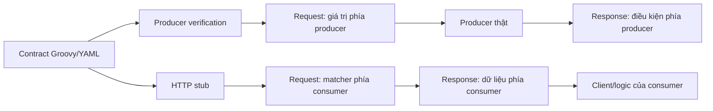
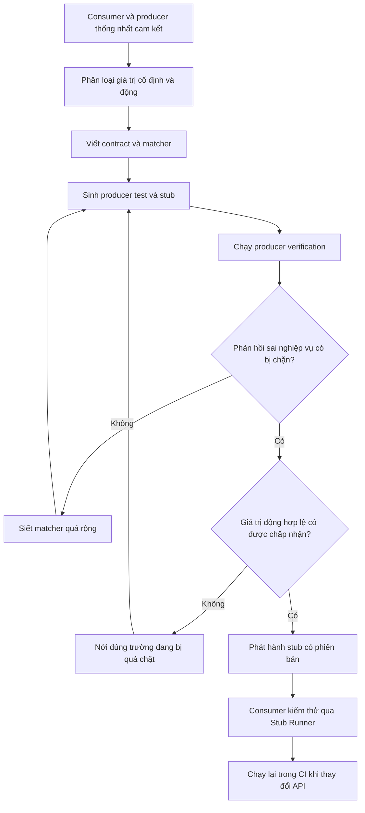

# Thực hành sửa hợp đồng khớp quá rộng hoặc quá chặt

## 1. Khi hợp đồng vẫn “xanh” nhưng không bảo vệ consumer

Trong một kiến trúc microservices, `checkout-service` (consumer) gọi HTTP API của `payment-service` (producer) để tạo thanh toán. Hai nhóm thống nhất rằng một yêu cầu hợp lệ phải chỉ rõ đơn hàng, số tiền, đơn vị tiền tệ; phản hồi tạo thành công phải chứa mã thanh toán và trạng thái `CREATED`.

**Spring Cloud Contract** giúp định nghĩa những cam kết như vậy bằng **Groovy hoặc YAML DSL**, sinh kiểm thử trên producer, tạo stub cho consumer chạy qua **Stub Runner**, rồi tích hợp vào CI để phát hiện các thay đổi API không tương thích. Nhưng nếu matcher được viết sai, toàn bộ pipeline vẫn có thể báo thành công mà không đảm bảo hành vi cần thiết.

Có hai cực đoan:

- **Khớp quá rộng (overmatching):** hợp đồng chấp nhận những request/response trái quy tắc nghiệp vụ. Ví dụ `status` được so với `.*`, nên producer trả `FAILED` vẫn qua test trong khi consumer cần `CREATED`.
- **Khớp quá chặt (overly strict matching):** hợp đồng yêu cầu những chi tiết vốn được phép thay đổi. Ví dụ bắt `paymentId` bằng đúng `PAY-1001` mặc dù producer cấp mã mới cho mỗi giao dịch; test thất bại dù API vẫn tương thích.

**Mục tiêu bài:** phát hiện hai kiểu sai lầm bằng test có chủ đích, xác định phía consumer/producer của một giá trị động, sửa Groovy DSL, viết phiên bản YAML tương đương, và kiểm chứng cả producer verification lẫn stub consumer trong CI.

> Một contract tốt phải **chặt với cam kết nghiệp vụ** và **linh hoạt với phần thực sự động**. Đừng tối ưu số lượng test xanh; hãy tối ưu khả năng phát hiện lỗi mà consumer sẽ gặp.

## 2. Hai phía của giá trị trong Spring Cloud Contract

Trước khi sửa matcher, cần hiểu `consumer(...)` và `producer(...)`. Trong Groovy DSL, có thể viết:

```groovy
value(consumer(...), producer(...))
// Hoặc dùng dạng rút gọn:
$(consumer(...), producer(...))
// Bí danh được hỗ trợ: c()/p(), stub()/test(), client()/server().
```

Ý nghĩa phụ thuộc **giá trị đang nằm trong request hay response**:

| Vị trí trong contract | Phía `consumer(...)` | Phía `producer(...)` |
| --- | --- | --- |
| **Request** | Điều kiện nhận diện request của stub mà consumer gọi: có thể là regex/matcher. | Giá trị cụ thể để test được sinh gửi tới producer. |
| **Response** | Giá trị mẫu mà stub trả về cho consumer. | Điều kiện hoặc matcher mà producer verification áp lên response thật. |

Hình dung luồng kiểm thử:



Ví dụ ngắn:

```groovy
// Trong request: stub nhận mã phù hợp mẫu; test producer gửi ORD-2001.
orderId: $(consumer(regex('ORD-[0-9]{4}')),
           producer('ORD-2001'))

// Trong response: stub trả PAY-1001; test producer chấp nhận mã đúng mẫu.
paymentId: $(consumer('PAY-1001'),
             producer(regex('PAY-[0-9]{4}')))
```

Đây chỉ là các trường minh họa trong khối `body([ ... ])`, không phải contract hoàn chỉnh. **Không hoán đổi tùy tiện hai phía.** Một regex được đặt ở phía `producer` của request có thể khiến generator cố tạo request theo một ý định khác; đặt matcher động ở phía `consumer` của response có thể khiến stub không có giá trị mẫu xác định mà consumer cần.

Các mẫu regex trong bài dùng để diễn đạt **dạng dữ liệu**. Dù match toàn chuỗi theo cơ chế regex của Spring Cloud Contract, regex không tự hiểu các quan hệ nghiệp vụ giữa các trường.

## 3. Phân loại giá trị trước khi chọn matcher

Hãy đưa các trường của API tạo thanh toán vào ba nhóm:

| Trường | Ví dụ | Quyết định đề xuất | Vì sao |
| --- | --- | --- | --- |
| `orderId` trong một fixture cố định | `ORD-2001` | So khớp chính xác ở kịch bản này. | Dữ liệu response/fixture phải thuộc đúng đơn hàng được yêu cầu. |
| `amount` | `250000` | So khớp chính xác nếu đây là số tiền của kịch bản. | Thay đổi số tiền làm thay đổi nghiệp vụ. |
| `currency` | `VND` | So khớp chính xác. | `VND` và `USD` không thể thay thế tùy ý. |
| `status` | `CREATED` | So khớp chính xác hoặc theo một tập trạng thái đã thống nhất. | Consumer rẽ nhánh dựa vào trạng thái. |
| `paymentId` mới được tạo | `PAY-1001` | Stub trả mẫu cố định; producer test dùng regex **đủ chặt**. | Mã sinh động nhưng cần đúng quy ước. |
| `X-Request-Id` do client sinh | `REQ-ABC12345` | Stub nhận nhiều ID đúng định dạng; producer test gửi một giá trị hợp lệ. | ID request thay đổi giữa các lần gọi. |
| `createdAt` | `2026-01-15T09:00:00Z` | Giữ đồng hồ cố định **hoặc** kiểm tra timestamp hợp lệ. | Không nên phụ thuộc thời điểm máy CI chạy. |
| `items` trong phản hồi | Danh sách có phần tử | Matcher về kiểu/kích thước **nếu đó là cam kết**. | `byType()` đơn thuần không đảm bảo có dữ liệu. |

Quy tắc lựa chọn:

1. Hỏi consumer **dùng trường này để quyết định điều gì**. Nếu thay đổi giá trị sẽ thay đổi quyết định, thường phải kiểm tra chặt.
2. Hỏi producer **có quyền trả một giá trị khác giữa hai lần gọi hợp lệ không**. Nếu có, cần xác định ràng buộc nào vẫn phải giữ.
3. Chọn **dữ liệu mẫu ổn định cho stub**, sau đó chọn **matcher phù hợp cho producer verification**.
4. Nếu quan hệ giữa hai trường là cam kết (`orderId` trong request và response phải giống nhau), **regex riêng trên từng trường chưa đủ**. Cần so khớp quan hệ bằng fixture, cơ chế tham chiếu request hoặc kiểm thử bổ sung.

## 4. Lỗi số 1: response matcher quá rộng

Một contract ban đầu của nhóm Payment có thể viết:

```groovy
response {
    status 201
    headers {
        contentType(applicationJson())
    }
    body([
        paymentId: $(consumer('PAY-1001'), producer(regex('.*'))),
        status: $(consumer('CREATED'), producer(regex('.*'))),
        currency: $(consumer('VND'), producer(regex('.*')))
    ])
}
```

Đây là ví dụ **sai về mức ràng buộc**, dù cú pháp giá trị hai phía có vẻ hợp lý:

- `paymentId` có thể rỗng hoặc chứa chuỗi hoàn toàn sai định dạng.
- `status` có thể là `DECLINED`, `FAILED` hoặc giá trị bất kỳ, trong khi consumer cần `CREATED`.
- `currency` có thể thành `USD` mà test vẫn không nhận ra.

Trong trường hợp giá trị chuỗi không phải null, `.*` có thể khớp chuỗi rỗng. Nếu một field thiếu hẳn hoặc đổi kiểu, matcher trên JSON path có thể có hành vi khác tùy phiên bản, nhưng điều đó **không cứu được** việc matcher cho phép quá nhiều giá trị sai.

### Sửa matcher theo từng loại dữ liệu

```groovy
response {
    status 201
    headers {
        contentType(applicationJson())
    }
    body([
        paymentId: $(consumer('PAY-1001'),
                     producer(regex('PAY-[0-9]{4}'))),
        status: 'CREATED',
        currency: 'VND'
    ])
}
```

**Điểm thay đổi:** chỉ `paymentId` được phép biến động theo định dạng mã đã cam kết; `status` và `currency` được giữ chính xác. Ví dụ này giả định mã hợp lệ đúng là `PAY-` theo sau bởi bốn chữ số. Nếu hệ thống thật dùng UUID hoặc quy tắc khác, matcher phải phản ánh **hợp đồng API thật**, không mặc định mã nào cũng có bốn chữ số.

Kiểm thử **có khả năng phát hiện sai**:

| Producer trả về | Kết quả mong muốn |
| --- | --- |
| `paymentId=PAY-1002`, `status=CREATED`, `currency=VND` | Đạt nếu mọi điều kiện khác cũng đúng. |
| `paymentId=abc`, `status=CREATED`, `currency=VND` | Trượt vì ID sai dạng. |
| `paymentId=""` | Trượt vì không khớp quy ước ID. |
| `status=FAILED` | Trượt dù mã thanh toán hợp lệ. |
| `currency=USD` | Trượt vì phá vỡ tiền tệ đã cam kết. |
| Không có `paymentId` | Phải được phát hiện; kiểm tra generated test để chắc chắn quy tắc hiện diện được xác minh. |

Đừng “sửa” lỗi `status` bằng matcher `(CREATED|FAILED|PENDING)` nếu hợp đồng của **kịch bản tạo thành công** chỉ hứa `CREATED`. Các nhánh thất bại nên có contract khác với status HTTP và payload đúng nghiệp vụ.

## 5. Lỗi số 2: response matcher quá chặt

Đổi hướng: một contract khác yêu cầu mọi response đều trả mã và thời điểm y hệt fixture:

```groovy
response {
    status 201
    body([
        paymentId: 'PAY-1001',
        status: 'CREATED',
        createdAt: '2026-01-15T09:00:00Z'
    ])
}
```

Nếu `paymentId` và `createdAt` do server sinh mới ở mỗi request, contract đang kiểm tra **giá trị triển khai ngẫu nhiên** thay vì cam kết. Producer trả:

```json
{
  "paymentId": "PAY-4827",
  "status": "CREATED",
  "createdAt": "2026-08-10T14:25:30Z"
}
```

vẫn có thể đúng hợp đồng API thật nhưng kiểm thử sẽ trượt vì khác literal.

### Sửa theo giá trị động

```groovy
response {
    status 201
    headers {
        contentType(applicationJson())
    }
    body([
        paymentId: $(consumer('PAY-1001'),
                     producer(regex('PAY-[0-9]{4}'))),
        status: 'CREATED',
        createdAt: $(consumer('2026-01-15T09:00:00Z'),
                     producer(regex(iso8601WithOffset())))
    ])
}
```

Với phần response:

- **Stub của consumer** luôn trả `PAY-1001` và timestamp mẫu `2026-01-15T09:00:00Z`, giúp test consumer có đầu vào lặp lại được.
- **Producer verification** chấp nhận `paymentId` có định dạng hợp lệ và timestamp theo quy tắc ISO 8601 với offset mà matcher hỗ trợ.
- **`status` vẫn cố định** vì consumer dựa vào giá trị đó để phân biệt nhánh xử lý.

Nếu nghiệp vụ yêu cầu `createdAt` phải **gần thời điểm tạo giao dịch**, hoặc `expiresAt > createdAt`, chỉ kiểm tra định dạng timestamp không đủ. Cần kiểm soát `Clock` hoặc thêm assertion về quan hệ/thời gian. Nếu timestamp thực tế **được phép cố định** theo một fixture, việc giữ exact value cũng hoàn toàn hợp lý. Chỉ nới matcher khi có lý do từ cam kết.

Một cách khác cho producer test là inject:

```java
Clock fixedClock = Clock.fixed(
    Instant.parse("2026-01-15T09:00:00Z"),
    ZoneOffset.UTC
);
```

Khi logic ứng dụng dùng `fixedClock`, test có thể so khớp chính xác thời gian; cách này đặc biệt hữu ích để kiểm tra các quy tắc hạn thanh toán. Mẫu chỉ minh họa ba kiểu Java: dự án cần import `Clock`, `Instant` và `ZoneOffset`, cũng như thiết kế inject đồng hồ thật.

## 6. Lỗi số 3: request của stub khớp quá rộng

Ở phía request, matcher trước hết quyết định **stub sẽ trả response cho request nào của consumer**. Xét một request tạo thanh toán có header `X-Request-Id` do consumer sinh:

```groovy
request {
    method 'POST'
    urlPath '/api/payments'
    headers {
        contentType(applicationJson())
        header('X-Request-Id', $(
            consumer(regex('.*')),
            producer('REQ-ABC12345')
        ))
    }
    body([
        orderId: 'ORD-2001',
        amount: 250000,
        currency: 'VND'
    ])
}
```

Ở đây, phía producer vẫn nhận header mẫu `REQ-ABC12345` khi generator sinh test. Nhưng stub nhận gần như mọi chuỗi header, thậm chí `""`, làm consumer test không phát hiện client phát sinh request ID sai.

### Sửa request matcher

```groovy
request {
    method 'POST'
    urlPath '/api/payments'
    headers {
        contentType(applicationJson())
        header('X-Request-Id', $(
            consumer(regex('REQ-[A-Z0-9]{8}')),
            producer('REQ-ABC12345')
        ))
    }
    body([
        orderId: 'ORD-2001',
        amount: 250000,
        currency: 'VND'
    ])
}
```

Sau thay đổi:

- Stub chấp nhận các header như `REQ-ABC12345` hoặc `REQ-XYZW9876` (đúng dạng), nhưng không chấp nhận `abc` hoặc chuỗi rỗng.
- Producer test vẫn gửi một header ví dụ **cố định** `REQ-ABC12345` để kiểm tra code producer.
- `orderId`, `amount`, `currency` giữ nguyên để không biến một stub dành cho giao dịch của `ORD-2001` thành stub vô tình chấp nhận thanh toán của mọi đơn.

Một stub không khớp request thường trả lỗi kiểu **không tìm thấy mapping** do stub server, nhưng điều đó **không đồng nghĩa** API producer thật cam kết trả `400 Bad Request`. Nếu API có quy tắc xác thực header và trả `400` khi sai, phải bổ sung contract/test cho nhánh lỗi đó.

### Không nới request mà quên quan hệ request–response

Đoạn sau trông thuận tiện nhưng có lỗi thiết kế:

```groovy
request {
    body([
        orderId: $(consumer(regex('ORD-[0-9]{4}')),
                   producer('ORD-2001'))
    ])
}
response {
    body([
        orderId: 'ORD-2001',
        status: 'CREATED'
    ])
}
```

Nếu stub chấp nhận `ORD-9999` nhưng luôn trả `ORD-2001`, consumer có thể xử lý sai đơn. Khi response **phải phản chiếu một giá trị từ request**, hãy dùng một trong hai cách:

1. Giữ request `orderId = ORD-2001` **cố định** nếu contract chỉ đại diện một fixture cụ thể; thêm contract khác khi cần tình huống khác.
2. Nếu cần stub phục vụ nhiều order ID, dùng tính năng **tham chiếu giá trị request trong response** (ví dụ `fromRequest().body('$.orderId')` trong Groovy DSL theo phiên bản được hỗ trợ) và kiểm chứng phần template được sinh trong stub. Nếu bất biến phải đúng trên producer, bổ sung assertion phù hợp để xác minh quan hệ, không chỉ regex từng trường.

Regex kiểm tra hình dạng từng chuỗi; **nó không tự đảm bảo hai chuỗi bằng nhau**.

## 7. Lỗi số 4: request quá chặt vì khóa một giá trị được phép đổi

Giả sử producer cam kết nhận bất kỳ header `X-Request-Id` hợp lệ, nhưng contract viết:

```groovy
request {
    method 'POST'
    urlPath '/api/payments'
    headers {
        header 'X-Request-Id': 'REQ-ABC12345'
    }
}
```

Stub từ hợp đồng đó chỉ khớp một ID mẫu. Consumer thực tế phát `REQ-XYZW9876`, nên test consumer nhận response “không có mapping”, dù request hoàn toàn hợp lệ theo thiết kế.

Sửa bằng cặp giá trị hai phía của **request** như phần 6:

```groovy
header('X-Request-Id',
       $(consumer(regex('REQ-[A-Z0-9]{8}')),
         producer('REQ-ABC12345')))
```

Tránh dùng `consumer(regex(...))` cho những dữ liệu không được phép đổi. Ví dụ nếu contract là **tình huống giao dịch `ORD-2001` có số tiền `250000 VND`**, việc nới `currency` từ `'VND'` thành `'.*'` có thể cho stub nhận request `USD` và trả thành công một cách sai lệch.

## 8. Ví dụ Groovy DSL hoàn chỉnh đã sửa

Đây là contract tự chứa cho nhánh **tạo thanh toán thành công**, kết hợp các quyết định đúng ở trên:

```groovy
import org.springframework.cloud.contract.spec.Contract

Contract.make {
    name 'create_payment_with_valid_request_id'
    description 'Tạo thanh toán cho ORD-2001, chấp nhận request ID hợp lệ'

    request {
        method 'POST'
        urlPath '/api/payments'
        headers {
            contentType(applicationJson())
            header('X-Request-Id', $(
                consumer(regex('REQ-[A-Z0-9]{8}')),
                producer('REQ-ABC12345')
            ))
        }
        body([
            orderId: 'ORD-2001',
            amount: 250000,
            currency: 'VND'
        ])
    }

    response {
        status 201
        headers {
            contentType(applicationJson())
        }
        body([
            paymentId: $(consumer('PAY-1001'),
                         producer(regex('PAY-[0-9]{4}'))),
            orderId: 'ORD-2001',
            status: 'CREATED',
            amount: 250000,
            currency: 'VND',
            createdAt: $(consumer('2026-01-15T09:00:00Z'),
                         producer(regex(iso8601WithOffset())))
        ])
    }
}
```

Đọc contract theo hai hướng:

**Producer verification:** generator sẽ tạo request ví dụ `POST /api/payments`, body cho `ORD-2001`, `amount=250000`, `currency=VND`, header `REQ-ABC12345`. Producer phải trả HTTP `201`, JSON đúng giá trị nghiệp vụ; `paymentId` và `createdAt` được kiểm tra theo matcher thay vì đúng từng byte của fixture.

**Consumer test qua Stub Runner:** stub nhận request có đúng `orderId`/`amount`/`currency` và header request ID hợp lệ theo regex; nó trả `PAY-1001` cùng timestamp mẫu, `status=CREATED` để consumer có dữ liệu ổn định.

Contract này bảo vệ **một tình huống kinh doanh cụ thể**. Nó không tự chứng minh producer chấp nhận **mọi** request ID hợp lệ: generated producer test thường gửi **một giá trị ví dụ**. Nếu API phải hỗ trợ cả các giá trị biên, cần thêm các bài kiểm thử input validation hoặc property-based test. Các test xác minh `createdAt` gần thời điểm hiện tại, `paymentId` duy nhất, idempotency theo `X-Request-Id` hay quan hệ của nhiều đơn hàng cũng phải được viết riêng khi đó là cam kết.

## 9. Chuyển cùng ý tưởng sang YAML DSL

Trong YAML DSL, không nhúng `consumer(...)`/`producer(...)` vào từng trường JSON theo cú pháp Groovy. Thay vào đó, giữ **giá trị mẫu** ở `body`/`headers`, rồi đặt matcher trong các mục `matchers` tương ứng.

Ví dụ YAML tương đương với contract phần 8:

```yaml
description: Tạo thanh toán cho ORD-2001, chấp nhận request ID hợp lệ
name: create_payment_with_valid_request_id
request:
  method: POST
  urlPath: /api/payments
  headers:
    Content-Type: application/json
    X-Request-Id: REQ-ABC12345
  body:
    orderId: ORD-2001
    amount: 250000
    currency: VND
  matchers:
    headers:
      - key: X-Request-Id
        regex: 'REQ-[A-Z0-9]{8}'
response:
  status: 201
  headers:
    Content-Type: application/json
  body:
    paymentId: PAY-1001
    orderId: ORD-2001
    status: CREATED
    amount: 250000
    currency: VND
    createdAt: "2026-01-15T09:00:00Z"
  matchers:
    body:
      - path: $.paymentId
        type: by_regex
        value: 'PAY-[0-9]{4}'
      - path: $.createdAt
        type: by_regex
        predefined: iso_8601_with_offset
```

Trong YAML này:

- Header `X-Request-Id` có **giá trị mẫu** `REQ-ABC12345` cho producer test và **matcher** cho stub.
- Phản hồi có **giá trị mẫu** `PAY-1001`/timestamp cố định cho stub, trong khi matcher response kiểm tra dữ liệu mà producer thực trả.
- Những trường không có matcher như `status` hoặc `currency` vẫn phải được xác minh theo cam kết; kiểm tra output test sinh ra để chắc các assert quan trọng có mặt.

Đây là hai **định dạng thay thế** của cùng một hợp đồng. Trong repository thực, chọn một bản Groovy **hoặc** YAML cho kịch bản này, tránh phát hành hai stub trùng lặp vô ý.

Tên thuộc tính YAML, các matcher predefined và loại header matcher phải theo **phiên bản Spring Cloud Contract của dự án**. Nếu chuyển từ Groovy sang YAML, luôn sinh lại test/stub và đọc đầu ra để chắc ý nghĩa request/response không bị thay đổi.

## 10. `bodyMatchers`: dùng đúng mục đích, đừng thay thế ý nghĩa nghiệp vụ

Spring Cloud Contract cũng cho phép tách matcher khỏi phần body trong Groovy DSL. Hai nơi áp dụng khác nhau:

- **`request { bodyMatchers { ... } }`:** ràng buộc request mà stub nhận từ consumer.
- **`response { bodyMatchers { ... } }`:** ràng buộc response được test producer sinh ra dùng để xác minh.

Ví dụ kiểm tra định dạng ID và giữ status chính xác:

```groovy
response {
    status 201
    headers {
        contentType(applicationJson())
    }
    body([
        paymentId: 'PAY-1001',
        status: 'CREATED',
        amount: 250000,
        currency: 'VND'
    ])
    bodyMatchers {
        jsonPath('$.paymentId',
                 byRegex('PAY-[0-9]{4}'))
        jsonPath('$.status', byEquality())
        jsonPath('$.amount', byEquality())
        jsonPath('$.currency', byEquality())
    }
}
```

Đây là **cách khác** để thể hiện ràng buộc response; không cần kết hợp thêm một matcher động trùng lặp ở chính trường `paymentId`. Giá trị mẫu vẫn cung cấp response xác định cho stub.

### Vì sao `byType()` dễ quá rộng?

Giả sử mã ban đầu dùng:

```groovy
response {
    body([
        status: 'CREATED',
        currency: 'VND'
    ])
    bodyMatchers {
        jsonPath('$.status', byType())
        jsonPath('$.currency', byType())
    }
}
```

Nếu generated test chỉ kiểm tra **kiểu String**, nó có thể chấp nhận `'FAILED'` hoặc `'USD'`. Sửa bằng `byEquality()` hoặc bỏ matcher kiểu và xác minh literal chính xác theo cơ chế generator của phiên bản đang dùng.

`byType()` phù hợp khi **kiểu dữ liệu** chính là ràng buộc mong muốn, chẳng hạn một trường ghi chú được phép có nhiều nội dung string khác nhau. Với danh sách, DSL có thể cho `minOccurrence/maxOccurrence` để giới hạn số phần tử; nhưng nếu cần ràng buộc “tất cả phần tử có `currency = VND`” thì chỉ kiểm tra kích thước danh sách là chưa đủ.

### Regex đủ cụ thể cũng có giới hạn

| Matcher | Ví dụ lỗi có thể lọt qua | Cách tăng độ tin cậy |
| --- | --- | --- |
| `.*` | ID rỗng hoặc status hoàn toàn sai. | Thay bằng pattern/tập giá trị nghiệp vụ. |
| `[0-9]+` | Giá trị cực lớn, âm không được cho phép, hoặc giới hạn số không được kiểm tra. | Kiểm tra kiểu/khoảng giá trị bằng test nghiệp vụ. |
| `PAY-[0-9]{4}` | ID đúng dạng nhưng không thuộc đơn hàng đang xử lý. | Assert quan hệ request–response hoặc test tra cứu theo ID. |
| `iso8601WithOffset()` | Timestamp hợp lệ nhưng nằm ngoài cửa sổ thời gian mong đợi. | Inject `Clock` và xác minh quan hệ/thời hạn. |
| `byType()` với `status` | `FAILED` vẫn là string như `CREATED`. | `byEquality()` hoặc kịch bản riêng cho từng trạng thái. |

**Không có matcher nào thay cho việc xác định cam kết nghiệp vụ.** Matcher càng linh hoạt thì càng cần test tình huống phủ định để đảm bảo nó không chấp nhận hành vi đáng lẽ phải bị chặn.

## 11. Thực hành kiểm tra matcher bằng hai chiều

Sau khi sửa hợp đồng, đừng chỉ chạy producer tests một lần. Hãy dùng ma trận kiểm chứng sau:

| Thí nghiệm | Đầu vào / phản hồi giả lập | Kết quả đúng | Mục tiêu |
| --- | --- | --- | --- |
| 1. Request hợp lệ chuẩn | `X-Request-Id=REQ-ABC12345`, `ORD-2001`, `250000 VND` | Stub khớp. | Xác minh trường hợp cơ sở. |
| 2. Request ID khác nhưng hợp lệ | `X-Request-Id=REQ-XYZW9876`, còn lại giống nhau | Stub vẫn khớp. | Tránh matcher quá chặt. |
| 3. Request ID sai | `X-Request-Id=abc` | Stub **không** khớp contract thành công. | Tránh matcher quá rộng. |
| 4. Sai tiền tệ | `currency=USD` | Không khớp contract thành công này. | Bảo vệ dữ liệu nghiệp vụ. |
| 5. Producer sinh mã mới | `paymentId=PAY-4827`, các trường còn lại đúng | Producer verification đạt. | Tránh response quá chặt. |
| 6. Producer sinh mã sai | `paymentId=ABC` | Producer verification trượt. | Bảo vệ định dạng ID. |
| 7. Producer đổi status | `status=FAILED` | Producer verification trượt. | Bảo vệ trạng thái được cam kết. |
| 8. Producer đổi số tiền | `amount=250001` | Producer verification trượt. | Bảo vệ giá trị cụ thể của kịch bản. |
| 9. Producer trả timestamp mới, hợp lệ | `createdAt=2026-08-10T14:25:30Z` | Đạt nếu các ràng buộc thời gian khác vẫn đúng. | Tránh ràng buộc đồng hồ máy chạy. |
| 10. Thiếu trường cần thiết | Không có `currency` | Producer verification phải phát hiện. | Kiểm tra các assertion về hiện diện/trường bắt buộc. |

**Phân biệt “stub không khớp” với “producer trả mã lỗi”:** WireMock/Stub Runner không tìm thấy mapping là kết quả của **test double**, không chứng minh producer thật xử lý request sai như thế nào. Nếu API yêu cầu trả `400` hoặc `422` cho input không hợp lệ, viết contract riêng cho lỗi và test producer tương ứng.

### Xem cả mã test và stub được sinh

Khi kiểm tra output:

1. **Producer test:** verify request gửi giá trị mẫu `REQ-ABC12345`, xác minh HTTP `201`, `status=CREATED`, `currency=VND`, `amount=250000` và matcher ID/timestamp.
2. **Stub request matcher:** verify header request ID theo pattern; request body chỉ khớp đúng tình huống `ORD-2001`, `250000`, `VND` đã định nghĩa.
3. **Stub response:** verify nó trả dữ liệu mẫu xác định `PAY-1001`, `CREATED` và timestamp mẫu, không phải chuỗi regex thô.
4. **Consumer test:** gọi qua HTTP client thật của Checkout rồi assert quyết định nghiệp vụ.

Nếu chỉ thấy file generated mà test runner không thực thi test nào, pipeline vẫn chưa được xác minh. Hãy xem báo cáo test của Maven/Gradle và bảo đảm test thuộc lifecycle CI đang chạy.

## 12. Chặn hai kiểu lỗi khi đưa vào CI

Một quy trình:



Trong CI, nên giữ rõ các bước:

- **Review contract:** ghi nhận lý do mỗi trường dùng exact value, regex hoặc kiểu dữ liệu.
- **Sinh test/stub:** dùng cùng commit của contract và cấu hình dependency phù hợp.
- **Chạy producer verification:** nếu producer cố tình đổi `CREATED` thành `FAILED` mà test vẫn xanh, matcher đang quá rộng hoặc test không được chạy.
- **Thử biến động hợp lệ:** nếu ID mới đúng dạng khiến test thất bại, matcher quá chặt hoặc fixture không được kiểm soát.
- **Phát hành stub đã kiểm chứng:** ghi phiên bản artifact; không dựa vào stub “mới nhất” thay đổi ngầm.
- **Chạy consumer test với Stub Runner:** kiểm tra cả request hợp lệ, request sai định dạng (không khớp stub thành công) và xử lý response theo mã nghiệp vụ.
- **Kiểm tra tương thích:** mỗi thay đổi path, JSON key, status, currency hoặc kiểu dữ liệu phải được đối chiếu với consumer đang được hỗ trợ.

Lưu ý: Spring Cloud Contract tự động hóa việc biến contract thành test và stub; nó **không tự xác định** regex nào phản ánh đúng quy tắc nghiệp vụ. Quyết định này là trách nhiệm phối hợp của producer và consumer.

## 13. Bài tập sửa một hợp đồng có bốn lỗi

Một thành viên mới viết contract sau cho giao dịch thanh toán:

```groovy
import org.springframework.cloud.contract.spec.Contract

Contract.make {
    name 'payment_created'
    request {
        method 'POST'
        urlPath '/api/payments'
        headers {
            contentType(applicationJson())
            header 'X-Request-Id': 'REQ-ABC12345'
        }
        body([
            orderId: 'ORD-2001',
            amount: 250000,
            currency: $(consumer(regex('.*')), producer('VND'))
        ])
    }
    response {
        status 201
        headers {
            contentType(applicationJson())
        }
        body([
            paymentId: 'PAY-1001',
            orderId: 'ORD-2001',
            status: $(consumer('CREATED'), producer(regex('.*'))),
            amount: 250000,
            currency: 'VND'
        ])
    }
}
```

**Nhiệm vụ:**

1. Tìm **hai matcher quá rộng** và **hai ràng buộc quá chặt**. Giải thích được test nào có thể xanh giả hoặc đỏ giả.
2. Giữ `currency = VND` và `status = CREATED` trong kịch bản thành công. Giải thích vì sao không nên dùng `.*`.
3. Nới header request ID để stub nhận `REQ-XYZW9876` nhưng từ chối `abc`; producer test vẫn gửi `REQ-ABC12345`.
4. Nới response `paymentId` để producer có thể trả bất kỳ mã dạng `PAY-` + bốn chữ số; stub vẫn trả `PAY-1001`.
5. Giải thích vì sao `orderId = ORD-2001` trong request và response **không nhất thiết là quá chặt** trong một kịch bản fixture có ID cố định.
6. Viết phiên bản YAML của hợp đồng đã sửa bằng `request.matchers.headers` và `response.matchers.body`.
7. Chạy hoặc mô tả cách chạy generated producer tests, kiểm tra stub request/response; tạo ca phủ định khi producer trả `FAILED`, và ca được phép khi producer trả `PAY-4827`.
8. Nếu mở rộng `orderId` thành regex cho nhiều đơn hàng, đề xuất cơ chế giữ đúng quan hệ request–response và bổ sung test tránh trả nhầm đơn.

**Gợi ý tự kiểm:** bài làm tốt phải có **ít nhất một thí nghiệm trước/sau** chứng minh matcher đã sửa phát hiện lỗi nghiệp vụ nhưng vẫn chấp nhận giá trị động hợp lệ. Chỉ thay một regex `.*` thành regex khác mà không giải thích tác động lên stub/test chưa đủ.

## 14. Ghi nhớ

- Với **request**, `consumer(...)` mô tả điều kiện request của stub, còn `producer(...)` cấp dữ liệu cho bài producer verification được sinh.
- Với **response**, `consumer(...)` là dữ liệu mẫu stub trả, còn `producer(...)` mô tả điều kiện xác minh phản hồi từ producer.
- **Quá rộng:** `.*` hoặc `byType()` trên status/currency có thể bỏ lọt lỗi nghiệp vụ; siết lại bằng giá trị cụ thể hoặc ràng buộc đúng miền giá trị.
- **Quá chặt:** ID/timestamp động bị bắt bằng một literal sẽ làm producer test thất bại hoặc stub không khớp request hợp lệ; dùng cặp giá trị hai phía hoặc kiểm soát fixture/Clock.
- Regex chỉ kiểm tra **hình dạng**, không tự xác minh sự tương quan giữa request/response hay thứ tự nghiệp vụ.
- Với YAML, dùng giá trị mẫu trong body/header và matcher thích hợp ở từng phía; luôn kiểm tra **generated test và stub** để xác nhận có cùng ý nghĩa với Groovy.
- Trong CI, kiểm tra cả **sai phải trượt** và **đúng phải đạt**, sau đó phát hành stub có phiên bản và chạy consumer test qua Stub Runner.

### Tài liệu tham khảo

- [Spring Cloud Contract — Dynamic Properties](https://docs.spring.io/spring-cloud-contract/reference/project-features-contract/dsl-dynamic-properties.html): `consumer/producer`, `value`, `$()`, regex và tham chiếu request.
- [Spring Cloud Contract — Contract DSL](https://docs.spring.io/spring-cloud-contract/reference/project-features-contract.html): cách định nghĩa request/response với Groovy và YAML.
- [Spring Cloud Contract — HTTP Contracts](https://docs.spring.io/spring-cloud-contract/reference/project-features-contract/http.html): method, URL, header và body HTTP.
- [Spring Cloud Contract — Stub Runner](https://docs.spring.io/spring-cloud-contract/reference/project-features-stubrunner.html): sử dụng stub từ producer trong bài kiểm thử consumer.
