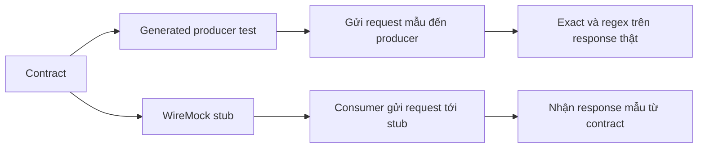
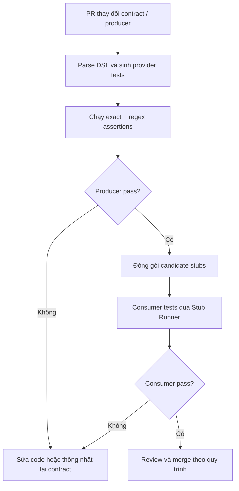

# So khớp bằng giá trị chính xác và bằng biểu thức chính quy trong Spring Cloud Contract

**Spring Cloud Contract (SCC)** giúp producer và consumer thống nhất hành vi giao tiếp qua HTTP hoặc thông điệp. Hợp đồng viết bằng **Groovy DSL hoặc YAML DSL** có thể dùng để sinh bài kiểm thử xác minh producer và tạo stub cho consumer chạy với **Stub Runner**. Một phần quan trọng của hợp đồng là chọn cách so khớp dữ liệu: giá trị phải **đúng chính xác**, hay chỉ cần **phù hợp một biểu thức chính quy**?

Bài thuộc chương **Matcher và assertion** này giải thích hai cách so khớp qua ví dụ `order-producer` và `order-consumer`. Mục tiêu là viết contract đủ chặt để phát hiện thay đổi API không tương thích, nhưng không quá cứng với dữ liệu sinh động như mã đơn hàng, correlation ID và timestamp.

## 1. Khi nào dùng exact, khi nào dùng regex?

Giả sử API đơn hàng trả phản hồi:

```http
HTTP/1.1 200 OK
Content-Type: application/json

{
  "orderId": "ORD-123456",
  "status": "CREATED",
  "currency": "VND",
  "createdAt": "2026-11-24T03:15:30.123Z"
}
```

Không phải mọi trường trong JSON đều cần cùng một kiểu matcher:

| Phần hợp đồng | Quy tắc mong muốn | Kiểu so khớp |
| --- | --- | --- |
| HTTP method | Chính xác `GET` | Exact |
| HTTP URL của ca thử | `/api/orders/1001` | Exact |
| Response status | `200` | Exact |
| `Content-Type` | Phản hồi JSON theo cam kết | Exact hoặc kiểm tra media type |
| `status` | `CREATED` trong kịch bản vừa tạo đơn | Exact |
| `currency` | `VND` | Exact |
| `orderId` | Tiền tố `ORD-` và đúng sáu chữ số | Regex |
| `createdAt` | Định dạng UTC được công bố | Regex kết hợp kiểm tra ngày giờ nếu cần |

Nếu hardcode `orderId: ORD-123456`, provider verification test có thể fail khi producer hợp lệ trả `ORD-654321`. Nhưng nếu thay `status: CREATED` bằng regex `.*`, producer có thể trả `UNKNOWN` và test vẫn pass dù consumer không biết xử lý trạng thái đó.

**Nguyên tắc:** dùng exact cho giá trị mang ý nghĩa cố định; dùng regex khi có nhiều giá trị được phép và các giá trị ấy phải tuân thủ quy tắc rõ ràng.

## 2. Exact matching kiểm tra điều gì?

Exact matching yêu cầu giá trị thực tế bằng giá trị kỳ vọng theo cách mà công cụ test diễn giải dữ liệu.

```text
Expected HTTP status = 200     Actual = 200       PASS
Expected HTTP status = 200     Actual = 201       FAIL
Expected status = "CREATED"    Actual = "CREATED" PASS
Expected status = "CREATED"    Actual = "PAID"    FAIL
Expected quantity = 2         Actual = "2"       Khác kiểu JSON
```

Một lưu ý quan trọng: **so sánh giá trị trong JSON không đồng nghĩa so sánh từng byte của chuỗi JSON**. Hai object có thể khác thứ tự field hoặc khoảng trắng mà vẫn biểu thị dữ liệu tương đương:

```json
{"id":1001,"status":"CREATED"}
```

```json
{
  "status": "CREATED",
  "id": 1001
}
```

Generated tests có thể so sánh dữ liệu theo cấu trúc và đường dẫn JSONPath. Đừng tự suy ra rằng contract mặc định kiểm tra cả thứ tự object fields, sự vắng mặt của mọi field thừa, hoặc so sánh nguyên văn toàn bộ body. Nếu consumer phụ thuộc vào một điều kiện cụ thể, hãy khai báo matcher/assertion phù hợp rồi kiểm tra generated test có bảo vệ điều kiện đó hay không.

### 2.1. Ví dụ HTTP dùng exact trong Groovy DSL

Tệp `src/test/resources/contracts/http/get-order-created.groovy`:

```groovy
import org.springframework.cloud.contract.spec.Contract

Contract.make {
    description 'GET đơn hàng 1001 trả trạng thái CREATED'

    request {
        method GET()
        url '/api/orders/1001'
        headers {
            header('Accept', 'application/json')
        }
    }

    response {
        status OK()
        headers {
            contentType(applicationJson())
        }
        body(
            id: 1001,
            status: 'CREATED',
            currency: 'VND'
        )
    }
}
```

Trong contract này:

- `method GET()` và `url` xác định request mà producer cần nhận.
- `status OK()` ràng buộc response phải có HTTP 200.
- `contentType(applicationJson())` biểu diễn cam kết media type của response.
- Các field `id`, `status` và `currency` có giá trị mẫu cụ thể.
- `description` giúp reviewer hiểu tình huống; điều kiện kiểm chứng nằm trong `request` và `response`.

Nếu producer đổi response field `status` từ `CREATED` thành `PAID` trong kịch bản này, provider verification test được sinh đúng phải cảnh báo. Điều tương tự xảy ra nếu đổi status HTTP từ 200 thành 404.

### 2.2. YAML DSL cho cùng kịch bản

Tệp `get-order-created.yml` tương đương:

```yaml
description: "GET đơn hàng 1001 trả trạng thái CREATED"
request:
  method: GET
  url: /api/orders/1001
  headers:
    Accept: application/json
response:
  status: 200
  headers:
    Content-Type: application/json
  body:
    id: 1001
    status: CREATED
    currency: VND
```

Hai định dạng minh họa cùng ý định, nhưng trong một build thực hành hãy **chỉ đưa một bản vào thư mục contracts** để tránh generated tests và stubs trùng nhau.

Với YAML, chú ý kiểu scalar:

```yaml
body:
  quantity: 2
  quantityText: "2"
  active: true
```

`2` là số; `"2"` là chuỗi; `true` là boolean. Khi consumer deserialize vào DTO, thay đổi kiểu dữ liệu có thể phá vỡ API dù giá trị trông giống nhau. Exact matching cần đi kèm kỳ vọng đúng về kiểu.

### 2.3. Trường nào nên dùng exact?

| Loại | Ví dụ | Lý do |
| --- | --- | --- |
| HTTP method hoặc status | `POST`, `201` | Consumer xử lý khác nhau theo kết quả |
| Enum của một ca nghiệp vụ cố định | `CREATED` | Không chấp nhận các trạng thái khác trong ca này |
| Mã lỗi | `INVALID_QUANTITY` | Consumer có thể phân nhánh theo mã lỗi |
| Tiền tệ | `VND` | Thay đổi đơn vị có ảnh hưởng lớn |
| Kết quả tính toán với input cố định | `totalMinor: 250000` | Dùng regex sẽ che lỗi tính tiền |
| Request dùng để kích hoạt một kịch bản | `quantity: 0` | Tách test validation với test thành công |

Exact đặc biệt thích hợp khi **giá trị cụ thể**, chứ không chỉ định dạng, là một phần cam kết.

## 3. Regex matching: cho phép các giá trị hợp lệ biến thiên

**Biểu thức chính quy (regular expression, regex)** diễn tả một tập chuỗi. Ví dụ:

```regex
^ORD-[0-9]{6}$
```

| Thành phần | Ý nghĩa |
| --- | --- |
| `^` | Bắt đầu chuỗi |
| `ORD-` | Tiền tố cố định |
| `[0-9]` | Một chữ số từ 0 đến 9 |
| `{6}` | Đúng sáu lần |
| `$` | Kết thúc chuỗi |

Kết quả mẫu:

```text
ORD-123456     PASS
ORD-000001     PASS
ORD-999999     PASS
ORD-12345      FAIL (thiếu chữ số)
ORD-1234567    FAIL (thừa chữ số)
ORD-12A456     FAIL (chứa chữ)
ord-123456     FAIL (sai chữ hoa/thường)
PRE-ORD-123456 FAIL (sai tiền tố)
```

Dùng anchor `^` và `$` giúp diễn đạt rõ **toàn bộ chuỗi** phải phù hợp. Không dựa vào giả định mọi matcher/library dùng cùng chế độ so khớp toàn chuỗi hoặc tìm đoạn con.

### 3.1. Regex quá rộng có thể che breaking change

| Regex | Chấp nhận | Nhận xét |
| --- | --- | --- |
| `.*` | Bất kỳ số lượng ký tự nào, kể cả rỗng | Quá lỏng cho ID |
| `.+` | Ít nhất một ký tự | Không kiểm tra hình dạng nghiệp vụ |
| `[A-Z0-9-]+` | Chuỗi các ký tự cho phép | Thiếu tiền tố và độ dài |
| `^ORD-[0-9]{6}$` | ID đúng sáu chữ số | Rõ yêu cầu |
| `^(CREATED|PAID|CANCELLED)$` | Ba trạng thái liệt kê | Chỉ đúng nếu cùng ca thử cho phép cả ba |

Không đổi exact `CREATED` thành `^(CREATED|PAID|CANCELLED)$` chỉ để làm test xanh khi producer bất ngờ trả `PAID`. Trước hết phải xem thay đổi đó có phù hợp với cam kết consumer hay không.

### 3.2. Regex chỉ kiểm tra mẫu, không hiểu nghiệp vụ

Pattern timestamp dạng UTC có đúng ba chữ số phần giây:

```regex
^[0-9]{4}-[0-9]{2}-[0-9]{2}T[0-9]{2}:[0-9]{2}:[0-9]{2}[.][0-9]{3}Z$
```

Nó chấp nhận hình dạng `YYYY-MM-DDTHH:mm:ss.SSSZ`, nhưng **không xác minh ngày giờ hợp lệ**. Chuỗi `2026-99-99T99:99:99.999Z` có thể qua regex. Nếu consumer yêu cầu thời điểm thực, hãy parse bằng `java.time.Instant` và bổ sung assertion theo ý nghĩa nghiệp vụ.

Tương tự, mã đúng mẫu `ORD-123456` không chứng minh đơn hàng ấy tồn tại trong database hoặc trùng với ID trong URL. Contract cần thêm test quan hệ hoặc test nghiệp vụ nếu consumer phụ thuộc vào điều đó.

## 4. Response body matcher bằng Groovy DSL

Một producer có thể trả `orderId` do hệ thống sinh, nhưng mã phải tuân thủ định dạng. Thay vì khóa cứng toàn bộ giá trị, dùng `bodyMatchers`:

```groovy
import org.springframework.cloud.contract.spec.Contract

Contract.make {
    description 'GET đơn hàng có ID đúng định dạng và trạng thái CREATED'

    request {
        method GET()
        url '/api/orders/1001'
    }

    response {
        status OK()
        headers {
            contentType(applicationJson())
        }
        body(
            orderId: 'ORD-123456',
            status: 'CREATED',
            currency: 'VND'
        )
        bodyMatchers {
            jsonPath('$.orderId', byRegex('^ORD-[0-9]{6}$'))
        }
    }
}
```

Cách hiểu từng phần:

1. `body.orderId = 'ORD-123456'` cung cấp một **giá trị mẫu** dùng trong contract và phản hồi stub.
2. `jsonPath('$.orderId', ...)` chọn trường `orderId` trong JSON.
3. `byRegex('^ORD-[0-9]{6}$')` diễn đạt quy tắc cho giá trị động.
4. `status: 'CREATED'` và `currency: 'VND'` vẫn được giữ chính xác theo kịch bản.
5. Producer verification có thể chấp nhận `ORD-654321` nhưng phát hiện `BAD-ID`, miễn generated test sử dụng matcher đã khai báo.
6. Stub trả giá trị ví dụ từ contract để consumer test có một phản hồi ổn định.

Điểm mấu chốt là **response body matcher hỗ trợ provider test kiểm tra giá trị động**, còn consumer stub thường cần **giá trị mẫu hợp lệ**. Khi chạy build, nên xem generated provider test và WireMock mapping để chắc chắn công cụ đã diễn giải đúng hai phía.

### 4.1. Nhiều matcher trên một response

```groovy
response {
    status OK()
    headers {
        contentType(applicationJson())
    }
    body(
        orderId: 'ORD-123456',
        status: 'CREATED',
        currency: 'VND',
        createdAt: '2026-11-24T03:15:30.123Z'
    )
    bodyMatchers {
        jsonPath('$.orderId',
            byRegex('^ORD-[0-9]{6}$'))
        jsonPath('$.createdAt',
            byRegex('^[0-9]{4}-[0-9]{2}-[0-9]{2}T[0-9]{2}:[0-9]{2}:[0-9]{2}[.][0-9]{3}Z$'))
    }
}
```

Regex timestamp chỉ kiểm tra format. Khi thời gian phải bằng một thời điểm dự kiến, hãy cân nhắc dùng `Clock.fixed` ở producer test hoặc assertion parse thời gian. Matcher mềm không thể thay thế yêu cầu tính toán chính xác.

### 4.2. JSONPath cho dữ liệu lồng nhau

Giả sử response:

```json
{
  "order": {
    "id": "ORD-123456",
    "status": "CREATED"
  },
  "items": [{"sku":"BOOK-01","quantity":2}]
}
```

Để kiểm tra ID lồng nhau:

```groovy
bodyMatchers {
    jsonPath('$.order.id',
        byRegex('^ORD-[0-9]{6}$'))
}
```

`$.order.id` là đường dẫn JSONPath; `$.items[0].sku` trỏ đến SKU đầu tiên trong mảng. Nếu mảng có thể thay đổi thứ tự, một matcher dựa vào `[0]` có thể quá cứng. Chọn đường dẫn theo cấu trúc mà consumer thực sự dựa vào.

### 4.3. Regex không phải lựa chọn tốt cho mọi JSON field

Regex thường hữu ích với **string**: ID, correlation ID, mã theo quy ước, timestamp theo định dạng. Với JSON number, boolean hoặc những field mà **kiểu dữ liệu** quan trọng, dùng exact hoặc matcher theo kiểu (ví dụ `byType()` khi phù hợp). Regex chỉ kiểm tra một biểu diễn chuỗi có thể che lỗi producer đổi JSON number `2` thành JSON string `"2"`.

Với tiền, chẳng hạn `totalMinor: 250000` được tính từ input cố định, nên so sánh số chính xác hoặc thực hiện assertion nghiệp vụ thay vì chỉ xác minh nó có nhiều chữ số.

## 5. Request matcher: giúp stub nhận yêu cầu có dữ liệu biến thiên

Ở **request**, cách sử dụng matcher có chiều khác response:

- **Generated producer test** cần gửi một request mẫu cụ thể để gọi producer.
- **HTTP stub** cần nhận diện request của consumer, có thể cho phép nhiều giá trị phù hợp mẫu.

Ví dụ POST đơn hàng với mã tham chiếu ngoài:

```groovy
import org.springframework.cloud.contract.spec.Contract

Contract.make {
    description 'Tạo đơn hàng với externalRef có dạng EXT và sáu chữ số'

    request {
        method POST()
        url '/api/orders'
        headers {
            contentType(applicationJson())
        }
        body(
            externalRef: 'EXT-100001',
            quantity: 2
        )
        bodyMatchers {
            jsonPath('$.externalRef',
                byRegex('^EXT-[0-9]{6}$'))
        }
    }

    response {
        status CREATED()
        headers {
            contentType(applicationJson())
        }
        body(
            status: 'CREATED'
        )
    }
}
```

Các request kỳ vọng:

| Request JSON | Ý định match | Giải thích |
| --- | --- | --- |
| `{"externalRef":"EXT-100001","quantity":2}` | Match | Mẫu hợp lệ |
| `{"externalRef":"EXT-999999","quantity":2}` | Match | Giá trị khác nhưng đúng regex |
| `{"externalRef":"BAD-999999","quantity":2}` | Không match | Sai tiền tố |
| `{"externalRef":"EXT-999999","quantity":3}` | Không match với tình huống mẫu | `quantity` của contract đang cố định là 2 |

Bảng trên thể hiện **ý định contract**. Cách WireMock mapping kiểm tra các field và điều kiện body không có matcher còn phụ thuộc output của SCC theo cấu hình. Khi gặp kết quả khác, xem mapping sinh ra trước khi kết luận lỗi do regex.

Generated producer test dùng `EXT-100001` để gọi producer thật. Nó không tự chứng minh producer hỗ trợ **mọi chuỗi** thuộc tập regex; những yêu cầu đó có thể cần parameterized tests hoặc property-based tests.

## 6. YAML DSL: định nghĩa matcher bằng JSONPath và by_regex

YAML DSL dùng các trường `matchers`, `body`, `path`, `type` và `value` để mô tả matcher theo cấu trúc dữ liệu.

### 6.1. Response matcher bằng YAML

```yaml
description: "GET đơn hàng có ID đúng định dạng và trạng thái CREATED"
request:
  method: GET
  url: /api/orders/1001
response:
  status: 200
  headers:
    Content-Type: application/json
  body:
    orderId: ORD-123456
    status: CREATED
    currency: VND
  matchers:
    body:
      - path: $.orderId
        type: by_regex
        value: '^ORD-[0-9]{6}$'
```

`response.matchers.body` được khai báo cùng cấp với `response.body`. Nó diễn đạt cùng quy tắc như Groovy `jsonPath('$.orderId', byRegex(...))`.

### 6.2. Request matcher bằng YAML

```yaml
description: "Tạo đơn hàng với externalRef có dạng EXT"
request:
  method: POST
  url: /api/orders
  headers:
    Content-Type: application/json
  body:
    externalRef: EXT-100001
    quantity: 2
  matchers:
    body:
      - path: $.externalRef
        type: by_regex
        value: '^EXT-[0-9]{6}$'
response:
  status: 201
  headers:
    Content-Type: application/json
  body:
    status: CREATED
```

Những điểm cần kiểm tra:

- `request.matchers.body` dùng cho body của request; `response.matchers.body` dùng cho response.
- `path` là **JSONPath**, không phải URL path.
- `type: by_regex` xác định cơ chế regex; `value` là biểu thức.
- Body mẫu phải phù hợp với regex để stub và generated tests mô tả cùng kịch bản.
- Cấu trúc YAML cần được parse bằng **đúng phiên bản Spring Cloud Contract mà dự án dùng**. Một tệp đúng cú pháp YAML vẫn có thể sai schema SCC.

Chỉ chọn một bản Groovy hoặc YAML cho cùng tình huống trong một build thực hành để tránh sinh stub trùng.

### 6.3. Escape pattern trong Groovy và YAML

Regex là chuỗi đi qua nhiều lớp phân tích, vì thế dấu backslash (`\`) dễ bị escape sai. Ví dụ pattern muốn kiểm tra sáu chữ số có thể viết bằng `[0-9]{6}` để tránh khác biệt.

Nếu muốn dùng `\d`:

```text
Regex mong muốn:     ^ORD-\d{6}$
Groovy single quote: '^ORD-\\d{6}$'
YAML single quote:   '^ORD-\d{6}$'
```

Groovy single-quoted string phải escape backslash để regex nhận đúng ký tự `\d`. YAML single-quoted scalar thường giữ backslash nguyên văn; YAML double-quoted scalar có cách escape riêng. Khi sửa regex, kiểm tra generated test và WireMock mapping để chắc chắn biểu thức được parse đúng.

## 7. Exact và regex ở URL, query parameter, header

Matcher không giới hạn ở JSON body. Tuy nhiên mỗi vị trí có cách diễn đạt DSL và cách sinh stub khác nhau.

### 7.1. HTTP method và status

```groovy
request {
    method GET()
    url '/api/orders/1001'
}
response {
    status OK()
}
```

Method và status của một kịch bản thường nên so khớp **exact**. Nếu producer đổi GET sang POST hoặc trả 201 thay cho 200, hợp đồng phải cảnh báo khi đó là thay đổi không tương thích.

### 7.2. Query parameters

Với `GET /api/orders?status=CREATED&limit=10`, khai báo cấu trúc tách biệt:

```groovy
request {
    method GET()
    urlPath('/api/orders') {
        queryParameters {
            parameter 'status': 'CREATED'
            parameter 'limit': '10'
        }
    }
}
```

`status` và `limit` đang là giá trị cố định. Nếu một query parameter có nhiều giá trị hợp lệ, SCC có cơ chế matcher/dynamic value tương ứng, nhưng cần xác minh cú pháp theo đúng phiên bản dự án.

Đừng chép `url '/api/orders/{id}'` rồi cho rằng dấu `{id}` tự biến thành regex; đó có thể chỉ là literal string trong contract. Cần dùng URL mẫu hoặc khai báo matcher rõ ràng theo DSL.

### 7.3. Header cố định và động

| Header | Phía giao tiếp | Cách kiểm tra hợp lý |
| --- | --- | --- |
| `Content-Type: application/json` | Request hoặc response tùy body | Exact hoặc media type theo cam kết |
| `X-Api-Version: v1` | Request/response | Exact khi API version cố định |
| `X-Correlation-Id` | Thường do consumer gửi | Regex/định dạng nếu ID thay đổi |
| `X-Request-Id` | Thường do producer tạo | Regex/hiện diện nếu sinh động |
| `Location` | Response tạo tài nguyên | Exact nếu URI cố định; matcher nếu ID động |

Để dùng matcher trực tiếp cho giá trị header, Spring Cloud Contract có cơ chế khai báo giá trị theo phía consumer/producer. Phải xác định đúng **ai gửi dữ liệu và ai kiểm chứng** trước khi triển khai, không sao chép một đoạn matcher của response body sang header rồi giả định có cùng cú pháp.

## 8. Assertion producer và stub consumer khác nhau thế nào?

Một contract tạo ra hai hướng sử dụng:



Với một response contract:

```groovy
body(orderId: 'ORD-123456', status: 'CREATED')
bodyMatchers {
    jsonPath('$.orderId', byRegex('^ORD-[0-9]{6}$'))
}
```

Bài kiểm thử producer sẽ xác minh phản hồi thực có `orderId` đúng regex và `status` đúng giá trị đã cam kết. Stub trả một response mẫu để consumer luyện parse, mapping DTO và xử lý nghiệp vụ.

Với **request matcher**, generated producer test dùng request mẫu, còn stub có thể áp dụng regex để nhận request consumer.

Đây là lý do **stub trả đúng dữ liệu không chứng minh producer thực đã tuân thủ contract**. Phải chạy provider verification tests và consumer tests riêng.

### 8.1. Pseudocode về assertion

Cú pháp generated tests thay đổi tùy phiên bản và test framework. Về logic, bài test có thể thực hiện:

```text
1. Gửi GET /api/orders/1001.
2. Kiểm tra HTTP status == 200.
3. Parse JSON response.
4. Kiểm tra $.status == "CREATED".
5. Kiểm tra $.currency == "VND".
6. Kiểm tra $.orderId phù hợp ^ORD-[0-9]{6}$.
```

Đây là mô tả hành vi, **không phải code generated cố định của SCC**. Khi test fail, mở generated test để tìm assertion và pattern thật sự được dùng.

## 9. Kiểm thử regex với trường hợp pass, fail và ranh giới

Một pattern tốt cần các ví dụ được chấp nhận và bị loại bỏ.

Pattern `^ORD-[0-9]{6}$`:

| Giá trị | Dự kiến | Lý do |
| --- | --- | --- |
| `ORD-000000` | Pass theo định dạng | Đúng sáu chữ số |
| `ORD-123456` | Pass | Đúng |
| `ORD-999999` | Pass | Đúng |
| `ORD-12345` | Fail | Thiếu chữ số |
| `ORD-1234567` | Fail | Thừa chữ số |
| `ORD-12A456` | Fail | Sai ký tự |
| `ord-123456` | Fail | Sai chữ hoa/thường |
| `XXORD-123456YY` | Fail | Có ký tự ngoài mẫu |
| Chuỗi rỗng | Fail | Không đủ cấu trúc |

Nếu mã `ORD-000000` bị cấm theo nghiệp vụ thì regex hiện tại vẫn chấp nhận. Cần thêm quy tắc hoặc assertion riêng; pattern chỉ kiểm tra điều đã viết.

### 9.1. Exact cho enum trong một kịch bản xác định

Trong tình huống “tạo đơn thành công trả trạng thái CREATED”:

```text
CREATED -> PASS
PAID    -> FAIL
UNKNOWN -> FAIL
```

Không nới thành regex chấp nhận mọi enum chỉ vì producer vô tình trả một giá trị khác. Cần đánh giá việc thay đổi trạng thái có ảnh hưởng consumer rồi sửa mã/hợp đồng theo quyết định đã thống nhất.

### 9.2. Regex có thể che lỗi kiểu

Hai body:

```json
{"quantity":2}
```

```json
{"quantity":"2"}
```

có kiểu dữ liệu khác nhau. Một regex chỉ xét các ký tự số có thể không bảo vệ việc consumer yêu cầu **JSON number**. Dùng exact hoặc matcher kiểu dữ liệu thích hợp, và thêm test kiểm tra số âm, phạm vi hoặc phép tính nếu cần.

## 10. Các lỗi thường gặp khi viết matcher

| Sai sót | Hậu quả | Cách sửa |
| --- | --- | --- |
| Dùng regex `.*` | Cho phép giá trị vô nghĩa | Ràng buộc tiền tố, độ dài, ký tự |
| Bỏ anchor không chủ đích | Có thể chấp nhận đoạn con | Dùng `^...$` khi cần toàn chuỗi |
| Escape `\` sai | Pattern không như ý | Kiểm tra output sinh và thử ví dụ fail |
| Regex cho thời gian nhưng không parse | Ngày giờ không hợp lệ vẫn pass | Dùng `Instant`, `LocalDate` hoặc validator |
| Dùng regex thay kiểm tra tiền | Không phát hiện phép tính sai | Exact và test nghiệp vụ |
| Trộn số với chuỗi số | Consumer deserialize sai | Kiểm tra JSON type |
| JSONPath sai | Assertion không kiểm tra đúng field | Xác minh body lồng nhau |
| Body mẫu không phù hợp matcher | Stub hoặc test tự mâu thuẫn | Đồng bộ sample và quy tắc |
| Đặt matcher ở nhầm request/response | Test/stub nới sai chiều | Kiểm tra vị trí và generated output |
| Regex lặp lồng nhau không giới hạn | Match có thể chậm bất thường | Dùng pattern đơn giản, giới hạn độ dài |

Regex có thể gặp **catastrophic backtracking** với pattern phức tạp có nhiều nhóm lặp lồng nhau khi xử lý input dài. Trong contract nên ưu tiên biểu thức ngắn, dễ review; nếu phải kiểm tra định dạng chuyên biệt như UUID, ngày giờ hoặc số tiền, có thể cần parser/assertion ngữ nghĩa thay cho regex tổng quát.

## 11. Kiểm chứng producer với Spring Cloud Contract Verifier

Khi producer đã tích hợp Contract Verifier và plugin build phù hợp, contract Groovy/YAML sẽ được dùng để sinh provider verification test. Với Maven:

```bash
mvn clean verify
```

Sau build, xác minh:

1. Generated contract tests được **sinh ra và chạy thật**.
2. Field `status` dùng phép so sánh chính xác.
3. Field `orderId` có matcher `^ORD-[0-9]{6}$` như cam kết.
4. Khi producer trả `ORD-654321`, test vẫn pass nếu chỉ định dạng thay đổi.
5. Khi producer trả `BAD-ID`, test fail.
6. Khi producer đổi `CREATED` thành `UNKNOWN`, test fail.
7. Với request matcher, generated test gửi dữ liệu mẫu và producer xử lý kịch bản đúng.

Một build xanh khi plugin không sinh test **không phải bằng chứng** producer đáp ứng contract. Nếu assertion không hoạt động như mong đợi, kiểm tra test mode, vị trí file contract, JSONPath và mapping đã sinh.

## 12. Consumer test với Stub Runner

Sau khi producer phát hành stubs JAR (thường classifier `stubs`), consumer chạy Stub Runner để gọi HTTP stub. Với artifact ví dụ `com.example:order-producer:1.0.0:stubs` đã cài vào Maven local repository, có thể viết:

```java
import static org.junit.jupiter.api.Assertions.assertEquals;
import static org.junit.jupiter.api.Assertions.assertTrue;

import java.util.Map;
import org.junit.jupiter.api.Test;
import org.springframework.boot.test.context.SpringBootTest;
import org.springframework.cloud.contract.stubrunner.spring.AutoConfigureStubRunner;
import org.springframework.cloud.contract.stubrunner.spring.StubRunnerProperties;
import org.springframework.web.client.RestTemplate;

@SpringBootTest
@AutoConfigureStubRunner(
    ids = "com.example:order-producer:1.0.0:stubs:8085",
    stubsMode = StubRunnerProperties.StubsMode.LOCAL
)
class OrderConsumerTest {

    @Test
    void readsOrderIdFromStub() {
        RestTemplate client = new RestTemplate();

        Map<?, ?> result = client.getForObject(
            "http://localhost:8085/api/orders/1001",
            Map.class
        );

        String id = (String) result.get("orderId");
        assertTrue(id.matches("^ORD-[0-9]{6}$"));
        assertEquals("CREATED", result.get("status"));
        assertEquals("VND", result.get("currency"));
    }
}
```

Ví dụ giả định stub được sinh từ response contract `get-order-with-generated-id.groovy` đã trình bày. Nó minh họa assertion ở consumer; với ứng dụng thật nên gọi **HTTP client của chính consumer** và cấu hình base URL tới stub server qua property.

Tọa độ `com.example:order-producer:1.0.0:stubs:8085` gồm groupId, artifactId, version, classifier và port. Trong CI nên dùng **candidate stubs đúng phiên bản producer đang được kiểm thử**, tránh artifact cũ làm consumer test xanh sai.

### 12.1. Hai phép kiểm chứng bảo vệ khác nhau

| Lỗi | Producer test | Consumer test với Stub Runner |
| --- | --- | --- |
| Producer trả `BAD-ID` | Có thể fail regex | Stub vẫn trả ID mẫu hợp lệ |
| Producer trả `UNKNOWN` | Fail exact status field | Stub vẫn trả `CREATED` |
| Consumer parse sai `orderId` | Có thể không phát hiện | Consumer test có thể fail |
| Consumer gọi URL sai | Producer test có thể vẫn pass | Stub không match request |
| Consumer dùng stub version cũ | Không thể suy ra từ producer build | Dễ cho tín hiệu sai |

Stub là mô phỏng từ contract, nên **không thay thế provider verification**. Với message contract, cùng nguyên tắc áp dụng cho payload matcher nhưng cần message verifier, test binder/transport và label trigger phù hợp.

## 13. Đưa matcher và assertion vào CI



Trong CI, cần kiểm tra:

- Đã phát hiện đúng các tệp contract và sinh đúng tập test dự kiến.
- Các field phải cố định không bị thay thành matcher quá rộng.
- Regex được thử với trường hợp đúng, sai và giá trị ranh giới.
- Body mẫu dùng cho stub tự phù hợp quy tắc matcher.
- Producer test chạy với implementation thật, test mode đúng.
- Consumer test dùng candidate stubs đã pin version.
- Thay đổi method, URL, status, enum hoặc định dạng ID quan trọng làm bước kiểm chứng tương ứng thất bại.

Ma trận lỗi thử có chủ đích:

| Thay đổi | Kết quả mong đợi |
| --- | --- |
| `CREATED` → `UNKNOWN` | Provider verification fail exact |
| `ORD-123456` → `BAD-123456` | Provider verification fail regex |
| `ORD-123456` → `ORD-654321` | Provider verification pass regex |
| JSON number `2` → JSON string `"2"` | Test kiểm tra kiểu cần fail |
| `GET` → `POST` | Provider test của GET fail |
| Consumer gọi sai URL | Stub không match như contract |

Nếu thay đổi đáng lẽ fail mà pipeline vẫn xanh, kiểm tra generated tests, matcher, phiên bản stub và phạm vi kịch bản. Đừng mặc định matcher đã phát hiện mọi sai khác có thể xảy ra.

## 14. Bài thực hành và tự đánh giá

Tạo `order-producer` và `order-consumer` được cấu hình Spring Cloud Contract. Dùng một DSL chính trong build; DSL còn lại dùng để đối chiếu ở nhánh thử nghiệm.

1. **Exact:** Viết contract GET trả status 200, `status: CREATED`, `currency: VND`. Đổi trạng thái của producer thành `PAID`, xác nhận provider test fail.
2. **Response regex:** Thêm `orderId` theo mẫu `^ORD-[0-9]{6}$`. Kiểm tra lần lượt `ORD-654321` và `BAD-ID`, quan sát pass/fail.
3. **Request regex:** Viết POST có `externalRef` theo `^EXT-[0-9]{6}$` và `quantity: 2`. Cho consumer gọi Stub Runner bằng nhiều giá trị và xem mapping thực tế.
4. **JSONPath:** Di chuyển ID vào `order.id`; sửa matcher thành `$.order.id`, chạy lại generated test.
5. **Escape:** So sánh regex viết bằng `[0-9]` với `\d` ở Groovy và YAML; kiểm tra kết quả parse.
6. **Timestamp:** Thêm matcher định dạng UTC; thử chuỗi đúng định dạng nhưng ngày không hợp lệ để thấy regex không thay parser.
7. **Ranh giới:** Thử ID thiếu/thừa chữ số, chữ thường, chuỗi rỗng và ký tự ngoài mẫu.
8. **Consumer stub:** Đóng gói stubs JAR, chạy consumer test kiểm tra parse ID cùng exact status/currency.
9. **CI:** Pin candidate stub version và thử gây breaking change để xem pipeline báo lỗi.

Bảng tự đánh giá:

| Tiêu chí | Bằng chứng |
| --- | --- |
| Hiểu exact vs regex | Chọn đúng kiểu matcher theo từng field |
| Đúng hướng request/response | Giải thích tác động với generated producer test và stub |
| Groovy DSL | Viết được `bodyMatchers`, `jsonPath`, `byRegex` |
| YAML DSL | Dùng đúng `matchers.body.path/type/value` |
| Regex chặt | Có ví dụ pass/fail, anchor và xử lý escape |
| Producer verification | Generated test chạy và phát hiện dữ liệu sai |
| Stub Runner | Consumer test dùng artifact đúng version và assertion hữu ích |
| CI | Thay đổi API quan trọng làm test phù hợp fail |

**Ghi nhớ:** **exact** bảo vệ những giá trị bắt buộc đúng; **regex** cho phép biến thiên trong một mẫu rõ ràng. Hãy giữ nguyên các cam kết mà consumer phụ thuộc, đặt matcher vào đúng phía request/response, kiểm tra generated tests và stubs, rồi chạy cả producer lẫn consumer trong CI để phát hiện sớm thay đổi không tương thích.
