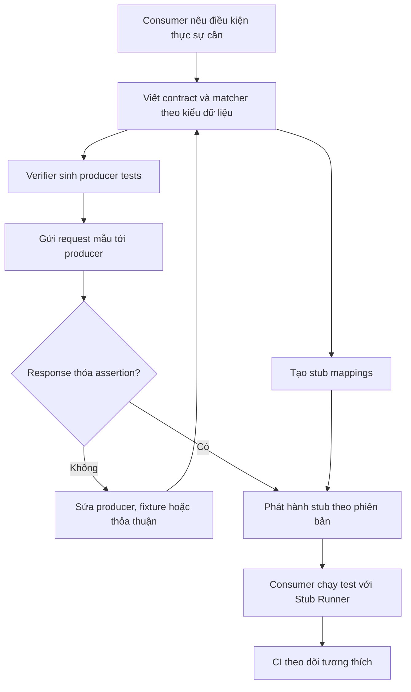

# Matcher theo kiểu dữ liệu

Khi kiểm thử hợp đồng giữa **producer** và **consumer** bằng **Spring Cloud Contract**, một phản hồi HTTP có thể đúng về mặt nghiệp vụ dù các giá trị thay đổi sau mỗi lần chạy. Chẳng hạn, mã giữ hàng `RES-7042` và `RES-8113` đều có thể hợp lệ; thời điểm tạo đơn thay đổi theo đồng hồ; danh sách mặt hàng có thể dài ngắn khác nhau. Ngược lại, một thay đổi từ JSON number sang JSON string, từ boolean sang chuỗi `"true"` hoặc từ trạng thái `HELD` sang `PENDING` có thể khiến consumer hỏng dù nội dung nhìn qua khá giống nhau.

Vì thế, trong chương **Matcher và assertion** của **Spring Cloud Contract**, ta cần chọn **matcher theo kiểu dữ liệu và ngữ nghĩa**: khi nào so sánh bằng nhau, khi nào so kiểu dữ liệu, khi nào cần regex, và khi nào cần điều kiện riêng cho ngày giờ, `null`, danh sách hoặc object. Các matcher được biểu diễn trong Groovy/YAML DSL nhằm sinh test phía producer và stub phía consumer. Việc chọn đúng matcher là một phần quan trọng của quy trình phát hành stub, dùng Stub Runner và chạy CI để phát hiện thay đổi API không tương thích.

Sau bài học, bạn có thể:

- Phân biệt assertion theo **giá trị**, **kiểu JSON**, **định dạng** và **quy tắc nghiệp vụ**.
- Dùng `bodyMatchers` và JSONPath để nhắm tới đúng trường trong request/response.
- Chọn `byEquality()`, `byType()`, `byRegex(...)`, `byDate()`, `byTime()`, `byTimestamp()` và `byNull()` trong ngữ cảnh thích hợp.
- Xác định giới hạn của matcher cho chuỗi, số, boolean, ngày giờ, mảng và object lồng nhau.
- Hiểu khác biệt giữa matcher request của stub và assertion response trong generated producer tests.
- Thiết kế các tình huống kiểm thử bổ sung khi matcher chưa chứng minh được ngữ nghĩa nghiệp vụ.

## 1. Matcher là điều kiện kiểm tra, không chỉ là ví dụ dữ liệu

Giả sử `OrderService` gọi `InventoryService` để lấy thông tin một lượt giữ hàng. Producer trả:

```json
{
  "reservationId": "RES-7042",
  "status": "HELD",
  "quantityReserved": 2,
  "active": true,
  "expiresAt": "2026-11-24T09:30:00Z",
  "items": [
    { "sku": "SKU-001", "quantity": 2 }
  ]
}
```

Consumer phụ thuộc vào từng trường theo cách khác nhau:

| Trường | Kiểu JSON | Điều consumer cần | Matcher phù hợp có thể cân nhắc |
| --- | --- | --- | --- |
| `reservationId` | String | ID có dạng `RES-` theo sau là chữ số | Regex, nếu định dạng này thực sự là cam kết |
| `status` | String | Phải bằng `HELD` trong kịch bản thành công | Equality |
| `quantityReserved` | Number | Là số, đúng lượng giữ hàng | Type để kiểm kiểu; equality/kiểm thử bổ sung để kiểm chính xác số lượng |
| `active` | Boolean | Có nghĩa là còn hiệu lực | Equality với `true` nếu consumer phụ thuộc chính xác giá trị |
| `expiresAt` | String | Chuỗi thời gian hợp lệ theo quy ước | Matcher ngày giờ hoặc regex phù hợp định dạng |
| `items` | Array | Có các mục hợp lệ, số lượng phần tử phù hợp | Type và ràng buộc số phần tử; kiểm thêm phần tử khi cần |

Một **giá trị mẫu** trong contract chủ yếu giúp sinh dữ liệu cụ thể. Một **matcher** nêu điều được phép thay đổi hoặc điều phải đúng. Chọn sai matcher dễ dẫn tới hai cực đoan: kiểm thử **giòn** vì bắt mọi ID đúng bằng một chuỗi cố định; hoặc kiểm thử **quá lỏng** vì chấp nhận mọi kiểu và mọi giá trị.

## 2. Phân biệt bốn cấp độ kiểm chứng

Trước khi viết DSL, hãy xác định mình cần bảo vệ cấp độ nào.

| Cấp độ | Ví dụ | Điều nó chứng minh | Điều nó chưa chứng minh |
| --- | --- | --- | --- |
| Giá trị chính xác | `status == "HELD"` | Trạng thái bằng đúng chuỗi đã cam kết | Trạng thái này có phản ánh dữ liệu nội bộ đúng hay không |
| Kiểu dữ liệu | `active` là boolean | Producer không đổi thành string/number | `active` phải luôn là `true` |
| Định dạng | ID khớp `RES-[0-9]+` | ID có cấu trúc được yêu cầu | ID có duy nhất hoặc đã lưu trong database |
| Quy tắc nghiệp vụ | Số lượng giữ không vượt tồn kho | Hành vi kinh doanh đúng qua trạng thái | Không thể suy ra từ matcher kiểu dữ liệu đơn lẻ |

Ví dụ `byType()` cho `quantityReserved` giúp bảo vệ kiểu JSON number, nhưng không tự bảo đảm số lượng bằng `2` hoặc lớn hơn `0`. Nếu `OrderService` cần đúng hai đơn vị sau khi đặt giữ, phải kiểm điều đó bằng equality hoặc một phép kiểm thử nghiệp vụ phù hợp.

**Nguyên tắc:** viết matcher theo điều consumer cần dựa vào, sau đó xác định các bất biến nghiệp vụ nào cần kiểm thử bên ngoài một phản hồi HTTP.

## 3. `bodyMatchers` và JSONPath trong Groovy DSL

Spring Cloud Contract Groovy DSL cho phép khai báo `bodyMatchers` bên trong `request` hoặc `response`. Với JSON, ta thường dùng `jsonPath(path, matcher)` để chọn một trường hoặc một phần của cây JSON.

Ví dụ đoạn response:

```groovy
response {
    status 200
    headers {
        contentType(applicationJson())
    }
    body([
        reservationId: 'RES-7042',
        status       : 'HELD',
        active       : true
    ])
    bodyMatchers {
        jsonPath('$.reservationId', byRegex('RES-[0-9]+'))
        jsonPath('$.status', byEquality())
        jsonPath('$.active', byType())
    }
}
```

Trong đoạn này:

- `body` cung cấp nội dung JSON mẫu, đồng thời là nguồn dữ liệu cho stub.
- `jsonPath('$.reservationId', ...)` chọn trường `reservationId` ở gốc object.
- `byRegex(...)` kiểm trường ID theo mẫu thay vì yêu cầu một ID cố định.
- `byEquality()` yêu cầu `status` trùng giá trị trong body mẫu, ở đây là `HELD`.
- `byType()` nhắm tới kiểu dữ liệu của `active`, ở đây là JSON boolean.

JSONPath thường dùng ký hiệu:

| Cú pháp | Ý nghĩa |
| --- | --- |
| `$` | Gốc tài liệu JSON |
| `$.reservationId` | Field `reservationId` tại gốc |
| `$.customer.id` | Field lồng nhau `customer.id` |
| `$.items[0].sku` | SKU của phần tử đầu tiên trong mảng |
| `$.items[*].sku` | Các SKU trong những phần tử của mảng |

JSONPath xác định **vị trí cần so khớp**. Nó không tự đưa ra điều kiện nội dung: phải gắn matcher phù hợp. Với những biểu thức JSONPath chọn nhiều giá trị, cần hiểu cách generator phiên bản hiện tại áp dụng matcher và kiểm tra tập assertion sinh ra, đặc biệt nếu yêu cầu là “mọi phần tử đều phải đúng”.

### Request matcher và response matcher chạy ở đâu?

Điểm rất quan trọng trong mô hình consumer–producer:

| Vị trí `bodyMatchers` | Cách dùng thường gặp |
| --- | --- |
| Bên trong `request` | Định nghĩa cách stub khớp request do consumer gửi |
| Bên trong `response` | Định nghĩa assertion mà generated test dùng để kiểm response thật của producer |

Test phía producer thường gửi **request mẫu** từ contract. Stub nhận request bằng các điều kiện request matcher và trả **response mẫu** của contract. Một matcher trong `response` không có nghĩa stub sẽ tự sinh một response ngẫu nhiên thỏa matcher.

## 4. `byEquality()`: khi giá trị phải chính xác

Dùng `byEquality()` khi **giá trị cụ thể** là cam kết, ví dụ trạng thái, mã lỗi, loại tiền hoặc boolean quyết định nhánh xử lý.

```groovy
body([
    status  : 'HELD',
    currency: 'VND',
    active  : true
])
bodyMatchers {
    jsonPath('$.status', byEquality())
    jsonPath('$.currency', byEquality())
    jsonPath('$.active', byEquality())
}
```

Đoạn trên minh họa phần `body` và `bodyMatchers` cần đặt trong một `response` hoàn chỉnh. Kết quả mong muốn:

- `status` phải là `"HELD"`.
- `currency` phải là `"VND"`.
- `active` phải là JSON boolean `true`.

Tại sao không dùng `byType()` cho tất cả? Nếu chỉ kiểm kiểu string của `status`, producer đổi từ `HELD` sang `CANCELLED` vẫn có thể pass. Nếu consumer chỉ tiếp tục thanh toán khi status là `HELD`, đây là một thay đổi không tương thích cần bị chặn.

**Mẹo:** field literal trong body đã có thể được xác minh bằng equality mặc định tùy ngữ cảnh và generator. `byEquality()` hữu ích khi nhóm cần làm rõ điều kiện và phối hợp với các matcher khác; không nhất thiết viết lại matcher equality cho từng field bất biến trong mọi contract.

## 5. `byType()`: bảo vệ kiểu JSON

`byType()` hữu ích cho các giá trị có thể thay đổi nhưng **kiểu dữ liệu phải ổn định**. Ví dụ response chứa số lượng mặt hàng được thống kê, một cờ boolean và một object có mã định danh:

```groovy
body([
    itemCount: 7,
    active   : true,
    customer : [
        id: 'C-100'
    ]
])
bodyMatchers {
    jsonPath('$.itemCount', byType())
    jsonPath('$.active', byType())
    jsonPath('$.customer.id', byType())
}
```

Ý nghĩa của ba điều kiện:

- `itemCount` phải có kiểu số theo cách matcher của công cụ kiểm tra, nhưng giá trị không bắt buộc bằng `7` chỉ vì mẫu là `7`.
- `active` phải có kiểu boolean, nhưng có thể là `true` hoặc `false` nếu không có assertion khác.
- `customer.id` phải có kiểu string, nhưng không nhất thiết bằng `C-100`.

Đừng nhầm `byType()` với kiểm tra **toàn bộ schema**. Tùy biểu thức JSONPath và cách sinh assertion, một matcher trên `$.customer.id` không bảo vệ tất cả field bên trong `customer`; nó cũng không kiểm giá trị hợp lệ của từng ID.

### Number có phải luôn là integer?

JSON chỉ có kiểu **number**, không phân biệt kiểu `int`, `long` hay `decimal` theo đặc tả dữ liệu JSON. Thư viện Java có thể parse các số này thành các kiểu số khác nhau, vì vậy đừng mặc định `byType()` đủ để bảo đảm số luôn nguyên hoặc nằm trong một khoảng nhất định.

Nếu consumer yêu cầu:

- `quantityReserved == 2`: dùng equality hoặc assertion tương ứng.
- `quantityReserved > 0`: cần ràng buộc giá trị hoặc kiểm thử nghiệp vụ bổ sung.
- `amount` là giá tiền theo đơn vị nhỏ nhất (ví dụ đồng): mô tả rõ đơn vị và tính chính xác, không chỉ kiểm number.

Trong nhiều API, field như `totalAmount` được biểu diễn bằng JSON number nhưng vẫn có thể bị lỗi về đơn vị hoặc làm tròn. Matcher theo kiểu dữ liệu không phát hiện được những thay đổi ngữ nghĩa đó.

## 6. `byRegex(...)`: khi chuỗi phải tuân một định dạng

Regex hữu ích cho các trường string có **cấu trúc ổn định** nhưng **giá trị thay đổi**.

```groovy
body([
    reservationId: 'RES-7042',
    sku          : 'SKU-001',
    status       : 'HELD'
])
bodyMatchers {
    jsonPath('$.reservationId', byRegex('RES-[0-9]+'))
    jsonPath('$.sku', byRegex('SKU-[0-9]{3}'))
    jsonPath('$.status', byEquality())
}
```

| Regex | Khớp ví dụ | Không khớp | Trường hợp dùng |
| --- | --- | --- | --- |
| `RES-[0-9]+` | `RES-7042` | `RES-ABCD` | ID có tiền tố và chữ số |
| `SKU-[0-9]{3}` | `SKU-001` | `SKU-1` | Mã hàng với ba chữ số |
| Hai trạng thái được phép | `HELD`, `EXPIRED` | `PENDING` | Khi contract thực sự cho phép cả hai trạng thái |
| `[A-Z]{2}-[0-9]{4}` | `VN-2026` | `vn-2026` | Mã theo dạng chữ hoa cố định |

Với tập hai trạng thái được phép, mẫu Groovy là `byRegex('(HELD|EXPIRED)')`: ký tự `|` trong regex biểu thị phép “hoặc”. Tuy nhiên, nếu kịch bản phải trả chính xác `HELD`, nên giữ `byEquality()` để không chấp nhận `EXPIRED` ngoài ý muốn.

Nhóm không nên cho `status` khớp `.*` để “linh hoạt”. Khi consumer phải ra quyết định dựa trên một enum, matcher cần bảo vệ **đúng tập giá trị được phép**, hoặc giữ equality cho mỗi kịch bản.

Một số matcher có sẵn của DSL như `nonEmpty()`, `number()` hoặc các helper regex khác có thể tiện hơn việc tự gõ mẫu, tùy phiên bản Spring Cloud Contract. Tuy nhiên, chọn helper theo **ngữ nghĩa thực tế** và đọc mã test được sinh, không dựa vào tên helper để suy rằng mọi điều kiện nghiệp vụ đã được kiểm.

### Regex không thay thế validation

Matcher `RES-[0-9]+` có thể kiểm định dạng, nhưng không chứng minh:

1. ID tồn tại trong kho dữ liệu.
2. ID là duy nhất giữa mọi lượt giữ hàng.
3. Lượt giữ hàng thuộc đúng người dùng đang truy cập.
4. Dữ liệu tham chiếu bởi ID còn hiệu lực.

Những yêu cầu đó cần test trạng thái, bảo mật, quy tắc nghiệp vụ hoặc kịch bản HTTP tiếp theo.

## 7. Boolean: kiểm kiểu hay kiểm giá trị?

Giả sử producer trả:

```json
{
  "available": true,
  "canReserve": false
}
```

Hai câu hỏi hoàn toàn khác nhau:

- **Field phải có kiểu boolean:** sử dụng `byType()` nếu chỉ cần đảm bảo JSON boolean.
- **Field phải là `true` hoặc `false` trong kịch bản:** sử dụng `byEquality()` hay kiểm giá trị chính xác.

Ví dụ:

```groovy
body([
    available : true,
    canReserve: false
])
bodyMatchers {
    jsonPath('$.available', byType())
    jsonPath('$.canReserve', byEquality())
}
```

Nếu `available` đổi từ `true` sang `false`, điều kiện `byType()` có thể vẫn thỏa; nhưng `canReserve` đổi từ `false` sang `true` phải bị xem là sai đối với kịch bản equality này.

Phải phân biệt các phản hồi:

| JSON | Kiểu dữ liệu | Có tương đương với boolean `true`? |
| --- | --- | --- |
| `true` | Boolean | Có |
| `"true"` | String | Không |
| `1` | Number | Không |
| `null` | Null | Không |
| Field không xuất hiện | Không có field | Không |

Một consumer deserialize bằng DTO có field boolean có thể bị ảnh hưởng khi producer đổi kiểu dù nội dung nhìn giống nhau. Đó chính là loại thay đổi mà matcher theo kiểu dữ liệu giúp phát hiện.

## 8. Ngày, giờ và timestamp

Thời gian thường là giá trị động, nên so khớp đúng một timestamp cố định sẽ khiến test giòn. Spring Cloud Contract có các matcher hỗ trợ kiểu ngày và thời gian, gồm `byDate()`, `byTime()` và `byTimestamp()`.

Ví dụ cấu trúc:

```groovy
body([
    businessDate: '2026-11-24',
    localTime   : '09:30:00',
    createdAt   : '2026-11-24T09:30:00.000+07:00'
])
bodyMatchers {
    jsonPath('$.businessDate', byDate())
    jsonPath('$.localTime', byTime())
    jsonPath('$.createdAt', byTimestamp())
}
```

**Quan trọng:** định dạng mặc định và chi tiết cách nhận dạng ngày giờ có thể phụ thuộc phiên bản Spring Cloud Contract và matcher engine. Trước khi chọn `byTimestamp()` cho định dạng ISO 8601 cụ thể, cần kiểm tra generated assertion và chạy thử với một vài giá trị hợp lệ/không hợp lệ mà hệ thống thực tế sử dụng. Khi contract yêu cầu **một định dạng chặt chẽ riêng**, có thể dùng regex/kiểm thử chuyên biệt thay vì giả định matcher mặc định bao phủ mọi biến thể.

Các yêu cầu sau đây **không được chứng minh chỉ bằng việc chuỗi có dạng thời gian hợp lệ**:

- `expiresAt` phải sau `createdAt`.
- `expiresAt` phải cách hiện tại ít nhất một khoảng thời gian xác định.
- Thời gian phải theo UTC thay vì giờ máy chủ.
- Hai sự kiện phải được sắp đúng thứ tự.

Đây là các điều kiện so sánh **giữa nhiều giá trị hoặc với đồng hồ**, nên cần assertion quan hệ hoặc test nghiệp vụ phù hợp.

### Timestamp với offset

Ví dụ `2026-11-24T02:30:00Z` và `2026-11-24T09:30:00+07:00` có thể biểu thị **cùng một thời điểm**. Nếu consumer chỉ cần thời điểm tuyệt đối, so chuỗi exact có thể không cần thiết. Ngược lại, nếu API đã quy định bắt buộc UTC với chữ `Z`, đó là một cam kết format cần kiểm.

## 9. `null`, field vắng mặt và giá trị rỗng

Ba phản hồi JSON sau **không giống nhau**:

```json
{"cancelledAt": null}
```

```json
{}
```

```json
{"cancelledAt": ""}
```

- `null`: field **có mặt** với giá trị JSON null.
- Field vắng mặt: không có khóa `cancelledAt` trong object.
- Chuỗi rỗng: field có mặt và có kiểu string, độ dài bằng 0.

Nếu hợp đồng cho biết một trường phải là JSON null, Groovy DSL có matcher `byNull()`:

```groovy
body([
    reservationId: 'RES-7042',
    cancelledAt  : null
])
bodyMatchers {
    jsonPath('$.reservationId', byRegex('RES-[0-9]+'))
    jsonPath('$.cancelledAt', byNull())
}
```

Đoạn trên có mục đích kiểm giá trị null của `cancelledAt`. Tuy nhiên, kiểm thử **field không tồn tại** đòi hỏi phân biệt sự hiện diện của khóa và giá trị null; đừng giả định `byNull()` đồng nghĩa “khóa có thể vắng mặt”. Khi một consumer phân biệt hai trường hợp, hãy thiết kế contract/test riêng và xác minh generator tạo assertion về sự hiện diện đúng như dự kiến.

**Không nên dùng `byType()` một cách mơ hồ cho nullable field** nếu consumer cần bảo đảm rõ rằng field là một string hợp lệ hoặc null trong hai kịch bản khác nhau. Hãy viết các kịch bản thể hiện rõ ngữ nghĩa để tránh chuyển thành hợp đồng quá lỏng.

## 10. Array và số lượng phần tử

Với JSON array, hai mối quan tâm khác nhau là:

1. **Cấu trúc phần tử:** mỗi phần tử chứa field cần thiết và đúng kiểu.
2. **Số phần tử:** có ít nhất một phần tử, tối đa một số lượng, hoặc bằng một số lượng cụ thể.

Giả sử producer trả:

```json
{
  "items": [
    { "sku": "SKU-001", "quantity": 2 }
  ]
}
```

Trong Groovy DSL, có thể khai báo ràng buộc theo kiểu và số lượng phần tử:

```groovy
body([
    items: [
        [sku: 'SKU-001', quantity: 2]
    ]
])
bodyMatchers {
    jsonPath('$.items', byType {
        minOccurrence(1)
        maxOccurrence(5)
    })
    jsonPath('$.items[0].sku', byRegex('SKU-[0-9]{3}'))
    jsonPath('$.items[0].quantity', byType())
}
```

Ràng buộc `minOccurrence`/`maxOccurrence` trên collection được hỗ trợ trong những trường hợp matcher phù hợp. Hãy xác minh cách generator phiên bản dự án hiểu JSONPath mục tiêu và giới hạn số phần tử.

Đừng hiểu việc kiểm `$.items[0].sku` là đã xác minh **mọi** phần tử. Nếu array có năm phần tử mà chỉ phần tử đầu tiên được kiểm SKU, bốn phần tử còn lại có thể không bị ràng buộc bởi assertion đó. Khi yêu cầu là “mọi phần tử đều có SKU đúng dạng và quantity dương”, cần matcher trên các phần tử tương ứng hoặc test chuyên biệt kiểm toàn bộ collection.

### Khi nào nên giữ equality cho mảng?

Nếu contract mô tả một kết quả **cố định**, ví dụ danh sách hai quyền hợp lệ theo thứ tự được bảo đảm, equality cho cả array có thể là lựa chọn đúng. Ngược lại, nếu thứ tự mặt hàng không quan trọng hoặc số phần tử biến thiên, equality toàn mảng có thể làm test thất bại do thứ tự trong khi consumer vẫn hoạt động đúng.

Trước khi dùng matcher, cần thống nhất:

- Thứ tự có phải cam kết không?
- Danh sách có thể rỗng không?
- Consumer có dùng hết các phần tử hay chỉ tìm một phần tử theo khóa?
- Có thể xuất hiện phần tử trùng lặp không?
- Field trong từng phần tử có bắt buộc không?

Một matcher về số lượng phần tử chỉ giải quyết một phần các câu hỏi trên.

## 11. Object lồng nhau và field bắt buộc

Đối với nested object, chọn JSONPath tại field mà consumer thực sự sử dụng:

```groovy
body([
    customer: [
        id  : 'CUS-1001',
        type: 'BUSINESS'
    ],
    pricing: [
        currency: 'VND',
        amount  : 120000
    ]
])
bodyMatchers {
    jsonPath('$.customer.id', byRegex('CUS-[0-9]+'))
    jsonPath('$.customer.type', byEquality())
    jsonPath('$.pricing.currency', byEquality())
    jsonPath('$.pricing.amount', byType())
}
```

Ở đây producer có thể tạo ID khách hàng khác nhau, nhưng `type` và `currency` được giữ chính xác trong kịch bản. `amount` chỉ được kiểm kiểu; nếu consumer cần đúng số tiền thanh toán, phải giữ assertion equality hoặc dùng test nghiệp vụ so tổng tiền.

**Không đánh đồng JSON object với Java DTO.** Contract nhìn thấy dữ liệu trao đổi qua HTTP. Một field có kiểu Java `BigDecimal` trong producer nhưng được serialize thành JSON string sẽ xuất hiện như **string** đối với consumer. Hợp đồng cần phản ánh kiểu trên **wire format**, không phải chỉ kiểu của biến Java trong implementation.

## 12. Ví dụ Groovy DSL đầy đủ: kiểm response theo nhiều kiểu

Giả sử `OrderService` gọi `InventoryService` để đọc lượt giữ `1042`. Nhóm thống nhất kịch bản trả `200`, trạng thái `HELD` và số lượng đã giữ đúng bằng 2. ID và thời điểm có thể thay đổi, nhưng phải giữ đúng dạng.

```groovy
import org.springframework.cloud.contract.spec.Contract

Contract.make {
    name 'get_reservation_with_typed_matchers'
    description '''
        OrderService đọc lượt giữ để tiếp tục thanh toán.
        Trạng thái và số lượng phải đúng kịch bản; ID và thời điểm
        có thể thay đổi nhưng phải đúng định dạng đã cam kết.
    '''

    request {
        method 'GET'
        url '/api/v1/reservations/1042'
    }

    response {
        status 200
        headers {
            contentType(applicationJson())
        }
        body([
            reservationId   : 'RES-7042',
            status          : 'HELD',
            quantityReserved: 2,
            active          : true,
            expiresAt       : '2026-11-24T09:30:00.000+07:00',
            items           : [
                [sku: 'SKU-001', quantity: 2]
            ]
        ])
        bodyMatchers {
            jsonPath('$.reservationId', byRegex('RES-[0-9]+'))
            jsonPath('$.status', byEquality())
            jsonPath('$.quantityReserved', byEquality())
            jsonPath('$.active', byEquality())
            jsonPath('$.expiresAt', byTimestamp())
            jsonPath('$.items', byType {
                minOccurrence(1)
                maxOccurrence(5)
            })
            jsonPath('$.items[0].sku', byRegex('SKU-[0-9]{3}'))
            jsonPath('$.items[0].quantity', byType())
        }
    }
}
```

Đây là ví dụ học tập về DSL; cần cấu hình Spring Cloud Contract Verifier, base class, dữ liệu fixture và phiên bản Spring phù hợp để sinh/chạy test.

Với contract này, kết quả producer test dự kiến:

| Nếu producer thay đổi... | Kết quả mong muốn | Lý do |
| --- | --- | --- |
| `reservationId` từ `RES-7042` thành `RES-8113` | Pass nếu các điều kiện khác đúng | ID vẫn hợp định dạng |
| `reservationId` thành `abc` | Fail | Không khớp regex |
| `status` từ `HELD` thành `PENDING` | Fail | `byEquality()` yêu cầu đúng `HELD` |
| `quantityReserved` từ `2` thành `3` | Fail | Kịch bản cam kết giữ đúng 2 |
| `active` từ `true` thành `false` | Fail | Boolean đúng kiểu nhưng sai giá trị |
| `items` thành mảng rỗng | Fail theo giới hạn phần tử | Yêu cầu ít nhất một item |
| `items[0].sku` thành `BAD` | Fail | Sai định dạng SKU |
| `expiresAt` đổi sang thời điểm khác cùng định dạng được hỗ trợ | Có thể pass | Mục tiêu là kiểm dạng timestamp |

Một kết quả pass vẫn chưa chứng minh reservation đã được lưu, không bị trừ tồn kho hai lần hoặc hết hạn đúng giờ. Những điều đó nằm ngoài phạm vi các assertion hiện tại.

## 13. Matcher ở request: giúp stub chọn đúng kịch bản

Trong `request.bodyMatchers`, mục tiêu chủ yếu là để stub nhận request phù hợp từ consumer. Ví dụ API giữ hàng:

```groovy
import org.springframework.cloud.contract.spec.Contract

Contract.make {
    name 'create_reservation_request_matchers'

    request {
        method 'POST'
        url '/api/v1/reservations'
        headers {
            contentType(applicationJson())
        }
        body([
            orderId : 'ORD-1001',
            sku     : 'SKU-001',
            quantity: 2
        ])
        bodyMatchers {
            jsonPath('$.orderId', byRegex('ORD-[0-9]+'))
            jsonPath('$.sku', byRegex('SKU-[0-9]{3}'))
            jsonPath('$.quantity', byEquality())
        }
    }

    response {
        status 201
        headers {
            contentType(applicationJson())
        }
        body([
            reservationId: 'RES-7042',
            status       : 'HELD'
        ])
    }
}
```

Ở stub:

- `orderId = ORD-1001` và `orderId = ORD-9999` đều có thể khớp mẫu nếu các điều kiện khác đúng.
- `sku = SKU-001` có dạng phù hợp; `sku = ABC` không khớp.
- `quantity` vẫn phải là giá trị `2` trong kịch bản này.

Nhưng **producer test** được sinh thường gửi giá trị mẫu có trong `request.body`, tức `ORD-1001` và `SKU-001`. Nó không tự chạy kiểm thử với mọi `orderId` khớp regex.

Nếu API phải trả `409` khi tồn kho không đủ, hãy tạo contract riêng với fixture và request phân biệt được. Đừng dùng một matcher quá rộng khiến cùng request vừa khớp stub `201` vừa khớp stub `409`. Cấu trúc mapping của stub thực tế phải được kiểm tra khi phát hành.

## 14. Phân biệt `byRegex(...)` trong bodyMatchers với `consumer/producer`

Ngoài `bodyMatchers`, Groovy DSL còn có cách mô tả **giá trị hai phía** bằng `$(consumer(...), producer(...))`. Hai kỹ thuật cùng giải quyết vấn đề giá trị động nhưng khác vị trí khai báo.

**Request** thường dùng matcher ở consumer side và giá trị cụ thể ở producer side:

```groovy
body([
    orderId: $(consumer(regex('ORD-[0-9]+')),
               producer('ORD-1001'))
])
```

**Response** thường dùng giá trị cụ thể cho stub và matcher phía producer:

```groovy
body([
    reservationId: $(consumer('RES-7042'),
                     producer(regex('RES-[0-9]+')))
])
```

Không cần đồng thời khai báo `$(...)` và `bodyMatchers` cho cùng một field nếu điều đó lặp lại hoặc mâu thuẫn. Nhóm có thể chọn một cách rõ ràng, kiểm tra generated test/stub rồi áp dụng nhất quán.

| Cách viết | Tác dụng chính | Lưu ý |
| --- | --- | --- |
| `response.bodyMatchers { jsonPath(..., byRegex(...)) }` | Xác định assertion đối với response producer | Body mẫu vẫn được dùng làm dữ liệu stub |
| `request.bodyMatchers { jsonPath(..., byRegex(...)) }` | Giúp stub khớp request | Producer test vẫn cần request mẫu |
| `$(consumer(...), producer(...))` | Tách giá trị/matcher cho hai góc nhìn | Phải đọc đúng chiều theo request/response |

## 15. YAML DSL và matcher theo kiểu dữ liệu

Spring Cloud Contract cũng hỗ trợ **YAML DSL**, nhưng không dùng nguyên cú pháp Groovy `bodyMatchers { jsonPath(...) }` ở dạng text trong YAML. Các phiên bản hỗ trợ cấu trúc matcher cho request/response theo schema YAML tương ứng.

Ví dụ YAML dùng **giá trị cụ thể**, chưa dùng matcher động:

```yaml
name: get_reservation_literal_response
description: OrderService lấy trạng thái lượt giữ hàng
request:
  method: GET
  url: /api/v1/reservations/1042
response:
  status: 200
  headers:
    Content-Type: application/json
  body:
    reservationId: RES-7042
    status: HELD
    quantityReserved: 2
    active: true
```

Nếu muốn kiểm `reservationId` theo regex hoặc kiểm `active` theo kiểu boolean trong YAML, hãy tham khảo **cú pháp matcher YAML của phiên bản Spring Cloud Contract đang dùng** và chạy thử generator. Không đưa trực tiếp `byRegex(...)` hay `$(consumer(...), producer(...))` thành chuỗi YAML rồi hy vọng chúng được dịch như Groovy.

Đặc biệt, YAML có cách biểu diễn type riêng: `true` là boolean nhưng `"true"` là string; `2` là number nhưng `"2"` là string. Khi mô tả contract, tránh vô tình đặt dấu nháy khiến **kiểu wire format** thay đổi.

## 16. Matcher cho HTTP header, cookie và message

`bodyMatchers` áp dụng cho **body**; chúng không thay thế mọi loại điều kiện của header, cookie hay thông điệp.

Ví dụ:

- `Content-Type` cần kiểm bằng matcher/header assertion phù hợp, vì nó thuộc **response headers**, không thuộc JSON body.
- `Location` có ID động có thể được biểu diễn bằng value/matcher thích hợp trong `headers`.
- `Set-Cookie` chứa nhiều thuộc tính; so nguyên chuỗi đôi khi giòn nếu thuộc tính đổi thứ tự.
- Với **message contract**, payload có thể có field ID hoặc timestamp động; cần dùng matcher được hỗ trợ trong `outputMessage` và xác minh đường phát message tương ứng.

Ví dụ một phần response có header Location động:

```groovy
response {
    status 201
    headers {
        header('Location',
               $(consumer('/api/v1/reservations/RES-7042'),
                 producer(regex('/api/v1/reservations/RES-[0-9]+'))))
    }
}
```

Stub nhận một URI mẫu cụ thể; generated producer test kiểm URI theo mẫu. Một regex cho Location và một regex riêng cho ID trong body **chưa chứng minh hai ID trùng nhau**. Khi consumer phụ thuộc vào quan hệ đó, cần assertion liên kết giá trị hoặc integration test bổ sung.

## 17. Gắn matcher vào kiểm thử producer, stub và CI



Với một dự án Maven đã tích hợp Spring Cloud Contract Verifier, lệnh kiểm tra thông dụng:

```bash
mvn -B -ntp clean verify
```

Khi build, kiểm tra:

1. Plugin có đọc contract và **sinh test** tương ứng không?
2. Generated tests có thực sự **được chạy** không, hay build xanh với 0 test?
3. Assertion sinh ra có kiểm đúng JSONPath và loại matcher đã chọn không?
4. Matcher request trong stub có chấp nhận đúng các request hợp lệ, từ chối request không hợp lệ và tránh xung đột với nhánh lỗi không?
5. Artifact stub dùng đúng version của producer đã được xác minh không?
6. Consumer test qua Stub Runner có bao phủ cách đọc và xử lý các field mà consumer thực sự phụ thuộc không?

Một bài test pass với `byType()` chỉ cho biết giá trị thỏa kiểm tra kiểu do matcher sinh ra; nó không chứng minh mọi thuộc tính nghiệp vụ. Nếu có thay đổi làm JSON number thành string, matcher type có thể giúp phát hiện sớm. Nếu thay đổi từ giá tiền 120000 đồng sang 120000 xu nhưng vẫn là number, cần thêm kiểm thử ngữ nghĩa.

## 18. Những lỗi chọn matcher thường gặp

| Sai lầm | Nguy cơ | Cách xử lý |
| --- | --- | --- |
| So exact timestamp/ID được sinh động | Test giòn vì thay đổi hợp lệ | Dùng matcher định dạng hoặc fixture xác định |
| Dùng `byType()` cho `status` cần đúng `HELD` | Producer đổi sang status khác mà test vẫn pass | Dùng equality hoặc tập enum cho phép |
| Dùng `byRegex('.*')` cho dữ liệu bắt buộc | Chấp nhận chuỗi không có ý nghĩa | Dùng mẫu có giới hạn rõ ràng |
| Dùng regex chuỗi cho trường JSON number | Có nguy cơ bỏ qua kiểu dữ liệu | Kiểm kiểu JSON trước, rồi thêm ràng buộc số |
| Dùng `byType()` để chứng minh số nguyên dương | Không phát hiện số âm hoặc sai đơn vị | Kiểm giá trị, miền hoặc test nghiệp vụ |
| Dùng matcher timestamp rồi khẳng định thời gian chưa hết hạn | Chỉ kiểm dạng chuỗi | Thêm test so sánh thời gian/trạng thái |
| Đồng nhất `null` với field vắng mặt | Consumer có thể xử lý khác nhau | Tách trường hợp và kiểm hiện diện field |
| Chỉ kiểm `items[0]` rồi kết luận mọi item hợp lệ | Bỏ sót phần tử sau | Kiểm toàn collection hoặc trường liên quan |
| Matcher request quá rộng cho nhánh thành công | Stub có thể trả thành công khi producer thật sẽ báo lỗi | Thu hẹp điều kiện và kiểm tra mapping |
| Matcher response quá lỏng | API phá ngữ nghĩa nhưng build xanh | Gắn matcher với hành vi consumer thực sự dùng |
| Thêm cùng lúc matcher mâu thuẫn cho một field | Assertion hoặc stub khó hiểu | Dùng một nguồn kỳ vọng rõ ràng |
| Không xem generated tests | Không biết DSL được dịch thành assertion nào | Đọc kết quả sinh và chạy thử kịch bản pass/fail |

## 19. Checklist trước khi viết matcher

- [ ] Đã xác định field nằm trong **request** hay **response**.
- [ ] Biết consumer dùng field để làm gì và có cần giá trị chính xác không.
- [ ] Đã chọn đúng kiểu JSON: string, number, boolean, object, array hoặc null.
- [ ] Dùng `byEquality()` khi giá trị cụ thể quyết định nghiệp vụ.
- [ ] Dùng `byType()` khi giá trị có thể đổi nhưng kiểu phải giữ.
- [ ] Dùng `byRegex(...)` cho định dạng thực sự được producer cam kết.
- [ ] Regex không rộng hơn phạm vi dữ liệu hợp lệ mà consumer cần.
- [ ] Không dùng matcher ngày giờ để thay kiểm tra quan hệ thời gian.
- [ ] Tách được `null`, chuỗi rỗng và field vắng mặt khi cần.
- [ ] Với array, đã xét số lượng phần tử, cấu trúc từng phần tử và thứ tự.
- [ ] Với object lồng nhau, JSONPath nhắm đúng field cần bảo vệ.
- [ ] Request matcher không gây xung đột giữa stub thành công và lỗi.
- [ ] Đã kiểm tra assertion sinh từ contract và phạm vi thực tế của stub.
- [ ] CI chạy đầy đủ generated producer tests; consumer dùng stub version tương ứng.

### Bài tập thực hành

`OrderService` (consumer) đọc `GET /api/v1/reservations/1042` từ `InventoryService` (producer). Response mẫu:

```json
{
  "reservationId": "RES-7042",
  "status": "HELD",
  "quantityReserved": 2,
  "active": true,
  "expiresAt": "2026-11-24T09:30:00.000+07:00",
  "items": [
    { "sku": "SKU-001", "quantity": 2 },
    { "sku": "SKU-002", "quantity": 1 }
  ]
}
```

**Yêu cầu:**

1. Viết Groovy contract với status `200`, `Content-Type: application/json` và body như trên.
2. Dùng `byRegex(...)` để `reservationId` thỏa mẫu `RES-[0-9]+`; giải thích vì sao không nên so exact ID động.
3. Dùng `byEquality()` cho `status = HELD` và `active = true`; thử đổi chúng để biết test nào fail.
4. Dùng `byType()` cho một trường number và giải thích vì sao phép kiểm này chưa chứng minh số lượng đúng.
5. Chọn matcher timestamp cho `expiresAt`; xác định một bài test riêng để bảo đảm thời điểm hết hạn sau thời điểm tạo.
6. Ràng buộc `items` có từ một đến năm phần tử; chỉ ra những assertion cần thêm để kiểm mọi SKU và quantity trong array.
7. Tạo kịch bản `404` cho reservation không tồn tại. Bảo đảm request matcher của stub `200` không chồng lên kịch bản `404`.
8. Sinh và chạy producer tests trong dự án đã cấu hình Spring Cloud Contract. Kiểm tra test được sinh từ matcher nào và nhận diện một lỗi kiểu JSON string-vs-number.
9. Dùng Stub Runner ở phía consumer để thử request hợp lệ và request phải bị từ chối; đánh giá những khác biệt về dữ liệu nghiệp vụ mà stub không tự phát hiện.

**Tiêu chí hoàn thành:** bạn biết với mỗi trường JSON phải **kiểm giá trị, kiểu, định dạng, tính hiện diện hay quan hệ nghiệp vụ**, giải thích được vì sao chọn matcher tương ứng, và có thể xác định chính xác những bảo đảm nào được Spring Cloud Contract kiểm tra trong producer tests và stub.

## Tài liệu tham khảo

- [Spring Cloud Contract — HTTP Contracts](https://docs.spring.io/spring-cloud-contract/reference/project-features-contract/http.html): cấu trúc HTTP contract và `bodyMatchers`.
- [Spring Cloud Contract — Dynamic Properties](https://docs.spring.io/spring-cloud-contract/reference/project-features-contract/dsl-dynamic-properties.html): matcher theo kiểu dữ liệu, JSONPath, regex và giá trị hai phía.
