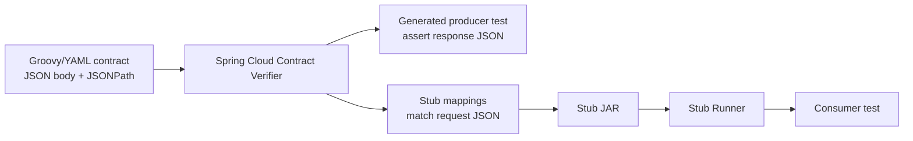

# JSONPath cho thuộc tính và phần tử mảng

## 1. JSONPath giải quyết vấn đề gì trong kiểm thử hợp đồng?

Trong **Spring Cloud Contract**, một hợp đồng mô tả hành vi HTTP hoặc thông điệp mà **producer** cung cấp và **consumer** dựa vào. Từ hợp đồng **Groovy DSL** hoặc **YAML DSL**, Spring Cloud Contract Verifier có thể sinh kiểm thử phía producer và tạo stub. **Stub Runner** cho phép consumer sử dụng các stub đã phát hành; CI có thể chạy kiểm thử của hai phía để phát hiện thay đổi API không tương thích.

Khi HTTP body là JSON, các thuộc tính thường lồng trong object hoặc danh sách:

```json
{
  "orderId": "ORD-42",
  "customer": {
    "name": "Nguyễn Ánh",
    "address": {
      "city": "Hà Nội"
    }
  },
  "items": [
    {"sku": "BOOK-101", "quantity": 2, "price": 150000},
    {"sku": "BOOK-202", "quantity": 1, "price": 90000}
  ],
  "state": "PAID"
}
```

Nếu chỉ so sánh toàn bộ JSON với dữ liệu mẫu, generated producer test dễ trở nên giòn khi một trường như `orderId` được sinh động. Nhưng nếu chỉ kiểm tra mã HTTP `200`, test có thể bỏ lọt việc producer làm mất `items` hoặc đổi `quantity` từ số sang chuỗi.

**JSONPath** cho phép chỉ tới một thuộc tính, một phần tử mảng hoặc một tập giá trị bên trong JSON. Kết hợp JSONPath với các matcher như `byEquality()`, `byRegex(...)`, `byType()`, `byNull()` giúp kiểm tra đúng phần của hợp đồng mà consumer cần.

Bài học thuộc chương **Matcher và assertion**, tập trung vào cú pháp JSONPath thực tế, cách áp dụng cho request/response, giới hạn của matcher và quy trình kiểm chứng từ producer đến consumer.

## 2. Nắm cú pháp JSONPath trước khi viết DSL

### 2.1. Ký hiệu đường dẫn cơ bản

JSONPath bắt đầu bằng ký hiệu **`$`** chỉ root của tài liệu JSON. Sau đó có thể dùng dấu chấm cho tên property, ngoặc vuông cho property, hoặc chỉ số mảng bắt đầu từ **0**.

| JSONPath | Chọn gì trong JSON ví dụ? | Kết quả ý tưởng |
|---|---|---|
| `$` | Toàn bộ tài liệu | Object root |
| `$.orderId` | Property `orderId` của object root | `"ORD-42"` |
| `$.customer.name` | Property lồng trong `customer` | `"Nguyễn Ánh"` |
| `$.customer.address.city` | Property lồng nhiều tầng | `"Hà Nội"` |
| `$.items` | Toàn bộ giá trị property `items` | Array có 2 object |
| `$.items[0]` | Phần tử thứ nhất trong array | Object có `sku=BOOK-101` |
| `$.items[0].sku` | `sku` của phần tử thứ nhất | `"BOOK-101"` |
| `$.items[1].quantity` | `quantity` của phần tử thứ hai | Số `1` |
| `$.items[*].sku` | `sku` của tất cả phần tử | Tập giá trị `BOOK-101`, `BOOK-202` |
| `$['customer']['name']` | Cách viết bằng bracket notation | `"Nguyễn Ánh"` |

**Lưu ý:** cú pháp JSONPath có nhiều đặc tả/biến thể triển khai. Ví dụ `[*]` là wildcard thông dụng, nhưng cách kết quả được trả thành danh sách và cách matcher của verifier diễn giải nó cần được kiểm tra với phiên bản thư viện trong dự án. Không mặc định mọi tính năng JSONPath đều hoạt động giống nhau ở mọi ngữ cảnh.

### 2.2. Property có dấu chấm, dấu cách hoặc dấu gạch nối

Một property có tên `order-id` không phải cú pháp truy cập một property thông thường theo mọi parser. Với các tên chứa dấu chấm, khoảng trắng hoặc dấu gạch nối, bracket notation giúp biểu đạt chính xác:

```json
{
  "order-id": "ORD-42",
  "customer.name": "Nguyễn Ánh",
  "display name": "Nguyễn Ánh"
}
```

```text
$['order-id']
$['customer.name']
$['display name']
```

`$.customer.name` và `$['customer.name']` **khác nhau**: cái đầu tìm `name` bên trong object `customer`, còn cái sau tìm một property root mang đúng tên `customer.name`. Khi viết các đường dẫn có dấu nháy đơn bên trong Groovy, hãy chọn kiểu chuỗi hoặc escape thích hợp để tránh lỗi cú pháp.

### 2.3. Phân biệt property, phần tử mảng và array ở root

Cho hai response:

```json
{"items":[{"id":42}]}
```

```json
[{"id":42}]
```

Với response thứ nhất, ID nằm tại `$.items[0].id`. Với response thứ hai, ID nằm tại **`$[0].id`** vì root chính là array. Viết nhầm root dẫn tới JSONPath không tìm thấy giá trị dù JSON vẫn hợp lệ.

## 3. JSONPath và hai hướng kiểm chứng của Spring Cloud Contract

JSONPath trong Spring Cloud Contract thường xuất hiện ở `bodyMatchers` thuộc khối `request` hoặc `response`.

| Vị trí | Ai sử dụng? | Mục tiêu |
|---|---|---|
| `request { bodyMatchers { ... } }` | **Stub** phía consumer, thường thông qua WireMock mapping | Chấp nhận request có JSON body đúng điều kiện |
| `response { bodyMatchers { ... } }` | **Generated producer test** | Xác minh JSON response thực tế từ producer |

Một **request matcher** không tự động tạo ra nhiều producer test; generated test vẫn gửi một request mẫu từ `body`. Một **response matcher** không làm stub tự tạo dữ liệu động; stub thường trả giá trị mẫu đã khai báo trong `body`. Cần hiểu khác biệt này trước khi chọn đường dẫn và matcher.



**JSONPath là cách trỏ đến dữ liệu; matcher mới là quy tắc kiểm tra dữ liệu ấy.** Ví dụ `$.items[0].sku` chỉ xác định vị trí, còn `byRegex('BOOK-[0-9]+')` quy định hình dạng giá trị chấp nhận được.

## 4. Ví dụ Groovy DSL: kiểm tra thuộc tính lồng nhau trong response

Giả sử API `GET /api/orders/42` trả thông tin đơn hàng; `customer.name` và `state` cần đúng, còn `receiptId` được sinh động theo định dạng `RCT-` cộng tám chữ số.

```groovy
import org.springframework.cloud.contract.spec.Contract

Contract.make {
    description 'Thông tin đơn hàng và mã biên nhận'

    request {
        method GET()
        url '/api/orders/42'
        headers {
            header 'Accept', 'application/json'
        }
    }

    response {
        status OK()
        headers {
            contentType(applicationJson())
        }
        body(
            orderId: 42,
            customer: [
                name: 'Nguyễn Ánh'
            ],
            state: 'PAID',
            receiptId: 'RCT-00001234'
        )
        bodyMatchers {
            jsonPath('$.orderId', byEquality())
            jsonPath('$.customer.name', byEquality())
            jsonPath('$.state', byEquality())
            jsonPath('$.receiptId', byRegex('RCT-[0-9]{8}'))
        }
    }
}
```

Các matcher có vai trò:

- `byEquality()` yêu cầu giá trị được chọn phù hợp với giá trị đã mô tả trong `body`. Với `state`, điều này bảo vệ ý nghĩa nghiệp vụ `PAID`.
- `byRegex('RCT-[0-9]{8}')` chấp nhận mã biên nhận động đúng định dạng; producer không bắt buộc trả `RCT-00001234` ở mọi lần chạy.
- `'$.customer.name'` chọn đúng property lồng nhau, không nhầm với một property root `name`.
- Stub phía consumer vẫn có thể trả ví dụ `receiptId = RCT-00001234`; consumer test dùng dữ liệu mẫu đó để xác nhận cách xử lý.

Giá trị `orderId=42` cần được producer test dựng fixture tương ứng. Nếu không có đơn hàng ID 42 trong môi trường kiểm thử, kết quả có thể thất bại vì thiếu dữ liệu, không phải vì JSONPath sai.

### 4.1. Khi nào nên dùng giá trị cố định?

Trường `state=PAID` hoặc `currency=VND` trong một kịch bản xác định thường nên so sánh chính xác. Nếu thay bằng `byRegex('.*')`, producer có thể trả `UNKNOWN` mà test vẫn xanh. JSONPath không làm matcher mạnh hơn nếu quy tắc so khớp ban đầu quá rộng.

## 5. JSONPath cho phần tử mảng: chỉ số và thuộc tính

Giả sử response:

```json
{
  "items": [
    {"sku":"BOOK-101","quantity":2,"price":150000},
    {"sku":"BOOK-202","quantity":1,"price":90000}
  ],
  "total": 2
}
```

### 5.1. Chọn phần tử đầu tiên và thứ hai

```groovy
response {
    status OK()
    headers {
        contentType(applicationJson())
    }
    body(
        items: [
            [sku: 'BOOK-101', quantity: 2, price: 150000],
            [sku: 'BOOK-202', quantity: 1, price: 90000]
        ],
        total: 2
    )
    bodyMatchers {
        jsonPath('$.items[0].sku', byEquality())
        jsonPath('$.items[0].quantity', byEquality())
        jsonPath('$.items[1].sku', byEquality())
        jsonPath('$.items[1].quantity', byEquality())
        jsonPath('$.total', byEquality())
    }
}
```

Chỉ số array bắt đầu từ `0`; `$.items[0].sku` và `$.items[1].sku` kiểm tra **hai vị trí khác nhau**. Kiểm tra vị trí là phù hợp nếu API cam kết thứ tự: ví dụ `items` được sắp xếp theo mã SKU hoặc request có `sort=price,desc`.

**Nếu API không cam kết thứ tự**, một contract khóa `BOOK-101` ở vị trí 0 có thể hỏng khi producer chỉ đổi cách sắp xếp nội bộ. Trong trường hợp đó, nên xác minh tập giá trị, điều kiện phần tử hoặc invariant nghiệp vụ bằng matcher thích hợp và test bổ sung, thay vì khẳng định một thứ tự không tồn tại trong hợp đồng.

### 5.2. Wildcard `[*]` không có nghĩa “tự kiểm tra mọi phần tử”

Các biểu thức:

```text
$.items[*]
$.items[*].sku
$.items[*].quantity
```

thường chọn nhiều phần tử. Nhưng một matcher chỉ được cấu hình với `$.items[0].sku` thì **không thể** chứng minh SKU của phần tử thứ hai đúng định dạng. Ngược lại, đặt wildcard vào `jsonPath(...)` không đồng nghĩa rằng verifier của mọi phiên bản sẽ tự sinh cùng một assertion **cho từng phần tử** như bạn tưởng tượng.

Để bảo vệ mọi phần tử của một array có kích thước động, cần xác minh cách thư viện JSONPath trả về danh sách, matcher dùng để so khớp danh sách và code generated test thực tế. Khi quy tắc phức tạp, có thể viết thêm test producer với vòng lặp trên các phần tử đã parse thay vì dựa vào giả định về wildcard.

### 5.3. JSONPath cho mảng ở root

Nếu API trả:

```json
[
  {"sku":"BOOK-101","quantity":2},
  {"sku":"BOOK-202","quantity":1}
]
```

thì JSONPath cần bắt đầu từ `$[0]` hoặc `$[1]`:

```groovy
response {
    status OK()
    headers {
        contentType(applicationJson())
    }
    body([
        [sku: 'BOOK-101', quantity: 2],
        [sku: 'BOOK-202', quantity: 1]
    ])
    bodyMatchers {
        jsonPath('$[0].sku', byEquality())
        jsonPath('$[1].quantity', byEquality())
    }
}
```

Không dùng `$.items[0]` cho root array vì tài liệu không có property `items`. Với response mảng rỗng, nên mô tả rõ `body([])` rồi kiểm chứng generated assertion thực sự yêu cầu mảng rỗng, không chỉ “giá trị là một array”.

## 6. Kiểm tra kiểu dữ liệu, regex và số phần tử

### 6.1. Các matcher phổ biến

| Matcher | Ý nghĩa | Ví dụ sử dụng |
|---|---|---|
| `byEquality()` | Bằng giá trị trong `body` | `state=PAID`, `total=2` |
| `byRegex('...')` | Khớp pattern của chuỗi/giá trị theo quy tắc verifier | Mã SKU, mã tham chiếu |
| `byType()` | Kiểm tra kiểu dữ liệu dựa trên giá trị mẫu | Chuỗi, số, boolean, object, array |
| `byType { minOccurrence(...); maxOccurrence(...) }` | Ràng buộc số phần tử của collection trong ngữ cảnh hỗ trợ | Danh sách kết quả |
| `byNull()` | Giá trị được chọn phải là JSON `null` trong response | Trường cố ý trả null |
| `byDate()`, `byTime()`, `byTimestamp()` | Kiểm tra các định dạng ngày/giờ được hỗ trợ | Timestamp động |
| `byCommand('...')` | Gọi phương thức kiểm tra của base test trong generated producer test | Quy tắc nghiệp vụ phức tạp |

**Kiểu JSON là một phần của hợp đồng.** Số `42` không tương đương chuỗi `"42"`; boolean `true` khác chuỗi `"true"`. Chỉ dùng regex cho `[0-9]+` có thể không đủ để bảo vệ kiểu số trong một số ngữ cảnh. `byType()` hoặc kiểm tra kiểu cụ thể sẽ hữu ích nếu consumer cần deserialization chính xác.

### 6.2. Ràng buộc số phần tử với `byType`

Ví dụ danh sách trả từ 1 đến 5 sản phẩm:

```groovy
response {
    status OK()
    headers {
        contentType(applicationJson())
    }
    body(
        items: [
            [sku: 'BOOK-101', quantity: 2]
        ]
    )
    bodyMatchers {
        jsonPath('$.items', byType {
            minOccurrence(1)
            maxOccurrence(5)
        })
    }
}
```

Ở đây ý định là `items` là collection có ít nhất 1 và tối đa 5 phần tử. **Đây không phải kiểm tra trạng thái, SKU hoặc số lượng của từng item.** Muốn bảo vệ cấu trúc phần tử, hãy thêm matcher tương ứng và xem generated test có thực sự bao phủ toàn bộ mảng theo yêu cầu không.

Nếu API cam kết **không có kết quả** thì phải là `[]`, hãy ghi hợp đồng riêng có `body(items: [])` hoặc `body([])` và tránh matcher có thể chấp nhận danh sách dài hơn 0. Một trường `items` bằng `null` hoặc bị thiếu cũng không mặc nhiên tương đương `[]`.

### 6.3. Kiểu null và property vắng mặt

Xét:

```json
{"receiptId": null}
```

và:

```json
{}
```

Đây là **hai cấu trúc JSON khác nhau**. Matcher `byNull()` dành cho một giá trị null được chọn; không coi nó tự động xác minh trường hoàn toàn **vắng mặt**. Một số JSONPath engine không trả giá trị khi path không tồn tại, hoặc có chế độ khác nhau giữa “không có path” và “path chứa null”. Khi API yêu cầu property phải vắng mặt, cần viết kịch bản/assertion kiểm tra chính xác ý định ấy.

## 7. JSONPath trong request: kiểm tra dữ liệu consumer gửi

Trong request, JSONPath có thể chỉ tới property hoặc phần tử của body mà **stub** cần khớp. Ví dụ consumer gửi yêu cầu tạo đơn hàng:

```json
{
  "customerId": "CUS-42",
  "items": [
    {"sku":"BOOK-101","quantity":2}
  ]
}
```

Hợp đồng Groovy:

```groovy
import org.springframework.cloud.contract.spec.Contract

Contract.make {
    description 'Tạo đơn hàng có mã khách và sản phẩm đúng định dạng'

    request {
        method POST()
        url '/api/orders'
        headers {
            contentType(applicationJson())
        }
        body(
            customerId: 'CUS-42',
            items: [
                [sku: 'BOOK-101', quantity: 2]
            ]
        )
        bodyMatchers {
            jsonPath('$.customerId', byRegex('CUS-[0-9]+'))
            jsonPath('$.items[0].sku', byRegex('BOOK-[0-9]+'))
        }
    }

    response {
        status 201
        headers {
            contentType(applicationJson())
        }
        body(
            orderId: 42,
            state: 'CREATED'
        )
    }
}
```

Hai matcher trong **request** giúp stub xác định những request mẫu nào được chấp nhận. Nhưng test producer vẫn gửi body mẫu `customerId = CUS-42`, `sku = BOOK-101`. Generated test **không tự gửi thêm** `CUS-43` hoặc một array nhiều phần tử chỉ vì có regex.

**Lưu ý tính nhất quán:** nếu stub nhận nhiều `customerId` nhưng luôn trả `orderId=42`, đây chỉ là dữ liệu mô phỏng. Đừng khiến consumer hiểu rằng `orderId=42` luôn là kết quả nghiệp vụ của mọi khách hàng; hãy dùng stub có dữ liệu phù hợp với kịch bản hoặc những phản hồi động được hỗ trợ nếu consumer cần kiểm tra quan hệ input/output.

### 7.1. Matcher ở request khác assertion ở response

- `request.bodyMatchers.jsonPath(...)` tham gia **chọn stub** cho request consumer gửi.
- `response.bodyMatchers.jsonPath(...)` tham gia **assert** response producer trả trong generated test.
- Muốn kiểm tra producer từ chối body thiếu `customerId`, phải có **kịch bản request thiếu trường** với response lỗi cụ thể; một kịch bản request hợp lệ chưa đủ chứng minh kiểm tra bắt buộc.

## 8. YAML DSL: biểu diễn matcher cho property và phần tử mảng

YAML DSL có thể mô tả body theo mapping/list và khai báo matcher theo JSONPath. Với một hợp đồng response, cấu trúc minh họa:

```yaml
description: Danh sách sản phẩm có mã SKU đúng định dạng
request:
  method: GET
  url: /api/products?category=BOOK
response:
  status: 200
  headers:
    Content-Type: application/json
  body:
    items:
      - sku: BOOK-101
        quantity: 2
      - sku: BOOK-202
        quantity: 1
  matchers:
    body:
      - path: $.items[0].sku
        type: by_regex
        value: "BOOK-[0-9]+"
      - path: $.items[1].sku
        type: by_regex
        value: "BOOK-[0-9]+"
```

Trong YAML này, `response.body.items` là list của hai object; matcher dùng hai path `$.items[0].sku` và `$.items[1].sku`. Stub trả các giá trị mẫu như đã khai báo, trong khi producer test áp dụng điều kiện kiểm tra theo matcher.

Một hợp đồng có response body là **root array** có thể mô tả bằng YAML sequence:

```yaml
description: Trả mảng kết quả
request:
  method: GET
  url: /api/products/top
response:
  status: 200
  headers:
    Content-Type: application/json
  body:
    - sku: BOOK-101
      quantity: 2
  matchers:
    body:
      - path: $[0].sku
        type: by_regex
        value: "BOOK-[0-9]+"
```

YAML matcher có tên `type` dạng `by_regex`, còn Groovy dùng phương thức `byRegex(...)`; **không chuyển nguyên xi cú pháp Groovy closure sang YAML**. Cú pháp được hỗ trợ có thể phụ thuộc phiên bản Spring Cloud Contract; khi dùng matcher phức tạp, hãy kiểm tra file contract được parse và generated test/mapping trong chính build của dự án.

## 9. JSONPath nâng cao: wildcard và filter có giới hạn

Nhiều triển khai JSONPath hỗ trợ selector nâng cao:

```text
$.items[*].sku
$.items[0:2].sku
$.items[?(@.quantity > 1)].sku
$..sku
```

Ý nghĩa thường gặp:

- `[*]`: chọn nhiều phần tử array.
- `[0:2]`: chọn một lát mảng, thường gồm phần tử chỉ số 0 và 1.
- `[?(@.quantity > 1)]`: lọc phần tử theo điều kiện.
- `..sku`: tìm property `sku` theo kiểu recursive descent.

**Đừng mặc định tất cả cách chọn này đều là matcher tương đương cho Spring Cloud Contract.** JSONPath engine, cách chuyển sang WireMock matcher và cách generated assertion xử lý danh sách có thể khác nhau. Đặc biệt, wildcard/filter trả nhiều giá trị có thể khiến một regex viết cho chuỗi đơn không hoạt động như dự kiến.

Một cách kiểm chứng thực tế là tạo response chứa **hai phần tử**, cố ý làm sai `sku` của phần tử thứ hai rồi chạy generated test. Nếu test vẫn xanh, matcher chưa bảo vệ đúng quy tắc mà consumer cần. Có thể thêm test tích hợp producer với code Java đọc danh sách nếu logic “mọi phần tử” phức tạp.

### 9.1. Ví dụ bổ sung kiểm tra tất cả phần tử ở tầng producer

Giả sử JSON đã được lấy từ phản hồi HTTP và lưu trong `responseJson`, có thể dùng JsonPath trong test Java thông thường:

```java
import com.jayway.jsonpath.JsonPath;
import java.util.List;

List<String> skus = JsonPath.read(responseJson, "$.items[*].sku");
assertThat(skus).isNotEmpty();
assertThat(skus).allMatch(s -> s.matches("BOOK-[0-9]+"));
```

Đây là ví dụ **assertion bổ sung**, không phải mã tự động xuất hiện trong tất cả generated tests. Nó có ích nếu phải kiểm tra **mọi phần tử** và chưa xác nhận được matcher DSL đã sinh đúng quy tắc đó. Các import của thư viện assertion và nguồn `responseJson` cần được dự án test cung cấp.

## 10. Sai lầm thường gặp với JSONPath

| Lỗi | Hậu quả | Cách sửa |
|---|---|---|
| Dùng `$.items[0].id` khi response là root array | Không tìm thấy property `items` | Dùng `$[0].id` |
| Nhầm `$.customer.name` với `$['customer.name']` | Chọn sai property | Dùng bracket notation cho tên property đặc biệt |
| Viết chỉ số mảng từ 1 | Chọn nhầm phần tử | JSONPath thông dụng bắt đầu từ `0` |
| Khẳng định `$.items[0].sku` bảo vệ mọi phần tử | Lọt lỗi ở các phần tử khác | Thêm matcher phù hợp và test toàn array |
| Dùng wildcard với regex mà không xem kết quả trả về | Matcher xử lý cả danh sách thay vì từng chuỗi | Xác minh generated test và WireMock mapping |
| Dùng `byType()` thay cho kiểm tra `state=PAID` | Giá trị sai nghiệp vụ vẫn có kiểu string | Dùng equality hoặc matcher đúng miền giá trị |
| Dùng `byRegex('.*')` cho mọi field | Assertion thiếu sức phát hiện lỗi | Khớp chính xác những trường quan trọng |
| Coi JSON null giống property vắng mặt | Kiểm thử bỏ lọt lỗi schema | Tách rõ hợp đồng null và không có key |
| So sánh `42` như chuỗi `"42"` | Consumer có thể lỗi deserialize | Kiểm tra kiểu JSON chính xác |
| Ràng buộc thứ tự array dù API không hứa | Test dễ fail vì thay đổi vô hại | Xác định sort contract hoặc kiểm tra tập giá trị |
| Bỏ qua trường hợp mảng rỗng | Lỗi khi trả `null` hoặc `{}` | Viết contract `body([])` hoặc `items: []` |
| Chỉ chạy stub, không chạy producer test | Stub đúng nhưng API thật đổi | Chạy cả hai phía trong CI |

## 11. Quy trình thực hành: kiểm tra response nhiều phần tử và phát hiện breaking change

**Bối cảnh:** `checkout-service` gọi `GET /api/orders/42`, cần biết mã đơn, trạng thái và sản phẩm. `order-service` muốn thay đổi cách tạo SKU và thêm trường metadata. Mục tiêu là giữ nguyên các cam kết consumer đang sử dụng.

**Yêu cầu API:**

1. Response có property `orderId` là số, `state` bằng `PAID`.
2. Property `items` là array có ít nhất một phần tử trong kịch bản đã thanh toán.
3. Mỗi SKU theo quy ước `BOOK-` và các chữ số; `quantity` phải là số nguyên dương.
4. Nếu API có bảo đảm thứ tự, kết quả phải giữ thứ tự đã công bố; nếu không, consumer không nên dựa vào một vị trí cố định.

**Gợi ý contract Groovy:**

```groovy
import org.springframework.cloud.contract.spec.Contract

Contract.make {
    description 'Đơn hàng PAID có sản phẩm đúng định dạng'
    request {
        method GET()
        url '/api/orders/42'
    }
    response {
        status OK()
        headers {
            contentType(applicationJson())
        }
        body(
            orderId: 42,
            state: 'PAID',
            items: [
                [sku: 'BOOK-101', quantity: 2],
                [sku: 'BOOK-202', quantity: 1]
            ]
        )
        bodyMatchers {
            jsonPath('$.orderId', byEquality())
            jsonPath('$.state', byEquality())
            jsonPath('$.items', byType {
                minOccurrence(1)
                maxOccurrence(10)
            })
            jsonPath('$.items[0].sku', byRegex('BOOK-[0-9]+'))
            jsonPath('$.items[1].sku', byRegex('BOOK-[0-9]+'))
        }
    }
}
```

Ví dụ bảo vệ hai phần tử mẫu và số lượng nằm trong khoảng 1–10. Nếu dữ liệu production có thể nhiều hơn hai phần tử, cần mở rộng kiểm thử cho các phần tử khác hoặc viết assertion danh sách để bảo vệ **tất cả SKU**, không coi hai JSONPath có chỉ số cố định là bao phủ cả danh sách.

**Thực hành theo bước:**

1. Viết contract vào thư mục được Verifier quét; thiết lập fixture đơn hàng ID 42 với hai sản phẩm trong base test.
2. Chạy build producer để sinh và thực thi contract tests. Kiểm tra mã trạng thái, JSONPath của `orderId`, `state`, `items`, hai SKU.
3. Cố ý đổi `state` thành `COMPLETED` và quan sát producer test thất bại vì khác `PAID`.
4. Cố ý đổi SKU thứ hai thành `PEN-202`. Nếu matcher phát hiện, test báo lỗi; nếu không, xem lại phạm vi matcher và generated assertions.
5. Tạo stub artifact có phiên bản. Trong consumer, dùng Stub Runner chạy stub và gọi HTTP client thật.
6. Consumer test xác nhận DTO đọc được array, trạng thái thanh toán và các SKU; không chỉ kiểm tra stub khởi động.
7. Đưa producer test, phát hành stub và consumer test vào CI; đánh giá thay đổi API trước khi triển khai.

### 11.1. Khi nào kết quả kiểm thử là dấu hiệu chưa đủ?

Ví dụ generated producer test xanh khi:

- Response có `items[0].sku` hợp lệ, nhưng `items[2].sku` không đúng.
- `quantity` đã đổi thành chuỗi do matcher chỉ kiểm tra SKU.
- API bỏ `items` trong tình huống không có dữ liệu, nhưng chưa có contract cho danh sách rỗng.
- Stub dùng phiên bản cũ và consumer test không được chạy với artifact mới.

Đây không phải lỗi của JSONPath mà là **thiếu phạm vi cam kết được mô tả và thực thi**. Khi thêm hợp đồng hoặc matcher, hãy chọn kịch bản có rủi ro thật thay vì nhân đôi assertion không tạo thêm giá trị.

## 12. Checklist khi review JSONPath trong hợp đồng

- [ ] Đường dẫn bắt đầu tại đúng root: object hay array.
- [ ] Property lồng nhau, tên đặc biệt và chỉ số mảng được viết đúng.
- [ ] Mỗi matcher có mục đích rõ: equality, định dạng, kiểu, null hoặc số phần tử.
- [ ] Matcher ở `request` được hiểu là điều kiện khớp stub; matcher ở `response` được hiểu là assertion của producer test.
- [ ] Giá trị sample và fixture của producer nhất quán với những đường dẫn JSONPath dùng trong test.
- [ ] Dùng wildcard/filter chỉ khi đã kiểm chứng kết quả của JSONPath và matcher được sinh trong phiên bản dự án.
- [ ] Nếu cần bảo vệ mọi phần tử, đã có test chứng minh một phần tử sai bất kỳ sẽ bị phát hiện.
- [ ] Danh sách rỗng, null và property vắng mặt được phân biệt khi consumer cần.
- [ ] Chỉ bắt buộc thứ tự array khi API có cam kết thứ tự.
- [ ] Stub được phát hành có phiên bản; consumer test dùng client thật và xác minh hành vi khi đọc JSON.
- [ ] CI chạy producer verification và consumer stub tests để phát hiện thay đổi không tương thích.

**Ghi nhớ:** JSONPath chỉ xác định **nơi tìm dữ liệu**. Hợp đồng đáng tin cậy còn cần một **quy tắc matcher đúng**, một kịch bản có fixture kiểm soát được và kiểm thử thực thi ở cả producer lẫn consumer. Khi kết hợp đúng các yếu tố đó, Spring Cloud Contract sẽ phát hiện việc đổi cấu trúc object, thay trường trong array hoặc làm sai giá trị mà consumer thực sự sử dụng.
