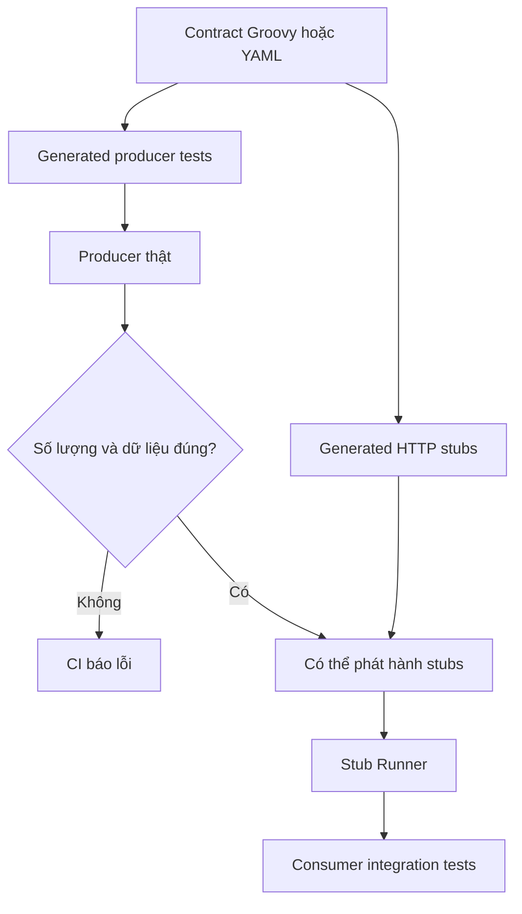

# Số lượng phần tử và điều kiện trên tập dữ liệu

## 1. Vì sao số lượng phần tử là một phần của hợp đồng?

Trong **Spring Cloud Contract**, hợp đồng (*contract*) mô tả các cam kết mà **producer** (dịch vụ cung cấp API) phải giữ để **consumer** (dịch vụ gọi API) hoạt động đúng. Với HTTP, hợp đồng được viết bằng **Groovy/YAML DSL** và dùng để sinh kiểm thử producer, tạo stub cho consumer thông qua **Stub Runner**. Khi chạy trên CI, các kiểm thử này giúp phát hiện thay đổi API không tương thích trước khi phát hành.

Kiểm thử một response chứa một đối tượng đơn lẻ tương đối đơn giản. Nhưng API trả danh sách thường có nhiều cam kết hơn việc “HTTP 200 và body là JSON”:

- Danh sách có được **rỗng** không? Phải có **ít nhất một** phần tử hay **đúng một** phần tử?
- Có giới hạn **tối đa** số phần tử trong một trang không?
- **Mỗi phần tử** có phải chứa `id`, `sku`, `quantity` hợp lệ?
- Consumer cần **tất cả** phần tử đáp ứng bộ lọc hay chỉ cần có **ít nhất một** phần tử khớp?
- Có cần bảo đảm **không trùng ID** hoặc **đúng thứ tự**?
- `totalElements` có phải bằng độ dài danh sách đang trả không, hay là tổng số bản ghi trên mọi trang?

Một hợp đồng chỉ kiểm tra “`items` là array” sẽ bỏ sót nhiều lỗi liên quan đến số lượng và điều kiện tập dữ liệu. Ngược lại, khóa cứng toàn bộ danh sách vào một bản snapshot có thể làm kiểm thử thất bại khi producer chỉ thêm một phần tử hợp lệ. Bài này hướng dẫn chọn mức ràng buộc phù hợp, dùng matcher/JSONPath của Spring Cloud Contract khi thích hợp và bổ sung assertion chuyên biệt khi cần.

## 2. Phân biệt danh sách, tập hợp và kết quả truy vấn

Xét endpoint:

```http
GET /api/orders?status=CONFIRMED&page=0&size=3
Accept: application/json
```

Producer có thể trả:

```json
{
  "page": 0,
  "size": 3,
  "totalElements": 7,
  "items": [
    { "orderId": "ord-101", "status": "CONFIRMED", "amount": 120000 },
    { "orderId": "ord-102", "status": "CONFIRMED", "amount": 250000 }
  ]
}
```

Ở đây có ba con số khác nhau:

| Khái niệm | Giá trị ví dụ | Ý nghĩa |
| --- | ---: | --- |
| `items.length` | 2 | Số phần tử **thực sự** được trả trong response này |
| `size` | 3 | Kích thước trang **được yêu cầu/khai báo**, không bắt buộc bằng số phần tử nhận được |
| `totalElements` | 7 | Tổng số bản ghi **phù hợp truy vấn** trên tất cả trang (theo quy ước phân trang) |

Vì vậy, assertion “`items.length == totalElements`” là **sai** khi kết quả phân trang. Một quy tắc hợp lý thường là `0 <= items.length <= size`; nhưng nếu API cho phép trang rỗng, trang cuối ngắn hơn hoặc trả ít dữ liệu do chính sách riêng, phải điều chỉnh theo hợp đồng đã thống nhất.

**Danh sách** (`array/list`) có thứ tự. **Tập hợp** theo nghĩa nghiệp vụ có thể không quan tâm thứ tự và không được trùng khóa. JSON không có kiểu `Set` riêng: producer vẫn trả array, còn kiểm tra “không trùng” phải dựa trên trường khóa và điều kiện độc lập.

## 3. Chọn kiểu ràng buộc số lượng

| Loại cam kết | Ví dụ | Khi nào dùng | Lỗi cần bắt |
| --- | --- | --- | --- |
| Danh sách rỗng được phép | `items.length >= 0` | Truy vấn có thể không có kết quả | `items = null` nếu consumer yêu cầu array |
| Ít nhất một phần tử | `items.length >= 1` | Một hành vi chỉ thành công khi có kết quả | Producer trả `[]` dù phải có dữ liệu |
| Tối đa N phần tử | `items.length <= 3` | API có giới hạn `size=3` | Producer trả 5 phần tử, client xử lý quá giới hạn |
| Trong khoảng | `1 <= items.length <= 3` | Kịch bản có ít nhất một kết quả và bị giới hạn trang | 0 hoặc 4 phần tử |
| Chính xác N phần tử | `items.length == 2` | N là bất biến nghiệp vụ của kịch bản | Thừa hoặc thiếu một phần tử |
| Không trùng khóa | Các `orderId` khác nhau | Danh sách thể hiện các đơn hàng duy nhất | Cùng đơn hàng xuất hiện hai lần |
| Tất cả phần tử hợp lệ | Mọi `status = CONFIRMED` | API được lọc theo trạng thái | Một phần tử `CANCELLED` lọt vào |
| Có ít nhất một phần tử hợp lệ | Tồn tại `amount > 0` | Consumer chỉ cần một lựa chọn thỏa điều kiện | Không có lựa chọn phù hợp |
| Đúng thứ tự | `createdAt` giảm dần | Consumer dựa vào sort của API | Producer đảo thứ tự dù tập phần tử không đổi |

**Không phải mọi điều kiện đều biểu diễn tốt bằng matcher một dòng.** Spring Cloud Contract có matcher theo JSONPath và ràng buộc số lần xuất hiện; các bất biến phức tạp như tổng số tiền, tính duy nhất theo khóa hoặc sắp xếp ổn định thường cần assertion nghiệp vụ bổ sung ở producer/consumer.

## 4. JSONPath và số lần xuất hiện trong Spring Cloud Contract

JSONPath cho phép chọn các nút trong JSON. Các biểu thức thường gặp:

| JSONPath | Chọn gì? | Điểm cần lưu ý |
| --- | --- | --- |
| `$.items` | **Một nút array** `items` | Một nút không đồng nghĩa array có một phần tử |
| `$.items[*]` | Các phần tử trực tiếp của array | Số nút khớp thường phản ánh số phần tử ở mức này |
| `$.items[*].orderId` | Các trường `orderId` có trong phần tử | Có thể ít hơn số phần tử nếu phần tử thiếu `orderId` |
| `$.items[0]` | Phần tử đầu tiên | Không kiểm tra toàn bộ array |
| `$.items[*].status` | Các trường `status` | Muốn chứng minh **mọi** phần tử có status hợp lệ phải đối chiếu số phần tử hoặc có assertion khác |

Trong **Groovy DSL**, Spring Cloud Contract cung cấp body matcher như `byEquality()`, `byRegex(...)`, `byType()`. Với cấu hình hỗ trợ, `byType` có thể kết hợp `minOccurrence` và `maxOccurrence` để kiểm soát số lần một JSONPath khớp. Ví dụ **phần response** của hợp đồng:

```groovy
response {
    status OK()
    headers {
        contentType(applicationJson())
    }
    body([
        items: [
            [orderId: 'ord-101', status: 'CONFIRMED']
        ]
    ])
    bodyMatchers {
        jsonPath('$.items[*]', byType {
            minOccurrence(1)
            maxOccurrence(3)
        })
    }
}
```

**Ý định của ví dụ** là kiểm tra có từ **1 đến 3 nút phần tử** được JSONPath `$.items[*]` chọn. `body.items` mang một **mẫu response** để tạo stub; nó không có nghĩa producer thật phải luôn trả đúng phần tử `ord-101` nếu cấu hình matcher cho phép biến động.

Điểm bắt buộc khi áp dụng: `minOccurrence`/`maxOccurrence` điều khiển **số lần path khớp trong generated assertion**, không phải một phép chứng minh tổng quát mọi thuộc tính nghiệp vụ của tập dữ liệu. Cách plugin chuyển body mẫu, body matchers và danh sách thành assertion có thể khác theo phiên bản và cấu hình. **Hãy mở producer test được sinh** để xác nhận nó thực sự kiểm tra giới hạn `1..3`, không vô tình so sánh cứng toàn bộ array mẫu.

### Số nút khớp không nhất thiết là số phần tử

Nếu dùng `$.items[*].orderId` để kiểm tra `minOccurrence(2)`, matcher có thể đếm **hai trường `orderId` tìm được**, chưa chứng minh array có đúng hai phần tử hoặc tất cả phần tử đều có `orderId`. Ví dụ:

```json
{
  "items": [
    { "orderId": "ord-101" },
    { "orderId": "ord-102" },
    { "status": "CONFIRMED" }
  ]
}
```

Đường dẫn `$.items[*].orderId` tìm được hai giá trị, nhưng array có ba phần tử và một phần tử thiếu ID. Nếu hợp đồng yêu cầu **mọi phần tử có ID**, cần kiểm tra sự hiện diện của trường trên từng phần tử và quan hệ giữa hai tập được chọn, hoặc viết kiểm thử chuyên biệt cho bất biến này.

### Giới hạn của max/min và các trường hợp biên

Với tập được phép rỗng, cần kiểm tra riêng trường hợp `[]` và phân biệt với `null` hoặc trường `items` vắng mặt. Đừng mặc định khai báo `minOccurrence(0)` tự chứng minh rằng field `items` luôn tồn tại và có kiểu array. Nếu mong đợi `items: []`, hãy kiểm tra **sự hiện diện và kiểu array** đồng thời với giới hạn số lượng.

Nếu API yêu cầu **chính xác hai** phần tử, về mặt mục tiêu cần cả min và max bằng 2. Tuy nhiên việc khẳng định đúng `2` phần tử bằng matcher vẫn nên được đối chiếu với generated test; trong trường hợp nghiệp vụ phức tạp, dùng assertion trực tiếp với JSON array hoặc DTO là dễ hiểu và kiểm chứng hơn.

## 5. Biểu diễn ý định tương ứng bằng YAML DSL

Trong YAML DSL, dữ liệu mẫu nằm ở `response.body`; matcher nằm ở `response.matchers.body`. Một cách biểu diễn tương ứng theo dạng matcher thông dụng là:

```yaml
description: Liệt kê tối đa ba đơn hàng đã xác nhận
request:
  method: GET
  url: /api/orders?status=CONFIRMED&page=0&size=3
  headers:
    Accept: application/json
response:
  status: 200
  headers:
    Content-Type: application/json
  body:
    items:
      - orderId: "ord-101"
        status: "CONFIRMED"
  matchers:
    body:
      - path: $.items[*]
        type: by_type
        minOccurrence: 1
        maxOccurrence: 3
```

Mẫu `items` gồm một phần tử để **stub có dữ liệu cố định** phục vụ consumer test. `minOccurrence` và `maxOccurrence` thể hiện **ý định về số lần JSONPath khớp** khi producer test chạy. Cú pháp trường matcher và các quy tắc sinh assertion phụ thuộc phiên bản Spring Cloud Contract; hãy xác nhận schema YAML của plugin được dùng và đọc generated tests. Nếu plugin/version không hỗ trợ đúng điều kiện cần, phải dùng giải pháp kiểm thử bổ sung thay vì tự giả định matcher có tác dụng.

**Không đặt cả hai bản Groovy/YAML của cùng một kịch bản trong thư mục hợp đồng chính** để tránh sinh các test hoặc stub trùng nhau. Việc chuyển định dạng cần giữ nguyên hành vi kiểm thử, không chỉ dịch tên thuộc tính.

### Cẩn thận với request URL

Ở ví dụ YAML, URL có query string được cố định cho kịch bản. Nếu consumer được phép đổi thứ tự tham số query, hoặc API có tham số tùy chọn không ảnh hưởng kết quả, cần mô tả path và query matcher phù hợp thay vì khóa toàn bộ chuỗi URL. Nguyên tắc tương tự áp dụng cho trường hợp phân trang: hợp đồng phải nói rõ `page`, `size` và `status` là những điều kiện nào của request.

## 6. Các điều kiện trên từng phần tử

Kiểm tra số lượng không đủ nếu phần tử trả về không hợp lệ. Với response đã được lọc theo `status=CONFIRMED`, một điều kiện có ý nghĩa là:

> Mọi phần tử trong `items` phải có `orderId` hợp lệ và `status = CONFIRMED`.

Những khẳng định thường gặp:

| Điều kiện | Ví dụ | Nguy cơ khi chỉ kiểm tra một JSONPath |
| --- | --- | --- |
| **Tất cả** phần tử thỏa điều kiện | Mọi `status = CONFIRMED` | Matcher `$.items[0].status` chỉ kiểm tra phần tử đầu tiên |
| **Tồn tại** phần tử thỏa điều kiện | Có ít nhất một `amount > 100000` | Path trỏ vào mẫu đầu tiên có thể bỏ qua những phần tử khác |
| **Không có** phần tử sai | Không có `status = CANCELLED` | Matcher kiểm tra một phần tử hợp lệ không chứng minh điều kiện phủ định |
| **Không trùng ID** | Các `orderId` duy nhất trong trang | Kiểm tra regex ID riêng lẻ vẫn cho phép hai ID giống nhau |
| **Giữ quan hệ giữa các trường** | `discount <= amount` | Kiểm tra mỗi field đều là số không chứng minh mối quan hệ |
| **Đủ cấu trúc** | Mỗi phần tử có `orderId` và `status` | Số lượng trường tìm được có thể ít hơn độ dài array |

Matcher JSONPath có ích để kiểm tra một trường hoặc một tập giá trị cụ thể, nhưng **không nên mặc định một matcher sẽ tự suy ra “tất cả phần tử”**. Ngữ nghĩa có thể là “path tồn tại”, “một số giá trị khớp” hoặc một assertion do plugin sinh; cần đọc mã được sinh. Khi yêu cầu là bất biến tổng quát như “mọi phần tử đều thỏa”, nên có kiểm thử với một array gồm nhiều phần tử, cố ý thêm một phần tử không hợp lệ để xác nhận kiểm thử thực sự phát hiện.

### Ví dụ assertion bổ sung bằng Java

Đoạn sau minh họa việc kiểm tra **response JSON đã nhận được từ producer** bằng Jackson và AssertJ. Có thể dùng trong integration test hoặc một phép kiểm tra chuyên biệt bên cạnh generated producer tests; các import, cấu hình HTTP client và việc lấy biến `responseBody` được đặt ở lớp test thực tế:

```java
JsonNode root = objectMapper.readTree(responseBody);
JsonNode items = root.path("items");

assertThat(items.isArray()).isTrue();

List<JsonNode> rows = StreamSupport.stream(
    items.spliterator(), false
).toList();

assertThat(rows.size()).isBetween(1, 3);

assertThat(rows).allSatisfy(item -> {
    assertThat(item.path("orderId").isTextual()).isTrue();
    assertThat(item.path("orderId").asText())
        .matches("ord-[0-9]+");
    assertThat(item.path("status").asText())
        .isEqualTo("CONFIRMED");
});

List<String> ids = rows.stream()
    .map(item -> item.path("orderId").asText())
    .toList();
assertThat(ids).doesNotHaveDuplicates();
```

Kiểm thử này xác minh những điều cụ thể:

1. `items` tồn tại **và là array**; `null` hay một object sẽ bị loại.
2. Độ dài array nằm trong khoảng `1..3`.
3. **Mỗi phần tử** có `orderId` dạng chuỗi theo mẫu và `status` bằng `CONFIRMED`.
4. Các ID trong response không trùng nhau.

**Lưu ý:** Đây là assertion bổ sung, không phải cú pháp riêng của Contract DSL. Việc viết test chuyên biệt là hợp lý khi matcher được sinh không thể diễn đạt rõ bất biến về tập hợp. Đặt test ở producer giúp xác minh triển khai; consumer cũng cần test riêng nếu logic xử lý danh sách phức tạp.

## 7. Khi thứ tự phần tử có và không có ý nghĩa

Một array JSON luôn có thứ tự phần tử, nhưng **không phải API nào cũng cam kết thứ tự đó**.

Ví dụ endpoint mặc định không có `sort`:

```json
{
  "items": [
    { "orderId": "ord-101" },
    { "orderId": "ord-102" }
  ]
}
```

Nếu consumer chỉ tạo bản đồ `orderId -> order`, việc producer trả `ord-102` trước `ord-101` có thể hoàn toàn tương thích. So sánh cả mảng bằng equality theo đúng thứ tự mẫu tạo ra ràng buộc thừa.

Ngược lại, nếu request là `GET /api/orders?sort=createdAt,desc` và UI dựa vào thứ tự từ server, thì **thứ tự giảm dần theo `createdAt`** là một phần của hợp đồng. Một test chỉ kiểm tra sự có mặt của các phần tử sẽ bỏ sót lỗi đổi hướng sắp xếp.

Một assertion minh họa cho quy tắc không giảm theo thứ tự đã sắp xếp:

```java
List<Instant> times = rows.stream()
    .map(item -> Instant.parse(item.path("createdAt").asText()))
    .toList();

for (int i = 1; i < times.size(); i++) {
    assertThat(times.get(i)).isBeforeOrEqualTo(times.get(i - 1));
}
```

Đây là kiểm tra thứ tự **không tăng** (giảm dần hoặc bằng nhau), phù hợp nếu có các bản ghi cùng timestamp. Nếu API cần quy tắc thứ tự phụ khi trùng thời gian (ví dụ `orderId` tăng dần), phải bổ sung assertion để phân trang và kết quả ổn định.

## 8. Trang rỗng, số lượng bằng không và giới hạn trang

Các response sau **không tương đương** nếu consumer kỳ vọng một array:

```json
{ "items": [] }
```

```json
{ "items": null }
```

```json
{}
```

Một API thiết kế nhất quán thường trả `items: []` khi truy vấn không có kết quả, cùng metadata phân trang thích hợp:

```json
{
  "page": 4,
  "size": 3,
  "totalElements": 7,
  "items": []
}
```

Với một trang vượt quá vùng có dữ liệu, `items` có thể rỗng dù `totalElements` vẫn bằng 7. Nếu consumer dùng `items` để lặp, `[]` giúp tránh xử lý `null`. Nhưng điều này chỉ là **một chính sách API phổ biến**; nếu API đã có quy ước khác, hợp đồng cần mô tả đúng quy ước thực tế và việc đổi sang `[]` cần được đánh giá tương thích.

Để bảo vệ nhánh rỗng, nên viết **contract riêng cho request có kết quả rỗng**, với HTTP status, body mẫu và những field bắt buộc được định nghĩa rõ ràng. Không chỉ dựa vào matcher có `minOccurrence(0)` trong một contract vốn mô tả danh sách không rỗng.

### Điều kiện phân trang cần phân biệt

Đối với response phân trang, các quy tắc có thể bao gồm:

- `page >= 0` và `size > 0` theo giao thức.
- `0 <= items.length <= size`.
- `totalElements >= 0`, phản ánh tổng số bản ghi phù hợp bộ lọc.
- `totalPages`, nếu được cung cấp, phải nhất quán với `totalElements` và `size` theo quy tắc làm tròn của API.
- Nếu API có `hasNext` hoặc cursor, giá trị phải nhất quán với quy ước điều hướng đã công bố.

Đừng so `items.length == size` cho mọi trang, vì trang cuối hoặc trang ngoài phạm vi thường có ít phần tử hơn. Với **cursor pagination**, quy tắc về `totalElements` hoặc `totalPages` có thể không tồn tại; hãy kiểm tra đúng những metadata mà producer thực sự cam kết.

## 9. Request có điều kiện lọc và kết quả tương ứng

Một hợp đồng collection không nên chỉ kiểm tra **kết quả đầu ra** mà bỏ quên bộ lọc **đầu vào**. Ví dụ consumer gọi:

```http
GET /api/orders?status=CONFIRMED&size=3
```

Nếu producer bỏ qua `status=CONFIRMED` nhưng response vẫn có ít nhất một phần tử, assertion count có thể qua trong khi consumer nhận thêm các đơn hàng `CANCELLED`. Do đó cần xác định từng quy tắc:

1. Request phải chứa bộ lọc `status=CONFIRMED` khi kịch bản yêu cầu.
2. Response phải có cấu trúc collection ổn định (array, metadata).
3. Số phần tử không vượt `size=3`.
4. Các phần tử trả về phải thực sự thỏa bộ lọc.
5. Nếu consumer yêu cầu thứ tự, kết quả phải giữ đúng quy tắc sort.

**Không đồng nhất `items.length` với số bản ghi thỏa bộ lọc trong cơ sở dữ liệu**. Với hệ thống phân trang, producer có thể trả ít phần tử hơn tổng kết quả. Contract HTTP kiểm tra giao diện mà consumer thấy; tính đúng đắn của truy vấn, bảo mật dữ liệu và các bất biến xuyên nhiều trang có thể cần kiểm thử tích hợp dữ liệu ở producer.

### “Có ít nhất một” khác “tất cả”

Xét response:

```json
{
  "items": [
    { "orderId": "ord-101", "status": "CONFIRMED" },
    { "orderId": "ord-102", "status": "CANCELLED" }
  ]
}
```

Điều kiện “**tồn tại** một `status=CONFIRMED`” là **đúng**, nhưng điều kiện “**mọi** `status=CONFIRMED`” là **sai**. Nếu producer cam kết endpoint đã lọc, điều kiện thứ hai mới là yêu cầu cần bảo vệ. Một matcher chỉ chứng minh có ít nhất một giá trị `CONFIRMED` không đủ.

Tương tự, nếu `items` chứa các mặt hàng và consumer dùng tổng tiền, có thể cần kiểm tra từng `quantity > 0` và `price >= 0`, đồng thời quan hệ `total == sum(quantity * price)`. Các matcher theo trường riêng lẻ không tự chứng minh tổng số học; một producer integration test hoặc assertion chuyên biệt là cần thiết.

## 10. Stub có một danh sách mẫu, producer test có matcher

Với Spring Cloud Contract, hợp đồng thường phục vụ hai luồng:



**Producer test** kiểm chứng triển khai thật theo những assertion và matcher được sinh. Nếu yêu cầu là `1..3` phần tử, test phải phát hiện response rỗng hoặc có bốn phần tử, với điều kiện matcher và cấu hình plugin thực sự sinh kiểm tra tương ứng.

**Stub** thông thường trả **dữ liệu mẫu cụ thể** khai báo ở `response.body`. Ví dụ stub có thể trả một phần tử `ord-101`, mặc dù producer thật được phép trả hai hoặc ba phần tử theo matcher. Vì vậy:

- Consumer test chạy với một stub một phần tử chứng minh consumer xử lý được **một ví dụ hợp lệ**, chưa chứng minh consumer xử lý tốt danh sách rỗng, dài, nhiều phần tử hoặc phần tử trùng nhau.
- Nếu consumer có các nhánh quan trọng cho `[]`, một phần tử, trang cuối hay lỗi `400` khi `size` sai, hãy viết **các hợp đồng/kịch bản riêng** hoặc kiểm thử consumer bổ sung, giữ request phân biệt rõ để tránh các WireMock mapping xung đột.
- Với dữ liệu biến động, không nên yêu cầu stub tự sinh mọi số lượng phần tử trừ khi dự án đã cấu hình khả năng đó và có lý do kiểm thử rõ ràng.

Ví dụ cấu hình Stub Runner bên consumer (phần minh họa, cần dependency và test framework trong dự án):

```java
import org.springframework.cloud.contract.stubrunner.StubRunnerProperties;
import org.springframework.cloud.contract.stubrunner.spring.AutoConfigureStubRunner;

@AutoConfigureStubRunner(
    ids = "com.example:order-service:1.2.0:stubs:9090",
    stubsMode = StubRunnerProperties.StubsMode.LOCAL
)
class OrdersConsumerContractTest {
    // HTTP client thật của consumer gọi http://localhost:9090.
    // Kiểm tra logic phân trang, kết quả rỗng và nhiều phần tử.
}
```

Chế độ `LOCAL` yêu cầu stubs JAR đã tồn tại trong Maven local repository. Ở CI có thể lấy artifact từ kho từ xa bằng chế độ và cấu hình repository phù hợp. Tọa độ stub phải gắn với **phiên bản hợp đồng đã được producer test xác minh**, không lấy một phiên bản bất kỳ có response trông tương tự.

## 11. Ma trận kiểm thử biên cho tập dữ liệu

Để chứng minh hợp đồng có giá trị, không chỉ chạy **một** response đúng. Hãy thử những thay đổi ở đường biên:

| Producer trả gì? | Mong đợi với quy tắc `1 <= length <= 3` và mọi `status=CONFIRMED` | Vì sao? |
| --- | --- | --- |
| `items` gồm 1 phần tử hợp lệ | Pass | Đúng giới hạn dưới |
| `items` gồm 3 phần tử hợp lệ | Pass | Đúng giới hạn trên |
| `items: []` | Fail trong kịch bản bắt buộc có dữ liệu | Ít hơn 1 phần tử |
| `items` gồm 4 phần tử | Fail | Vượt giới hạn trên |
| `items` gồm 2 phần tử, một `CANCELLED` | Fail | Vi phạm bộ lọc nghiệp vụ |
| `items` gồm 2 phần tử cùng `orderId` | Fail **nếu** hợp đồng cam kết duy nhất | Trùng khóa |
| `items: null` | Fail **nếu** schema yêu cầu array | Sai kiểu |
| Không có trường `items` | Fail **nếu** field bắt buộc | Mất trường |
| Đảo thứ tự hai phần tử | Pass nếu không cam kết thứ tự; fail nếu có cam kết sort | Tùy điều kiện API |
| Thêm một field metadata trên từng phần tử | Thường nên pass nếu consumer không dùng và so khớp cho phép mở rộng | Tránh ràng buộc thừa |

Các kết quả “pass/fail” ở bảng là **mục tiêu hợp đồng**. Không nên tuyên bố plugin đã tự kiểm tra tất cả chỉ vì có `minOccurrence`/`maxOccurrence`. Cần xác nhận generated assertions, đồng thời viết test chuyên biệt cho điều kiện mà DSL không đủ biểu diễn.

### Kiểm tra cả tính nhất quán giữa nhiều trang

Nếu producer hỗ trợ phân trang, consumer có thể cần:

- Cùng một `orderId` không bị lặp trên hai trang liên tiếp trong một snapshot ổn định.
- Cursor tiếp theo không lặp lại các phần tử đã trả.
- Tổng số bản ghi và thứ tự phù hợp với cách phân trang đã công bố.

Những điều kiện này thường đòi **nhiều request có liên hệ** và dữ liệu kiểm thử cố định. Một contract đơn cho response trang đầu tiên không thể chứng minh toàn bộ tính đúng đắn xuyên nhiều trang. Hãy bổ sung integration test có seed dữ liệu hoặc các kịch bản khác có chủ đích.

## 12. Bài thực hành: danh sách sản phẩm đủ điều kiện giao hàng

Ứng dụng consumer gọi:

```http
GET /api/products?available=true&limit=3
Accept: application/json
```

Producer trả danh sách tối đa ba sản phẩm còn hàng:

```json
{
  "limit": 3,
  "totalElements": 5,
  "products": [
    { "sku": "SKU-101", "available": true, "stock": 4 },
    { "sku": "SKU-102", "available": true, "stock": 1 }
  ]
}
```

Consumer cần danh sách sản phẩm **không trùng SKU**, tất cả phải `available = true` và `stock > 0`. API cho phép trả `0..3` phần tử vì một lần truy vấn có thể hết hàng.

**Yêu cầu:**

1. Viết hợp đồng Groovy hoặc YAML cho method, URL/query, HTTP `200`, JSON body và mẫu dữ liệu. Phân biệt `limit=3` với số phần tử trả về.
2. Đề xuất cách dùng JSONPath matcher cho giới hạn số lần xuất hiện. Giải thích vì sao `$.products[*]` phù hợp hơn `$.products` khi đếm phần tử trực tiếp.
3. Thiết kế assertion bổ sung cho **mọi `available = true`**, **mọi `stock > 0`** và **không trùng `sku`**.
4. Thử `products: []`, bốn phần tử, một phần tử `available=false`, một phần tử thiếu `sku` và hai phần tử có cùng SKU.
5. Với consumer, tạo ít nhất hai kịch bản stub: danh sách có dữ liệu và danh sách rỗng. Kiểm tra UI/client xử lý mỗi trường hợp.
6. Đưa kiểm thử producer và consumer vào CI, ghi rõ version stubs JAR.

### Gợi ý đáp án và điều kiện chấp nhận

**Những điều cần giữ** là `products` có kiểu array, số phần tử trong `0..3`, từng sản phẩm có SKU hợp lệ, có sẵn và `stock > 0`, không trùng khóa. `totalElements = 5` trong ví dụ là **tổng số kết quả** (nếu API cam kết cách tính đó), không phải `products.length`.

Ví dụ một phần response Groovy minh họa matcher số lần xuất hiện:

```groovy
response {
    status OK()
    headers {
        contentType(applicationJson())
    }
    body([
        limit: 3,
        totalElements: 5,
        products: [
            [sku: 'SKU-101', available: true, stock: 4],
            [sku: 'SKU-102', available: true, stock: 1]
        ]
    ])
    bodyMatchers {
        jsonPath('$.products[*]', byType {
            minOccurrence(0)
            maxOccurrence(3)
        })
    }
}
```

Hãy kiểm tra tính khả dụng của `minOccurrence(0)` và `maxOccurrence(3)` trong plugin hiện dùng, sau đó xem **generated assertion** có thực sự cho phép array rỗng không và có kiểm tra `products` luôn là array không. Nếu không, bổ sung test cho nhánh rỗng và assertion trực tiếp về kiểu/độ dài. Để xác minh **mọi sản phẩm có sẵn, tồn kho dương và SKU duy nhất**, dùng assertion chuyên biệt như ví dụ Java ở mục 6, đổi điều kiện sang `available`, `stock` và `sku`.

**Kết quả mong đợi:** Danh sách rỗng vẫn được chấp nhận trong kịch bản cho phép rỗng; danh sách có bốn sản phẩm phải bị từ chối; phần tử `available=false`, `stock=0`, thiếu SKU hoặc trùng SKU phải bị phát hiện nếu toàn bộ điều kiện đã được kiểm thử.

## 13. Những lỗi thiết kế matcher thường gặp

| Sai lầm | Tác động | Cách khắc phục |
| --- | --- | --- |
| Dùng `$.items` để tưởng đang đếm phần tử | Có thể chỉ khớp một nút array | Dùng JSONPath phần tử hoặc assertion về kích thước |
| Cố định toàn bộ array vì mẫu có hai phần tử | Thay đổi số lượng hợp lệ làm test đỏ | Matcher theo điều kiện consumer thật sự dùng |
| Chỉ kiểm tra phần tử đầu tiên | Phần tử sau có thể sai trạng thái/kiểu | Assertion cho mọi phần tử |
| Kiểm tra số ID thay vì số object | Phần tử thiếu ID bị bỏ sót | Kiểm tra kiểu/độ dài array và từng object |
| So `items.length` với `totalElements` | Sai với API phân trang | Phân biệt count trang và tổng dữ liệu |
| Bỏ qua case `[]` | Consumer lỗi ở danh sách rỗng | Contract/kịch bản riêng cho tập rỗng |
| Yêu cầu đúng thứ tự khi API không cam kết | Test fail giả khi DB đổi thứ tự | Chỉ kiểm tra thứ tự nếu có yêu cầu sort |
| Dùng regex cho mọi giá trị | Không bảo vệ bất biến trạng thái, số tiền | Kết hợp equality, type và assertion nghiệp vụ |
| Chỉ nhìn stub có hai phần tử và kết luận producer luôn trả hai | Nhầm giá trị mẫu với matcher phía producer | Đọc generated producer tests và chạy boundary tests |
| Pipeline xanh nhưng số contract tests bằng 0 | Mất vùng bảo vệ tương thích | Kiểm tra generated tests và số lượng test đã chạy |

## 14. Checklist trước khi phát hành contract có tập dữ liệu

- [ ] Đã xác định `items` có bắt buộc tồn tại và luôn là array hay không.
- [ ] Số lượng mong đợi là rỗng, chính xác N, ít nhất N, tối đa N hay trong khoảng.
- [ ] Phân biệt độ dài trang hiện tại với `size`, `totalElements` và `totalPages`.
- [ ] JSONPath chọn đúng **phần tử** cần đếm, không nhầm nút array với các phần tử.
- [ ] Matcher `minOccurrence`/`maxOccurrence` được plugin hỗ trợ và generated assertion đã được kiểm tra.
- [ ] Các điều kiện “mọi phần tử”, “tồn tại”, tính duy nhất và quan hệ dữ liệu được bảo vệ bằng assertion phù hợp.
- [ ] Thứ tự chỉ bị ràng buộc nếu consumer thực sự dùng; trường hợp bằng nhau có quy tắc rõ ràng.
- [ ] Có kịch bản riêng cho collection rỗng, trang cuối, dữ liệu nhiều phần tử và lỗi request nếu cần.
- [ ] Stub dùng dữ liệu mẫu có ý nghĩa; consumer test có đủ nhánh xử lý quan trọng.
- [ ] Producer tests được sinh, biên dịch và chạy; CI phát hiện sai giới hạn và phần tử không hợp lệ.
- [ ] Stubs JAR có version truy vết được và chỉ được phát hành sau khi producer test đạt.

**Ghi nhớ:** Với dữ liệu dạng collection, một hợp đồng tốt cần phân biệt **số phần tử**, **số nút JSONPath khớp** và **những điều kiện nghiệp vụ trên phần tử**. Spring Cloud Contract cung cấp matcher giúp biểu diễn nhiều ràng buộc, nhưng hãy kiểm tra generated assertions và bổ sung kiểm thử khi cần bảo vệ “mọi phần tử”, tính duy nhất, thứ tự hoặc dữ liệu phân trang. Nhờ đó producer test và stub cùng hỗ trợ phát hiện thay đổi API không tương thích mà không tạo các ràng buộc thừa.
