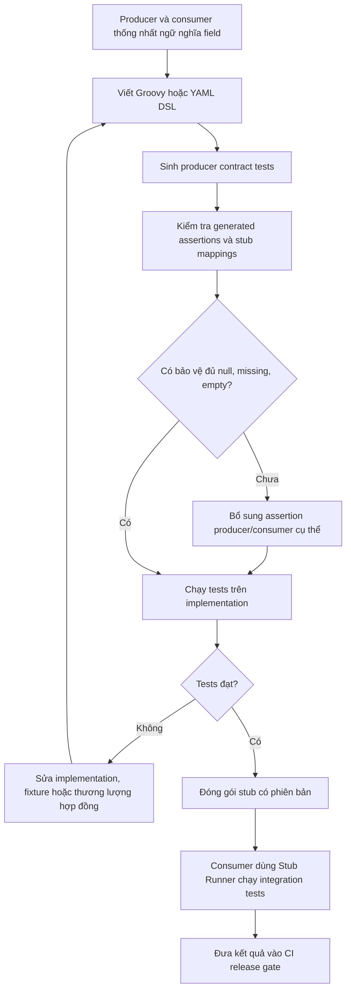

# Kiểm tra có, thiếu, null hoặc rỗng theo ngữ nghĩa được hỗ trợ

Một phản hồi JSON có thể **không chứa một thuộc tính**, **chứa thuộc tính với giá trị `null`**, hoặc **chứa thuộc tính với chuỗi, mảng hay object rỗng**. Đối với con người, các trường hợp này dễ bị gom chung thành “không có dữ liệu”. Với consumer, chúng có thể dẫn đến **những hành vi hoàn toàn khác nhau**: bỏ qua giá trị, xóa thông tin đang lưu, hiển thị chuỗi rỗng, hoặc đánh dấu dữ liệu không hợp lệ.

Trong **Spring Cloud Contract**, producer và consumer dùng hợp đồng **Groovy/YAML DSL** để thỏa thuận hành vi HTTP hoặc thông điệp. Công cụ sinh kiểm thử cho producer và stub cho consumer sử dụng qua **Stub Runner**. Khi viết matcher/assertion, cần phân biệt rõ điều **DSL mô tả**, điều **generated test thực sự kiểm tra**, và điều cần bổ sung bằng **kiểm thử cấu trúc JSON chuyên biệt**.

Bài này thuộc chương **Matcher và assertion** của lộ trình **SPRING_CLOUD_CONTRACT**. Trọng tâm là xác định đúng ngữ nghĩa “có”, “thiếu”, “`null`” và “rỗng” trong request/response, đồng thời tránh giả định rằng mọi phiên bản Spring Cloud Contract đều có cùng matcher cho tất cả các trường hợp.

## 1. Bốn trạng thái dữ liệu không đồng nghĩa

Giả sử Profile Service trả thông tin hiển thị của người dùng:

```json
{
  "id": "USER-42",
  "displayName": "",
  "middleName": null,
  "tags": [],
  "preferences": {}
}
```

Trong phản hồi này **không có** khóa `legacyCode`. Điều đó khác với việc xuất hiện khóa `legacyCode` mang giá trị `null`.

| Trạng thái | JSON ví dụ | Câu hỏi cần kiểm tra |
|---|---|---|
| **Có trường và có giá trị khác `null`** | `"id": "USER-42"` | Khóa tồn tại, giá trị đúng kiểu hoặc đúng giá trị? |
| **Thiếu trường** | Không có khóa `legacyCode` | Object thực sự không khai báo khóa? |
| **Có trường với `null`** | `"middleName": null` | Khóa hiện diện và JSON value là `null`? |
| **Chuỗi rỗng** | `"displayName": ""` | Khóa hiện diện, value là chuỗi độ dài 0? |
| **Mảng rỗng** | `"tags": []` | Khóa hiện diện, value là array có 0 phần tử? |
| **Object rỗng** | `"preferences": {}` | Khóa hiện diện, value là object có 0 thuộc tính? |
| **Chuỗi chỉ chứa khoảng trắng** | `"displayName": "   "` | Chuỗi không rỗng về độ dài nhưng có thể bị xem là blank theo nghiệp vụ |
| **Body HTTP không có nội dung** | Phản hồi `204 No Content` | Response body không có bytes/nội dung? |
| **Body JSON là `null`** | Body chứa ký tự `null` | Body có nội dung JSON hợp lệ là giá trị null, khác với không có body |

**Quy tắc cốt lõi:** `{}`, `{"field": null}`, `{"field": ""}` và `{"field": []}` là bốn JSON payload **khác nhau**. Một consumer có thể xem chúng tương đương nếu API quy định như vậy, nhưng không nên tự giả định.

### 1.1. “Có” không luôn đồng nghĩa “khác null”

Một kiểm tra **field tồn tại** chỉ trả lời xem có khóa hay không. Nó không khẳng định giá trị thuộc kiểu mong đợi hoặc khác `null`. Với JSON:

```json
{"middleName": null}
```

Các mệnh đề sau có kết quả khác nhau:

- “Object chứa khóa `middleName`”: **đúng**.
- “`middleName` khác `null`”: **sai**.
- “`middleName` có chuỗi không rỗng”: **sai**.
- “Không có trường `middleName`”: **sai**.

Ngược lại, với `{}`, “không có trường” là đúng, nhưng không được suy ra producer đang trả một trường có giá trị null.

### 1.2. Rỗng và blank cũng khác nhau

Giữa các chuỗi:

```json
{"note": ""}
```

và:

```json
{"note": "   "}
```

có khác biệt về độ dài: chuỗi đầu có `length == 0`, chuỗi sau có ba ký tự khoảng trắng. Nếu quy tắc nghiệp vụ không chấp nhận tên chỉ có khoảng trắng, cần kiểm tra **blank**, không chỉ **empty**. Cách kiểm tra phụ thuộc công cụ; regex hoặc Bean Validation như `@NotBlank` có thể hữu ích ở test riêng, nhưng không có nghĩa mọi matcher “rỗng” đều tự loại khoảng trắng.

## 2. Vì sao phân biệt trạng thái quan trọng cho consumer?

Xét hai cách triển khai cập nhật hồ sơ:

- Trong một API PATCH, **thiếu `middleName`** có thể có nghĩa **giữ nguyên tên đệm**.
- **`middleName: null`** có thể có nghĩa **xóa tên đệm**.
- **`middleName: ""`** có thể có nghĩa **đặt tên đệm thành chuỗi rỗng** hoặc **bị từ chối vì không hợp lệ**, tùy thiết kế.

Đối với nội dung theo **JSON Merge Patch** (`Content-Type: application/merge-patch+json`, RFC 7396), thiếu một member trong patch object nói chung giữ nguyên thành viên tương ứng; giá trị `null` biểu thị xóa member. Đây là **ngữ nghĩa của định dạng JSON Merge Patch**, không phải quy tắc tự động áp dụng cho mọi `PUT` hoặc `PATCH`.

Ví dụ khác, consumer phân biệt:

| Response | Ý nghĩa có thể được API thỏa thuận |
|---|---|
| `"discounts": []` | Đã tính danh sách giảm giá và kết quả không có phần tử |
| `"discounts": null` | Chưa có thông tin giảm giá / chưa được tính |
| Thiếu `discounts` | Phiên bản hoặc chế độ response không trả trường này |
| `"discounts": {}` | Trả object khác schema mong đợi, có thể là lỗi phá vỡ API |

Ý nghĩa thực tế phải do **producer và consumer thống nhất**. Contract testing có nhiệm vụ bảo vệ những phân biệt mà consumer đang sử dụng.

## 3. Thiết kế hợp đồng theo hành vi đã thỏa thuận

Giả sử Profile Service có endpoint:

```http
GET /api/profiles/USER-42
Accept: application/json
```

và hợp đồng phản hồi:

```http
HTTP/1.1 200 OK
Content-Type: application/json

{
  "id": "USER-42",
  "displayName": "",
  "middleName": null,
  "tags": [],
  "preferences": {}
}
```

Các yêu cầu được thống nhất:

1. `id` **phải tồn tại** và là chuỗi nhận diện người dùng.
2. `displayName` **phải tồn tại**, được phép là `""`.
3. `middleName` **phải tồn tại với JSON null** khi chưa có tên đệm.
4. `tags` **phải là mảng**, có thể không chứa phần tử.
5. `preferences` **phải là object**, có thể không chứa thuộc tính.
6. `legacyCode` **phải vắng mặt**, vì API đã ngừng công bố trường này.

Yêu cầu thứ 6 khác với việc chỉ không đề cập `legacyCode` trong mẫu body. **Không đưa trường vào response mẫu không phải lúc nào cũng tương đương assertion “trường không được tồn tại”**; generated tests có thể kiểm tra các path đã mô tả mà vẫn cho phép producer trả thêm thuộc tính. Cần kiểm tra test/mapping được sinh ra và dùng assertion cấu trúc rõ ràng cho điều kiện “vắng mặt”.

## 4. Groovy DSL: body mẫu và matcher có ý nghĩa

Một hợp đồng Groovy mô tả phản hồi ở mục 3:

```groovy
import org.springframework.cloud.contract.spec.Contract

Contract.make {
    name 'profile_get_nullable_and_empty_fields_200'
    description 'Profile API phân biệt null, chuỗi rỗng và collection rỗng'

    request {
        method GET()
        url '/api/profiles/USER-42'
        headers {
            header 'Accept', 'application/json'
        }
    }

    response {
        status OK()
        headers {
            contentType(applicationJson())
        }
        body(
            id: 'USER-42',
            displayName: '',
            middleName: null,
            tags: [],
            preferences: [:]
        )
    }
}
```

Trong Groovy, `[:]` là map rỗng, còn `[]` là list rỗng. Khi chuyển thành JSON, các dạng dự kiến lần lượt là `{}` và `[]`. Nhưng cấu hình serialization của producer có thể bỏ những trường `null` hoặc rỗng; vì vậy **phải xem response thực tế và generated assertions**, không chỉ xem file DSL.

Đoạn trên **chưa khẳng định được một cách tổng quát** rằng `legacyCode` vắng mặt. Muốn biến yêu cầu đó thành điều kiện bắt buộc trong CI, bổ sung kiểm tra chuyên biệt (mục 7) hoặc dùng matcher xác minh **absence** được tài liệu của **đúng phiên bản** Spring Cloud Contract hỗ trợ.

### 4.1. Ví dụ `bodyMatchers` cho thuộc tính có giá trị

Ngoài body mẫu, DSL Groovy có thể dùng matcher để kiểm tra những ràng buộc cần thiết thay vì khóa chặt mọi giá trị:

```groovy
response {
    status OK()
    headers {
        contentType(applicationJson())
    }
    body(
        id: 'USER-42',
        status: 'ACTIVE',
        age: 25
    )
    bodyMatchers {
        jsonPath('$.id', byRegex('USER-[0-9]+'))
        jsonPath('$.status', byEquality())
        jsonPath('$.age', byType())
    }
}
```

Đây là đoạn minh họa đặt trong `Contract.make { ... }` và cần phần `request` khi sử dụng như hợp đồng đầy đủ. Các matcher có những mục đích riêng:

- `byEquality()`: so khớp giá trị dự kiến đã mô tả.
- `byType()`: so khớp kiểu của giá trị; **không thay thế** ràng buộc nghiệp vụ, chẳng hạn tuổi phải không âm.
- `byRegex(...)`: so khớp định dạng chuỗi theo biểu thức chính quy.

**Điểm cần tránh:** `byType()` cho một string không có nghĩa string đó **không rỗng**. `byRegex('.*')` có thể chấp nhận chuỗi rỗng. Muốn chuỗi không rỗng, dùng điều kiện chính xác hơn, ví dụ `.+` nếu miền giá trị cho phép, và nếu cần loại cả khoảng trắng thì dùng quy tắc phù hợp với định dạng đã cam kết.

### 4.2. Matcher chuyên biệt cho null hoặc absent có phụ thuộc phiên bản

Trong các bản Spring Cloud Contract, tập DSL/matcher và cách chúng được chuyển thành Java assertions hoặc WireMock predicates có thể khác nhau. Một số ví dụ tài liệu hoặc thư viện liên quan nhắc đến matcher cho null, không null hoặc field absence; **không nên mặc định** mỗi dạng `byNull`, `byNotNull`, `absent` hay cú pháp tương tự đều hợp lệ trong mọi `bodyMatchers`, `request` và mọi phiên bản.

Khi cần chính xác “JSON path tồn tại và giá trị bằng null” hay “JSON path hoàn toàn không tồn tại”, hãy thực hiện theo trình tự:

1. Kiểm tra **tài liệu DSL của phiên bản Spring Cloud Contract đã ghim** và vị trí matcher được hỗ trợ: request hay response, body hay header.
2. Chạy tác vụ sinh producer test/stub của project.
3. Đọc **generated test assertion** và **stub mapping** để biết chúng thực sự kiểm tra gì.
4. Viết **kiểm thử bổ sung ở producer** cho ngữ nghĩa mà DSL/generator hiện tại chưa thể diễn đạt chính xác.
5. Chỉ công bố stub sau khi producer contract tests và kiểm thử bổ sung cần thiết đều đạt.

Phần tiếp theo sử dụng **Spring MockMvc/Jackson**, vốn cho phép thể hiện các trạng thái này một cách rõ ràng ở lớp kiểm thử HTTP của producer.

## 5. YAML DSL: biểu diễn null, rỗng và trường không khai báo

Cùng kịch bản ở mục 4 có thể được mô tả bằng YAML:

```yaml
name: profile_get_nullable_and_empty_fields_200
description: Profile API phân biệt null, chuỗi và collection rỗng
request:
  method: GET
  url: /api/profiles/USER-42
  headers:
    Accept: application/json
response:
  status: 200
  headers:
    Content-Type: application/json
  body:
    id: USER-42
    displayName: ''
    middleName: null
    tags: []
    preferences: {}
```

Chú ý các giá trị:

| YAML | JSON mong muốn | Lưu ý |
|---|---|---|
| `middleName: null` | `"middleName": null` | YAML null có ý nghĩa riêng, không phải chuỗi `"null"` |
| `displayName: ''` | `"displayName": ""` | Dấu nháy giữ giá trị là chuỗi rỗng |
| `tags: []` | `"tags": []` | List rỗng, không phải null |
| `preferences: {}` | `"preferences": {}` | Map/object rỗng |
| Không viết `legacyCode` | Không có kỳ vọng mẫu về `legacyCode` | **Không tự coi là assertion khóa vắng mặt** |
| `displayName: '   '` | `"displayName": "   "` | Có khoảng trắng, khác chuỗi rỗng |

Nếu YAML viết `middleName: 'null'` (có nháy), giá trị là **chuỗi bốn ký tự** `null`, không phải JSON null. Tương tự, `tags: '[]'` là chuỗi `[]`, không phải mảng rỗng.

**Quan trọng:** Groovy và YAML ở hai mục trên là **hai cách biểu diễn cùng một hợp đồng**. Trong dự án, chỉ chọn một bản làm nguồn chính cho kịch bản đó; tránh tạo hai generated tests/mappings cùng request và response khi không có chủ ý.

### 5.1. Khi nào dùng matcher YAML?

Khi dữ liệu động, YAML DSL của những phiên bản Spring Cloud Contract hỗ trợ khai báo các matcher cho response/body theo schema tương ứng, chẳng hạn kiểu giá trị hoặc regex. Tuy nhiên, **cấu trúc YAML matcher và giá trị `type` phải khớp tài liệu phiên bản đang dùng**.

Để kiểm tra “field phải vắng mặt”, đừng tự tạo một khóa YAML như `notExists: true` khi chưa được plugin hỗ trợ. YAML vẫn có thể hợp lệ về cú pháp nhưng plugin bỏ qua, báo lỗi hoặc không sinh được assertion mong muốn. Một kiểm thử cấu trúc JSON rõ ràng thường an toàn và dễ hiểu hơn khi yêu cầu absence chưa được DSL phiên bản đó hỗ trợ đầy đủ.

## 6. Bảng phân biệt assertion trong Spring MockMvc

**Spring MockMvc** cung cấp các phép so khớp JSONPath hữu ích để kiểm tra producer ở mức HTTP. Các phương thức tồn tại của `JsonPathResultMatchers` có ngữ nghĩa quan trọng:

| Assertion | Ý nghĩa cần nhớ |
|---|---|
| `jsonPath("$.name").exists()` | Path tồn tại và giá trị **khác null** |
| `jsonPath("$.name").doesNotExist()` | Không có giá trị khác null tại path; có thể đúng khi path **thiếu hoặc là null** |
| `jsonPath("$.name").hasJsonPath()` | Path **tồn tại**, kể cả giá trị `null` |
| `jsonPath("$.name").doesNotHaveJsonPath()` | Path **không tồn tại**, kể cả phân biệt với path có `null` |
| `jsonPath("$.name").value(nullValue())` | Giá trị là JSON `null`; nên kết hợp xác nhận path hiện diện |
| `jsonPath("$.name").value("")` | Chính xác chuỗi rỗng |
| `jsonPath("$.tags").isArray()` | Giá trị có kiểu array |
| `jsonPath("$.tags").value(hasSize(0))` | Array có 0 phần tử (kèm import matcher phù hợp) |
| `jsonPath("$.prefs").isMap()` | Giá trị có kiểu object/map |
| `jsonPath("$.id").isString()` | Giá trị thuộc kiểu chuỗi |

Các phương thức này là API kiểm thử **Spring MVC Test**, không phải lệnh DSL do Spring Cloud Contract tự sinh ra một cách bảo đảm. Hãy đối chiếu phiên bản Spring Framework trong dự án; chẳng hạn các phép kiểm tra phân biệt path có/không có kể cả null cần phương thức tương ứng trong bản Framework đang chạy.

### 6.1. Bẫy thường gặp với `doesNotExist()`

Giả sử một test kiểm tra:

```java
.andExpect(jsonPath("$.legacyCode").doesNotExist());
```

Nó có thể **đạt cả khi producer trả**:

```json
{"legacyCode": null}
```

Nếu yêu cầu là “API tuyệt đối không được trả khóa `legacyCode`”, nên dùng phép kiểm tra **path không tồn tại**, chẳng hạn:

```java
.andExpect(jsonPath("$.legacyCode").doesNotHaveJsonPath());
```

Ngược lại, nếu yêu cầu là “khóa `middleName` phải có và mang null”, kiểm tra:

```java
.andExpect(jsonPath("$.middleName").hasJsonPath())
.andExpect(jsonPath("$.middleName").value(nullValue()));
```

Như vậy test không nhầm **null** với **vắng mặt**.

### 6.2. Bẫy với `isEmpty()` và `isNotEmpty()`

Một số phép kiểm tra “empty” của thư viện dùng định nghĩa chung về **giá trị rỗng**, có thể bao gồm chuỗi `""`, collection trống và đôi khi cả `null`. Nếu consumer cần đúng **một kiểu rỗng cụ thể**, hãy kiểm tra cả kiểu lẫn độ dài/số phần tử:

```java
.andExpect(jsonPath("$.displayName").isString())
.andExpect(jsonPath("$.displayName").value(""))
.andExpect(jsonPath("$.tags").isArray())
.andExpect(jsonPath("$.tags").value(hasSize(0)))
.andExpect(jsonPath("$.preferences").isMap())
.andExpect(jsonPath("$.preferences").value(anEmptyMap()));
```

Các matcher `hasSize(0)` và `anEmptyMap()` thuộc **Hamcrest**; cần import và dependency test thích hợp. Assertion này thể hiện rõ `[]` khác `{}`. Nếu muốn kiểm tra một chuỗi **không blank**, `isNotEmpty()` riêng lẻ chưa đủ vì `"   "` không có độ dài bằng 0.

## 7. Một producer test kiểm tra bốn trạng thái rõ ràng

Khi yêu cầu quá cụ thể cho matcher DSL đang dùng, có thể thêm một bài **Spring MVC integration test** tại producer. Ví dụ hoàn chỉnh về cấu trúc:

```java
import com.fasterxml.jackson.databind.JsonNode;
import com.fasterxml.jackson.databind.ObjectMapper;
import org.junit.jupiter.api.Test;
import org.springframework.beans.factory.annotation.Autowired;
import org.springframework.boot.test.autoconfigure.web.servlet.AutoConfigureMockMvc;
import org.springframework.boot.test.context.SpringBootTest;
import org.springframework.http.MediaType;
import org.springframework.test.web.servlet.MockMvc;
import org.springframework.test.web.servlet.MvcResult;

import static org.junit.jupiter.api.Assertions.*;
import static org.springframework.test.web.servlet.request.MockMvcRequestBuilders.get;
import static org.springframework.test.web.servlet.result.MockMvcResultMatchers.*;

@SpringBootTest
@AutoConfigureMockMvc
class ProfileResponseShapeTest {

    @Autowired MockMvc mockMvc;
    @Autowired ObjectMapper objectMapper;

    @Test
    void distinguishesMissingNullAndEmpty() throws Exception {
        MvcResult result = mockMvc.perform(
                get("/api/profiles/USER-42")
                    .accept(MediaType.APPLICATION_JSON))
            .andExpect(status().isOk())
            .andExpect(content()
                .contentTypeCompatibleWith(MediaType.APPLICATION_JSON))
            .andReturn();

        JsonNode root = objectMapper.readTree(
            result.getResponse().getContentAsString());

        assertTrue(root.has("id"));
        assertEquals("USER-42", root.get("id").asText());

        assertTrue(root.has("middleName"));
        assertTrue(root.get("middleName").isNull());

        assertFalse(root.has("legacyCode"));

        assertTrue(root.has("displayName"));
        assertTrue(root.get("displayName").isTextual());
        assertEquals("", root.get("displayName").textValue());

        assertTrue(root.has("tags"));
        assertTrue(root.get("tags").isArray());
        assertEquals(0, root.get("tags").size());

        assertTrue(root.has("preferences"));
        assertTrue(root.get("preferences").isObject());
        assertEquals(0, root.get("preferences").size());
    }
}
```

**Điều kiện thực thi:** test context phải có endpoint `/api/profiles/USER-42`, dữ liệu fixture tương ứng và dependency Spring MVC Test/Jackson/JUnit. Các import này mô tả một test điển hình trong Spring Boot; dự án phải cấu hình security hoặc test identity nếu endpoint yêu cầu xác thực.

Ở đây, `JsonNode.has("field")` chỉ kiểm tra **khóa tồn tại**, kể cả khi giá trị là null. `root.get("field").isNull()` kiểm tra **giá trị null thực sự**. `isTextual()/isArray()/isObject()` bảo vệ kiểu dữ liệu trước khi kiểm tra rỗng. Cách tiếp cận này giúp tránh sự mơ hồ khi dùng chung một hàm “empty” cho nhiều kiểu.

### 7.1. Dùng `path()` hay `get()` của Jackson?

Jackson `JsonNode.get("field")` trả `null` Java khi **không có trường**, nhưng trả một `NullNode` khi JSON chứa `"field": null`. Đó là hai thứ khác nhau.

`JsonNode.path("field")` thường trả `MissingNode` nếu field vắng mặt, giúp viết code không ném lỗi truy cập null; nhưng nếu muốn phân biệt chắc chắn, hãy dùng `has`, `isMissingNode`, `isNull` và kiểm tra kiểu thích hợp.

Ví dụ:

```java
JsonNode root = mapper.readTree("{\"value\":null}");

assertTrue(root.has("value"));
assertTrue(root.get("value").isNull());
assertTrue(root.path("missing").isMissingNode());
assertFalse(root.has("missing"));
```

`mapper` ở đây là một `ObjectMapper` đã khởi tạo; snippet minh họa API Jackson, không phải một lớp test hoàn chỉnh.

## 8. Kiểm tra trường vắng mặt trong request

Cùng một API có thể phân biệt request có và không có thuộc tính. Ví dụ `PATCH /api/profiles/USER-42`:

```http
PATCH /api/profiles/USER-42
Content-Type: application/merge-patch+json

{"displayName":"Lan"}
```

so với:

```http
PATCH /api/profiles/USER-42
Content-Type: application/merge-patch+json

{"displayName":"Lan","middleName":null}
```

Nếu producer áp dụng **JSON Merge Patch**, request thứ nhất **không động đến `middleName`**, còn request thứ hai có thể **xóa giá trị `middleName`**. Với API JSON PATCH tự thiết kế khác, quy tắc có thể khác; không suy ngữ nghĩa chỉ từ việc dùng HTTP `PATCH`.

Để kiểm tra đúng hai tình huống, cần:

1. Hai request fixture **khác nhau về cấu trúc**, không chỉ khác tên file contract.
2. Chuẩn bị trạng thái producer ban đầu có `middleName` để thấy tác dụng giữ nguyên/xóa.
3. Xác minh response và trạng thái sau khi cập nhật, nếu đó là cam kết.
4. Kiểm tra stub matcher đủ phân biệt hai request nếu consumer dùng stub cho cả hai.

### 8.1. Vì sao request thiếu trường dễ gây mapping chồng lấn?

Hai contract cùng `PATCH /api/profiles/USER-42` mà một contract chỉ kiểm tra `displayName`, contract kia kiểm tra thêm `middleName: null`, có thể tạo **hai WireMock mappings cùng khớp** nếu điều kiện body matcher không phân biệt cấu trúc như nhóm mong đợi. Stub server sẽ chọn mapping theo cơ chế của nó, chứ không tự hiểu “case cập nhật” hay “case xóa”.

Không nên chỉ đổi tên file hoặc thay thứ tự nạp mapping để xử lý. Cần xem **mapping request thực tế đã sinh**, xác định matcher có điều kiện **trường vắng mặt** hoặc **giá trị null** được hỗ trợ chính xác bởi bản WireMock/DSL, rồi thử cả hai request trên stub.

Nếu công cụ trong phiên bản dự án không diễn đạt được một ràng buộc absence như mong muốn, dùng **kiểm thử producer độc lập** để bảo vệ ngữ nghĩa ấy, và cho consumer kiểm thử nhánh cụ thể bằng stub/mapping được tạo theo giải pháp có kiểm soát.

## 9. Trường thiếu, null và rỗng trong DTO Java

Ngay cả khi contract được viết đúng, producer có thể serialize sai vì mô hình DTO và cấu hình Jackson.

Ví dụ:

```java
public record ProfileResponse(
    String id,
    String displayName,
    String middleName,
    java.util.List<String> tags
) {}
```

Một `String middleName` không tự quyết định JSON có bỏ trường null hay không. Serializer có thể được cấu hình theo nhiều chính sách.

| Cấu hình/đặc tính | Hệ quả cần xem xét |
|---|---|
| Jackson mặc định thường serialize null | Có thể xuất hiện `"middleName": null` |
| `@JsonInclude(NON_NULL)` | Các property null có thể bị **bỏ khỏi JSON** |
| `@JsonInclude(NON_EMPTY)` | Có thể loại cả null, chuỗi rỗng và collection rỗng |
| DTO có giá trị mặc định | Request thiếu trường có thể thành giá trị mặc định, làm mất phân biệt |
| Primitive `int` thay cho `Integer` | Không thể biểu diễn null một cách trực tiếp ở Java field |
| Deserialization vào field nullable | Thiếu trường và JSON null có thể cùng dẫn tới Java null |
| Mapper/DTO đặc biệt | Có thể lưu thêm metadata về việc trường có thực sự hiện diện |

**Không suy ra “request thiếu trường” từ việc Java field đang null** nếu cần phân biệt với request có JSON null. Với PATCH cần ngữ nghĩa ba trạng thái, cân nhắc xử lý `JsonNode`, kiểu wrapper thể hiện sự hiện diện, hoặc cơ chế update DTO có tracking field presence; sau đó viết test cho cả ba trường hợp.

### 9.1. Bean Validation không đồng nghĩa assertion JSON presence

Các annotation phổ biến có mục đích khác nhau:

- `@NotNull`: không chấp nhận giá trị Java `null`.
- `@NotEmpty`: không chấp nhận giá trị rỗng ở những kiểu được hỗ trợ, như chuỗi/collection/map.
- `@NotBlank`: dùng cho chuỗi, không chấp nhận null, chuỗi rỗng hoặc chỉ gồm whitespace.

Chúng là **quy tắc validation khi được kích hoạt** trong application, không tự biến thành các assertion của Spring Cloud Contract, cũng không bảo đảm phân biệt được field JSON thiếu với field JSON null sau bước deserialize. Khi sự khác biệt này ảnh hưởng API, phải kiểm tra tại mức HTTP payload.

## 10. Header và body HTTP: thiếu không đồng nghĩa rỗng

Ngữ nghĩa “thiếu/null/rỗng” không chỉ áp dụng cho các field trong JSON.

### 10.1. Header không tồn tại và header rỗng

Hai phản hồi:

```http
HTTP/1.1 200 OK
X-Correlation-Id:
```

và phản hồi **không hề có header `X-Correlation-Id`** là khác nhau.

Với Spring MockMvc, có thể kiểm tra:

```java
.andExpect(header().doesNotExist("X-Legacy-Flag"));
```

hoặc:

```java
.andExpect(header().string("X-Correlation-Id", ""));
```

Hai phép kiểm tra chỉ dùng khi API thực sự cam kết ngữ nghĩa tương ứng. Không có “header null” theo cú pháp JSON: HTTP truyền các trường header, giá trị header rỗng hoặc trường không hiện diện. Ngoài ra, Spring HTTP stack có thể chuẩn hóa/canonicalize tên header; tên header HTTP không phân biệt hoa thường theo giao thức.

### 10.2. Không có body, body rỗng và JSON null

| Trường hợp | Ví dụ phản hồi | Ý nghĩa kỹ thuật |
|---|---|---|
| Không có response body | `204 No Content` | Không gửi payload phản hồi |
| Body là chuỗi bytes độ dài 0 | `200 OK` với body rỗng | Có thể khác hành vi với `204` về status và cách client xử lý |
| JSON literal `null` | `200 OK` + body `null` | Có payload JSON, giá trị JSON null |
| JSON object rỗng | Body `{}` | Có một object không có thuộc tính |
| JSON array rỗng | Body `[]` | Có một array không có phần tử |

Hợp đồng cho `204` thường chỉ cần mô tả status và các header liên quan, không khai báo body JSON như `null` hoặc `{}` nếu API không trả payload.

Ví dụ Groovy:

```groovy
import org.springframework.cloud.contract.spec.Contract

Contract.make {
    name 'profile_delete_no_content_204'

    request {
        method DELETE()
        url '/api/profiles/USER-42'
    }

    response {
        status NO_CONTENT()
    }
}
```

Nếu consumer dựa vào việc **không có body**, có thể bổ sung producer integration test xác minh response không có payload. Đừng dùng `{"value":null}` làm cách biểu diễn thay thế cho no content.

## 11. Stub Runner kiểm tra gì, và dễ bỏ sót gì?

Spring Cloud Contract có thể tạo HTTP stub mappings để consumer chạy qua **Stub Runner**. Khi producer đã vượt contract tests, bản stub có version giúp consumer phát triển mà không cần khởi chạy producer.

Tuy nhiên, Stub Runner trả response theo mapping đã định nghĩa. Nó **không tự chạy code serialize JSON của producer** ở mỗi request.

Ví dụ consumer đọc:

```json
{"id":"USER-42","middleName":null,"tags":[]}
```

Stub có thể luôn trả `middleName: null`, trong khi producer thực tế đã bật `@JsonInclude(NON_NULL)` và **không gửi trường này**. Nếu producer verification chỉ kiểm tra một số field khác hoặc generated test không bảo vệ absence/null đúng cách, consumer test với stub vẫn xanh.

Vì vậy cần cả hai phía:

| Bên | Phải kiểm tra |
|---|---|
| **Producer** | Implementation thật có đúng null/absence/empty theo hợp đồng không? |
| **Consumer** | Client parse null, thiếu field, `""`, `[]` hoặc `{}` theo cách được API cam kết không? |
| **CI phát hành** | Producer verification và assertion bổ sung có đạt trước khi publish stub không? |
| **Artifact management** | Stub Runner đang tải đúng phiên bản stub đã kiểm chứng không? |

### 11.1. Consumer xử lý các trạng thái khác nhau như thế nào?

Ví dụ consumer có thể cần:

- `middleName: null` → hiển thị “Chưa có tên đệm”.
- `displayName: ""` → hiển thị placeholder thay vì hiển thị một ô trống.
- `tags: []` → hiển thị “Chưa gắn thẻ”.
- `legacyCode` vắng mặt → không chạy nhánh xử lý dữ liệu đã ngừng hỗ trợ.
- `tags: null` → xử lý theo chính sách rõ ràng; không mặc định thành list rỗng nếu API cấm null.

Một consumer test tốt nên gọi **HTTP client thật** của consumer qua Stub Runner rồi kiểm tra logic ánh xạ dữ liệu. Không chỉ gọi trực tiếp WireMock bằng một client khác vì sẽ bỏ qua code deserialize và mapper mà consumer sử dụng.

### 11.2. Không nhầm unmatched stub request với kịch bản `404`

Khi request không khớp một mapping, WireMock/Stub Runner có thể trả một response mặc định như `404`. Phản hồi đó **không có nghĩa** producer thật công bố lỗi nghiệp vụ `404` hoặc body `{"code":"PROFILE_NOT_FOUND"}`.

Nếu muốn kiểm thử trường hợp không tìm thấy, cần hợp đồng riêng cho request và response `404`, với dữ liệu test producer được chuẩn bị. Đừng coi mọi `404` từ stub server là thành công của consumer error handling.

## 12. Kiểm thử với message contract

Đối với hợp đồng **message**, các trạng thái null/rỗng cũng quan trọng nếu body sử dụng JSON hoặc một định dạng có phân biệt chúng:

```json
{
  "eventType": "PROFILE_UPDATED",
  "middleName": null,
  "tags": []
}
```

Một consumer message có thể hiểu:

- `middleName: null` → xóa dữ liệu tên đệm trong projection.
- Không có `middleName` → giữ nguyên tên đệm trong projection.
- `tags: []` → đặt danh sách tag thành rỗng.
- `tags: null` → xử lý khác hoặc báo lỗi schema.

Tuy vậy, **không phải mọi message broker, serializer và schema format** đều biểu diễn missing/null/empty giống JSON. Chẳng hạn, Avro/Protobuf có quy tắc về presence/default/nullable khác nhau. Hãy kiểm tra **schema thực tế của message** cùng serializer/deserializer, thay vì dùng quy tắc JSON cho mọi giao thức.

Nếu Spring Cloud Contract phát message stub theo `label`, cần bảo đảm label ổn định và consumer test kiểm tra payload sau deserialize. Chạy producer message verification với thành phần publish và fixture tương ứng để phát hiện thay đổi trước khi đưa sự kiện thật lên broker.

## 13. Lập bảng tiêu chí kiểm thử trước khi viết matcher

Một cách làm bền vững là bắt đầu từ bảng **ý nghĩa API → hình dạng JSON → assertion tối thiểu**:

| Yêu cầu nghiệp vụ | JSON được phép | Assertion cần có |
|---|---|---|
| Mã người dùng luôn có | `"id":"USER-42"` | Key có, khác null, đúng string/format |
| Có tên đệm chưa được khai báo | `"middleName":null` | Key tồn tại **và** value là null |
| Không công bố trường cũ | Không có `legacyCode` | Key **không tồn tại** |
| Tên hiển thị cho phép để trống | `"displayName":""` | Key tồn tại, là string, có thể rỗng |
| Tag đã biết là rỗng | `"tags":[]` | Key tồn tại, là array, size bằng 0 |
| Preferences là object rỗng | `"preferences":{}` | Key tồn tại, là object, size bằng 0 |
| Tên không được toàn khoảng trắng | `"name":"Lan"` | String hợp lệ, không blank |
| Xóa thành công không trả nội dung | `204` không body | Status `204` và response không có payload |

Bảng này giúp tránh lỗi thiết kế matcher theo những gì tiện nhất để viết trong DSL mà **không phản ánh điều consumer phụ thuộc**.

### 13.1. Phạm vi tối thiểu của assertion

Không cần khóa mọi trường trong JSON nếu consumer không sử dụng. Producer có thể bổ sung trường tùy chọn mà không phá vỡ các consumer cũ. Tuy nhiên, nếu consumer cần phân biệt **không có trường** với **giá trị null**, hoặc hợp đồng cần bảo đảm không phát một thuộc tính nhạy cảm, kiểm tra absence là cam kết có chủ đích và phải được thể hiện rõ.

Cần tránh hai cực đoan:

- **Quá chặt:** body phải giống từng ký tự, kể cả thứ tự thuộc tính JSON hoặc thông tin không ảnh hưởng consumer.
- **Quá lỏng:** dùng matcher tổng quát cho mọi giá trị, bỏ qua sự khác nhau giữa JSON null, chuỗi rỗng và trường không tồn tại.

## 14. Quy trình xác minh matcher trong build và CI

Một luồng kiểm tra phù hợp:



Các bước thực hiện:

1. **Xác định API thực tế** và schema: key bắt buộc, nullable, optional, empty list, empty string, header hay no body.
2. **Viết hợp đồng** với mẫu dữ liệu nhất quán và matcher cho các điều kiện được hỗ trợ trong phiên bản dự án.
3. **Sinh producer tests**, kiểm tra xem test có thực sự xác nhận khác biệt missing/null/empty.
4. **Bổ sung test cấu trúc** (như MockMvc + Jackson) khi một điều kiện không được DSL/generator thể hiện đầy đủ.
5. **Chạy producer tests trên implementation** với dữ liệu fixture có thể lặp lại.
6. **Đóng gói và phát hành stub** chỉ sau khi producer đã được xác minh.
7. **Dùng Stub Runner ở consumer** với artifact/version cụ thể, kiểm tra cách client xử lý các giá trị khác nhau.
8. **Đưa vào CI** và giữ kết quả test cùng phiên bản hợp đồng, producer và stub để truy vết.

Không nên dùng một stub `preview` chưa được kiểm chứng để kết luận producer tuân thủ quy tắc về null/absence.

### 14.1. Cách tự kiểm tra chất lượng matcher

Khi thiết kế assertion, hãy thử **làm hỏng có chủ đích** response của producer:

- Đổi `middleName: null` thành **không có `middleName`**. Test yêu cầu “key hiện diện với null” phải thất bại.
- Đổi `displayName: ""` thành `displayName: null`. Test yêu cầu chuỗi rỗng phải thất bại.
- Đổi `tags: []` thành `tags: {}`. Test yêu cầu array rỗng phải thất bại.
- Thêm `legacyCode: null`. Test yêu cầu key vắng mặt phải thất bại.
- Đổi `id: "USER-42"` thành `id: 42`. Test yêu cầu string ID phải thất bại.

Nếu một thay đổi trên **không làm test thất bại**, kiểm tra xem matcher có quá lỏng, generated test có bỏ sót field hay có test nào đang bị skip.

## 15. Lỗi thường gặp và hướng xử lý

| Triệu chứng | Nguyên nhân có thể | Cách kiểm tra |
|---|---|---|
| Contract tưởng yêu cầu null, response thiếu key vẫn xanh | Generated assertion dùng ngữ nghĩa null/missing không phân biệt | Xem generated test, bổ sung `hasJsonPath` + `nullValue` hoặc Jackson `has`/`isNull` |
| Test `doesNotExist()` xanh dù producer trả key null | Phép kiểm tra chấp nhận null như “không có giá trị” | Dùng kiểm tra **path vắng mặt** đúng nghĩa |
| Test rỗng xanh với một JSON type không mong đợi | Chỉ dùng `isEmpty()` | Kiểm tra thêm `isArray`/`isMap`/`isString` |
| YAML `'null'` ra chuỗi | Đặt dấu nháy quanh chữ null | Dùng YAML null khi muốn JSON null |
| JSON null bị loại khỏi response | Cấu hình Jackson `NON_NULL` hoặc custom serializer | Xem response thật và `@JsonInclude` |
| Chuỗi rỗng bị bỏ khỏi response | Cấu hình `NON_EMPTY` | Điều chỉnh serializer hoặc hợp đồng qua review |
| Request thiếu trường bị xử lý như gửi null | DTO mất thông tin property presence | Dùng parsing/DTO có tracking sự hiện diện cho PATCH |
| Hai HTTP stubs chọn nhầm case | Matcher request thiếu/null chồng lấn | Xem WireMock mappings và thử các request |
| `204` bị kiểm tra như body JSON null | Nhầm no-content với JSON literal `null` | Kiểm tra status và payload riêng |
| Producer test xanh nhưng consumer lỗi NPE | Stub/test chưa bao phủ nhánh null/missing hoặc client giả khác client thật | Bổ sung consumer integration test qua client thực |
| Test chỉ lỗi ở bản Framework cũ | API assertion chưa tồn tại hoặc matcher semantics khác | Đối chiếu phiên bản Spring Framework/Contract đã ghim |
| Build xanh nhưng không sinh contract test | Plugin/source directory sai hoặc test bị skip | Kiểm tra generated sources, số lượng tests và CI report |

Khi gặp lỗi, phân biệt rõ **cú pháp YAML/Groovy**, **matcher được generator hỗ trợ**, **serialization của producer** và **deserialization của consumer**. Chúng là những lớp khác nhau, cần bằng chứng riêng trước khi sửa.

## 16. Bài thực hành: kiểm tra hồ sơ người dùng

Bối cảnh: Profile Service cung cấp `GET /api/profiles/USER-42` cho một consumer hiển thị màn hình thông tin cá nhân.

Định nghĩa hợp đồng:

```json
{
  "id": "USER-42",
  "displayName": "",
  "middleName": null,
  "tags": [],
  "preferences": {}
}
```

Và yêu cầu **không xuất hiện `legacyCode`**.

Thực hiện theo các bước:

1. **Phân tích bảng trạng thái:** xác định chính xác key nào bắt buộc hiện diện, key nào được null, key nào phải rỗng và key nào phải vắng mặt.
2. **Viết DSL:** chọn Groovy hoặc YAML, khai báo request và body phản hồi đúng loại dữ liệu.
3. **Sinh producer test:** kiểm tra các assertion được tạo ra. Xác định test có thực sự bắt trường `middleName` hiện diện hay chỉ cho phép null/missing.
4. **Bổ sung MockMvc/Jackson test:** xác nhận `middleName` có và là null, `legacyCode` không có, `displayName` là chuỗi rỗng, `tags` là array rỗng, `preferences` là object rỗng.
5. **Thử phá vỡ contract:** xóa khóa `middleName`, đổi `tags` thành `{}`, thêm `legacyCode:null`, và kiểm tra từng thay đổi làm test liên quan thất bại.
6. **Đóng gói stub:** chỉ sau khi producer vượt qua kiểm tra, tạo stub artifact có phiên bản và cho Stub Runner phục vụ.
7. **Kiểm tra consumer:** gọi qua HTTP client thật, xác minh logic UI hoặc mapping dữ liệu khi gặp null, thiếu field và các giá trị rỗng.
8. **Đưa vào CI:** producer contract test, assertion bổ sung và consumer test phải được chạy trong mỗi thay đổi ảnh hưởng API.

### 16.1. Bài mở rộng với PATCH

Cho API `PATCH /api/profiles/USER-42` sử dụng `application/merge-patch+json`. Ban đầu `middleName` là `"Thi"`.

Kiểm tra ba request:

```json
{"displayName":"Lan"}
```

```json
{"middleName":null}
```

```json
{"middleName":""}
```

Dựa trên JSON Merge Patch và chính sách nghiệp vụ đã thống nhất, viết test xác minh:

- Request thứ nhất **giữ nguyên** `middleName`.
- Request thứ hai **xóa** thành viên `middleName` khỏi tài liệu đích theo ngữ nghĩa Merge Patch.
- Request thứ ba **đặt thành chuỗi rỗng** hoặc **trả lỗi validation**, tùy API công bố; phải ghi rõ kết quả dự kiến, không tự suy ra.

Bài mở rộng giúp thấy rõ vì sao việc gộp “thiếu”, “null” và “rỗng” thành một trạng thái sẽ gây lỗi logic cho consumer.

**Tiêu chí hoàn thành:** test thất bại khi producer làm sai từng trạng thái được cam kết; generated contract test và assertion bổ sung có thể chạy lại ổn định; Stub Runner và client consumer xử lý đúng dữ liệu; pipeline biết rõ artifact nào đã qua producer verification.

## 17. Câu hỏi tự kiểm tra

1. **`{}` và `{"middleName":null}` có giống nhau không?** Không. Một bên không có khóa, bên kia có khóa mang giá trị null.
2. **`""` có bằng `"   "` không?** Không. Chuỗi sau có ký tự khoảng trắng; kiểm tra empty và blank khác nhau.
3. **`[]` với `{}` có giống nhau không?** Không. Một bên là array, bên kia là object.
4. **Chỉ không khai báo `legacyCode` trong body mẫu có bảo đảm producer không trả trường này không?** Không nên giả định. Cần xem generated test và kiểm tra absence rõ ràng.
5. **Vì sao `doesNotExist()` có thể không đủ để bảo vệ “khóa vắng mặt”?** Vì phép kiểm tra kiểu JSONPath này có thể chấp nhận cả path tồn tại với giá trị null; cần `doesNotHaveJsonPath()` hoặc kiểm tra cấu trúc tương đương.
6. **Cách xác nhận trường tồn tại với null trong MockMvc là gì?** Kết hợp `hasJsonPath()` và `value(nullValue())`, hoặc dùng Jackson `has` và `isNull`.
7. **Vì sao nên kiểm tra kiểu trước khi kiểm tra rỗng?** Vì chuỗi, array và object đều có dạng rỗng nhưng có ý nghĩa khác nhau với consumer.
8. **Trong JSON Merge Patch, thiếu field và field null khác gì?** Thiếu thường giữ nguyên member; null biểu thị xóa member của tài liệu đích.
9. **`204 No Content` có tương đương với body JSON `null` không?** Không. Một bên không có payload, bên kia có JSON literal null.
10. **Stub Runner trả đúng `middleName:null` đã chứng minh producer thật cũng trả vậy chưa?** Chưa. Phải chạy producer verification và kiểm tra serialization thực.
11. **Nếu Spring Cloud Contract DSL phiên bản dự án không có matcher absence mong muốn thì làm gì?** Bổ sung producer test ở mức HTTP/JSON, kiểm tra mapping và yêu cầu consumer qua Stub Runner.
12. **Vì sao đổi từ `@JsonInclude(NON_NULL)` sang `NON_EMPTY` có thể phá vỡ hợp đồng?** Vì các string/array/map rỗng trước đó được trả có thể bị loại khỏi JSON, khiến consumer không còn phân biệt được trạng thái đã công bố.

## Kết luận

Khi làm việc với **Spring Cloud Contract**, “**có trường**”, “**thiếu trường**”, “**giá trị null**” và “**giá trị rỗng**” phải được định nghĩa theo **ngữ nghĩa dữ liệu mà producer và consumer đã thống nhất**. Groovy/YAML DSL giúp tạo các hợp đồng thực thi, nhưng độ chính xác của kiểm tra phụ thuộc matcher mà **phiên bản công cụ hỗ trợ**, generated producer tests, serializer và stub mappings. Bằng cách kết hợp **mẫu contract rõ ràng**, **assertion JSONPath/Jackson cho những trạng thái cần phân biệt**, **producer verification** và **consumer tests qua Stub Runner trong CI**, nhóm có thể bảo vệ API khỏi những thay đổi nhỏ về JSON nhưng gây lỗi lớn trong tích hợp.
