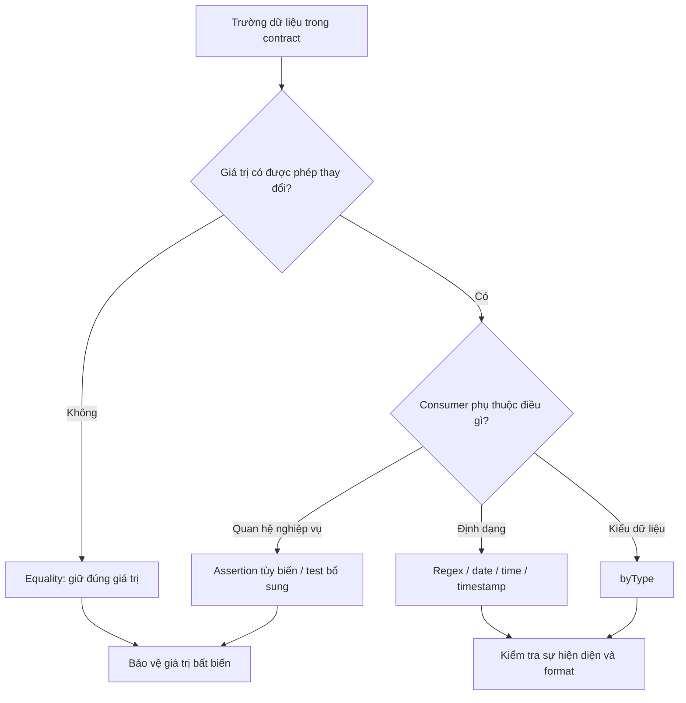
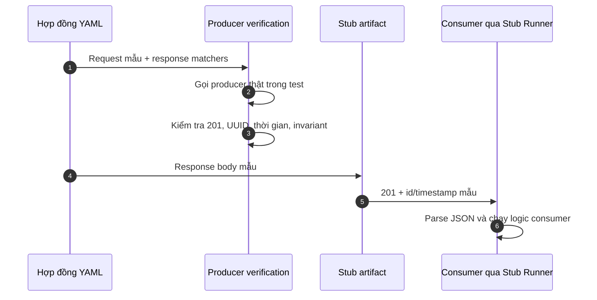
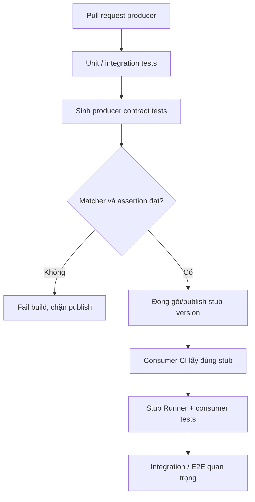

# Bỏ qua trường động mà không bỏ mất hành vi quan trọng

> **Chương:** Matcher và assertion  
> **Module:** `SPRING_CLOUD_CONTRACT` — kiểm thử hợp đồng giữa producer và consumer bằng Spring Cloud Contract, định nghĩa HTTP/message contract qua Groovy hoặc YAML DSL, sinh test phía producer, phát hành stub, chạy Stub Runner và kiểm tra thay đổi API trên CI.

## Mục tiêu học tập

Sau bài này, bạn có thể:

1. Phân biệt **bỏ qua giá trị cụ thể của một trường động** với **bỏ qua sự tồn tại, kiểu và ý nghĩa của trường đó**.
2. Phân loại trường nào nên kiểm tra **equality**, trường nào nên dùng **regex**, **type**, **date/time**, giới hạn số phần tử hoặc assertion nghiệp vụ bổ sung.
3. Định nghĩa `response.bodyMatchers` trong Groovy DSL và `response.matchers.body` trong YAML DSL để sinh producer verification test có ý nghĩa.
4. Hiểu vì sao `response.body` vẫn cần ví dụ cụ thể để tạo **stub** cho consumer, ngay cả khi producer sinh UUID và timestamp mới mỗi lần.
5. Kiểm tra các bất biến như HTTP status, `status` nghiệp vụ, số tiền, loại tiền, SKU và số lượng thay vì làm lỏng toàn bộ response.
6. Chỉ ra những thuộc tính mà matcher đơn trường chưa bảo đảm: quan hệ giữa các field, thời gian tăng dần, tính duy nhất của ID, tính hợp lệ của phép tính và tương thích ngược.
7. Kết hợp producer verification, Stub Runner và CI để phát hiện thay đổi API làm hỏng hợp đồng.

## 1. Một response vừa có dữ liệu động, vừa có lời hứa cố định

Giả sử `checkout-service` gọi `order-service` để tạo đơn hàng:

```http
POST /api/orders HTTP/1.1
Content-Type: application/json
Accept: application/json

{
  "customerReference": "WEB-0042",
  "items": [
    {"sku": "BOOK-001", "quantity": 2}
  ]
}
```

Producer trả HTTP `201` với JSON:

```http
HTTP/1.1 201 Created
Content-Type: application/json

{
  "id": "c22aaf62-1a13-4dbe-b5fb-f342d3f81fb9",
  "createdAt": "2026-11-24T09:10:11Z",
  "status": "ACCEPTED",
  "customerReference": "WEB-0042",
  "items": [
    {"sku": "BOOK-001", "quantity": 2, "unitPrice": 120000}
  ],
  "total": 240000,
  "currency": "VND"
}
```

Ở lần gọi khác, `id` và `createdAt` có thể thay đổi; các điều kiện sau vẫn cần bảo vệ:

- HTTP status là `201` và body là JSON.
- `id` **hiện diện, có kiểu chuỗi và đúng mẫu UUID**.
- `createdAt` **hiện diện và có định dạng timestamp đã cam kết**.
- `status` là `ACCEPTED`; consumer chỉ tiếp tục luồng thanh toán khi đơn đã được chấp nhận.
- `customerReference` giữ đúng giá trị yêu cầu trong tình huống kiểm thử.
- `items` mô tả đúng sản phẩm/số lượng mà consumer đang xử lý.
- `total` và `currency` đáp ứng quy tắc tiền tệ đã thống nhất.

Một test ép `id` bằng đúng chuỗi ở response mẫu sẽ **giòn**, vì producer sinh UUID mới. Một test chỉ kiểm tra "trả HTTP 201" lại **quá lỏng**: producer có thể đổi `status` thành `REJECTED`, trả `total: 0`, đổi `total` thành string hoặc bỏ hẳn `id` mà CI vẫn xanh.

Mục tiêu là **nới lỏng đúng trường cần động và giữ chặt các bất biến quan trọng**.

## 2. Định nghĩa rõ hợp đồng của từng trường trước khi chọn matcher

Bảng dưới đây là thiết kế cho **một kịch bản cụ thể**: tạo một đơn `BOOK-001`, số lượng `2`, đơn giá mẫu `120000` đồng.

| Trường | Điều consumer cần | Loại assertion phù hợp |
| --- | --- | --- |
| HTTP status | Chính xác `201` | Equality của `response.status` |
| Response `Content-Type` | JSON | Header assertion phù hợp media type |
| `id` | Chuỗi theo định dạng UUID | `by_regex` với matcher `uuid` |
| `createdAt` | Timestamp UTC theo định dạng ISO đã định | Regex/matcher thời gian đúng format |
| `status` | Chính xác `ACCEPTED` | Equality |
| `customerReference` | Khớp dữ liệu đầu vào mẫu | Equality trong kịch bản cố định; test riêng cho quan hệ động |
| `items[0].sku` | Chính xác `BOOK-001` | Equality |
| `items[0].quantity` | Chính xác số `2` | Equality và kiểu số từ JSON |
| `items[0].unitPrice` | Chính xác số `120000` trong fixture | Equality; kiểm thử công thức riêng nếu giá biến thiên |
| `total` | Chính xác số `240000` trong fixture | Equality; test quan hệ tổng tiền khi cần |
| `currency` | Chính xác `VND` | Equality |

Các quyết định ở cột cuối chỉ đúng khi phản ánh điều consumer thực sự dựa vào. Trong một API giá biến động theo chương trình khuyến mãi, `total` có thể không cố định; khi đó cần chuyển từ equality sang **điều kiện nghiệp vụ được xác định rõ** (ví dụ tổng tiền không âm, cùng currency, bằng tổng dòng sau giảm giá). Đổi sang `by_type` đơn thuần chưa đủ bảo vệ các điều kiện ấy.

### 2.1. Cấp độ nghiêm ngặt của assertion

Có thể hình dung ba mức:



**Không mặc định chọn matcher yếu nhất.** Hãy bắt đầu từ "consumer cần tin điều gì để xử lý an toàn?" rồi mã hóa điều đó thành test.

## 3. Anti-pattern: so sánh cứng cả response, sau đó xóa bớt assertion

Contract YAML ban đầu:

```yaml
name: order_accepted
request:
  method: POST
  url: /api/orders
  headers:
    Content-Type: application/json
    Accept: application/json
  body:
    customerReference: WEB-0042
    items:
      - sku: BOOK-001
        quantity: 2

response:
  status: 201
  headers:
    Content-Type: application/json
  body:
    id: "c22aaf62-1a13-4dbe-b5fb-f342d3f81fb9"
    createdAt: "2026-11-24T09:10:11Z"
    status: ACCEPTED
    customerReference: WEB-0042
    items:
      - sku: BOOK-001
        quantity: 2
        unitPrice: 120000
    total: 240000
    currency: VND
```

Nếu producer dùng `UUID.randomUUID()` và `Instant.now()`, response thực tế gần như chắc chắn khác hai giá trị trong fixture.

Một cách sửa sai thường gặp là **xóa `id` và `createdAt` khỏi contract**. Khi đó bản đặc tả không còn kiểm tra được việc producer có gửi ID và timestamp hay không. Consumer có thể yêu cầu cả hai để hiển thị đơn và ghi nhận lịch sử; xóa chúng làm mất tín hiệu bảo vệ một phần API.

Một cách sửa sai khác là dùng regex `.*` cho tất cả string, `by_type` cho tất cả số và bỏ mọi giá trị nghiệp vụ. Khi đó `status: REJECTED` vẫn là string, `total: -1` vẫn là number, test có thể xanh trong khi consumer xử lý sai.

**Cách sửa đúng:** giữ `id`, `createdAt` trong **body mẫu**; chỉ thay assertion chính xác của **hai trường này** bằng điều kiện định dạng đủ mạnh.

## 4. Giải pháp YAML: response.matchers.body có chọn lọc

Tạo `src/test/resources/contracts/order_accepted.yml` trong dự án **producer**:

```yaml
name: order_accepted
description: "Don hang duoc chap nhan voi ID va thoi gian dong"

request:
  method: POST
  url: /api/orders
  headers:
    Content-Type: application/json
    Accept: application/json
  body:
    customerReference: WEB-0042
    items:
      - sku: BOOK-001
        quantity: 2

response:
  status: 201
  headers:
    Content-Type: application/json
  body:
    id: "c22aaf62-1a13-4dbe-b5fb-f342d3f81fb9"
    createdAt: "2026-11-24T09:10:11Z"
    status: ACCEPTED
    customerReference: WEB-0042
    items:
      - sku: BOOK-001
        quantity: 2
        unitPrice: 120000
    total: 240000
    currency: VND
  matchers:
    body:
      - path: $.id
        type: by_regex
        predefined: uuid
      - path: $.createdAt
        type: by_regex
        value: '[0-9]{4}-[0-9]{2}-[0-9]{2}T[0-9]{2}:[0-9]{2}:[0-9]{2}Z'
```

Đây là một contract tự chứa về tình huống thành công:

- `response.body.id` là **mẫu** dùng cho stub, còn `response.matchers.body` tại `$.id` cho phép producer trả một UUID khác nhưng đúng định dạng.
- `response.body.createdAt` là timestamp mẫu cho stub, còn regex ở `$.createdAt` kiểm tra hình dạng response thực.
- `status`, `customerReference`, `items`, `total` và `currency` không có matcher nới lỏng; producer verification giữ những kỳ vọng cụ thể được mô tả trong body.
- HTTP status `201` và header `Content-Type` vẫn được kiểm tra theo contract.

**Regex thời gian ở đây chủ yếu kiểm tra hình dạng** `YYYY-MM-DDTHH:mm:ssZ`; nó chưa chứng minh ngày 31/02 hợp lệ, timestamp đang ở gần đồng hồ hệ thống hay `createdAt` tăng dần qua nhiều request. Nếu đó là cam kết API, cần thêm kiểm tra khác.

Thử sửa `status: ACCEPTED` thành `status: REJECTED` **trong implementation**, giữ nguyên contract: verification phải thất bại. Đây là cách kiểm tra rằng việc nới điều kiện cho ID/thời gian không làm mất assertion nghiệp vụ.

### 4.1. Vì sao không xóa giá trị mẫu trong YAML?

Spring Cloud Contract tạo hai artifact liên quan:



Producer verification kiểm tra **giá trị do implementation thực sự tạo**. Stub trả **giá trị mẫu trong contract** để consumer test có dữ liệu có thể đoán trước. Stub mặc định không tự tạo một UUID ngẫu nhiên khác theo mỗi lần gọi chỉ vì producer matcher dùng `uuid`.

Consumer nhận ID mẫu vẫn kiểm tra được cách parse/hiển thị ID; muốn kiểm tra **tính duy nhất** thì cần test dùng producer hoặc mô hình generator riêng có kiểm chứng.

### 4.2. Khi nào regex cần chặt hơn?

`predefined: uuid` thích hợp nếu giao kèo yêu cầu **UUID**. Không nên dùng:

```yaml
- path: $.id
  type: by_regex
  value: '.*'
```

Vì mẫu này có thể cho phép chuỗi rỗng hoặc giá trị không có cấu trúc ID như `not-an-id`. Nếu ứng dụng dùng ID kiểu `ORD-000123` thay vì UUID, hãy định nghĩa đúng format ấy:

```yaml
- path: $.id
  type: by_regex
  value: 'ORD-[0-9]{6}'
```

Một matcher tốt cần **đủ rộng cho dữ liệu hợp lệ** và **đủ chặt để lỗi định dạng thật sự làm test đỏ**.

## 5. Cùng hợp đồng bằng Groovy DSL

Với Groovy, Spring Cloud Contract cho phép đặt các điều kiện động trong `bodyMatchers` của `response`. Dưới đây là tương tác tương đương với YAML ở mục 4:

```groovy
org.springframework.cloud.contract.spec.Contract.make {
    name 'order_accepted'

    request {
        method 'POST'
        url '/api/orders'
        headers {
            contentType(applicationJson())
            header 'Accept': 'application/json'
        }
        body(
            customerReference: 'WEB-0042',
            items: [
                [sku: 'BOOK-001', quantity: 2]
            ]
        )
    }

    response {
        status 201
        headers {
            contentType(applicationJson())
        }
        body(
            id: 'c22aaf62-1a13-4dbe-b5fb-f342d3f81fb9',
            createdAt: '2026-11-24T09:10:11Z',
            status: 'ACCEPTED',
            customerReference: 'WEB-0042',
            items: [
                [sku: 'BOOK-001', quantity: 2, unitPrice: 120000]
            ],
            total: 240000,
            currency: 'VND'
        )
        bodyMatchers {
            jsonPath('$.id', byRegex(
                '[0-9a-fA-F]{8}-[0-9a-fA-F]{4}-[0-9a-fA-F]{4}-[0-9a-fA-F]{4}-[0-9a-fA-F]{12}'
            ))
            jsonPath('$.createdAt', byRegex(
                '[0-9]{4}-[0-9]{2}-[0-9]{2}T[0-9]{2}:[0-9]{2}:[0-9]{2}Z'
            ))
        }
    }
}
```

**Đừng đặt cả `order_accepted.groovy` và `order_accepted.yml` vào cùng bộ contract nếu chúng chỉ là hai bản dịch của cùng một tương tác.** Khi học, có thể giữ bản còn lại ở phần tài liệu; khi chạy, chọn một DSL chính thức để tránh sinh stub/test lặp.

### 5.1. So sánh cú pháp

| Ý định | Groovy DSL | YAML DSL |
| --- | --- | --- |
| Định nghĩa response body mẫu | `body(id: '...')` | `response.body.id` |
| Định nghĩa response matcher | `bodyMatchers { ... }` trong `response` | `response.matchers.body` |
| Trỏ đến trường JSON | `jsonPath('$.id', ...)` | `path: $.id` |
| Kiểm tra regex | `byRegex('...')` | `type: by_regex` + `value` |
| Regex dựng sẵn | Helper regex phù hợp | `type: by_regex` + `predefined: uuid` |
| Kiểm tra kiểu | `byType()` | `type: by_type` |
| Kiểm tra bằng giá trị | `byEquality()` hoặc không nới matcher | `type: by_equality` hoặc body mẫu |
| Kiểm tra ngày/giờ | `byDate()`, `byTime()`, `byTimestamp()` | `by_date`, `by_time`, `by_timestamp` |

Ở **response**, Groovy cũng hỗ trợ viết giá trị hai phía trực tiếp trong body:

```groovy
id: $(
    consumer('c22aaf62-1a13-4dbe-b5fb-f342d3f81fb9'),
    producer(regex('[0-9a-fA-F]{8}-[0-9a-fA-F]{4}-[0-9a-fA-F]{4}-[0-9a-fA-F]{4}-[0-9a-fA-F]{12}'))
)
```

Đây là **một lựa chọn khác** cho riêng trường `id`; không cần đồng thời thêm `bodyMatchers` trên chính field ấy. `consumer(...)` cung cấp response mẫu cho stub, `producer(...)` cung cấp điều kiện cho generated test. Trong YAML, dùng `body` và `matchers` thay cho biểu thức `$(...)`.

## 6. Chọn matcher theo lời hứa dữ liệu

Spring Cloud Contract hỗ trợ nhiều matcher có vai trò khác nhau. Không nên dùng chúng như những công cụ "tắt assertion" cho toàn bộ response.

| Matcher | Ý nghĩa | Dùng khi | Điều không được suy ra |
| --- | --- | --- | --- |
| `by_equality` | Giá trị khớp đúng mẫu | `status: ACCEPTED`, `currency: VND` | Không cần nới khi giá trị ổn định |
| `by_regex` | Giá trị phù hợp mẫu văn bản/kiểu được chọn | UUID, mã giao dịch, định dạng nghiệp vụ | Regex không tự kiểm tra logic liên trường |
| `by_type` | Giá trị có kiểu theo body mẫu | Một số field có giá trị thay đổi nhưng kiểu phải ổn định | Number đúng kiểu không có nghĩa là lớn hơn 0 |
| `by_date` | Giá trị khớp quy tắc ngày của DSL | Ngày ISO theo format hỗ trợ | Không tự so ngày với ngày khác |
| `by_time` | Giá trị khớp quy tắc giờ của DSL | Giờ theo format hỗ trợ | Không tự so thứ tự thời gian |
| `by_timestamp` | Giá trị khớp định dạng date-time của DSL | Timestamp phù hợp matcher đã chọn | Không mặc nhiên hỗ trợ mọi timezone/offset |
| `by_null` | Trường có giá trị null | Một trường null được cam kết | Khác với field không tồn tại |
| `by_command` | Chạy helper kiểm chứng tùy biến | Quy tắc chuyên biệt quá phức tạp cho matcher thường | Cần helper và cấu hình test phù hợp |

Tài liệu DSL phân biệt các matcher dùng cho **stub matching** và matcher dùng cho **test verification**. Chẳng hạn `by_command` và `by_null` được hỗ trợ cho một số tình huống kiểm chứng response của producer; đừng giả định đặt chúng ở mọi vị trí request sẽ tạo được WireMock mapping tương đương.

### 6.1. by_type không có nghĩa "đúng nghiệp vụ"

Giả sử có field:

```yaml
body:
  total: 240000
matchers:
  body:
    - path: $.total
      type: by_type
```

Đây là đoạn **bên trong `response`**, mô tả total là kiểu số theo mẫu. Producer trả `0` hoặc `-100` có thể vẫn thỏa ràng buộc kiểu. Nếu consumer yêu cầu đúng tổng tiền trong fixture, giữ equality; nếu cần bảo vệ tổng tiền dương và đúng công thức, viết assertion nghiệp vụ bổ sung hoặc matcher tùy biến phù hợp.

Lưu ý `by_type` không phải validator schema đầy đủ; chẳng hạn nó không tự kiểm tra tổng tiền có khớp từng dòng sản phẩm, số thập phân có đúng chính sách làm tròn hay currency đã được chuyển đổi đúng.

### 6.2. Ngày giờ: định dạng, thời điểm và múi giờ là ba vấn đề khác nhau

Nếu API trả:

```json
{"createdAt":"2026-11-24T09:10:11Z"}
```

thì những mong đợi có thể khác nhau:

- **Định dạng:** chuỗi có hình dạng ISO và hậu tố `Z`.
- **Thời điểm:** có thể parse thành một `Instant` hợp lệ.
- **Nghiệp vụ:** `createdAt` không nằm trong tương lai quá xa, `expiresAt > createdAt` và thời điểm thật gần đồng hồ xử lý.

Regex chỉ giải quyết một phần đầu tiên. Matcher `by_timestamp` có bộ mẫu định dạng riêng; đừng tự khẳng định nó nhận mọi chuỗi có offset như `+07:00` nếu chưa xác minh phiên bản DSL và generated test. Với trường hợp UTC `...Z` của bài này, regex tường minh giữ hợp đồng dễ đọc. Để kiểm tra tính hợp lệ và quan hệ thời gian, thêm unit/integration test dùng `Clock` kiểm soát được.

### 6.3. Null khác với thiếu trường

Response sau:

```json
{"discountCode":null}
```

khác với:

```json
{}
```

Nếu consumer cần field `discountCode` luôn xuất hiện, dù không có mã giảm giá, hãy định nghĩa rõ sự khác biệt. Spring Cloud Contract hỗ trợ matcher `by_null` trong kiểm chứng response, nhưng phải đọc generated test và xác minh trường hợp missing field có thật sự bị bắt trong cấu hình/version của dự án. Trường *optional* cần hợp đồng riêng hoặc schema/serialization test thể hiện rõ quy tắc; không dùng null matcher như giải pháp tổng quát cho "có cũng được, không cũng được".

## 7. Assertion cho mảng và các đối tượng lồng nhau

Một danh sách nhiều phần tử là nơi rất dễ làm mất hành vi khi chỉ quan tâm kiểu của nó.

Ví dụ:

```json
{
  "items": [
    {"sku":"BOOK-001","quantity":2,"unitPrice":120000},
    {"sku":"PEN-002","quantity":1,"unitPrice":10000}
  ],
  "total":250000,
  "currency":"VND"
}
```

Tùy hợp đồng, consumer có thể cần:

- `items` là array chứ không phải object.
- Array có ít nhất một phần tử, không vượt giới hạn cho phép.
- Mỗi phần tử có `sku` (chuỗi), `quantity` (số) và `unitPrice` (số).
- Giá trị `total` bằng tổng `quantity * unitPrice` của các phần tử, có tính toán giảm giá/thuế nếu nghiệp vụ quy định.
- `currency` phù hợp với đơn giá.

### 7.1. Kiểm tra kiểu và kích thước collection

Trong YAML, `by_type` có thể đi kèm `minOccurrence` và `maxOccurrence`. Một response minh họa:

```yaml
response:
  status: 200
  headers:
    Content-Type: application/json
  body:
    items:
      - sku: BOOK-001
        quantity: 2
      - sku: PEN-002
        quantity: 1
  matchers:
    body:
      - path: $.items
        type: by_type
        minOccurrence: 1
        maxOccurrence: 10
```

Đoạn trên là **một biến thể response độc lập**, không ghép thêm `response` vào contract `order_accepted.yml` ở mục 4.

Matcher này hữu ích để khẳng định danh sách tồn tại đúng dạng và số phần tử trong phạm vi mong đợi, **nhưng không tự khẳng định SKU, số lượng hay tính đúng của tổng tiền**. Kết quả cụ thể có thể phụ thuộc cách JSONPath/generator xử lý mảng đã làm phẳng; hãy kiểm tra generated assertions cho collection lồng sâu.

Groovy biểu diễn giới hạn độ dài kiểu này bằng:

```groovy
bodyMatchers {
    jsonPath('$.items', byType {
        minOccurrence(1)
        maxOccurrence(10)
    })
}
```

### 7.2. Kiểm tra từng phần tử hay kiểm tra toàn danh sách?

Giả sử chỉ viết matcher `$.items[0].sku`. Khi response có ba phần tử, assertion tại chỉ số `0` **không chứng minh** hai phần tử còn lại hợp lệ. Cần xác định:

- API cho phép danh sách có thứ tự hay không?
- Consumer chỉ đọc phần tử đầu tiên hay duyệt toàn bộ?
- Field nào là bắt buộc với **mọi** phần tử?
- Có cần uniqueness cho `sku` hoặc giới hạn tổng số phần tử?

Với collection phức tạp, dùng validation/schema test hoặc **assertion tùy biến trên toàn collection** ở producer thay vì nới tất cả field thành `.*`. Spring Cloud Contract hỗ trợ `by_command` cho một số producer response assertions; triển khai helper kiểm tra collection đầy đủ tại lớp base test khi phù hợp.

Một ví dụ kiểm tra nghiệp vụ độc lập ở Java (phác họa, giả định đã có DTO `OrderResponse`):

```java
long calculatedTotal = order.items().stream()
    .mapToLong(item -> item.quantity() * item.unitPrice())
    .sum();

assertEquals(calculatedTotal, order.total());
assertTrue(order.items().stream()
    .allMatch(item -> item.quantity() > 0));
```

Đây là **unit/integration assertion bổ sung**, không phải cú pháp contract DSL trực tiếp. Nó bảo vệ quan hệ số tiền và số lượng, điều mà `by_type` đơn thuần bỏ sót.

## 8. Khi quan hệ giữa các trường quan trọng hơn giá trị riêng lẻ

Giả sử producer trả:

```json
{
  "id": "c22aaf62-1a13-4dbe-b5fb-f342d3f81fb9",
  "location": "/api/orders/ffffffff-ffff-4fff-bfff-ffffffffffff"
}
```

Hai trường đều có thể khớp regex UUID/URL **độc lập**, nhưng `location` đang trỏ sang **một ID khác**. Nếu consumer dùng `location` để lấy đúng đơn vừa tạo, contract cần bảo vệ quan hệ:

```text
location == "/api/orders/" + id
```

Tương tự, có thể có các quan hệ:

- `customerReference` trong response bằng giá trị đã gửi trong request.
- `total` bằng tổng các dòng cộng thuế trừ giảm giá.
- `expiresAt` lớn hơn `createdAt`.
- `available = false` khi `quantity = 0`.
- `status = REJECTED` phải đi kèm lý do lỗi hợp lệ.

Matcher `by_regex` hay `by_type` trên từng field không tự suy ra những quan hệ đó. Có thể dùng kỹ thuật **tham chiếu request** trong Spring Cloud Contract, matcher tùy biến (`by_command`) hoặc các test tích hợp/ứng dụng chuyên biệt. Cần chọn cách làm mà nhóm có thể chạy và duy trì trong CI.

## 9. Request matcher và response matcher có vai trò khác nhau

Đây là điểm quan trọng khi kiểm thử HTTP động giữa producer và consumer.

Trong `request`, consumer có thể gửi `X-Request-Id` khác nhau. YAML có thể giữ một giá trị mẫu cho generated producer test và dùng matcher để stub chấp nhận nhiều request hợp lệ:

```yaml
request:
  method: POST
  url: /api/orders
  headers:
    Content-Type: application/json
    X-Request-Id: req-0042
  body:
    customerReference: WEB-0042
    items:
      - sku: BOOK-001
        quantity: 2
  matchers:
    headers:
      - key: X-Request-Id
        regex: 'req-[0-9]{4}'
```

Ngược lại, `response.matchers.body` được dùng để producer verification kiểm tra phản hồi thật. Bảng tóm tắt:

| Loại matcher | Sinh ra để làm gì? | Một giới hạn cần nhớ |
| --- | --- | --- |
| `request.matchers` | Cho stub khớp các request consumer gửi; producer test dùng request mẫu | Không chứng minh producer từ chối mọi input không hợp lệ |
| `response.matchers` | Cho producer test kiểm tra response thật với điều kiện linh hoạt; stub có body mẫu | Không bảo đảm stub tự sinh dữ liệu mới mỗi lần |
| `response.headers` và matcher header | Bảo vệ header response được cam kết | Không tự xác minh quan hệ với request header nếu chỉ kiểm tra format |

**Đừng cố làm xanh consumer test bằng cách gỡ request matcher**, vì điều đó có thể khiến stub nhận những request mà API thật sẽ không nhận. Tương tự, đừng làm xanh producer test bằng cách bỏ response assertions mà consumer cần.

## 10. Kiểm chứng contract bằng những thay đổi có chủ đích

Để biết matcher có đủ mạnh hay không, thực hiện một **thử nghiệm làm hỏng API có kiểm soát** trong nhánh thử nghiệm:

1. Giữ `order_accepted.yml`.
2. Thay lần lượt một phần response của `order-service`.
3. Chạy producer contract verification.
4. Quan sát xem test có thất bại khi lời hứa API bị phá hay không.
5. Phục hồi implementation sau thử nghiệm.

Ma trận dự đoán:

| Response producer thay đổi | Kết quả mong đợi | Lý do |
| --- | --- | --- |
| Sinh UUID khác nhưng vẫn hợp lệ | **PASS** | `$.id` được kiểm tra bằng matcher UUID |
| Sinh timestamp khác, đúng format UTC `...Z` | **PASS** | `$.createdAt` khớp regex |
| `id: "abc"` | **FAIL** | Không thỏa định dạng UUID |
| Bỏ trường `id` | **FAIL** | JSONPath matcher không tìm được field cần kiểm chứng |
| `createdAt: "hôm qua"` | **FAIL** | Sai format đã cam kết |
| `status: "REJECTED"` | **FAIL** | Trái giá trị bất biến `ACCEPTED` |
| `total: 0` | **FAIL** | Trái fixture `240000` |
| `total: "240000"` | **FAIL** | Khác kiểu dữ liệu trong body mẫu |
| `currency: "USD"` | **FAIL** | Consumer đang kỳ vọng `VND` |
| Đổi HTTP `201` thành `200` | **FAIL** | Sai trạng thái HTTP |
| `createdAt` đúng hình dạng nhưng là ngày không có thật | **Có thể PASS** | Regex hình dạng không xác minh ngày lịch |
| Hai lần gọi tạo cùng một UUID hợp lệ | **Có thể PASS** | Test một response không chứng minh uniqueness |

Bảng thể hiện **ý định assertion**. Hãy kiểm tra test thực tế được plugin sinh với phiên bản đang dùng: cách tạo JSONPath assertion, so sánh JSON number hoặc kiểm tra header có thể khác nhau giữa các cấu hình. Không đánh dấu "đã bảo vệ" chỉ vì đọc DSL thấy có matcher; cần thấy test thực sự thất bại trên một thay đổi phá vỡ giao kèo.

### 10.1. Khi nào cần contract cho tình huống lỗi?

Một contract thành công không tự chứng minh producer từ chối request có `quantity: -1`, thiếu `customerReference` hoặc sai SKU.

Nếu consumer cần xử lý `400 Bad Request`, `404 Not Found` hoặc `409 Conflict`, hãy thêm contract riêng cho từng tình huống **được producer hỗ trợ và hai bên cam kết**. Không nên dùng một request matcher quá rộng rồi cố gắng kiểm chứng nhiều response mâu thuẫn trên cùng đầu vào.

## 11. Stub Runner: dữ liệu ổn định và giới hạn cần hiểu

Sau khi producer verification đạt và stub được đóng gói, consumer có thể dùng Stub Runner để kiểm tra client:

```java
@SpringBootTest(properties = {
    "orders.base-url=http://localhost:8090"
})
@AutoConfigureStubRunner(
    ids = "com.example:order-service:1.0.0:stubs:8090",
    stubsMode = StubRunnerProperties.StubsMode.LOCAL
)
class OrderClientContractTest {

    @Autowired
    OrderClient client; // Giả định đã triển khai trong dự án consumer

    @Test
    void consumerHieuDuocResponseCuaProducer() {
        OrderResponse order = client.createOrder("WEB-0042", "BOOK-001", 2);

        UUID.fromString(order.id());
        Instant.parse(order.createdAt());
        assertEquals("ACCEPTED", order.status());
        assertEquals(240000, order.total());
        assertEquals("VND", order.currency());
    }
}
```

Đây là **ví dụ JUnit minh họa**; cần các class `OrderClient`, `OrderResponse`, import và cấu hình Spring tương ứng để chạy. Địa chỉ/cổng và tọa độ artifact phải khớp với hệ thống của bạn.

Bài test chứng minh consumer tạo được request phù hợp và **đọc được một response theo contract**. Nó không chứng minh:

- ID do producer mới nhất sinh đã đúng.
- Producer mới nhất vẫn trả `status: ACCEPTED`.
- Mọi đơn hàng trong production đều có tổng tiền chính xác.
- Timestamp ở production luôn tăng hoặc đúng timezone.
- Stub cũ đang sử dụng đồng nhất với implementation producer mới.

Muốn bảo vệ các yếu tố đó, producer verification phải chạy ở bản producer liên quan, artifact stub phải có version rõ ràng và test nghiệp vụ/tích hợp phải bao phủ các bất biến ngoài khả năng matcher.

## 12. CI: nới giá trị động mà vẫn chặn breaking changes

Một pipeline đề xuất:



Một quy trình Maven thông thường khi đã cấu hình plugin:

```bash
mvn clean verify
```

Chỉ khi producer test thành công mới cài/phát hành stub:

```bash
mvn clean install
```

Trên CI nhiều job, không mặc định cho rằng mỗi job dùng chung `~/.m2`. Cần truyền artifact stub giữa job hoặc publish đến Maven-compatible repository, sau đó consumer dùng `StubsMode.REMOTE` và cấu hình kho phù hợp.

**Mỗi thay đổi nới matcher cần được review:** tại sao nới, consumer còn phụ thuộc điều gì, trường nào giữ equality, có cần negative contract và test quan hệ trường hay không? Với thay đổi API không tương thích, dùng version hoặc kế hoạch di trú hợp lý thay vì tự sửa contract sao cho producer test xanh mà consumer cũ vẫn hỏng.

### 12.1. Bộ câu hỏi review contract

Trước khi approve một thay đổi matcher, hãy hỏi:

- Trường này thực sự động hay bị đổi vì lỗi?
- Nếu field bị **xóa**, test còn fail không?
- Nếu kiểu dữ liệu sai (số thành string, boolean thành string), test còn fail không?
- Nếu giá trị nghiệp vụ sai (status, amount, currency), test còn fail không?
- Giá trị mẫu trong stub có đủ để consumer parse đúng không?
- Matcher có cho phép dữ liệu vô nghĩa (chuỗi rỗng, số âm, timestamp sai) không?
- Có quan hệ liên trường hoặc thời gian nào cần kiểm tra riêng không?
- Consumer đang chạy phiên bản API nào, và stub nào đã được producer xác minh?

Những câu hỏi này giúp cân bằng độ bền của test với khả năng phát hiện breaking change.

## 13. Lỗi phổ biến và cách khắc phục

| Triệu chứng | Nguyên nhân có thể | Cách khắc phục |
| --- | --- | --- |
| Test producer đỏ vì UUID khác mẫu | Không có matcher response cho ID động | Thêm `by_regex` / predefined `uuid` |
| Test producer xanh khi `status` sai | Matcher quá rộng hoặc bỏ field khỏi contract | Giữ equality cho status |
| Test xanh khi `total = -1` | Chỉ kiểm tra `by_type` | Giữ giá trị fixture hoặc thêm assertion tổng tiền |
| Stub trả cùng ID mẫu mỗi lần | Stub dùng `response.body` cố định | Đây là hành vi thường gặp; test uniqueness trên producer |
| Producer test không bắt field thiếu | Matcher sai JSONPath, test không chạy hoặc thiếu assertion | Kiểm tra JSONPath, generated test và CI execution |
| Stub không nhận request hợp lệ | `request.matchers` quá chặt hoặc sai header | Kiểm tra WireMock mappings và request thực |
| Có matcher cho phần tử `items[0]` nhưng phần tử khác sai | Chỉ khẳng định phần tử đầu | Assert toàn collection hoặc dùng test tùy biến |
| Response có ID và URL hợp format nhưng không khớp nhau | Matcher đơn trường thiếu quan hệ | Thêm test liên trường |
| Timestamp có `Z` nhưng `by_timestamp` không khớp | Pattern format/timezone khác | Chọn matcher đúng với format API và phiên bản plugin |
| Consumer test xanh nhưng producer mới sai | Stub version cũ hoặc chưa chạy producer verification | Chặn publish, pin version, kiểm tra cả hai phía |

## 14. Bài tập thực hành

**Bài 1 — Tìm chỗ nới quá mức.** Một developer sửa contract thành:

```yaml
response:
  status: 201
  body:
    id: "c22aaf62-1a13-4dbe-b5fb-f342d3f81fb9"
    status: ACCEPTED
    total: 240000
  matchers:
    body:
      - path: $.id
        type: by_regex
        value: '.*'
      - path: $.status
        type: by_type
      - path: $.total
        type: by_type
```

Hãy chỉ ra vì sao ba matcher trên làm mất tín hiệu lỗi. Viết lại sao cho `id` phải đúng UUID, `status` phải bằng `ACCEPTED` và `total` phải đúng `240000` trong fixture.

**Bài 2 — Matcher thời gian.** API trả `createdAt` có format `2026-11-24T09:10:11Z`. Hãy đặt response body mẫu cùng matcher regex yêu cầu hậu tố `Z`. Giải thích regex còn bỏ lọt loại lỗi thời gian nào.

**Bài 3 — Kiểm tra danh sách.** Response có `items` gồm từ 1 đến 10 phần tử. Viết `by_type` với `minOccurrence` và `maxOccurrence`. Sau đó nêu cách kiểm tra **mọi** `quantity > 0` và `total` khớp tổng dòng.

**Bài 4 — Thiết kế breaking-change check.** Producer lỡ đổi `currency` từ `VND` sang `USD`, đổi `status` thành `WAITING`. Test nào phải thất bại? Tại sao consumer test với stub version cũ có thể vẫn xanh?

**Bài 5 — Mối quan hệ hai trường.** `location` phải bằng đường dẫn `/api/orders/{id}` từ response. Trình bày test bảo đảm mối quan hệ, thay vì chỉ regex mỗi trường riêng.

**Bài 6 — Messaging.** Một producer phát sự kiện `OrderAccepted` gồm `eventId` (UUID động), `occurredAt` (timestamp động), `orderId` (UUID) và `eventType` cố định. Chọn matcher cho các trường động và giữ bất biến `eventType: OrderAccepted`. Giải thích vì sao việc broker thực sự nhận/gửi sự kiện đúng thứ tự vẫn cần integration test.

### Gợi ý đáp án

1. `.*` không bảo vệ định dạng; `by_type` cho phép `status: REJECTED` và `total: -1`. Dùng `predefined: uuid` cho ID; giữ `status` và `total` bằng body mẫu.
2. Dùng `type: by_regex` và regex ISO UTC có `Z`. Regex đơn giản không bảo đảm ngày hợp lệ hay thời điểm nằm trong khoảng nghiệp vụ.
3. Dùng `minOccurrence: 1`, `maxOccurrence: 10` trên `$.items`; kiểm tra quantity/tổng tiền bằng assertion trên toàn collection.
4. Producer verification phải đỏ nếu giữ contract; Stub Runner với artifact cũ chỉ mô phỏng dữ liệu cũ.
5. Kiểm tra equality giữa `location` và chuỗi nối từ `id` trong **cùng response**.
6. ID và thời gian dùng định dạng phù hợp; `eventType` giữ equality; broker/order/retry là vấn đề tích hợp.

## 15. Ghi nhớ

"Bỏ qua trường động" trong kiểm thử hợp đồng có nghĩa là **không ép một giá trị cụ thể phải lặp lại**, trong khi vẫn kiểm tra **sự hiện diện, định dạng, kiểu và lời hứa có ý nghĩa**. Spring Cloud Contract cho phép dùng `bodyMatchers` ở Groovy hoặc `matchers` ở YAML để chỉ nới các trường thực sự động. Các trường ổn định như HTTP status, `status` nghiệp vụ, số tiền và currency phải tiếp tục được bảo vệ bằng assertion phù hợp.

Viết contract tốt không kết thúc ở việc sinh stub: cần **chạy producer verification**, xem generated test có giữ đúng assertion, publish stub từ bản đã kiểm chứng, dùng Stub Runner trong consumer test và bổ sung unit/integration/E2E test cho những bất biến như tổng tiền, tính duy nhất và quan hệ liên trường. Nhờ vậy API có thể tạo ID/timestamp khác nhau mỗi lần mà CI vẫn phát hiện các thay đổi không tương thích.

## Tài liệu tham khảo

- [Spring Cloud Contract — Dynamic properties](https://docs.spring.io/spring-cloud-contract/reference/project-features-contract/dsl-dynamic-properties.html): cách dùng `bodyMatchers`, `matchers`, regex, type, date/time, occurrence và custom command.
- [Spring Cloud Contract — YML Schema](https://docs.spring.io/spring-cloud-contract/reference/yml-schema.html): các field hợp lệ cho YAML request/response matchers.
- [Spring Cloud Contract — Contract DSL](https://docs.spring.io/spring-cloud-contract/reference/project-features-contract.html): mục đích và các dạng biểu diễn hợp đồng.
- [Spring Cloud Contract — How to Provide Dynamic Values](https://docs.spring.io/spring-cloud-contract/reference/howto/how-to-provide-dynamic-values.html): phân biệt dữ liệu stub và test khi có giá trị động.
- [Spring Cloud Contract — Stub Runner Core](https://docs.spring.io/spring-cloud-contract/reference/project-features-stubrunner/stub-runner-core.html): chạy stub artifact ở consumer test.
