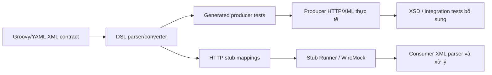

# Matcher cho XML và giới hạn theo công cụ kiểm thử

## 1. Vì sao XML cần cách so khớp khác JSON?

Trong **Spring Cloud Contract** (module `SPRING_CLOUD_CONTRACT`), hợp đồng là lời cam kết về cách **producer** tương tác với **consumer**, được mô tả bằng **Groovy DSL** hoặc **YAML DSL** cho HTTP hoặc thông điệp. Từ hợp đồng, framework có thể sinh kiểm thử ở phía producer, đóng gói stub để consumer dùng với **Stub Runner**, rồi kết hợp cả hai phía trong CI để phát hiện thay đổi API không tương thích.

Với một API trao đổi XML, các giá trị nghiệp vụ thường nằm ở **phần tử**, **thuộc tính** và **namespace**. So sánh toàn bộ response như một chuỗi có thể khiến test thất bại vì cách xuống dòng, khoảng trắng hay thứ tự thuộc tính, trong khi consumer chỉ quan tâm đến một số giá trị thực sự. Ngược lại, một matcher quá rộng có thể khiến producer đổi hoặc bỏ trường quan trọng mà test vẫn đạt.

Spring Cloud Contract hỗ trợ **XML body** và **XPath body matchers** cho hợp đồng HTTP. XPath giúp chọn đúng vị trí cần xác minh trong cây XML: phần tử, text node, thuộc tính, hoặc một nút xác định bởi namespace. Những XPath matcher này có thể xuất hiện ở cả **request** và **response**, nhưng ý nghĩa kiểm tra không giống nhau.

Sau bài học, bạn có thể:

- Viết hợp đồng HTTP có XML body bằng Groovy và YAML DSL.
- Dùng `xPath(path, byRegex(...))`, `byEquality()` và matcher phù hợp để chọn text/attribute trong XML.
- Hiểu **request matcher** kiểm tra request consumer gửi tới stub, còn **response matcher** kiểm tra response thật của producer.
- Nhận biết vấn đề namespace, thứ tự, khoảng trắng và dữ liệu động.
- Phân biệt khả năng của DSL, generated tests, WireMock/Stub Runner, XSD validator và kiểm thử ứng dụng.
- Đưa các kiểm tra phù hợp vào CI, tránh ngộ nhận rằng một matcher đã kiểm tra toàn bộ tài liệu XML.

## 2. XML body trong hợp đồng HTTP

Giả sử một producer thanh toán có endpoint `POST /api/payments` nhận XML:

```xml
<paymentRequest>
  <clientReference>REF-123456</clientReference>
  <amount currency="VND">50000</amount>
</paymentRequest>
```

Với ví dụ hợp lệ, producer trả `201`:

```xml
<paymentReceipt>
  <receiptId>rcpt-100001</receiptId>
  <status>ACCEPTED</status>
  <amount currency="VND">50000</amount>
</paymentReceipt>
```

Quy tắc minh họa của API này là:

- `clientReference` hợp lệ có dạng `REF-` và sáu chữ số.
- `amount` là một số nguyên dương, đơn vị `VND`.
- Với fixture có đủ điều kiện tạo thanh toán, producer trả mã HTTP `201`.
- `receiptId` do producer sinh có dạng `rcpt-` và sáu chữ số.
- `status = ACCEPTED` là trạng thái nghiệp vụ, không phải HTTP status.

Đây là **quy tắc giả định của bài học**, không phải quy tắc mặc định do Spring Cloud Contract cung cấp.

### 2.1. XML body phải là văn bản XML

Trong **Groovy DSL**, XML body được đưa vào `body` dưới dạng `String` hoặc `GString`, thường dùng chuỗi nhiều dòng:

```groovy
body '''
<paymentRequest>
  <clientReference>REF-123456</clientReference>
  <amount currency="VND">50000</amount>
</paymentRequest>
'''
```

Khác với JSON body hay biểu diễn bằng map/list của Groovy, XML có cú pháp thẻ, thuộc tính và namespace. Nếu truyền XML như một map mà không có bước chuyển đổi thích hợp, công cụ sẽ không tự hiểu đó là cấu trúc XML bạn định cam kết.

Trong **YAML DSL**, dùng chuỗi nhiều dòng `|` và `Content-Type: application/xml`:

```yaml
request:
  method: POST
  url: /api/payments
  headers:
    Content-Type: application/xml
  body: |
    <paymentRequest>
      <clientReference>REF-123456</clientReference>
      <amount currency="VND">50000</amount>
    </paymentRequest>
```

Giá trị `body` ở đây là **chuỗi XML**, không phải một object YAML lồng nhau. Đừng dùng JSONPath (`$.field`) để chọn trường từ một XML body; hãy sử dụng **XPath**.

## 3. XPath chọn phần nào của XML?

**XPath** là ngôn ngữ biểu thức dùng để chọn node hoặc giá trị từ cây XML. Trong hợp đồng, mỗi XPath nên phản ánh một thuộc tính mà consumer thực sự phụ thuộc.

Với request mẫu:

```xml
<paymentRequest>
  <clientReference>REF-123456</clientReference>
  <amount currency="VND">50000</amount>
</paymentRequest>
```

Những biểu thức cần nhớ:

| XPath | Thành phần được chọn | Ý nghĩa kiểm tra |
| --- | --- | --- |
| `/paymentRequest/clientReference/text()` | Text `REF-123456` | Định dạng mã tham chiếu |
| `/paymentRequest/amount/text()` | Text `50000` | Giá trị số tiền |
| `/paymentRequest/amount/@currency` | Thuộc tính `VND` | Đơn vị tiền |
| `/paymentRequest/amount` | Node phần tử `amount` | Chỉ hữu ích khi matcher xử lý đúng node đó |
| `/paymentRequest/missing` | Không chọn được node nào | Có thể dùng để kiểm tra vắng mặt theo matcher được hỗ trợ |

Trong nhiều tình huống, thêm `/text()` giúp thể hiện rõ muốn **kiểm tra giá trị text** thay vì kiểm tra toàn bộ phần tử. Để kiểm tra thuộc tính XML, dùng ký hiệu `@`. Các đường dẫn ở bảng chỉ phù hợp với XML **không có namespace**; phần namespace sẽ được giải thích ở mục 8.

### 3.1. XPath và regex đảm nhiệm hai việc khác nhau

Ví dụ:

```groovy
xPath('/paymentRequest/clientReference/text()', byRegex('REF-[0-9]{6}'))
```

- `'/paymentRequest/clientReference/text()'`: chọn giá trị trong tài liệu XML.
- `byRegex('REF-[0-9]{6}')`: xác định điều kiện kiểm tra giá trị đã chọn.

XPath không tự áp dụng quy tắc `REF-[0-9]{6}`. Tương tự, regex không thể biết phần tử nào cần kiểm tra nếu thiếu XPath đúng.

## 4. Ví dụ hoàn chỉnh bằng Groovy DSL

Ví dụ `create_payment_xml.groovy`:

```groovy
import org.springframework.cloud.contract.spec.Contract

Contract.make {
    name 'create_payment_xml'
    description 'Tạo thanh toán từ request XML hợp lệ'

    request {
        method POST()
        url '/api/payments'
        headers {
            contentType(applicationXml())
        }
        body '''
<paymentRequest>
  <clientReference>REF-123456</clientReference>
  <amount currency="VND">50000</amount>
</paymentRequest>
'''
        bodyMatchers {
            xPath('/paymentRequest/clientReference/text()',
                  byRegex('REF-[0-9]{6}'))
            xPath('/paymentRequest/amount/text()', byEquality())
            xPath('/paymentRequest/amount/@currency', byEquality())
        }
    }

    response {
        status 201
        headers {
            contentType(applicationXml())
        }
        body '''
<paymentReceipt>
  <receiptId>rcpt-100001</receiptId>
  <status>ACCEPTED</status>
  <amount currency="VND">50000</amount>
</paymentReceipt>
'''
        bodyMatchers {
            xPath('/paymentReceipt/receiptId/text()',
                  byRegex('rcpt-[0-9]{6}'))
            xPath('/paymentReceipt/status/text()', byEquality())
            xPath('/paymentReceipt/amount/@currency', byEquality())
        }
    }
}
```

Đây là một hợp đồng HTTP có **hai nhóm XPath matcher**. Cần đọc chúng theo đúng chiều hoạt động.

### 4.1. Matcher trong `request`: stub nhận những gì?

Trong `request.bodyMatchers`:

```groovy
xPath('/paymentRequest/clientReference/text()',
      byRegex('REF-[0-9]{6}'))
```

Khi consumer gọi HTTP stub do Stub Runner chạy, matcher này cho phép nhiều mã tham chiếu có cùng định dạng, ví dụ `REF-123456` và `REF-987654`. Phần `body` vẫn cung cấp một request mẫu cụ thể để **generated producer test** gửi vào producer thật.

Với `amount`:

```groovy
xPath('/paymentRequest/amount/text()', byEquality())
xPath('/paymentRequest/amount/@currency', byEquality())
```

`byEquality()` so với giá trị tương ứng trong body mẫu: `50000` và `VND`. Mục tiêu là giữ nguyên ràng buộc giá trị số tiền và đơn vị cho **tình huống đại diện** này.

Việc stub chấp nhận `REF-987654` không chứng minh producer thật xử lý **mọi** mã tham chiếu hợp lệ; generated producer test trong ví dụ chỉ gửi `REF-123456`. Nếu producer có nhánh “mã đã được sử dụng” hoặc “không đủ điều kiện tạo thanh toán”, cần hợp đồng tương ứng thay vì để regex thành công bắt mọi request.

### 4.2. Matcher trong `response`: kiểm tra producer thật

Trong `response.bodyMatchers`:

```groovy
xPath('/paymentReceipt/receiptId/text()',
      byRegex('rcpt-[0-9]{6}'))
```

Stub trả response XML có ID mẫu `rcpt-100001` để consumer test có dữ liệu ổn định. Generated producer test gửi request mẫu và kiểm tra `receiptId` trong **response thật** theo regex, vì producer có thể sinh `rcpt-902341`.

Ngược lại:

```groovy
xPath('/paymentReceipt/status/text()', byEquality())
```

ràng buộc trường trạng thái theo giá trị `ACCEPTED` đã viết trong body mẫu. Nếu producer đổi sang `PENDING` mà không thay hợp đồng, producer test của nhánh này cần phát hiện sự sai khác.

### 4.3. Điều gì vẫn chưa được kiểm tra?

Những XPath matcher trên **không tự chứng minh** toàn bộ tính đúng đắn của thanh toán:

- ID được sinh là duy nhất hoặc đã được lưu bền vững.
- Số tiền trong response luôn bằng số tiền request ở mọi trường hợp.
- Mọi request có `REF-######` đều được chấp nhận.
- XML đáp ứng mọi ràng buộc trong một XSD bên ngoài.
- Consumer thực tế xử lý được mọi namespace, encoding hoặc biến thể được API cho phép.

Đó là những yêu cầu cần bổ sung **assertion nghiệp vụ**, schema validation, các hợp đồng cho nhánh khác hoặc integration tests tùy mức độ rủi ro.

## 5. YAML DSL cho matcher XML

Spring Cloud Contract cũng hỗ trợ biểu diễn XML và matcher bằng **YAML DSL**. Trong YAML, thay vì khối `bodyMatchers` của Groovy, đặt matcher dưới `request.matchers.body` hoặc `response.matchers.body`.

Ví dụ tương đương về ý nghĩa (chọn Groovy **hoặc** YAML cho một kịch bản, tránh sinh stub trùng):

```yaml
name: create_payment_xml
request:
  method: POST
  url: /api/payments
  headers:
    Content-Type: application/xml
  body: |
    <paymentRequest>
      <clientReference>REF-123456</clientReference>
      <amount currency="VND">50000</amount>
    </paymentRequest>
  matchers:
    body:
      - path: /paymentRequest/clientReference/text()
        type: by_regex
        value: 'REF-[0-9]{6}'
      - path: /paymentRequest/amount/text()
        type: by_equality
      - path: /paymentRequest/amount/@currency
        type: by_equality
response:
  status: 201
  headers:
    Content-Type: application/xml
  body: |
    <paymentReceipt>
      <receiptId>rcpt-100001</receiptId>
      <status>ACCEPTED</status>
      <amount currency="VND">50000</amount>
    </paymentReceipt>
  matchers:
    body:
      - path: /paymentReceipt/receiptId/text()
        type: by_regex
        value: 'rcpt-[0-9]{6}'
      - path: /paymentReceipt/status/text()
        type: by_equality
      - path: /paymentReceipt/amount/@currency
        type: by_equality
```

**Chú ý:** `path` trong YAML này là **XPath của XML**, không phải JSONPath. Các giá trị `by_regex` và `by_equality` là cú pháp kiểu matcher ở dạng YAML. Cần dùng phiên bản plugin hỗ trợ các matcher tương ứng, chạy bước chuyển đổi và đọc lại output khi nâng phiên bản thư viện.

## 6. Các kiểu matcher quan trọng và giới hạn của XML

Tài liệu Spring Cloud Contract về HTTP XML có hỗ trợ những matcher như `byRegex`, `byEquality`, `byNull` và matcher ngày/giờ. **Riêng `byType()` không được hỗ trợ cho XML body matchers** trong phần tài liệu này; không nên chuyển nguyên ví dụ JSON `byType()` sang XPath rồi kỳ vọng hoạt động.

| Matcher | Ví dụ với XPath | Mục đích | Cẩn trọng |
| --- | --- | --- | --- |
| `byRegex(...)` | `xPath('/receipt/id/text()', byRegex('rcpt-[0-9]{6}'))` | Kiểm tra định dạng text/thuộc tính | Regex quá rộng dễ bỏ lọt lỗi |
| `byEquality()` | `xPath('/receipt/status/text()', byEquality())` | So sánh với giá trị body mẫu | Mẫu phải phản ánh giá trị đã cam kết |
| `byNull()` | `xPath('/receipt/obsolete', byNull())` | Kiểm tra vị trí không có node theo cơ chế hỗ trợ | Cần xác nhận semantics của generated test |
| `byDate()` | `xPath('/receipt/issuedOn/text()', byDate())` | Kiểm tra giá trị ngày theo loại matcher | Không thay thế toàn bộ quy tắc nghiệp vụ về ngày |
| `byTime()` | `xPath('/receipt/issuedAt/text()', byTime())` | Kiểm tra giá trị giờ | Cần thỏa thuận timezone/định dạng |
| `byTimestamp()` | `xPath('/receipt/createdAt/text()', byTimestamp())` | Kiểm tra thời điểm | Phân biệt offset, UTC, fractional seconds |
| `byType()` | Không dùng cho XML | Dùng trong ngữ cảnh khác khi DSL hỗ trợ | **Không hỗ trợ** cho XML XPath body matcher |

Tên/hình thức của helper và mức hỗ trợ có thể thay đổi theo phiên bản Spring Cloud Contract. Không nên suy luận rằng một matcher tồn tại trong JSON DSL thì cùng matcher ấy chắc chắn có hành vi tương đương trong XML.

### 6.1. Matcher kiểm tra text không phải XML Schema validation

Ví dụ:

```groovy
xPath('/paymentRequest/amount/text()', byRegex('[0-9]+'))
```

Điều này kiểm tra rằng **text được chọn** có các chữ số theo regex. Nó không xác minh:

- XML được khai báo với `xs:decimal` hay `xs:positiveInteger` trong XSD.
- Giá trị nằm trong khoảng cho phép, ví dụ từ 1 đến 100 triệu.
- `currency` chỉ nhận `VND` hoặc `USD` theo danh sách nghiệp vụ.
- Tài liệu không có thêm phần tử hoặc thuộc tính không được phép.

Nếu producer/consumer yêu cầu đúng schema XSD, cần kiểm tra schema riêng bằng validator phù hợp, đồng thời giữ contract tests cho những tình huống cụ thể mà consumer dùng.

### 6.2. Sự khác nhau giữa `missing`, rỗng và `xsi:nil`

Ba biểu diễn này không có cùng ý nghĩa:

```xml
<!-- Không có <note> -->
<receipt><status>ACCEPTED</status></receipt>
```

```xml
<!-- Có phần tử note rỗng -->
<receipt><note/></receipt>
```

```xml
<!-- Có phần tử note được đánh dấu nil -->
<receipt xmlns:xsi="http://www.w3.org/2001/XMLSchema-instance">
  <note xsi:nil="true"/>
</receipt>
```

XPath chọn `/receipt/note`, `/receipt/note/text()` và `/receipt/note/@xsi:nil` sẽ cho kết quả khác nhau; ví dụ sau còn phụ thuộc khai báo namespace `xsi`. Matcher như `byNull()` phải được dùng đúng mục đích kiểm tra **node vắng mặt** hoặc giá trị null theo khả năng công cụ, không nên giả định nó tự hiểu toàn bộ ngữ nghĩa `xsi:nil`. Với hợp đồng nghiêm ngặt về nullability, cần bổ sung test/schema assertion thích hợp.

## 7. Vì sao không nên so khớp toàn bộ XML như một chuỗi?

Hai tài liệu có thể mang cùng dữ liệu quan trọng nhưng khác cách biểu diễn:

```xml
<receipt id="rcpt-100001" currency="VND">
  <status>ACCEPTED</status>
</receipt>
```

```xml
<receipt currency="VND" id="rcpt-100001"><status>ACCEPTED</status></receipt>
```

Nếu dùng so sánh **chuỗi raw**, hai body này khác nhau vì khoảng trắng, xuống dòng và thứ tự thuộc tính. Với consumer XML parser, thứ tự thuộc tính thường không mang ngữ nghĩa nghiệp vụ, nhưng **thứ tự các phần tử** có thể là một phần schema và rất quan trọng.

XPath nhắm vào các node như `/receipt/@id` và `/receipt/status/text()` giúp loại bỏ một số khác biệt biểu diễn không quan trọng. Dù vậy, lựa chọn XPath cũng có thể làm kiểm tra **quá lỏng**:

- Chỉ kiểm tra `status` không phát hiện producer bỏ `amount`.
- Chọn `//status` quá rộng có thể khớp nhầm status ở một nhánh lồng nhau.
- Dùng `normalize-space(...)` không đúng chỗ có thể làm mất khác biệt whitespace mà consumer thực sự quan tâm.
- Bỏ qua thứ tự phần tử có thể không phù hợp nếu XSD yêu cầu `xs:sequence`.

Nguyên tắc tốt là **kiểm tra các trường mà consumer phụ thuộc**, đồng thời bổ sung schema assertion nếu các ràng buộc cấu trúc của toàn tài liệu thuộc hợp đồng.

## 8. XML namespace: nguồn gây lỗi matcher phổ biến

Trong XML, namespace ảnh hưởng đến **danh tính phần tử**, không chỉ là phần tiền tố hiển thị. Ví dụ:

```xml
<ord:order xmlns:ord="urn:example:orders:v1">
  <ord:id>ord-1001</ord:id>
</ord:order>
```

Biểu thức `/order/id/text()` sẽ **không chọn đúng** phần tử nằm trong namespace `urn:example:orders:v1` theo cách đánh giá XPath có nhận biết namespace. Vì thế, matcher có thể thất bại dù response XML “trông giống” điều người viết mong đợi.

Một cách diễn đạt XPath không cần đăng ký prefix là dùng `local-name()` và `namespace-uri()`:

```groovy
bodyMatchers {
    xPath("/*[local-name()='order' and namespace-uri()='urn:example:orders:v1']" +
          "/*[local-name()='id' and namespace-uri()='urn:example:orders:v1']/text()",
          byRegex('ord-[0-9]{4}'))
}
```

Lưu ý:

- `local-name()` chỉ kiểm tra phần tên địa phương (ví dụ `order`).
- `namespace-uri()` kiểm tra URI namespace thực; nhờ đó phân biệt được các phần tử cùng tên nhưng khác miền dữ liệu.
- Chỉ dùng `local-name()='order'` mà bỏ URI khi hệ thống có nhiều namespace có thể khiến matcher khớp nhầm.
- Một số môi trường cho phép đăng ký namespace prefix rồi dùng XPath như `/ord:order/ord:id/text()`; cách cung cấp namespace context tùy công cụ và cấu hình kiểm thử.

### 8.1. Default namespace cũng cần xử lý

XML:

```xml
<order xmlns="urn:example:orders:v1">
  <id>ord-1001</id>
</order>
```

Mặc dù không thấy tiền tố `ord:`, các phần tử vẫn thuộc namespace mặc định. XPath `/order/id/text()` thường **không khớp** nếu engine tìm các phần tử không namespace. Có thể dùng biểu thức kết hợp `local-name()` và `namespace-uri()` như trên.

### 8.2. SOAP có thêm lớp Envelope/Body

Với SOAP, payload nghiệp vụ thường nằm dưới `Envelope` và `Body`:

```xml
<soap:Envelope xmlns:soap="http://schemas.xmlsoap.org/soap/envelope/"
               xmlns:pay="urn:example:payments:v1">
  <soap:Body>
    <pay:PaymentResult>
      <pay:receiptId>rcpt-100001</pay:receiptId>
    </pay:PaymentResult>
  </soap:Body>
</soap:Envelope>
```

Một XPath chỉ tìm `/PaymentResult/receiptId` sẽ không chọn được node ở vị trí này. Cần đưa lớp Envelope/Body và namespace vào biểu thức, hoặc dùng XPath có điều kiện tên và URI đủ cụ thể. Nếu hợp đồng còn cam kết **SOAP Fault**, status và body lỗi cần có ví dụ/kiểm thử riêng; không được suy ra mọi lỗi SOAP đều biểu diễn bằng cùng một mã HTTP.

## 9. Giới hạn thực tế theo công cụ kiểm thử

Một hợp đồng XML đi qua nhiều công cụ, mỗi công cụ có khả năng và phạm vi kiểm chứng khác nhau:



| Công cụ/bước | Kiểm tra được | Giới hạn cần hiểu |
| --- | --- | --- |
| Groovy/YAML parser và contract converter | Cú pháp hợp đồng, khả năng chuyển đổi sang mô hình/mapping | Không biết ý nghĩa nghiệp vụ của toàn bộ XML |
| Generated producer tests | Producer thật trả status/header/body và các XPath assertion đã mô tả | Không tự kiểm tra mọi node, XSD, DB hay broker |
| Stub Runner/WireMock cho HTTP | Nhận request khớp mapping và trả XML body mẫu | Stub không tự bảo đảm producer thật còn đúng nếu bỏ producer verification |
| Consumer test | Client XML thực sự parse và xử lý response từ stub | Một payload mẫu không bao phủ mọi biến thể XML ở production |
| XSD validator | Ràng buộc schema, kiểu, cardinality, thứ tự phần tử theo XSD | Không tự kiểm tra các quy tắc nghiệp vụ không có trong schema |
| SOAP/XML integration test | Luồng SOAP, security, header, endpoint thực và serialization | Tốn nhiều thiết lập hơn, cần fixture/hạ tầng thích hợp |

### 9.1. Matcher hỗ trợ ở DSL chưa chắc được từng backend xử lý giống nhau

Khi nâng Spring Cloud Contract hoặc đổi framework kiểm thử HTTP, cần **đọc generated test và generated mapping**, không chỉ xem file Groovy/YAML hợp lệ. Cách một XPath được chuyển thành assertion có thể phụ thuộc phiên bản plugin và thư viện mà generated tests sử dụng.

Một ví dụ dễ hiểu:

- Hợp đồng ghi `xPath('/paymentReceipt/receiptId/text()', byRegex('rcpt-[0-9]{6}'))`.
- Generated producer test phải có assertion kiểm tra response thực ở đường dẫn đó.
- Mapping stub phải chọn đúng request XML dựa trên XPath trong **request**; XPath chỉ đặt trong **response** không tự thay đổi điều kiện match request.

Nếu build trả mã thoát thành công nhưng file hợp đồng không được plugin quét, đó **không phải** bằng chứng matcher đúng. Phải xác nhận test/mapping tương ứng đã được sinh.

### 9.2. XPath không tự xác minh toàn bộ XML

Một XPath chỉ chứng minh thuộc tính ở vị trí đã chọn theo matcher tương ứng; nó không tự xác minh:

- Tất cả phần tử bắt buộc theo XSD đều có mặt.
- Những phần tử không được phép đều vắng mặt.
- Kiểu số, ngày giờ và đơn vị đúng theo nghiệp vụ.
- Các phần tử có quan hệ đúng với nhau (ví dụ tổng tiền bằng tổng các dòng).
- Namespace và encoding được hỗ trợ ở mọi endpoint.
- Nội dung XML độc hại không thể khai thác parser.

Nếu yêu cầu an toàn XML liên quan đến external entity/XXE, cần cấu hình parser bảo mật trong môi trường thực và bổ sung security tests. Contract có thể phát hiện một số response sai mẫu, nhưng không thay thế việc cấu hình và kiểm thử XML parser an toàn.

### 9.3. HTTP XML khác với hợp đồng thông điệp

Các ví dụ trên sử dụng **HTTP** request/response. Spring Cloud Contract cũng có **messaging contracts** với `input` và `outputMessage`; XML khi nằm trong payload message sẽ đi qua một cơ chế transport và kiểm thử khác. Không mặc định matcher XPath HTTP sẽ tự được áp dụng giống nhau cho mọi broker hoặc message converter. Phải xem khả năng cụ thể của phiên bản plugin/binder và kiểm thử với transport sử dụng thực tế.

## 10. Quy trình đọc lỗi XPath và XML matcher

Khi test thất bại, kiểm tra theo trình tự để tránh sửa nhầm:

1. **Content-Type và payload:** consumer/producer có gửi `application/xml` và XML thực sự không? Có XML declaration, BOM hoặc encoding khác không?
2. **Tính hợp lệ XML:** các thẻ đóng đầy đủ, dấu `&` trong text đã escape (`&amp;`), thuộc tính được đặt trong nháy, namespace khai báo đúng không?
3. **XPath chọn node nào:** dùng XPath với body thực tế; xem có bỏ sót `text()`, `@attribute` hoặc namespace không.
4. **Matcher so khớp giá trị nào:** regex, equality, null, date/time áp vào text hay node nào? Giá trị mẫu trong hợp đồng có hợp lệ không?
5. **Bước nào lỗi:** không chuyển đổi được DSL, producer test assertion thất bại, stub không match request hay consumer parse lỗi?
6. **Version artifact:** Stub Runner có đang nạp đúng bản stub đã phát hành chứa matcher mới không?

| Dấu hiệu | Nguyên nhân có thể | Hướng kiểm tra |
| --- | --- | --- |
| `XPath trả rỗng` dù XML có thẻ | XPath sai path, namespace mặc định, sai tiền tố | Kiểm tra namespace URI và cấu trúc XML thực |
| Stub trả response không khớp mong đợi | Request matcher quá hẹp, content type khác, mapping chồng lấp | So request thực tế với generated WireMock mapping |
| Producer test fail vì `receiptId` khác mẫu cố định | Chưa áp matcher động hoặc áp sai phía | Kiểm tra `response.bodyMatchers` và generated assertion |
| Producer test pass dù thiếu phần tử nghiệp vụ | Hợp đồng chỉ kiểm tra vài XPath | Thêm matcher bắt buộc, kiểm tra schema hoặc integration test |
| `byType` không hoạt động với XML | Loại matcher không được hỗ trợ | Chọn regex/equality/type kiểm tra qua XSD |
| XPath khớp ở XML không namespace nhưng fail ở SOAP | Có lớp `Envelope/Body` và namespace | Chọn đúng node theo cấu trúc SOAP |
| Client consumer đọc sai dữ liệu XML | Deserializer/binding/schema của consumer không tương thích | Chạy consumer integration test với stub XML mới |
| CI xanh nhưng thiếu file test/mapping | Contract không được scan hoặc filter sai | Kiểm tra danh sách contract, generated tests và stub JAR |

## 11. Kết hợp matcher XML với producer test, Stub Runner và CI

Một quy trình triển khai hợp lý:

1. **Định nghĩa hành vi HTTP XML**: method, path, status, header, các trường XML bắt buộc và nhánh lỗi cần bảo vệ.
2. **Viết XML body và XPath matchers**: chọn text/attribute đúng mục đích; dùng matcher linh hoạt cho giá trị động.
3. **Tiền kiểm DSL/conversion**: bảo đảm Groovy/YAML được đọc, generated mappings dùng XPath đúng đường dẫn.
4. **Chạy producer tests**: thiết lập fixture `REF-123456`, gọi producer thật, xác minh response XML có những trường quan trọng.
5. **Đóng gói/publish stub** có classifier `stubs` cùng phiên bản producer đã xác minh.
6. **Chạy consumer tests bằng Stub Runner**: gửi một request hợp lệ và ít nhất một nhánh lỗi quan trọng; xác nhận logic consumer parse/hiển thị đúng XML body.
7. **Bổ sung kiểm thử XSD và tích hợp** nếu schema chặt, SOAP, bảo mật hoặc quan hệ dữ liệu là yêu cầu.

Ví dụ artifact:

```text
com.example:payments-producer:1.5.0:stubs
```

Consumer nên **ghim phiên bản stub** để CI có thể tái lập. Nếu dùng phiên bản động hoặc SNAPSHOT thay đổi sau mỗi lần build, consumer test có thể thất bại do stub thay đổi trong khi mã consumer vẫn giữ nguyên.

### 11.1. Khi nào nên thêm contract XML mới?

Không nhất thiết cần một hợp đồng cho **mọi** giá trị `clientReference`. Nếu mọi giá trị hợp lệ dẫn đến cùng hành vi, matcher là phù hợp. Nhưng khi kết quả HTTP hoặc payload khác nhau có ý nghĩa với consumer, cần **tình huống riêng**:

| Nhánh | Request đại diện | Kết quả công bố | Cách kiểm tra |
| --- | --- | --- | --- |
| Tạo thanh toán thành công | `REF-123456`, `amount = 50000` | `201`, XML `paymentReceipt` | Contract thành công + XPath |
| Số tiền không hợp lệ | `amount = 0` | `400`, XML có `errorCode = INVALID_AMOUNT` | Contract lỗi độc lập |
| Mã tham chiếu đã dùng | `REF-DUPLICATE` theo dữ liệu fixture | `409`, XML có `errorCode = DUPLICATE_REFERENCE` | Contract xung đột độc lập |

Một matcher request quá rộng có thể khiến Stub Runner trả `201` cho cả yêu cầu lẽ ra phải trả `400` hoặc `409`. Cần tách matcher và fixture theo nhánh mà consumer phải xử lý.

## 12. Bài tập thực hành: xác minh XML kết quả giao hàng

Producer `shipping-producer` có API:

```http
GET /api/shipments/shp-1001 HTTP/1.1
Accept: application/xml
```

Response thành công:

```xml
<shipment>
  <id>shp-1001</id>
  <status>IN_TRANSIT</status>
  <trackingCode carrier="LOCAL">TRK-123456</trackingCode>
</shipment>
```

**Yêu cầu:**

1. Viết hợp đồng Groovy `get_shipment_xml.groovy` cho `GET /api/shipments/shp-1001`, response `200` với header `Content-Type: application/xml`.
2. Đặt XML body bằng chuỗi nhiều dòng.
3. Dùng XPath cho `/shipment/id/text()` và `/shipment/status/text()`; quyết định trường nào cần `byEquality()`.
4. Dùng `xPath('/shipment/trackingCode/text()', byRegex('TRK-[0-9]{6}'))` để kiểm tra mã vận đơn do producer sinh động.
5. Dùng `xPath('/shipment/trackingCode/@carrier', byEquality())` cho thuộc tính hãng vận chuyển.
6. Giải thích vì sao contract có thể đạt dù response thêm một phần tử mới không thuộc tập XPath được chọn. Đề xuất thêm XSD validation nếu cấm các phần tử không công bố.
7. Thay response bằng XML có namespace mặc định `urn:example:shipping:v1` rồi điều chỉnh XPath để vẫn chọn đúng node.
8. Nêu cách chạy consumer test với Stub Runner và assertion rằng client đã đọc `trackingCode` đúng.

### 12.1. Lời giải tham khảo cho nhánh thành công

```groovy
import org.springframework.cloud.contract.spec.Contract

Contract.make {
    name 'get_shipment_xml'

    request {
        method GET()
        url '/api/shipments/shp-1001'
        headers {
            header 'Accept': 'application/xml'
        }
    }

    response {
        status 200
        headers {
            contentType(applicationXml())
        }
        body '''
<shipment>
  <id>shp-1001</id>
  <status>IN_TRANSIT</status>
  <trackingCode carrier="LOCAL">TRK-123456</trackingCode>
</shipment>
'''
        bodyMatchers {
            xPath('/shipment/id/text()', byEquality())
            xPath('/shipment/status/text()', byEquality())
            xPath('/shipment/trackingCode/text()',
                  byRegex('TRK-[0-9]{6}'))
            xPath('/shipment/trackingCode/@carrier', byEquality())
        }
    }
}
```

Ở đây, Stub Runner trả XML body mẫu có `TRK-123456`. Generated producer test cần cho phép mã vận đơn thực tế biến đổi nhưng vẫn khớp regex; `id`, `status` và `carrier` vẫn được kiểm tra theo giá trị của tình huống đại diện. Khi sử dụng với ứng dụng thật, cần có fixture `shp-1001` và cấu hình test base phù hợp.

### 12.2. Tài liệu tham khảo

- [Spring Cloud Contract — HTTP Contracts: XML Support for HTTP](https://docs.spring.io/spring-cloud-contract/reference/project-features-contract/http.html#xml-support-for-http): XML body, XPath body matchers, giới hạn `byType()` và XML namespaces.
- [Spring Cloud Contract — Dynamic properties](https://docs.spring.io/spring-cloud-contract/reference/project-features-contract/dsl-dynamic-properties.html): giá trị động, matcher request/response và các phía producer/consumer.

### Checklist trước khi chốt XML matcher

- [ ] Body dùng XML String/GString với `Content-Type` đúng.
- [ ] XPath chọn đúng **text node** hoặc **attribute** mà consumer cần.
- [ ] Matcher nằm đúng khối: request để stub match, response để generated producer test assert.
- [ ] Giá trị mẫu có thể tái lập; matcher không quá rộng.
- [ ] XML namespace và default namespace được xử lý đúng.
- [ ] Không dùng `byType()` cho XML XPath matcher.
- [ ] Xác định rõ yêu cầu nào thuộc XSD/schema validation hoặc integration/security tests.
- [ ] Có producer verification thật và consumer tests với Stub Runner.
- [ ] Generated test/mapping thực sự được tạo và có matcher dự kiến.
- [ ] Các nhánh lỗi XML quan trọng có hợp đồng riêng.

**Ghi nhớ:** trong Spring Cloud Contract, **XPath xác định vị trí cần kiểm tra trong XML** còn matcher quyết định giá trị nào được chấp nhận. Request XPath matcher phục vụ việc stub nhận request; response XPath matcher bảo vệ kết quả producer thật trả. Kết hợp XPath với kiểm thử schema, consumer và tích hợp giúp kiểm soát tương thích XML có ý nghĩa, không chỉ xác nhận một chuỗi XML có vẻ giống mẫu.
