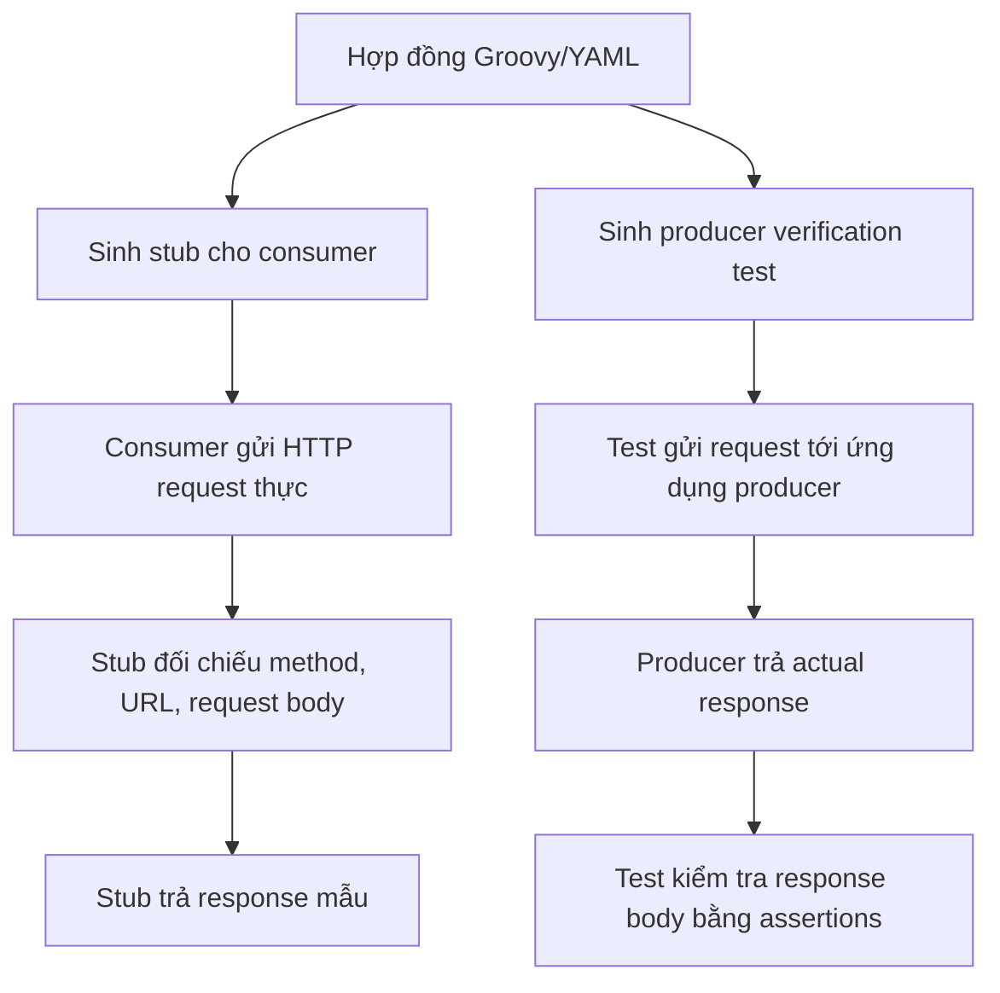
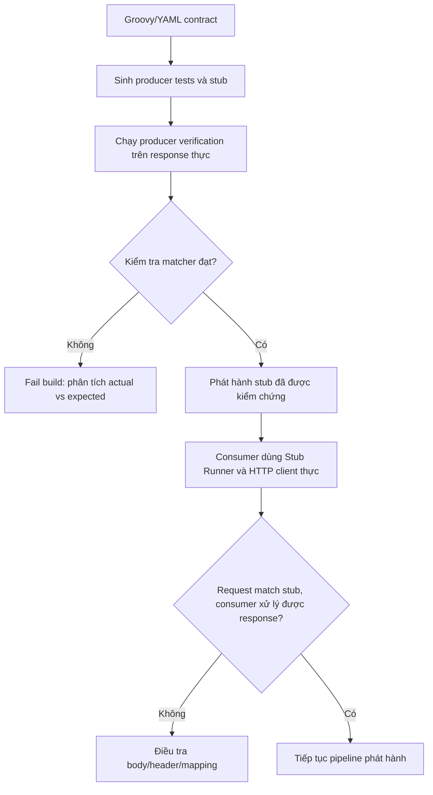

# So khớp body không phụ thuộc định dạng khoảng trắng

## 1. Bài toán thực tế: cùng dữ liệu nhưng khác cách xuống dòng

Trong kiến trúc microservices, hai dịch vụ có thể cùng hiểu một nội dung JSON nhưng **serialize** nó khác nhau. Chẳng hạn, `Checkout Service` (consumer) gửi một đơn hàng tới `Order Service` (producer); thư viện HTTP client gửi JSON trên một dòng, trong khi bản ghi request minh họa trong hợp đồng được trình bày có thụt lề để dễ đọc.

JSON mà consumer gửi:

```json
{"orderId":"O-42","amount":125000,"currency":"VND"}
```

JSON được trình bày trong tài liệu hoặc fixture:

```json
{
  "orderId": "O-42",
  "amount": 125000,
  "currency": "VND"
}
```

Hai văn bản khác nhau về số byte, xuống dòng và dấu cách, nhưng sau khi được phân tích cú pháp chúng mô tả **cùng một JSON object**. Nếu một stub chỉ nhận chuỗi body khớp từng ký tự, consumer test có thể thất bại vì cách định dạng, không phải vì vi phạm API.

**Spring Cloud Contract** cung cấp Groovy/YAML DSL để mô tả HTTP request/response, matcher và assertion; từ đó sinh kiểm thử ở producer và stub cho consumer dùng với **Stub Runner**. Thiết kế matcher đúng giúp CI phát hiện thay đổi API không tương thích mà không làm test trở nên giòn vì khoảng trắng trình bày.

Sau bài này, người học có thể:

1. Phân biệt **khoảng trắng định dạng** và **khoảng trắng thuộc giá trị dữ liệu**.
2. Mô tả body JSON theo cấu trúc, áp dụng JSONPath cùng `byEquality`, `byType`, `byRegex` trong Groovy/YAML DSL.
3. Hiểu so khớp request ở stub khác với assertion trên response thực tế của producer.
4. Biết khi nào nên dùng so sánh JSON theo ngữ nghĩa, khi nào phải giữ so sánh văn bản/byte nghiêm ngặt.
5. Chẩn đoán mismatch, kiểm tra generated tests/stubs và đặt các bước kiểm chứng trong CI.

## 2. “Bỏ qua khoảng trắng” phải có phạm vi rõ ràng

Theo ngữ pháp JSON, khoảng trắng **ngoài** token, chẳng hạn sau dấu phẩy, sau dấu hai chấm hoặc giữa các dòng, không thay đổi giá trị dữ liệu. Ngược lại, khoảng trắng **bên trong** một JSON string là một phần của giá trị chuỗi.

### 2.1. Các khác biệt không làm thay đổi giá trị JSON

Ba JSON object sau mang cùng thông tin:

```json
{"id":42,"status":"PAID"}
```

```json
{
    "id"  : 42,
    "status" : "PAID"
}
```

```json
{"status":"PAID", "id":42}
```

Khác biệt ở đây gồm khoảng trắng, ngắt dòng và **thứ tự các thuộc tính của object**. Khi kiểm tra theo JSON object, không nên vô tình xem những khác biệt trình bày này là thay đổi API.

### 2.2. Các khác biệt có thể thay đổi dữ liệu thật

Ngược lại, các ví dụ sau không nên được xem là tương đương chỉ vì chúng “gần giống nhau”:

| Expected JSON | Actual JSON | Vì sao không giống nhau? |
| --- | --- | --- |
| `{"note":"Hello world"}` | `{"note":"Hello  world"}` | Có **hai** dấu cách bên trong giá trị `note` thay vì một |
| `{"code":" AB "}` | `{"code":"AB"}` | Dấu cách đầu/cuối là nội dung chuỗi |
| `{"amount":125000}` | `{"amount":"125000"}` | Kiểu number khác string |
| `{"items":[1,2]}` | `{"items":[2,1]}` | Thứ tự các phần tử mảng đã đổi |
| `{"receiptUrl":null}` | `{}` | Trường có giá trị `null` khác trường vắng mặt |
| `{"enabled":true}` | `{"enabled":"true"}` | Boolean khác string |
| `{"status":"PAID"}` | `{"state":"PAID"}` | Tên trường thay đổi |

**Nguyên tắc:** Có thể bỏ qua khoảng trắng *giữa các token JSON*, nhưng không được xóa hoặc gộp khoảng trắng *bên trong chuỗi*. Đừng gọi một hàm thay thế mọi `\s+` bằng chuỗi rỗng rồi so sánh body: cách đó có thể biến cả `"A B"` thành `"AB"` và che giấu lỗi.

### 2.3. Định dạng JSON không quyết định hết chính sách tương thích

Hai object có cùng trường nhưng thứ tự key khác nhau thường tương đương về mặt dữ liệu. Tuy vậy:

- **Mảng** có thứ tự: `[1,2]` khác `[2,1]` nếu hợp đồng hoặc consumer phụ thuộc thứ tự.
- **Trường thừa** có được chấp nhận hay không tùy chính sách so khớp và cách client giải mã.
- **Kiểu và miền giá trị** phải được bảo vệ riêng; một so sánh JSON theo cấu trúc không tự biết `status` chỉ được nhận `PAID`, `PENDING`, `FAILED`.
- **Giá trị động** như ID hoặc timestamp cần matcher linh hoạt thay vì so sánh với dữ liệu mẫu cố định.

Vì vậy, “không phụ thuộc khoảng trắng” chỉ là **một** thuộc tính của chiến lược kiểm thử hợp đồng, không phải lý do để bỏ hết các assertion khác.

## 3. Chọn đúng cơ chế so khớp cho từng loại nội dung

| Loại body | Hướng tiếp cận | Khoảng trắng nào có thể bỏ qua? |
| --- | --- | --- |
| JSON object/array | Parse JSON, so khớp các trường/JSONPath hoặc JSON equality | Khoảng trắng **cấu trúc** giữa token |
| XML | Parse XML, dùng XPath/matcher hoặc comparator XML phù hợp | Chỉ các khoảng trắng được xác định là không có ý nghĩa theo nghiệp vụ/comparator |
| Text thuần | So sánh chuỗi hoặc regex có chủ đích | Chỉ phần được hợp đồng cho phép linh hoạt |
| CSV | Parse cột/hàng theo format và quy tắc nghiệp vụ | Phụ thuộc quy tắc quoting, trimming và separator |
| Binary, PDF, ảnh | So sánh byte hoặc thuộc tính/chữ ký phù hợp | Không nên xóa byte theo khái niệm whitespace của văn bản |

Nếu API yêu cầu chữ ký số trên body gốc, chuỗi canonical được ký hoặc một payload text có cấu trúc đặc biệt, **byte-level equality** có thể là yêu cầu thực sự. Bỏ qua whitespace bừa bãi trong trường hợp này sẽ làm kiểm thử mất ý nghĩa.

## 4. Spring Cloud Contract phân biệt request và response

Một hợp đồng HTTP thường chứa hai khối:

- `request`: mô tả những gì consumer gửi đến producer.
- `response`: mô tả những gì producer trả cho consumer.

Hai khối đều có `body` và có thể có matcher, nhưng chúng được dùng ở hai giai đoạn khác nhau:



Với JSON, nên mô tả cấu trúc dữ liệu và ràng buộc nghiệp vụ thay vì dựa vào một chuỗi body có khoảng trắng chính xác. Các ví dụ tiếp theo áp dụng cùng một API: `POST /api/orders`.

## 5. Groovy DSL: viết body theo cấu trúc JSON

Hợp đồng Groovy cho một đơn hàng gồm hai sản phẩm:

```groovy
import org.springframework.cloud.contract.spec.Contract

Contract.make {
    description 'Tao don hang tu JSON co cau truc'

    request {
        method POST()
        url '/api/orders'
        headers {
            contentType(applicationJson())
        }
        body(
            orderId: 'O-42',
            customer: [
                id: 'C-7',
                name: 'Nguyen An'
            ],
            items: [
                [sku: 'BOOK-01', quantity: 2],
                [sku: 'PEN-02', quantity: 1]
            ]
        )
        bodyMatchers {
            jsonPath('$.orderId', byRegex('O-[0-9]+'))
            jsonPath('$.customer.id', byEquality())
            jsonPath('$.items[0].sku', byEquality())
        }
    }

    response {
        status CREATED()
        headers {
            contentType(applicationJson())
        }
        body(
            orderId: 'O-42',
            status: 'CREATED',
            totalQuantity: 3
        )
        bodyMatchers {
            jsonPath('$.orderId', byRegex('O-[0-9]+'))
            jsonPath('$.status', byEquality())
            jsonPath('$.totalQuantity', byType())
        }
    }
}
```

Điểm đáng chú ý:

1. `body(...)` nhận **map/list Groovy** thể hiện object/mảng, không phải một chuỗi JSON mà ứng dụng phải gửi với đúng số lượng dấu cách.
2. `jsonPath('$.orderId', byRegex('O-[0-9]+'))` kiểm tra **giá trị của trường** theo regex; nó không quan tâm việc JSON có được xuống dòng giữa các key hay không.
3. `byEquality()` lấy giá trị tương ứng từ body mẫu để so sánh, ví dụ `$.customer.id` phải là `C-7` và response `$.status` phải là `CREATED`.
4. `byType()` xác minh kiểu dữ liệu phù hợp với mẫu; nó không kiểm tra `totalQuantity` nhất thiết phải đúng `3` nếu giá trị thực vẫn thuộc kiểu được phép.
5. Thứ tự trong `items` có thể mang ý nghĩa; matcher `$.items[0].sku` rõ ràng kiểm tra **phần tử đầu tiên**.

**Cần phân biệt hai hướng sử dụng matcher:** `request.bodyMatchers` chủ yếu giúp sinh điều kiện matching ở **stub** khi consumer gửi request; `response.bodyMatchers` tạo assertion dùng để kiểm tra **actual response của producer**. Generated producer test dùng dữ liệu request cụ thể từ hợp đồng; stub trả response mẫu được khai báo ở `response.body`.

### 5.1. Cùng request được serialize khác nhau

Consumer có thể gửi:

```json
{"orderId":"O-42","customer":{"id":"C-7","name":"Nguyen An"},"items":[{"sku":"BOOK-01","quantity":2},{"sku":"PEN-02","quantity":1}]}
```

Hoặc:

```json
{
  "items": [
    {"quantity": 2, "sku": "BOOK-01"},
    {"quantity": 1, "sku": "PEN-02"}
  ],
  "customer": {"name": "Nguyen An", "id": "C-7"},
  "orderId": "O-42"
}
```

Về mặt JSON, các trường và phần tử tương ứng có cùng giá trị; chỉ khác whitespace và thứ tự **key của object**. Một matcher dựa trên giá trị JSON/JSONPath không cần khóa vào cách pretty print. Nhưng việc consumer vẫn match được stub còn tùy **mapping thực tế được sinh**, phiên bản WireMock và các điều kiện khác như headers.

### 5.2. Không dùng regex toàn body khi JSONPath là đủ

Một regex trên chuỗi nguyên body, ví dụ:

```regex
.*"orderId"\s*:\s*"O-42".*
```

có thể bị ảnh hưởng bởi ngắt dòng, thứ tự key, escaping hoặc trường nằm sai vị trí. Nó cũng khó bảo đảm JSON hợp lệ. Khi body là JSON có cấu trúc, nên dùng JSONPath cho trường cần kiểm tra; chỉ dùng regex cho **giá trị tại trường**, chẳng hạn `O-[0-9]+`.

Regex toàn body có thể hữu ích cho một định dạng text đặc thù, nhưng không phải lựa chọn mặc định để làm một hợp đồng JSON “chịu được mọi khoảng trắng”.

## 6. YAML DSL: body mapping và JSONPath matchers

Ví dụ YAML tương ứng với Groovy DSL ở trên:

```yaml
description: Tao don hang tu JSON co cau truc
request:
  method: POST
  url: /api/orders
  headers:
    Content-Type: application/json
  body:
    orderId: "O-42"
    customer:
      id: "C-7"
      name: "Nguyen An"
    items:
      - sku: "BOOK-01"
        quantity: 2
      - sku: "PEN-02"
        quantity: 1
  matchers:
    body:
      - path: '$.orderId'
        type: by_regex
        value: 'O-[0-9]+'
      - path: '$.customer.id'
        type: by_equality
      - path: '$.items[0].sku'
        type: by_equality
response:
  status: 201
  headers:
    Content-Type: application/json
  body:
    orderId: "O-42"
    status: "CREATED"
    totalQuantity: 3
  matchers:
    body:
      - path: '$.orderId'
        type: by_regex
        value: 'O-[0-9]+'
      - path: '$.status'
        type: by_equality
      - path: '$.totalQuantity'
        type: by_type
```

Ý nghĩa hai vị trí `matchers`:

| Đường dẫn YAML | Nơi điều kiện được sử dụng | Ví dụ |
| --- | --- | --- |
| `request.matchers.body` | Chủ yếu ở stub request matching | Consumer gửi `orderId` hợp regex |
| `response.matchers.body` | Trong producer verification | Actual response có `status` bằng mẫu |

Cú pháp trong YAML là `type: by_regex`, `by_equality`, `by_type`, không phải Groovy method `byRegex()` viết nguyên vào YAML. Matcher JSONPath trỏ tới trường trong body mẫu; body mẫu tiếp tục cần có giá trị cụ thể để sinh request test hoặc stub response.

**Chú ý:** Không được suy rằng `by_type` tương đương “bỏ qua toàn bộ cấu trúc”. Với một mảng, cần kiểm tra kiểu, số phần tử và thứ tự theo yêu cầu. Với trường động, có thể cần matcher về định dạng hoặc miền giá trị thay vì chỉ ràng buộc kiểu.

## 7. Producer verification: kiểm tra response sau khi parse JSON

Với hợp đồng có `response.bodyMatchers`, Spring Cloud Contract Verifier sinh kiểm thử dùng để gọi ứng dụng producer thật và xác minh response. Các assertion thường truy cập nội dung theo JSONPath hoặc API so sánh JSON tương ứng; generated code cụ thể phụ thuộc phiên bản/plugin và chế độ kiểm thử.

Ví dụ mã Java **viết tay để minh họa ý nghĩa**, không khẳng định là mã Spring Cloud Contract sinh ra nguyên văn:

```java
@SpringBootTest
@AutoConfigureMockMvc
class CreateOrderContractExampleTest {
    @Autowired
    MockMvc mockMvc;

    @Test
    void createdOrderMatchesExpectedFields() throws Exception {
        mockMvc.perform(post("/api/orders")
                .contentType(MediaType.APPLICATION_JSON)
                .content("""
                    {"orderId":"O-42","customer":{"id":"C-7","name":"Nguyen An"},
                     "items":[{"sku":"BOOK-01","quantity":2},
                              {"sku":"PEN-02","quantity":1}]}
                    """))
            .andExpect(status().isCreated())
            .andExpect(content()
                .contentTypeCompatibleWith(MediaType.APPLICATION_JSON))
            .andExpect(jsonPath("$.status").value("CREATED"))
            .andExpect(jsonPath("$.totalQuantity").isNumber())
            .andExpect(jsonPath("$.orderId").isString());
    }
}
```

Ví dụ giả định project dùng Java hỗ trợ text block, Spring Boot Test, MockMvc, JUnit và có đủ import. Đoạn test chỉ diễn đạt một phần mục tiêu: `isString()` không thay thế kiểm tra regex `O-[0-9]+`. Khi kiểm chứng đầy đủ, cần dựa vào generated test thực tế để xác nhận cả ràng buộc regex được thực thi.

Ví dụ response producer ở dạng gọn:

```json
{"totalQuantity":3,"orderId":"O-99","status":"CREATED"}
```

Nếu hợp đồng cho phép `orderId` theo `O-[0-9]+` và `totalQuantity` theo kiểu số, những khác biệt về thứ tự key, khoảng trắng và giá trị ID hợp lệ có thể được chấp nhận. Nếu producer trả `"totalQuantity":"3"` hoặc `"status":"CANCELLED"`, các điều kiện kiểu và giá trị cần khiến test thất bại.

### 7.1. So sánh JSON theo cấu trúc trong kiểm thử hỗ trợ

Khi cần một phép kiểm tra **toàn bộ JSON** thay vì chỉ vài JSONPath, có thể parse expected và actual thành cây JSON để đối chiếu ngữ nghĩa:

```java
ObjectMapper mapper = new ObjectMapper();

String expected = """
    {"status":"CREATED","orderId":"O-42"}
    """;

String actual = """
    {
      "orderId": "O-42",
      "status" : "CREATED"
    }
    """;

JsonNode expectedTree = mapper.readTree(expected);
JsonNode actualTree = mapper.readTree(actual);

assertEquals(expectedTree, actualTree);
```

Đây là cách **viết một assertion Java bổ sung**, không phải cú pháp Spring Cloud Contract DSL. Việc parse thành `JsonNode` làm cho dấu cách định dạng và thứ tự các thuộc tính object không còn là lý do gây sai lệch; giá trị trong string và cấu trúc dữ liệu vẫn được so sánh. Cần biết thư viện so sánh đang dùng xử lý giá trị số và các chi tiết JSON như thế nào nếu API có yêu cầu chính xác về kiểu số.

Không nên tự triển khai một bước `replaceAll` xóa whitespace khỏi chuỗi raw body trước khi so sánh. Parser JSON là công cụ đúng để phân biệt khoảng trắng cấu trúc và nội dung.

## 8. Stub Runner và so khớp JSON request

Ở phía consumer, Stub Runner thường khởi động các stub HTTP được sinh từ hợp đồng. Với các stub dùng **WireMock**, công cụ nền tảng có nhiều kiểu matcher:

| Matcher WireMock | Mức so khớp | Ứng dụng |
| --- | --- | --- |
| `equalTo` | So sánh chuỗi văn bản | Text cần đúng ký tự, bao gồm whitespace |
| `equalToJson` | So sánh JSON theo cấu trúc | JSON khác cách định dạng nhưng cùng nội dung |
| `matchesJsonPath` | Chọn một phần JSON theo đường dẫn | Chỉ ràng buộc field hoặc giá trị cần thiết |
| `binaryEqualTo` | So sánh byte | Dữ liệu nhị phân hoặc nội dung cần khớp byte |

**Lưu ý kỹ thuật:** Đây là tên các matcher của **WireMock**, không phải các key có thể sao chép trực tiếp vào mọi vị trí của Groovy/YAML DSL. Spring Cloud Contract sinh ra stub mapping theo phiên bản và matcher được khai báo; muốn biết thực sự dùng `equalToJson` hay `matchesJsonPath`, cần xem file mapping đã sinh.

### 8.1. Ví dụ mapping WireMock minh họa độc lập

Một mapping WireMock tự viết có thể kiểm tra JSON request theo cấu trúc:

```json
{
  "request": {
    "method": "POST",
    "url": "/api/orders",
    "bodyPatterns": [
      {
        "equalToJson": {
          "orderId": "O-42",
          "customer": {"id": "C-7", "name": "Nguyen An"},
          "items": [
            {"sku": "BOOK-01", "quantity": 2},
            {"sku": "PEN-02", "quantity": 1}
          ]
        }
      }
    ]
  },
  "response": {
    "status": 201,
    "headers": {"Content-Type": "application/json"},
    "jsonBody": {
      "orderId": "O-42",
      "status": "CREATED",
      "totalQuantity": 3
    }
  }
}
```

Đây là **cấu hình WireMock minh họa cơ chế** chứ không phải file Spring Cloud Contract sinh ra chắc chắn sẽ giống hệt. `equalToJson` so sánh nội dung JSON chứ không yêu cầu cùng số khoảng trắng. Theo mặc định, các khác biệt như thứ tự phần tử mảng và thuộc tính object thừa có thể khiến matcher này không khớp.

### 8.2. Nới điều kiện mảng và trường thừa có kiểm soát

WireMock cho phép chỉnh chính sách so sánh JSON, ví dụ:

```json
{
  "equalToJson": {
    "orderId": "O-42",
    "items": [
      {"sku": "BOOK-01"},
      {"sku": "PEN-02"}
    ]
  },
  "ignoreArrayOrder": true,
  "ignoreExtraElements": true
}
```

Đoạn này là **một body pattern độc lập** của WireMock, không phải một hợp đồng Spring Cloud Contract YAML. `ignoreArrayOrder` cho phép hoán vị thứ tự mảng ở bước matching; `ignoreExtraElements` cho phép trường object thừa. Hai lựa chọn này **khác với việc bỏ qua khoảng trắng** và không nên bật nếu consumer phụ thuộc thứ tự hoặc yêu cầu schema chặt.

Nếu dùng Spring Cloud Contract, hãy xác minh cách sinh stub mapping ở bản đang dùng hoặc viết matcher JSONPath phù hợp trong DSL. Đừng giả định rằng đặt hai flag WireMock ở bất kỳ vị trí nào của YAML Contract cũng được hỗ trợ.

## 9. XML và văn bản thuần: không suy rộng quy tắc của JSON

### 9.1. Với XML

Hai XML document sau khác cách thụt lề:

```xml
<payment>
  <id>42</id>
  <status>PAID</status>
</payment>
```

```xml
<payment><id>42</id><status>PAID</status></payment>
```

Các chương trình đọc XML theo mô hình phần tử có thể xem chúng mang cùng dữ liệu nghiệp vụ, nhưng **không phải mọi trình so sánh XML đều mặc nhiên bỏ qua mọi whitespace text node**. Dấu cách nằm trong `<message>Xin chao  ban</message>` có thể là một phần giá trị.

Spring Cloud Contract hỗ trợ body XML và XPath matcher trong Groovy DSL, chẳng hạn:

```groovy
import org.springframework.cloud.contract.spec.Contract

Contract.make {
    request {
        method GET()
        url '/api/payments/42/xml'
    }
    response {
        status OK()
        headers {
            contentType(applicationXml())
        }
        body('''<payment>
            <id>42</id>
            <status>PAID</status>
        </payment>''')
        bodyMatchers {
            xPath('/payment/id/text()', byEquality())
            xPath('/payment/status/text()', byEquality())
        }
    }
}
```

XPath tập trung vào các nút cần kiểm tra, thay vì buộc source XML dùng một kiểu thụt lề. Tuy nhiên, nếu whitespace trong nút text mang ý nghĩa, vẫn phải kiểm tra nó. Nếu cần phép so sánh toàn bộ XML theo ngữ nghĩa, hãy chọn cấu hình comparator/XMLUnit thích hợp với yêu cầu namespace, thứ tự node và text content của ứng dụng.

### 9.2. Với text thuần

Nếu endpoint trả `text/plain`, hai body `"Order paid"` và `"Order  paid"` có thể **khác** nếu consumer hiển thị chính xác câu chữ. Nếu nghiệp vụ cho phép nhiều dấu cách, có thể dùng matcher chuyên biệt hoặc assertion chuẩn hóa **có giới hạn** như trim đầu/cuối. Không nên áp dụng quy tắc JSON vào text thuần.

### 9.3. Với body đã ký hoặc payload nhị phân

Nếu bên nhận xác minh chữ ký HMAC trên byte body gốc, một newline mới cũng có thể làm chữ ký khác. Trường hợp này phải bảo vệ **đúng dữ liệu byte** và quy trình ký/xác minh, không phải nới matcher để bỏ qua tất cả dấu cách. PDF, ZIP hoặc ảnh cũng phải được kiểm tra bằng cơ chế phù hợp với byte và metadata.

## 10. Ma trận kiểm thử: khác whitespace hay khác hợp đồng?

Giả sử expected:

```json
{"paymentId":42,"status":"PAID","note":"A B","items":[1,2]}
```

| Actual JSON | Kết quả khi so sánh JSON chặt theo cấu trúc | Giải thích |
| --- | --- | --- |
| Cùng dữ liệu, viết nhiều dòng/thụt lề | **PASS** | Khoảng trắng ngoài token không có ý nghĩa |
| Đổi thứ tự các key của object | **PASS** | Thứ tự key của JSON object không mang nghĩa |
| `"note":"A  B"` | **FAIL** | Dấu cách bên trong chuỗi khác |
| `"paymentId":"42"` | **FAIL** | String khác number |
| `"items":[2,1]` | **FAIL** theo so sánh có xét thứ tự | Mảng đảo thứ tự |
| Thêm `"traceId":"x"` | **FAIL** với so sánh chặt toàn object | Có trường thừa; có thể cho phép bằng chính sách riêng |
| Thiếu `"status"` | **FAIL** | Mất trường bắt buộc |
| `"status":"PENDING"` | **FAIL** | Giá trị nghiệp vụ khác |
| `"items":[]` | **FAIL** | Thay đổi số phần tử và dữ liệu |

Bảng nói về **một phép so sánh JSON chặt toàn cấu trúc**, không khẳng định mọi generated test của Spring Cloud Contract đều triển khai chính xác bảng này. Nếu dùng matcher JSONPath cho một số trường, những điều kiện ngoài danh sách matcher và phần body mẫu cần được xác minh từ mã test được sinh.

## 11. Các lỗi thường gặp khi cấu hình matcher

### 11.1. So sánh JSON như chuỗi text

**Triệu chứng:** test fail khi developer bật pretty print hoặc HTTP client đổi serialization. **Cách xử lý:** dùng body map/sequence và JSONPath trong Spring Cloud Contract; nếu dùng WireMock thủ công, cân nhắc `equalToJson` thay `equalTo`.

### 11.2. Xóa tất cả whitespace trước khi so sánh

**Triệu chứng:** test pass dù nội dung `message`, `name` hoặc `address` thay đổi dấu cách. **Cách xử lý:** parse JSON trước; so sánh giá trị string nguyên vẹn ở những trường cần bảo vệ.

### 11.3. Dùng `byType()` cho mọi trường

**Triệu chứng:** producer đổi `status` từ `PAID` sang `CANCELLED` nhưng test vẫn pass vì cả hai đều là string. **Cách xử lý:** giữ `byEquality()` hoặc giới hạn regex đúng miền giá trị quan trọng.

### 11.4. Cố định giá trị động không cần thiết

**Triệu chứng:** `orderId` hoặc timestamp thay đổi hợp lệ làm producer verification đỏ. **Cách xử lý:** dùng `byRegex()`, `byType()`, matcher ngày giờ hoặc giá trị hai phía phù hợp; vẫn kiểm tra format quan trọng.

### 11.5. Tưởng bỏ qua whitespace thì được đổi thứ tự mảng

**Triệu chứng:** consumer chọn phần tử đầu làm lựa chọn ưu tiên nhưng hợp đồng không bảo vệ thứ tự. **Cách xử lý:** kiểm tra thứ tự, phần tử hoặc quan hệ nghiệp vụ khi consumer phụ thuộc; chỉ bật bỏ qua thứ tự nếu API đã thỏa thuận.

### 11.6. Trộn `request.matchers` và `response.matchers`

**Triệu chứng:** producer test vẫn so sánh response quá chặt hoặc stub không khớp body request thực. **Cách xử lý:** xác định hướng kiểm tra: request matcher chủ yếu cho stub matching, response matcher chủ yếu cho producer verification. Đọc generated artifacts trước khi kết luận.

### 11.7. Không biết vì sao một body được xem là hợp lệ

**Triệu chứng:** response có thêm trường, thay đổi null hoặc mảng nhưng test vẫn xanh/đỏ trái kỳ vọng. **Cách xử lý:** xem DSL, generated test code, WireMock mapping và thư viện assertion được sử dụng. Mức độ chặt có thể phụ thuộc phiên bản và matcher; không suy luận chỉ từ hình thức JSON mẫu.

## 12. Quy trình chẩn đoán mismatch ở dự án thật

Khi consumer test báo stub không khớp hoặc producer test thất bại:

1. **Lưu request/response actual** dưới dạng bytes hoặc text có che dữ liệu nhạy cảm; ghi thêm `Content-Type` và URL.
2. **Xác minh JSON hợp lệ.** Nếu một body không parse được, không thể gọi đó là khác biệt “chỉ do thụt lề”.
3. **So sánh object/array đã parse**, chỉ ra JSONPath đang khác và phân biệt type, missing, null, value.
4. **Kiểm tra matcher nào được áp dụng.** Có phải `equalTo` theo chuỗi, `equalToJson` hay `matchesJsonPath`? Với producer, assertion sinh ra kiểm tra trường nào?
5. **Thử hai body giống nhau về dữ liệu nhưng khác định dạng** để xác nhận mục tiêu “không phụ thuộc whitespace”.
6. **Thử một thay đổi mang ý nghĩa** như đổi `status`, chuyển số sang chuỗi hoặc thay whitespace trong `note`. Test cần phát hiện nếu đó là cam kết.
7. **Sửa sai ở đúng lớp.** Không xóa assertion chỉ để build xanh khi producer đã phá vỡ yêu cầu consumer; cũng không khóa format JSON nếu consumer không phụ thuộc nó.

Ví dụ báo cáo lỗi minh họa:

```text
Endpoint: POST /api/orders
Matcher: equalTo (raw string)
Expected body: {"orderId":"O-42","amount":125000}
Actual body:
{
  "amount": 125000,
  "orderId": "O-42"
}
Raw string match: FAIL
Parsed JSON match: PASS
```

Trong tình huống này, lỗi là **chiến lược so sánh text** quá chặt đối với một giao diện JSON. Tuy nhiên, nếu `amount` đổi thành `"125000"`, parse JSON vẫn thành công nhưng một phép so sánh cấu trúc đúng phải phát hiện khác biệt kiểu.

## 13. Tích hợp CI: vừa tránh false failure vừa phát hiện lỗi thật

Một pipeline kiểm thử hợp đồng nên bảo vệ cả hai phía:



Gợi ý kiểm soát chất lượng:

- **Pin phiên bản** Spring Boot, Spring Cloud, Spring Cloud Contract plugin/dependencies và Stub Runner tương thích.
- **Không bỏ qua producer verification.** Stub được tạo ra không chứng minh producer hiện tại đã đáp ứng hợp đồng.
- **Chạy consumer test bằng HTTP client thực.** Nó giúp phát hiện vấn đề Content-Type, serialization hoặc URL, thay vì chỉ kiểm tra một JSON mẫu trong bộ nhớ.
- **Kiểm tra số lượng tests đã chạy.** Pipeline xanh khi test bị skip không đủ bảo vệ.
- **Bổ sung các ca âm tính có ý nghĩa:** sai kiểu, thiếu trường, sai status, đảo mảng khi thứ tự quan trọng, khác whitespace trong string.
- **Review thay đổi matcher**: nới matcher chỉ khi giao diện thực sự cho phép biến thể đó.
- **Không thay thế integration/E2E tests** cho mạng, bảo mật, dữ liệu thật và giao tiếp giữa nhiều dịch vụ.

## 14. Bài tập thực hành: phân biệt định dạng với dữ liệu

Hợp đồng mẫu cho response:

```yaml
description: Tra cuu thanh toan
request:
  method: GET
  url: /api/payments/42
response:
  status: 200
  headers:
    Content-Type: application/json
  body:
    paymentId: 42
    status: "PAID"
    message: "Paid successfully"
    items:
      - sku: "BOOK-01"
        quantity: 2
      - sku: "PEN-02"
        quantity: 1
  matchers:
    body:
      - path: '$.paymentId'
        type: by_type
      - path: '$.status'
        type: by_equality
      - path: '$.message'
        type: by_equality
```

### Yêu cầu

1. Viết lại JSON response trên ở dạng minified một dòng và dạng pretty print nhiều dòng. Giải thích vì sao chúng có cùng giá trị.
2. Nếu producer trả `"message":"Paid  successfully"` với hai dấu cách, kiểm thử có nên pass không?
3. Nếu producer trả `"paymentId":"42"`, điều kiện `by_type` có phát hiện lỗi không?
4. Nếu producer trả `items` theo thứ tự ngược, có nên pass không? Cần biết thông tin nào trước khi quyết định?
5. Nếu consumer test dùng WireMock thủ công, chọn `equalTo`, `equalToJson` hay `binaryEqualTo` cho JSON request? Vì sao?

### Gợi ý đáp án

| Câu | Kết luận cần đạt |
| --- | --- |
| 1 | Dấu cách ngoài token không đổi object/array sau khi parse JSON; test nên so sánh theo cấu trúc |
| 2 | Không, nếu `message` được cam kết chính xác như body mẫu và `by_equality` |
| 3 | Có, vì mẫu là number còn actual là string; kiểm tra assertion sinh ra để xác nhận |
| 4 | Phải xác định consumer có phụ thuộc thứ tự không; `by_type` của `paymentId` không kiểm tra thứ tự mảng |
| 5 | `equalToJson` thường phù hợp hơn vì so sánh dữ liệu JSON thay vì ký tự trình bày |

Hãy thử chủ động thay đổi khoảng trắng ngoài chuỗi, rồi thay khoảng trắng *bên trong* `message`. Một hệ thống matcher tốt phải phân biệt được hai thay đổi này theo kỳ vọng đã công bố.

## 15. Checklist trước khi review hợp đồng

- Body là JSON, XML, text hay binary? Cách so khớp đã chọn đúng loại dữ liệu?
- Khi là JSON, hợp đồng có mô tả cấu trúc object/array và các JSONPath thực sự quan trọng?
- Có tránh so sánh body JSON theo byte chỉ vì cách serialize khác nhau?
- Có giữ nguyên whitespace **bên trong giá trị string** và các điều kiện kiểu/giá trị nghiệp vụ?
- Mảng có cần cố định thứ tự, kích thước hoặc schema từng phần tử? Điều đó đã được kiểm tra?
- `request.matchers.body` và `response.matchers.body` đã đặt đúng hướng sử dụng?
- Generated producer test và WireMock stub mapping có thật sự áp dụng matcher như dự định?
- Producer verification và consumer test Stub Runner đã chạy trong CI trước khi phát hành?

**Tài liệu chính thức để tra cứu theo phiên bản:**

- [Spring Cloud Contract — Contract DSL](https://docs.spring.io/spring-cloud-contract/reference/project-features-contract.html)
- [Spring Cloud Contract — Dynamic properties và body matchers](https://docs.spring.io/spring-cloud-contract/reference/project-features-contract/dsl-dynamic-properties.html)
- [Spring Cloud Contract — HTTP contracts, JSON và XML](https://docs.spring.io/spring-cloud-contract/reference/project-features-contract/http.html)
- [WireMock — Request matching (JSON equality, JSONPath)](https://wiremock.org/docs/request-matching/)

**Ghi nhớ:** **Không phụ thuộc định dạng khoảng trắng** nghĩa là kiểm tra **giá trị và cấu trúc JSON**, thay vì so sánh toàn bộ body theo từng ký tự. Dấu cách trong string, kiểu dữ liệu, trường bắt buộc và quy tắc mảng vẫn có thể là phần của hợp đồng. Với Spring Cloud Contract, hãy mô tả body theo cấu trúc, dùng JSONPath/matcher đúng vị trí, kiểm tra mã test/stub được sinh và chạy đủ producer–consumer tests trong CI.
