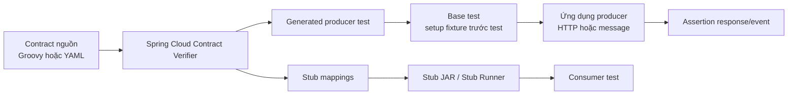
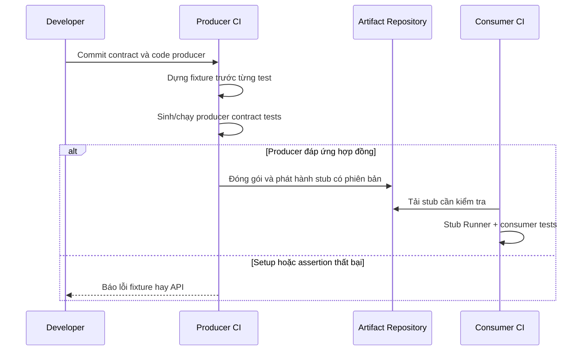

# Thiết lập trạng thái producer trước từng tương tác

## 1. Trạng thái producer là gì và tại sao phải chuẩn bị?

Trong **Spring Cloud Contract**, hợp đồng định nghĩa hành vi mà **producer** cam kết với **consumer**: khi nhận một HTTP request hoặc một thông điệp cụ thể, producer phải phản hồi hoặc phát thông điệp như thế nào. Hợp đồng có thể viết bằng **Groovy DSL** hoặc **YAML DSL**; từ đó Spring Cloud Contract Verifier sinh **kiểm thử phía producer** và **stub**. Consumer dùng **Stub Runner** để kiểm thử độc lập, còn CI chạy các kiểm tra nhằm phát hiện thay đổi API không tương thích.

Giả sử producer cung cấp API đơn hàng:

```http
GET /api/orders/42
```

Một phản hồi mong đợi là:

```http
HTTP/1.1 200 OK
Content-Type: application/json

{"id":42,"state":"PAID","totalAmount":120000}
```

Producer chỉ có thể trả kết quả đó nếu **trước khi xử lý request**, hệ thống kiểm thử có đơn hàng ID `42` ở trạng thái `PAID`, hoặc một dependency đã được mock để cung cấp dữ liệu tương đương. Nếu dữ liệu không tồn tại, test có thể nhận `404`; nếu đơn hàng đã bị test khác sửa, test có thể trả `PENDING`. Đây là lỗi **chuẩn bị trạng thái**, chưa chắc là lỗi hợp đồng hay logic API.

Trong bài này, **trạng thái producer** là điều kiện bên trong producer và các dependency trước tương tác: bản ghi database, trạng thái nghiệp vụ, mock service, security principal, thời gian, hàng đợi thông điệp và cấu hình cần thiết. Nó **khác với HTTP status** như `200`, `404` hay `409`: HTTP status là **kết quả quan sát được** sau khi thực hiện tương tác.

> Nguyên tắc: **Mỗi kịch bản hợp đồng phải chạy từ một trạng thái đầu vào xác định, có thể thiết lập lại và không phụ thuộc thứ tự chạy test.**

## 2. Đặt trạng thái trước mỗi tương tác: bức tranh tổng thể



Có hai việc **không được nhầm lẫn**:

1. **Mô tả trạng thái cần có** trong kịch bản, chẳng hạn “đơn hàng 42 đã thanh toán, đơn hàng 9999 không tồn tại”.
2. **Thực sự tạo trạng thái ấy** trước khi generated producer test chạy: seed database, thay bean bằng mock, dựng dữ liệu trong base test hoặc kích hoạt một hành vi có kiểm soát.

Hợp đồng không tự sinh ra bản ghi database từ nội dung `response.body`. Nếu DSL nói `state: PAID`, verifier biết cần **kiểm tra** giá trị `PAID`; nó không biết hệ thống của bạn phải thêm bản ghi nào, dùng repository nào hay mock dependency nào để tạo trạng thái ấy.

Đặc biệt, **đừng nhầm với khái niệm provider state của Pact**. Trong luồng Spring Cloud Contract Verifier thông dụng, việc thiết lập dữ liệu HTTP được thực hiện bằng **base test và cơ chế test của ứng dụng**. Không nên giả định chỉ cần thêm một trường `given: paid_order_exists` tùy ý vào contract HTTP là verifier sẽ tự gọi hàm dựng dữ liệu.

## 3. Ma trận trạng thái và phản hồi nên xây dựng trước

Một API thường có nhiều trạng thái nghiệp vụ, dẫn đến các status lỗi khác nhau. Hãy lập ma trận trước khi soạn DSL:

| Kịch bản | Trạng thái phải có **trước request** | Request | Phản hồi cam kết |
|---|---|---|---|
| Tìm thấy đơn đã thanh toán | Có order `42`, `state=PAID` | `GET /api/orders/42` | `200`, body có `id=42`, `state=PAID` |
| Không tìm thấy | **Không có** order `9999` | `GET /api/orders/9999` | `404`, mã lỗi `ORDER_NOT_FOUND` |
| Dữ liệu request sai | Không cần order cụ thể; validation được bật | `POST /api/orders` với `quantity=0` | `400`, mã lỗi `INVALID_QUANTITY` |
| Xung đột trạng thái | Order `42` đã thanh toán, không được thanh toán lại | `POST /api/orders/42/pay` | `409`, mã lỗi `ALREADY_PAID` |
| Không có quyền | Principal không có quyền đọc order được yêu cầu | `GET /api/orders/42` | `403` theo chính sách ứng dụng |
| Hệ thống phụ thuộc không sẵn sàng | Dependency được mô phỏng lỗi có kiểm soát | `GET /api/orders/42` | Mã lỗi/thông điệp theo chính sách đã công bố |

Ma trận này có ý nghĩa quan trọng:

- **`404`** không tự chứng minh API xử lý đúng “không tìm thấy” nếu test vô tình không có dữ liệu do setup thất bại.
- **`409`** chỉ có giá trị khi trạng thái trước request thật sự tạo ra **xung đột nghiệp vụ**, không phải khi endpoint lỗi vì thiếu dependency.
- **`400`** cần phát sinh từ quy tắc validation đã cam kết, không nên sinh ra vì body sai kiểu ngẫu nhiên nếu kịch bản đang kiểm tra `quantity=0`.
- **`401` và `403`** không thay thế nhau: thông thường `401` liên quan xác thực, `403` liên quan không đủ quyền. Bộ security filter, principal và dữ liệu phân quyền phải được chuẩn bị phù hợp.

Không cần đưa tất cả kịch bản vào một contract. **Một contract cho một hành vi quan sát được** thường dễ hiểu và dễ chẩn đoán hơn.

## 4. Định nghĩa hợp đồng HTTP có trạng thái thành công và lỗi

### 4.1. Groovy DSL: đơn hàng tồn tại

File ví dụ: `src/test/resources/contracts/orders/get-paid-order.groovy`.

```groovy
import org.springframework.cloud.contract.spec.Contract

Contract.make {
    description 'Đơn hàng 42 đã thanh toán'

    request {
        method GET()
        url '/api/orders/42'
        headers {
            header 'Accept', 'application/json'
        }
    }

    response {
        status OK()
        headers {
            contentType(applicationJson())
        }
        body(
            id: 42,
            state: 'PAID',
            totalAmount: 120000
        )
    }
}
```

Để generated test này chạy xanh, producer phải trả dữ liệu phù hợp khi gọi ID `42`. DSL **không** chỉ ra cách lưu một đơn hàng; dữ liệu được setup ở test infrastructure như mục 5 và 6.

### 4.2. YAML DSL: đơn hàng không tồn tại

File ví dụ: `src/test/resources/contracts/orders/get-order-not-found.yml`.

```yaml
description: Đơn hàng không tồn tại phải trả lỗi ổn định
request:
  method: GET
  url: /api/orders/9999
  headers:
    Accept: application/json
response:
  status: 404
  headers:
    Content-Type: application/json
  body:
    code: ORDER_NOT_FOUND
    message: Order does not exist
```

Trạng thái đầu vào của kịch bản này là **không có bản ghi ID `9999`**. Nếu fixture của test khác vô tình tạo bản ghi đó, producer có thể trả `200` và test thất bại vì dữ liệu test bị rò rỉ. Nếu API trả `404` nhưng thiếu `code`, test cũng phải phát hiện vì consumer có thể dựa vào mã lỗi để hiển thị thông báo.

### 4.3. Groovy DSL: xung đột nghiệp vụ

Ví dụ API không cho phép thanh toán một đơn đã thanh toán:

```groovy
import org.springframework.cloud.contract.spec.Contract

Contract.make {
    description 'Không thể thanh toán lại đơn đã PAID'

    request {
        method POST()
        url '/api/orders/42/pay'
    }

    response {
        status CONFLICT()
        headers {
            contentType(applicationJson())
        }
        body(
            code: 'ALREADY_PAID',
            message: 'Order has already been paid'
        )
    }
}
```

Đây là kịch bản **đòi trạng thái đầu vào cụ thể**: order `42` phải tồn tại và đã `PAID`. Nếu không có order, producer có thể trả `404` đúng theo quy tắc khác nhưng **sai kịch bản** `409` đang kiểm thử. Không nên đổi kỳ vọng `409` thành `404` chỉ để test xanh; phải kiểm tra fixture trước.

## 5. Base test: nơi chuẩn bị trạng thái trước mỗi generated test

### 5.1. Cơ chế kế thừa test

Với cấu hình Spring Cloud Contract Verifier phù hợp, các lớp test được sinh có thể **kế thừa một base class** do đội phát triển viết. Trong dự án dùng **JUnit 5**, phương thức của base class gắn `@BeforeEach` chạy trước **mỗi phương thức test** kế thừa, giúp làm mới trạng thái.

Sơ đồ:

```text
src/test/
├── java/com/example/orders/contract/
│   └── ContractVerifierBase.java     <-- code do nhóm viết
└── resources/contracts/orders/
    ├── get-paid-order.groovy          <-- hợp đồng nguồn
    ├── get-order-not-found.yml
    └── pay-already-paid.groovy

target/generated-test-sources/contracts/
└── ...                                <-- generated tests, không sửa tay
```

Tùy Maven/Gradle và phiên bản plugin, vị trí đầu ra build có thể khác. Điều quan trọng là **base class được cấu hình đúng bằng fully qualified name** và **generated tests thực sự kế thừa nó**.

### 5.2. Ví dụ base class với Spring MVC và Mockito

Giả sử controller gọi một bean `OrderQueryService` để đọc đơn hàng, và ứng dụng có `OrderView` cùng `OrderNotFoundException`. Ta có thể thay bean này bằng mock trong Spring test context:

```java
package com.example.orders.contract;

import com.example.orders.api.OrderView;
import com.example.orders.service.OrderNotFoundException;
import com.example.orders.service.OrderQueryService;
import io.restassured.module.mockmvc.RestAssuredMockMvc;
import org.junit.jupiter.api.BeforeEach;
import org.springframework.beans.factory.annotation.Autowired;
import org.springframework.boot.test.autoconfigure.web.servlet.AutoConfigureMockMvc;
import org.springframework.boot.test.context.SpringBootTest;
import org.springframework.test.context.bean.override.mockito.MockitoBean;
import org.springframework.web.context.WebApplicationContext;

import static org.mockito.Mockito.reset;
import static org.mockito.Mockito.when;

@SpringBootTest(webEnvironment = SpringBootTest.WebEnvironment.MOCK)
@AutoConfigureMockMvc
public abstract class ContractVerifierBase {

    @Autowired
    private WebApplicationContext context;

    @MockitoBean
    private OrderQueryService orderQueryService;

    @BeforeEach
    void beforeEachContract() {
        // Mỗi generated test nhận một bộ mock state đã biết.
        reset(orderQueryService);

        when(orderQueryService.findById(42L))
            .thenReturn(new OrderView(42L, "PAID", 120000L));

        when(orderQueryService.findById(9999L))
            .thenThrow(new OrderNotFoundException(9999L));

        RestAssuredMockMvc.webAppContextSetup(context);
    }
}
```

**Điều kiện của ví dụ**:

1. Đây là mẫu cho **Spring MVC + Rest Assured MockMvc + JUnit 5**. Spring Cloud Contract plugin cần dùng test mode tương ứng, chẳng hạn `MOCKMVC`, và trỏ đến `com.example.orders.contract.ContractVerifierBase`.
2. `@MockitoBean` là annotation của **Spring Framework 6.2+**. Với stack Spring Boot/Spring Framework cũ hơn, dự án có thể dùng `@MockBean` của Spring Boot theo phiên bản được hỗ trợ. Không trộn ví dụ với dependency không tương thích.
3. `OrderQueryService`, `OrderView` và `OrderNotFoundException` là các kiểu **minh họa thuộc ứng dụng**, không phải lớp có sẵn của Spring Cloud Contract; thay bằng tên method/kiểu thực tế của dự án.
4. Ứng dụng phải có controller gọi `findById` và exception handler ánh xạ `OrderNotFoundException` thành **`404` với body đã cam kết**. Mock ném exception không tự định nghĩa format lỗi.
5. `reset(orderQueryService)` làm sạch hành vi mock trước khi thiết lập lại. Với ứng dụng có nhiều mock, cần kiểm soát trạng thái của từng mock/dependency; chỉ reset một bean không cô lập được database hoặc message broker.

Khi chạy generated test cho `GET /api/orders/42`, mock trả đơn `PAID`. Khi generated test gọi `GET /api/orders/9999`, mock ném exception để controller và exception handler tạo phản hồi `404`. Test xác nhận **API thật ở tầng HTTP**, không chỉ xác nhận trực tiếp một method Java.

### 5.3. Trạng thái khác nhau có buộc tạo base class riêng?

**Không nhất thiết.** Một `@BeforeEach` có thể khởi tạo **một tập fixture nhất quán**: order `42` tồn tại ở trạng thái `PAID`, order `9999` không tồn tại, user test có quyền đọc. Cùng tập dữ liệu này có thể phục vụ nhiều contract khi chúng không mâu thuẫn.

Nếu kịch bản A cần order `42` là `PAID` nhưng kịch bản B cần **cùng order `42` là `PENDING`**, hai cách tổ chức thường hợp lý hơn là:

- Dùng **ID khác nhau** (ví dụ `42` là `PAID`, `43` là `PENDING`) trong cùng fixture, nếu điều đó không làm sai ngữ nghĩa nghiệp vụ.
- Tách các contract thành **nhóm có base test/fixture riêng**, sử dụng cơ chế cấu hình ánh xạ base class theo package hoặc quy tắc contract của phiên bản plugin.

Không nên làm cho một contract phụ thuộc việc **contract trước đó đã chạy và sửa order**. JUnit không đảm bảo thứ tự những generated tests độc lập theo logic nghiệp vụ của bạn.

## 6. Dùng database fixture khi cần kiểm tra nhiều lớp thực tế

Mock service giúp kiểm tra mapping HTTP/serialization/exception handler trong một phạm vi kiểm soát được. Tuy nhiên, nếu mục tiêu còn bao gồm JPA query, repository hoặc transaction, có thể cần **database test thật** thay vì mock tầng service.

### 6.1. Chiến lược seed dữ liệu cho từng test

Ví dụ dữ liệu SQL:

```sql
-- Chỉ dùng trong database dành riêng cho test.
DELETE FROM order_items;
DELETE FROM orders;

INSERT INTO orders (id, state, total_amount)
VALUES (42, 'PAID', 120000);
```

Trong base class test, có thể dùng `@Sql` của Spring Test:

```java
import org.junit.jupiter.api.BeforeEach;
import org.springframework.beans.factory.annotation.Autowired;
import org.springframework.boot.test.autoconfigure.web.servlet.AutoConfigureMockMvc;
import org.springframework.boot.test.context.SpringBootTest;
import org.springframework.test.context.jdbc.Sql;
import org.springframework.web.context.WebApplicationContext;
import io.restassured.module.mockmvc.RestAssuredMockMvc;

@SpringBootTest(webEnvironment = SpringBootTest.WebEnvironment.MOCK)
@AutoConfigureMockMvc
@Sql(
    scripts = {
        "/contract-fixtures/clear-orders.sql",
        "/contract-fixtures/paid-order.sql"
    },
    executionPhase = Sql.ExecutionPhase.BEFORE_TEST_METHOD
)
public abstract class DbContractVerifierBase {

    @Autowired
    WebApplicationContext context;

    @BeforeEach
    void setupHttp() {
        RestAssuredMockMvc.webAppContextSetup(context);
    }
}
```

Trong ví dụ, hai file SQL ở `src/test/resources/contract-fixtures/` là **tài nguyên mà dự án cần tự tạo**, không phải file do Spring Cloud Contract tự sinh. Chúng phải phù hợp schema, khóa ngoại và chính sách transaction của ứng dụng.

### 6.2. Yêu cầu để fixture database ổn định

- **Làm sạch có kiểm soát:** xóa theo thứ tự phụ thuộc khóa ngoại, hoặc dùng transaction rollback khi thực sự phù hợp với chế độ chạy test.
- **Khóa chính xác định:** dùng ID mẫu có thể tái lập như `42`; với cột ID tự sinh, cần thiết lập sequence/identity theo database test hoặc sử dụng chiến lược fixture phù hợp.
- **Không dùng database chung:** không chạy script dọn dữ liệu trên database production hoặc môi trường chia sẻ.
- **Không dựa vào thứ tự chạy:** test `404` phải có dữ liệu bị thiếu theo chủ đích, kể cả khi chạy độc lập.
- **Kiểm tra ranh giới transaction:** HTTP gọi qua MockMvc và HTTP gọi cổng thật có thể có phạm vi transaction khác nhau; đừng giả định annotation `@Transactional` trong test sẽ hoàn tác mọi side effect của request chạy trên thread/connection khác.
- **Chạy song song có chủ đích:** các test cùng `DELETE`/`INSERT` chung bảng có thể giẫm lên nhau; dùng database/schema riêng, namespace fixture hoặc tắt parallel cho nhóm đó.

Nếu data layer là phạm vi đang cần kiểm tra, không nên mock toàn bộ service chỉ để test dễ chạy. Ngược lại, nếu chỉ muốn bảo vệ HTTP contract, một mock có kiểm soát thường giảm chi phí thiết lập và sự mong manh do dữ liệu database.

## 7. Trạng thái âm và lỗi: phải kiểm tra đúng nguyên nhân

Các phản hồi lỗi thường phụ thuộc trạng thái đầu vào nhiều hơn happy path.

### 7.1. Không tìm thấy khác không đủ quyền

Với cùng `GET /api/orders/42`, một producer có thể trả:

- `200` nếu order tồn tại và principal được phép xem.
- `403` nếu principal đã xác thực nhưng không đủ quyền.
- `404` nếu ID không tồn tại; hoặc cố tình trả `404` thay cho `403` để tránh lộ thông tin, **nếu đó là chính sách đã công bố**.
- `401` nếu yêu cầu thiếu thông tin xác thực hợp lệ theo cơ chế bảo mật của ứng dụng.

Test phải chuẩn bị **principal, quyền sở hữu và dữ liệu** cùng nhau. Nếu đang thử `403` nhưng chưa thiết lập token/authorization, response có thể là `401`, không phản ánh đúng kịch bản “đã xác thực nhưng bị cấm”.

### 7.2. Trạng thái lỗi `409` có thể có side effect

Ví dụ `POST /api/orders/42/pay` phải trả `409` nếu đơn đã `PAID`. Nhưng request có thể đi qua transaction hoặc phát message. Khi fixture trạng thái `PAID` được dùng nhiều lần, cần kiểm tra thêm rằng request bị từ chối **không tạo giao dịch thanh toán mới**, nếu đó là một phần cam kết quan trọng.

Contract HTTP thường chỉ kiểm tra request/response đã mô tả. Để xác nhận **không có side effect**, có thể cần test integration riêng, kiểm tra repository/broker hoặc một phương thức assertion phù hợp trong base test. Đừng mặc định status `409` chứng minh toàn bộ hệ thống chưa thay đổi.

### 7.3. Lỗi dependency không được phụ thuộc mạng thật

Nếu muốn hợp đồng bảo vệ cách producer trả lỗi khi hệ thống thanh toán không sẵn sàng, hãy làm dependency thất bại **có kiểm soát**: mock exception, test container với cơ chế fault injection hoặc giả lập HTTP upstream theo chính sách dự án. Tránh ngắt mạng thật hoặc chờ một dịch vụ bên ngoài “tình cờ” lỗi, bởi test sẽ chập chờn và khó tái hiện trên CI.

## 8. Khả năng tái lập theo từng tương tác

### 8.1. Reset state không phải chỉ xóa database

Một producer có thể giữ trạng thái trong nhiều nơi:

| Nguồn trạng thái | Ví dụ | Cách cô lập phù hợp |
|---|---|---|
| Database | Order `42`, ledger, session | Seed/cleanup, transaction hoặc database test riêng |
| Bean/mock | Service trả `PAID`, exception được ném | Reset và stub lại trước mỗi test |
| Cache | Kết quả tra cứu order cũ | Xóa cache hoặc dùng cache instance riêng |
| Clock | Thời điểm hết hạn token, thời gian thanh toán | Inject `Clock` cố định có chủ đích |
| Message broker | Event đang đợi trong queue | Dọn consumer records, dùng destination/group riêng |
| Security context | User/role đang xác thực | Thiết lập và làm sạch principal giữa test |
| Feature flag | API bật chế độ lỗi mới | Gán giá trị rõ ràng, hoàn tác sau test |
| Remote dependency | Upstream payment/tax | Stub/mock ổn định thay vì mạng ngoài |

Tài nguyên singleton, cache tĩnh, dữ liệu trong queue hoặc object mutable dùng chung là nguyên nhân phổ biến khiến test chạy đơn lẻ xanh nhưng chạy cả suite đỏ.

### 8.2. Thời gian và dữ liệu động

Nếu order chỉ được thanh toán trước một thời điểm, dùng đồng hồ thật có thể khiến kết quả thay đổi theo phút hoặc múi giờ. Có thể inject `java.time.Clock` để đặt thời gian kiểm thử cố định, rồi chuẩn bị dữ liệu nhất quán với đồng hồ đó.

Đối với response sinh `requestId`, UUID hoặc timestamp động, **không ép giá trị response phải cố định** nếu consumer chỉ cần định dạng. Sử dụng matcher thích hợp trong DSL, đồng thời giữ **fixture request cụ thể** để generated producer test chạy được.

### 8.3. Thứ tự test và parallel execution

Không nên viết “test tạo order trước, test đọc order sau” dưới dạng hai hợp đồng rời rồi yêu cầu test tự chạy đúng thứ tự. Đó là một luồng nghiệp vụ **stateful**, không phải hai test độc lập. Nếu cần kiểm tra chuỗi tương tác, nên tổ chức một integration test thực thi đầy đủ các bước và kiểm soát trạng thái/cleanup; các hợp đồng đơn lẻ vẫn nên có tiền điều kiện riêng.

Khi chạy test song song, cần chứng minh fixture không xung đột. Đặc biệt cẩn trọng với các kịch bản cùng sử dụng ID `42` và các script dọn sạch toàn bộ bảng.

## 9. Producer state trong kiểm thử thông điệp

Với messaging, “tương tác” không nhất thiết bắt đầu từ một HTTP request. Spring Cloud Contract hỗ trợ `input` và `outputMessage`, trong đó `triggeredBy(...)` có thể yêu cầu generated test **gọi một method** để kích hoạt producer phát sự kiện.

Ví dụ:

```groovy
import org.springframework.cloud.contract.spec.Contract

Contract.make {
    name 'shouldPublishOrderPaid'
    label 'order_paid'

    input {
        triggeredBy('publishOrderPaidForContract()')
    }

    outputMessage {
        sentTo('orders.paid')
        headers {
            header('eventType', 'OrderPaid')
        }
        body(
            orderId: 42,
            state: 'PAID'
        )
    }
}
```

`publishOrderPaidForContract()` là **method do dự án triển khai trong base test hoặc lớp mà test sinh có thể gọi được**, không phải helper tự sinh đơn hàng của Spring Cloud Contract. Method cần thực hiện phần chuẩn bị/truyền lệnh để producer phát message thực tế.

Ví dụ ý tưởng trong base test:

```java
// Phương thức custom mà generated test có thể gọi.
protected void publishOrderPaidForContract() {
    orderFixture.ensurePaidOrder(42L);
    orderEventPublisher.publishPaidEvent(42L);
}
```

Để generated test có thể thu thập và so sánh message, còn phải cấu hình **test binder/message verifier, destination và application context** tương ứng với công nghệ nhắn tin. Hai lời gọi `orderFixture` và `orderEventPublisher` là **API minh họa của ứng dụng**, không tồn tại sẵn trong Spring Cloud Contract.

**Phân biệt rõ:**

- `@BeforeEach` có thể tạo trạng thái chung trước khi test bắt đầu.
- `triggeredBy(...)` là hành động kích hoạt luồng message trong **test**, có thể tận dụng trạng thái đã chuẩn bị.
- Stub cho message không có nghĩa backend producer phải tồn tại hoặc database được dựng tự động trong consumer test.

Với hệ thống bất đồng bộ, hãy kiểm soát trạng thái queue và cơ chế đợi có điều kiện. Tránh dựa vào `Thread.sleep(...)` cố định để “đợi đủ lâu”, dễ gây lỗi ngẫu nhiên trên CI.

## 10. Stub Runner có tự thiết lập producer state không?

**Không.** Stub Runner chạy các stub đã được sinh/phát hành để consumer kiểm thử mà không cần gọi producer thật. Với hợp đồng HTTP, WireMock thường đối chiếu request với mapping và trả response mẫu; nó **không gọi repository producer** và **không dùng database producer**.

Ví dụ khi consumer gửi:

```http
GET /api/orders/42
```

Stub trả body mẫu `{"id":42,"state":"PAID"}` theo contract. Không cần tạo order `42` trong database thật. Trạng thái “order đã PAID” ở phía **producer test** vẫn phải được chuẩn bị để **xác minh code thật**, nhưng ở phía **consumer stub test** nó được biểu diễn bằng **stub mapping**.

### 10.1. Tránh giả định stub là API có trạng thái thật

Nếu consumer gửi lần lượt:

```text
POST /api/orders           -> tạo order 42
GET /api/orders/42         -> trả order vừa tạo
POST /api/orders/42/pay    -> đổi PENDING thành PAID
GET /api/orders/42         -> trả PAID
```

Các stub độc lập **không mặc nhiên ghi nhận sự chuyển trạng thái** sau mỗi request. Để kiểm thử luồng có trạng thái, cần WireMock scenarios/cấu hình phù hợp hoặc integration test với producer thật; không nên suy ra state machine từ bốn contract tĩnh.

Với consumer contract tests thông thường, có thể chia kịch bản theo endpoint và kiểm tra các nhánh mà consumer dựa vào: thành công, không tìm thấy, xung đột, lỗi validation. Các response mẫu phải nhất quán với request được stub match; nếu matcher cho phép nhiều ID nhưng body luôn trả ID `42`, consumer có thể hình thành kỳ vọng sai.

## 11. Quy trình CI: trạng thái phải tái lập trên mọi máy



Một pipeline hữu ích nên phân biệt **lỗi setup** và **lỗi tương thích**:

1. **Preflight test infrastructure:** database test/mocks/message destination có sẵn, migrations hoàn tất, đồng hồ/feature flag được đặt.
2. **Producer verification:** generated test được sinh, chạy và xác minh status, header, body hay message đúng hợp đồng.
3. **Đóng gói stub:** chỉ phát hành artifact khi producer verification đạt; đặt version có thể truy vết.
4. **Consumer verification:** Stub Runner tải artifact đó và consumer test gọi client thật, kiểm tra cả nhánh lỗi.
5. **Đánh giá thay đổi:** khi đổi `404` sang `200`, bỏ `code` hoặc thay `409` thành `422`, xem consumer hiện hữu có xử lý được không trước khi chấp nhận cập nhật hợp đồng.

Nếu chỉ cập nhật contract cho khớp hành vi mới của producer mà không chạy consumer test, CI có thể “xanh” dù consumer cũ đã hỏng. Ngược lại, nếu chỉ chạy consumer với stub cũ, producer thật có thể đã thay đổi mà test không phát hiện.

## 12. Chẩn đoán khi generated contract test thất bại

| Triệu chứng | Nguyên nhân khả dĩ | Hướng xử lý |
|---|---|---|
| Kịch bản `200` trả `404` | Fixture order chưa được seed, mock chưa stub đúng ID | Kiểm tra `@BeforeEach`/`@Sql` và request ID |
| Kịch bản `404` trả `200` | ID dự kiến không tồn tại lại đang có dữ liệu | Cô lập database, dùng ID riêng và reset state |
| Kịch bản `409` trả `404` | Đơn hàng phải ở trạng thái `PAID` chưa tồn tại | Dựng đúng tiền điều kiện trước request |
| Kịch bản `403` trả `401` | Chưa xác thực principal, setup security sai | Thiết lập auth context/token hợp lệ và thiếu quyền |
| Kịch bản `400` trả `500` | Validation/exception handler không xử lý đúng | Kiểm tra code/handler và kịch bản dữ liệu đầu vào |
| Test chạy riêng xanh, chạy cả suite đỏ | Fixture/mocks/cache dùng chung, thứ tự test ảnh hưởng | Làm sạch trước mỗi test và kiểm tra parallel |
| Generated test không thấy setup | Base class FQN sai, test mode sai hoặc `@BeforeEach` không được kế thừa | Kiểm tra cấu hình verifier và generated test |
| Test messaging không thấy event | Trigger method không phát đúng message, broker/binder chưa cấu hình | Kiểm tra `triggeredBy`, destination, test binder |
| Producer test xanh nhưng consumer lỗi | Chưa chạy stub mới hoặc consumer có kỳ vọng không được bảo vệ | Kiểm tra artifact version và consumer assertions |
| Stub trả `PAID` sau mọi request | Matcher quá rộng; stub tĩnh không có state machine | Chia mapping theo kịch bản, xem xét scenario nếu cần |
| CI chập chờn theo giờ | Clock thật, timeout, message async, dữ liệu hết hạn | Cố định clock, dùng await có điều kiện, tránh sleep cố định |

### 12.1. Thứ tự điều tra hiệu quả

Khi một contract test thất bại, nên kiểm tra theo thứ tự:

1. **Test đã gửi request/message nào?** Method, URL, query, body, header và danh tính đã đúng chưa?
2. **Trạng thái thực tế ngay trước tương tác là gì?** Order/DB/mock/principal có đúng như ma trận không?
3. **Producer thật trả gì?** Mã trạng thái, body và log exception.
4. **Contract cam kết gì?** Nếu hành vi producer đúng theo API đã thống nhất nhưng contract sai, mới xem xét sửa contract; nếu API hỏng, sửa code.
5. **Consumer có dựa vào hành vi cũ không?** Nếu thay đổi là breaking, không “làm xanh build” bằng cách sửa contract một phía mà bỏ qua consumer.

## 13. Bài thực hành: chuẩn bị trạng thái cho `200`, `404` và `409`

**Bối cảnh:** Producer `order-service` công bố API đọc đơn hàng và thanh toán; consumer `checkout-service` cần hiển thị thành công, không tìm thấy và xung đột thanh toán.

**Nhiệm vụ:**

1. Tạo ba hợp đồng nguồn: `get-paid-order.groovy`, `get-order-not-found.yml` và `pay-already-paid.groovy` theo ví dụ ở mục 4.
2. Chọn chiến lược setup: **mock `OrderQueryService`** nếu chỉ bảo vệ HTTP behavior, hoặc **database test riêng** nếu cần bao gồm repository.
3. Trước **mỗi** generated test, đảm bảo order `42` đang `PAID` và order `9999` không tồn tại. Với kịch bản thanh toán, chuẩn bị mock/logic lệnh `pay` để trả `ALREADY_PAID`.
4. Chạy riêng từng generated test rồi chạy cả suite. Thay đổi thứ tự hoặc bật parallel trong một môi trường an toàn để kiểm tra khả năng cô lập nếu dự án cho phép.
5. Cố ý xóa fixture order `42` và chạy contract `200`: xác nhận thất bại có nguyên nhân là **setup**, không tự sửa hợp đồng.
6. Khôi phục fixture, rồi cố ý đổi producer từ `state=PAID` sang `PENDING`: xác nhận test bắt được **hành vi không tương thích**.
7. Sinh/phát hành stub có version; dùng Stub Runner trong consumer test để kiểm tra ba nhánh hiển thị tương ứng.
8. Thử đổi producer trả `404` mà không có `code=ORDER_NOT_FOUND`: producer test nên phát hiện nếu contract có assertion đó.

**Câu hỏi tự đánh giá:**

- *Vì sao `response { status OK() }` chưa đủ để tạo order trước test?* — Vì DSL mô tả **kết quả kỳ vọng**, không cung cấp logic dựng database/mocks.
- *Có nhất thiết mỗi contract có một base class riêng?* — Không. Có thể dùng fixture chung nếu trạng thái không mâu thuẫn; tách setup khi kịch bản cần những điều kiện không thể cùng tồn tại.
- *Nếu contract `404` xanh vì database test trống, có chứng minh ứng dụng trả lỗi đúng nghiệp vụ không?* — Chưa chắc. Cần chắc chắn request đến đúng endpoint và response có status/body lỗi đã cam kết.
- *Stub Runner có làm thay đổi trạng thái trong producer thật không?* — Không. Stub mô phỏng phản hồi độc lập với producer, trừ khi bạn có cấu hình stateful scenario riêng trong stub.
- *Vì sao không yêu cầu test `POST` tạo dữ liệu chạy trước `GET`?* — Vì hai generated tests độc lập không nên dựa vào thứ tự và trạng thái từ nhau.

## 14. Checklist trước khi hoàn thành bài kiểm thử hợp đồng

- [ ] Mỗi kịch bản có mô tả **trạng thái đầu vào** rõ ràng, tương ứng response đã cam kết.
- [ ] Base test được cấu hình đúng và setup thực sự chạy trước generated test.
- [ ] Fixture có thể tái lập trên local/CI; test không phụ thuộc thứ tự hoặc dữ liệu môi trường chung.
- [ ] Trạng thái tồn tại/không tồn tại, quyền truy cập và xung đột nghiệp vụ được tách thành các kịch bản có ý nghĩa.
- [ ] Error response có status, content type và mã lỗi đúng theo nhu cầu consumer.
- [ ] Mock/database/cache/clock/broker được reset hoặc cô lập khi cần.
- [ ] Không đưa credential thật, dữ liệu cá nhân thật hoặc URL production vào fixture.
- [ ] Với message contract, trigger method và test binder/destination được cấu hình đúng.
- [ ] Hiểu Stub Runner dùng **stub response**, không tự chuẩn bị state/database của producer.
- [ ] Generated producer tests thực thi, stub artifact có phiên bản và consumer tests được chạy trong CI.
- [ ] Khi thay đổi API, đã đánh giá tác động lên consumer thay vì chỉ sửa expected response để build xanh.

**Ghi nhớ:** Spring Cloud Contract giúp trả lời **“Producer có đáp ứng hành vi đã cam kết không?”**; muốn câu trả lời đáng tin cậy, generated test phải bắt đầu từ **trạng thái đúng, rõ ràng và độc lập**. Chuẩn bị producer state trước mỗi tương tác là nền tảng để phân biệt lỗi thiết lập dữ liệu với lỗi tương thích API, đặc biệt ở các kịch bản `404`, `409` và giao tiếp thông điệp.
