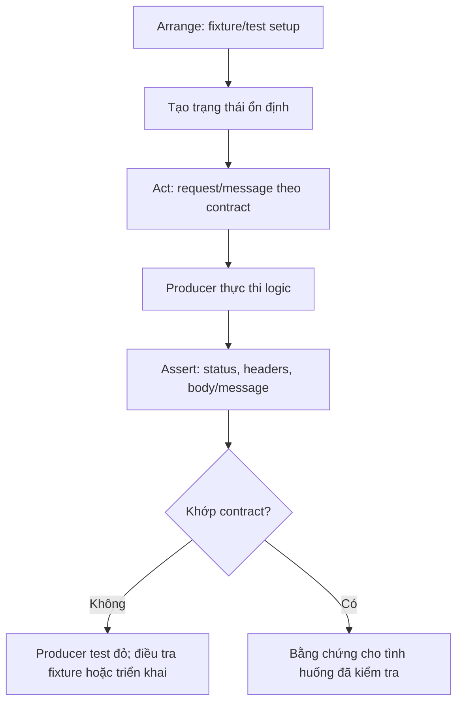
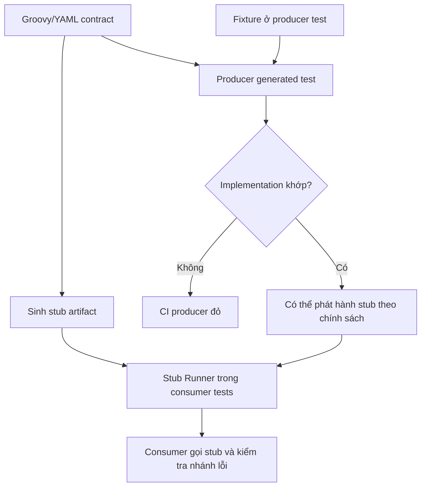

# Tách chuẩn bị dữ liệu khỏi hành vi cần xác minh

## 1. Mục tiêu của việc tách trạng thái và kỳ vọng

Trong hệ thống nhiều dịch vụ, **producer** triển khai API hoặc phát thông điệp; **consumer** gọi API hoặc nhận thông điệp. Với **Spring Cloud Contract (SCC)**, hai bên thỏa thuận hành vi HTTP/messaging bằng **Groovy/YAML DSL**, sinh kiểm thử phía producer, tạo stub cho consumer dùng qua **Stub Runner** và tích hợp vào CI để phát hiện thay đổi API không tương thích.

Một request `GET /api/orders/42` chỉ trả `200 OK` nếu trạng thái hệ thống phù hợp: đơn `42` tồn tại và có dữ liệu cần thiết. Request `GET /api/orders/9999` có thể cần trả `404 Not Found` nếu đơn không tồn tại. Request xác nhận một đơn `LOCKED` có thể được thiết kế trả `409 Conflict`. **Contract mô tả kết quả quan sát được; test fixture dựng điều kiện để kết quả đó có ý nghĩa.**

Nếu môi trường test chưa có đơn `42`, producer test có thể đỏ vì thiếu dữ liệu dù logic API đúng. Ngược lại, nếu controller trong test luôn trả `404` cho mọi ID thì test nhánh lỗi có thể xanh dù producer không thật sự kiểm tra việc tồn tại của resource.

**Sau bài này, người học có thể:**

- Phân biệt **Arrange** (chuẩn bị dữ liệu), **Act** (gửi request/kích hoạt tương tác) và **Assert** (xác minh response/message).
- Thiết kế fixture cho nhánh thành công, không tìm thấy và xung đột mà không nhồi chi tiết database vào contract.
- Biết sử dụng base class/setup cho generated producer tests trong Spring Cloud Contract.
- Giữ dữ liệu thử nghiệm độc lập, tái lập được và không phụ thuộc thứ tự test.
- Phân biệt dữ liệu producer test với hành vi mô phỏng của stub, rồi thiết lập cổng CI phù hợp.

> **Nguyên tắc:** Contract trả lời “consumer gọi gì và producer phải trả gì”; fixture trả lời “trạng thái nào phải có trước khi gọi”. Hai câu trả lời liên quan nhưng không thể thay thế nhau.

## 2. Phân biệt ba loại trạng thái

Từ “trạng thái” dễ gây nhầm khi nói về API lỗi:

| Khái niệm | Ví dụ | Vai trò |
|---|---|---|
| **Trạng thái nghiệp vụ** | Đơn hàng `PAID`, `LOCKED`, `CANCELLED` | Điều kiện trong logic producer |
| **HTTP status** | `200`, `404`, `409` | Cam kết giao tiếp mà consumer quan sát |
| **Trạng thái test** | Có bản ghi `42`; không có `9999`; đồng hồ hoặc quyền truy cập được cấu hình | Điều kiện để generated tests đi đúng nhánh |

Trường `response.status: 409` trong YAML là **mã HTTP**. Nếu response có `body.status: LOCKED` thì đây là **trường nghiệp vụ**; chúng không đồng nghĩa. Tương tự, không có key chuẩn nào tên `given: orderExists` mà ta có thể tùy ý thêm vào YAML rồi mong SCC tự thêm dữ liệu vào database.

### Quy trình Arrange – Act – Assert



Trong HTTP contract của SCC, `request` mô tả **Act** và `response` mô tả **Assert**. **Arrange** thường nằm trong **lớp cơ sở (test base)** của generated tests, fixture/test configuration, cơ sở dữ liệu thử nghiệm hoặc mock của thành phần phụ thuộc.

Không nên để các chi tiết như tên bảng `orders`, lệnh SQL seed, class repository hoặc cách reset cache lẫn vào kỳ vọng giao tiếp, trừ khi bản thân chúng là một phần API mà consumer cần.

## 3. Bài toán xuyên suốt: ba tình huống đơn hàng

Giả sử `order-web` (consumer) sử dụng `order-service` (producer). Hai nhóm **đề xuất** những quy tắc sau; chúng không phải hành vi mặc định của Spring Cloud Contract:

| Tình huống | Trạng thái cần dựng trước test | Request | Kết quả consumer cần |
|---|---|---|---|
| Đơn đã thanh toán | Đơn `42` tồn tại; `PAID`; `125000 VND` | `GET /api/orders/42` | `200`, chi tiết đơn |
| Đơn không tồn tại | **Không** có đơn `9999` | `GET /api/orders/9999` | `404`, `ORDER_NOT_FOUND` |
| Đơn bị khóa | Đơn `43` tồn tại; `LOCKED` | `POST /api/orders/43/confirm` | `409`, `ORDER_LOCKED` |

Ma trận này cho thấy một contract chỉ kiểm tra được hành vi khi fixture tương ứng đã được chuẩn bị. Đừng chọn ID `9999` làm “đơn không tồn tại” nếu một bài test khác có thể thêm ID đó vào database dùng chung.

Một consumer có thể còn phụ thuộc vào `400`, `401`, `403`, `422` hoặc `503`. Khi cần, bổ sung tình huống riêng và điều kiện test phù hợp; không suy diễn rằng ba hợp đồng trong bài tự bao phủ mọi lỗi.

## 4. YAML contract: mô tả hành vi, không nhúng việc chuẩn bị dữ liệu

### 4.1. Trường hợp thành công: `200 OK`

File minh họa `order-found.yml`:

```yaml
name: order_found
description: "Đơn 42 tồn tại và đã thanh toán"
request:
  method: GET
  url: /api/orders/42
  headers:
    Accept: application/json
response:
  status: 200
  headers:
    Content-Type: application/json
  body:
    id: 42
    status: PAID
    totalAmount: 125000
    currency: VND
```

Hợp đồng này **không tạo** đơn `42`. Test base/fixture phải đưa producer vào trạng thái có đơn tương ứng. `status: PAID` trong body có ý nghĩa nghiệp vụ, khác `status: 200` ở cấp response.

### 4.2. Trường hợp không tìm thấy: `404 Not Found`

File minh họa `order-not-found.yml`:

```yaml
name: order_not_found
description: "Đơn 9999 không tồn tại trong môi trường test"
request:
  method: GET
  url: /api/orders/9999
response:
  status: 404
  headers:
    Content-Type: application/json
  body:
    code: ORDER_NOT_FOUND
    message: Order not found
```

Đây là kỳ vọng có điều kiện: **ID `9999` vắng mặt** trước khi request. Nếu producer trả `200` vì bản ghi còn sót từ test khác, cần điều tra **setup/cleanup** trước khi sửa contract. Nếu fixture đã đúng nhưng producer vẫn trả `200`, đó có thể là lỗi triển khai thật.

Nếu consumer chỉ phụ thuộc vào `code`, hãy cân nhắc liệu `message` có cần khớp chính xác (nội dung thông báo có thể được dịch). Contract nên ràng buộc đúng những gì consumer cần và nhóm đã cam kết.

### 4.3. Trường hợp xung đột: `409 Conflict`

File minh họa `order-locked.yml`:

```yaml
name: order_locked_cannot_confirm
description: "Đơn 43 đang LOCKED nên không thể xác nhận"
request:
  method: POST
  url: /api/orders/43/confirm
response:
  status: 409
  headers:
    Content-Type: application/json
  body:
    code: ORDER_LOCKED
```

Trước khi chạy test, fixture cần bảo đảm đơn `43` **thực sự ở trạng thái `LOCKED`**. Một mock luôn trả `409` cho mọi request có thể làm test này xanh nhưng che lỗi logic. Nếu consumer cần cả nhánh xác nhận thành công, nhóm phải có contract/test riêng cho tình huống phù hợp.

**Quan trọng:** `409` và `ORDER_LOCKED` là lựa chọn trong API minh họa. SCC không tự suy ra mã HTTP từ tên domain state.

### 4.4. Hợp đồng không nên giả định stub biết trạng thái database

Các contract trên dùng **request phân biệt bằng ID và path**. Nếu hai hợp đồng có **request matcher trùng nhau nhưng response khác nhau**, stub HTTP có thể không biết phải trả tình huống nào. Khi cần mô phỏng trạng thái khác nhau với cùng request, phải thiết kế request phân biệt hoặc dùng cơ chế scenario/stateful stub phù hợp. Không giả định Stub Runner sẽ truy vấn database fixture của producer.

## 5. Đặt phần Arrange ở test base của Spring Cloud Contract

Spring Cloud Contract có thể sinh producer tests kế thừa một **base class** do nhóm cấu hình. Base class là nơi thích hợp để khởi tạo ứng dụng, dựng fixture, thiết lập mock hoặc cấu hình test mode. Tài liệu Spring Cloud Contract mô tả base test class như nơi chứa thông tin cần thiết để generated tests chạy.

### 5.1. Ví dụ JUnit 5, Spring Boot, MockMvc

Đoạn mã sau là **khung minh họa**. `OrderScenarioFixtures` là thành phần **do dự án tự triển khai**, không phải API có sẵn của Spring Cloud Contract; cần điều chỉnh tên package, dependency, repository và setup theo dự án.

```java
package com.example.orders.contract;

import org.junit.jupiter.api.BeforeEach;
import org.springframework.beans.factory.annotation.Autowired;
import org.springframework.boot.test.context.SpringBootTest;
import org.springframework.web.context.WebApplicationContext;
import static io.restassured.module.mockmvc.RestAssuredMockMvc.webAppContextSetup;

@SpringBootTest
public abstract class ContractTestBase {
    @Autowired
    private WebApplicationContext applicationContext;

    @Autowired
    private OrderScenarioFixtures fixture;

    @BeforeEach
    void prepare() {
        fixture.resetOrdersForContracts();
        fixture.saveOrder(42L, "PAID", 125000L, "VND");
        fixture.saveOrder(43L, "LOCKED", 0L, "VND");
        fixture.ensureOrderAbsent(9999L);

        webAppContextSetup(applicationContext);
    }
}
```

Trong cấu hình **JUnit 5 và test mode MockMvc** phù hợp, `@BeforeEach` chạy trước generated test kế thừa lớp cơ sở. Dữ liệu được dựng lại để request đi vào đúng nhánh. Nếu dự án dùng JUnit 4/Spock, Rest Assured với server thật, WebTestClient hoặc messaging, cơ chế lifecycle và setup cần thay đổi theo framework/version.

Không nên dùng trực tiếp lệnh `deleteAll()` trên một database dùng chung. `resetOrdersForContracts()` chỉ được triển khai trong **môi trường test cô lập**, ví dụ test database/schema hoặc container riêng.

### 5.2. Liên kết base class với Maven plugin

Đoạn cấu hình trọng tâm trong `pom.xml`:

```xml
<build>
    <plugins>
        <plugin>
            <groupId>org.springframework.cloud</groupId>
            <artifactId>spring-cloud-contract-maven-plugin</artifactId>
            <version>YOUR_COMPATIBLE_SCC_VERSION</version>
            <extensions>true</extensions>
            <configuration>
                <baseClassForTests>
                    com.example.orders.contract.ContractTestBase
                </baseClassForTests>
            </configuration>
        </plugin>
    </plugins>
</build>
```

Đây **không phải POM hoàn chỉnh**; producer vẫn cần cấu hình plugin, test mode, verifier dependency và các phiên bản tương thích với Spring Boot/Spring Cloud. Nếu dùng Gradle, SCC plugin có cấu hình base class tương ứng với cú pháp Gradle DSL. Hãy xác nhận generated tests **thật sự kế thừa lớp này** bằng cách đọc generated sources/test report.

### 5.3. Tách API fixture khỏi assertion

Một interface test fixture minh họa:

```java
interface OrderScenarioFixtures {
    void resetOrdersForContracts();
    void paidOrderExists(long id, long amount, String currency);
    void lockedOrderExists(long id);
    void orderDoesNotExist(long id);
}
```

Các phương thức này diễn đạt **điều kiện**, không nên trả `HttpResponse` hoặc tự assert status. Ngược lại, trong contract `request/response` không cần biết repository sử dụng SQL gì để lưu đơn. Hai trách nhiệm tách biệt giúp người bảo trì hiểu test đỏ do **setup**, **implementation**, hay **thỏa thuận giao diện**.

Khi số tình huống tăng, có thể tách fixture theo nhóm và dùng các cơ chế base-class mapping được plugin hỗ trợ theo phiên bản. Không cần đặt mọi fixture của cả hệ thống trong một hàm `@BeforeEach` khổng lồ.

## 6. Fixture tốt phải có thể tái lập và không phụ thuộc thứ tự test

Một bài contract test có ý nghĩa không chỉ nhờ YAML đúng cú pháp, mà còn nhờ trạng thái ban đầu được thiết kế tốt.

| Tính chất | Cách thực hiện | Hậu quả nếu thiếu |
|---|---|---|
| **Tái lập (deterministic)** | Cùng setup luôn tạo cùng tình huống | Test lúc xanh lúc đỏ |
| **Cô lập (isolated)** | Không chia sẻ dữ liệu có thể bị test khác sửa | Kết quả phụ thuộc thứ tự |
| **Nhỏ gọn (minimal)** | Chỉ chuẩn bị dữ liệu quan trọng | Khó phân biệt nguyên nhân lỗi |
| **Rõ ràng (explicit)** | Tên fixture nói lên điều kiện nghiệp vụ | Không biết vì sao `404` hay `409` |
| **An toàn (scoped)** | Chỉ ghi vào môi trường thử nghiệm | Có thể xóa nhầm dữ liệu dùng chung |
| **Có thể quan sát (traceable)** | Log ID/tình huống và trạng thái đã dựng | Khó tìm chỗ sai trong CI |

### 6.1. Chạy test riêng lẻ hay cả suite đều phải đúng

Đừng thiết kế test A thêm đơn `42` để test B dùng lại. Generated tests có thể chạy theo thứ tự khác, chạy riêng, hoặc song song trong CI.

Có thể chọn một trong các cách sau theo kiến trúc:

- **Cơ sở dữ liệu test cô lập:** dựng hoặc dọn dữ liệu trước mỗi bài test.
- **Transaction/rollback:** phù hợp khi test và request cùng phạm vi transaction; phải xác minh hành vi thực tế.
- **Testcontainers hoặc schema riêng:** hữu ích khi cần database thật nhưng tránh can thiệp dữ liệu khác.
- **Mock dependency theo input:** phù hợp khi chỉ cần cô lập ranh giới HTTP mà vẫn muốn kiểm tra logic mapping.
- **Dữ liệu ID cố định trong fixture:** giúp debug dễ hơn; dùng riêng phạm vi test để tránh trùng ID.

**Không** chạy dọn sạch bảng production hay database chia sẻ không có cơ chế cách ly. Chữ “reset” trong ví dụ là một **trách nhiệm test fixture**, không phải hướng dẫn xóa dữ liệu tùy tiện.

### 6.2. Trạng thái ngoài database cũng cần được chuẩn bị

Một test lỗi có thể phụ thuộc vào:

- **Clock:** đơn quá hạn vào ngày cố định; tránh dùng `Instant.now()` không kiểm soát.
- **Principal và role:** phân biệt xác thực `401` với phân quyền `403`.
- **Feature flag/config:** API có nhánh hành vi theo cấu hình.
- **Cache:** phải đồng bộ hoặc làm sạch khi fixture đổi bản ghi.
- **Downstream service:** mô phỏng phản hồi `503` hoặc timeout bằng cách ổn định, không làm sập cả môi trường.
- **Rate limiter:** reset counter đúng phạm vi để thử `429`.

Tất cả các điều kiện này đều thuộc **Arrange**. Nếu dữ liệu trong response như `correlationId`, `ETag` hay mã lỗi là một phần cam kết giao tiếp, hãy khai báo **điều consumer nhìn thấy** trong contract, còn cách tạo ra điều kiện ban đầu vẫn ở fixture/test setup.

## 7. Chuẩn bị tình huống lỗi mà không phá hỏng ý nghĩa của hợp đồng

Một API có nhiều dạng lỗi, mỗi dạng yêu cầu fixture khác nhau:

| Lỗi consumer cần phân biệt | Arrange phù hợp | Act/Assert trong contract | Bẫy |
|---|---|---|---|
| `400 Bad Request` | Gửi input không hợp lệ theo quy tắc API | Status `400` và schema lỗi | Cố làm database hỏng để tạo lỗi validation |
| `401 Unauthorized` | Thiếu/thông tin xác thực không hợp lệ | Status/challenge cần thiết | Nhầm với `403` |
| `403 Forbidden` | User đã xác thực nhưng không có quyền | Status và error envelope | Fixture vô tình cấp quyền quản trị |
| `404 Not Found` | Resource chắc chắn không tồn tại | `404`, `ORDER_NOT_FOUND` | Bản ghi sót lại từ test khác |
| `409 Conflict` | Resource/version ở trạng thái xung đột | `409`, `ORDER_LOCKED` | Mock luôn trả `409` bất kể trạng thái |
| `422 Unprocessable Content` | Body đúng cú pháp nhưng vi phạm quy tắc đã thỏa thuận | `422` nếu API sử dụng | Gộp nhầm với mọi `400` |
| `429 Too Many Requests` | Rate limiter ở ngưỡng định trước | `429` và `Retry-After` nếu cần | Counter bị ảnh hưởng test khác |
| `503 Service Unavailable` | Downstream hoặc service ở chế độ lỗi có kiểm soát | `503` và thông tin được cam kết | Tạo lỗi không ổn định trên mạng thật |

Các mã ở bảng là **ví dụ thiết kế phổ biến**, không phải SCC mặc định lựa chọn dựa trên input. Với mỗi API, producer và consumer phải thống nhất mã, body lỗi, các header cần thiết và nhánh nào đáng được bảo vệ.

### 7.1. Phản ví dụ: ép controller ném lỗi để test xanh

```java
// KHÔNG NÊN: minh họa cách làm sai.
// Một test profile làm mọi request đều thất bại.
if (contractTestProfile) {
    throw new OrderNotFoundException();
}
```

Một generated test cho `404` có thể xanh, nhưng việc producer có phân biệt resource tồn tại hay không **chưa được kiểm chứng**. Hãy để controller đi qua nhánh xử lý thật với fixture điều kiện tương ứng. Nếu cần mock repository, mock nên phụ thuộc vào ID/điều kiện cần bảo vệ, chứ không trả lỗi vô điều kiện.

### 7.2. Danh sách rỗng chưa chắc là `404`

`GET /api/orders?status=PAID` có thể trả `200` với `items: []` khi bộ lọc không tìm được phần tử; `GET /api/orders/9999` có thể trả `404` khi một resource cụ thể không tồn tại. Cả hai đều “không có đơn” ở dữ liệu, nhưng **ngữ nghĩa request khác nhau**. Fixture giúp tái hiện trạng thái; contract cần bảo vệ response mà consumer thật sự mong đợi.

### 7.3. Body lỗi có ý nghĩa khác nhau

Nếu consumer dựa vào `code: ORDER_LOCKED` để chọn thông báo, nên đưa code vào hợp đồng. Trường `message` có thể thay đổi theo ngôn ngữ hoặc chiến lược hiển thị, nên việc buộc khớp văn bản chính xác cần được cân nhắc. Không dùng một matcher `.*` cho tất cả error code chỉ để test đỡ đỏ; điều đó có thể che thay đổi làm consumer không nhận diện được lỗi.

## 8. Transaction, concurrency và tính ổn định của trạng thái test

### 8.1. `@Transactional` không giải quyết mọi trường hợp

Một generated test có thể gọi controller qua MockMvc, hoặc gửi request vào server chạy ở thread khác, trong khi service thực hiện transaction riêng. Vì vậy, `@Transactional` và cơ chế rollback trên test **không tự bảo đảm** mọi side effect, event bất đồng bộ hoặc cache được phục hồi.

Nên xác nhận test mode đang dùng và cách request truy cập database; nếu cần, triển khai cleanup rõ ràng hoặc dựng database/container mới cho test. Tránh dựa vào rollback một cách mặc định khi có message broker, tác vụ nền hoặc HTTP server thật.

### 8.2. Chạy song song có thể phá fixture của nhau

Giả sử test A xóa mọi đơn rồi thêm `42`, trong khi test B đang kiểm tra đơn `43` bị khóa. Nếu hai test dùng chung database và chạy đồng thời, dữ liệu test B có thể bị xóa giữa chừng.

Các lựa chọn phù hợp tùy dự án gồm:

- Database/schema/container riêng cho từng nhóm test.
- Fixture có namespace/ID độc lập, tránh cleanup trên toàn bộ bảng dùng chung.
- Điều phối mức song song khi không thể cô lập trạng thái.
- Dọn và tạo lại dữ liệu theo phạm vi test, không theo thứ tự chạy.

### 8.3. Dữ liệu ngẫu nhiên và thời gian hiện tại

Nếu fixture sinh ID tự do nhưng contract cố định `GET /api/orders/42`, test sẽ không tái lập được. Nếu API trả timestamp hiện tại, không nên bắt buộc bằng một chuỗi thời gian cố định trừ khi clock được cố định; hãy dùng matcher phù hợp cho trường động khi đó là cam kết thật.

**Giá trị test cố định và dữ liệu production động không mâu thuẫn:** fixture dùng `42` để đưa request vào một nhánh đã định, không có nghĩa producer phải luôn phục vụ ID `42` trong mọi môi trường.

## 9. Đọc kết quả producer verification theo đúng trách nhiệm

Generated producer test thường thực hiện request được DSL mô tả và so khớp status/header/body đã khai báo. Về mặt ý nghĩa, test nhánh không tồn tại giống như:

```java
// Pseudocode để giải thích trách nhiệm,
// KHÔNG phải mã generated SCC chính xác.
prepareFixtureWhereOrder9999DoesNotExist();
HttpResponse result = callGet("/api/orders/9999");
assert result.statusCode() == 404;
assert result.json("code").equals("ORDER_NOT_FOUND");
```

Trong thực tế, `prepareFixtureWhereOrder9999DoesNotExist()` nằm trong **base class/lifecycle setup**, không phải do SCC tự suy ra từ `response.status: 404`.

| Hiện tượng | Nguyên nhân cần xem xét | Bước chẩn đoán |
|---|---|---|
| Test không khởi động | Sai base class/test mode, thiếu bean | Kiểm tra generated source và test context |
| `GET /42` trả `404` | Chưa seed đơn hoặc producer lỗi | Kiểm tra fixture và đường xử lý |
| `GET /9999` trả `200` | ID còn tồn tại hoặc nhánh lỗi sai | Kiểm tra trạng thái trước request |
| `POST /43/confirm` trả `200` | Đơn không LOCKED hoặc xử lý xung đột sai | Kiểm tra fixture rồi implementation |
| HTTP đúng, error code sai | Producer đổi schema lỗi | Kiểm tra body và consumer requirements |
| Chạy riêng xanh, chạy chung đỏ | Test dùng chung dữ liệu/cache | Kiểm tra cleanup, thứ tự, parallelism |
| Local xanh, CI đỏ | Profile, DB seed, timezone/config khác | Đảm bảo test environment có thể tái lập |
| Không thấy test contract được chạy | Bị skip hoặc plugin/lifecycle thiếu | Kiểm tra build log và test report |

Khi một test đỏ, **đừng đổi contract để test xanh trước khi tìm nguyên nhân**. Nếu fixture sai, sửa fixture. Nếu producer sai giao diện đã thỏa thuận, sửa implementation. Nếu nhóm **chủ ý đổi API**, cần review với consumer, cập nhật contract và lên kế hoạch tương thích/versioning.

## 10. Consumer test với Stub Runner không sử dụng fixture producer

Đây là ranh giới cần nhớ:

- **Producer verification** chạy test trên **producer thật trong môi trường test**, nên phải chuẩn bị database, mock, clock, quyền và các điều kiện thích hợp.
- **Consumer test** chạy với **stub** mô phỏng API/message được tạo từ contract. Stub Runner thường nạp mapping có sẵn, không tự truy cập database fixture của producer.



Ví dụ stub có thể đáp ứng `GET /api/orders/9999` bằng `404` dù producer bản mới đã vô tình trả `200`. **Consumer test xanh không chứng minh producer thật đang chạy đúng**. Phải chạy producer test trên đúng commit/artifact dự kiến phát hành và quản lý stub version để tránh kết luận từ bản mô phỏng cũ.

Nếu có hai contract cho **cùng request hoàn toàn** nhưng yêu cầu response khác do trạng thái nền khác nhau, cần thiết kế lại mapping/stub scenario. Stub không thể tự nhìn vào database producer để chọn response. Trong bài cơ bản, việc dùng ID/path khác nhau cho các tình huống giúp tránh chồng lấn mapping.

### Messaging cũng cần tách trạng thái

Với message contract, điều kiện như “đơn đã thanh toán trước khi phát sự kiện” thuộc setup/trigger của producer test; những trường payload, header, destination và điều kiện consumer cần thuộc contract. Cấu hình broker, retry, thứ tự giao hàng, duplicate delivery và transaction/outbox cần những lớp kiểm thử bổ sung. Đừng coi stub thông điệp là bằng chứng broker production luôn giao hàng đúng.

## 11. Tích hợp CI mà không che sai lệch giao diện

Một quy trình hữu ích:

1. **Review contract:** consumer và producer thống nhất request/response cho từng trạng thái thành công/lỗi.
2. **Tạo môi trường test cô lập:** database hoặc mock được reset, seed đúng các fixture đã nêu.
3. **Sinh producer tests:** Maven/Gradle plugin đọc Groovy/YAML DSL.
4. **Chạy generated tests:** test base dựng điều kiện, test gửi request và xác minh HTTP/message. Lỗi phải làm job CI fail.
5. **Điều tra lỗi ở đúng lớp:** phân biệt fixture sai với implementation vi phạm contract; không bỏ qua test thất bại.
6. **Phát hành stub có phiên bản:** gắn với hợp đồng và producer build đã được xác minh theo chính sách dự án.
7. **Chạy consumer tests với Stub Runner:** nạp stub đúng version, gọi request và kiểm tra logic xử lý các mã `200`, `404`, `409`.
8. **Giữ các lớp test bổ sung:** integration/database, nghiệp vụ, bảo mật và độ bền để kiểm tra những điều ngoài contract.

Một pipeline chỉ **sinh** test hoặc stub nhưng không **chạy** test, hoặc release một artifact khác artifact đã được xác minh, không cung cấp bằng chứng tương thích đáng tin cậy.

## 12. Lỗi thường gặp khi trộn dữ liệu và kỳ vọng

| Sai lầm | Hậu quả | Cách khắc phục |
|---|---|---|
| Thêm `given: orderExists` tùy ý trong YAML | Công cụ không tự seed dữ liệu | Đặt setup trong fixture/test base |
| Một test phụ thuộc test khác đã tạo bản ghi | Flaky test theo thứ tự chạy | Chuẩn bị độc lập trước mỗi test |
| Mock luôn trả `404` bất kể ID | Không kiểm tra đúng điều kiện không tồn tại | Mock theo input hoặc dùng test DB |
| Dọn database dùng chung trước mỗi test | Gây race condition và mất dữ liệu | Cô lập database/schema/fixture |
| Cho rằng `@Transactional` rollback mọi request/event | Side effect vẫn còn, test khó tái lập | Kiểm tra transaction boundary, cleanup |
| Nhầm `body.status: LOCKED` với `response.status: 409` | Không bảo vệ đúng HTTP status | Đọc đúng cấp dữ liệu |
| Chỉ kiểm tra `404`, bỏ error `code` | Consumer có thể phân nhánh sai | Assert cả mã lỗi ổn định |
| Mặc định danh sách rỗng phải trả `404` | Sai ngữ nghĩa API collection | Phân biệt request collection với resource ID |
| Hai stub mapping trùng request nhưng khác response | Stub khó chọn đúng nhánh | Phân biệt request hoặc scenario rõ |
| Consumer test dùng stub cũ rồi tuyên bố producer mới đã đúng | Không thấy regression ở implementation | Chạy producer verification đúng build |
| Sửa YAML để CI xanh trong khi setup chưa chuẩn | Hợp thức hóa giao diện sai | Sửa fixture trước, review API khi cần |

## 13. Bài tập: tách fixture và hợp đồng lỗi cho thanh toán

**Bối cảnh:** `invoice-service` gọi `payment-service` bằng `POST /api/payments/{paymentId}/capture`. Các tình huống được hai bên đề xuất:

- `PAY-101` ở trạng thái `AUTHORIZED`: capture thành công, HTTP `200`, body `state: CAPTURED`.
- `PAY-999` không tồn tại: HTTP `404`, `code: PAYMENT_NOT_FOUND`.
- `PAY-202` đã `CAPTURED`: thao tác capture lặp bị từ chối, HTTP `409`, `code: ALREADY_CAPTURED`.

**Yêu cầu thực hành:**

1. Lập bảng Arrange – Act – Assert cho ba tình huống.
2. Viết ba YAML contract riêng cho `200`, `404` và `409`.
3. Đề xuất fixture API `authorizedPaymentExists`, `capturedPaymentExists`, `paymentDoesNotExist`; giải thích tại sao những hàm này không nên assert HTTP.
4. Nêu cách reset test database/mocks để các bài test chạy độc lập.
5. Chỉ ra bằng chứng mà producer verification và consumer test với Stub Runner cung cấp.
6. Thiết kế thêm một integration/business test để xác nhận **không capture giao dịch hai lần**, vì status contract đơn lẻ chưa chứng minh side effect.

**Gợi ý hợp đồng xung đột:**

```yaml
name: payment_already_captured
description: "PAY-202 đã CAPTURED; capture lại bị từ chối"
request:
  method: POST
  url: /api/payments/PAY-202/capture
response:
  status: 409
  headers:
    Content-Type: application/json
  body:
    code: ALREADY_CAPTURED
```

**Gợi ý bảng đối chiếu:**

| Contract | Arrange | Act | Assert |
|---|---|---|---|
| `payment_capture_success` | `PAY-101` tồn tại, `AUTHORIZED` | `POST /api/payments/PAY-101/capture` | `200`, `state: CAPTURED` |
| `payment_not_found` | `PAY-999` vắng mặt | `POST /api/payments/PAY-999/capture` | `404`, `PAYMENT_NOT_FOUND` |
| `payment_already_captured` | `PAY-202` tồn tại, `CAPTURED` | `POST /api/payments/PAY-202/capture` | `409`, `ALREADY_CAPTURED` |

Một test trả đúng `409` mà vẫn gọi downstream capture lần thứ hai cho thấy **cần kiểm thử side effect riêng**, không được suy ra nghiệp vụ đúng chỉ từ response.

## 14. Checklist trước khi review và phát hành

- [ ] Mỗi contract có giả định **trạng thái ban đầu** rõ ràng.
- [ ] DSL mô tả **request/response/message** consumer thực sự cần; fixture ở test setup.
- [ ] Base class của generated tests chạy đúng với JUnit/Spock/test mode cấu hình.
- [ ] Dữ liệu được reset hoặc cô lập giữa các test, không phụ thuộc thứ tự.
- [ ] Test DB/mock/cache/clock/role/feature flag được kiểm soát theo phạm vi an toàn.
- [ ] Status, header và error code được assert đúng với cam kết của consumer.
- [ ] Không hard-code controller bỏ qua logic chỉ để test contract xanh.
- [ ] Generated producer tests được **sinh và thực thi**, lỗi khiến CI thất bại.
- [ ] Stub không có mapping chồng lấn không được giải quyết.
- [ ] Consumer test qua Stub Runner kiểm tra hành vi client với đúng stub version.
- [ ] Thay đổi API có chủ ý được review và kiểm thử với các phiên bản consumer còn hỗ trợ.
- [ ] Có integration/security/business tests bổ sung cho side effect và các rủi ro ngoài hợp đồng.

## 15. Ghi nhớ và tài liệu tham khảo

**Tách chuẩn bị dữ liệu khỏi hành vi cần xác minh** giúp hợp đồng dễ review, producer tests tái lập và báo cáo CI đáng tin cậy. Spring Cloud Contract mô tả giao diện HTTP/message qua Groovy/YAML DSL; **test base và fixture** tạo điều kiện để producer đi đúng nhánh; **generated tests** xác minh implementation; **stub và Stub Runner** giúp consumer kiểm thử hành vi mô phỏng. Hai nhánh kiểm thử bổ sung cho nhau, không thay thế nhau.

Một kết quả PASS chỉ có ý nghĩa với request, fixture, assertion và phiên bản đã chạy. Nó không tự chứng minh toàn bộ nghiệp vụ, giao dịch database, broker, mọi consumer hoặc production đều đúng. Hãy thiết lập CI theo chuỗi có thể truy vết và dùng kiểm thử bổ sung cho những điều contract không bao phủ.

Tài liệu chính thức để đối chiếu theo phiên bản Spring Cloud Contract:

- [Spring Cloud Contract — First Application: cấu hình base test class](https://docs.spring.io/spring-cloud-contract/reference/getting-started/first-application.html).
- [Spring Cloud Contract — HTTP Contracts: request và response](https://docs.spring.io/spring-cloud-contract/reference/project-features-contract/http.html).
- [Spring Cloud Contract — Dynamic Properties](https://docs.spring.io/spring-cloud-contract/reference/project-features-contract/dsl-dynamic-properties.html).
- [Spring Cloud Contract — Stub Runner Core](https://docs.spring.io/spring-cloud-contract/reference/project-features-stubrunner/stub-runner-core.html).


