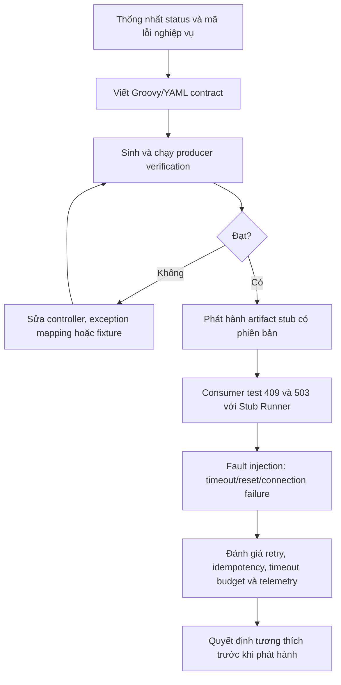

# Phân biệt lỗi nghiệp vụ với lỗi kết nối hoặc hạ tầng

## 1. Vì sao phải phân loại lỗi khi thiết kế hợp đồng?

Trong hệ thống microservices, `checkout-service` (consumer) gọi `payment-service` (producer) để thu tiền cho một đơn hàng. Khi thao tác không thành công, consumer cần biết **nguyên nhân và hành động tiếp theo**. Một lệnh thu tiền bị từ chối vì thanh toán đang ở trạng thái không cho phép khác hoàn toàn với lệnh thất bại vì mất kết nối đến Payment. Hai tình huống có thể cùng khiến giao diện hiển thị “Không thể thanh toán”, nhưng cách xử lý, retry, ghi log và đối soát không được giống nhau.

**Spring Cloud Contract** cho phép định nghĩa hành vi HTTP hoặc thông điệp bằng **Groovy/YAML DSL**, sinh kiểm thử xác minh producer và phát hành stub. Consumer dùng **Stub Runner** để kiểm tra client mà không cần khởi động producer thật; CI chạy producer verification và consumer test để phát hiện thay đổi API không tương thích. Tuy nhiên, một contract HTTP chỉ mô tả những tương tác **có request và response xác định**. Nó không tự chứng minh mọi trường hợp đứt mạng, broker chết hay request đã được xử lý nhưng response bị mất.

Bài này tập trung vào ba loại kết quả cần tách bạch:

1. **Lỗi nghiệp vụ / từ chối có chủ đích:** producer nhận và xử lý yêu cầu, nhưng một quy tắc nghiệp vụ không cho phép hoàn tất. Thường có HTTP response và mã lỗi ổn định cho consumer.
2. **Lỗi phía server hoặc hạ tầng được biểu diễn bằng HTTP:** producer, gateway hoặc proxy vẫn trả **một HTTP response**, ví dụ `503 Service Unavailable` hay `504 Gateway Timeout`.
3. **Lỗi kết nối / transport không có HTTP response:** consumer không nhận được status và body hợp lệ, ví dụ DNS không phân giải, kết nối bị từ chối, TLS handshake thất bại hoặc read timeout.

**Kết quả học tập:** sau bài này, bạn có thể thiết kế contract lỗi nghiệp vụ và lỗi HTTP hạ tầng, kiểm tra consumer phân nhánh theo status và mã lỗi, phân biệt retry an toàn với retry nguy hiểm, đồng thời đưa fault injection vào tầng kiểm thử riêng thay vì giả vờ rằng mọi timeout đều có status `504`.

## 2. Cùng chữ “lỗi” nhưng ý nghĩa khác nhau

| Khía cạnh | Lỗi nghiệp vụ | Lỗi HTTP do server/hạ tầng | Lỗi transport không có response |
| --- | --- | --- | --- |
| Điều gì đã xảy ra? | Yêu cầu đến producer; quy tắc ứng dụng từ chối hoặc không thể đáp ứng yêu cầu. | Một thành phần HTTP trả trạng thái lỗi vì không thực hiện được request. | Client không nhận được HTTP response hoàn chỉnh. |
| Ví dụ | Payment đang `REJECTED` nên không thể capture. | Payment đang tạm ngưng nhận yêu cầu, trả `503`. | TCP connection refused, TLS error, read timeout. |
| HTTP status? | **Có**, theo API đã thống nhất, ví dụ `409`/`422`. | **Có**, ví dụ `500`, `502`, `503`, `504`. | **Không có status nhận được**; một exception hoặc timeout xảy ra ở client. |
| Có JSON lỗi? | Thường có mã lỗi và thông tin đủ để consumer xử lý. | Có thể có JSON lỗi ổn định; không phải lúc nào gateway cũng tuân cùng schema. | **Không thể** trông chờ body JSON từ request đó. |
| Retry ngay? | Thường **không**, trừ khi trạng thái nghiệp vụ thay đổi hoặc policy nói rõ. | Chỉ khi an toàn và theo chính sách retry/budget, không mặc định mọi `5xx` đều retry. | Cần rất cẩn thận: request có thể đã thực thi trước khi kết nối đứt. |
| Hướng xử lý | Thông báo hành động cần sửa; cập nhật trạng thái đơn; không coi là sự cố mạng. | Theo dõi khả dụng, backoff, circuit breaker, đối soát trạng thái khi cần. | Phân loại timeout/connect error, ghi telemetry, đối soát trước khi phát lại thao tác có side effect. |
| Test phù hợp | Spring Cloud Contract HTTP contract + test consumer với stub. | HTTP contract cho **response đã cam kết**; thêm test logic tạo lỗi. | Fault injection/network tests ở tầng client/integration, ngoài một cặp request/response contract thông thường. |

**Không được suy luận “mọi `4xx` là lỗi nghiệp vụ, mọi `5xx` là lỗi hạ tầng”.** `400` có thể là request sai cú pháp; `401/403` liên quan xác thực/phân quyền; `429` thể hiện giới hạn tần suất; `500` có thể do lỗi lập trình trong producer chứ không hẳn do mạng. Phân loại theo **ngữ nghĩa API và nguồn gốc sự cố**, rồi mới chọn status phù hợp.

## 3. Chọn HTTP status có cơ sở

Các mã dưới đây có ý nghĩa trong HTTP, nhưng **không phải bảng ánh xạ bắt buộc cho mọi nghiệp vụ**:

| Status | Ý nghĩa HTTP | Khi có thể xuất hiện trong API thanh toán |
| --- | --- | --- |
| `400 Bad Request` | Request không hợp lệ theo cách server diễn giải. | JSON malformed hoặc vi phạm định dạng mà API coi là bad request. |
| `401 Unauthorized` | Thiếu hoặc không có thông tin xác thực hợp lệ. | Token thiếu/hết hạn, theo cơ chế xác thực của API. |
| `403 Forbidden` | Server hiểu request nhưng từ chối cấp quyền. | Tài khoản không được phép capture thanh toán đó. |
| `404 Not Found` | Tài nguyên đích không được tìm thấy/công bố. | Không có payment ID hoặc chính sách ẩn tài nguyên. |
| `409 Conflict` | Request xung đột với **trạng thái hiện tại của tài nguyên**. | Payment đang `REJECTED`, không thể chuyển sang `CAPTURED`. |
| `422 Unprocessable Content` | Nội dung đúng cú pháp và loại dữ liệu, nhưng chỉ dẫn trong nội dung không xử lý được. | Số tiền không đáp ứng quy tắc nghiệp vụ; chọn `422` khi đó là quy ước API. |
| `429 Too Many Requests` | Request bị giới hạn tần suất. | Consumer vượt quota của API. |
| `500 Internal Server Error` | Server gặp sự cố không mong đợi. | Bug hoặc ngoại lệ chưa được ánh xạ phù hợp. |
| `502 Bad Gateway` | Gateway/proxy nhận phản hồi không hợp lệ từ upstream. | API gateway nhận phản hồi sai từ dịch vụ Payment. |
| `503 Service Unavailable` | Server tạm không thể xử lý, thường vì quá tải/bảo trì. | Payment trả response `503` khi không sẵn sàng theo chính sách của dịch vụ. |
| `504 Gateway Timeout` | Gateway/proxy không nhận phản hồi upstream đúng hạn. | API gateway đợi Payment quá thời gian cho phép. |

**Ví dụ chính của bài:** nhóm Payment thống nhất dùng `409` khi capture một giao dịch đang ở trạng thái `REJECTED`. Đây là một **quy tắc cụ thể của API giả định**, không có nghĩa mọi thanh toán bị từ chối bắt buộc dùng `409`. Một hệ thống khác có thể trả `200` cùng trạng thái nghiệp vụ `DECLINED` hoặc dùng một quy ước khác, miễn cả hai bên nhất trí và kiểm thử đúng cam kết.

Với `503`, RFC 9110 cho phép server gửi `Retry-After` để gợi ý khoảng chờ. Nó **không bảo đảm** yêu cầu lặp lại sẽ an toàn hoặc thành công. `504` có ngữ nghĩa gateway/proxy đợi upstream quá hạn; timeout mà consumer tự phát hiện khi gọi thẳng producer **không tự tạo ra một HTTP response `504`**. <https://www.rfc-editor.org/rfc/rfc9110.html>

## 4. Thiết kế một mã lỗi nghiệp vụ ổn định

Giả sử Checkout gửi lệnh capture:

```http
POST /api/payments/PAY-2002/capture HTTP/1.1
Content-Type: application/json
Idempotency-Key: CAP-ORD-2002-01

{"amount":250000,"currency":"VND"}
```

Trong fixture, giao dịch `PAY-2002` có trạng thái `REJECTED`, nên không đủ điều kiện capture. Producer đã nhận được request và **chủ động trả lời**:

```http
HTTP/1.1 409 Conflict
Content-Type: application/json

{
  "error": {
    "code": "PAYMENT_NOT_CAPTURABLE",
    "message": "Payment is not eligible for capture",
    "paymentId": "PAY-2002",
    "retryable": false
  }
}
```

Các trường có nhiệm vụ khác nhau:

- **HTTP `409`:** cho biết yêu cầu xung đột với trạng thái hiện tại.
- **`error.code`:** mã máy đọc được, bền vững hơn câu chữ. Consumer có thể dùng mã này để rẽ nhánh.
- **`error.message`:** mô tả phục vụ người đọc hoặc log; không nên dùng để quyết định logic vì có thể thay đổi/ngôn ngữ hóa.
- **`error.paymentId`:** giúp xác minh lỗi thuộc đúng giao dịch được yêu cầu.
- **`error.retryable = false`:** gợi ý theo **policy của API**, không phải thuộc tính được HTTP định nghĩa; consumer không nên tự retry chỉ vì status khác `2xx`.

Trong trường hợp này, consumer nên hiển thị hoặc lưu lý do không thể capture, ngừng tự động retry yêu cầu giống hệt, và chỉ cho phép thao tác khác nếu workflow nghiệp vụ có đường xử lý. Không tự đổi `PAYMENT_NOT_CAPTURABLE` thành “Gateway không phản hồi”.

### Quy tắc để một error schema có ích

1. Có **mã lỗi ổn định** với tên phản ánh nguyên nhân nghiệp vụ, ví dụ `PAYMENT_NOT_CAPTURABLE`.
2. Không để consumer parse một câu `message` tự do để phân nhánh.
3. Giữ field/kiểu dữ liệu nhất quán giữa những response cùng họ lỗi; phân biệt trường bắt buộc và tùy chọn.
4. Tránh rò rỉ SQL, stack trace, token, endpoint nội bộ, ID khách hàng nhạy cảm trong payload công khai.
5. Nếu API sử dụng **Problem Details** (`application/problem+json` theo RFC 9457), hãy theo định dạng đó nhất quán. Không trộn cấu trúc tùy biến ở ví dụ này với Problem Details mà không có quyết định thiết kế.
6. Chỉ hứa `retryable` nếu các nhóm đã thống nhất ý nghĩa và các điều kiện an toàn khi thực hiện lại.

## 5. Groovy DSL: contract cho lỗi nghiệp vụ

Ví dụ contract của `payment-service` cho trường hợp giao dịch `REJECTED`:

```groovy
import org.springframework.cloud.contract.spec.Contract

Contract.make {
    name 'capture_payment_rejected_by_state'
    description 'Không thể capture thanh toán ở trạng thái REJECTED'

    request {
        method 'POST'
        urlPath '/api/payments/PAY-2002/capture'
        headers {
            contentType(applicationJson())
            header('Idempotency-Key', 'CAP-ORD-2002-01')
        }
        body([
            amount: 250000,
            currency: 'VND'
        ])
    }

    response {
        status 409
        headers {
            contentType(applicationJson())
        }
        body([
            error: [
                code: 'PAYMENT_NOT_CAPTURABLE',
                message: 'Payment is not eligible for capture',
                paymentId: 'PAY-2002',
                retryable: false
            ]
        ])
    }
}
```

**Producer verification** được sinh sẽ gửi request mẫu vào producer và kiểm tra status, header, JSON response đã mô tả. Để bài test có ý nghĩa, fixture phải khiến `PAY-2002` thật sự ở trạng thái `REJECTED`; contract **không tự tạo** giao dịch đó trong database.

**Stub** được tạo từ contract mô phỏng chính phản hồi `409` cho request khớp. Checkout có thể kiểm tra rằng mã client **không coi lỗi nghiệp vụ là sự cố kết nối** và không xác nhận đơn hàng khi nhận `PAYMENT_NOT_CAPTURABLE`.

### YAML DSL tương đương

```yaml
description: Không thể capture thanh toán ở trạng thái REJECTED
name: capture_payment_rejected_by_state
request:
  method: POST
  urlPath: /api/payments/PAY-2002/capture
  headers:
    Content-Type: application/json
    Idempotency-Key: CAP-ORD-2002-01
  body:
    amount: 250000
    currency: VND
response:
  status: 409
  headers:
    Content-Type: application/json
  body:
    error:
      code: PAYMENT_NOT_CAPTURABLE
      message: Payment is not eligible for capture
      paymentId: PAY-2002
      retryable: false
```

Hai đoạn mô tả **cùng một tương tác**, không cần lưu cả hai thành hai contract trùng nhau trong repository. Việc chọn Groovy hay YAML không thay đổi ý nghĩa lỗi và cách consumer cần xử lý nó.

## 6. Lỗi hạ tầng **có HTTP response** khác gì?

Một tình huống khác: Payment nhận lệnh capture nhưng đang tạm thời không sẵn sàng xử lý vì tài nguyên nội bộ không đủ hoặc chính sách phục vụ yêu cầu đang ở chế độ bảo trì. Nhóm thiết kế **quy định rõ** trường hợp này được ánh xạ thành HTTP `503`:

```http
POST /api/payments/PAY-9003/capture HTTP/1.1
Content-Type: application/json
Idempotency-Key: CAP-ORD-9003-01

{"amount":250000,"currency":"VND"}
```

Response:

```http
HTTP/1.1 503 Service Unavailable
Content-Type: application/json
Retry-After: 3

{
  "error": {
    "code": "PAYMENT_SERVICE_UNAVAILABLE",
    "message": "Payment processing is temporarily unavailable",
    "paymentId": "PAY-9003",
    "retryable": true
  }
}
```

Phản hồi trên vẫn là **HTTP response đầy đủ**: consumer nhận được status `503`, headers và body JSON. Nó không giống một lần gọi `RestTemplate` ném `ResourceAccessException` vì không mở được socket.

**Cần phân biệt điều hai bên có thể cam kết:** nếu `503` và schema lỗi là một hành vi ổn định mà producer **tự tạo ra** theo điều kiện xác định, hợp đồng HTTP có thể xác minh nó. Nếu API gateway sinh `502`/`504`, test hợp đồng của riêng Payment controller không nhất thiết bao phủ được phản hồi từ gateway; cần kiểm thử tại đúng thành phần chịu trách nhiệm.

### Groovy DSL cho response `503` đã cam kết

```groovy
import org.springframework.cloud.contract.spec.Contract

Contract.make {
    name 'capture_payment_temporarily_unavailable'
    description 'Dịch vụ tạm không tiếp nhận lệnh capture'

    request {
        method 'POST'
        urlPath '/api/payments/PAY-9003/capture'
        headers {
            contentType(applicationJson())
            header('Idempotency-Key', 'CAP-ORD-9003-01')
        }
        body([
            amount: 250000,
            currency: 'VND'
        ])
    }

    response {
        status 503
        headers {
            contentType(applicationJson())
            header('Retry-After', '3')
        }
        body([
            error: [
                code: 'PAYMENT_SERVICE_UNAVAILABLE',
                message: 'Payment processing is temporarily unavailable',
                paymentId: 'PAY-9003',
                retryable: true
            ]
        ])
    }
}
```

Ở đây `Retry-After: 3` là **giá trị fixture cố định** để test dễ lặp lại, không phải lời khuyên sản phẩm phải retry sau đúng 3 giây. Trên hệ thống thật, header có thể là số giây hoặc ngày HTTP theo tiêu chuẩn. Nếu producer cung cấp giá trị động, có thể dùng matcher phù hợp, nhưng không nên nới rộng đến mức chấp nhận header sai cấu trúc.

### YAML DSL tương đương

```yaml
description: Dịch vụ tạm không tiếp nhận lệnh capture
name: capture_payment_temporarily_unavailable
request:
  method: POST
  urlPath: /api/payments/PAY-9003/capture
  headers:
    Content-Type: application/json
    Idempotency-Key: CAP-ORD-9003-01
  body:
    amount: 250000
    currency: VND
response:
  status: 503
  headers:
    Content-Type: application/json
    Retry-After: "3"
  body:
    error:
      code: PAYMENT_SERVICE_UNAVAILABLE
      message: Payment processing is temporarily unavailable
      paymentId: PAY-9003
      retryable: true
```

Producer verification muốn đạt với contract trên phải **chủ động đưa ứng dụng vào điều kiện tạm không khả dụng** trong test, chẳng hạn một fake `PaymentAvailability` trả `UNAVAILABLE`. Nếu không thiết lập trạng thái, producer có thể thực hiện capture thành công và trả `200`, khiến contract `503` thất bại hoàn toàn hợp lý. Khi công bố stub, người dùng cần hiểu đây là **một tình huống lỗi có điều kiện**, không phải phản hồi ngẫu nhiên cho mọi request.

**Không dùng contract `503` để thay thế kiểm thử crash process, DNS lỗi hoặc network timeout.** Các trường hợp đó phải được tái hiện ở lớp giao tiếp phù hợp.

## 7. Lỗi kết nối hoặc timeout: không có status để so khớp

Hãy đặt ba kết quả cạnh nhau:

```text
A. Producer nhận POST, trả HTTP 409 + JSON PAYMENT_NOT_CAPTURABLE
   -> Client có HTTP response, đây là từ chối theo nghiệp vụ.

B. Producer nhận POST, trả HTTP 503 + JSON SERVICE_UNAVAILABLE
   -> Client có HTTP response lỗi server, có thể có Retry-After.

C. Client POST nhưng TCP bị từ chối / socket ngắt / read timeout
   -> Client không nhận HTTP response hoàn chỉnh.
   -> Không được kết luận rằng HTTP status = 503 hay 504.
```

Các lỗi thường gặp ở trường hợp C:

| Lỗi | Ví dụ | Điều consumer biết chắc |
| --- | --- | --- |
| **DNS resolution failure** | Không phân giải được `payment-service`. | Không thiết lập được kết nối đến đích mong muốn. |
| **Connection refused** | Không có process lắng nghe trên host:port. | Không kết nối được với tiến trình đích. |
| **Connect timeout** | Không thiết lập được kết nối trong thời hạn. | Không có HTTP response từ kết nối đó. |
| **TLS handshake failure** | Chứng chỉ không tin cậy hoặc lỗi đàm phán TLS. | Kênh bảo mật không được thiết lập hoàn chỉnh. |
| **Read timeout** | Request có thể đã gửi, nhưng client không nhận response đúng hạn. | **Không biết chắc** producer đã xử lý xong hay chưa. |
| **Connection reset / closed early** | Socket bị ngắt khi gửi/nhận. | Kết quả nghiệp vụ có thể chưa rõ nếu request đã tới producer. |

Đặc biệt quan trọng với thao tác tạo/capture thanh toán: khi **read timeout**, producer có thể đã thu tiền thành công nhưng response mất trên đường về. Nếu Checkout lập tức phát lại POST như một request mới, hệ thống có nguy cơ thu hai lần. Vì vậy **timeout không phải bằng chứng giao dịch thất bại**.

### Vì sao không mô phỏng timeout bằng một contract HTTP `504`?

Một contract có `response { status 504 }` mô tả **server/gateway đã trả HTTP 504**. Nó **không** tái hiện một lần gọi không nhận được status, không gửi headers và body. Nếu consumer chỉ test với stub `504`, bạn vẫn chưa kiểm tra nhánh mã Java xử lý `SocketTimeoutException` hoặc `ResourceAccessException`.

Lỗi kết nối/timeout nên được kiểm tra bằng **fault injection** có kiểm soát: HTTP test server chủ động reset connection, cố tình phản hồi chậm hơn read timeout, hoặc mô phỏng lỗi tại adapter client. Tùy thư viện, có thể dùng WireMock fault/delay, một local server kiểm thử, hoặc fake transport ném exception. Chạy các test này trong tầng integration/client reliability riêng, cùng với Spring Cloud Contract tests cho các response HTTP đã cam kết.

## 8. Client Spring phân nhánh lỗi thế nào?

Với `RestTemplate` và trình xử lý lỗi mặc định, HTTP `4xx/5xx` thường được biểu diễn bằng exception thuộc họ `HttpStatusCodeException`, trong khi nhiều lỗi I/O lúc gửi request được bọc trong `ResourceAccessException`. Với `WebClient`, một số loại tương ứng là `WebClientResponseException` (đã nhận status lỗi) và `WebClientRequestException` (sự cố khi thực hiện request). Nếu dùng handler tùy chỉnh, hành vi có thể khác; cần kiểm tra client thực tế.

Pseudo-code Java sau chỉ minh họa **phân loại**, không phải lớp hoàn chỉnh có thể dán chạy:

```java
try {
    PaymentResult result = paymentClient.capture(
        "PAY-2002", "CAP-ORD-2002-01", 250000L, "VND"
    );
    return handleSuccess(result);

} catch (HttpStatusCodeException ex) {
    int status = ex.getStatusCode().value();

    if (status == 409) {
        // Parse error.code đúng schema API và phân nhánh nghiệp vụ.
        return handleBusinessConflict(ex.getResponseBodyAsString());
    }

    if (status == 503) {
        // Server đã phản hồi; xét Retry-After, idempotency và policy.
        return handleTemporaryUnavailability(ex);
    }

    // Không biến mọi HTTP error thành cùng một thông báo.
    return handleOtherHttpError(status);

} catch (ResourceAccessException ex) {
    // Không có HTTP response tin cậy; outcome của POST có thể chưa biết.
    return markPaymentOutcomeUnknownAndReconcile(ex);
}
```

Đoạn minh họa giả định `paymentClient` được xây bằng RestTemplate, có các hàm `handle...` do ứng dụng cung cấp. **Không được** catch mọi exception rồi tự trả `false` như thể chắc chắn ngân hàng đã từ chối. Với bất kỳ thư viện HTTP nào, cần duy trì sự phân biệt:

1. Có HTTP response và mã lỗi nghiệp vụ ổn định.
2. Có HTTP response nhưng producer/gateway báo không sẵn sàng.
3. Không có HTTP response, kết quả giao dịch có thể **chưa xác định**.

Consumer có thể dùng enum/kiểu kết quả rõ ràng như `BUSINESS_REJECTED`, `TEMPORARILY_UNAVAILABLE`, `UNKNOWN_OUTCOME` thay vì một boolean `success=false` chung cho mọi trường hợp.

## 9. Retry, idempotency và trạng thái “chưa biết”

**Retry** có thể hữu ích với lỗi tạm thời, nhưng cũng có thể gây side effect trùng lặp. Phải quyết định dựa trên **phương thức, tính idempotent, loại lỗi và trạng thái thực tế**, không đơn giản là “thấy `5xx` thì retry”.

### 9.1. Ba nguyên tắc

**Nguyên tắc 1 — Lỗi nghiệp vụ không tự biến mất nếu gửi lại giống hệt.** Khi `PAY-2002` đang `REJECTED`, gửi lại lệnh capture với cùng body không làm nó thành `AUTHORIZED`. Cần sửa trạng thái hoặc chọn workflow được phép, không retry vô hạn.

**Nguyên tắc 2 — Có `503` hoặc `Retry-After` không có nghĩa POST được phép replay tùy ý.** `Retry-After` gợi ý thời gian; consumer phải có retry policy, giới hạn số lần, timeout budget và cơ chế tránh tạo side effect lặp lại. Những API cho phép retry an toàn thường dùng **idempotency key** và lưu kết quả tương ứng với key, nhưng cần xác minh cách triển khai thật.

**Nguyên tắc 3 — Không có response thì chưa rõ outcome.** Với capture payment, hãy đối soát bằng một API tra cứu trạng thái đáng tin hoặc dùng cùng idempotency key theo quy ước API để tránh phát sinh giao dịch mới. Nếu không có cơ chế xác định, đánh dấu `UNKNOWN_OUTCOME` và xử lý theo quy trình nghiệp vụ, không khẳng định “đã thất bại”.

### 9.2. Ma trận quyết định đơn giản

| Kết quả lần gọi | Có nên thử lại? | Hành động ưu tiên |
| --- | --- | --- |
| `409 PAYMENT_NOT_CAPTURABLE` | Không với cùng điều kiện. | Sửa workflow hoặc thông báo không thể capture. |
| `422` validation nghiệp vụ | Không khi request chưa thay đổi. | Chỉnh dữ liệu không hợp lệ. |
| `429` rate limited | Chỉ theo chính sách/quota; cân nhắc `Retry-After`. | Giảm tần suất, backoff có giới hạn. |
| `503` có HTTP response | Có thể **nếu an toàn** và điều kiện dịch vụ cho phép. | Retry theo policy, backoff/jitter, idempotency và deadline. |
| `504` từ gateway | Có thể xem xét nhưng outcome upstream chưa chắc rõ. | Đối soát và đảm bảo thao tác lặp an toàn. |
| Read timeout trên POST | **Không retry mù quáng**. | Kiểm tra trạng thái, dùng cùng idempotency key nếu được hỗ trợ. |
| Connection refused trước khi gửi request | Có thể retry kết nối theo policy. | Vẫn cần giới hạn retry và kiểm tra cách client báo lỗi. |

**Circuit breaker** giúp ngừng gửi request liên tục khi dependency không ổn định, nhưng không thay thế error contract. **Bulkhead**, **timeout** và **exponential backoff có jitter** là cơ chế bảo vệ vận hành; cấu hình chúng nên nằm trong tầng reliability và được kiểm thử riêng. Lỗi nghiệp vụ không nên bị tính chung là sự cố hạ tầng làm circuit breaker mở nếu hệ thống phân loại được chính xác.

## 10. Thiết lập producer verification cho hai nhóm lỗi HTTP

Một bài contract không tự tạo trạng thái cơ sở dữ liệu hoặc tình trạng hạ tầng. Để kiểm thử hai response `409` và `503` bằng Spring Cloud Contract Verifier, producer có thể cấu hình fixture/test double **khác nhau theo ID**:

```text
POST /api/payments/PAY-2002/capture
  fixture: PAY-2002 đang REJECTED
  expected: 409 + error.code=PAYMENT_NOT_CAPTURABLE

POST /api/payments/PAY-9003/capture
  fixture: availability adapter báo TEMPORARILY_UNAVAILABLE
  expected: 503 + error.code=PAYMENT_SERVICE_UNAVAILABLE
```

Phác thảo base test Java JUnit 5 cho HTTP qua RestAssuredMockMvc:

```java
// Ví dụ cấu trúc, chưa gồm import/model/bean của dự án thật.
public abstract class ContractBase {

    @BeforeEach
    void setup() {
        PaymentCaptureService service =
            Mockito.mock(PaymentCaptureService.class);

        Mockito.when(service.capture(
                Mockito.eq("PAY-2002"), Mockito.any()))
            .thenThrow(new PaymentNotCapturableException("PAY-2002"));

        Mockito.when(service.capture(
                Mockito.eq("PAY-9003"), Mockito.any()))
            .thenThrow(new PaymentServiceUnavailableException());

        RestAssuredMockMvc.standaloneSetup(
            new PaymentCaptureController(service),
            new PaymentExceptionHandler()
        );
    }
}
```

Đoạn này chỉ minh họa cách **kiểm soát hai đầu vào**; chữ ký `PaymentCaptureService.capture`, controller, exception handler và cách RestAssuredMockMvc nhận các đối tượng phải phù hợp với ứng dụng và phiên bản thực tế. Nếu handler thật nằm trong Spring context, cấu hình base test dùng `webAppContextSetup` hoặc test mode phù hợp để kiểm tra đúng định tuyến, serialization và xử lý exception. Test 503 cần được thiết lập qua **đúng cơ chế** mà producer dự kiến dùng, không tạo exception giả khác rồi kết luận mapping đã được xác minh.

Khi generated tests chạy, cần kiểm tra:

1. `PAY-2002` cho `409`; lỗi có `PAYMENT_NOT_CAPTURABLE` và `retryable=false`.
2. `PAY-9003` cho `503`; lỗi có `PAYMENT_SERVICE_UNAVAILABLE`, header `Retry-After` và payload đúng.
3. Fixture được tạo lại mỗi test và không truy cập ngân hàng hoặc database staging/production.
4. Đổi nhầm `409` thành `503`, đổi tên `error.code` hoặc bỏ field bắt buộc sẽ làm producer verification thất bại.

**Phạm vi test:** nếu test dùng mock outbound gateway, nó không chứng minh TCP/gateway thật hoạt động. Hãy có integration test riêng cho outbound client, cấu hình timeouts và gateway routing. Ngược lại, chỉ dùng một WireMock response `409` rồi assert stub trả `409` **không chứng minh code producer thật** biết xử lý trạng thái `REJECTED`; phải chạy producer verification trên implementation.

## 11. Consumer test với Stub Runner: hai HTTP response khác nhau

Sau khi producer verification đạt, producer phát hành stub có phiên bản. Consumer có thể dùng Stub Runner để khởi chạy artifact này:

```java
// Ví dụ minh họa; cần imports, dependency và cấu hình thực tế.
@SpringBootTest(properties = {
    "payment.base-url=http://localhost:6565"
})
@AutoConfigureStubRunner(
    ids = "com.example:payment-service:1.4.2:stubs:6565",
    stubsMode = StubRunnerProperties.StubsMode.LOCAL
)
class CheckoutCaptureContractTest {

    @Autowired
    CheckoutCaptureService checkout;

    @Test
    void doesNotRetryBusinessRejectionAsInfrastructureFailure() {
        CaptureResult result = checkout.capture(
            "PAY-2002", "CAP-ORD-2002-01", 250000L, "VND"
        );
        assertThat(result.kind()).isEqualTo(BUSINESS_REJECTED);
    }

    @Test
    void identifiesHttp503AsTemporaryUnavailability() {
        CaptureResult result = checkout.capture(
            "PAY-9003", "CAP-ORD-9003-01", 250000L, "VND"
        );
        assertThat(result.kind()).isEqualTo(TEMPORARILY_UNAVAILABLE);
    }
}
```

Đây là **test minh họa**, không phải một lớp biên dịch độc lập: cần có `CheckoutCaptureService`, enum `CaptureResult` và import tương ứng. Các test chỉ có giá trị nếu service của consumer gọi **HTTP client thật** đến stub; không được mock luôn `PaymentClient` rồi kết luận Stub Runner đã được kiểm thử.

`LOCAL` lấy artifact stub đã có trong local Maven repository. Trong CI, có thể cấu hình `REMOTE` với artifact repository được phép truy cập. Dùng phiên bản cố định `1.4.2` giúp tái hiện kết quả; không dùng “latest” ngầm cho một pipeline cần ổn định.

### Điều Stub Runner giúp kiểm tra và điều nó không thể chứng minh

- **Có thể:** trả một HTTP `409`/`503` phù hợp contract để test client parsing, mã lỗi, xử lý nhánh nghiệp vụ, hành vi retry được kiểm soát.
- **Không tự động:** mô phỏng chính xác connection refused, DNS failure, TLS handshake error, read timeout hoặc request đã được xử lý nhưng response bị mất.
- **Không thay thế:** generated producer tests. Một stub xanh không đảm bảo producer thật trả đúng response.

Khi consumer cần thử nhận `503` từ API gateway, nên dùng stub/fault test được cấu hình tại đúng ranh giới mà client gọi. Một contract producer của Payment không phải lời hứa rằng mọi proxy trung gian cũng trả cùng JSON khi quá tải.

## 12. Test transport failure bằng fault injection có chủ đích

Để hoàn thiện ma trận kiểm thử, tạo test riêng cho client mà **không** dựa vào việc Spring Cloud Contract trả một mã `5xx`. Những kịch bản điển hình:

| Test bổ sung | Kỹ thuật minh họa | Điều cần assert |
| --- | --- | --- |
| Connection refused | Trỏ HTTP client vào endpoint test chắc chắn không lắng nghe, hoặc sử dụng fake connector ném lỗi kết nối. | Consumer ghi nhận `TRANSPORT_FAILURE`, không cố parse JSON hay gán `409`. |
| Read timeout | Local HTTP test server nhận request nhưng cố tình phản hồi trễ hơn read timeout. | Consumer chuyển sang `UNKNOWN_OUTCOME` với thao tác capture, không tự khẳng định chưa thu tiền. |
| Connection reset | Test server đóng kết nối trước khi trả HTTP response hoàn chỉnh. | Consumer xử lý lỗi I/O; policy retry không tạo yêu cầu trùng ngoài ý muốn. |
| HTTP `504` từ gateway | Local gateway stub **trả HTTP 504 thật**. | Consumer đi nhánh “đã nhận lỗi HTTP gateway”, không nhầm với exception không có status. |
| `503` có `Retry-After` | HTTP stub trả header theo contract. | Consumer dùng backoff/giới hạn retry đúng policy; không lặp vô hạn. |

Với kịch bản connection refused, một cổng “đoán là không có ai dùng” có thể bị process khác chiếm, khiến test flaky. Trong CI đáng tin cậy, nên dùng fault injection ở lớp transport hoặc một server test được quản lý vòng đời rõ ràng. Với read timeout, chỉ cần delay có kiểm soát, timeout ngắn và tài nguyên riêng; không cần chờ thời gian dài hoặc phụ thuộc internet.

**Không nên trộn `ResourceAccessException`, `SocketTimeoutException` và `HttpServerErrorException` thành một loại duy nhất.** Chúng mang thông tin khác nhau về việc có response hay chưa; cách retry an toàn của POST phụ thuộc vào sự khác nhau đó.

## 13. Khi dùng messaging, lỗi nghiệp vụ và lỗi hạ tầng vẫn khác nhau

Spring Cloud Contract còn hỗ trợ contract thông điệp. Trong messaging, phân biệt có thể là:

- **Sự kiện nghiệp vụ:** producer phát `PaymentCaptureDeclined` với `reasonCode=PAYMENT_NOT_CAPTURABLE`. Đây là *kết quả nghiệp vụ*, không phải lỗi Kafka/RabbitMQ.
- **Broker hoặc transport sự kiện thất bại:** producer không publish/ack được message, connection tới broker đứt, hoặc consumer chưa nhận được event. Đây là vấn đề giao vận, không được tự suy ra khách hàng bị từ chối thanh toán.

Ví dụ payload sự kiện nghiệp vụ:

```json
{
  "eventId": "EVT-DECLINED-2002",
  "eventType": "PaymentCaptureDeclined",
  "paymentId": "PAY-2002",
  "orderId": "ORD-2002",
  "reasonCode": "PAYMENT_NOT_CAPTURABLE",
  "occurredAt": "2026-01-15T09:00:00Z"
}
```

Một messaging contract có thể kiểm tra trigger, destination, headers và payload của event nếu cấu hình Spring Cloud Contract/messaging verifier được hỗ trợ. **Broker unavailable** cần test publisher/consumer retry, acknowledgment, dead-letter hoặc cơ chế outbox trong tầng integration/reliability riêng. Một sự kiện `PaymentCaptureDeclined` gửi thành công không đồng nghĩa lỗi hạ tầng đã xảy ra; ngược lại, broker down không có nghĩa phải phát event từ chối thanh toán.

## 14. Đưa hai nhóm lỗi vào CI/CD

Luồng nên tách các trách nhiệm:



Checklist kiểm tra:

1. **Error schema được review:** mã lỗi ổn định, thông điệp phù hợp, không lộ thông tin nhạy cảm, có quy ước rõ giữa các nhóm.
2. **Có contract cho lỗi nghiệp vụ quan trọng:** `409 PAYMENT_NOT_CAPTURABLE` hoặc các mã khác đã thống nhất.
3. **Có contract cho HTTP `5xx` chỉ khi đó là response producer thực sự cam kết:** không viết một `503` giả định cho mọi lỗi mạng.
4. **Producer tests thực sự chạy:** CI phải phát hiện test được sinh, khởi tạo fixture lỗi và thất bại khi status/payload sai.
5. **Stub Runner dùng artifact có version:** consumer phân loại kết quả theo status **và** error code; không gộp tất cả thành “thanh toán bị từ chối”.
6. **Transport fault tests được chạy riêng:** ít nhất một read timeout và một connection error, không dựa vào JSON body.
7. **Retry an toàn:** có budget, giới hạn, backoff/jitter khi cần và idempotency/reconciliation cho thao tác có side effect.
8. **Telemetry có phân loại:** lưu correlation ID, mã lỗi, status (nếu có), loại transport exception, số lần thử; không log token/thẻ thanh toán.

### Một thay đổi API dễ gây lỗi

Phiên bản cũ trả:

```json
{"error":{"code":"PAYMENT_NOT_CAPTURABLE","retryable":false}}
```

Phiên bản mới vô tình trả:

```json
{"error":{"code":"INTERNAL_ERROR","retryable":true}}
```

với cùng trạng thái giao dịch `REJECTED`. Dù HTTP status vẫn là `409`, mã lỗi thay đổi có thể khiến consumer bỏ qua nhánh nghiệp vụ, thử lại không cần thiết hoặc hiển thị thông báo sai. Vì vậy contract nên bảo vệ **cả status lẫn các field có ý nghĩa**, không chỉ kiểm tra `status >= 400`.

Tương tự, chuyển `503` sang trường hợp không trả response là một thay đổi **hành vi giao tiếp**, không thể chứng minh tương thích chỉ bằng cách sửa contract response. Cần có test client xử lý kết nối và chính sách vận hành.

## 15. Bài thực hành phân loại lỗi

Nhóm Checkout tích hợp Payment qua `POST /api/payments/{paymentId}/capture`. Các tình huống được giao:

| Kịch bản | Điều kiện | Kết quả mong đợi |
| --- | --- | --- |
| A | `PAY-2002` đang `REJECTED` | HTTP `409`, `PAYMENT_NOT_CAPTURABLE`, `retryable=false`. |
| B | `PAY-9003` và Payment tạm không sẵn sàng | HTTP `503`, `PAYMENT_SERVICE_UNAVAILABLE`, có `Retry-After`. |
| C | Request POST đã gửi nhưng đọc response quá hạn | Client timeout, **không có status nhận được**, trạng thái giao dịch chưa chắc chắn. |
| D | Gateway trả HTTP `504` do đợi Payment quá lâu | Client có HTTP `504` nhưng cần cân nhắc trạng thái upstream chưa chắc chắn. |

**Nhiệm vụ:**

1. Viết Groovy contract cho kịch bản A, dùng `status 409` và `body` với mã lỗi nghiệp vụ. Giải thích vì sao không coi đây là mất kết nối.
2. Viết bản YAML tương đương cho A. Không thay `code` bằng một chuỗi quá chung như `ERROR`.
3. Viết contract Groovy hoặc YAML cho B với `status 503`, `Retry-After` và mã lỗi ổn định.
4. Cho biết vì sao không thể dùng contract `response { status 504 }` để thay cho kịch bản C. Đề xuất một test transport có thể tái hiện read timeout.
5. Thiết kế một enum hoặc sealed result type cho consumer phân biệt `BUSINESS_REJECTED`, `TEMPORARILY_UNAVAILABLE` và `UNKNOWN_OUTCOME`.
6. Giải thích cách dùng cùng `Idempotency-Key` và API tra cứu trạng thái để tránh capture trùng sau timeout. Chỉ retry khi API có bảo đảm idempotency phù hợp.
7. Mô tả cách producer verification dựng fixture cho A/B, cách Stub Runner test A/B ở phía Checkout và cách test fault injection bổ sung C/D.
8. Thử thay `PAYMENT_NOT_CAPTURABLE` thành `INTERNAL_ERROR` trong producer. Test nào cần trượt? Nếu test vẫn xanh, contract đang thiếu ràng buộc nào?

**Tự đánh giá:** câu trả lời đúng phải nói rõ trường hợp nào **có HTTP response** và trường hợp nào **không có**, vì sao `409` khác `503`, những trường cần bảo vệ trong error schema, và cách ngăn retry tạo side effect trùng lặp.

## 16. Ghi nhớ

- **Lỗi nghiệp vụ:** producer chủ động từ chối theo quy tắc; thường có HTTP status và **mã lỗi nghiệp vụ ổn định**. Không retry y nguyên nếu điều kiện không đổi.
- **Lỗi hạ tầng có HTTP response:** client vẫn nhận được status như `503` hoặc `504`. `Retry-After` chỉ là gợi ý; không thay cho policy retry an toàn.
- **Lỗi transport không có response:** client không có status/body để parse; nhất là với POST có side effect, **không thể biết chắc request đã thực hiện hay chưa** khi read timeout.
- **Spring Cloud Contract** kiểm tra những response HTTP đã mô tả bằng Groovy/YAML, sinh producer verification và stub cho Stub Runner. Nó **không tự mô phỏng** toàn bộ sự cố TCP, DNS, TLS, broker hoặc timeout.
- **Consumer test + fault injection + producer verification** bổ sung cho nhau: một nhánh kiểm tra ý nghĩa HTTP, nhánh khác kiểm tra khi không có response; CI cần cả hai.
- **Idempotency, đối soát và observability** là yếu tố thiết yếu cho lỗi hạ tầng trong luồng thanh toán hoặc các thao tác có tác dụng phụ.

### Tài liệu tham khảo

- [Spring Cloud Contract — HTTP Contracts](https://docs.spring.io/spring-cloud-contract/reference/project-features-contract/http.html): cú pháp request/response, status, header, body.
- [Spring Cloud Contract — Developing Your First Application](https://docs.spring.io/spring-cloud-contract/reference/getting-started/first-application.html): sinh producer verification tests và stub.
- [Spring Cloud Contract — Stub Runner](https://docs.spring.io/spring-cloud-contract/reference/project-features-stubrunner.html): chạy artifact stub trong consumer tests.
- [RFC 9110 — HTTP Semantics](https://www.rfc-editor.org/rfc/rfc9110.html): ý nghĩa `409`, `422`, `503`, `504` và header `Retry-After`.
- [RFC 9457 — Problem Details for HTTP APIs](https://www.rfc-editor.org/rfc/rfc9457.html): định dạng error response chuẩn hóa nếu API lựa chọn sử dụng.
