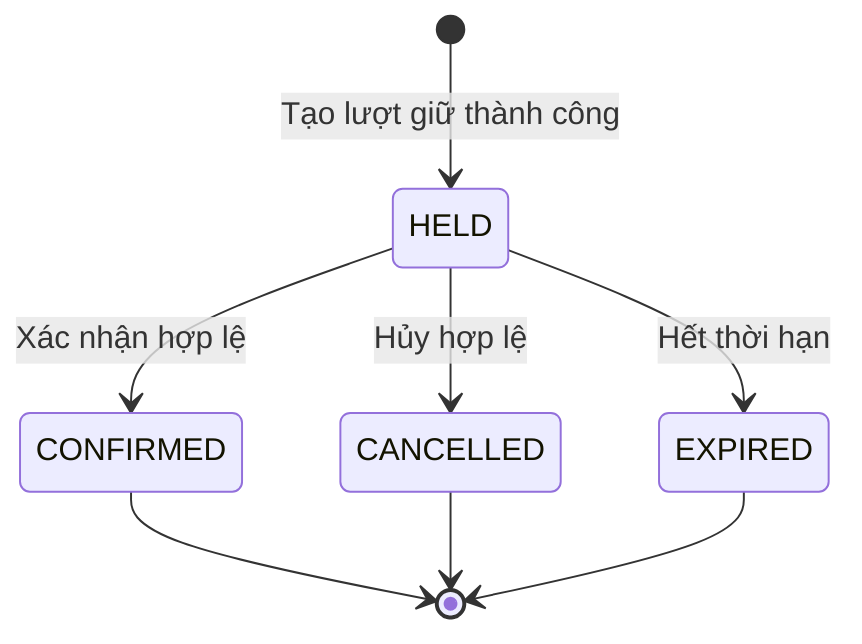
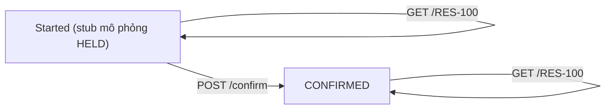
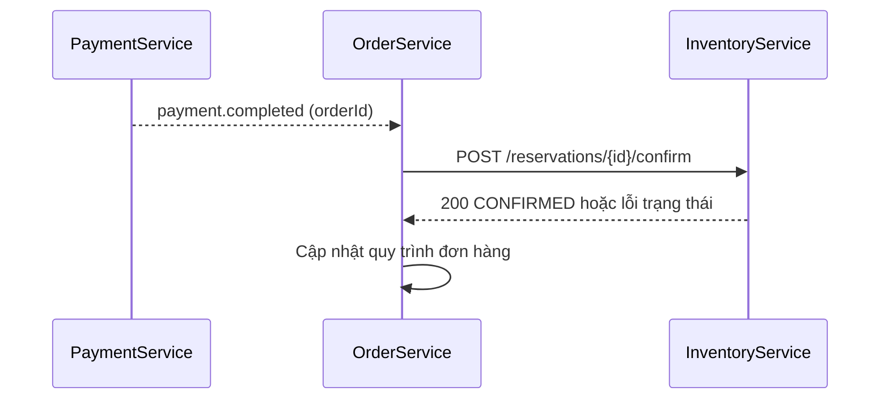
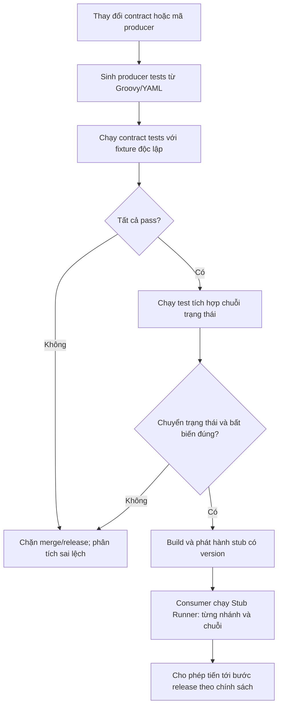

# Chuỗi tương tác có trạng thái và điều kiện trước khi dùng

Một API có thể trả đúng JSON cho từng request riêng lẻ nhưng vẫn làm hỏng luồng nghiệp vụ khi các request được thực hiện **không đúng thứ tự**. Chẳng hạn, API xác nhận giữ hàng chỉ nên thành công khi đã tồn tại một lượt giữ hàng còn hiệu lực; gọi xác nhận cho lượt giữ đã hết hạn phải dẫn đến kết quả khác. Việc một contract cho `POST /reservations/{id}/confirm` trả `200` không tự chứng minh toàn bộ điều kiện đó.

Trong chương **Trạng thái và lỗi** của **Spring Cloud Contract**, bài này giải thích cách nhận diện **tiền điều kiện** (precondition), **chuỗi tương tác có trạng thái** (stateful interaction sequence) và **chuyển trạng thái** (state transition). Ta sẽ phân biệt điều gì có thể mô tả bằng hợp đồng HTTP hoặc message viết bằng Groovy/YAML DSL, điều gì cần fixture và kiểm thử tích hợp phía producer, và khi nào cần stub có trạng thái để consumer thử luồng bằng **Stub Runner**. Mục tiêu cuối cùng là phát hiện thay đổi API không tương thích trong CI mà không nhầm một stub trả đúng mẫu với bằng chứng quy trình nghiệp vụ đã đúng.

Sau bài học, bạn có thể:

- Phân biệt request độc lập với request có kết quả phụ thuộc trạng thái trước đó.
- Vẽ sơ đồ trạng thái, liệt kê điều kiện trước khi thực hiện từng thao tác và xác định kết quả của chuyển trạng thái hợp lệ/không hợp lệ.
- Viết các contract Spring Cloud Contract cho trạng thái thành công, hết hạn, không tồn tại và xung đột.
- Chuẩn bị fixture producer để generated tests có thể chạy độc lập, tái lập được.
- Giải thích vì sao nhiều contract tĩnh **không tự ghép thành** một luồng có trạng thái.
- Hiểu cách mô hình hóa trạng thái trong stub WireMock, giới hạn của Stub Runner và những kiểm thử nhiều bước cần bổ sung.
- Thiết kế cổng CI kiểm cả tương thích giao diện lẫn những bất biến nghiệp vụ quan trọng.

## 1. Từ một HTTP request tới chuỗi hành động nghiệp vụ

Giả sử có hai dịch vụ:

- **Consumer – `OrderService`:** tạo đơn và cần đặt giữ hàng trước khi thanh toán.
- **Producer – `InventoryService`:** tạo, xác nhận và hủy lượt giữ hàng.

Luồng thuận lợi gồm các bước:

1. `OrderService` gọi `POST /api/v1/reservations` để giữ 2 đơn vị hàng.
2. `InventoryService` trả `201 Created`, `reservationId` và `status = HELD`.
3. Sau khi thanh toán thành công, consumer gọi `POST /api/v1/reservations/{reservationId}/confirm`.
4. Producer chuyển lượt giữ từ `HELD` sang `CONFIRMED` và trả `200 OK`.

Nếu bước 3 được gọi trước khi có reservation, hoặc sau khi reservation hết hạn, producer không nên giả vờ xác nhận thành công. Kết quả phụ thuộc vào **trạng thái mà những request trước tạo ra**, không chỉ vào method, URL và JSON body hiện tại.

### Khác nhau giữa kiểm tra một request và kiểm tra chuỗi

| Mức kiểm thử | Câu hỏi cần trả lời | Ví dụ |
| --- | --- | --- |
| Contract cho một tương tác | Với request và tiền điều kiện đã chuẩn bị, producer có trả response như cam kết? | Reservation đang `HELD` → confirm trả `200`, `CONFIRMED` |
| Kiểm thử tích hợp nhiều bước | Request trước có thực sự tạo trạng thái để request sau tiếp tục đúng? | Create → confirm → get phải trả `CONFIRMED` |
| Kiểm thử xử lý thất bại | Chuyển trạng thái sai bị từ chối và hệ thống có giữ trạng thái hợp lệ không? | Reservation `EXPIRED` → confirm trả `409`, không bị chuyển thành `CONFIRMED` |
| Kiểm thử cạnh tranh và retry | Khi gọi lặp/đồng thời có giữ đúng các bất biến nghiệp vụ không? | Hai yêu cầu confirm song song không làm trừ tồn kho hai lần |

Spring Cloud Contract rất hữu ích ở mức **giao tiếp được cam kết**; nhưng bản thân một file contract không phải bộ điều phối workflow, cơ sở dữ liệu trạng thái hay bằng chứng về giao dịch nguyên tử.

## 2. Mô hình hóa trạng thái trước khi viết contract

Hãy bắt đầu bằng một **state machine** để cả producer và consumer hiểu rõ các kết quả.



Trong mô hình minh họa này, `HELD` là trạng thái ban đầu sau khi tạo thành công; `CONFIRMED`, `CANCELLED`, `EXPIRED` là các trạng thái kết thúc. Hệ thống thực tế có thể có thêm `PENDING`, `RELEASED` hoặc các trạng thái trung gian. **Tên và quy tắc chuyển trạng thái là quyết định nghiệp vụ**, không phải những trạng thái mặc định được Spring Cloud Contract cung cấp.

Từ sơ đồ, lập một bảng điều kiện trước khi dùng:

| Thao tác | Tiền điều kiện | Trạng thái sau | Phản hồi ví dụ |
| --- | --- | --- | --- |
| Tạo giữ hàng | SKU tồn tại, còn đủ hàng, dữ liệu hợp lệ | `HELD` | `201` + `reservationId` |
| Xác nhận | Reservation tồn tại, thuộc đơn hợp lệ, đang `HELD` và chưa hết hạn | `CONFIRMED` | `200` + `status: CONFIRMED` |
| Hủy | Reservation tồn tại, đang `HELD` | `CANCELLED` | `200` + `status: CANCELLED` |
| Xác nhận đã hết hạn | Reservation đang `EXPIRED` | Không đổi | `409` + `RESERVATION_EXPIRED` |
| Xác nhận ID không tồn tại | Không tìm thấy reservation | Không đổi | `404` + `RESERVATION_NOT_FOUND` |
| Xác nhận đã hủy | Reservation đang `CANCELLED` | Không đổi | `409` + `INVALID_RESERVATION_STATE` |

Các mã `200`, `201`, `404`, `409` và tên lỗi là **quy ước của API ví dụ**. Với hệ thống khác, nhóm có thể chọn cách biểu diễn khác; điều quan trọng là consumer và producer thống nhất về ngữ nghĩa, khả năng retry và tác động đến trạng thái.

### Tiền điều kiện không chỉ là một field trạng thái

Một thao tác xác nhận có thể cần đồng thời:

- Reservation tồn tại và chưa bị hủy.
- Trạng thái hiện tại là `HELD`.
- Chưa qua thời điểm `expiresAt`.
- Người gọi có quyền thao tác trên đơn liên quan.
- Hệ thống chưa xác nhận lần trước theo một chính sách idempotency đã thỏa thuận.

Việc một test nhận `status = HELD` từ một API đọc **chưa tự bảo đảm** tất cả những điều kiện đó tại thời điểm thao tác xác nhận. Cần quyết định mức kiểm chứng phù hợp cho từng điều kiện.

## 3. Đọc chuỗi tương tác như các kịch bản Given–When–Then

Trước khi chọn Groovy/YAML, mô tả kịch bản bằng ngôn ngữ nghiệp vụ.

**Kịch bản A – xác nhận thành công**

- **Given:** reservation `RES-HELD-100` tồn tại, đang `HELD`, chưa hết hạn và người gọi được phép xác nhận.
- **When:** consumer gửi `POST /api/v1/reservations/RES-HELD-100/confirm`.
- **Then:** producer trả `200` với `reservationId = RES-HELD-100` và `status = CONFIRMED`; trạng thái được lưu thành `CONFIRMED`.

**Kịch bản B – không tồn tại**

- **Given:** không có reservation `RES-MISSING-999`.
- **When:** consumer gửi request confirm cho ID đó.
- **Then:** producer trả `404` và mã lỗi `RESERVATION_NOT_FOUND`; không có lượt giữ mới nào được tạo.

**Kịch bản C – đã hết hạn**

- **Given:** reservation `RES-EXPIRED-200` tồn tại nhưng trạng thái đã là `EXPIRED`.
- **When:** consumer yêu cầu confirm.
- **Then:** producer trả `409` và mã `RESERVATION_EXPIRED`; không phục hồi hoặc xác nhận lượt giữ hết hạn.

**Kịch bản D – gọi lại sau timeout**

- **Given:** lần xác nhận trước có thể đã thành công, nhưng consumer chưa nhận được phản hồi.
- **When:** consumer gửi lại yêu cầu theo chính sách retry/idempotency đã thỏa thuận.
- **Then:** phải có quy tắc rõ cho việc trả lại kết quả cũ, trả xung đột hay xác nhận đã xử lý. Kiểm tra cả **phản hồi** lẫn **tác dụng phụ** để bảo đảm không nhân đôi nghiệp vụ.

Những câu ở phần **Given** quyết định trạng thái fixture khi chạy test; không thể chỉ viết chúng trong `description` rồi mặc nhiên coi chúng đã được thực thi.

## 4. Vì sao một contract không tự đặt hệ thống vào trạng thái cần thiết?

Một contract HTTP có thể mô tả:

```groovy
import org.springframework.cloud.contract.spec.Contract

Contract.make {
    name 'confirm_held_reservation_success'
    description 'Reservation đang HELD thì OrderService có thể xác nhận'

    request {
        method 'POST'
        url '/api/v1/reservations/RES-HELD-100/confirm'
    }

    response {
        status 200
        headers {
            contentType(applicationJson())
        }
        body([
            reservationId: 'RES-HELD-100',
            status       : 'CONFIRMED'
        ])
    }
}
```

Verifier có thể sinh một test gửi request rồi đối chiếu response với contract. Tuy nhiên, DSL ở trên **không chứa lệnh tự tạo reservation trong database**. Nếu test chạy trên cơ sở dữ liệu rỗng, controller có thể trả `404` và làm test thất bại dù mã producer xử lý đúng quy tắc.

Để test có ý nghĩa, nhóm phải chuẩn bị **tiền điều kiện ở môi trường producer test**: có reservation `RES-HELD-100` đang `HELD` và chưa hết hạn. Có thể dùng fixture database, repository test, một dịch vụ giả có trạng thái hoặc phương pháp khác phù hợp với phạm vi kiểm thử.

Điều cần nhớ: **mô tả tiền điều kiện trong `description` giúp con người hiểu kịch bản, nhưng phần tạo trạng thái phải được thực thi bởi fixture hoặc quy trình test thật**.

## 5. Tách các trạng thái thành contract riêng

Cùng một endpoint confirm, kết quả có thể khác nhau theo trạng thái. Một cách đơn giản để tổ chức các contract tĩnh là dùng **ID fixture khác nhau cho mỗi trường hợp**.

### Trường hợp đã hết hạn

```groovy
import org.springframework.cloud.contract.spec.Contract

Contract.make {
    name 'confirm_expired_reservation_conflict'
    description '''
        Consumer không được tiếp tục thanh toán bằng lượt giữ đã hết hạn.
        Fixture: RES-EXPIRED-200 đang ở trạng thái EXPIRED.
    '''

    request {
        method 'POST'
        url '/api/v1/reservations/RES-EXPIRED-200/confirm'
    }

    response {
        status 409
        headers {
            contentType(applicationJson())
        }
        body([
            code: 'RESERVATION_EXPIRED'
        ])
    }
}
```

### Trường hợp không tìm thấy

```groovy
import org.springframework.cloud.contract.spec.Contract

Contract.make {
    name 'confirm_missing_reservation_not_found'
    description 'Consumer nhận 404 khi xác nhận ID không tồn tại'

    request {
        method 'POST'
        url '/api/v1/reservations/RES-MISSING-999/confirm'
    }

    response {
        status 404
        headers {
            contentType(applicationJson())
        }
        body([
            code: 'RESERVATION_NOT_FOUND'
        ])
    }
}
```

Khi đặt cạnh contract thành công, cả ba tạo thành một bộ ví dụ bảo vệ **hành vi quan sát được** của endpoint confirm ở ba điều kiện đã được dựng sẵn.

| Tên contract | Request mẫu | Tiền điều kiện fixture | Phản hồi |
| --- | --- | --- | --- |
| `confirm_held_reservation_success` | `.../RES-HELD-100/confirm` | ID ở `HELD` | `200`, `CONFIRMED` |
| `confirm_expired_reservation_conflict` | `.../RES-EXPIRED-200/confirm` | ID ở `EXPIRED` | `409`, `RESERVATION_EXPIRED` |
| `confirm_missing_reservation_not_found` | `.../RES-MISSING-999/confirm` | Không có ID | `404`, `RESERVATION_NOT_FOUND` |

Đường dẫn **khác nhau** cũng làm cho các mapping stub tĩnh không mâu thuẫn. Nếu ba contract dùng cùng method và URL nhưng mong ba response khác nhau, một stub không có trạng thái sẽ không thể tự biết trước điều kiện database bên producer để chọn đúng phản hồi.

### Đừng nhầm đường dẫn cố định với bảo đảm cho tất cả ID

Ba contract trên chỉ tạo test cho **ba ví dụ có ý nghĩa**. Chúng chưa chứng minh producer xử lý đúng mọi mã reservation, mọi đồng hồ hết hạn và mọi tình huống lỗi. Đó là lý do phải bổ sung kiểm thử theo mức rủi ro: ranh giới thời gian, quyền truy cập, các trạng thái khác và gọi đồng thời.

## 6. Chuẩn bị fixture và làm sạch trạng thái trong producer test

Để generated tests có kết quả ổn định, mỗi test phải có thể chạy từ trạng thái đã biết, **không phụ thuộc vào thứ tự test trước đó**.

Một bảng dữ liệu minh họa:

| Reservation ID | Trạng thái trước test | Thời hạn | Mong đợi |
| --- | --- | --- | --- |
| `RES-HELD-100` | `HELD` | Chưa hết hạn | Confirm thành công |
| `RES-EXPIRED-200` | `EXPIRED` | Đã hết hạn | Confirm trả xung đột |
| `RES-CANCELLED-300` | `CANCELLED` | Không còn hiệu lực | Confirm bị từ chối |
| `RES-MISSING-999` | Không tồn tại | Không áp dụng | Confirm trả không tìm thấy |

Cách chuẩn bị có thể khác nhau:

1. **Test database với dữ liệu hạt giống:** insert reservation trước test, rollback hoặc reset sau test. Cần bảo đảm câu lệnh kiểm thử không chạm dữ liệu production.
2. **Fixture repository trong profile test:** khởi tạo trạng thái bộ nhớ trước mỗi kịch bản; phù hợp khi kiểm tra controller, validation và response mapping.
3. **Test double cho phụ thuộc ngoài:** mô phỏng phản hồi của dịch vụ ngoài phạm vi đang kiểm, nhưng không mock mất phần hành vi producer mà contract cần xác minh.
4. **Dùng đồng hồ kiểm soát được:** đặt `Clock` giả hoặc mốc thời gian có chủ đích để kiểm trường hợp vừa trước/vừa sau khi hết hạn.

Ví dụ **phác thảo** một lớp chuẩn bị fixture Java; tên repository, method và entity phải điều chỉnh theo ứng dụng:

```java
// Minh họa ý tưởng; không phải đoạn mã độc lập có thể biên dịch.
@BeforeEach
void prepareContractFixtures() {
    reservationRepository.deleteAllTestReservations();

    reservationRepository.save(
        reservation("RES-HELD-100", "HELD", clock.instant().plusSeconds(600))
    );
    reservationRepository.save(
        reservation("RES-EXPIRED-200", "EXPIRED", clock.instant().minusSeconds(60))
    );
}
```

Các helper `deleteAllTestReservations()` và `reservation(...)` trong đoạn này là **API giả định của fixture**, không phải API có sẵn của Spring Cloud Contract. Một lớp base test thật cần cấu hình đúng chế độ test (ví dụ MockMvc/RestAssured nếu producer dùng Spring MVC) để generated tests gọi được controller.

Đặc biệt với test **làm thay đổi trạng thái** như confirm, cần reset dữ liệu trước mỗi test. Nếu confirm thành công khiến `RES-HELD-100` thành `CONFIRMED`, test chạy lần sau trên cùng dữ liệu mà không reset sẽ không còn thực sự kiểm tra nhánh `HELD`.

## 7. Test một tương tác không đồng nghĩa test cả chuỗi

Giả sử các contract sau đều pass độc lập:

- Tạo reservation trả `201` và `status = HELD`.
- Confirm một reservation đã `HELD` trả `200` và `status = CONFIRMED`.
- Đọc một reservation đã `CONFIRMED` trả `200` và `status = CONFIRMED`.

Điều đó vẫn chưa chứng minh **reservation do bước tạo sinh ra** có thể được bước confirm dùng ngay; hoặc confirm đã ghi trạng thái vào cùng kho dữ liệu mà GET sau đó đọc.

Kiểm thử tích hợp nhiều bước có thể kiểm trực tiếp:

```text
Given: Tồn kho đủ cho SKU-001; chưa có lượt giữ liên quan
When:
  1. POST /reservations
  2. Trích reservationId từ response 201
  3. POST /reservations/{reservationId}/confirm
  4. GET /reservations/{reservationId}
Then:
  - Bước 1 trả trạng thái HELD và ID hợp lệ
  - Bước 2 xác nhận thành công
  - Bước 3 đọc được cùng ID với trạng thái CONFIRMED
  - Tồn kho và dữ liệu liên quan vẫn thỏa bất biến nghiệp vụ
```

Ví dụ phác thảo bằng Java với Spring MockMvc, đã lược bỏ bước khởi tạo fixture và các import:

```java
// Mã minh họa test tích hợp; điều chỉnh path, DTO và setup theo dự án.
MvcResult created = mockMvc.perform(post("/api/v1/reservations")
        .contentType(MediaType.APPLICATION_JSON)
        .content("{\"sku\":\"SKU-001\",\"quantity\":2}"))
    .andExpect(status().isCreated())
    .andExpect(jsonPath("$.status").value("HELD"))
    .andReturn();

String body = created.getResponse().getContentAsString();
String reservationId = objectMapper.readTree(body)
    .path("reservationId").asText();

mockMvc.perform(post("/api/v1/reservations/{id}/confirm", reservationId))
    .andExpect(status().isOk())
    .andExpect(jsonPath("$.status").value("CONFIRMED"));

mockMvc.perform(get("/api/v1/reservations/{id}", reservationId))
    .andExpect(status().isOk())
    .andExpect(jsonPath("$.reservationId").value(reservationId))
    .andExpect(jsonPath("$.status").value("CONFIRMED"));
```

Ở đây chính test tích hợp **truyền ID thật** từ bước tạo sang bước confirm và bước đọc; đây là liên kết giữa các tương tác mà ba file contract độc lập không tự thực hiện. Để kiểm tồn kho và tính nguyên tử, cần assertion bổ sung dựa trên repository hoặc hệ thống thật đang thử nghiệm.

## 8. Stub tĩnh mô phỏng phản hồi, không lưu trạng thái nghiệp vụ

Stub thông thường do Spring Cloud Contract tạo ra mô phỏng tương tác theo **request matcher → response**. Nếu có mapping:

```text
POST /api/v1/reservations/RES-HELD-100/confirm
    -> 200 {"status":"CONFIRMED"}
```

Consumer có thể chạy test nhánh xử lý `200`, nhưng điều đó không chứng minh stub đã cập nhật một reservation thật. Khi consumer gọi `GET /api/v1/reservations/RES-HELD-100`, kết quả phụ thuộc vào mapping của GET đã được định nghĩa, không tự được suy ra từ POST trước đó.

Điều này đặc biệt quan trọng khi thử:

- Gọi GET trước và sau khi confirm, mong hai status khác nhau.
- Hủy sau khi đã confirm, mong bị từ chối.
- Gửi lại confirm và mong phản hồi theo chính sách idempotency.
- Đọc trạng thái qua API khác hoặc sau sự kiện bất đồng bộ.

Nếu những hành vi này cần được kiểm **ở phía consumer**, một tập mapping tĩnh có thể không đủ. Có thể cấu hình stub có trạng thái bằng cơ chế như **WireMock Scenarios**, hoặc dùng một fake service có state rõ ràng. Cần hiểu rằng đây là **cấu hình bổ sung của công cụ stub**, không phải điều tự xảy ra khi đặt nhiều contract Groovy cạnh nhau.

## 9. Mô hình hóa chuỗi trạng thái trong WireMock Scenario

Spring Cloud Contract Stub Runner thường chạy stub HTTP trên cơ sở WireMock. WireMock hỗ trợ **scenarios** để một mapping chỉ được dùng khi scenario đang ở một trạng thái nhất định và một request có thể chuyển scenario sang trạng thái mới.

Một mô hình đơn giản cho reservation `RES-100`:



Về mặt WireMock, các mapping JSON sau minh họa ý tưởng. Đây là **WireMock stub mapping**, **không phải cú pháp Spring Cloud Contract Groovy/YAML DSL** và không có nghĩa Verifier tự chuyển contract thông thường thành scenario.

### Mapping A – GET khi đang giữ hàng

```json
{
  "scenarioName": "reservation-RES-100",
  "requiredScenarioState": "Started",
  "request": {
    "method": "GET",
    "url": "/api/v1/reservations/RES-100"
  },
  "response": {
    "status": 200,
    "headers": { "Content-Type": "application/json" },
    "jsonBody": {
      "reservationId": "RES-100",
      "status": "HELD"
    }
  }
}
```

### Mapping B – confirm chuyển từ HELD sang CONFIRMED

```json
{
  "scenarioName": "reservation-RES-100",
  "requiredScenarioState": "Started",
  "newScenarioState": "CONFIRMED",
  "request": {
    "method": "POST",
    "url": "/api/v1/reservations/RES-100/confirm"
  },
  "response": {
    "status": 200,
    "headers": { "Content-Type": "application/json" },
    "jsonBody": {
      "reservationId": "RES-100",
      "status": "CONFIRMED"
    }
  }
}
```

### Mapping C – GET sau khi xác nhận

```json
{
  "scenarioName": "reservation-RES-100",
  "requiredScenarioState": "CONFIRMED",
  "request": {
    "method": "GET",
    "url": "/api/v1/reservations/RES-100"
  },
  "response": {
    "status": 200,
    "headers": { "Content-Type": "application/json" },
    "jsonBody": {
      "reservationId": "RES-100",
      "status": "CONFIRMED"
    }
  }
}
```

Với ba mapping này, consumer có thể kiểm:

1. GET trước confirm → `HELD`.
2. POST confirm → `CONFIRMED`, scenario đổi trạng thái.
3. GET sau confirm → `CONFIRMED`.

**Giới hạn quan trọng:** đây vẫn là mô phỏng của stub, không chứng minh producer thật ghi transaction đúng. Nó cũng không tự xử lý đầy đủ các nhánh hủy, hết hạn, quyền truy cập hay retry. Cần thêm mapping hoặc fake thích hợp khi luồng consumer phụ thuộc vào chúng.

### Dùng WireMock scenario cùng Stub Runner có cần cấu hình gì?

Có. Ví dụ trên cho biết **định dạng mapping của WireMock** chứ không khẳng định ba JSON file sẽ được Spring Cloud Contract tự đóng gói nếu chỉ đặt ở một thư mục tùy ý. Muốn consumer dùng được trong Stub Runner, cần bảo đảm cách tạo artifact stub của **phiên bản dự án** đưa đúng các mapping vào nơi WireMock đọc được; sau đó kiểm tra artifact được phát hành và chạy thử kịch bản thật.

Không nên lạm dụng stateful mapping cho các luồng chỉ cần một response cố định: mỗi trạng thái bổ sung tạo thêm công việc khởi tạo, reset và tránh xung đột giữa test.

### Khởi tạo và reset scenario

WireMock sử dụng trạng thái khởi đầu `Started`. Khi một test đã gọi confirm, scenario có thể tiếp tục ở `CONFIRMED` cho test khác nếu dùng chung một instance mà không reset.

Vì vậy, trước mỗi test consumer độc lập:

- Reset scenario về trạng thái ban đầu bằng API hoặc công cụ WireMock phù hợp.
- Nếu cần, xóa request journal/interaction history để assertion không đọc nhầm request cũ.
- Tránh cho các test song song cùng thay đổi một scenario chung; dùng instance riêng hoặc tên scenario riêng nếu cần.
- Kiểm tra cụ thể hành vi reset với phiên bản WireMock/Stub Runner đang dùng.

**Chạy được một lần chưa có nghĩa test tái lập được**: stateful stubs đặc biệt dễ gây lỗi theo thứ tự và chạy song song nếu không quản lý vòng đời state.

## 10. Stub có trạng thái và producer test có nhiệm vụ khác nhau

| Khía cạnh | Producer contract verification | Stateful stub / consumer test |
| --- | --- | --- |
| Đối tượng được kiểm | Controller, service và response của producer với fixture đã chuẩn bị | Mã consumer xử lý chuỗi request/response theo kịch bản giả lập |
| Nguồn trạng thái | Dữ liệu thật trong test DB/repository hoặc fixture | Scenario/fake state của stub |
| Cách chuyển trạng thái | Business logic của producer | Mapping `newScenarioState` hoặc logic fake |
| Giá trị chứng minh | Producer đáp ứng từng cam kết quan sát được | Consumer xử lý đúng luồng mà stub mô phỏng |
| Điều chưa chứng minh | Toàn bộ trạng thái liên kết qua nhiều request nếu test độc lập | Producer thật có transaction, timer, concurrency và lưu trữ đúng |

Hai phía **bổ sung** cho nhau. Một bộ test đáng tin cậy nên có các contract cho những response consumer cần, và thêm test tích hợp end-to-end với producer thật cho các chuỗi trạng thái quan trọng.

## 11. Điều kiện trước khi dùng một stub phải được diễn đạt rõ

Không phải lúc nào cũng cần stub có state. Một API có thể yêu cầu **tiền điều kiện ở request**, ví dụ header xác thực, idempotency key hoặc một token có định dạng cụ thể.

Phân biệt hai loại điều kiện:

| Loại điều kiện | Ví dụ | Công cụ kiểm tra |
| --- | --- | --- |
| Quan sát được trong request | Header `Idempotency-Key` hiện diện; JSON có `orderId` | Request matcher trong contract/stub |
| Phụ thuộc trạng thái ẩn trước đó | ID đã được tạo, chưa hết hạn, thuộc người dùng gọi | Fixture producer, integration test và stub có state nếu cần |

Ví dụ contract yêu cầu header idempotency:

```groovy
import org.springframework.cloud.contract.spec.Contract

Contract.make {
    name 'create_reservation_with_idempotency_key'
    description 'OrderService gửi khóa retry để producer có thể chống tạo trùng'

    request {
        method 'POST'
        url '/api/v1/reservations'
        headers {
            contentType(applicationJson())
            header('Idempotency-Key', 'order-1001-create-reservation')
        }
        body([
            orderId : 'ORD-1001',
            sku     : 'SKU-001',
            quantity: 2
        ])
    }

    response {
        status 201
        headers {
            contentType(applicationJson())
        }
        body([
            reservationId: 'RES-100',
            status       : 'HELD'
        ])
    }
}
```

Contract kiểm được **header và phản hồi của một request**. Dù contract pass, vẫn chưa chứng minh hai lần gọi lại cùng key chỉ tạo một reservation. Hành vi idempotency cần test hai lần request và kiểm **số bản ghi được tạo** hoặc tác dụng phụ tương ứng.

### Retry sau timeout là chuỗi nhiều trạng thái

Xét:

1. Consumer gửi create, producer tạo reservation nhưng phản hồi bị mất trên mạng.
2. Consumer timeout và không biết reservation đã được tạo chưa.
3. Consumer retry với cùng `Idempotency-Key`.

Hành vi producer có thể được thống nhất theo nhiều chính sách: trả lại kết quả ban đầu, trả một phản hồi cho biết request đã xử lý hoặc từ chối khi key gắn với payload khác. **Không có một mã HTTP duy nhất mà Spring Cloud Contract mặc định bắt buộc**. Quy ước phải rõ với consumer, được diễn tả bằng contract tương ứng và kiểm thử tích hợp cho tác dụng phụ.

## 12. Thời gian và chuyển trạng thái hết hạn

`expiresAt` làm luồng stateful khó hơn vì **thời gian** trở thành một đầu vào ẩn:

- Lúc `now < expiresAt`, confirm có thể hợp lệ.
- Lúc `now >= expiresAt`, confirm phải bị từ chối theo quy tắc đã thống nhất.
- Một job nền có thể chuyển trạng thái từ `HELD` sang `EXPIRED` không đồng bộ với request.

Đừng viết producer contract test giả định mốc thời gian cố định trong quá khứ/tương lai mà không kiểm soát đồng hồ; vài tuần sau test có thể tự đổi kết quả.

Gợi ý thiết kế test:

1. Dùng `Clock` có thể tiêm vào business logic và cố định thời điểm kiểm thử.
2. Chuẩn bị fixture rõ các trường hợp *trước, đúng tại, sau* thời điểm hết hạn.
3. Kiểm response lỗi và xác nhận rằng producer **không chuyển trạng thái sai**.
4. Nếu có job nền hoặc message hết hạn, bổ sung test event/scheduler riêng.
5. Với consumer, mô phỏng trạng thái hết hạn bằng stub tĩnh hoặc scenario phù hợp và kiểm nhánh xử lý.

Regex cho định dạng timestamp không chứng minh thời điểm còn hiệu lực. Tương tự, stub trả `EXPIRED` không chứng minh job hết hạn của producer hoạt động đúng.

## 13. Thứ tự chuyển trạng thái và quyền truy cập

Trong hệ thống đa người dùng hoặc đa tenant, trạng thái nghiệp vụ và phân quyền có thể cùng ảnh hưởng kết quả:

- Reservation ở `HELD`, nhưng người gọi không có quyền confirm.
- ID không tồn tại; hệ thống có thể chọn trả `404`.
- ID tồn tại nhưng thuộc tenant khác; chính sách bảo mật có thể yêu cầu `404` thay vì tiết lộ sự tồn tại.
- Token hết hạn; producer có thể trả `401` trước khi kiểm trạng thái nghiệp vụ.

Vì vậy, không nên đưa vào contract một thứ tự kiểm tra tùy tiện khiến lộ thông tin người dùng. Những lựa chọn giữa `401`, `403`, `404` và `409` cần phản ánh chính sách bảo mật và trải nghiệm consumer; không phải do Spring Cloud Contract tự quyết định.

Nếu cần một contract cho lỗi bảo mật, hãy mô tả **request cụ thể và phản hồi quan sát được**. Việc chỉ mô tả một phản hồi lỗi không thay thế security test cho toàn bộ ma trận quyền/trạng thái.

## 14. Chuỗi có message bất đồng bộ

Không phải mọi chuyển trạng thái được kích hoạt bởi HTTP. Trong kiến trúc event-driven, `PaymentService` có thể phát sự kiện `payment.completed`; `OrderService` tiêu thụ sự kiện và gọi `InventoryService` để confirm reservation.



Ở đây:

- Message contract có thể kiểm header/payload sự kiện producer phát và phản hồi mà consumer trông đợi.
- HTTP contract có thể kiểm confirm trả `200`, `404`, `409` hoặc mã lỗi đã thỏa thuận.
- Integration test phải kiểm **thứ tự, retry, trùng lặp, giao lại và tính nhất quán theo thời gian** khi những điều đó quyết định nghiệp vụ.

Đặc biệt, message broker có thể giao sự kiện ít nhất một lần hoặc không bảo đảm thứ tự giữa các kênh. Consumer không nên dựa vào một stub chỉ phát đúng một sự kiện theo đúng thứ tự rồi kết luận hệ thống production không bao giờ nhận sự kiện trùng hoặc đến muộn.

## 15. Ngăn xung đột khi có nhiều contract cho cùng một URL

Đây là bẫy phổ biến nhất khi chuyển từ một request độc lập sang nhiều trạng thái. Giả sử có hai contract:

```text
POST /api/v1/reservations/RES-100/confirm
  -> 200 {"status":"CONFIRMED"}

POST /api/v1/reservations/RES-100/confirm
  -> 409 {"code":"RESERVATION_EXPIRED"}
```

Nếu cả hai trở thành mapping tĩnh cho **cùng một method/URL/header/body**, stub không thể xác định “reservation đang HELD hay EXPIRED” chỉ bằng request. Kết quả có thể phụ thuộc vào ưu tiên mapping hoặc cơ chế chọn matching, và không mô phỏng đúng business state.

Các cách giải quyết:

| Cách | Khi nào phù hợp | Điều cần kiểm |
| --- | --- | --- |
| Dùng fixture ID khác nhau | Consumer chỉ cần thử từng nhánh trả về | Request của mỗi contract phân biệt được |
| Dùng request điều kiện khác nhau | API thật có path/header/body phân biệt kịch bản | Điều kiện khớp không rộng hơn thực tế |
| Dùng WireMock Scenario | Consumer phải thử cùng ID trước/sau một thao tác | Trạng thái được reset, các bước đi đúng thứ tự |
| Dùng fake service có state | Luồng quá phức tạp cho mapping đơn giản | Fake được quản lý phiên bản, có test đảm bảo hành vi |
| Kiểm thử với producer thật | Cần chứng minh transaction và state thực tế | Database, concurrency, timer và dependency được kiểm soát |

Không nên giải quyết bằng việc đặt tên file khác nhau hoặc chuyển file sang thư mục consumer khác rồi mong Stub Runner tự hiểu trạng thái. Folder và `name` là công cụ tổ chức, không phải điều kiện chuyển state.

## 16. CI cần kiểm những lớp nào?

Một quy trình CI đáng tin cậy có thể chia thành các lớp kiểm:



Với dự án Maven đã cấu hình Spring Cloud Contract Verifier, bước xác minh phổ biến:

```bash
mvn -B -ntp clean verify
```

Đó là lệnh ví dụ cho một **dự án producer đã thiết lập plugin và test**; bản thân bài Markdown này không phải ứng dụng Spring Boot có thể build. Các integration test nhiều bước cần được đưa vào vòng đời test phù hợp với cấu hình dự án.

Checklist CI nên bao gồm:

1. **Phát hiện contract:** tất cả contract liên quan được generator đọc; không có build xanh với 0 generated tests.
2. **Fixture:** test không phụ thuộc dữ liệu môi trường chung hay thứ tự chạy.
3. **Producer verification:** mã trạng thái, header, body và matcher phản ánh đúng các điều khoản giao diện.
4. **Stateful integration:** những chuỗi quan trọng như create → confirm → get và confirm khi expired được test trên producer thật ở mức phù hợp.
5. **Stub artifact:** mapping được đóng gói đúng version, không có xung đột vô tình.
6. **Consumer tests:** Stub Runner dùng phiên bản artifact cố định, reset scenario khi cần, kiểm cả nhánh thành công và lỗi.
7. **Release:** không phát hành stub đại diện cho một producer chưa vượt qua các cổng kiểm tra bắt buộc.

## 17. Chẩn đoán lỗi thường gặp

| Hiện tượng | Nguyên nhân thường gặp | Hướng xử lý |
| --- | --- | --- |
| Contract confirm mong `200` nhưng producer trả `404` | Fixture không tạo reservation trước test | Chuẩn bị trạng thái `HELD` trước mỗi test |
| Test đầu pass, chạy lại fail | Test trước đã đổi state nhưng không reset | Tái tạo fixture hoặc rollback rõ ràng |
| Test pass từng contract nhưng luồng create → confirm fail | Các test không dùng cùng reservation thực | Thêm integration test lấy ID từ bước create |
| Stub trả `200` cho reservation đã hết hạn | Matcher thành công quá rộng hoặc thiếu state | Phân biệt mapping và bổ sung stateful stub |
| Consumer test fail tùy thứ tự | Scenario WireMock không reset giữa các test | Reset scenario/test isolation |
| Test song song không ổn định | Các test dùng chung state hoặc DB | Dữ liệu/test instance độc lập, quản lý concurrency |
| `expiresAt` làm test xanh hôm nay, đỏ ngày mai | Clock dựa vào thời gian thực | Clock kiểm soát được và boundary tests |
| Producer trả đúng mã lỗi nhưng vẫn tạo side effect | Contract chỉ kiểm response, không kiểm DB | Thêm kiểm thử bất biến trạng thái |
| Gửi lại cùng idempotency key tạo hai bản ghi | Chưa kiểm retry nhiều request | Viết integration test nhiều lần gọi và đếm side effect |
| State sau message đến muộn không đúng | Thiếu test event ordering/retry | Kiểm thử workflow bất đồng bộ và chính sách idempotency |
| Build có 0 contract tests nhưng xanh | Plugin/đường dẫn/config sai | Kiểm tra số test sinh và thực thi |
| Đặt nhiều contract cùng method/URL, khác response | Stub không biết chọn theo trạng thái ẩn | Cấu hình scenario hoặc phân biệt điều kiện request |

## 18. Checklist trước khi thiết kế chuỗi có trạng thái

- [ ] Có sơ đồ trạng thái hoặc ít nhất một bảng chuyển trạng thái rõ ràng.
- [ ] Mỗi request quan trọng ghi rõ **tiền điều kiện** và phản hồi thành công/lỗi.
- [ ] Consumer biết khi nào nên retry, dừng, hủy hoặc chuyển sang nhánh khác.
- [ ] Đã chọn mã HTTP và error code theo quy ước nghiệp vụ, không dựa vào mặc định tưởng tượng.
- [ ] Contract có kịch bản `200/201` và các nhánh `404/409` hoặc lỗi phù hợp.
- [ ] Fixture producer thực sự tạo trạng thái mà contract mong đợi.
- [ ] Generated tests độc lập, có thể chạy lại và chạy trong CI mà không cần thứ tự cố định.
- [ ] Các trạng thái kết thúc như `CONFIRMED`, `CANCELLED` và `EXPIRED` được xử lý theo quy tắc.
- [ ] Có integration test cho chuỗi nhiều request khi cần chứng minh tác dụng phụ.
- [ ] Giá trị ID trả ở bước trước được chuyển đúng sang bước tiếp theo trong test chuỗi.
- [ ] Đã kiểm các trường hợp hết hạn, timeout và gọi lặp nếu consumer phụ thuộc.
- [ ] Nếu dùng WireMock Scenario, artifact stub có mapping phù hợp và mỗi test reset state.
- [ ] Không có mapping tĩnh trùng method/URL/điều kiện nhưng mong response mâu thuẫn.
- [ ] Message contract và kiểm thử bất đồng bộ bao phủ các luồng event quan trọng.
- [ ] Stub Runner dùng phiên bản rõ ràng; CI chặn phát hành khi contract hoặc kiểm thử trạng thái thất bại.

### Bài tập thực hành

Bạn phát triển `OrderService` (consumer) tích hợp `InventoryService` (producer). Quy tắc được thống nhất:

- Tạo reservation thành công → `201` với `status = HELD` và một `reservationId`.
- Confirm reservation đang `HELD`, chưa hết hạn → `200` với `status = CONFIRMED`.
- Confirm reservation đã `EXPIRED` → `409` và `code = RESERVATION_EXPIRED`.
- Confirm reservation không tồn tại → `404` và `code = RESERVATION_NOT_FOUND`.
- Confirm sau khi đã `CANCELLED` → `409` và `code = INVALID_RESERVATION_STATE`.

Hãy thực hiện:

1. Vẽ sơ đồ trạng thái với các chuyển tiếp `HELD → CONFIRMED`, `HELD → CANCELLED` và `HELD → EXPIRED`.
2. Lập bảng *Given–When–Then* cho năm hành vi trên; với mỗi contract, nêu trạng thái fixture producer phải tạo.
3. Viết ba contract Groovy cho confirm thành công, đã hết hạn và không tồn tại. Dùng ID cố định **khác nhau** để stub tĩnh phân biệt request.
4. Viết một integration test gọi create → confirm → get, lấy ID được tạo thật ở bước đầu, sau đó kiểm kết quả `CONFIRMED` và trạng thái đã được lưu.
5. Mô tả test với đồng hồ giả: confirm trước `expiresAt` và confirm đúng/sau `expiresAt`; giải thích kết quả mong đợi.
6. Dùng ba mapping WireMock Scenario tương tự mục 9 cho một reservation, rồi viết consumer test GET trước confirm, POST confirm và GET sau confirm.
7. Cố ý không reset scenario giữa hai test, quan sát sự phụ thuộc thứ tự; thêm reset hoặc tách instance để khắc phục.
8. Thiết kế test retry confirm/create theo chính sách idempotency đã thống nhất; kiểm cả response và số lần thay đổi state.
9. Đưa producer contract verification, integration tests và consumer test với Stub Runner vào CI, chỉ phát hành stub sau khi các bước bắt buộc đạt.

**Tiêu chí hoàn thành:** bạn phân biệt được **hợp đồng kiểm phản hồi một tương tác**, **kiểm thử nhiều bước trên producer thật** và **stub có trạng thái để thử logic consumer**. Với mỗi chuyển trạng thái, bạn biết điều kiện nào phải có trước, cách thiết lập fixture và giới hạn bằng chứng của từng loại kiểm thử.

## Tài liệu tham khảo

- [Spring Cloud Contract — Reference](https://docs.spring.io/spring-cloud-contract/reference/): nguyên lý contract, generated producer tests và stub.
- [Spring Cloud Contract — HTTP Contracts](https://docs.spring.io/spring-cloud-contract/reference/project-features-contract/http.html): cách mô tả request/response và các kịch bản lỗi.
- [WireMock — Stateful Behaviour](https://wiremock.org/docs/stateful-behaviour/): mô hình scenario, required/new state và reset state của stub.
