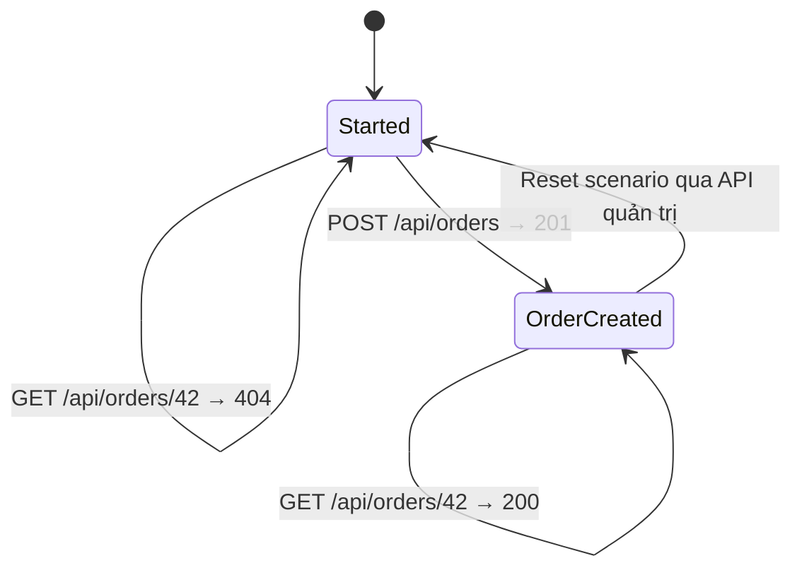
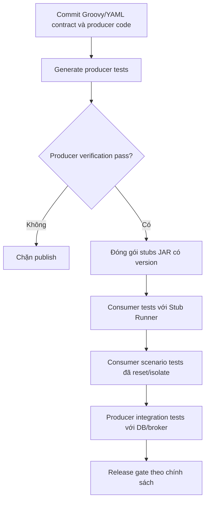

# Scenario của stub và giới hạn so với trạng thái hệ thống thật

## 1. Stub có thể giả lập một chuỗi hành vi, nhưng không phải hệ thống thật

Trong **Spring Cloud Contract**, hợp đồng (*contract*) mô tả hành vi mà **producer** cam kết với **consumer** thông qua HTTP hoặc thông điệp. Từ Groovy/YAML DSL, công cụ có thể sinh **kiểm thử phía producer** và **stub** để consumer thử tích hợp qua **Stub Runner** mà không phải khởi động producer thật. CI dùng các kiểm thử này để phát hiện sớm thay đổi API không tương thích.

Một stub HTTP thông thường trả response dựa vào những điều kiện request: `GET /api/orders/42` trả JSON có mã đơn, `GET /api/orders/999` trả `404`. Nhưng có những luồng consumer cần kiểm tra **nhiều lần gọi liên tiếp**:

1. Chưa tạo đơn: `GET /api/orders/42` trả `404 ORDER_NOT_FOUND`.
2. Gọi `POST /api/orders`: nhận `201 Created` với mã đơn `42`.
3. Gọi lại `GET /api/orders/42`: nhận `200` và trạng thái `CREATED`.

Muốn mô phỏng luồng này, stub phải nhớ rằng một request ở bước 2 đã xảy ra. **WireMock scenarios** cung cấp cơ chế trạng thái nhẹ cho những trường hợp như vậy. Tuy nhiên, **trạng thái của WireMock scenario không phải trạng thái nghiệp vụ thật trong cơ sở dữ liệu, message broker hay hệ thống phân tán**. Nó chỉ là một phần dữ liệu điều khiển những stub mapping nào được kích hoạt trên một mock server.

Mục tiêu bài học:

- Phân biệt **stub tĩnh**, **scenario có trạng thái**, và **trạng thái của producer thật**.
- Biết cách đọc và viết các trạng thái/chuyển trạng thái đơn giản trong WireMock.
- Hiểu mối quan hệ giữa Groovy/YAML contract, generated producer tests, stub, Stub Runner và CI.
- Xác định những lỗi scenario có thể phát hiện và những thuộc tính chỉ kiểm thử tích hợp/E2E với hệ thống thật mới xác minh được.

## 2. Ba tầng trạng thái khác nhau

| Tầng | Ai quản lý? | Ví dụ | Điều thực sự được kiểm tra |
| --- | --- | --- | --- |
| **HTTP status** | Response cho từng request | `201`, `200`, `404`, `409` | Phản hồi của một lần gọi có đúng giao thức và contract không |
| **Stub scenario state** | WireMock server đang chạy | `Started` → `OrderCreated` | Trong một kịch bản mô phỏng, request nào sẽ kích hoạt mapping nào |
| **Business/system state** | Producer thật, DB, cache, broker và dịch vụ khác | `NEW` → `PAID` → `SHIPPED` | Nghiệp vụ, lưu trữ, cạnh tranh, giao dịch, sự kiện và tính nhất quán thực tế |

Ví dụ HTTP `200` **không phải** một trạng thái workflow như `PAID`. Tương tự, giá trị `OrderCreated` trong WireMock scenario là **nhãn điều khiển mock**, không nhất thiết bằng trường `state: CREATED` trong JSON của API.

Một trình tự mô phỏng:



Sơ đồ này chỉ mô tả **quy tắc kích hoạt stub**. Nó chưa mô phỏng chuyện DB commit trước khi trả `201`, thứ tự event trên Kafka, phân quyền tạo đơn, timeout khi gọi payment service hay tranh chấp khi hai người dùng tạo cùng đơn hàng.

## 3. Stub tĩnh và giới hạn khi nhiều request có cùng điều kiện match

Với một contract HTTP thông thường:

```groovy
import org.springframework.cloud.contract.spec.Contract

Contract.make {
    description 'Truy vấn đơn hàng đã tạo'
    request {
        method GET()
        url '/api/orders/42'
        headers {
            accept(applicationJson())
        }
    }
    response {
        status OK()
        headers {
            contentType(applicationJson())
        }
        body([
            orderId: 42,
            state: 'CREATED'
        ])
    }
}
```

Stub sinh từ hợp đồng này về mặt ý nghĩa nhận `GET /api/orders/42` và trả một response mẫu cố định. Nếu gọi liên tiếp mười lần trong cùng điều kiện, nó **không tự biết** rằng producer thật có thể đã thanh toán, hủy hay chuyển đơn hàng sang trạng thái mới.

Không nên đơn giản tạo hai mapping không có điều kiện phân biệt cho **cùng method + URL**, một mapping trả `404` và một mapping trả `200`, rồi mong WireMock “biết lúc nào trả cái nào”. Những mapping chồng lấn có thể dẫn đến chọn theo ưu tiên/quy tắc match của server, không tạo thành workflow đúng nghĩa.

Có hai hướng hợp lệ tùy mục tiêu:

1. **Tình huống độc lập:** dùng hai contract với **request phân biệt được** (ví dụ `/api/orders/42` tồn tại và `/api/orders/999` không tồn tại). Phù hợp với kiểm thử hợp đồng tĩnh và không cần trạng thái.
2. **Chuỗi gọi có chuyển trạng thái:** cấu hình WireMock scenario hoặc một fake service có model trạng thái riêng. Phù hợp với kiểm thử **hành vi consumer qua nhiều request**, không tự thay thế kiểm thử producer.

Quy tắc thiết kế là **chỉ mô phỏng phần trạng thái mà consumer thực sự quan sát và cần xử lý**. Không cần dựng một database giả phức tạp chỉ để kiểm tra một màn hình có thể xử lý `404` và `200`.

## 4. Cơ chế WireMock scenario: nhãn và chuyển trạng thái

Trong WireMock, các stub mapping tham gia cùng một scenario có thể khai báo:

- `scenarioName`: tên nhóm trạng thái, ví dụ `Order creation flow`.
- `requiredScenarioState`: trạng thái scenario cần có **trước** khi mapping được phép match.
- `newScenarioState`: trạng thái chuyển sang **sau khi** mapping phù hợp được phục vụ.

Trạng thái khởi đầu mặc định của một scenario là `Started` (đúng chữ hoa/thường theo giá trị WireMock dùng). Nếu một request match mapping ở `Started` và mapping có `newScenarioState`, những request sau sẽ được so với trạng thái mới.

Trạng thái thuộc về **scenario trong một WireMock server instance**, không gắn tự động với `sessionId`, `customerId` hoặc user đã gửi request. Hai người dùng cùng gọi vào một mock server có thể cùng tác động đến trạng thái scenario ấy.

### Quy tắc khớp phải đồng thời đúng

Một mapping có `requiredScenarioState: OrderCreated` chỉ được dùng khi **cả** điều kiện request (method, URL, header, body matcher nếu có) **và** trạng thái scenario đều phù hợp. Nếu trạng thái không đúng, mapping này không phục vụ request. Nếu không có mapping khác khớp, WireMock có thể trả response `404` mặc định vì không tìm thấy stub; response mặc định này **không đồng nghĩa** với một response nghiệp vụ `ORDER_NOT_FOUND` mà contract đã mô tả.

> **Phân biệt nguồn kỹ thuật:** WireMock scenario là tính năng của **WireMock**. Không nên mặc định rằng chỉ cần đặt nhiều hợp đồng Groovy/YAML thông thường trong Spring Cloud Contract là plugin sẽ tự tạo `scenarioName`/`requiredScenarioState`/`newScenarioState` hay một chuỗi chuyển trạng thái đầy đủ. Muốn dùng scenario, phải cấu hình nó một cách có chủ đích và kiểm tra mapping thực tế được nạp, theo khả năng của phiên bản công cụ và pipeline đóng gói stub.

## 5. Ví dụ ba mapping cho một vòng đời đơn giản

Giả sử consumer đang thử quy trình **tạo đơn rồi tra cứu**. Ta dùng một WireMock scenario tên `Order creation flow` gồm ba mapping JSON độc lập. Mỗi khối dưới đây là **nội dung của một file mapping riêng**, không phải một mảng JSON duy nhất để dán vào một file.

### 5.1. Chưa tạo: GET trả lỗi nghiệp vụ 404

Ví dụ file `mappings/order-before-create.json`:

```json
{
  "name": "Order before creation",
  "scenarioName": "Order creation flow",
  "requiredScenarioState": "Started",
  "request": {
    "method": "GET",
    "url": "/api/orders/42"
  },
  "response": {
    "status": 404,
    "headers": {
      "Content-Type": "application/json"
    },
    "jsonBody": {
      "code": "ORDER_NOT_FOUND",
      "message": "Đơn hàng chưa tồn tại"
    }
  }
}
```

Mapping này **không** có `newScenarioState`, vì một lần tra cứu thất bại không tạo đơn hàng. Scenario vẫn ở `Started`.

### 5.2. Tạo: POST trả 201 và chuyển trạng thái

Ví dụ file `mappings/create-order.json`:

```json
{
  "name": "Create order",
  "scenarioName": "Order creation flow",
  "requiredScenarioState": "Started",
  "newScenarioState": "OrderCreated",
  "request": {
    "method": "POST",
    "url": "/api/orders",
    "headers": {
      "Content-Type": {
        "contains": "application/json"
      }
    },
    "bodyPatterns": [
      {
        "equalToJson": "{ \"customerId\": \"cust-123\", \"quantity\": 2 }"
      }
    ]
  },
  "response": {
    "status": 201,
    "headers": {
      "Content-Type": "application/json",
      "Location": "/api/orders/42"
    },
    "jsonBody": {
      "orderId": 42,
      "state": "CREATED"
    }
  }
}
```

Việc giới hạn request body ở `customerId` và `quantity` cho thấy scenario ở đây chỉ mô phỏng **một dữ liệu ví dụ**. Một API thật có thể chấp nhận nhiều khách hàng và tạo mã đơn hàng khác nhau. Nếu consumer cần kiểm tra thêm trường hợp, phải bổ sung mẫu hoặc fake service phù hợp; không mở regex quá rộng chỉ để mock nhận mọi input bất kể nghiệp vụ.

### 5.3. Đã tạo: GET trả 200

Ví dụ file `mappings/order-after-create.json`:

```json
{
  "name": "Order after creation",
  "scenarioName": "Order creation flow",
  "requiredScenarioState": "OrderCreated",
  "request": {
    "method": "GET",
    "url": "/api/orders/42"
  },
  "response": {
    "status": 200,
    "headers": {
      "Content-Type": "application/json"
    },
    "jsonBody": {
      "orderId": 42,
      "state": "CREATED"
    }
  }
}
```

Mapping này không có `newScenarioState`; sau khi tạo, các lần gọi `GET` tiếp theo vẫn nhận dữ liệu như đã tạo. Đây là mô hình đơn giản có **hai nhãn trạng thái**. Nếu muốn mô phỏng `CREATED → PAID → CANCELLED`, cần định nghĩa các request/chuyển trạng thái tương ứng; số lượng mapping tăng lên nhanh chóng khi có nhiều nhánh.

**Quan trọng:** Ba ví dụ trên là **WireMock mapping JSON để minh họa scenario**, không phải tệp Groovy/YAML Contract DSL và không phải bằng chứng Spring Cloud Contract đã tự sinh ba mapping stateful đó. Nếu hệ thống test dùng Stub Runner, chỉ những mapping **thực sự nằm trong artifact hoặc được nạp vào WireMock của bài test** mới có tác dụng. Cần xác minh cách đóng gói/nạp mapping ở plugin và phiên bản đang dùng, tránh duy trì một bản contract và một bản mock viết tay lệch nhau.

## 6. Chạy scenario và kiểm tra chuyển trạng thái

Giả sử đã khởi chạy một **WireMock standalone server** trên cổng `8089` và server đã nạp đúng ba file mapping ở mục 5. Đây là một bài lab riêng cho cơ chế scenario; không khẳng định `8089` là cổng mặc định hoặc là cổng mà Stub Runner sẽ chọn.

### Bước 1. Reset trước mỗi bài test

WireMock có API quản trị để đưa các scenario trở về trạng thái ban đầu:

```bash
curl -X POST http://localhost:8089/__admin/scenarios/reset
```

Lệnh reset scenario **không phải** thao tác xóa dữ liệu thật ở producer; nó chỉ thay đổi trạng thái điều khiển scenario trên WireMock server. Nếu cần cô lập toàn bộ test, phải cân nhắc thêm journal request, mapping bổ sung và những cấu hình test khác.

### Bước 2. GET trước khi tạo

```bash
curl -i http://localhost:8089/api/orders/42
```

Kỳ vọng:

```http
HTTP/1.1 404 Not Found
Content-Type: application/json

{"code":"ORDER_NOT_FOUND","message":"Đơn hàng chưa tồn tại"}
```

**Phải kiểm tra cả body `ORDER_NOT_FOUND`**, không chỉ status `404`. Nếu một request không match bất kỳ mapping nào, WireMock cũng có thể trả `404` mặc định; điều đó không chứng minh tình huống lỗi nghiệp vụ đã được mô phỏng đúng.

### Bước 3. POST để chuyển trạng thái

```bash
curl -i -X POST http://localhost:8089/api/orders \
  -H 'Content-Type: application/json' \
  -d '{"customerId":"cust-123","quantity":2}'
```

Kỳ vọng HTTP `201`, header `Location: /api/orders/42`, body chứa `orderId = 42` và `state = CREATED`. Sau khi mapping được phục vụ, scenario chuyển từ `Started` sang `OrderCreated`.

### Bước 4. GET lần nữa

```bash
curl -i http://localhost:8089/api/orders/42
```

Kỳ vọng HTTP `200` với body:

```json
{
  "orderId": 42,
  "state": "CREATED"
}
```

Đó là bằng chứng **WireMock chọn mapping mới theo nhãn scenario**. Nó chưa chứng minh order được ghi vào database, không bị mất sau restart, có transaction rollback đúng hay có sự kiện `OrderCreated` được phát.

### Bước 5. Quan sát trạng thái quản trị

Có thể xem trạng thái các scenario trên WireMock qua API quản trị tương ứng:

```bash
curl http://localhost:8089/__admin/scenarios
```

Thông tin quản trị giúp debug khi test trả response không mong đợi. Không nên để các API quản trị mock server này công khai trong môi trường thực hoặc để test dựa vào chúng như một phần contract API của producer.

### Trên Windows

Các câu lệnh `curl` ở đây là ví dụ dành cho shell hỗ trợ cú pháp đó; trong Windows PowerShell, `curl` có thể là alias của `Invoke-WebRequest` tùy môi trường. Có thể dùng `curl.exe` hoặc chuyển sang lệnh PowerShell tương ứng để tránh nhầm cách xử lý body/header. Bản thân kịch bản không phụ thuộc hệ điều hành.

## 7. Stub Runner và contract: ai kiểm chứng điều gì?

Trong quy trình Spring Cloud Contract chuẩn, một file Groovy/YAML mô tả **một kịch bản request-response**; plugin xử lý hợp đồng để sinh **producer verification test** và **HTTP stub**. Ví dụ, hai kịch bản HTTP độc lập có thể là:

| Contract nguồn | Request | Expected response | Producer test cần chứng minh |
| --- | --- | --- | --- |
| `get-existing-order.groovy` | `GET /api/orders/42` trên dữ liệu thử đã có đơn 42 | `200`, JSON có `orderId/state` | Controller/service trả đúng response |
| `get-missing-order.groovy` | `GET /api/orders/999` trên dữ liệu thử không có đơn 999 | `404`, JSON có `ORDER_NOT_FOUND` | Handler và dữ liệu thử thể hiện lỗi đúng |

Ví dụ contract Groovy cho nhánh “không tìm thấy”:

```groovy
import org.springframework.cloud.contract.spec.Contract

Contract.make {
    description 'Đơn hàng 999 chưa tồn tại'
    request {
        method GET()
        url '/api/orders/999'
    }
    response {
        status NOT_FOUND()
        headers {
            contentType(applicationJson())
        }
        body([
            code: 'ORDER_NOT_FOUND',
            message: 'Đơn hàng không tồn tại'
        ])
    }
}
```

Cùng kịch bản đó bằng YAML DSL:

```yaml
description: Đơn hàng 999 chưa tồn tại
request:
  method: GET
  url: /api/orders/999
response:
  status: 404
  headers:
    Content-Type: application/json
  body:
    code: "ORDER_NOT_FOUND"
    message: "Đơn hàng không tồn tại"
```

Đây là **hai định dạng thay thế nhau**, không phải hai hợp đồng cần nạp đồng thời. Bản YAML và Groovy phải được dùng với cùng nguồn dữ liệu producer test để bảo đảm trạng thái “không tồn tại” thực sự được kiểm chứng.

### Generated producer test không tự dựng vòng đời

Với contract `GET /api/orders/999`, generated test có thể phát request đó và kiểm tra `404`, nhưng không tự chứng minh rằng một lệnh `POST` trước đó làm dữ liệu xuất hiện và tồn tại bền vững sau nhiều request. Muốn kiểm thử vòng đời thật, cần một **producer integration test nhiều bước** cùng dữ liệu được quản lý có chủ đích:

1. Seed trạng thái ban đầu phù hợp, bảo đảm đơn `42` chưa tồn tại.
2. Gọi API tạo đơn, kiểm tra `201` và ID trả về.
3. Gọi API tra cứu ID đó, kiểm tra `200` và dữ liệu tương ứng.
4. Kiểm tra persistence, transaction hoặc phát sự kiện nếu đó là yêu cầu nghiệp vụ.

Phần này là **kiểm thử ngoài khả năng mà một stub scenario tự chứng minh**. Contract tests và producer integration tests bổ sung nhau, không thay thế nhau.

### Khi consumer dùng Stub Runner

Một consumer test có thể nạp stubs JAR mà producer đã phát hành:

```java
import org.springframework.cloud.contract.stubrunner.StubRunnerProperties;
import org.springframework.cloud.contract.stubrunner.spring.AutoConfigureStubRunner;

@AutoConfigureStubRunner(
    ids = "com.example:order-service:1.2.0:stubs:9090",
    stubsMode = StubRunnerProperties.StubsMode.LOCAL
)
class OrderClientContractTest {
    // HTTP client của consumer gọi stub trên localhost:9090.
    // Bổ sung test kiểm tra các nhánh 404, 201, 200 theo mapping đã nạp.
}
```

Đoạn trên chỉ minh họa cấu hình; test cần dependency và assertion thực, cùng cấu hình base URL của consumer client. `LOCAL` yêu cầu artifact có trong Maven local; với CI, cần repository/mode phù hợp nếu lấy từ xa.

**Điều phải phân biệt:** Stub Runner tải **những mapping có thật trong stubs JAR và khởi chạy chúng**, không tự biến nhiều contract tĩnh thành một state machine. Nếu muốn thử **WireMock scenario**, phải xác minh artifact hoặc cấu hình test đã nạp những mapping có `scenarioName`/`requiredScenarioState`/`newScenarioState` tương ứng, hoặc sử dụng một WireMock server riêng được thiết lập rõ cho bài test đó.

Trong dự án thực, nên giữ contract là nguồn mô tả cam kết API, và quản lý scenario mock như một **test fixture có mục đích được review**, không để hai tập mô tả trôi độc lập. Với mọi hành vi quan trọng của producer, kiểm thử thật phải xác minh triển khai, không chỉ xác minh fixture mock.

## 8. Tại sao “stub scenario pass” vẫn chưa chứng minh hệ thống đúng?

Xét cùng chuỗi `GET 404 → POST 201 → GET 200`. Một mock có thể trả chính xác ba response ngay cả khi producer thật:

- Không ghi đơn hàng vào database vì transaction bị rollback.
- Trả `201` nhưng service phía sau vẫn lỗi khi client truy vấn tức thì.
- Tạo hai đơn hàng do client retry `POST` sau timeout.
- Không kiểm tra quyền truy cập của người dùng trước khi tạo đơn.
- Phát trùng event `OrderCreated` hoặc không phát event nào.
- Có cache cũ khiến `GET` trả `404` trong một thời gian sau `POST`.

Những lỗi này không bị phát hiện bằng cách kiểm tra **chỉ trạng thái nội bộ của WireMock scenario**, vì scenario chuyển nhãn khi một request khớp mapping, không phải khi một transaction DB thật hoàn tất.

| Năng lực cần chứng minh | Stub scenario có thể giúp? | Cần thêm kiểm thử gì? |
| --- | --- | --- |
| Consumer xử lý `404`, `201`, `200` theo đúng thứ tự mô phỏng | **Có** | Test consumer nhiều bước với stub đã reset |
| Request path, header và body consumer gửi có đúng format | **Có** nếu mapping đủ chặt | Contract test và test client |
| Producer thực sự trả status/body đúng cam kết | **Không** | Generated producer verification tests |
| POST thật ghi dữ liệu và GET sau đó đọc đúng dữ liệu | **Không** | Producer integration test với DB |
| Không tạo trùng khi retry, xử lý idempotency | **Không tự chứng minh** | Integration test timeout/retry, idempotency key |
| Đúng quy tắc phân quyền và ownership dữ liệu | **Không** | Security/integration tests với identity |
| Event gửi đến broker, đúng ordering và xử lý trễ | **Không** | Messaging integration test với broker |
| Tính nhất quán của nhiều service khi có sự cố mạng | **Không** | E2E, fault-injection, resiliency tests |
| Hiệu năng, throughput, khóa cạnh tranh | **Không** | Load/concurrency tests |

Nếu hệ thống được thiết kế **eventually consistent**, việc `GET` không thấy dữ liệu ngay sau `POST` có thể là hành vi hợp lệ trong một khoảng thời gian. Stub scenario trả `200` tức thì chỉ đại diện một **đường đi mong muốn**, không phản ánh độ trễ/cơ chế retry thật. Consumer có thể cần thêm kịch bản `404` tạm thời hoặc `202 Accepted` (nếu API cam kết như vậy), nhưng phải thiết kế từ giao thức thực tế chứ không tự tưởng tượng behavior.

## 9. Reset, cô lập test và chạy song song

Đây là những nguyên nhân phổ biến khiến một consumer test dùng scenario **pass riêng lẻ nhưng fail ngẫu nhiên khi chạy toàn bộ suite**.

### 9.1. State được giữ trong mock server

Giả sử test A thực hiện `POST /api/orders` và chuyển `Order creation flow` sang `OrderCreated`. Nếu test B chạy tiếp trên **cùng WireMock server** mà không reset và kỳ vọng `GET /api/orders/42` trả `404` ở trạng thái ban đầu, test B sẽ thấy `200`. Lỗi nằm ở fixture, không nhất thiết ở consumer.

Nên dùng một trong những cách:

- Reset scenario về `Started` trước mỗi test có phụ thuộc trạng thái (nếu server test được phép gọi admin API).
- Tạo WireMock instance/port riêng cho từng test hoặc nhóm test độc lập.
- Tránh chia sẻ một server stateful giữa các test chạy song song, hoặc cấu hình isolation rõ ràng.

Lệnh:

```bash
curl -X POST http://localhost:8089/__admin/scenarios/reset
```

Đây là ví dụ cho WireMock được quản lý trong lab ở mục 6. Với Stub Runner, cách truy cập server, cổng và lifecycle phụ thuộc cấu hình test; không giả định mọi bộ test đều có thể gọi một admin endpoint trên cùng cổng hoặc được phép reset server chung.

### 9.2. Reset không thay cho setup trạng thái ứng dụng

Reset WireMock scenario làm biến mất **nhãn trạng thái mô phỏng**, không xóa dữ liệu producer thật, không dọn cơ sở dữ liệu của ứng dụng và không thu hồi những event đã phát. Ngược lại, xóa dữ liệu trong DB test không reset state đã được giữ bởi WireMock server.

Với một test producer hoặc E2E thực:

1. Seed dữ liệu đầu vào xác định, hoặc chuẩn bị database transaction riêng.
2. Reset các mock server liên quan nếu chúng được dùng làm dependency.
3. Chạy test, kiểm tra kết quả và side effects.
4. Cleanup/isolate để test sau không phụ thuộc thứ tự.

### 9.3. Scenario không tự phân nhánh theo từng người dùng

Trong ví dụ, `Order creation flow` thuộc một server duy nhất. Nếu khách A gọi `POST` và làm scenario chuyển trạng thái, khách B gọi `GET` có thể thấy “đã tạo” dù họ chưa tạo đơn hàng nào. WireMock không tự quản lý bảng `orderId -> owner/state` như database.

Để kiểm thử nhiều người dùng hoặc nhiều đơn hàng:

- Dùng các fixture độc lập và request matcher phân biệt rõ khi số trường hợp ít.
- Dùng mock server instance riêng cho các test cần isolation.
- Nếu cần trạng thái động theo ID hoặc quy tắc phức tạp, cân nhắc **fake service** với cấu trúc dữ liệu in-memory rõ ràng và test riêng.
- Chạy test với producer thật để xác minh phân quyền, tính duy nhất và isolation của dữ liệu.

### 9.4. Lỗi cạnh tranh của các request

Hai request đến đồng thời có thể cùng dựa vào một nhãn state hiện tại. WireMock scenario **không phải cơ chế khóa, giao dịch hoặc kiểm soát đồng thời nghiệp vụ**. Không sử dụng kết quả scenario để kết luận producer đã xử lý race condition, optimistic locking hay deduplication đúng.

## 10. Thiết kế scenario cho lỗi và trạng thái bất thường

Một scenario hữu ích không chỉ mô phỏng **happy path**. Consumer thường phải xử lý những response lỗi xảy ra tại thời điểm cụ thể của một workflow.

| Tình huống | Chuỗi hành vi mô phỏng | Phần consumer cần kiểm tra | Giới hạn của mock |
| --- | --- | --- | --- |
| Tạo rồi tra cứu | `404 → POST 201 → GET 200` | Chuyển màn hình khi dữ liệu xuất hiện | Không chứng minh DB đã commit |
| Thanh toán trùng | `POST /pay 200 → POST /pay 409` | Không gửi lại vô hạn, hiện “đã thanh toán” | Không chứng minh khóa/idempotency thực |
| Hết hạn xác thực | `GET 401 → refresh token → GET 200` | Luồng refresh và xử lý lỗi | Không chứng minh security server kiểm tra token thật |
| Tạm thời quá tải | `GET 429 → chờ → GET 200` | Backoff và giới hạn retry | Không chứng minh rate limiting phân tán |
| Xử lý bất đồng bộ | `POST 202 → GET PENDING → GET COMPLETED` | Polling và timeout của UI | Không phản ánh broker/eventual consistency thật |
| Lỗi hệ thống | `GET 503 → retry → GET 200` | Retry an toàn và thông báo người dùng | Không chứng minh phục hồi thực tế |

**HTTP status không tự chuyển scenario state.** Nếu muốn `POST /pay` lần thứ hai trả `409`, phải khai báo mapping cho request ở state mới hoặc dùng fake service. Không thể chỉ viết một contract `409` rồi mặc nhiên giả định stub nhớ các request trước.

### Một scenario retry không được che lỗi client

Với `429` hoặc `503`, consumer test cần kiểm tra **số lần thử**, khoảng chờ và thời hạn dừng theo chính sách. Một stub lập tức trả `200` ở lần thử thứ hai chỉ kiểm chứng nhánh “thử lại thành công”; nó không chứng minh client dừng sau ngưỡng retry, dùng exponential backoff hay không retry request không idempotent.

Nếu contract yêu cầu header `Retry-After`, stub cần trả giá trị theo giao thức và producer phải có kiểm thử tương ứng. Không dùng một giá trị trễ giả để khẳng định được hiệu năng hoặc khả năng chịu tải của hệ thống thật.

### Mã lỗi nghiệp vụ vẫn phải là một phần của assertion

Trong kịch bản chưa có đơn, consumer test cần xác minh response có:

```json
{
  "code": "ORDER_NOT_FOUND",
  "message": "Đơn hàng chưa tồn tại"
}
```

Nếu WireMock trả `404` mặc định vì **không có mapping nào khớp**, response thường không có mã `ORDER_NOT_FOUND`. Chỉ assertion HTTP `404` có thể tạo **false positive**; cần kiểm tra `Content-Type`, `code` và các trường consumer thực sự dựa vào.

## 11. Chọn đúng lớp kiểm thử cho từng câu hỏi

Một chiến lược tốt sử dụng nhiều lớp kiểm thử, mỗi lớp có trách nhiệm rõ ràng:

| Lớp | Đối tượng chạy | Thế mạnh | Chưa chứng minh |
| --- | --- | --- | --- |
| **Generated contract test** | Producer thật với dữ liệu test xác định | Status, header, body và matcher của từng hợp đồng | Mọi chuỗi chuyển trạng thái nếu không được viết test tương ứng |
| **Consumer + stub tĩnh** | Consumer thật kết nối WireMock/Stub Runner | Parsing, mapping, logic xử lý từng response | Side effects của producer |
| **Consumer + stateful stub scenario** | Consumer chạy chuỗi request trên mock có nhãn state | Luồng nhiều bước, UI, retry, nhánh lỗi ở trạng thái mô phỏng | DB, giao dịch, phân quyền, concurrency thật |
| **Producer integration test** | Producer + DB/dependency phù hợp | Ghi/đọc dữ liệu, luật nghiệp vụ, transaction, state transitions | Toàn bộ ảnh hưởng đa service nếu dependency còn mock |
| **End-to-end/resilience test** | Các service và hạ tầng thực hoặc gần thật | Tích hợp đa service, độ trễ, lỗi mạng, event ordering | Không thay thế mọi hợp đồng nhỏ, nhanh và ổn định |

Thứ tự ưu tiên thường là: **contract test bảo vệ API**, **consumer stub test bảo vệ client**, **producer integration test bảo vệ nghiệp vụ**, **E2E/resilience test bảo vệ các luồng xuyên dịch vụ**. Không cần kiểm tra mọi thứ bằng một loại test duy nhất.

### Một contract có thể là đúng nhưng business state vẫn sai

Giả sử contract bảo vệ `POST /api/orders` trả `201` và body chứa `orderId`, còn generated test dùng một service giả để tạo ID. Test vẫn pass khi controller trả đúng response mẫu, nhưng code production có thể không persist vì lỗi cấu hình DB. Đó là hạn chế **độ phủ của môi trường kiểm thử producer**, không phải dấu hiệu contract vô ích.

Muốn phát hiện, bổ sung test chạy tầng persistence thật với dữ liệu xác định, gọi tạo và đọc lại đơn. Nếu dự án có bảo đảm phát sự kiện, test riêng hành vi publishing qua broker phù hợp.

## 12. Tích hợp vào CI mà không đánh đồng độ tin cậy



Một cách chia pipeline thực tế:

1. **Producer contract stage:** sinh và chạy tests từ Groovy/YAML DSL, chắc chắn test thật sự được thực thi; nếu test fail, không công bố stub như một lời hứa đã xác minh.
2. **Stub artifact stage:** đóng gói/version hóa mapping do contract sinh; ghi tọa độ và commit của stubs JAR. Nếu có mapping scenario bổ sung, xác nhận chính xác nguồn và cách chúng được nạp, tránh ghi đè/che một mapping hợp đồng khác.
3. **Consumer stage:** chạy client với stub, kiểm tra cả response thành công và lỗi; với scenario có trạng thái, reset/isolated server để test không phụ thuộc thứ tự.
4. **Integration stage:** kiểm tra producer với database, auth hoặc broker thực tế/thử nghiệm để xác minh những trạng thái business mà mock không thể chứng minh.
5. **Release review:** đánh giá tương thích với consumer hiện đang dùng version cũ và những thay đổi về business state, retry, idempotency hay event ordering.

**Một pipeline xanh chỉ có ý nghĩa trong phạm vi kiểm thử đã chạy.** Nếu chạy consumer scenario test mà không có producer verification, việc test xanh chỉ chứng minh consumer tương thích với một mô phỏng. Nếu đã chạy producer tests nhưng không có integration test lưu trữ, chưa thể kết luận trạng thái đơn hàng được duy trì đúng trong hệ thống thật.

### Các chỉ báo nên lưu trong log

- Version Spring Cloud Contract, WireMock, build tool và JDK.
- Tọa độ stubs JAR, commit nguồn contract và phiên bản đã tải.
- Danh sách kịch bản được kiểm tra, số producer tests thật sự chạy.
- Scenario state ban đầu, đường đi chuyển trạng thái và kết quả reset/isolation của mock.
- Những lớp test không được chạy ở job hiện tại (ví dụ DB integration hoặc E2E), để không hiểu nhầm phạm vi.

## 13. Bài thực hành: thanh toán lần thứ hai phải nhận 409

Một consumer gọi `POST /api/orders/42/pay` để thanh toán đơn hàng. Theo yêu cầu nghiệp vụ, thanh toán thành công lần đầu trả `200` với `paymentState = PAID`. Nếu gọi lại trong cùng luồng test khi đơn đã thanh toán, producer thật dự kiến trả `409 ORDER_ALREADY_PAID`.

### Phần A. Thiết kế scenario giả lập

Xây dựng một WireMock scenario có hai nhãn `Started` và `Paid`:

1. Ở `Started`, `POST /api/orders/42/pay` trả HTTP `200`, body có `paymentState: "PAID"`, rồi chuyển sang `Paid`.
2. Ở `Paid`, cùng request trả HTTP `409` với `code: "ORDER_ALREADY_PAID"` và một `message` hợp lệ. Lần gọi thất bại không đổi nhãn scenario.
3. Reset scenario về `Started` trước mỗi bài test độc lập.
4. Thử một request có method hoặc path sai để chắc chắn nó không vô tình kích hoạt việc chuyển state.

### Phần B. Hai mapping tối thiểu

Mapping thứ nhất, nội dung file `pay-first-time.json`:

```json
{
  "scenarioName": "Payment flow",
  "requiredScenarioState": "Started",
  "newScenarioState": "Paid",
  "request": {
    "method": "POST",
    "url": "/api/orders/42/pay"
  },
  "response": {
    "status": 200,
    "headers": {
      "Content-Type": "application/json"
    },
    "jsonBody": {
      "paymentState": "PAID"
    }
  }
}
```

Mapping thứ hai, nội dung file `pay-already-paid.json`:

```json
{
  "scenarioName": "Payment flow",
  "requiredScenarioState": "Paid",
  "request": {
    "method": "POST",
    "url": "/api/orders/42/pay"
  },
  "response": {
    "status": 409,
    "headers": {
      "Content-Type": "application/json"
    },
    "jsonBody": {
      "code": "ORDER_ALREADY_PAID",
      "message": "Đơn hàng đã được thanh toán"
    }
  }
}
```

Đây là **mapping WireMock dành cho bài test scenario**, không phải tự động là contract Groovy/YAML mà Spring Cloud Contract dùng để sinh producer tests. Bộ test producer vẫn phải có hợp đồng hoặc các assertion tương đương cho response thành công và xung đột trong điều kiện dữ liệu thích hợp.

### Phần C. Ma trận xác minh

| Bước | Request | Kết quả mong đợi | Nhãn scenario sau bước |
| --- | --- | --- | --- |
| 1 | Reset scenario | Về trạng thái đầu | `Started` |
| 2 | `POST /api/orders/42/pay` | `200`, `paymentState = PAID` | `Paid` |
| 3 | `POST /api/orders/42/pay` | `409`, `code = ORDER_ALREADY_PAID` | `Paid` |
| 4 | Reset scenario | Về trạng thái đầu | `Started` |
| 5 | `POST /api/orders/42/pay` | `200` một lần nữa trong test độc lập | `Paid` |

**Câu hỏi:** Nếu test trên pass thì có thể kết luận producer thật không thu tiền hai lần không? **Không.** Đó mới là bằng chứng consumer đã xử lý hai response giả lập. Cần thêm test producer/integration về idempotency, giao dịch thanh toán, xử lý retry và trạng thái lưu trữ. Khi request có thể đi qua mạng và timeout sau khi payment đã được ghi, mô hình thực tế phải xác định chính sách dùng idempotency key hoặc cơ chế chống trùng tương ứng.

### Phần D. Các thử nghiệm phá vỡ

1. Đổi response `409` thành `200` trong mapping nhưng không đổi logic consumer: xác định consumer test có phát hiện nhánh sai không.
2. Giữ `409` nhưng bỏ `code = ORDER_ALREADY_PAID`: xác định test có phân biệt **business error** với HTTP `409` đơn thuần không.
3. Bỏ bước reset trước test: giải thích vì sao bài test thứ hai có thể fail tùy thứ tự chạy.
4. Chạy hai consumer test song song trên cùng mock server: quan sát nguy cơ cùng tác động đến một scenario state.
5. Gọi một producer tích hợp DB thật: kiểm tra xem hai lần `POST` có bị trừ tiền hai lần, có dùng transaction/idempotency chính xác và có event thanh toán bị phát trùng không.

### Đáp án định hướng

- Với các mapping ở phần B, lần `POST` đầu tiên kích hoạt `newScenarioState = Paid`; lần sau được phục vụ bởi mapping chỉ hoạt động khi `requiredScenarioState = Paid`.
- `409` chưa đủ nếu client phải phân biệt `ORDER_ALREADY_PAID` với những xung đột khác. Consumer test nên assert cả status và mã lỗi.
- Reset phục hồi **mock**, không phục hồi trạng thái DB hay giao dịch thật.
- Scenario chỉ có một nhãn `Paid` dùng chung trong server nên không biểu diễn các đơn hàng hoặc khách hàng độc lập.
- Hợp đồng và kiểm thử tích hợp producer phải chứng minh API thực trả các trạng thái phù hợp và nghiệp vụ không thực hiện thanh toán lặp.

## 14. Lỗi thường gặp khi sử dụng scenario

| Hiện tượng | Nguyên nhân có thể | Cách kiểm tra |
| --- | --- | --- |
| GET mong `404` nhưng lại nhận `200` ngay từ đầu test | State của test trước còn giữ | Reset scenario, xem `/__admin/scenarios` |
| POST đúng request nhưng không chuyển trạng thái | Method/path/header/body không match hoặc mapping không được nạp | Kiểm tra request journal và mapping đang hiệu lực |
| GET trả `404` nhưng body không có mã lỗi | WireMock không tìm thấy mapping, không phải lỗi nghiệp vụ được mock | Kiểm tra `code`, `Content-Type` và stub mappings |
| Producer contract test pass nhưng scenario consumer fail | Mô phỏng sai thứ tự, thiếu mapping hoặc test chưa reset | So luồng consumer với state machine và fixture |
| Consumer scenario pass nhưng producer fail với DB | Mock không mô phỏng persistence/transaction | Chạy producer integration tests và kiểm tra dữ liệu |
| Test chỉ fail khi chạy song song | Scenario state dùng chung hoặc cổng WireMock bị chia sẻ | Isolate server/port; không dựa vào thứ tự thực thi |
| Thay đổi contract nhưng stub scenario vẫn trả response cũ | Mapping viết tay tách rời nguồn contract | Review/update fixture, xác minh artifact cuối cùng |
| Stub Runner không chạy scenario như dự kiến | Stubs JAR không chứa mapping stateful hoặc nạp sai | Xem nội dung JAR, startup log và mapping thực sự được nạp |
| Scenario trở nên rất phức tạp | Nhiều ID, user, nhánh lỗi hoặc dữ liệu động | Dùng fake service hoặc integration test thật phù hợp hơn |
| Mọi test đều xanh dù security sai | Stub không chạy authentication/authorization thật | Bổ sung security tests trên producer |

## 15. Checklist trước khi dùng stateful stub trong dự án

- [ ] Nhu cầu test có **chuỗi gọi phụ thuộc trạng thái** thật; stub tĩnh chưa đáp ứng được.
- [ ] Phân biệt rõ HTTP status, nhãn WireMock scenario và business state của producer.
- [ ] Từng mapping có request matcher cụ thể, `scenarioName` và `requiredScenarioState` phù hợp.
- [ ] `newScenarioState` được khai báo đúng request làm thay đổi luồng; request chỉ đọc không tự chuyển trạng thái nếu không có yêu cầu.
- [ ] Response lỗi giả lập có status **và mã lỗi nghiệp vụ**, không nhầm `404` do miss mapping.
- [ ] Test có reset/isolation rõ ràng; không chia sẻ state ngầm giữa các test chạy song song.
- [ ] Stub mappings được nạp thực sự và có version/truy vết nguồn; không giả định SCC tự sinh scenario từ nhiều contract độc lập.
- [ ] Generated producer tests xác minh những cam kết HTTP tương ứng; stub test không được dùng thay producer verification.
- [ ] Bất biến DB, idempotency, quyền truy cập, concurrency và messaging có test thật ở lớp thích hợp.
- [ ] Consumer kiểm tra các nhánh thành công, lỗi, retry/timeout và thay đổi state mà họ thực sự sử dụng.
- [ ] CI ghi nhận phạm vi kiểm thử đã chạy và chỉ phát hành stub sau khi producer verification pass.

**Ghi nhớ:** WireMock scenario giúp mô phỏng **một chuỗi response phụ thuộc vào các request trước đó**, rất hữu ích khi kiểm thử logic consumer trong các luồng nhiều bước. Nhưng scenario chỉ là **state machine của mock server**, không phải bằng chứng về dữ liệu, giao dịch hay độ tin cậy của producer thật. Trong Spring Cloud Contract, hãy dùng contract và generated producer tests để bảo vệ cam kết HTTP, dùng stub/Stub Runner để thử consumer, và dùng integration/E2E tests để xác minh những trạng thái nghiệp vụ mà mô phỏng không thể bảo đảm.
