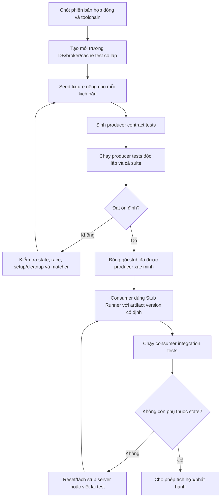

# Tránh kiểm thử phụ thuộc thứ tự hoặc dùng chung trạng thái

Trong hệ thống microservices, cùng một API có thể trả nhiều mã trạng thái tùy dữ liệu hiện tại: đơn hàng còn mới có thể hủy và trả `200 OK`, đơn hàng đã giao bị từ chối với `409 Conflict`, còn mã đơn hàng không tồn tại trả `404 Not Found`. Điều này hoàn toàn hợp lý về nghiệp vụ. Vấn đề phát sinh khi **kết quả kiểm thử phụ thuộc vào bài test khác đã chạy trước**, hoặc nhiều bài test dùng chung database, cache, stub server, message broker mà không kiểm soát trạng thái.

Với **Spring Cloud Contract**, nhóm dùng **Groovy/YAML DSL** để mô tả kỳ vọng giữa **producer** và **consumer**, sinh producer contract tests, phát hành stub và dùng **Stub Runner** cho consumer kiểm thử. Nếu dữ liệu đầu vào không độc lập, hợp đồng đúng vẫn có thể làm CI đỏ ngẫu nhiên; ngược lại, một stub dùng chung còn sót trạng thái có thể khiến consumer test xanh sai.

Bài này thuộc chương **Trạng thái và lỗi** của **SPRING_CLOUD_CONTRACT**. Mục tiêu là thiết kế kiểm thử hợp đồng **độc lập, lặp lại được và đúng ngữ nghĩa trạng thái**, đặc biệt với HTTP `200`, `404`, `409`, tương tác có thay đổi dữ liệu và message bất đồng bộ.

## 1. Phân biệt trạng thái nghiệp vụ với trạng thái môi trường kiểm thử

Hai loại “trạng thái” thường bị nhầm:

- **Trạng thái nghiệp vụ**: `NEW`, `CANCELLED`, `SHIPPED`, số lượng tồn kho, việc tài nguyên có tồn tại hay không. Producer **phải** dùng trạng thái này để quyết định hành vi API.
- **Trạng thái môi trường kiểm thử**: dữ liệu còn lại từ test trước, hàng đợi chưa dọn, cache chưa làm mới, WireMock đang ở một scenario đã kích hoạt, token hết hạn hoặc singleton giữ giá trị giữa các tests. Đây là điều **không nên ảnh hưởng ngầm** đến kết quả một test độc lập.

Ví dụ:

```text
Test A: Tạo đơn ORDER-42       -> 201 Created
Test B: Hủy đơn ORDER-42       -> 200 OK
Test C: Hủy lại ORDER-42       -> 409 Conflict
```

Chuỗi trên mô tả một **workflow hợp lệ** nếu được viết thành **một bài kiểm thử luồng** có chuẩn bị và xác minh từng bước. Nhưng nếu A, B, C là ba **contract tests độc lập** và B chỉ đạt khi A chạy trước, thì suite sẽ thất bại khi:

- chạy riêng B trên IDE;
- runner đổi thứ tự;
- CI chạy nhiều test song song;
- A không chạy vì lọc test;
- database vẫn còn dữ liệu từ build cũ.

**Quy tắc:** mỗi contract test phải tự biết cần trạng thái ban đầu nào. Nếu thực sự muốn kiểm tra **chuỗi trạng thái**, hãy quản lý chuỗi đó rõ ràng trong **một integration/workflow test**, không ngầm lệ thuộc vào thứ tự các generated contract tests.

## 2. Vì sao lỗi phụ thuộc thứ tự nguy hiểm?

| Tình huống | Khi chạy riêng | Khi chạy cả suite | Rủi ro |
|---|---|---|---|
| Test `cancel` yêu cầu test `create` chạy trước | `404` | Có thể `200` | Contract test không độc lập |
| Test `404` dùng ID được test khác tạo | `404` | Có thể `200` | Kiểm tra sai trường hợp lỗi |
| Test `409` dựa vào test trước đã chuyển trạng thái | `200` | Có thể `409` | Không thể tái hiện lỗi |
| Hai test cùng reset một database | Có thể đạt | Ngẫu nhiên thất bại | Race condition |
| Stub Runner tái sử dụng WireMock scenario | Đạt khi khởi động mới | Test sau nhận response khác | Consumer test phụ thuộc lịch sử |
| Message broker còn sự kiện từ test cũ | Có thể đạt | Có thể nhận nhầm event | Kết luận sai về producer/consumer |

Kết quả kiểu “chạy lại một lần thì xanh” thường là dấu hiệu **flaky test**, không phải bằng chứng sự thay đổi API đã được sửa. Bất kỳ lần xanh nào cũng phải có điều kiện đầu vào tái lập được.

## 3. Thiết kế các kịch bản HTTP với dữ liệu tách biệt

Giả sử producer **Order Service** cung cấp API hủy đơn cho consumer **Checkout**:

```http
POST /api/orders/{id}/cancel
Accept: application/json
```

Hai nhóm thống nhất:

| Dữ liệu fixture | Trạng thái trước request | Request | Kết quả |
|---|---|---|---|
| `ORDER-CANCELLABLE` | `NEW` | `POST /api/orders/ORDER-CANCELLABLE/cancel` | `200`, `status=CANCELLED` |
| `ORDER-SHIPPED` | `SHIPPED` | `POST /api/orders/ORDER-SHIPPED/cancel` | `409`, `code=ORDER_CANNOT_CANCEL` |
| `ORDER-MISSING` | Không tồn tại | `GET /api/orders/ORDER-MISSING` | `404`, `code=ORDER_NOT_FOUND` |

Đây là ba kịch bản khác nhau. Mỗi kịch bản được chạy trên **trạng thái trước request xác định**, thay vì phải gọi endpoint khác để tạo trạng thái ngầm.

Khi chuẩn bị dữ liệu cho mỗi producer test:

- Tạo/đặt lại `ORDER-CANCELLABLE` thành `NEW`.
- Tạo/đặt lại `ORDER-SHIPPED` thành `SHIPPED`.
- Bảo đảm `ORDER-MISSING` **không tồn tại**.
- Dọn các side effects như bảng trạng thái, cache và outbox event thuộc phạm vi test khi cần.
- Tách database hoặc namespace để tests song song không cùng sửa các ID này.

Nếu test `200` chạy trước và chuyển `ORDER-CANCELLABLE` sang `CANCELLED`, bài `200` chạy lại vẫn phải bắt đầu từ `NEW`. Đó là trách nhiệm của fixture.

### 3.1. Groovy DSL: hủy đơn thành công

Một contract cho tình huống có thể hủy:

```groovy
import org.springframework.cloud.contract.spec.Contract

Contract.make {
    name 'checkout_cancel_new_order_200'
    description 'Đơn hàng NEW có thể hủy thành công'

    request {
        method POST()
        url '/api/orders/ORDER-CANCELLABLE/cancel'
        headers {
            header 'Accept', 'application/json'
        }
    }

    response {
        status OK()
        headers {
            contentType(applicationJson())
        }
        body(
            id: 'ORDER-CANCELLABLE',
            status: 'CANCELLED'
        )
    }
}
```

Generated producer test từ hợp đồng này sẽ gửi `POST` và kiểm tra response theo DSL. Nó **không tự suy ra** cần tạo đơn hàng `NEW` từ `description`. Producer test base hoặc cơ chế setup của dự án phải đưa dữ liệu về trạng thái phù hợp trước mỗi test.

### 3.2. YAML DSL: từ chối hủy đơn đã giao

Một contract **riêng** cho trường hợp xung đột:

```yaml
name: checkout_cancel_shipped_order_409
description: Đơn đã giao không thể hủy
request:
  method: POST
  url: /api/orders/ORDER-SHIPPED/cancel
  headers:
    Accept: application/json
response:
  status: 409
  headers:
    Content-Type: application/json
  body:
    code: ORDER_CANNOT_CANCEL
    message: Order has already shipped
```

Khi chạy contract `409`, producer phải **đã có** `ORDER-SHIPPED` với trạng thái `SHIPPED`. Việc xóa toàn bộ bảng mà không seed lại dữ liệu sẽ khiến producer trả `404`, không đúng kịch bản đang kiểm tra.

`409 Conflict` thể hiện xung đột với trạng thái hiện tại của tài nguyên theo thiết kế API; không phải mã trả về bắt buộc cho mọi lỗi nghiệp vụ. Phải dùng mã và schema lỗi đã được producer/consumer thỏa thuận.

### 3.3. YAML DSL: tài nguyên không tồn tại

```yaml
name: checkout_get_missing_order_404
description: Đơn hàng không tồn tại trả 404
request:
  method: GET
  url: /api/orders/ORDER-MISSING
response:
  status: 404
  headers:
    Content-Type: application/json
  body:
    code: ORDER_NOT_FOUND
    message: Order not found
```

Một test `404` cũng cần chuẩn bị fixture: **bảo đảm ID thực sự vắng mặt**, không chỉ chọn một ID được cho là “chắc không bao giờ dùng”.

Các ví dụ Groovy và YAML ở trên là **ba tình huống khác nhau**, nên có thể cùng nằm trong tập hợp contract của Order Service. Trong dự án thật, hãy xác minh cách plugin quét thư mục, sinh test và tạo mappings theo phiên bản Spring Cloud Contract đã chọn.

## 4. Không để generated contract tests tạo ra thứ tự ngầm

Spring Cloud Contract sinh mã kiểm thử từ DSL theo cấu hình build. Với mỗi request/response độc lập, cách đáng tin cậy là mỗi test có thể chạy **một mình** trên fixture phù hợp.

Những giả định cần tránh:

- “File `create_order.groovy` được đọc trước `cancel_order.groovy`, nên dữ liệu sẽ có sẵn.”
- “Tên test bắt đầu bằng `001_`, `002_` nên JUnit sẽ chạy đúng thứ tự.”
- “Maven/Gradle giữ nguyên thứ tự test khi chạy trên CI.”
- “Test B chỉ cần đọc dữ liệu do Test A vừa ghi.”
- “Mỗi lần CI sẽ tự động dọn database giữa các tests.”

**Không nên dựa vào tên file, tên method, thứ tự plugin quét hoặc thứ tự chạy JUnit** để truyền trạng thái nghiệp vụ giữa các contract tests.

Nếu một endpoint chỉ trả response mong đợi sau bước chuẩn bị dữ liệu, hãy đưa trạng thái đó vào **fixture chạy trước test**. Nếu yêu cầu là kiểm tra chuyển trạng thái qua nhiều API, viết **workflow integration test** rõ ràng ở ngoài phạm vi từng hợp đồng độc lập.

### 4.1. Khi nào nên kiểm tra cả chuỗi nghiệp vụ?

Ví dụ Checkout có luồng:

```text
POST /api/orders        -> 201, nhận orderId
POST /api/orders/{id}/cancel -> 200
GET /api/orders/{id}    -> 200, status=CANCELLED
```

Đây là bài kiểm thử **tương tác có thứ tự mang ý nghĩa nghiệp vụ**. Nó hợp lý nếu được đóng gói trong **một test workflow** tự tạo dữ liệu, gọi đủ ba bước, giữ `orderId` trong phạm vi test và cleanup cuối test.

Không chia luồng thành ba contract tests rồi trông đợi tác vụ sinh test sẽ bảo đảm chúng chạy đúng thứ tự. Contract testing có thể bảo vệ từng **giao diện HTTP** của các bước; integration testing bổ sung bằng chứng rằng **toàn bộ workflow** phối hợp đúng với trạng thái thực.

## 5. Xây dựng fixture producer độc lập

Một test base có thể quản lý dữ liệu thống nhất cho producer tests. Ví dụ Java dưới đây minh họa trách nhiệm của test setup khi dùng Spring MVC/MockMvc.

```java
import io.restassured.module.mockmvc.RestAssuredMockMvc;
import org.junit.jupiter.api.BeforeEach;
import org.springframework.beans.factory.annotation.Autowired;
import org.springframework.boot.test.autoconfigure.web.servlet.AutoConfigureMockMvc;
import org.springframework.boot.test.context.SpringBootTest;
import org.springframework.test.web.servlet.MockMvc;

@SpringBootTest
@AutoConfigureMockMvc
public abstract class OrderContractTestBase {

    @Autowired
    MockMvc mockMvc;

    @Autowired
    OrderTestFixture fixture; // Helper do dự án tự định nghĩa.

    @BeforeEach
    void prepareContractState() {
        // Cần chạy trên database/schema test cô lập.
        fixture.resetContractOrders();
        fixture.insertOrder("ORDER-CANCELLABLE", "NEW");
        fixture.insertOrder("ORDER-SHIPPED", "SHIPPED");
        fixture.ensureOrderAbsent("ORDER-MISSING");

        RestAssuredMockMvc.mockMvc(mockMvc);
    }
}
```

**Đây là ví dụ cấu trúc**, không phải lớp có thể chạy nguyên xi:

- `OrderTestFixture` phải được dự án hiện thực, bao gồm database/repository, transaction và xử lý cache/outbox liên quan.
- Plugin Spring Cloud Contract cần được cấu hình để **generated tests kế thừa đúng base class** và sử dụng test mode tương thích với MockMvc.
- Dự án phải có dependency Spring Boot Test, JUnit, RestAssured MockMvc và Contract Verifier phù hợp phiên bản.
- Nếu producer dùng WebFlux hoặc test mode khởi động server thật, test base phải được thay cho phù hợp.
- Mọi thao tác reset/seed phải **chỉ tác động môi trường kiểm thử**.

Cách setup trên bảo đảm mỗi bài test có dữ liệu **đúng về mặt khái niệm**, nhưng **chưa an toàn khi chạy song song trên cùng database**: hai `@BeforeEach` có thể reset dữ liệu của nhau. Cần thêm chiến lược isolation (mục 6).

### 5.1. Ví dụ seed SQL minh họa

Với một cơ sở dữ liệu test có schema tương ứng:

```sql
DELETE FROM orders
WHERE id IN (
    'ORDER-CANCELLABLE',
    'ORDER-SHIPPED',
    'ORDER-MISSING'
);

INSERT INTO orders (id, status) VALUES
    ('ORDER-CANCELLABLE', 'NEW'),
    ('ORDER-SHIPPED', 'SHIPPED');
```

Không chạy các câu lệnh xóa này trên database production hay database dùng chung với nhóm khác. Nếu có khóa ngoại, outbox, bảng lịch sử hoặc cache, reset dữ liệu cần bao phủ **các thành phần liên quan đến kịch bản** chứ không chỉ bảng `orders`.

### 5.2. Seed trước hay rollback sau?

Hai kỹ thuật có mục tiêu khác nhau:

- **Seed/reset trước test:** tạo trạng thái đầu vào đã biết; hữu ích cho kịch bản `200`, `404`, `409`.
- **Rollback/cleanup sau test:** tránh side effects truyền sang test khác; hữu ích khi request thay đổi database.

Không nên mặc định `@Transactional` trên JUnit test sẽ rollback mọi dữ liệu mà controller xử lý. Nếu HTTP test chạy trên server/cổng và transaction khác, rollback của test method có thể không bao phủ transaction trong request. Cần kiểm tra **ranh giới transaction thực tế**.

Với `@Sql`, test fixture/helper hoặc Testcontainers, nên có tài liệu rõ **khi nào dữ liệu được tạo, khi nào bị xóa và test nào sở hữu tài nguyên**.

## 6. Chạy song song: reset cùng một dữ liệu vẫn chưa đủ

Giả sử test A đang gửi `POST /api/orders/ORDER-CANCELLABLE/cancel` thì test B bắt đầu và chạy `fixture.resetContractOrders()`. Test A có thể nhận `404` thay vì `200` vì record vừa bị xóa. Cả hai test đều có `@BeforeEach` nhưng suite vẫn không lặp lại được.

Các chiến lược giảm xung đột:

| Chiến lược | Ưu điểm | Giới hạn |
|---|---|---|
| Mỗi worker có database/schema riêng | Cô lập dữ liệu, dễ tái hiện | Tốn thời gian tạo môi trường |
| Mỗi test có namespace/tenant và ID riêng | Có thể song song trên cùng DB | Hợp đồng và fixture phải hỗ trợ ánh xạ ID rõ ràng |
| Container test riêng cho suite/worker | Giảm phụ thuộc máy và CI | Testcontainers vẫn cần tránh chia sẻ sai scope |
| Không chạy song song các test chạm trạng thái chung | Giảm race nhanh | Suite chậm hơn, chưa giải quyết dữ liệu bẩn giữa các lần chạy |
| Lock tài nguyên theo test | Bảo vệ một số tài nguyên chia sẻ | Dễ thành nút nghẽn hoặc thiếu khóa cho side effects |
| Mock dependency ở lớp HTTP | Test nhanh và ít phụ thuộc DB | Không thay thế integration test với persistence thực |

Nếu test phải có request cố định `ORDER-CANCELLABLE`, không thể chỉ gắn UUID vào path của mỗi lần chạy mà không cập nhật DSL/fixture theo đúng quy tắc. **Thiết kế isolation phù hợp với hợp đồng**, thay vì âm thầm làm generated request đổi nghĩa.

Có thể **tạm tắt JUnit parallel execution** ở bộ producer contract tests dùng DB chung như biện pháp an toàn trước mắt. Nhưng giải pháp dài hạn vẫn là giảm trạng thái chia sẻ và bảo đảm cleanup.

### 6.1. `@DirtiesContext` không phải thuốc chữa mọi dữ liệu bẩn

`@DirtiesContext` làm Spring TestContext đánh dấu context cần làm mới, hữu ích khi một test đã thay đổi **bean/application context state**. Nhưng nó không mặc nhiên xóa **database ngoài, Redis, broker, filesystem hoặc WireMock server bên ngoài context**.

Chạy lại Spring context có thể tốn thời gian đáng kể. Đừng dùng `@DirtiesContext` trên mọi test để che việc thiếu fixture/cleanup. Hãy xác định **trạng thái nào thật sự bị chia sẻ** rồi chọn cơ chế reset đúng lớp.

## 7. Đưa trạng thái lỗi vào contract mà không tạo stub mơ hồ

Một đặc điểm của **Stub Runner** là HTTP stub thường phục vụ phản hồi dựa trên **điều kiện khớp request**. Nó không tự biết database của producer đang có đơn hàng ở trạng thái nào.

Nếu viết hai hợp đồng:

```text
POST /api/orders/ORDER-42/cancel -> 200 CANCELLED
POST /api/orders/ORDER-42/cancel -> 409 ORDER_CANNOT_CANCEL
```

với **cùng method, path và điều kiện request**, hai mapping có thể cùng khớp một request. Stub sẽ không tự suy ra test nào vừa chạy trước để chọn response đúng. Việc đổi tên hợp đồng không xử lý được vấn đề này.

Bộ hợp đồng ở mục 3 dùng **ID đầu vào khác nhau**, nên consumer có thể yêu cầu đúng kịch bản:

```text
POST /api/orders/ORDER-CANCELLABLE/cancel -> 200
POST /api/orders/ORDER-SHIPPED/cancel     -> 409
GET  /api/orders/ORDER-MISSING            -> 404
```

Cách tách này thuận tiện để **kiểm tra client xử lý các trạng thái/lỗi**. Nếu consumer cần kiểm tra trạng thái **thực sự chuyển từ NEW sang CANCELLED**, cần workflow test phía producer hoặc một mô phỏng stateful được thiết kế rõ ràng.

### 7.1. Stateful stubs và WireMock scenarios

WireMock hỗ trợ **stateful scenarios** để một mapping có thể thay đổi hành vi theo trạng thái của scenario, khi được cấu hình phù hợp. Đây là **tính năng tùy chọn của mock server**, không phải mặc định của mỗi contract Groovy/YAML trong Spring Cloud Contract.

Nếu dự án dùng stateful stub:

1. Xác định chính xác API cấu hình scenario mà **phiên bản Spring Cloud Contract/WireMock đang dùng** hỗ trợ.
2. Chỉ sử dụng scenario khi consumer test **thực sự cần kiểm tra nhiều bước**.
3. Khởi tạo scenario về trạng thái ban đầu trước **mỗi bài test cần độc lập**.
4. Không dùng chung scenario state giữa các consumer tests chạy song song.
5. Kiểm tra rằng các mapping/hợp đồng không vô tình cùng dùng một scenario name.
6. Không nhầm stub scenario xanh với bằng chứng producer thật đang chuyển trạng thái đúng.

**Cẩn trọng khi reset:** một thao tác reset toàn bộ WireMock có thể xóa cả mappings do Stub Runner nạp. Nếu cần reset chỉ scenario state, dùng cơ chế tương ứng được hỗ trợ trong phiên bản server, hoặc tạo instance stub server mới; không tự gọi reset-all rồi kỳ vọng mappings vẫn còn.

### 7.2. Consumer test nên độc lập với lịch sử của stub server

Một consumer test dùng Stub Runner nên:

- Trỏ client thật của Checkout tới stub server đã khởi động.
- Gửi request của **một kịch bản được xác định rõ**.
- Kiểm tra cách client parse body và xử lý `200`, `404`, `409`.
- Không phụ thuộc một consumer test trước đã gọi `create` hay đã “mở khóa” scenario nào.
- Có setup/reset thích hợp nếu test chủ đích dùng stateful mappings.

Stub Runner có thể tái sử dụng server hoặc Spring context tùy cách tích hợp và cấu hình; **không được giả định rằng mọi test method tự nhận một WireMock server mới sạch hoàn toàn**.

## 8. Mã trạng thái và lỗi cần được kiểm tra đúng nghĩa

Tách test giúp xác minh chính xác ý nghĩa của lỗi:

| Trường hợp | Mã HTTP minh họa | Điều nên kiểm tra |
|---|---|---|
| Hủy đơn còn mới | `200 OK` | Trạng thái `CANCELLED` và ID đúng |
| Hủy đơn đã giao | `409 Conflict` | Body có mã lỗi ổn định `ORDER_CANNOT_CANCEL` |
| Đọc đơn không tồn tại | `404 Not Found` | Body lỗi được công bố, không nhầm `404` stub không khớp |
| Gửi request body không hợp lệ | `400 Bad Request` | Schema lỗi mà consumer cần để sửa request |
| Thiếu xác thực | `401 Unauthorized` | Luồng xác thực theo hợp đồng |
| Có danh tính nhưng thiếu quyền | `403 Forbidden` | Luồng phân quyền theo hợp đồng |
| Hệ thống phụ thuộc tạm thời lỗi | `503 Service Unavailable` (nếu API dùng) | Cơ chế retry/backoff của consumer theo chính sách |

Không nên “làm cho mọi kịch bản lỗi đều trả `400`” chỉ để giảm số lượng fixtures. Consumer cần phân biệt lỗi có thể thử lại với lỗi phải sửa request hoặc xin quyền.

Với `404`, hãy đặc biệt phân biệt:

- **`404` của producer được mô tả trong contract**: request đã khớp và backend trả lỗi nghiệp vụ.
- **`404` mặc định của WireMock/Stub Runner khi không khớp mapping**: stub không tìm thấy kịch bản thích hợp.

Hai phản hồi có thể cùng status nhưng **không cùng ý nghĩa**; cần kiểm tra body/headers dự kiến và request mapping.

## 9. Cache, session, token và singleton: các nguồn chia sẻ bị bỏ sót

Ngay cả khi database đã reset, producer test vẫn có thể phụ thuộc các trạng thái ngoài database:

| Trạng thái | Dấu hiệu | Cách phòng ngừa |
|---|---|---|
| Cache trong bộ nhớ/Redis | Test trả dữ liệu cũ dù DB đã cập nhật | Xóa cache theo namespace test hoặc tạo cache riêng |
| HTTP session/cookie | Test không gắn token nhưng vẫn được xác thực | Client/session mới cho từng test, xóa session hợp lệ |
| Spring singleton giữ mutable field | Kết quả phụ thuộc test method trước | Thiết kế stateless hoặc reset state có kiểm soát |
| Token hết hạn | `200` hôm nay, `401` tuần sau | Dùng test token/Clock có kiểm soát; không dùng credential thật |
| Rate limiter | Test sau nhận `429` | Reset limiter hoặc namespace/client identity riêng |
| Idempotency cache | POST sau trả response cũ | Dùng idempotency key cố định theo kịch bản, cô lập giữa các test |
| Outbox/queue | Test nhận event từ lần chạy trước | Dọn và lọc event theo correlation key |
| Feature flag | Một test bật flag ảnh hưởng test sau | Cố định feature config và reset |

Nếu chỉ reset bảng `orders` nhưng cache vẫn lưu `ORDER-42=CANCELLED`, test cho tình huống `NEW` có thể sai. Phải ghi lại **mọi thành phần ảnh hưởng tới hành vi quan sát được** của producer.

### 9.1. Idempotency và request lặp

Một API có thể dùng header `Idempotency-Key` để cùng một yêu cầu được gửi lại mà không tạo tác dụng phụ trùng. Trong contract, nếu consumer dựa vào hành vi này, nên quy định rõ request/response cho việc retry.

Tuy nhiên, kiểm tra **lần gọi đầu và lần gọi lại dùng cùng key** là một **workflow có trạng thái**. Đừng chia hai bài contract độc lập rồi giả định server giữ key của bài trước. Dùng một workflow test hoặc setup test data biểu diễn trạng thái idempotency đã tồn tại; kiểm tra mapping stub tương ứng nếu consumer cần giả lập tình huống lặp.

## 10. Message contracts: trạng thái chia sẻ còn khó thấy hơn

Hợp đồng thông điệp trong Spring Cloud Contract có thể xác minh producer phát event với destination, header và body đã cam kết. Consumer dùng stub/message trigger để kiểm thử logic xử lý event. Nhưng broker và consumer group là những tài nguyên có thể giữ trạng thái qua nhiều lần chạy.

Ví dụ một sự kiện:

```json
{
  "eventId": "EVENT-42",
  "type": "ORDER_CANCELLED",
  "orderId": "ORDER-CANCELLABLE"
}
```

Nếu broker còn sự kiện `EVENT-42` từ test cũ, consumer test mới có thể “nhận đúng event” trước cả khi producer hiện tại phát nó. Nếu nhiều test cùng sử dụng một consumer group, sự kiện có thể bị phân chia khiến test chạy riêng đạt nhưng khi chạy song song bị timeout.

Các biện pháp:

1. **Event ID/correlation ID riêng** cho từng kịch bản hoặc test instance, và assertion xác minh đúng correlation.
2. **Topic/queue/consumer group tách biệt** trong môi trường test nếu công cụ và broker hỗ trợ.
3. **Dọn dữ liệu tồn dư** hoặc khởi tạo broker test sạch theo chính sách.
4. **Chờ điều kiện quan sát được** thay vì cố định `Thread.sleep(500)` rồi hy vọng event đã đến.
5. **Không phụ thuộc thứ tự event** nếu broker/API không cam kết thứ tự; nếu có cam kết, test theo đúng phạm vi partition/key.
6. **Reset mock message verifier/stub trigger state** giữa các tests khi được chia sẻ.
7. **Kiểm tra idempotency/duplicate event** ở cấp integration test riêng khi consumer phải chịu được việc broker gửi lại.

Label của message contract dùng để kích hoạt một kịch bản nên ổn định, chẳng hạn `checkout_order_cancelled_v1`, không ghép timestamp ngẫu nhiên khiến consumer test phải biết kết quả test trước.

## 11. Thiết kế CI để phát hiện phụ thuộc thứ tự

Mục tiêu của CI không chỉ là “chạy hết tests rồi xanh” mà còn chứng minh **tests có khả năng lặp lại và không che lỗi API**.

Một luồng gợi ý:



Checklist kỹ thuật:

- **JDK/Wrapper và phiên bản plugin** đã ghim và tương thích.
- **Generated producer contract tests thực sự được chạy**, không bị bỏ qua.
- **Fixture được khởi tạo trước mỗi test** và có cleanup hoặc isolation phù hợp.
- **Test chạy độc lập**: ít nhất các kịch bản trạng thái/lỗi quan trọng chạy một mình cũng đạt.
- **Test chạy chung/parallel**: không tranh chấp DB, cổng, stub scenario, cache hoặc broker.
- **Stub version cố định**, có thể truy vết tới build producer đã kiểm chứng.
- **Request/response log có mã lỗi, ID fixture và correlation**, nhưng không chứa token thật hoặc PII.
- **Pipeline release gate** chặn khi producer contract tests hay consumer tests không đạt.

### 11.1. Lệnh minh họa

Nếu producer sử dụng Maven Wrapper đã cấu hình Spring Cloud Contract:

```bash
./mvnw clean test
./mvnw verify
```

Nếu dùng Gradle Wrapper:

```bash
./gradlew clean test
./gradlew build
```

Các lệnh này chỉ có ý nghĩa khi plugin/source directory/test base đã được cấu hình đúng. `clean` giúp giảm nguy cơ dùng generated artifacts cũ, nhưng **không tự xóa database, queue, Redis hoặc trạng thái của stub server**.

Để kiểm tra một test riêng, dùng cơ chế chọn test của JUnit/Maven/Gradle trong đúng phiên bản dự án. Nếu một contract chỉ đạt khi chạy cả suite mà thất bại khi chạy riêng, cần tìm chỗ thiếu setup. Nếu chỉ thất bại khi chạy song song, tìm tài nguyên chia sẻ và race condition.

## 12. Phân tích lỗi có hệ thống

Giả sử kịch bản `checkout_cancel_shipped_order_409` lúc trả `409`, lúc trả `200`. Trình tự điều tra:

1. **Đọc tên contract** và thông tin phiên bản producer/plugin/stub.
2. **Ghi request thực tế** mà generated test gửi: method, path, header, body.
3. **Kiểm tra fixture trước request**: `ORDER-SHIPPED` có thật đang `SHIPPED` không?
4. **Kiểm tra các test chạy đồng thời** có reset/chuyển trạng thái của `ORDER-SHIPPED` không?
5. **Kiểm tra cache, transaction, session** nếu DB đúng mà response sai.
6. **Xác minh test mode**: request đang chạy qua MockMvc, server thật hay WireMock stub?
7. **So sánh body lỗi**: `409` có đúng `ORDER_CANNOT_CANCEL` không?
8. **Chạy lại độc lập** trên môi trường vừa khởi tạo và kết luận nguyên nhân.
9. **Sửa đúng lớp**: fixture/isolation, producer logic hoặc hợp đồng (chỉ khi thay đổi được hai nhóm chấp thuận).
10. **Chạy lại producer/consumer tests** trước khi phát hành stub.

| Triệu chứng | Nguyên nhân khả dĩ | Hành động |
|---|---|---|
| `409` đôi khi thành `200` | Đơn đã bị reset sang `NEW` | Cô lập fixture, kiểm tra race |
| `200` thành `404` | Đơn bị xóa bởi test khác | Seed test riêng, tránh reset chung |
| `404` thành `200` | Test khác tạo ID dự kiến vắng mặt | Quản lý fixture âm tính |
| Consumer nhận nhầm response stub | Hai mappings cùng khớp hoặc scenario cũ | Xem mapping, reset scenario/tách server |
| Chỉ CI lỗi | Database/cache dùng chung giữa jobs | Cô lập job/namespace |
| Chỉ lỗi khi test chạy lẻ | Setup nằm trong test trước | Chuyển setup vào fixture của test |
| Message test nhận event sai | Broker còn message hoặc thiếu correlation | Dọn broker và lọc đúng ID |
| Build xanh nhưng không có generated tests | Plugin chưa nhận contract hoặc test bị skip | Kiểm tra output generate và số test |
| Chạy lại tự xanh | Race/timeout/state bẩn chưa xử lý | Thu thập dữ kiện, sửa gốc lỗi |

Không chữa lỗi bằng cách tự động retry cho đến khi xanh. Retry có thể hữu ích để **chẩn đoán flakiness**, nhưng không thay thế việc bảo đảm test độc lập.

## 13. Các ngộ nhận cần tránh

**“JUnit luôn chạy method theo thứ tự tên.”** Không nên dựa vào điều này. Một số cơ chế ordering tồn tại nhưng không biến tests thành độc lập; plugin, runner và CI có thể thay đổi cách chạy.

**“Có `@BeforeEach` thì mặc nhiên an toàn khi chạy song song.”** Không. Nếu mọi test cùng reset database hoặc cùng sử dụng một ID, các thao tác setup vẫn có thể tranh chấp nhau.

**“`@Transactional` rollback được mọi HTTP request.”** Không mặc nhiên. HTTP request trên server thật có thể chạy ở transaction khác với test method.

**“`@DirtiesContext` reset luôn database và broker.”** Không. Nó chủ yếu liên quan vòng đời Spring context; tài nguyên ngoài context có cơ chế riêng.

**“Stub Runner sẽ đọc trạng thái database producer.”** Không. HTTP stub mô phỏng request–response từ mappings, không tự truy cập DB của producer.

**“Hai contract có cùng request nhưng khác response vẫn ổn vì tên file khác nhau.”** Không. Nếu matcher request trùng nhau, stub có thể chọn response không như mong đợi.

**“Test `404` không cần dữ liệu.”** Sai. Phải bảo đảm tài nguyên đó **không tồn tại**; nếu ID bị tạo ngẫu nhiên hoặc bởi test khác, kịch bản không còn đúng.

**“Chạy CI xanh một lần đã chứng minh tests không flaky.”** Chưa đủ. Chạy độc lập, chạy suite và kiểm tra song song có thể phát hiện các phụ thuộc ẩn; quan trọng hơn là thiết kế fixture/isolation đúng ngay từ đầu.

## 14. Bài thực hành: loại bỏ phụ thuộc thứ tự ở Order Service

Bối cảnh: producer **Order Service** và consumer **Checkout** dùng Spring Cloud Contract. Một bộ test cũ có ba bước:

```text
A. Tạo ORDER-42 (201)
B. Hủy ORDER-42 (200)
C. Hủy lại ORDER-42 (409)
```

B khi chạy riêng báo `404`, còn C đôi khi trả `200`. Consumer test với Stub Runner cũng có lúc bị mapping `200` nhận nhầm request `409`.

### Giai đoạn 1 — tái hiện và phân tích

1. Chạy riêng B và C trên môi trường test sạch, ghi lại lỗi.
2. Xác định bảng, cache hoặc trạng thái nào A đã ghi và B/C đang ngầm sử dụng.
3. Kiểm tra generated producer tests: chúng có phần setup nào tạo `ORDER-42` không?
4. Kiểm tra mappings của Stub Runner cho request hủy đơn; tìm điều kiện chồng lấn.

### Giai đoạn 2 — tách contract theo fixture

1. Tạo `ORDER-CANCELLABLE` trạng thái `NEW` cho `200`.
2. Tạo `ORDER-SHIPPED` trạng thái `SHIPPED` cho `409`.
3. Bảo đảm `ORDER-MISSING` không tồn tại cho `404`.
4. Viết ba hợp đồng ở mục 3 hoặc tương đương, bảo đảm method/path/request conditions phân biệt rõ.
5. Tạo test base seed/reset phù hợp và xác minh mỗi generated test đạt **khi chạy riêng**.

### Giai đoạn 3 — cô lập dữ liệu và stub

1. Chạy tests trong DB/schema cô lập; nếu có chạy song song, không để các setup xóa dữ liệu của nhau.
2. Nếu cần kiểm tra đầy đủ chuỗi A→B→C, viết **một workflow integration test** riêng có setup/cleanup.
3. Đảm bảo HTTP mappings của Stub Runner chọn đúng `200`/`409`/`404`, không phụ thuộc thứ tự test.
4. Nếu dùng stateful WireMock scenario, xác định reset state giữa các tests.
5. Với message `ORDER_CANCELLED`, dùng correlation ID và broker test được cô lập.

### Giai đoạn 4 — CI và kiểm thử phá vỡ có chủ đích

1. Sinh và chạy producer contract tests trên implementation.
2. Đóng gói stub chỉ khi producer verification đạt.
3. Cho consumer dùng Stub Runner với artifact version đã ghim.
4. Chạy một test riêng, cả suite và lần chạy với điều kiện song song phù hợp.
5. Thử sửa implementation để đơn đã `SHIPPED` vẫn bị hủy. Contract `409` phải thất bại, chứng minh test đang bảo vệ quy tắc nghiệp vụ.

**Tiêu chí hoàn thành:** ba kịch bản trạng thái/lỗi không cần nhau chạy trước, không tranh chấp dữ liệu, mappings không mơ hồ; producer test phát hiện hồi quy, consumer test dùng đúng stub, CI có thể tái hiện kết quả.

## 15. Tự kiểm tra kiến thức

1. **Vì sao test hủy đơn không nên phụ thuộc test tạo đơn chạy trước?** Vì contract test phải có fixture riêng để chạy một mình và trong bất kỳ thứ tự phù hợp nào.
2. **Nếu hai tests đều có `@BeforeEach` reset cùng DB, chúng đã an toàn khi chạy song song chưa?** Chưa. Các thao tác reset có thể xóa dữ liệu mà test khác đang sử dụng.
3. **Test `404` cần trạng thái đầu vào gì?** Phải bảo đảm ID được truy vấn thực sự không tồn tại.
4. **Một chuỗi tạo → hủy → xem trạng thái nên kiểm tra thế nào?** Dùng một workflow integration test tự quản lý thứ tự/ID, bổ sung các contract độc lập cho mỗi giao diện.
5. **`@DirtiesContext` có tự xóa Redis/broker ngoài context không?** Không; những tài nguyên đó cần cleanup/isolation riêng.
6. **Vì sao hai stub giống request nhưng khác `200`/`409` nguy hiểm?** Stub server không tự biết trạng thái backend; cả hai mapping có thể cùng khớp.
7. **Có thể dùng stateful WireMock scenario không?** Có nếu phiên bản/cấu hình hỗ trợ, nhưng phải reset và cô lập scenario rõ ràng.
8. **Vì sao `409` đôi khi thành `404` không nhất thiết do API bị sửa?** Fixture có thể bị xóa hoặc chưa seed tài nguyên.
9. **Consumer test với Stub Runner xanh chứng minh database producer đã reset đúng chưa?** Không. Stub không dùng database thật của producer.
10. **Dấu hiệu phụ thuộc thứ tự dễ phát hiện nhất là gì?** Test đạt khi chạy suite nhưng fail khi chạy riêng, hoặc fail chỉ khi đổi thứ tự/chạy song song.
11. **Có nên tự động retry test flaky đến khi xanh để mở release gate không?** Không. Cần sửa nguyên nhân state/race và giữ test đáng tin cậy.
12. **CI cần bảo đảm những gì trước khi publish stub?** Producer contract tests chạy thật trên fixture ổn định, không bị phụ thuộc thứ tự, artifact đúng version và consumer tests tương ứng đạt.

## Kết luận

**Tránh phụ thuộc thứ tự và trạng thái dùng chung** là điều kiện quan trọng để Spring Cloud Contract phát hiện đúng các thay đổi API không tương thích. Hãy tách những kịch bản `200`, `404`, `409` bằng **fixture độc lập**, reset hoặc cô lập dữ liệu producer, kiểm soát cache/broker/session, tránh HTTP mappings chồng lấn và chỉ dùng **stateful stub** khi có thiết kế kiểm thử chuỗi rõ ràng. Kết hợp **generated producer contract tests**, **Stub Runner consumer tests** và **CI release gate** trên những môi trường có thể tái hiện sẽ biến bộ hợp đồng thành tín hiệu tin cậy thay vì những bài test thất thường.
