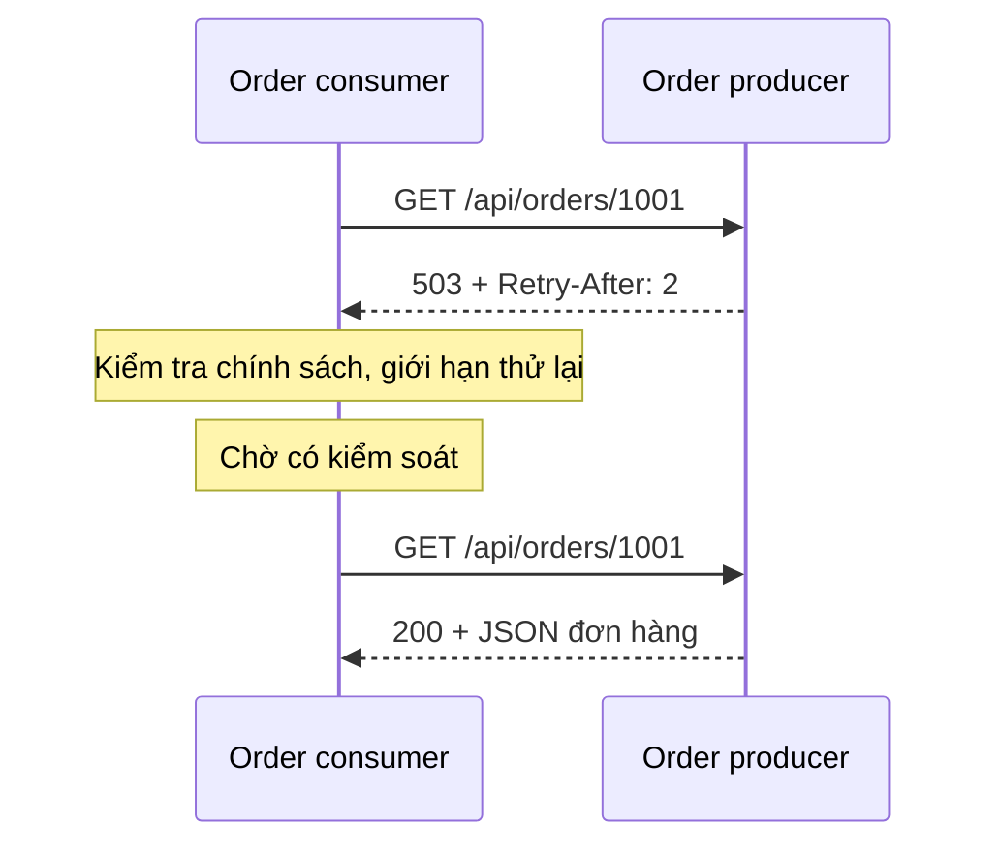
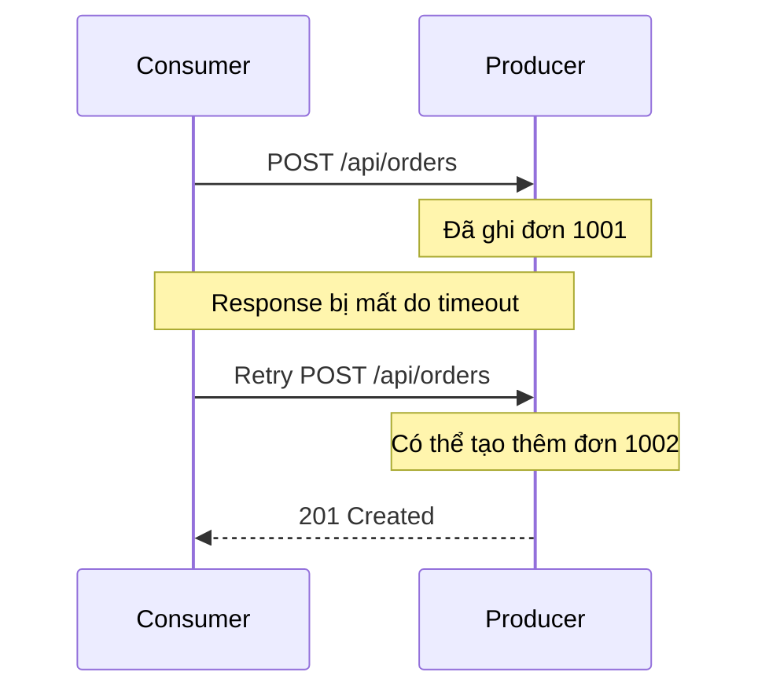
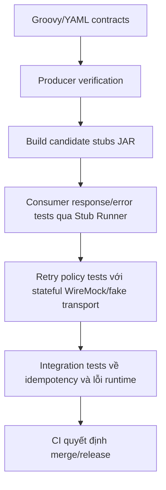

# Hành vi retry và giới hạn kiểm chứng bằng hợp đồng trong Spring Cloud Contract

Trong hệ thống phân tán, lỗi không phải lúc nào cũng có nghĩa là một thao tác thất bại vĩnh viễn. Producer có thể tạm thời quá tải, một dependency có thể ngừng hoạt động trong vài giây hoặc client có thể không nhận được phản hồi do sự cố mạng. **Retry** (thử lại) giúp consumer phục hồi từ một số lỗi tạm thời, nhưng retry không kiểm soát có thể tạo đơn hàng trùng, nhân tải lên hệ thống đang lỗi hoặc kéo dài thời gian phản hồi vượt giới hạn.

**Spring Cloud Contract (SCC)** hỗ trợ ghi nhận **hành vi có thể quan sát tại ranh giới giao tiếp** bằng Groovy/YAML DSL: HTTP status, response headers, error body, request headers hoặc nội dung thông điệp. Từ contract, công cụ sinh **provider verification tests** và **stubs** cho consumer sử dụng với **Stub Runner**. Tuy nhiên, **một contract response tĩnh không tự chứng minh client retry đúng số lần, đúng thời gian, đúng điều kiện dừng hoặc không tạo tác dụng phụ trùng lặp**.

Bài thuộc chương **Trạng thái và lỗi** này phân tích ranh giới ấy, đồng thời xây một chiến lược kiểm thử hoàn chỉnh cho dịch vụ `order-producer` cung cấp API đơn hàng và `order-consumer` gọi API này.

## 1. Mục tiêu và mô hình retry

Sau bài học, bạn cần có khả năng:

1. Phân loại lỗi có thể thử lại, lỗi không nên thử lại và lỗi phụ thuộc ngữ nghĩa nghiệp vụ.
2. Viết contract cho HTTP 503/429 cùng `Retry-After` và cấu trúc lỗi bằng Groovy hoặc YAML.
3. Nêu rõ producer verification kiểm chứng được gì và **không** kiểm chứng được gì về retry.
4. Tổ chức consumer test để quan sát số lần gửi request, backoff, thời hạn chờ và điều kiện dừng.
5. Tránh retry gây duplicate side effect bằng tính idempotent hoặc cơ chế idempotency key.
6. Tách quy tắc retry HTTP khỏi retry/redelivery của message broker và đưa các tầng test vào CI.

Luồng nghiệp vụ đơn giản:



Sơ đồ diễn tả **hai lần giao tiếp trong một chuỗi**. Trong khi đó, một HTTP contract SCC thông thường mô tả **một request cùng một response mong đợi**. Phải dùng công cụ phù hợp nếu muốn kiểm chứng cả chuỗi thời gian.

## 2. Retry là quyết định của consumer, không phải thuộc tính mặc định của status

Một status HTTP giúp consumer suy luận về lỗi, nhưng không tự kích hoạt retry. Ví dụ, một `RestTemplate` thông thường **không mặc nhiên** thực thi toàn bộ chính sách retry chỉ vì server trả 503. Consumer cần HTTP client, retry library hoặc một lớp điều phối với cấu hình rõ ràng.

| Tín hiệu | Khả năng retry | Câu hỏi bắt buộc trước khi thử lại |
| --- | --- | --- |
| `503 Service Unavailable` | Thường là lỗi tạm thời | Có `Retry-After` không? Hệ thống có đang quá tải không? |
| `429 Too Many Requests` | Có thể retry khi hết hạn giới hạn | Có tuân thủ hạn mức và thời gian chờ server yêu cầu không? |
| `502 Bad Gateway` | Có thể là lỗi nhất thời của gateway | Request trước đã được chuyển tới backend chưa? |
| `504 Gateway Timeout` | Có thể thử lại với điều kiện an toàn | Backend có thể đã thực hiện thao tác dù gateway timeout? |
| `408 Request Timeout` | Có thể thử lại trong một số tình huống | Request trước có tác dụng phụ không? |
| `500 Internal Server Error` | Không nên mặc định mọi 500 đều retryable | Nguyên nhân có tạm thời, và request có an toàn để lặp không? |
| `409 Conflict` | Phụ thuộc ngữ nghĩa nghiệp vụ | Conflict có thể tự hết hoặc phải sửa dữ liệu? |
| `404 Not Found` | Thông thường không retry | Có tình huống eventual consistency được quy định rõ không? |
| `400 Bad Request`, `422 Unprocessable Content` | Thường không retry với cùng input | Dữ liệu đầu vào cần sửa gì? |
| `401 Unauthorized`, `403 Forbidden` | Không retry y nguyên request liên tục | Có một quy trình refresh credential hợp lệ, hữu hạn không? |
| Lỗi kết nối hoặc đọc response | Có thể retry | Server đã nhận và thực hiện request lần đầu chưa? |

Ví dụ `POST /api/orders` bị timeout **sau khi server đã tạo đơn**. Consumer không biết response đã bị mất hay thao tác chưa diễn ra. Gửi POST lại có thể tạo thêm đơn thứ hai nếu producer không có biện pháp chống trùng.

**Đừng viết quy tắc “mọi 5xx đều retry ba lần” cho mọi endpoint.** Quyết định retry cần dựa đồng thời trên loại lỗi, phương thức/thao tác, tính idempotent, ngân sách thời gian và yêu cầu nghiệp vụ.

### 2.1. Retry khác với fallback và circuit breaker

- **Retry:** gửi lại yêu cầu sau khi một lần thất bại, thường có backoff.
- **Timeout:** giới hạn thời gian cho mỗi attempt hoặc toàn bộ thao tác.
- **Circuit breaker:** tạm ngừng gọi dependency sau khi tỷ lệ lỗi vượt ngưỡng, tránh gây thêm tải.
- **Fallback:** trả giá trị thay thế hoặc xử lý suy giảm chức năng khi dependency không đáp ứng.
- **Bulkhead/rate limiter:** giới hạn mức cạnh tranh hoặc tần suất để bảo vệ tài nguyên.

Contract SCC có thể kiểm tra **response tại một trạng thái cụ thể**, nhưng không tự xác minh thuật toán circuit breaker, lựa chọn fallback hay cách phối hợp các giới hạn này. Các hành vi đó cần test consumer/resilience bổ sung.

## 3. HTTP Retry-After: tín hiệu trong hợp đồng

Header `Retry-After` cho biết thời điểm hoặc khoảng chờ mà server đề nghị client áp dụng trước yêu cầu tiếp theo. Đối với các API rate limit hoặc service temporarily unavailable, đây là tín hiệu hữu ích.

Ví dụ lỗi tạm thời:

```http
HTTP/1.1 503 Service Unavailable
Content-Type: application/problem+json
Retry-After: 2

{
  "type": "https://example.org/problems/order-source-unavailable",
  "title": "Order source temporarily unavailable",
  "status": 503,
  "code": "ORDER_SOURCE_UNAVAILABLE"
}
```

Ý nghĩa của response:

- `503`: dịch vụ hiện không đáp ứng yêu cầu trong điều kiện đã kiểm thử.
- `Retry-After: 2`: giá trị dạng số giây, tức chờ khoảng hai giây trước khi thử lại theo hướng dẫn server.
- `Content-Type: application/problem+json`: response lỗi dùng biểu diễn Problem Details dạng JSON.
- `code`: mã lỗi thuộc contract của ứng dụng; consumer có thể dùng nó nếu đã thống nhất.

`Retry-After` có thể được biểu diễn theo **delay-seconds** hoặc **HTTP-date**:

```http
Retry-After: 2
```

```http
Retry-After: Wed, 21 Oct 2015 07:28:00 GMT
```

Dòng thứ hai minh họa **cú pháp HTTP-date**, không phải mốc thời gian cần dùng trong bài thực hành năm 2026. Với HTTP-date, client phải tính thời gian chờ từ thời điểm hiện tại; đồng hồ lệch hoặc response bị cache có thể ảnh hưởng. Client nên có chính sách rõ khi header thiếu, sai định dạng, quá khứ, quá xa hoặc vượt tổng thời gian cho phép.

**Response có `Retry-After` không có nghĩa client bắt buộc thử lại vô hạn.** Nếu thời gian đề nghị chờ vượt deadline nghiệp vụ, consumer có thể dừng và báo lỗi hoặc chuyển sang hàng đợi xử lý sau, thay vì vi phạm deadline.

### 3.1. Retry-After không thay thế hướng dẫn tương thích

`429` và `503` có thể cùng đi kèm `Retry-After`, nhưng ý nghĩa khác nhau:

| Response | Ngữ cảnh thường gặp | Điều consumer nên cân nhắc |
| --- | --- | --- |
| `429 + Retry-After` | Bị giới hạn số lần gọi | Tôn trọng hạn mức; tránh tất cả client cùng bắn lại |
| `503 + Retry-After` | Producer/dependency tạm thời không sẵn sàng | Hạn chế thêm tải cho hệ thống đang lỗi |
| `503` không có `Retry-After` | Producer tạm thời lỗi nhưng không nêu thời gian | Chính sách backoff mặc định có giới hạn |
| `200` sau lần lỗi | Dịch vụ phục hồi | Dừng retry ngay; không gửi thêm request |

Không nên mặc định mọi response 503 của mọi producer đều có `Retry-After`. Nếu header này là một phần giao diện mà consumer phụ thuộc, hãy ghi nó trong contract của kịch bản tương ứng.

## 4. Groovy DSL: contract cho lỗi 503 và Retry-After

Giả sử producer có một ca kiểm thử có thể tái hiện lỗi phụ thuộc tạm thời với đơn hàng `9001`. Việc chọn ID này là **fixture của bài thực hành**, không phải quy tắc production cho ID đó.

Tệp `src/test/resources/contracts/http/get-order-service-unavailable.groovy`:

```groovy
import org.springframework.cloud.contract.spec.Contract

Contract.make {
    description 'Khi nguồn đơn hàng tạm không sẵn sàng, trả 503 và Retry-After'

    request {
        method GET()
        url '/api/orders/9001'
        headers {
            header('Accept', 'application/json')
        }
    }

    response {
        status 503
        headers {
            header('Content-Type', 'application/problem+json')
            header('Retry-After', '2')
        }
        body(
            type: 'https://example.org/problems/order-source-unavailable',
            title: 'Order source temporarily unavailable',
            status: 503,
            code: 'ORDER_SOURCE_UNAVAILABLE'
        )
    }
}
```

Phân tích hợp đồng:

| Khai báo | Thứ producer phải đáp ứng |
| --- | --- |
| `request.method GET()` | Nhận đúng HTTP GET |
| `request.url` | Kịch bản thử với `/api/orders/9001` |
| `response.status 503` | Trả chính xác HTTP 503 |
| `Content-Type` | Dữ liệu lỗi được công bố dưới dạng Problem Details JSON |
| `Retry-After: 2` | Server đưa ra header hẹn chờ trong kịch bản này |
| `response.body.code` | Giữ mã lỗi đã cam kết với consumer |

SCC sinh **producer test** để gửi request mẫu và kiểm tra một response theo contract. Nếu implementation đổi 503 thành 500, bỏ `Retry-After` hoặc đổi `code`, generated test phù hợp sẽ cảnh báo khi được chạy với test setup đúng.

Tệp contract này **không** nói rằng lần gọi kế tiếp sẽ thành công; cũng không nói consumer đã ngủ hai giây, có giới hạn attempt hoặc đã thực hiện retry.

### 4.1. Làm test producer tái lập được

Không nên phụ thuộc vào việc một dịch vụ bên ngoài **tình cờ** đang lỗi để tạo response 503. Hãy cấu hình test để producer đi qua một nhánh lỗi có kiểm soát:

```text
Provider verification setup
  -> dữ liệu test chứa orderId = 9001
  -> fake/mock dependency trả "temporarily unavailable"
  -> gọi GET /api/orders/9001 qua HTTP test mode
  -> controller/exception handler tạo response 503
  -> generated test đối chiếu status, headers, body
```

Trong ứng dụng Spring, test base có thể sử dụng MockMvc hoặc HTTP test mode phù hợp và thay dependency bằng test double. Phần xử lý lỗi nên là đường thực của producer (ví dụ exception handler), thay vì tự viết một stub bên ngoài rồi ngộ nhận đó là kiểm chứng provider.

Nếu một test biến động vì dependency thật liên tục phục hồi/lỗi lại, kết quả CI không còn tái lập được. **Kiểm thử hành vi thất bại nên sử dụng fixture được điều khiển**, tách khỏi hệ thống bên ngoài.

## 5. YAML DSL: cùng hành vi lỗi 503

Nếu nhóm chọn YAML thay cho Groovy, viết cùng cam kết tại `src/test/resources/contracts/http/get-order-service-unavailable.yml`:

```yaml
description: "Khi nguồn đơn hàng tạm không sẵn sàng, trả 503 và Retry-After"
request:
  method: GET
  url: /api/orders/9001
  headers:
    Accept: application/json
response:
  status: 503
  headers:
    Content-Type: application/problem+json
    Retry-After: "2"
  body:
    type: "https://example.org/problems/order-source-unavailable"
    title: Order source temporarily unavailable
    status: 503
    code: ORDER_SOURCE_UNAVAILABLE
```

`Retry-After: "2"` được đặt dấu nháy để biểu thị **header string**, không phải JSON number. Header HTTP truyền dạng văn bản, dù ý nghĩa của nó là số giây. `body.status: 503` vẫn là một giá trị số JSON, khác vị trí với `response.status: 503`.

Hai ví dụ Groovy và YAML là **hai cách biểu diễn cùng một kịch bản**. Chỉ chọn một tệp trong bộ contract đang được build quét để tránh sinh duplicate test/stub mapping.

### 5.1. Một contract khác cho 429

Ví dụ producer có một ca thử rate limiting được kích hoạt bằng test fixture; response có thể là:

```http
HTTP/1.1 429 Too Many Requests
Content-Type: application/problem+json
Retry-After: 5

{"type":"https://example.org/problems/rate-limited","status":429,"code":"RATE_LIMITED"}
```

Contract có thể kiểm tra đúng `429`, `Retry-After: 5` và body lỗi. Nhưng việc **rate limit chỉ kích hoạt sau N yêu cầu trong cửa sổ T** là hành vi trạng thái và thời gian; một request/response contract thông thường không tự kiểm chứng thuật toán quota. Cần test stateful/integration chuyên biệt để xác nhận bộ đếm và thời gian reset.

## 6. Không đặt hai response xung đột trên cùng một request vô điều kiện

Một sai lầm khi mô phỏng retry là tạo hai hợp đồng như sau:

```text
Contract A: GET /api/orders/1001 -> 503
Contract B: GET /api/orders/1001 -> 200
```

Nếu hai contract cùng match request mà **không có điều kiện phân biệt**, bộ stub có thể trở nên mơ hồ: không có quy tắc xác định khi nào trả 503, khi nào trả 200. Contract Verifier cũng cần test setup cho producer bảo đảm mỗi kịch bản tạo được response tương ứng.

Ba hướng xử lý:

1. **Khác biệt đầu vào rõ ràng:** dùng ID, header, query hoặc dữ liệu fixture riêng cho hai trường hợp, khi ngữ nghĩa API cho phép.
2. **Test setup điều khiển trạng thái:** với producer verification, chuẩn bị dependency ở trạng thái thất bại cho ca 503 và sẵn sàng cho ca 200.
3. **Stub có trạng thái/chuỗi response:** nếu mục đích là kiểm tra consumer retry cùng một request, dùng cơ chế stateful scenarios của WireMock hoặc test double trả response theo thứ tự, không dựa vào hai mapping tĩnh chồng nhau.

Ví dụ hai ca độc lập:

| Contract | Request | Response |
| --- | --- | --- |
| Đọc đơn thành công | `GET /api/orders/1001` | `200` + JSON đơn hàng |
| Nguồn dữ liệu tạm lỗi | `GET /api/orders/9001` | `503` + `Retry-After: 2` |

Hai ca giúp kiểm tra mỗi response của producer. Chúng **không** tự tạo được chuỗi `503 → 200` cho **cùng** `GET /api/orders/1001`. Muốn kiểm thử retry thực sự, cần một lớp test khác.

## 7. Thiết kế chính sách retry hữu hạn ở consumer

Một chính sách retry nên có các quyết định rõ ràng:

| Quy tắc | Ví dụ minh họa | Vì sao cần |
| --- | --- | --- |
| Retryable errors | `429`, `503` và lỗi kết nối được phân loại cụ thể | Tránh lặp vô ích với lỗi vĩnh viễn |
| Giới hạn attempts | Tối đa **3 attempts** gồm 1 lần đầu + tối đa 2 lần thử lại | Tránh vòng lặp vô hạn |
| Backoff ban đầu | 200 ms | Giảm tải ngay sau lỗi |
| Backoff tăng dần | Exponential backoff | Tránh gửi liên tục khi dependency chưa phục hồi |
| Backoff tối đa | 2 giây | Không để một lần chờ phình quá lớn |
| Jitter | Thêm dao động ngẫu nhiên có kiểm soát | Giảm hiện tượng nhiều client retry đồng loạt |
| `Retry-After` | Tôn trọng khi áp dụng và còn đủ deadline | Hạn chế làm quá tải producer |
| Per-attempt timeout | Ví dụ 1 giây | Không để mỗi lời gọi chờ vô hạn |
| Overall deadline | Ví dụ 5 giây | Giữ tổng thời gian thao tác trong ngân sách |
| Idempotency policy | GET an toàn; POST yêu cầu biện pháp chống trùng | Tránh side effect lặp |

Các con số chỉ để minh họa **chính sách cụ thể có thể kiểm thử**, không phải mặc định Spring Cloud Contract hoặc khuyến nghị bắt buộc cho production. Cần chọn giới hạn phù hợp SLA, tần suất gọi và độ trễ của hệ thống.

### 7.1. Exponential backoff và jitter

Với lần retry thứ `n` (không tính lời gọi ban đầu), công thức cơ bản:

```text
delay_n = min(baseDelay * 2^(n-1), maxDelay)
```

Nếu `baseDelay = 200ms`, `maxDelay = 2s`:

| Lần gửi | Hành động | Backoff cơ bản trước lần gửi |
| --- | --- | --- |
| Attempt 1 | Gửi lần đầu | 0 ms |
| Attempt 2 | Retry lần 1 | 200 ms |
| Attempt 3 | Retry lần 2 | 400 ms |

Jitter có thể biến delay thành một giá trị ngẫu nhiên trong khoảng do chính sách quy định. Không nên kiểm tra một độ trễ ngẫu nhiên bằng exact value trong test; thay vào đó, **inject bộ sinh jitter có seed cố định** hoặc kiểm tra delay nằm trong khoảng cho phép.

`maxAttempts = 3` nghĩa là **tổng cộng nhiều nhất ba lần gửi**, không phải một lần đầu cộng thêm ba lần retry. Làm rõ cách đếm trong code, tài liệu và assertion để tránh off-by-one.

### 7.2. Kết hợp Retry-After với tổng deadline

Giả sử attempt 1 nhận:

```http
HTTP/1.1 503 Service Unavailable
Retry-After: 10
```

Nhưng tổng ngân sách xử lý của consumer chỉ còn 3 giây. Consumer không thể vừa chờ đủ 10 giây vừa giữ deadline 3 giây. Quy tắc hợp lý là **dừng/sắp lịch xử lý bất đồng bộ** theo chính sách, thay vì cố retry sớm sau 3 giây và vô tình phớt lờ tín hiệu từ server.

Khi `Retry-After` vắng mặt, client có thể dùng exponential backoff mặc định; khi header không parse được, nên dùng fallback có giới hạn và log chẩn đoán phù hợp. Không để server điều khiển một thời gian chờ vô hạn hoặc vượt SLA của consumer.

## 8. Retry an toàn: idempotency và tác dụng phụ

### 8.1. GET khác POST

Đọc `GET /api/orders/1001` thường là thao tác không tạo side effect nghiệp vụ, nên có thể thử lại sau lỗi tạm thời theo chính sách. Ngược lại, `POST /api/orders` có thể tạo đơn mới.

Kịch bản nguy hiểm:



Consumer chỉ nhận response của lần hai nên có thể không biết đã tạo hai đơn. Việc HTTP method là POST **không đủ để kết luận có thể retry an toàn**.

### 8.2. Idempotency-Key

Một API tạo đơn có thể hỗ trợ header `Idempotency-Key` để producer nhận diện các lần gửi lặp của **cùng một yêu cầu logic**:

```http
POST /api/orders HTTP/1.1
Content-Type: application/json
Idempotency-Key: order-request-a1b2c3

{"customerId":"CUS-42","sku":"BOOK-01","quantity":2}
```

Giả sử API cam kết gửi lại **cùng key và cùng payload** trong thời gian lưu khóa sẽ không tạo thêm tài nguyên mới. Cần làm rõ các điểm sau bằng thiết kế thực tế:

- Khóa được định danh trong phạm vi nào: tenant, tài khoản, endpoint hay toàn hệ thống?
- Cùng key nhưng **khác payload** bị từ chối bằng mã lỗi gì?
- Producer lưu kết quả/key trong bao lâu? Sau hết hạn, replay có còn an toàn?
- Hai request dùng cùng key đến **đồng thời** được đồng bộ như thế nào?
- Khi request đã được xử lý nhưng response bị mất, producer trả lại kết quả ra sao?

Một contract tĩnh có thể kiểm tra producer **nhận header** và trả response của **một lần gọi**. Nó **không tự chứng minh** server ngăn duplicate khi cùng request được gửi hai lần, khi nhiều node cùng xử lý hoặc khi khóa hết hạn. Cần integration test gửi lặp và xác minh số tài nguyên được tạo.

### 8.3. Groovy contract cho request có idempotency key

Ví dụ một kịch bản tạo đơn bằng khóa mẫu:

```groovy
import org.springframework.cloud.contract.spec.Contract

Contract.make {
    description 'Tạo đơn từ request có Idempotency-Key hợp lệ'

    request {
        method POST()
        url '/api/orders'
        headers {
            contentType(applicationJson())
            header('Idempotency-Key', 'order-request-a1b2c3')
        }
        body(
            customerId: 'CUS-42',
            sku: 'BOOK-01',
            quantity: 2
        )
    }

    response {
        status CREATED()
        headers {
            contentType(applicationJson())
            header('Location', '/api/orders/1001')
        }
        body(
            id: 1001,
            status: 'CREATED'
        )
    }
}
```

Contract này bảo vệ **hình dạng request và response** của một kịch bản. Test chống trùng phải bổ sung:

```text
1. Gửi POST với key K và payload P.
2. Giả lập mất response hoặc gửi lại POST với cùng K, P.
3. Xác minh số đơn hàng logic được tạo vẫn là 1.
4. Xác minh response lặp tuân thủ chính sách đã công bố.
5. Gửi cùng K nhưng payload P2 và kiểm tra hành vi xung đột.
6. Thử hai request đồng thời nếu hệ thống có nhiều worker/nút.
```

Kết quả bước 4–5 phụ thuộc vào API thiết kế ra sao; không mặc định mọi framework trả cùng status hoặc cùng body khi replay.

## 9. Giới hạn căn bản của một HTTP contract SCC tĩnh

Một contract điển hình:

```text
request X -> response Y
```

Có thể kiểm chứng được những gì?

| Điều có thể mô tả và kiểm tra qua contract | Điều chưa được một contract tĩnh chứng minh |
| --- | --- |
| `GET /api/orders/9001` trả `503` | Lần hai cùng request sẽ chuyển thành `200` |
| `Retry-After: 2` có trong response | Client thật sự chờ hai giây |
| Error body có `code` đúng | Client chỉ retry các mã lỗi được phép |
| `POST` có header `Idempotency-Key` | Server ngăn tạo bản ghi trùng sau hai POST |
| Response `200` có JSON đúng schema | Tổng thời gian retry nằm dưới deadline |
| Event có destination/payload đúng | Broker giao lại message sau backoff, đẩy DLQ theo chính sách |

Đây không phải thiếu sót riêng Groovy hay YAML; nó là khác biệt giữa **hợp đồng hành vi tại một lần giao tiếp** và **hành vi stateful xuyên thời gian**. Nếu có nhu cầu kiểm tra sequence, dùng test fixture/stateful mock và assertion cụ thể; không diễn giải một response stub tĩnh như bằng chứng đã thực thi thuật toán retry.

### 9.1. Điều một provider verification test thật sự làm

Trong kịch bản 503, generated test thường:

1. Thiết lập/gửi request từ contract.
2. Quan sát status của response producer.
3. So sánh header và body với contract.
4. Pass nếu producer trả đúng trạng thái lỗi đã cam kết.

Provider verification **không tự thực hiện** retry theo policy của consumer. Nó cũng không đo “mất bao lâu để producer hồi phục” trừ khi bạn viết test và hệ thống fixture riêng.

### 9.2. Điều một HTTP stub trong Stub Runner thật sự làm

Với contract 503 tĩnh, stub trả `503` khi request match mapping tương ứng. Nếu consumer gửi lại **cùng request** ba lần, stub tĩnh sẽ thường **tiếp tục trả cùng 503**, chứ không tự đổi thành 200 ở lần hai. Điều đó vẫn hữu ích để test:

- Consumer có dừng sau `maxAttempts` không?
- Consumer có trả lỗi tổng hợp hoặc fallback phù hợp không?
- Consumer có tránh retry đối với response không retryable không?

Nhưng để test **thất bại rồi thành công**, cần stub có trạng thái hoặc transport trả response theo thứ tự.

## 10. Kiểm thử retry ở consumer với stateful test double

Một chiến lược tốt là kết hợp hai nhóm test:

1. **Contract-driven consumer tests** dùng Stub Runner kiểm tra consumer xử lý được response 503, 429 và body/header theo contract.
2. **Retry policy tests** dùng WireMock scenario, fake transport hoặc mock HTTP client để xác minh **chuỗi response và số lần gọi**.

Nếu dùng **WireMock scenarios** cho một endpoint, có thể dựng chuỗi `503 → 200` như sau. Đoạn Java minh họa tập trung vào phần cấu hình stub; giả định test đã có `WireMockServer wireMock` đang chạy và static imports từ WireMock:

```java
import static com.github.tomakehurst.wiremock.client.WireMock.*;
import com.github.tomakehurst.wiremock.stubbing.Scenario;

// Lần gọi đầu tiên: 503, rồi chuyển trạng thái scenario.
wireMock.stubFor(get(urlEqualTo("/api/orders/1001"))
    .inScenario("recovering-order-service")
    .whenScenarioStateIs(Scenario.STARTED)
    .willReturn(aResponse()
        .withStatus(503)
        .withHeader("Retry-After", "0"))
    .willSetStateTo("AVAILABLE"));

// Từ lần gọi thứ hai trở đi: 200.
wireMock.stubFor(get(urlEqualTo("/api/orders/1001"))
    .inScenario("recovering-order-service")
    .whenScenarioStateIs("AVAILABLE")
    .willReturn(okJson(
        "{\"id\":1001,\"status\":\"CREATED\"}")));
```

Sau khi cấu hình, **gọi HTTP client thật của consumer** trỏ tới `wireMock.baseUrl()` và thực thi thao tác đọc đơn:

```java
// Pseudocode: RetryingOrderClient là client của ứng dụng cần kiểm tra.
OrderDto order = retryingOrderClient.getOrder(1001L);

assertEquals("CREATED", order.status());

wireMock.verify(2, getRequestedFor(
    urlEqualTo("/api/orders/1001")));
```

Ví dụ cần một `RetryingOrderClient` do dự án định nghĩa; SCC không cung cấp sẵn class ấy. Assertion `verify(2, ...)` xác nhận client thực hiện hai HTTP GET: một lần nhận 503, lần sau nhận 200. Nó **không tự kiểm tra thời gian chờ**, nên nếu cần xác minh backoff, phải quan sát sleeper/scheduler hoặc thời gian qua đồng hồ giả.

Đây là **WireMock stateful test bổ sung**, không phải lời khẳng định Groovy/YAML DSL tĩnh tự động sinh scenario này. Khi đưa vào dự án thực, cần dùng API WireMock phù hợp với phiên bản dependency.

### 10.1. Kiểm tra thời gian mà không làm test chậm và flaky

Không nên viết:

```java
Thread.sleep(2000);
assertEquals(2, requestCount);
```

Vấn đề: test chờ thật, chạy chậm và dễ fail vì scheduler, tải CI hoặc mạng. Thay vào đó:

- Trừu tượng hóa `Sleeper` hoặc scheduler thành dependency của retry policy.
- Dùng fake clock, fake sleeper hoặc virtual time của thư viện reactive nếu có.
- Capture danh sách delay đã **yêu cầu** thay vì đo thực tế bằng đồng hồ hệ thống.
- Nếu dùng jitter, cấp nguồn ngẫu nhiên có seed ổn định hoặc kiểm tra delay nằm trong khoảng đã quy định.
- Giữ một số integration test thời gian thực khi thực sự cần, nhưng không biến mọi contract test thành bài đo thời gian.

Ví dụ điều kiện của policy có `maxAttempts = 3` và backoff `200ms, 400ms`:

```text
Transport mô phỏng: 503, 503, 200
Expected send count: 3
Expected requested delays: [200ms, 400ms]
Expected final result: success

Transport mô phỏng: 503, 503, 503, 200
Expected send count: 3
Expected final result: exhausted / fallback
Expected fourth response: never consumed
```

Để những assertion này có ý nghĩa, policy cần cho phép inject HTTP transport, clock/scheduler và (nếu dùng) jitter source; với Spring Retry/Resilience4j, dùng các hook/test facilities phù hợp với phiên bản thư viện thực tế.

### 10.2. Kiểm thử không retry sai

Các test có giá trị tương đương:

| Response đầu tiên | Mong đợi | Assertion |
| --- | --- | --- |
| `400` vì body sai | Không retry cùng dữ liệu | Một lần gửi |
| `401` không có quy trình refresh hợp lệ | Không lặp vô hạn | Một lần gửi |
| `404` đối với resource không tồn tại | Không retry theo policy thông thường | Một lần gửi |
| `503`, sau đó `200` | Retry hữu hạn và thành công | Hai lần gửi |
| `503` liên tục | Dừng khi hết attempts/deadline | Không vượt giới hạn |
| `429 + Retry-After: 2` | Áp dụng chính sách chờ phù hợp | Capture delay/điều kiện dừng |
| Timeout sau POST đã thực thi | Không gây duplicate | Kiểm tra idempotency trong integration test |

Không nên chỉ test happy path `503 → 200`. Một retry policy tốt còn phải **không thử lại** khi lỗi vĩnh viễn và **dừng đúng lúc** khi lỗi tiếp diễn.

## 11. Kết hợp Stub Runner với các bài test retry

Stub Runner dùng stubs JAR được sinh từ contracts của producer. Một consumer test có thể khởi động artifact cố định:

```java
import org.springframework.boot.test.context.SpringBootTest;
import org.springframework.cloud.contract.stubrunner.spring.AutoConfigureStubRunner;
import org.springframework.cloud.contract.stubrunner.spring.StubRunnerProperties;

@SpringBootTest
@AutoConfigureStubRunner(
    ids = "com.example:order-producer:1.0.0:stubs:8085",
    stubsMode = StubRunnerProperties.StubsMode.LOCAL
)
class OrderConsumerContractTest {
    // Client ứng dụng trỏ tới HTTP stub ở cổng 8085.
    // Kiểm tra consumer đọc Retry-After và mã lỗi đã thỏa thuận.
}
```

Ví dụ tọa độ gồm `groupId:artifactId:version:classifier:port`. Chế độ `LOCAL` yêu cầu stubs artifact có trong Maven local repository; CI có thể chọn `REMOTE` và repository phù hợp. Không dùng một phiên bản stubs cũ rồi kết luận consumer tương thích với producer candidate mới.

### 11.1. Test contract nên assert điều gì?

Đối với hợp đồng `GET /api/orders/9001 → 503`, consumer test cần xác minh:

1. HTTP client đọc đúng `503` và không parse error body như một response thành công.
2. `Retry-After` được parse thành thời gian chờ theo quy ước, có xử lý khi sai định dạng.
3. Error code `ORDER_SOURCE_UNAVAILABLE` được mapping thành loại lỗi phù hợp.
4. Nếu policy có retry, client **không vượt giới hạn** và có đường kết thúc; vì stub trả 503 mãi, đây là kịch bản **exhaustion** hữu ích.
5. Những thông tin lỗi quan trọng được chuyển đến tầng gọi theo đúng giao diện ứng dụng.

Nếu consumer test chỉ dùng `RestTemplate` gọi một lần vào stub và assert 503, nó chứng minh **khả năng nhận diện response**, chưa chứng minh policy retry đúng. Muốn chứng minh policy, chạy qua **client thực có retry interceptor/decorator** và assert số lần gọi/delay/điều kiện dừng.

### 11.2. Test producer và consumer cần được liên kết bằng version



Không coi nhóm test phía dưới thay thế nhóm phía trên. Mỗi nhóm trả lời một câu hỏi khác nhau và có thể cùng cần thiết với API có rủi ro cao.

## 12. Retry trong messaging: hợp đồng không kiểm chứng được lịch redelivery

Với message broker, retry thường là **redelivery** khi consumer không xác nhận thành công hoặc xử lý lỗi. Broker, framework listener và ứng dụng có thể cùng quyết định số lần gửi lại, delay, dead-letter queue (DLQ) và chính sách bỏ message.

Giả sử producer phát thông điệp:

```json
{
  "eventType": "ORDER_CREATED",
  "eventId": "evt-1001",
  "orderId": 1001,
  "status": "CREATED"
}
```

Một contract thông điệp có thể mô tả **destination, header và payload**, ví dụ:

```groovy
import org.springframework.cloud.contract.spec.Contract

Contract.make {
    description 'Phát sự kiện đơn hàng được tạo'
    label 'order_created_v1'

    input {
        triggeredBy('publishOrderCreated()')
    }

    outputMessage {
        sentTo('orders.created')
        headers {
            messagingContentType(applicationJson())
        }
        body(
            eventType: 'ORDER_CREATED',
            eventId: 'evt-1001',
            orderId: 1001,
            status: 'CREATED'
        )
    }
}
```

Provider verification cần hook `publishOrderCreated()` và message verifier/binder thích hợp; phía consumer, Stub Runner có thể phát message mẫu theo label. Nhưng **một lần trigger message stub không chứng minh**:

- Broker sẽ redeliver sau một khoảng thời gian nhất định khi consumer thất bại.
- Số lần redelivery tối đa đúng cấu hình.
- Message chuyển sang DLQ sau khi quá số lần xử lý.
- Consumer xử lý cùng `eventId` nhiều lần mà không tạo tác dụng phụ trùng.
- Thứ tự event được bảo toàn dưới cạnh tranh, partition và retry.
- Message tồn tại và được replay đúng qua retention/restart.

Các thuộc tính này đòi hỏi test listener/integration với broker hoặc test binder phù hợp, mô phỏng ack/nack, retry và consumer state. Một consumer **idempotent theo eventId** có thể giữ bảng/dấu vết event đã xử lý; contract chỉ kiểm tra field `eventId` xuất hiện chứ không kiểm chứng logic chống trùng.

### 12.1. Vì sao HTTP retry và message retry không giống nhau?

| Khía cạnh | HTTP | Messaging |
| --- | --- | --- |
| Ai quyết định gửi lại? | Thường là HTTP consumer/client | Broker, listener container hoặc app |
| Tín hiệu lỗi | Status, header, exception, timeout | Ack/nack, exception, retry topic, DLQ |
| Đơn vị công việc | Một request/response | Một message/event |
| Cách tránh trùng | Idempotent methods, `Idempotency-Key`, dedupe | Dedupe theo `eventId`, khóa nghiệp vụ |
| Điều contract dễ bảo vệ | Status, headers, body của một lần giao tiếp | Schema, destination, headers, payload |
| Điều cần test riêng | Attempts, backoff, deadline, retry thành công | Redelivery, order, DLQ, retention, xử lý trùng |

Không dùng `Retry-After` của HTTP làm bằng chứng rằng broker sẽ redeliver đúng hạn; đây là các cơ chế độc lập.

## 13. Thiết kế CI để phát hiện lỗi retry và giới hạn của contract

Một pipeline nên có nhiều tầng test:

| Tầng kiểm thử | Ví dụ | Phát hiện |
| --- | --- | --- |
| **Contract parse/generation** | SCC đọc Groovy/YAML | Lỗi DSL, hợp đồng không được phát hiện |
| **Provider verification** | GET fixture lỗi trả 503 + Retry-After | Producer phá vỡ status/header/body |
| **Consumer test với stubs** | Client nhận 503 hoặc 429 từ Stub Runner | Consumer mapping lỗi, parse header sai |
| **Retry policy unit test** | Fake transport trả 503, 503, 200 | Sai attempts, delay, stop condition |
| **Stateful HTTP test** | WireMock scenario 503 → 200 | Client thực không retry hoặc gửi lặp quá nhiều |
| **Idempotency integration** | Gửi POST lặp cùng key | Tạo dữ liệu trùng sau timeout |
| **Messaging integration** | Ack/nack, DLQ, redelivery | Sai số lần giao lại hoặc duplicate processing |
| **End-to-end/observability** | Gateway, network, broker thực | Sai khác do cấu hình hoặc môi trường triển khai |

Pipeline khái quát:

```text
Pull request
  -> parse Groovy/YAML contracts
  -> generate and run provider verification tests
  -> package candidate stubs artifact
  -> run consumer contract tests using candidate stubs
  -> run retry/backoff/deadline unit tests
  -> run selected WireMock scenario + idempotency tests
  -> run messaging retry/DLQ tests where applicable
  -> approve merge/release only if required gates pass
```

Với Maven và cấu hình Contract Verifier phù hợp:

```bash
mvn clean verify
```

Lệnh này **không tự thực hiện tất cả các test kể trên** nếu dự án chưa cấu hình chúng. Cần kiểm tra generated tests thực sự chạy và các nhóm test resilience/integration đã được nối vào lifecycle CI.

### 13.1. Bảng lỗi cố ý để kiểm tra pipeline

| Thay đổi có chủ đích | Cổng kiểm tra nên báo lỗi |
| --- | --- |
| Producer trả `500` thay `503` đã cam kết | Provider contract test |
| Producer bỏ `Retry-After` | Provider contract test |
| Producer đổi `code` lỗi | Provider contract test và consumer mapping nếu cần |
| Consumer retry cả `400` | Retry policy unit test |
| Consumer vượt `maxAttempts` | Unit/stateful test với số lần gọi |
| Consumer bỏ qua deadline | Policy test với fake clock |
| Consumer nhận `Retry-After: 10` nhưng retry ngay | Policy test kiểm tra lịch chờ |
| POST timeout tạo hai đơn | Idempotency integration test |
| Message lỗi không vào DLQ | Messaging integration test |

Một CI chỉ chạy Groovy/YAML contract tests mà không có thử nghiệm nhiều attempt sẽ **không** chứng minh chính sách retry là đúng. Ngược lại, một consumer test retry với WireMock tự viết chưa chắc chứng minh producer thật trả đúng error payload. Hai loại test cần cùng hiện diện.

## 14. Những sai lầm thường gặp

**“Producer trả 503 thì Spring Cloud Contract tự retry.”** Không đúng: SCC là công cụ kiểm chứng hợp đồng, không phải retry engine của ứng dụng. Retry cần ở HTTP client hoặc lớp resilience và phải được test riêng.

**“Có Retry-After trong contract là đã test thời gian chờ.”** Contract chỉ kiểm tra header được trả về; chưa chứng minh consumer parse hoặc chờ đúng.

**“Tạo hai stubs cùng GET, một 503 và một 200 là đủ mô phỏng retry.”** Nếu điều kiện match giống nhau, kết quả mơ hồ. Cần trạng thái WireMock hoặc test transport có trình tự.

**“Mỗi lần lỗi 5xx thử lại vô hạn sẽ tăng độ tin cậy.”** Retry có thể khuếch đại tải lên producer đang quá tải. Luôn đặt attempts, timeout, backoff và deadline.

**“GET an toàn thì retry bao nhiêu cũng được.”** GET thường không có side effect nghiệp vụ, nhưng vẫn dùng tài nguyên; quá nhiều retry có thể gây thác lỗi, rate limit và quá tải hệ thống.

**“POST đã timeout chắc chắn chưa xử lý.”** Server có thể đã commit giao dịch. Retry cần chính sách idempotency/deduplication và test gửi lặp.

**“Dùng Thread.sleep là cách duy nhất để test backoff.”** Fake clock/sleeper và virtual time làm test nhanh và ổn định hơn.

**“Retry-After nhỏ hơn thời gian backoff thì cứ dùng giá trị nhỏ hơn.”** Không có luật chung áp dụng cho mọi API; chính sách phải xét tín hiệu từ producer, giới hạn tải và deadline. Không tự giảm thời gian chờ server đã yêu cầu.

**“Contract error response bảo vệ luôn circuit breaker, fallback và DLQ.”** Các hành vi này nằm ở nhiều lần giao tiếp hoặc ở middleware/broker, cần test riêng.

**“Stub Runner test pass nên producer thật xử lý đúng lỗi.”** Stub được tạo từ contract; phải có provider verification để chứng minh implementation thật đáp ứng.

## 15. Bài tập thực hành và tiêu chí hoàn thành

Giả sử đã có `order-producer` với `GET /api/orders/{id}` và `POST /api/orders`, cùng `order-consumer` gọi các API đó. Thực hiện theo thứ tự:

1. **Phân loại lỗi:** Lập bảng xử lý `400`, `401`, `404`, `429`, `500`, `503`, `504`, timeout. Giải thích lỗi nào retry và dựa trên điều kiện gì.
2. **Groovy/YAML contract:** Viết `GET /api/orders/9001` trả `503`, `Retry-After: 2`, `application/problem+json` và `code: ORDER_SOURCE_UNAVAILABLE`. Chỉ chọn một DSL vào bộ build.
3. **Producer setup:** Mock dependency để generated contract test luôn tái hiện 503. Cố ý đổi response thành 500 hoặc bỏ Retry-After; chứng minh test fail.
4. **Consumer error handling:** Dùng Stub Runner để test client đọc đúng status, header và mã lỗi. Xác nhận nó không parse Problem Details như body thành công.
5. **Retry policy:** Cấu hình tối đa ba attempts (gồm lần đầu), backoff `200ms` và `400ms` cho hai retry, tổng deadline rõ ràng. Viết test với fake sleeper.
6. **Stateful response:** Dùng WireMock scenario trên cùng GET để trả `503` rồi `200`. Xác nhận consumer gửi đúng hai request và dừng khi thành công.
7. **Exhaustion:** Stub hoặc fake transport luôn trả 503; xác nhận tổng số attempts không vượt giới hạn và consumer trả lỗi/fallback phù hợp.
8. **Không retry sai:** Trả 400 và 401; xác nhận policy không liên tục gửi lại cùng request.
9. **Idempotency:** Gửi POST với cùng `Idempotency-Key` hai lần, mô phỏng mất response; xác nhận server chỉ tạo một đơn logic.
10. **Messaging mở rộng:** Cho listener xử lý sự kiện trùng `eventId` hoặc thất bại rồi redeliver; xác minh dedupe, số lần và DLQ theo chính sách đã thiết kế.
11. **CI:** Nối provider verification, candidate stubs, retry policy tests và stateful/integration tests vào pipeline. Kiểm tra mỗi thay đổi lỗi được chặn ở tầng phù hợp.

Bảng đánh giá:

| Năng lực | Bằng chứng |
| --- | --- |
| Hiểu ranh giới contract | Phân biệt một response tĩnh với chuỗi retry |
| Viết hợp đồng lỗi | Groovy/YAML mô tả 503, Retry-After, body lỗi đúng |
| Kiểm chứng producer | Generated test chạy với trạng thái lỗi xác định |
| Xử lý lỗi ở consumer | Stub Runner test parse đúng error status và header |
| Retry hữu hạn | Có assertion về attempts, backoff, deadline và điều kiện dừng |
| Không khuếch đại lỗi | 400/401 không bị retry mù quáng |
| Idempotency | POST lặp không sinh hai tài nguyên logic |
| Messaging | Có test riêng cho redelivery/DLQ/dedupe |
| CI | Thử phá vỡ status, header, policy đều được phát hiện đúng tầng |

**Kết luận:** hợp đồng Spring Cloud Contract có thể giữ ổn định **tín hiệu để consumer quyết định retry** — status, header và error payload — nhưng không tự xác minh toàn bộ **cơ chế retry xuyên nhiều lần gọi**. Hãy kết hợp provider verification, Stub Runner, test retry stateful, kiểm tra idempotency và các cổng CI phù hợp. Đó là cách phát hiện thay đổi API không tương thích mà vẫn bảo đảm thử lại có giới hạn, có thể quan sát và không gây tác dụng phụ ngoài dự kiến.
