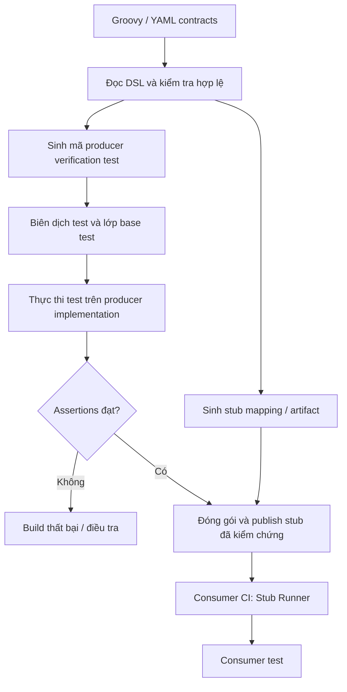
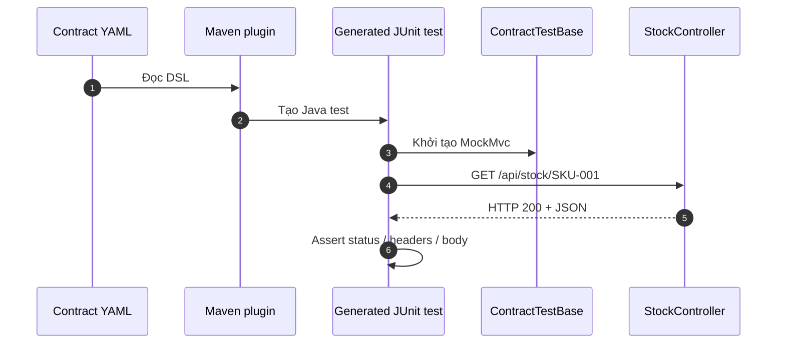
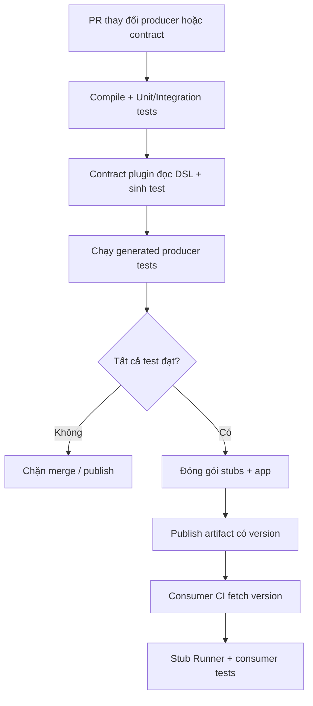

# Pipeline đọc hợp đồng, sinh kiểm thử và thực thi

> **Chương:** Contract Verifier  
> **Module:** Spring Cloud Contract (`SPRING_CLOUD_CONTRACT`) — kiểm thử hợp đồng giữa producer và consumer bằng Groovy/YAML DSL, sinh test cho producer, phát hành stub, dùng Stub Runner và tích hợp CI nhằm phát hiện API thay đổi không tương thích.

## Mục tiêu học tập

Sau khi hoàn thành bài này, bạn có thể:

1. Mô tả chính xác **pipeline của Spring Cloud Contract Verifier** từ file contract đến producer verification test và kết quả thực thi.
2. Phân biệt **đọc/kiểm tra DSL**, **sinh mã test**, **biên dịch test**, **chạy test**, **đóng gói stub** và **phát hành artifact**; hiểu vì sao các bước này không thay thế nhau.
3. Tổ chức Groovy/YAML contract trong dự án producer, cấu hình plugin Maven và lớp **base test** cho test sinh ra.
4. Đọc output sinh test và giải thích cơ chế gửi request, kiểm tra HTTP status, header, body cùng matcher.
5. Chẩn đoán pipeline hỏng do contract sai, không có base class, test không được thực thi hoặc triển khai producer không đúng hợp đồng.
6. Kết nối producer verification với **stub JAR**, **Stub Runner** và pipeline CI có kiểm soát phiên bản để bảo vệ consumer.

## 1. Contract Verifier đứng ở đâu trong quy trình?

Giả sử `checkout-service` (consumer) gọi `inventory-service` (producer) để kiểm tra tồn kho:

```http
GET /api/stock/SKU-001 HTTP/1.1
Accept: application/json
```

Producer cam kết trả:

```http
HTTP/1.1 200 OK
Content-Type: application/json

{
  "sku": "SKU-001",
  "available": true,
  "quantity": 4
}
```

Consumer phụ thuộc các đặc điểm:

- Đường dẫn và HTTP method phải đúng.
- Response phải là JSON, status phải là `200`.
- `available` phải là boolean `true` trong tình huống này.
- `quantity` phải là số nguyên `4` trong dữ liệu mẫu, không phải chuỗi `"4"`.
- Khi API thay đổi, consumer không nên chỉ biết sau khi ứng dụng đã triển khai.

**Spring Cloud Contract Verifier** là phần kiểm tra phía producer: đọc các hợp đồng, **sinh test kiểm chứng** và chạy những test đó trên triển khai producer. Test có thể chạy qua MockMvc, HTTP server thật hoặc cơ chế khác tùy cấu hình.

Bên cạnh đó, Spring Cloud Contract có thể sinh **HTTP stubs** từ cùng nguồn hợp đồng. Consumer dùng Stub Runner để chạy stubs mà không phải khởi động producer thật. Vì vậy có hai bằng chứng khác nhau:

| Bằng chứng | Câu hỏi được trả lời |
| --- | --- |
| **Producer verification test đã chạy và PASS** | Triển khai producer trong phạm vi test có thỏa hợp đồng không? |
| **Consumer test dùng stub đã xác minh đã PASS** | HTTP client của consumer có gửi request và hiểu response đã cam kết không? |

**Một stub JAR tồn tại không tự chứng minh producer đã vượt qua verification**. Nếu build bỏ qua test hoặc phát hành artifact sai thứ tự, pipeline vẫn có thể tạo dữ liệu mô phỏng nhưng mất tín hiệu tương thích API.

## 2. Sơ đồ toàn pipeline



Pipeline có thể được Maven/Gradle nối vào **lifecycle**. Thứ tự và tên task cụ thể phụ thuộc plugin và phiên bản, nhưng về mặt logic phải bảo đảm:

1. **Contract hợp lệ** trước khi sinh artifact.
2. **Test sinh ra được biên dịch** cùng dependency cần thiết.
3. **Test thực sự được chạy**, không chỉ nằm trong thư mục `target`.
4. **Kết quả verification đạt** trước khi phát hành stub dùng làm bằng chứng tương thích.
5. Consumer lấy **đúng phiên bản** artifact và chạy test client.

Bài này dùng **Maven + JUnit 5 + MockMvc** để giải thích toàn bộ đường đi HTTP. Spring Cloud Contract còn hỗ trợ Groovy/YAML DSL cho **message contract**, Gradle plugin và các chế độ test khác; bản chất các bước đọc hợp đồng → sinh test → thực thi vẫn giữ nguyên.

## 3. Đầu vào: một contract được đặt ở đâu?

Đường dẫn mặc định thường dùng trong producer Maven:

```text
inventory-producer/
├── pom.xml
└── src/
    ├── main/java/com/example/inventory/
    │   ├── InventoryApplication.java
    │   └── StockController.java
    └── test/
        ├── java/com/example/inventory/
        │   └── ContractTestBase.java
        └── resources/contracts/
            └── stock_available.yml
```

Một file contract được viết trong `src/test/resources/contracts` (hoặc thư mục được cấu hình cho plugin). Khi build chạy, plugin đọc những contract ở nguồn tương ứng.

### 3.1. Ví dụ YAML DSL

Tạo `src/test/resources/contracts/stock_available.yml`:

```yaml
name: stock_available
description: "Checkout kiem tra ton kho mot san pham"

request:
  method: GET
  url: /api/stock/SKU-001
  headers:
    Accept: application/json

response:
  status: 200
  headers:
    Content-Type: application/json
  body:
    sku: SKU-001
    available: true
    quantity: 4
```

Hãy đọc hợp đồng như một **mệnh đề điều kiện**:

> Với `GET /api/stock/SKU-001` và `Accept: application/json`, producer phải trả `200`, `Content-Type: application/json` và JSON thỏa cấu trúc/giá trị đã cam kết.

Ở **producer verification**, plugin dùng `request` để tạo lời gọi tới implementation và dùng `response` để sinh assertion.

Ở **stub**, `request` trở thành điều kiện để server giả lập nhận lời gọi, còn `response` là nội dung stub trả lại.

### 3.2. Cùng hành vi bằng Groovy DSL

Có thể biểu diễn chính tương tác này trong file `stock_available.groovy`:

```groovy
org.springframework.cloud.contract.spec.Contract.make {
    name 'stock_available'

    request {
        method 'GET'
        url '/api/stock/SKU-001'
        headers {
            header 'Accept': 'application/json'
        }
    }

    response {
        status 200
        headers {
            contentType(applicationJson())
        }
        body(
            sku: 'SKU-001',
            available: true,
            quantity: 4
        )
    }
}
```

**Chỉ giữ một phiên bản YAML hoặc Groovy cho cùng tương tác khi chạy bài thực hành**. Nếu đặt cả hai trong thư mục được quét, plugin có thể tạo hai test/stub tương đương, khiến số lượng test và log khó hiểu.

### 3.3. Những nội dung cần được kiểm tra ở bước đọc contract

| Đầu vào | Ví dụ | Rủi ro nếu sai |
| --- | --- | --- |
| Method | `GET` | Generated test gọi nhầm HTTP method |
| URL/path/query | `/api/stock/SKU-001` | Test gửi vào endpoint không tồn tại |
| Request headers | `Accept: application/json` | Stub không khớp request của consumer |
| Request body | JSON với đúng kiểu | Test sinh request không đúng dữ liệu producer hỗ trợ |
| Response status | `200` | Test kỳ vọng sai mã HTTP |
| Response headers | `Content-Type: application/json` | Sai định dạng response được cam kết |
| Response body | `quantity: 4` | Kiểu số hoặc giá trị bị mô tả sai |
| Matchers | Regex/kiểu/định dạng | Ràng buộc quá cứng hoặc quá lỏng |

**YAML parse thành công không đồng nghĩa contract đúng nghiệp vụ.** Chẳng hạn, `quantity: "4"` hợp lệ về cú pháp YAML nhưng là chuỗi; nếu consumer cần number, đó vẫn là hợp đồng sai. Tương tự, khai báo thiếu một trường mà consumer đang dùng sẽ khiến verification không kiểm tra trường ấy.

## 4. Chuẩn bị implementation của producer

Một producer đơn giản có thể dùng Spring MVC controller:

```java
package com.example.inventory;

import org.springframework.http.HttpStatus;
import org.springframework.http.MediaType;
import org.springframework.web.bind.annotation.GetMapping;
import org.springframework.web.bind.annotation.PathVariable;
import org.springframework.web.bind.annotation.RequestMapping;
import org.springframework.web.bind.annotation.RestController;
import org.springframework.web.server.ResponseStatusException;

@RestController
@RequestMapping("/api/stock")
public class StockController {

    @GetMapping(
        value = "/{sku}",
        produces = MediaType.APPLICATION_JSON_VALUE
    )
    public StockResponse getStock(@PathVariable String sku) {
        if (!"SKU-001".equals(sku)) {
            throw new ResponseStatusException(
                HttpStatus.NOT_FOUND, "SKU not found"
            );
        }
        return new StockResponse(sku, true, 4);
    }

    public record StockResponse(
        String sku, boolean available, int quantity
    ) {}
}
```

Với `SKU-001`, method trả một record; Spring MVC serialize thành JSON theo cấu hình ứng dụng. API không cần database để minh họa cách test được sinh.

**Điểm cần phân biệt:** contract nằm trong `src/test/resources`, controller nằm trong `src/main/java`. Contract mô tả hành vi được cam kết; controller là **code thật** mà generated test phải kiểm tra. Không nên viết controller trả chính xác mọi giá trị contract chỉ vì test đỏ nếu dữ liệu đó vốn cần được tạo động; hãy dùng matcher cho trường động.

Ví dụ nhỏ này cố định quantity để người học nhìn thấy test fail khi triển khai sai. Trong production, dữ liệu có thể đến từ repository/service khác và base test cần chuẩn bị dữ liệu phù hợp.

## 5. Cấu hình Contract Verifier cho Maven

Giả định producer đã có `pom.xml` Spring Boot và đang dùng **bộ phiên bản Spring Boot – Spring Cloud – Spring Cloud Contract tương thích**. Cấu hình plugin phụ thuộc phiên bản cụ thể; người học cần chọn bản theo bảng tương thích của Spring Cloud trước khi chạy.

Các thành phần quan trọng trong POM:

```xml
<!-- Trong <dependencies> của producer -->
<dependency>
    <groupId>org.springframework.cloud</groupId>
    <artifactId>spring-cloud-starter-contract-verifier</artifactId>
    <scope>test</scope>
</dependency>

<!-- Trong <build><plugins> -->
<plugin>
    <groupId>org.springframework.cloud</groupId>
    <artifactId>spring-cloud-contract-maven-plugin</artifactId>
    <version>${spring-cloud-contract.version}</version>
    <extensions>true</extensions>
    <configuration>
        <testFramework>JUNIT5</testFramework>
        <baseClassForTests>com.example.inventory.ContractTestBase</baseClassForTests>
    </configuration>
</plugin>
```

Lưu ý khi tích hợp đoạn này:

- Đây là **các fragment của POM**, không phải POM hoàn chỉnh. Cần có parent/BOM Spring Boot–Spring Cloud tương thích, property `spring-cloud-contract.version` và các dependency Spring MVC, test framework.
- `spring-cloud-starter-contract-verifier` cung cấp những thành phần cần để chạy test được sinh ở producer.
- `spring-cloud-contract-maven-plugin` đọc contract, sinh mã test và tạo stub theo lifecycle/configuration của plugin.
- `testFramework` yêu cầu tạo test theo JUnit 5 để tương thích với `@BeforeEach` ở base class.
- `baseClassForTests` là tên lớp Java đầy đủ. Nếu sai package/class, generated tests không thể dùng đúng cấu hình test.
- `<extensions>true</extensions>` là cách cấu hình plugin tham gia lifecycle Maven trong ví dụ. Nên đọc output build để xác nhận những goal cần thiết thật sự đã chạy.

**Không coi dependency verifier đơn thuần là đủ.** Một dependency nằm trong POM không tự bảo đảm plugin đã đọc contract, sinh mã và kích hoạt test trong lifecycle.

### 5.1. Maven lifecycle liên quan

Bảng sau diễn giải ý nghĩa các phase thường tham gia:

| Phase / hoạt động | Vai trò |
| --- | --- |
| `generate-test-sources` | Sinh Java test từ DSL (khi plugin nối goal thích hợp vào lifecycle) |
| `test-compile` | Biên dịch mã test sinh ra và mã test thường |
| `test` | Chạy test qua test engine/provider phù hợp |
| `package` | Đóng gói artifact và stub nếu plugin/cấu hình áp dụng |
| `verify` | Chạy đến phase verify, kiểm tra kết quả trong vòng build |
| `install` | Cài artifact vào Maven local repository để dự án consumer dùng |
| `deploy` | Publish artifact tới Maven repository đã cấu hình, phù hợp cho CI |

Đừng ghi nhớ tên thư mục sinh mã hoặc goal theo một phiên bản duy nhất. Hãy xem **log plugin và các artifact thực tế** để xác định Maven đã chạy những bước nào.

### 5.2. Vì sao dùng `mvn clean verify`?

```bash
mvn clean verify
```

Lệnh trên:

1. Bắt đầu từ build sạch, tránh dùng lại generated test/stub cũ trong `target`.
2. Đi qua các phase cần thiết, trong đó có sinh/biên dịch/thực thi test nếu plugin được gắn đúng.
3. Trả **mã lỗi khác 0** nếu test thất bại, giúp CI chặn thay đổi không tương thích.

Nhưng **thành công của lệnh chưa đủ nếu không có test contract nào được phát hiện hoặc test bị bỏ qua**. Cần kiểm tra số test, log và file sinh ra (xem mục 9). Đây là lỗi âm thầm rất nguy hiểm khi hệ thống mới bắt đầu áp dụng contract testing.

## 6. Base test: cầu nối giữa generated test và producer thật

Verifier có thể sinh lời gọi HTTP và assertion, nhưng để thực thi, test phải biết cách dựng ứng dụng hoặc controller sẽ nhận request.

Ví dụ class `src/test/java/com/example/inventory/ContractTestBase.java`:

```java
package com.example.inventory;

import io.restassured.module.mockmvc.RestAssuredMockMvc;
import org.junit.jupiter.api.BeforeEach;

public abstract class ContractTestBase {

    @BeforeEach
    public void setUp() {
        RestAssuredMockMvc.standaloneSetup(new StockController());
    }
}
```

Lớp này được khai báo trong `baseClassForTests`. Mỗi test tự sinh sẽ kế thừa nó và nhờ `RestAssuredMockMvc` để mô phỏng HTTP request qua Spring MVC vào chính `StockController`.

Vì controller ví dụ không có dependency, `standaloneSetup` giúp test nhanh, ít hạ tầng. Khi controller phụ thuộc bean, configuration, filter, security hoặc persistence, setup có thể cần dùng **Spring context** hoặc chạy HTTP server thật.

### 6.1. Chọn chế độ chạy test phù hợp

| Cách dựng môi trường | Khi nào hợp lý | Điều chưa được chứng minh |
| --- | --- | --- |
| **MockMvc standalone** | Controller đơn giản, ít phụ thuộc | Toàn bộ Spring configuration, filter, Security, DB thật |
| **MockMvc với Spring context** | Muốn kiểm tra wiring, serialization, validation hoặc middleware được bật | Không kiểm tra network thực ngoài process |
| **HTTP server chạy thật trong test** | Muốn xác minh endpoint qua cổng HTTP | Vẫn chỉ bao phủ môi trường và kịch bản của test |
| **Message test infrastructure** | Contract message/event với trigger và adapter | Không tự chứng minh broker production ổn định |

Chọn setup theo **hành vi cần bảo vệ**. Nếu consumer phụ thuộc security header hoặc lỗi mapping do Jackson configuration, dùng standalone controller quá giản lược có thể bỏ sót vấn đề thực tế. Nếu chỉ cần giải thích pipeline ở bài nhập môn, standalone là đủ.

**Base test không phải một contract mới.** Nó là mã hạ tầng dùng chung cho nhiều test được sinh, có thể chứa chuẩn bị dữ liệu, mock dependency, thiết lập MockMvc hoặc helper dùng cho assertion.

## 7. Bước sinh mã: generated producer verification test

Giả sử file `stock_available.yml` hợp lệ và plugin đọc được. Plugin sẽ tạo một hoặc nhiều Java test tương ứng, thường dưới một thư mục trong `target/generated-test-sources`. Tên file/class và đường dẫn chính xác có thể phụ thuộc plugin, cấu trúc thư mục contract và cấu hình.

Về mặt hành vi, test được sinh gần với đoạn minh họa sau:

```java
// Pseudocode minh họa ý nghĩa, không phải output Java nguyên văn của plugin.
@Test
void stock_available() {
    // 1. Gửi GET /api/stock/SKU-001
    // 2. Kèm header Accept: application/json
    // 3. Kiểm tra HTTP status = 200
    // 4. Kiểm tra Content-Type của response
    // 5. Kiểm tra sku = SKU-001, available = true, quantity = 4
}
```

Nội dung thực có thể dùng Rest Assured MockMvc, Hamcrest, JsonPath, Spring MockMvc hoặc công cụ tương ứng tùy `testMode` và phiên bản. Mục đích không đổi: **một test Java thực thi được, có request và assertion đã sinh từ DSL**.

### 7.1. Đọc generated test để hiểu điều gì đang được kiểm chứng

Khi kiểm tra file test sinh ra, lần lượt tìm:

1. Lớp có kế thừa `ContractTestBase` hoặc cơ chế setup đúng.
2. Method và URI được gọi có khớp contract.
3. Request headers và body mẫu có được gửi đúng.
4. HTTP status assertion có đúng `200`.
5. Response header `Content-Type` có được kiểm tra.
6. Mọi field consumer thực sự cần có được assertion hay matcher.
7. Test có annotation/framework phù hợp để Maven Surefire/JUnit nhận diện.

Nếu generated test chỉ kiểm tra `statusCode(200)` mà không kiểm tra `quantity`, phải tìm nguyên nhân: contract không khai báo field, matcher sai vị trí, dữ liệu không phải JSON như dự kiến hoặc phần sinh test không thực thi đúng.

### 7.2. Dữ liệu động và matcher

Một response có thể chứa ID hoặc timestamp mới sau mỗi lần gọi. Khi đó, hãy tránh khóa giá trị cụ thể trong producer test nhưng **vẫn bảo vệ định dạng**.

Ví dụ response YAML thay thế:

```yaml
response:
  status: 200
  headers:
    Content-Type: application/json
  body:
    sku: SKU-001
    available: true
    quantity: 4
    traceId: 6f1341e7-3e74-4596-88d7-ae0040838ccf
  matchers:
    body:
      - path: $.traceId
        type: by_regex
        predefined: uuid
```

Đây là một **biến thể minh họa**, chỉ dùng sau khi producer thật có trả `traceId`. Test producer sẽ kiểm tra UUID hợp lệ thay vì yêu cầu producer trả chính UUID mẫu; stub có thể trả UUID mẫu cố định cho consumer.

Không đổi `quantity` sang `by_type` nếu consumer cần đúng `4` trong kịch bản: số `-100` cũng có thể qua assertion chỉ kiểm tra type. Giữ các **bất biến nghiệp vụ** như status, quantity, currency, event type hoặc cấu trúc lỗi.

## 8. Thực thi producer test: điều gì khiến build đỏ?

Sau khi biên dịch, framework test thực thi generated test như các unit/integration test khác. Với pipeline mẫu:



Để kiểm tra pipeline có thực sự bảo vệ contract, sửa tạm controller trong nhánh thử nghiệm:

```java
return new StockResponse(sku, true, 0);
```

Giữ YAML `quantity: 4`. Chạy:

```bash
mvn clean verify
```

Kết quả mong muốn: generated contract test **FAIL** do response thật có `quantity = 0`, khác lời hứa `quantity = 4`. Khôi phục quantity về `4` và chạy lại.

**Lưu ý:** nếu bạn sửa implementation phá hợp đồng nhưng build vẫn xanh, có thể test chưa sinh, chưa chạy, assertions thiếu, hoặc test bị skip. Chưa nên kết luận thay đổi API là tương thích.

### 8.1. Phân biệt các kiểu lỗi

| Giai đoạn | Lỗi điển hình | Cách hiểu |
| --- | --- | --- |
| **Đọc DSL** | YAML thụt lề sai, matcher không hợp lệ | Contract chưa được phân tích thành đặc tả |
| **Sinh test** | Không có output hoặc goal không được kích hoạt | Pipeline chưa tạo verification test |
| **Biên dịch** | Thiếu `ContractTestBase`, import/dependency sai | Test sinh ra có thể chưa đến bước thực thi |
| **Khởi tạo test** | Không dựng được Spring context, base setup lỗi | Môi trường test chưa sẵn sàng |
| **Thực thi request** | 404, 405, 415, 406 hoặc exception | HTTP method/path/header/body hoặc route sai |
| **Assertion** | `expected 200 but was 500`, JSONPath mismatch | Producer triển khai không đáp ứng contract hoặc test data chưa phù hợp |
| **Đóng gói stub** | Không có classifier `stubs` | Artifact chưa được attach/đóng gói đúng |
| **Consumer test** | Stub không tìm thấy hoặc mapping không khớp | Phiên bản, kho artifact, cổng, request consumer cần kiểm tra |

Chỉ lỗi **assertion về hành vi thật** mới trực tiếp cho biết triển khai producer trái hợp đồng. Các lỗi đọc DSL, dependency hoặc hạ tầng cũng phải làm CI đỏ nhưng cần sửa **pipeline** thay vì thay đổi kỳ vọng API.

## 9. Cách xác nhận generated tests thực sự đã chạy

Một pipeline thành công về mặt kỹ thuật cần **bằng chứng** ở cả ba mức:

### 9.1. Có contract hợp lệ

Kiểm tra đường dẫn `src/test/resources/contracts` và log plugin ghi nhận contract. Nếu file đặt nhầm chỗ hoặc cấu hình contract directory sai, plugin có thể không thu được test nào.

### 9.2. Có mã test được sinh và biên dịch

Sau `mvn clean verify`, kiểm tra các output tương tự:

```text
target/
├── generated-test-sources/
│   └── contracts/        # ví dụ nơi sinh test Java
├── test-classes/         # các class test đã biên dịch
└── surefire-reports/     # báo cáo test Maven khi Surefire được dùng
```

Tên thư mục trung gian có thể khác theo phiên bản/plugin. **Không tự suy ra test đã chạy chỉ vì thư mục generated-test-sources tồn tại**.

### 9.3. Có kết quả thực thi trong test report

Maven Surefire thường tạo báo cáo trong `target/surefire-reports` cho những test do Surefire chạy. Cần nhìn thấy test được sinh nằm trong báo cáo hoặc phần tổng số test của build và có kết quả `PASS`/`FAIL`.

Nếu dự án đổi naming convention hoặc dùng plugin test runner khác, hãy xác định đúng report tương ứng. Các trường hợp cần điều tra:

- Build không sinh test nhưng vẫn trả exit code 0.
- Test được sinh nhưng không có tên nào phù hợp rule phát hiện test.
- Test framework dùng JUnit 5 nhưng runtime/provider không tương thích.
- `-DskipTests` hoặc cấu hình tương đương đã bỏ qua test.
- CI chỉ chạy `generateTests` mà chưa chạy phase `test` hoặc `verify`.
- Test report chứa `Tests run: 0` cho module được kỳ vọng có contract test.

**Nên thử một thay đổi cố ý phá hợp đồng** trong môi trường thử nghiệm. Nếu test chuyển từ xanh sang đỏ và từ đỏ về xanh sau khi phục hồi, bạn có bằng chứng mạnh hơn rằng pipeline đang kiểm tra hành vi thực.

## 10. Sinh stub: artifact khác với producer verification test

Spring Cloud Contract còn tạo stub (thường là WireMock mapping cho HTTP) từ cùng hợp đồng. Về logic:

- **Generated producer test** dùng request để gọi producer thật trong test và **kiểm chứng** response.
- **Stub mapping** dùng request để **match** lời gọi của consumer và trả response được định nghĩa trong contract.

Với `stock_available.yml`, stub có thể trả response:

```json
{
  "sku": "SKU-001",
  "available": true,
  "quantity": 4
}
```

Khi consumer gọi đúng method/path/header, stub trả response mẫu. Producer thật không cần chạy trong consumer test.

### 10.1. Stub JAR được đóng gói như thế nào?

Với producer Maven:

```bash
mvn clean install
```

Sau build thành công, có thể nhận các artifact dạng:

```text
target/
  inventory-producer-1.0.0.jar
  inventory-producer-1.0.0-stubs.jar
```

Maven local repository thường lưu:

```text
~/.m2/repository/com/example/inventory-producer/1.0.0/
  inventory-producer-1.0.0.pom
  inventory-producer-1.0.0.jar
  inventory-producer-1.0.0-stubs.jar
```

Tên `inventory-producer` và phiên bản `1.0.0` chỉ minh họa; phải thống nhất với `groupId`, `artifactId`, `version` của producer thật. Nội dung JAR stub và cấu trúc mapping phụ thuộc phiên bản/plugin.

**Quy tắc release:** chỉ coi stub là một artifact đã được xác minh khi producer contract tests của đúng build/version đã PASS. Một lệnh `install` chạy với các test bị skip không tạo ra bảo đảm đó.

### 10.2. Tại sao sinh stub và kiểm chứng phải gắn với nhau?

Nếu producer vô tình đổi response `available` thành chuỗi `"yes"` nhưng contract vẫn mô tả `available: true`, producer verification phải đỏ khi thực sự chạy. Nếu team phát hành stub bất chấp test fail hoặc bỏ qua test, consumer sẽ tiếp tục kiểm tra với stub trả boolean, trong khi production trả string.

Đây là khác biệt cốt lõi giữa **stub giả lập thủ công** và **stub được kiểm chứng bằng hợp đồng phía producer**. Stub không tự bảo vệ tương thích API; nó cần quy trình xác minh và quản trị artifact.

## 11. Consumer dùng Stub Runner sau khi producer verification PASS

Ví dụ cấu hình consumer test, giả sử đã có `InventoryClient` và property `inventory.base-url` trong ứng dụng:

```java
@SpringBootTest(
    properties = "inventory.base-url=http://localhost:8090",
    webEnvironment = SpringBootTest.WebEnvironment.NONE
)
@AutoConfigureStubRunner(
    ids = "com.example:inventory-producer:1.0.0:stubs:8090",
    stubsMode = StubRunnerProperties.StubsMode.LOCAL
)
class CheckoutInventoryContractTest {

    @Autowired
    InventoryClient inventoryClient;

    @Test
    void docDuocTonKhoTuProducerStub() {
        boolean enough = inventoryClient.hasEnoughStock("SKU-001", 2);
        assertTrue(enough);
    }
}
```

Đây là đoạn mã **minh họa**: cần các import, dependency và triển khai `InventoryClient` tương ứng. `LOCAL` chỉ dùng khi artifact `stubs` đã được cài vào Maven local trên máy đang chạy consumer test.

Trong test:

1. Stub Runner lấy `com.example:inventory-producer:1.0.0:stubs`.
2. WireMock khởi động ở cổng `8090`.
3. Consumer HTTP client gửi request đến `http://localhost:8090`.
4. Stub trả response đã định nghĩa trong contract.
5. Consumer test kiểm tra code giải mã/xử lý response.

Khi chạy CI trên **máy khác**, cần publish stub vào artifact repository (Nexus, Artifactory hoặc Maven repository tương đương), hoặc chuyển artifact giữa các job. Với kho từ xa, sử dụng cấu hình `REMOTE` và địa chỉ repository phù hợp.

Stub Runner **không chạy lại producer verification**. Nếu producer mới phá hợp đồng nhưng consumer vẫn trỏ stub phiên bản cũ, consumer test có thể xanh. Đây là lý do producer CI phải bảo vệ việc phát hành và consumer CI phải chọn version rõ ràng.

## 12. Kết nối pipeline vào CI

Một pipeline producer cơ bản:



Trong thực tế, test thường được Maven chạy theo các phase đã tích hợp, không nhất thiết CI phải gọi riêng mỗi ô của sơ đồ. Sơ đồ thể hiện **ràng buộc chất lượng**: publish chỉ được phép khi toàn bộ các test cần thiết, đặc biệt là generated contract tests, đạt.

Một cấu trúc bước CI tham khảo:

```bash
# Chạy trong dự án producer đã cấu hình đúng plugin:
mvn --batch-mode clean verify

# Chỉ bước tiếp theo khi verify thành công:
mvn --batch-mode deploy
```

`deploy` có thể chạy lại các phase cần thiết tùy lifecycle; cách tránh build lại và cách truyền artifact phụ thuộc công cụ CI. Quan trọng là **không publish artifact từ build khác chưa vượt verification**, và không đặt cờ skip test trong đường phát hành.

### 12.1. Điều kiện chặn cần rõ ràng

| Điều kiện | Hành động CI gợi ý |
| --- | --- |
| Contract DSL không parse được | Fail build |
| Không sinh ra test contract dù repository có contract bắt buộc | Fail bằng kiểm tra sự tồn tại/số test dự kiến |
| Generated test không biên dịch | Fail build |
| Producer trả sai status/header/body/matcher | Fail build |
| Test bị skip ngoài chính sách | Fail hoặc cảnh báo chặn release |
| Producer verification PASS | Cho phép đóng gói/publish đúng version |
| Consumer test với stub mới FAIL | Chặn phát hành consumer hoặc phối hợp sửa contract/API |

Nếu dự án có nhiều consumer, cần biết **consumer nào đang phụ thuộc version nào**. Một thay đổi contract chỉ có test của producer mới PASS chưa chắc tương thích với tất cả consumer cũ. Review, API versioning hoặc kiểm tra các contract đang được sử dụng sẽ cần thiết.

### 12.2. Chiến lược phiên bản stub

Nên dùng artifact xác định như:

```text
com.example:inventory-producer:1.0.0:stubs
```

trong đường kiểm tra một release cụ thể. Một version động như `+` có thể khiến consumer test tải stub khác theo thời điểm; nếu dùng cho thử nghiệm tương thích với bản mới nhất, hãy ghi rõ chiến lược và lưu lại version đã được thực thi.

Đồng thời, với nhiều nhánh producer, tránh xuất bản một version artifact từ nhiều commit không tương thích nếu pipeline không có cơ chế phân biệt. Có thể dùng version release hoặc snapshot theo chính sách repository, nhưng cần xác định rõ nguồn và tính tái lập của kết quả kiểm thử.

## 13. Những lỗi dễ nhầm khi đọc pipeline

| Nhận định | Vì sao chưa đúng | Cần kiểm tra thêm |
| --- | --- | --- |
| "Đã có YAML nên đã kiểm thử contract." | YAML chỉ là đặc tả đầu vào | Plugin đã sinh và chạy test chưa? |
| "Đã sinh test thì chắc chắn pass." | Sinh mã không thực thi assertion | Test report và exit code |
| "`mvn verify` xanh nghĩa là producer đúng contract." | Có thể không có test, hoặc test bị skip | Số test, report, thử breaking change |
| "Stub Runner chạy xanh chứng minh producer mới đúng." | Stub Runner chạy **artifact stub**, không gọi producer thật | Producer verification cho đúng version |
| "Chỉ cần kiểm tra status `200`." | Consumer có thể phụ thuộc header/body/kiểu dữ liệu | Assertion cho field quan trọng |
| "Có thể sửa contract theo code mới để test xanh." | Consumer cũ có thể cần hợp đồng cũ | Review backward compatibility |
| "Tất cả contract test đều phải chạy qua HTTP server thật." | MockMvc có thể đủ cho contract HTTP đơn giản | Chọn test mode theo phạm vi |
| "Nếu contract test pass thì toàn hệ thống hoạt động." | Contract không kiểm tra DB/network/orchestration ngoài phạm vi | Integration/E2E, smoke test |

## 14. Phân biệt pipeline HTTP và messaging

Spring Cloud Contract hỗ trợ cả hợp đồng thông điệp. Khi producer phát sự kiện `StockReserved`, contract có thể mô tả input trigger và output message.

Ví dụ Groovy minh họa:

```groovy
org.springframework.cloud.contract.spec.Contract.make {
    name 'stock_reserved_message'
    label 'stock_reserved'

    input {
        triggeredBy('reservationTriggered()')
    }

    outputMessage {
        sentTo('inventory.events')
        body(
            eventType: 'StockReserved',
            sku: 'SKU-001',
            reservedQuantity: 2
        )
        headers {
            messagingContentType(applicationJson())
        }
    }
}
```

**Các giai đoạn giống HTTP:** đọc contract → sinh producer-side test → dựng test infrastructure → kích hoạt producer → kiểm tra output message → đóng gói stub hỗ trợ consumer.

**Điểm khác:** test không gửi HTTP request vào controller. Nó có thể **gọi trigger**, kiểm tra message gửi đến channel/destination hoặc mô phỏng nhận một message đầu vào tùy loại contract.

Để chạy cần cấu hình Spring Cloud Contract messaging, binder/test adapter hoặc hạ tầng thích hợp. DSL tự nó không tạo broker production. Một producer test message PASS không chứng minh Kafka/RabbitMQ production hoạt động, không chứng minh ordering, retry hoặc vận hành mạng; cần integration test cho những yếu tố ấy.

## 15. Bài thực hành: nhìn thấy pipeline hoạt động và thất bại

### Bài 1 — Đọc output test

Tạo controller và contract `stock_available.yml` ở mục 3–4, cấu hình plugin và base test ở mục 5–6. Chạy:

```bash
mvn clean verify
```

Ghi nhận đường dẫn generated tests, số test chạy và vị trí báo cáo. Tìm assertion cho `quantity` và HTTP status.

**Tiêu chí hoàn thành:** không chỉ nhìn thấy `BUILD SUCCESS`; phải chứng minh có một generated test tương ứng đã được thực thi và PASS.

### Bài 2 — Kiểm tra tín hiệu breaking change

Đổi controller trả `quantity = 0` trong khi contract vẫn giữ `quantity: 4`. Chạy lại `mvn clean verify`.

**Kỳ vọng:** generated test FAIL do body khác hợp đồng. Phục hồi code và chạy lại để thấy test PASS. Nếu không FAIL, kiểm tra plugin/lifecycle/test report.

### Bài 3 — Contract không hợp lệ

Trong branch thử nghiệm, sửa YAML thành:

```yaml
request:
  method: GET
  url: /api/stock/SKU-001

response:
  status: 200
  body:
    quantity: "4"
```

Dữ liệu này **có thể parse được** nhưng đã đổi kiểu `quantity` từ number sang string. Thử chạy producer verification và giải thích vì sao đây là một lỗi **ngữ nghĩa hợp đồng**, khác với lỗi cú pháp YAML.

### Bài 4 — So sánh Groovy với YAML

Chuyển `stock_available.yml` thành Groovy DSL tương đương và chạy pipeline trong một branch riêng. So sánh request, response, generated assertions và stub mapping.

**Điều kiện:** không để đồng thời hai contract giống hệt nhau trong cùng nguồn quét nếu mục tiêu là một test duy nhất.

### Bài 5 — Giá trị động

Bổ sung field `traceId` vào response producer, sinh một UUID mới mỗi lần gọi. Sử dụng matcher `predefined: uuid` trong `response.matchers.body`; chứng minh generated producer test PASS dù UUID thay đổi. Giải thích vì sao consumer stub có thể trả một UUID mẫu cố định.

### Bài 6 — Thiết kế CI

Vẽ pipeline gồm producer verification, publish stub, consumer Stub Runner test và kiểm thử tích hợp quan trọng. Chỉ ra chính xác điểm nào phải chặn release nếu generated producer test thất bại và cách phát hiện build bỏ qua contract tests.

### Câu hỏi tự kiểm tra

1. File `stock_available.yml` là **mã test** hay **đầu vào để sinh mã test**? — Đây là đặc tả DSL, plugin dùng để sinh test/stub.
2. `ContractTestBase` có tác dụng gì? — Thiết lập môi trường mà generated test dùng để gọi implementation producer.
3. Khi nào phát hành stub được coi là đã kiểm chứng? — Khi producer tests được sinh và **thực thi PASS** trên triển khai đúng version.
4. Vì sao consumer test với stub cũ có thể xanh dù API mới bị hỏng? — Nó chỉ tương tác với stub artifact đã chọn, không gọi implementation mới.
5. Vì sao `mvn clean verify` cần đi kèm kiểm tra test report? — Build thành công vẫn có thể không thực thi contract test do cấu hình hoặc skip.

## 16. Tóm tắt

**Pipeline Contract Verifier** bắt đầu bằng **Groovy/YAML contract** mô tả lời hứa giao tiếp. Plugin đọc DSL, tạo **producer verification test**, biên dịch/chạy test trên implementation được chuẩn bị qua **base test**, sau đó chỉ cho phép **đóng gói và phát hành stubs** khi verification thật sự thành công. Consumer dùng **Stub Runner** để kiểm thử client với những stub đã xác minh.

Điểm cần nắm là **đọc contract**, **sinh test** và **chạy test** là ba bước khác nhau. Một YAML hợp lệ hoặc một stub JAR tồn tại chưa đủ làm bằng chứng API tương thích; phải có generated test thực sự chạy, các assertion quan trọng còn nguyên và CI chặn phát hành khi producer phá hợp đồng. Integration/E2E test tiếp tục bảo vệ các khía cạnh bên ngoài phạm vi hợp đồng.

## Tài liệu tham khảo

- [Spring Cloud Contract — Getting Started: First Application](https://docs.spring.io/spring-cloud-contract/reference/getting-started/first-application.html): luồng producer verification và consumer stub.
- [Spring Cloud Contract — Maven Project](https://docs.spring.io/spring-cloud-contract/reference/maven-project.html): Maven plugin và test generation.
- [Spring Cloud Contract — Contract DSL](https://docs.spring.io/spring-cloud-contract/reference/project-features-contract.html): Groovy/YAML contract và hành vi được cam kết.
- [Spring Cloud Contract — Dynamic Properties](https://docs.spring.io/spring-cloud-contract/reference/project-features-contract/dsl-dynamic-properties.html): matchers và giá trị động.
- [Spring Cloud Contract — Stub Runner Core](https://docs.spring.io/spring-cloud-contract/reference/project-features-stubrunner/stub-runner-core.html): tải và chạy stub trong consumer test.
- [Spring Cloud Contract — Messaging](https://docs.spring.io/spring-cloud-contract/reference/project-features-messaging.html): biến thể contract cho thông điệp.
- [Spring Cloud — Release Trains](https://spring.io/projects/spring-cloud): lựa chọn bộ phiên bản tương thích.
