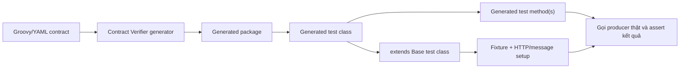
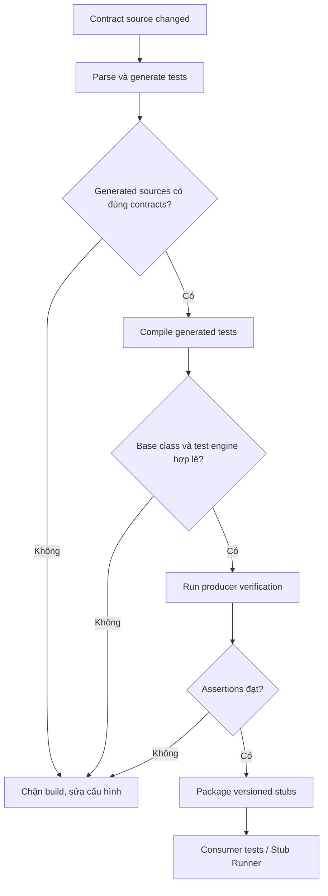

# Tên package, lớp kiểm thử và phương thức kiểm thử

## 1. Vì sao tên của generated tests lại quan trọng?

Trong **Spring Cloud Contract** (module `SPRING_CLOUD_CONTRACT`), producer và consumer thống nhất hành vi HTTP hoặc thông điệp bằng **Groovy DSL** hay **YAML DSL**. Từ hợp đồng, **Contract Verifier** tạo kiểm thử để xác nhận producer thật tuân thủ những lời hứa đã công bố. Cùng nguồn hợp đồng có thể dùng để tạo stub, phát hành artifact, chạy consumer tests qua **Stub Runner** và tích hợp CI nhằm phát hiện thay đổi API không tương thích.

Khi dự án có hàng chục hoặc hàng trăm hợp đồng, chỉ biết “plugin đã sinh test” chưa đủ. Người phát triển cần xác định:

- **Package** Java/Groovy của mã kiểm thử được sinh là gì và tại sao nó có tên đó.
- **Lớp kiểm thử** nào chứa các phương thức kiểm chứng hợp đồng.
- **Phương thức kiểm thử** nào gắn với từng file hoặc từng định nghĩa hợp đồng.
- **Lớp nền (base class)** nào được test sinh ra kế thừa để chuẩn bị producer, request client, fixture hoặc message verifier.
- Khi test thất bại trong CI, cách **truy ngược** từ tên phương thức đến hợp đồng và nhánh API tương ứng.

Các tên này thường liên quan với nhau nhưng **không đồng nghĩa**. Đặc biệt, một **file hợp đồng không nhất thiết tương ứng với một lớp test riêng**, và lớp nền được viết thủ công **không phải** lớp test do generator tạo ra.

## 2. Bốn thành phần trong quá trình sinh kiểm thử

| Thành phần | Ví dụ minh họa | Vai trò |
| --- | --- | --- |
| **Hợp đồng nguồn** | `get_order_success.groovy` | Mô tả request và response theo DSL |
| **Package của generated test** | `com.example.orders.contract` | Namespace của mã kiểm thử; quyết định import và cách tổ chức lớp |
| **Generated test class** | `ContractVerifierTest` | Lớp chứa các phương thức test do Contract Verifier sinh |
| **Generated test method** | `validate_get_order_success()` | Chạy một kịch bản hợp đồng cụ thể và kiểm tra kết quả |
| **Base test class** | `com.example.orders.contract.ContractVerifierBase` | Do nhóm viết; cấu hình hạ tầng test và fixture để generated test sử dụng |

**Chú ý:** tên package, lớp và method trong bảng là **ví dụ minh họa**, không phải tên mặc định cố định của mọi phiên bản Spring Cloud Contract. Tên thực tế phụ thuộc vào cấu trúc hợp đồng, metadata, plugin, test framework và các tùy chọn sinh mã. Bước xác nhận đáng tin cậy là **đọc mã kiểm thử thực tế đã được sinh**.

### 2.1. Sơ đồ trách nhiệm



Generator đọc hành vi hợp đồng và tạo mã test; lớp nền do đội phát triển cung cấp các điều kiện để test này **thực thi trên producer**. Nếu plugin sinh test đúng nhưng lớp nền không tạo được dữ liệu cần thiết, kiểm thử vẫn có thể thất bại.

## 3. Ví dụ xuyên suốt: hợp đồng đọc đơn hàng

Giả sử dịch vụ `orders-producer` công bố một API:

- `GET /api/orders/ord-1001` trả `200 OK`.
- Response là JSON có `id = ord-1001` và `status = CREATED`.
- `ord-1001` là fixture đã được tạo cho producer test.

Một hợp đồng Groovy `get_order_success.groovy`:

```groovy
import org.springframework.cloud.contract.spec.Contract

Contract.make {
    name 'get_order_success'
    description 'Trả thông tin đơn hàng đã tồn tại'

    request {
        method GET()
        url '/api/orders/ord-1001'
    }

    response {
        status 200
        headers {
            contentType(applicationJson())
        }
        body([
            id    : 'ord-1001',
            status: 'CREATED'
        ])
    }
}
```

Trong hợp đồng này, `name 'get_order_success'` mô tả định danh tình huống. Nó **giúp công cụ và người đọc nhận diện test**, nhưng không nên suy ra một cách máy móc rằng tên lớp hay tên phương thức Java chắc chắn sẽ có cùng chuỗi từng ký tự. Generator có thể thêm tiền tố, chuẩn hóa ký tự và xử lý trùng tên tùy phiên bản.

Nếu nhóm chọn YAML DSL thì nội dung tương ứng là:

```yaml
name: get_order_success
description: Trả thông tin đơn hàng đã tồn tại
request:
  method: GET
  url: /api/orders/ord-1001
response:
  status: 200
  headers:
    Content-Type: application/json
  body:
    id: ord-1001
    status: CREATED
```

Hai bản trên diễn tả **cùng hành vi**. Dự án nên chỉ đăng ký **một** biểu diễn cho tình huống này để tránh sinh những kiểm thử và stub trùng nhau.

## 4. Package của generated test được quyết định thế nào?

**Package** là tên không gian trong mã Java/Groovy, ví dụ:

```java
package com.example.orders.contract;
```

Nó khác với **đường dẫn HTTP** `/api/orders`, **tọa độ Maven** `com.example:orders-producer` và **thư mục chứa hợp đồng**. Các khái niệm này có thể được nhóm phát triển đặt tên giống nhau về mặt ý nghĩa, nhưng không nhất thiết được suy ra tự động từ nhau.

Trong thực tế, package được sinh có thể chịu ảnh hưởng bởi:

1. **Package/cấu hình mặc định của dự án producer** và cách plugin nhận diện project.
2. **Cấu trúc thư mục hợp đồng** dưới contracts root.
3. **Tùy chọn tổ chức và base class** của Maven/Gradle plugin.
4. **Phiên bản Contract Verifier và ngôn ngữ test** (Java/JUnit hoặc Groovy/Spock, tùy cấu hình).

Vì các quy tắc có thể khác theo cách cấu hình, **không nên tự suy package từ tên thư mục**, ví dụ cho rằng `contracts/http/orders/` chắc chắn tạo package `http.orders`. Phải kiểm tra file test thực tế sau khi generator chạy.

### 4.1. Phân biệt source directory và package

Một bố cục minh họa:

```text
orders-producer/
  src/test/resources/contracts/
    http/orders/
      get_order_success.groovy
      get_order_not_found.groovy

  src/test/java/com/example/orders/contract/
    ContractVerifierBase.java

  target/generated-test-sources/contracts/
    ... generated test sources ...
```

Đây là cách tổ chức **minh họa cho Maven**. `target/generated-test-sources/contracts` là nơi thường dùng cho mã test được sinh khi áp dụng cấu hình Maven tương ứng. Cấu trúc package và tên file bên dưới cần xem tại **output thực tế**, không sao chép ví dụ làm đường dẫn bất biến.

Nếu generated test khai báo:

```java
package com.example.orders.contract;
```

thì file nguồn tương ứng thường nằm dưới thư mục theo package:

```text
.../com/example/orders/contract/...
```

Một file nằm ở thư mục khác vẫn có thể khai báo package này, nhưng các công cụ build/IDE thường tổ chức theo cấu trúc package để import và tìm lớp rõ ràng.

### 4.2. Vì sao package ảnh hưởng đến test base?

Giả sử plugin được cấu hình:

```xml
<baseClassForTests>
  com.example.orders.contract.ContractVerifierBase
</baseClassForTests>
```

Đây là **tên lớp đầy đủ** (*fully qualified class name*), bao gồm package và class. Test sinh ra cần tìm và kế thừa được lớp đó. Nếu bạn đổi package của `ContractVerifierBase` nhưng không cập nhật cấu hình, generated test có thể không biên dịch vì không resolve được base class.

Đổi package chỉ là một thay đổi tổ chức mã, nhưng có thể phá bước build nếu:

- Lớp nền không còn ở đúng tên đầy đủ.
- Import hoặc các phụ thuộc test không còn hợp lệ.
- Cấu hình base class mapping theo thư mục chưa được cập nhật.
- IDE vẫn hiển thị nguồn generated cũ trong khi build đã đổi output.

Vì vậy, kiểm tra **package declaration trong generated source** quan trọng hơn việc chỉ xem tên thư mục trên ổ đĩa.

## 5. Lớp kiểm thử được sinh và lớp nền kiểm thử

Hai lớp này có trách nhiệm riêng:

| Tiêu chí | Generated test class | Base test class |
| --- | --- | --- |
| Ai tạo? | Contract Verifier | Nhóm phát triển producer |
| Nguồn thay đổi | Hợp đồng và cấu hình generator | Mã chuẩn bị producer và fixture |
| Chứa gì? | Các test methods và assertions được sinh | Cấu hình HTTP test, ứng dụng, dữ liệu, message trigger |
| Có nên sửa trực tiếp? | Không; sẽ bị sinh lại | Có; đây là mã được bảo trì trong repository |
| Lỗi thường gặp | Sai package/import, method trùng tên, assertion không đúng mong đợi | Thiếu bean, fixture sai, không setup request client, thiếu trigger |

### 5.1. Cấu hình Maven plugin

Một đoạn `pom.xml` rút gọn:

```xml
<build>
  <plugins>
    <plugin>
      <groupId>org.springframework.cloud</groupId>
      <artifactId>spring-cloud-contract-maven-plugin</artifactId>
      <extensions>true</extensions>
      <configuration>
        <baseClassForTests>
          com.example.orders.contract.ContractVerifierBase
        </baseClassForTests>
        <testFramework>JUNIT5</testFramework>
        <testMode>MOCKMVC</testMode>
      </configuration>
    </plugin>
  </plugins>
</build>
```

Đoạn này **chưa phải `pom.xml` hoàn chỉnh**. Dự án cần khai báo phiên bản plugin tương thích với Spring Boot/Spring Cloud Contract, test dependencies và thiết lập build cần thiết. Cần kiểm tra tên tùy chọn và giá trị enum theo **phiên bản plugin đang dùng**, đặc biệt khi nâng phiên bản.

Ý nghĩa:

- `baseClassForTests` chỉ lớp nền mà generated tests kế thừa.
- `testFramework` chọn framework test mà generator hỗ trợ, ví dụ JUnit 5.
- `testMode` chọn cách gọi HTTP thích hợp, ví dụ MockMvc cho kiểm thử lớp web.

Giá trị `MOCKMVC` chỉ có ý nghĩa nếu base class thực sự cung cấp môi trường MockMvc. Nếu project chạy server thật hoặc dùng WebTestClient thì phải cấu hình test mode và lớp nền tương ứng.

### 5.2. Base class Java minh họa

Với MockMvc, một lớp nền có thể có hình dạng:

```java
package com.example.orders.contract;

import io.restassured.module.mockmvc.RestAssuredMockMvc;
import org.junit.jupiter.api.BeforeEach;
import org.springframework.beans.factory.annotation.Autowired;
import org.springframework.boot.test.autoconfigure.web.servlet.AutoConfigureMockMvc;
import org.springframework.boot.test.context.SpringBootTest;
import org.springframework.test.web.servlet.MockMvc;

@SpringBootTest
@AutoConfigureMockMvc
public abstract class ContractVerifierBase {

    @Autowired
    private MockMvc mockMvc;

    @BeforeEach
    void setUp() {
        // Trong dự án thật: chuẩn bị fixture ord-1001 trước mỗi bài test.
        RestAssuredMockMvc.mockMvc(mockMvc);
    }
}
```

Lớp này chỉ minh họa cách cấp `MockMvc` cho generated tests. Để ví dụ `get_order_success` đạt, dự án còn cần:

- Controller và các bean cần thiết được khởi tạo.
- Fixture `ord-1001` có thật trong nguồn dữ liệu của test hoặc service được stub ở mức phù hợp.
- Security filter, context path và request encoding khớp contract.
- Trạng thái được cô lập để các test không phụ thuộc thứ tự chạy.

Nếu thiếu fixture, producer có thể trả `404` thay vì `200` dù generated test compile thành công.

### 5.3. Base class không tự tạo hợp đồng

Tên `ContractVerifierBase` là quy ước do nhóm chọn, không phải cú pháp `Contract.make` bắt buộc. Ngược lại, đổi tên base class **không tự thay đổi nội dung hợp đồng**. Các ràng buộc về method, URL, status, header và JSON body vẫn đến từ DSL.

Với **messaging contract**, lớp nền còn có thể chứa phương thức kích hoạt sự kiện như `publishOrderCreated()` và cơ chế quan sát message đầu ra. Không thể dùng một cấu hình MockMvc đơn thuần để xác minh toàn bộ tương tác qua broker.

## 6. Phương thức kiểm thử được sinh từ hợp đồng

Một generated test method đại diện cho **một kịch bản** đã khai báo. Ví dụ giả lập cấu trúc Java sau:

```java
// MINH HỌA CẤU TRÚC, KHÔNG PHẢI OUTPUT NGUYÊN VĂN CỦA GENERATOR.
package com.example.orders.contract;

import org.junit.jupiter.api.Test;

public class ContractVerifierTest extends ContractVerifierBase {

    @Test
    public void validate_get_order_success() throws Exception {
        // Gửi GET /api/orders/ord-1001 đến producer thật.
        // Assert HTTP 200, Content-Type và các trường JSON theo contract.
    }

    @Test
    public void validate_get_order_not_found() throws Exception {
        // Gửi GET /api/orders/ord-missing.
        // Assert HTTP 404 và mã lỗi ORDER_NOT_FOUND.
    }
}
```

Trong một phiên bản/cấu hình thực, tên lớp có thể **không phải `ContractVerifierTest`**, tên method có thể có tiền tố/chuẩn hóa khác và các assertions được sinh ra sẽ chi tiết hơn. Ví dụ cố tình rút gọn để minh họa **mối quan hệ giữa lớp, phương thức và hợp đồng**, không nhằm khẳng định từng dòng output của framework.

### 6.1. `name` trong hợp đồng có tác động gì?

Trong Groovy:

```groovy
Contract.make {
    name 'get_order_not_found'

    request {
        method GET()
        url '/api/orders/ord-missing'
    }

    response {
        status 404
    }
}
```

`name` đặt định danh rõ ràng cho trường hợp kiểm thử, thường có ảnh hưởng đến cách generator đặt tên bài kiểm thử. Nếu không đặt `name`, công cụ có thể dựa vào tên file/metadata khác để định danh; chi tiết tùy phiên bản và hình thức DSL.

Quy ước tốt là **đặt tên mô tả hành vi quan sát được**: `get_order_not_found` rõ nghĩa hơn `test_02`. Nên tránh khoảng trắng, dấu câu đặc biệt, ký tự Unicode khó xử lý trong Java identifier hoặc các tên giống nhau trong cùng phạm vi generated class.

### 6.2. Tên file và `name` có luôn giống nhau không?

Không bắt buộc về cú pháp, nhưng nên nhất quán:

| File | `name` trong DSL | Đánh giá |
| --- | --- | --- |
| `get_order_success.groovy` | `get_order_success` | Rõ ràng, dễ truy vết |
| `get_order_not_found.groovy` | `get_order_not_found` | Rõ ràng, dễ truy vết |
| `get_order_success.groovy` | `create_product_success` | Dễ gây nhầm và chẩn đoán sai |
| `case1.groovy` | `get_order_not_found` | Vẫn có ý nghĩa từ `name`, nhưng tên file ít mô tả |

**Tình huống nhiều hợp đồng:** một số cách tổ chức Groovy DSL cho phép chứa nhiều định nghĩa contract trong cùng một file. Vì thế, **số file không luôn bằng số test methods**. Nếu dùng mẫu này, mỗi định nghĩa phải có khả năng truy vết riêng, tránh trùng tên và kiểm tra generated output sau khi build.

### 6.3. Một lớp có thể chứa nhiều phương thức kiểm thử

Giả sử dự án có ba tình huống:

```text
get_order_success
get_order_not_found
create_order_invalid_quantity
```

Generator có thể nhóm nhiều test methods trong một class hoặc tách theo cách cấu hình, thư mục và phiên bản. **Không suy ra ba contracts sẽ tạo đúng ba classes.** Điều cần xác nhận là **cả ba kịch bản đều xuất hiện và được chạy**.

Khi CI báo:

```text
ContractVerifierTest > validate_get_order_not_found FAILED
Expected HTTP status: 404
Actual HTTP status: 200
```

đó là log **minh họa**. Cách điều tra:

1. Tìm generated method `validate_get_order_not_found`.
2. Xem request và assertion được sinh.
3. Truy về hợp đồng `get_order_not_found`/file nguồn.
4. Xác minh fixture `ord-missing` thực sự không tồn tại.
5. So sánh response producer thật với hành vi đã thống nhất; sửa nguyên nhân đúng lớp.

Không nên đổi hợp đồng `404` thành `200` chỉ để test xanh nếu producer mới là bên sai.

## 7. Vì sao thay đổi tên có thể làm build thất bại?

### 7.1. Xung đột tên phương thức

Giả sử hai hợp đồng khác nhau cùng được đặt:

```groovy
name 'get_order_success'
```

Nếu chúng được đưa vào một generated class và generator dùng `name` để đặt method, tên trùng **có thể gây va chạm** hoặc một kết quả không như dự kiến. Cần đặt định danh duy nhất theo phạm vi nhóm hợp đồng và **xem generated source** để biết thực tế.

Các cặp tên có thể trở nên trùng sau khi chuẩn hóa ký tự, ví dụ `get-order-success` và `get_order_success`, tùy thuật toán đặt tên. Dù framework có cơ chế tránh trùng, tên khó phân biệt sẽ làm log CI kém rõ ràng.

### 7.2. Sai package/lớp nền

Ví dụ plugin trỏ:

```text
com.example.orders.contract.ContractVerifierBase
```

nhưng lớp nguồn được đổi thành:

```text
com.example.orders.tests.ContractVerifierBase
```

Generated test có thể không tìm được lớp nền để kế thừa. Đây là lỗi **cấu hình biên dịch test**, không phải hợp đồng HTTP sai. Cần cập nhật FQCN trong plugin và kiểm tra import/package của lớp nền.

### 7.3. Base class mapping không trỏ tới lớp phù hợp

Với nhiều miền API, một lớp nền duy nhất có thể quá rộng:

- Hợp đồng `orders/*` cần fixture đơn hàng và MockMvc.
- Hợp đồng `payments/*` cần fixture thanh toán.
- Hợp đồng `messaging/*` cần message trigger hoặc message verifier.

Spring Cloud Contract có cơ chế **base class mappings** theo cấu hình plugin để chọn base class phù hợp cho các nhóm hợp đồng, thay vì buộc mọi test dùng một lớp nền. Cú pháp và cách regex/path mapping được diễn giải phụ thuộc Maven/Gradle plugin và phiên bản; khi áp dụng phải kiểm tra tài liệu của phiên bản dự án và generated classes.

Không nên tự đổi package hoặc tên class generated rồi commit. Khi chạy generator lần nữa, sửa tay sẽ mất; hãy sửa **DSL, plugin configuration hoặc base classes** là nguồn tạo ra kết quả.

## 8. Tên test được sinh dưới Maven và Gradle

### 8.1. Dự án Maven

Khi plugin đã được cấu hình, có thể gọi goal sinh test của Spring Cloud Contract:

```bash
./mvnw -B spring-cloud-contract:generateTests
```

Lệnh trên là ví dụ dành cho dự án **đã có Maven Wrapper, dependency/plugin và phiên bản phù hợp**. Nếu Maven báo không tìm thấy plugin prefix hoặc goal, cần kiểm tra `pom.xml` và phiên bản plugin trước khi quy lỗi cho hợp đồng.

Output Java test thường được tạo trong vùng `target/generated-test-sources/contracts` theo cấu hình Maven tương ứng. Xem **file thực tế** để xác định package, class, method, import và base class. Một bước sinh test thành công không có nghĩa test đã được **biên dịch hoặc thực thi**.

Để chạy producer verification đầy đủ trong pipeline Maven được cấu hình đúng:

```bash
./mvnw -B clean verify
```

Phải xác nhận build thực sự phát hiện hợp đồng, sinh test, đưa source vào test compilation và thực thi bằng test runner. Một build xanh khi không có contract nào được quét không bảo vệ API.

### 8.2. Dự án Gradle

Với Gradle plugin tương ứng, những task thường gặp là `generateContractTests` và `contractTest`. Ví dụ:

```bash
./gradlew generateContractTests
./gradlew contractTest
```

Task và cách nối vào lifecycle phụ thuộc phiên bản plugin/cấu hình dự án. Generated sources thường nằm dưới `build/`, với thư mục cụ thể cần xem từ output của task. Đừng mặc định Gradle tạo cùng package/class/file layout như Maven hoặc dùng cùng test runner.

### 8.3. Xem output thay vì dự đoán tên

Một quy trình kiểm tra ngắn:

1. Chạy **goal/task sinh test**.
2. Xem thư mục generated sources mà build đã báo.
3. Mở file class, đọc dòng `package ...;`.
4. Đọc dòng `class ... extends ...` hoặc dạng khai báo tương ứng của test framework.
5. Liệt kê các method có `@Test` (JUnit) hoặc test blocks tương ứng (Spock).
6. Đối chiếu số lượng và ý nghĩa các method với những hợp đồng source được plugin quét.
7. Biên dịch và thực thi test; xem build report để biết kịch bản nào đạt/thất bại.

Chỉ dùng tên file/hợp đồng như **gợi ý tìm kiếm ban đầu**. Generated source là bằng chứng trực tiếp của cấu hình hiện hành.

## 9. JUnit 5, JUnit 4 và Spock ảnh hưởng tên test ra sao?

Spring Cloud Contract có thể sinh mã theo nhiều test framework được phiên bản/plugin hỗ trợ. Ví dụ:

| Framework | Dạng generated test | Điểm cần lưu ý |
| --- | --- | --- |
| **JUnit 5** | Lớp Java, method có `org.junit.jupiter.api.Test` | Cần test engine và dependency đúng |
| **JUnit 4** | Lớp Java, method có `org.junit.Test` | Cần runner/dependency phù hợp |
| **Spock** | Specification Groovy với feature methods | Tên feature có thể dùng văn bản mô tả theo cú pháp Groovy |

Sự khác nhau ở annotation/ngôn ngữ có thể ảnh hưởng cách test runner **hiển thị tên**, nhưng mọi biến thể vẫn phải kiểm chứng đúng hành vi trong hợp đồng.

Không nên viết một script CI chỉ tìm chuỗi `@Test` rồi kết luận không có test nếu dự án dùng Spock. Tương tự, sự hiện diện của file Java test không bảo đảm JUnit 5 engine đã thực thi nó. Kiểm tra kết quả test runner ở cấp build.

### 9.1. Package có quyết định quyền truy cập của phương thức không?

Trong Java, thành viên `package-private` chỉ truy cập được từ cùng package. Khi generated class nằm ở package khác base class, những helper/fixture package-private có thể không truy cập được trực tiếp. Helper dùng từ generated subclasses nên có mức truy cập phù hợp (chẳng hạn `protected`/`public` khi cần) và thiết kế để test gọi ổn định.

Không nên sửa generated test để gọi một helper package-private. Sửa API của test base hoặc cách tổ chức package/configuration, rồi sinh lại mã.

## 10. Test được sinh từ hợp đồng thông điệp

Với messaging, contract vẫn có thể có `name`:

```groovy
import org.springframework.cloud.contract.spec.Contract

Contract.make {
    name 'order_created_event'
    label 'order_created'

    input {
        triggeredBy('publishOrderCreated()')
    }

    outputMessage {
        sentTo('orders.events')
        body([
            eventType: 'ORDER_CREATED',
            orderId  : 'ord-1001'
        ])
    }
}
```

Generated producer test cần gọi một **cơ chế kích hoạt** và kiểm tra message được phát. Trong ví dụ, `publishOrderCreated()` là phương thức **do nhóm hiện thực trong test base**, không phải phương thức Spring Cloud Contract tự tạo. Vì vậy:

- Package/class/method của **generated test** vẫn do plugin sinh và chịu ảnh hưởng cấu hình.
- **Trigger method** `publishOrderCreated()` là helper trong base class/configuration; nó không đồng nghĩa với tên test method.
- `label 'order_created'` có ý nghĩa khi consumer cần kích hoạt message stub trong khả năng hỗ trợ của Stub Runner; nó không phải tên package Java.
- `sentTo('orders.events')` là destination nghiệp vụ, không quyết định Java package.

Nhầm các tên này có thể khiến người học đi tìm một generated Java method tên `publishOrderCreated` hoặc nghĩ rằng đổi `label` sẽ tự đổi package. Cần phân biệt **tên kỹ thuật kiểm thử** với **tên của thành phần message transport**.

## 11. Đặt tên để truy vết từ hợp đồng đến kết quả CI

Một quy ước có thể áp dụng:

| Thành phần | Mẫu đặt tên đề xuất | Lý do |
| --- | --- | --- |
| Contract file | `get_order_success.groovy` | Có hành động, đối tượng, kết quả |
| `name` | `get_order_success` | Nhất quán với file, dễ tìm trong log |
| Contract lỗi | `get_order_not_found.groovy` | Tách nhánh `404` khỏi nhánh `200` |
| Contract message | `order_created_event.groovy` | Phân biệt sự kiện với endpoint HTTP |
| Base class | `OrdersContractTestBase` | Nói rõ miền nghiệp vụ và vai trò |
| Base class package | `com.example.orders.contract` | Gom cơ sở hạ tầng kiểm thử của module |

Đây là **quy ước đề xuất**, không phải yêu cầu cú pháp bắt buộc của framework. Tên có thể khác tùy chuẩn dự án, miễn giữ được sự nhất quán và tránh trùng sau khi generator chuẩn hóa.

### 11.1. Traceability giữa source và generated test

Một bảng quản lý minh họa:

| Hợp đồng nguồn | Hành vi | Kết quả cần thấy ở generated tests |
| --- | --- | --- |
| `get_order_success.groovy` | `GET /api/orders/ord-1001 -> 200` | Có phương thức xác minh nhánh thành công |
| `get_order_not_found.groovy` | `GET /api/orders/ord-missing -> 404` | Có phương thức xác minh nhánh không tìm thấy |
| `create_order_invalid_quantity.yml` | `POST /api/orders -> 400` khi quantity = 0 | Có phương thức xác minh dữ liệu không hợp lệ |
| `order_created_event.groovy` | Phát event `ORDER_CREATED` | Có test kích hoạt producer và quan sát message |

Không nên chỉ đếm file có đuôi `.java` trong generated source: một file có thể chứa nhiều test methods. Cũng không nên chỉ đếm dòng `@Test` nếu test framework không dùng JUnit annotation. Điều cần kiểm tra là **mỗi hành vi đã chọn được bao phủ bởi một kiểm thử chạy được**.

### 11.2. Khi thêm hợp đồng mới

Đề xuất một quy trình review:

1. Xác định hành vi consumer cần bảo vệ và thêm contract file tương ứng.
2. Chọn `name` có ý nghĩa và không trùng với các trường hợp khác cùng phạm vi.
3. Sinh generated tests và kiểm tra package/lớp/method mới.
4. Bảo đảm base class được chọn đúng cho HTTP hoặc messaging.
5. Chạy test để xác minh producer; sau đó đóng gói stub đã được kiểm chứng.
6. Consumer chạy stub của đúng phiên bản và CI ghi nhận kết quả.

Nếu contract mới **không xuất hiện** trong generated output, đừng giả định test runner có lỗi. Kiểm tra trước **contracts root, phần mở rộng file, bộ lọc quét, DSL parsing và plugin configuration**.

## 12. Lỗi thường gặp và cách chẩn đoán

| Triệu chứng | Nguyên nhân có thể | Hành động đầu tiên |
| --- | --- | --- |
| Không thấy generated test method cho contract mới | File không được quét hoặc chuyển đổi lỗi | Xem contracts directory, tên file, plugin log và generated source |
| Test method có tên khó hiểu | `name` hoặc file đặt tên mơ hồ; generator chuẩn hóa tên | Đặt lại tên source có ý nghĩa và sinh lại |
| Compile lỗi `cannot find symbol ContractVerifierBase` | Sai package/FQCN hoặc base class không trong test classpath | Kiểm tra `baseClassForTests` và `package` của lớp nền |
| Có hai test cùng tên hoặc mapping mơ hồ | Định danh hợp đồng trùng hoặc chuẩn hóa thành cùng tên | Kiểm tra `name`, file và generated methods |
| Test HTTP fail trước khi có assertion | Base class chưa cấu hình MockMvc/REST Assured hoặc thiếu fixture | Kiểm tra setup, controller và trạng thái test |
| Test message báo không có trigger | `triggeredBy` trỏ đến phương thức chưa hiện thực | Bổ sung helper và cấu hình message verifier |
| Mã generated test đúng nhưng test không chạy | Test engine/lifecycle chưa nhận nguồn generated | Xem dependency, plugin test configuration và test runner output |
| Build báo xanh nhưng không có test nào | Plugin không quét contracts hoặc runner bỏ qua generated tests | Kiểm tra danh sách hợp đồng và report số test đã chạy |
| Đổi package rồi import hỏng | Base class/helper nằm ngoài package hoặc không đủ visibility | Sửa package/import/mức truy cập của mã do nhóm quản lý |
| Sau `clean`, sửa tay generated source bị mất | Source generated không phải nơi chỉnh sửa lâu dài | Sửa DSL, test base hoặc plugin configuration |

### 12.1. Cách phân biệt lỗi tên và lỗi hành vi

Một test có tên dài hoặc khác kỳ vọng vẫn có thể kiểm chứng đúng API. Ngược lại, tên đẹp nhưng test gửi sai URL hay assert sai response thì **không bảo vệ đúng hợp đồng**.

Khi thất bại, hãy lần theo thứ tự:

```text
Hợp đồng nguồn được plugin quét?
  -> Generated package / class / method có tồn tại?
     -> Base class được resolve và setup đúng?
        -> Generated test có gửi đúng request/message?
           -> Assertion có khớp hợp đồng?
              -> Producer thật có trả đúng hành vi không?
```

Mỗi tầng giải quyết một loại nguyên nhân. Không sửa HTTP status trong DSL chỉ để khắc phục một lỗi `ClassNotFoundException` do sai package.

## 13. Tích hợp kiểm tra tên test và khả năng chạy vào CI

CI producer nên chứng minh **khả năng truy vết và thực thi**, không chỉ chứng minh có file được sinh:



Những thông tin có ích trong log/artifact của pipeline:

- Danh sách hợp đồng source được đọc.
- Tên generated test classes và số lượng test cases được sinh.
- Package và base class được sử dụng, đặc biệt khi có base class mappings.
- Số test thực sự được runner chạy, số pass/fail/skip.
- Tọa độ stub artifact được phát hành, ví dụ `com.example:orders-producer:1.4.2:stubs`.
- Commit/tag producer tương ứng với artifact và kết quả kiểm thử.

Nếu producer thay `404` bằng `200`, **test có tên gắn với nhánh không tìm thấy** nên thất bại do assertion, giúp người đọc log tìm ngay hợp đồng cần xem. Consumer sau đó có thể dùng Stub Runner để xác minh mã xử lý lỗi của mình với đúng stub version.

## 14. Bài thực hành: đặt tên và tìm generated tests

### 14.1. Đề bài

Một producer có ba hành vi:

| Hành vi | Contract source đề xuất |
| --- | --- |
| `GET /api/products/SKU-001 -> 200`, JSON có `id`, `available` | `get_product_success.groovy` |
| `GET /api/products/SKU-MISSING -> 404`, JSON có `code = PRODUCT_NOT_FOUND` | `get_product_not_found.groovy` |
| `POST /api/products/reservations -> 409` khi không đủ hàng | `reserve_product_out_of_stock.groovy` |

Bạn được giao:

1. Viết ba contract files với `name` khớp ngữ nghĩa tên file.
2. Cấu hình một base class `com.example.products.contract.ProductsContractTestBase` cho producer tests.
3. Thiết lập fixture để `SKU-001` tồn tại, `SKU-MISSING` không tồn tại và tình huống hết hàng trả `409`.
4. Chạy bước **generate tests** theo Maven hoặc Gradle plugin hiện dùng.
5. Ghi lại **package, class name, method name** của generated tests thật từ file output.
6. Kiểm tra cả ba hành vi có test chạy được và không bị bỏ qua.
7. Cố ý đổi package của base class nhưng chưa đổi cấu hình plugin; quan sát lỗi compile rồi sửa **cấu hình nguồn** cho nhất quán.

### 14.2. Phiếu ghi nhận kết quả

| Thông tin | Cần điền từ dự án thực |
| --- | --- |
| Framework test | JUnit 5 / JUnit 4 / Spock |
| Plugin/phiên bản | Tên và version được cấu hình |
| Contracts root | Đường dẫn plugin thực sự quét |
| Generated sources directory | Đường dẫn do build tạo |
| Generated package | Dòng `package ...` trong source |
| Generated class(es) | Tên class/specification thực tế |
| Generated method(s) | Tên method/feature theo từng hợp đồng |
| Base class FQCN | Lớp nền được generated tests sử dụng |
| Tổng số test chạy | Số liệu từ report của test runner |
| Kết quả producer verification | Pass/fail và nguyên nhân nếu lỗi |

### 14.3. Câu hỏi tự kiểm tra

**Câu 1.** Ba file hợp đồng có luôn sinh đúng ba lớp Java không?

**Đáp án:** Không. Một lớp có thể chứa nhiều phương thức test; cách nhóm phụ thuộc vào generator và cấu hình. Hãy kiểm tra output thực tế.

**Câu 2.** Đổi `name 'get_product_success'` có đồng nghĩa đổi Java package không?

**Đáp án:** Không. `name` giúp định danh tình huống, còn package do quy tắc tổ chức và cấu hình generator quyết định.

**Câu 3.** Generated test báo thiếu `ProductsContractTestBase` thì nên sửa gì?

**Đáp án:** Kiểm tra FQCN trong plugin, package declaration của base class và test classpath. Không sửa generated test bằng tay.

**Câu 4.** Có generated method nhưng CI báo 0 test chạy thì producer đã được kiểm chứng chưa?

**Đáp án:** Chưa. Cần test runner nhận và thực thi phương thức đó, sau đó xác minh assertion thực sự đạt.

**Câu 5.** Hợp đồng messaging có `triggeredBy('publishEvent()')`. Đây có phải tên phương thức generated test không?

**Đáp án:** Không. Đây là tên phương thức kích hoạt được định nghĩa trong base class/configuration, khác với tên test method do generator tạo.

### Checklist trước khi kết luận generated tests đã sẵn sàng

- [ ] Hợp đồng nguồn đã được quét và có `name`/file name rõ nghĩa.
- [ ] Generated source có package, lớp và phương thức như dự án thực tế tạo ra.
- [ ] Không có tên trùng hoặc nhánh test bị bỏ sót.
- [ ] Generated test kế thừa đúng base class FQCN.
- [ ] Base class khởi tạo được HTTP client hoặc messaging verifier và fixture.
- [ ] Generated tests đã **biên dịch và được thực thi**, không chỉ được tạo file.
- [ ] Assertions bảo vệ đúng method, URL, status, body, header hoặc message output đã thống nhất.
- [ ] Build report ghi rõ test pass/fail/skip và cho phép truy ngược hợp đồng lỗi.
- [ ] Stub đã được đóng gói/phát hành đúng phiên bản sau khi producer verification đạt.

**Ghi nhớ:** package tổ chức mã test, generated class nhóm các bài kiểm tra, generated method thực thi kịch bản hợp đồng, còn base class cung cấp điều kiện để chạy. Tên cụ thể do generator và cấu hình quyết định; muốn biết chính xác phải đọc generated source và report của test runner. Hiểu mối quan hệ này giúp chẩn đoán nhanh lỗi Contract Verifier và bảo đảm CI thực sự kiểm tra lời hứa giữa producer và consumer.
