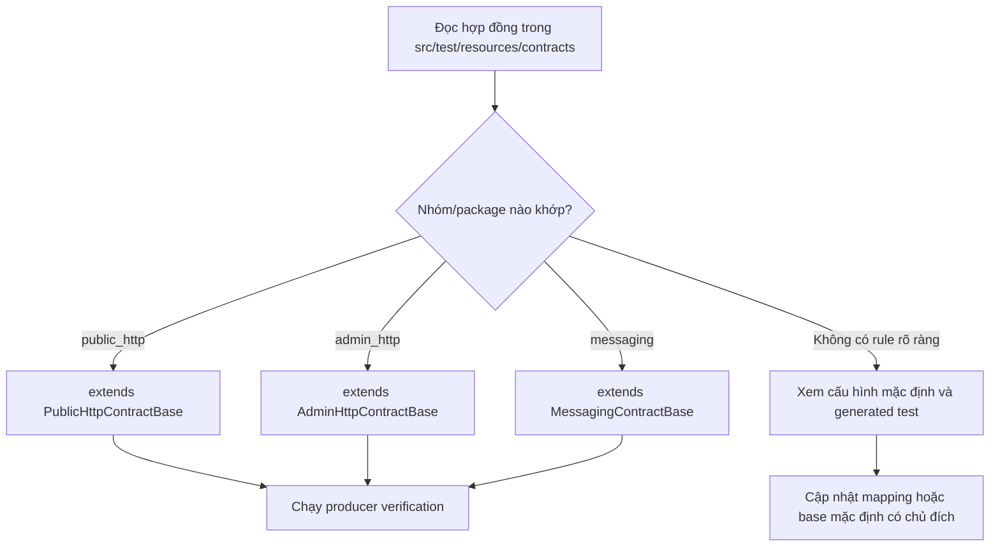
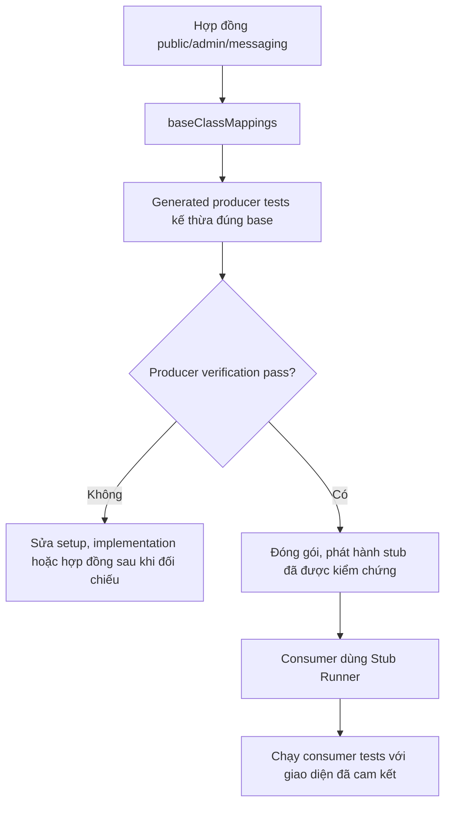

# Ánh xạ nhóm hợp đồng đến base class phù hợp

## 1. Tại sao producer cần nhiều test base class?

Trong hệ thống nhiều dịch vụ, **Spring Cloud Contract Verifier** đọc các hợp đồng HTTP hoặc thông điệp (Groovy/YAML DSL), sinh kiểm thử tại phía **producer**, xác minh ứng dụng đáp ứng giao diện đã cam kết, rồi hỗ trợ đóng gói stub cho **consumer** kiểm thử bằng Stub Runner. Các bài kiểm thử này cần một môi trường chạy: Spring context, client HTTP, dữ liệu mẫu, xác thực hoặc hạ tầng thông điệp. Phần chuẩn bị môi trường thường được đặt trong **test base class**.

Với một producer chỉ có vài hợp đồng HTTP dùng chung cấu hình, một base class có thể đủ. Tuy nhiên, dự án thực tế thường có nhiều nhóm:

- **Public HTTP:** các endpoint `/api/orders`, dùng MockMvc và dữ liệu đơn hàng mẫu.
- **Admin HTTP:** các endpoint `/internal/orders`, có điều kiện xác thực/phân quyền và fixture riêng.
- **Messaging:** nghiệp vụ phát sự kiện `OrderCreated` cần trigger và cơ chế quan sát message.

Nếu tất cả test kế thừa cùng một base class chứa mọi bean, mock, trigger và cấu hình, class đó dễ trở thành điểm tập trung trách nhiệm, khó bảo trì, khó chạy độc lập và làm test ảnh hưởng lẫn nhau. Ngược lại, nếu gán sai base class, kiểm thử sinh ra có thể không biên dịch, không khởi động test context hoặc không gửi được request/message theo đúng hợp đồng.

**Mục tiêu bài học:** dùng cấu hình `baseClassForTests` cho trường hợp đơn giản và `baseClassMappings` để ánh xạ **nhóm hợp đồng → fully qualified base class**. Sau đó kiểm tra kết quả sinh test, xử lý các nhóm bị thiếu hoặc khớp nhầm, và tích hợp producer verification cùng quy trình phát hành stub trong CI.

## 2. Base class là gì trong Spring Cloud Contract Verifier?

Base class là một **lớp Java/Kotlin/Groovy do nhóm producer viết và quản lý**; test sinh tự động kế thừa lớp đó để dùng chung môi trường kiểm thử. Spring Cloud Contract **không tự viết toàn bộ nghiệp vụ hoặc Spring context** chỉ vì chúng ta khai báo tên base class trong plugin.

Một test sinh ra có thể mang cấu trúc khái niệm:

```java
// Minh họa hình thức: class/method thật phụ thuộc phiên bản SCC và cấu hình.
public class Validate_create_order extends PublicHttpContractBase {
    @Test
    public void validate_create_order() throws Exception {
        // Mã được sinh: gửi request đến producer và đối chiếu response.
    }
}
```

Vai trò của base class tùy nhóm:

| Nhu cầu của test | Base class có thể chuẩn bị | Ví dụ |
| --- | --- | --- |
| Gửi HTTP request qua MockMvc | Spring test context, MockMvc và cấu hình RestAssuredMockMvc | `PublicHttpContractBase` |
| Kiểm tra endpoint quản trị | Context có filter bảo mật, tài khoản/quyền thử nghiệm, fixture phù hợp | `AdminHttpContractBase` |
| Phát/nhận thông điệp | Message verifier, binder/test transport, các phương thức `triggeredBy` | `MessagingContractBase` |
| Dữ liệu cần tái lập | Seed/cleanup fixture và cách cô lập trạng thái | Tất cả nhóm, tùy dữ liệu |

Base class không phải một phần của giao diện mà consumer nhìn thấy. Nó là **cơ sở hạ tầng kiểm thử ở producer**, giúp thực thi hành vi do hợp đồng quy định.

### 2.1. Đặt base class ở đâu?

Với Maven hoặc Gradle sử dụng source set Java thông thường:

```text
src/
  test/
    java/
      com/example/contract/
        PublicHttpContractBase.java
        AdminHttpContractBase.java
        MessagingContractBase.java
    resources/
      contracts/
        public_http/
          create_order.groovy
          order_not_found.yml
        admin_http/
          get_internal_order.groovy
        messaging/
          order_created.groovy
```

Đây là **cấu trúc minh họa**. Đường dẫn hợp đồng mặc định/cấu hình riêng và package của mã test sinh ra phụ thuộc plugin, nhưng nguyên tắc luôn là giữ đường dẫn nhóm rõ ràng và đảm bảo base class có mặt trong **test compile classpath**.

Tệp `PublicHttpContractBase.java` phải khai báo `package com.example.contract;` để khớp tên đầy đủ `com.example.contract.PublicHttpContractBase` trong plugin.

## 3. Một base class duy nhất với `baseClassForTests`

Nếu mọi hợp đồng dùng cùng test context, có thể khai báo duy nhất:

```xml
<plugin>
    <groupId>org.springframework.cloud</groupId>
    <artifactId>spring-cloud-contract-maven-plugin</artifactId>
    <version>${spring-cloud-contract.version}</version>
    <extensions>true</extensions>
    <configuration>
        <testFramework>JUNIT5</testFramework>
        <testMode>MOCKMVC</testMode>
        <baseClassForTests>com.example.contract.HttpContractBase</baseClassForTests>
    </configuration>
</plugin>
```

`baseClassForTests` chỉ định **một lớp cha mặc định** cho các bài kiểm thử sinh ra trong phạm vi cấu hình đó. Phần `testMode=MOCKMVC` minh họa producer là ứng dụng Spring MVC được kiểm thử bằng MockMvc. Property `${spring-cloud-contract.version}` phải tồn tại trong cấu hình Maven thực tế và phù hợp với thư viện Spring Cloud Contract mà BOM đang quản lý.

Điểm mạnh của cách này là đơn giản, ít quy tắc. Hạn chế xuất hiện khi phải thiết lập môi trường khác nhau cho HTTP public, HTTP admin và messaging. Đó là lúc nên dùng **ánh xạ theo nhóm** thay vì tăng dần nhiều câu `if` bên trong một base class.

Trong Gradle Groovy DSL, cấu hình tương ứng về ý tưởng là:

```groovy
contracts {
    baseClassForTests = 'com.example.contract.HttpContractBase'
}
```

Cấu hình trên giả định dự án đã áp dụng **Spring Cloud Contract Gradle plugin** và khai báo phiên bản tương thích. Với các dự án dùng Kotlin DSL hoặc phiên bản plugin khác, cú pháp property có thể cần điều chỉnh theo DSL tương ứng.

## 4. Ánh xạ nhiều nhóm bằng `baseClassMappings`

Spring Cloud Contract hỗ trợ cơ chế **mapping** để chỉ định base class khác nhau dựa trên vị trí/package của hợp đồng. Thay vì áp dụng một class cho mọi hợp đồng, ta tạo các quy tắc:

| Nhóm hợp đồng | Quy tắc nhận diện minh họa | Test base class |
| --- | --- | --- |
| `public_http` | `.*public_http.*` | `com.example.contract.PublicHttpContractBase` |
| `admin_http` | `.*admin_http.*` | `com.example.contract.AdminHttpContractBase` |
| `messaging` | `.*messaging.*` | `com.example.contract.MessagingContractBase` |

Mỗi rule gồm:

- **`contractPackageRegex`**: biểu thức chính quy để chọn nhóm hợp đồng tương ứng với đường dẫn/package mà trình sinh test xét. Hãy kiểm tra cách plugin của phiên bản đang dùng biểu diễn package/path thực tế, không tự giả định phần đường dẫn sẽ luôn giống hệt trên mọi hệ điều hành.
- **`baseClassFQN`**: tên class đầy đủ, gồm package và tên lớp, phải có thật trên test classpath.

Một cấu hình Maven minh họa:

```xml
<plugin>
    <groupId>org.springframework.cloud</groupId>
    <artifactId>spring-cloud-contract-maven-plugin</artifactId>
    <version>${spring-cloud-contract.version}</version>
    <extensions>true</extensions>
    <configuration>
        <testFramework>JUNIT5</testFramework>
        <testMode>MOCKMVC</testMode>
        <baseClassMappings>
            <baseClassMapping>
                <contractPackageRegex>.*public_http.*</contractPackageRegex>
                <baseClassFQN>com.example.contract.PublicHttpContractBase</baseClassFQN>
            </baseClassMapping>
            <baseClassMapping>
                <contractPackageRegex>.*admin_http.*</contractPackageRegex>
                <baseClassFQN>com.example.contract.AdminHttpContractBase</baseClassFQN>
            </baseClassMapping>
            <baseClassMapping>
                <contractPackageRegex>.*messaging.*</contractPackageRegex>
                <baseClassFQN>com.example.contract.MessagingContractBase</baseClassFQN>
            </baseClassMapping>
        </baseClassMappings>
    </configuration>
</plugin>
```

**Cách đọc:** một hợp đồng nằm trong nhóm được nhận diện là `public_http` sẽ được sinh test kế thừa `PublicHttpContractBase`, không phải `AdminHttpContractBase`. Đối với messaging, test có thể cần những phương thức trigger trong `MessagingContractBase` thay vì setup MockMvc.

### 4.1. Cấu hình tương ứng trong Gradle

Với Groovy DSL và Spring Cloud Contract Gradle plugin:

```groovy
contracts {
    baseClassMappings {
        baseClassMapping('.*public_http.*',
                         'com.example.contract.PublicHttpContractBase')
        baseClassMapping('.*admin_http.*',
                         'com.example.contract.AdminHttpContractBase')
        baseClassMapping('.*messaging.*',
                         'com.example.contract.MessagingContractBase')
    }
}
```

Đây là cấu hình **phần `contracts`**, không phải toàn bộ `build.gradle`. Producer vẫn cần plugin Spring Boot, Spring Cloud Contract, các test dependencies và BOM tương thích. Gradle Kotlin DSL (`build.gradle.kts`) sử dụng cú pháp khác; hãy tra tài liệu theo phiên bản thay vì sao chép nguyên Groovy DSL.

### 4.2. Một sơ đồ quyết định khi sinh test



Sơ đồ mô tả chính sách mong muốn; việc generator áp dụng **rule nào trước** hoặc có fallback ra sao cần được xác nhận bằng **mã test được sinh** theo phiên bản Spring Cloud Contract của dự án. Không thiết kế các regex chồng lấn rồi phụ thuộc ngầm vào thứ tự nếu chưa có cam kết rõ ràng.

## 5. Viết một base class HTTP đúng trách nhiệm

Giả sử `PublicHttpContractBase` dành cho hợp đồng REST API chạy MockMvc. Một cách triển khai minh họa:

```java
package com.example.contract;

import io.restassured.module.mockmvc.RestAssuredMockMvc;
import org.junit.jupiter.api.BeforeEach;
import org.springframework.beans.factory.annotation.Autowired;
import org.springframework.boot.test.autoconfigure.web.servlet.AutoConfigureMockMvc;
import org.springframework.boot.test.context.SpringBootTest;
import org.springframework.test.web.servlet.MockMvc;

@SpringBootTest(webEnvironment = SpringBootTest.WebEnvironment.MOCK)
@AutoConfigureMockMvc
public abstract class PublicHttpContractBase {

    @Autowired
    protected MockMvc mockMvc;

    @BeforeEach
    protected void configureContractClient() {
        RestAssuredMockMvc.mockMvc(mockMvc);
    }
}
```

Đây là **mẫu cho test mode tương ứng**, cần `spring-cloud-starter-contract-verifier`, Spring Boot Test và các dependency do plugin/build cung cấp. `@BeforeEach` được kế thừa bởi test class JUnit 5 và thiết lập client để mã test sinh ra có thể gửi request đến controller thật trong Spring test context.

Một hợp đồng public HTTP:

```groovy
import org.springframework.cloud.contract.spec.Contract

Contract.make {
    description 'Lấy đơn hàng công khai theo ID'
    request {
        method GET()
        url '/api/orders/42'
    }
    response {
        status OK()
        headers {
            contentType(applicationJson())
        }
        body(
            orderId: 42,
            status: 'CREATED'
        )
    }
}
```

Để bài kiểm thử đi qua, producer phải thật sự có `GET /api/orders/42` và dữ liệu test phù hợp. Base class **không** tự tạo controller, không tạo response JSON và không thay thế các fixture được thiết kế cho tình huống này.

### 5.1. Khi nào nên có base class admin khác?

Hợp đồng quản trị có thể cần:

- **Security filter chain** đang hoạt động để xác minh behavior trả `401`, `403` hoặc `200` theo thông tin xác thực.
- Dữ liệu/role thử nghiệm khác với tài nguyên public.
- Các header như `Authorization`, `X-Tenant-Id` hoặc context người dùng phù hợp.
- Profile/config khác phục vụ dữ liệu admin, nhưng không được làm test vô tình bỏ qua bảo mật.

Ví dụ một lớp quản trị đơn giản có thể kế thừa hỗ trợ MockMvc chung và bổ sung cấu hình kiểm thử của nhóm:

```java
package com.example.contract;

import org.springframework.test.context.ActiveProfiles;

@ActiveProfiles("contract-admin")
public abstract class AdminHttpContractBase extends PublicHttpContractBase {
    // Có thể bổ sung fixture admin trong @BeforeEach,
    // và bảo đảm xác thực được thực thi qua MockMvc.
}
```

Đoạn này **chưa tự cấp quyền admin**: profile `contract-admin` phải tồn tại nếu dùng, và cách cấp principal/token phải phù hợp Spring Security cũng như hợp đồng request. Nếu test base hoặc setup admin tự bypass toàn bộ authorization, kiểm thử có thể xanh nhưng không phản ánh hành vi HTTP mà consumer thực sự phụ thuộc.

Trong dự án lớn, có thể trích phần thiết lập MockMvc chung ra một lớp hỗ trợ, còn hai base HTTP kế thừa phần chung và cấu hình riêng. Mục tiêu là tránh lặp mã mà vẫn **tách nghĩa vụ** của public/admin.

## 6. Test base class cho hợp đồng thông điệp

Messaging contract không nhất thiết có HTTP request. Ví dụ khi đơn hàng được xác nhận, producer phát sự kiện `OrderCreated` đến destination `orders.created`.

Một hợp đồng Groovy minh họa:

```groovy
import org.springframework.cloud.contract.spec.Contract

Contract.make {
    description 'Phát thông điệp khi đơn hàng được tạo'
    label 'order_created'

    input {
        triggeredBy('createOrderAndPublishEvent()')
    }

    outputMessage {
        sentTo('orders.created')
        body(
            eventType: 'OrderCreated',
            orderId: 42
        )
        headers {
            header('eventType', 'OrderCreated')
        }
    }
}
```

Trong hợp đồng này, `triggeredBy` yêu cầu một phương thức được generator gọi để **kích hoạt logic thực tế**. Base class messaging cần cung cấp phương thức đó cùng Spring context và cấu hình message verifier/binder phù hợp.

```java
package com.example.contract;

import org.springframework.beans.factory.annotation.Autowired;
import org.springframework.boot.test.context.SpringBootTest;
import org.springframework.cloud.contract.verifier.messaging.boot.AutoConfigureMessageVerifier;

@SpringBootTest
@AutoConfigureMessageVerifier
public abstract class MessagingContractBase {

    @Autowired
    protected OrderApplicationService orderApplicationService;

    public void createOrderAndPublishEvent() {
        orderApplicationService.createOrderAndPublishEvent(42L);
    }
}
```

`OrderApplicationService` và method `createOrderAndPublishEvent` là **API ứng dụng giả định** cần do dự án triển khai. Mẫu minh họa đường đi từ generated test đến nghiệp vụ thật; nó không thể biên dịch trong một dự án trống nếu thiếu class, bean và cấu hình vận chuyển thông điệp.

**Điểm quan trọng:** `@AutoConfigureMessageVerifier` và thư viện verifier hỗ trợ quan sát thông điệp trong cấu hình tương ứng, nhưng không thay thế việc cấu hình topic/queue/binder hoặc listener thực tế. Tùy phiên bản Spring Cloud Contract và phương tiện truyền tin, phải kiểm tra cách Spring Cloud Contract Verifier kết nối với hạ tầng message. Nếu hợp đồng dùng `input.messageFrom(...)`, test base và message transport cần hỗ trợ đưa message vào đúng destination.

Đừng để `MessagingContractBase` mặc định kế thừa setup MockMvc không liên quan chỉ vì muốn tái sử dụng một class. Nếu có phần chung như khởi tạo dữ liệu, có thể tách thành helper/service fixture và tái sử dụng theo cách không tạo phụ thuộc sai giữa HTTP và messaging.

## 7. Regex ánh xạ: khớp đúng một nhóm, không chồng lấn

Một cấu hình mapping tốt phải giúp người review trả lời được: **với mỗi contract path, class cha nào sẽ được chọn?**

Giả sử cấu trúc:

```text
contracts/
  public_http/get_order.groovy
  admin_http/get_internal_order.groovy
  messaging/order_created.groovy
```

Ma trận kỳ vọng:

| Tệp hợp đồng | Quy tắc dự định khớp | Class cha dự định |
| --- | --- | --- |
| `public_http/get_order.groovy` | `.*public_http.*` | `PublicHttpContractBase` |
| `admin_http/get_internal_order.groovy` | `.*admin_http.*` | `AdminHttpContractBase` |
| `messaging/order_created.groovy` | `.*messaging.*` | `MessagingContractBase` |

Các lỗi phổ biến:

**Regex quá rộng.** `.*http.*` có thể khớp cả nhóm public và admin, khiến toàn bộ HTTP tests dùng một base class mặc dù có setup khác nhau.

**Regex phụ thuộc separator.** Một regex chỉ nhận `/public_http/` có thể không đúng nếu bản plugin khớp **tên package dạng dấu chấm**, hoặc nếu đường dẫn được normalize khác. Thử quy tắc thực tế bằng generated tests.

**Regex quá hẹp.** `public_http` có thể không khớp package đầy đủ như `com.example.contracts.public_http` nếu cơ chế matching đòi toàn chuỗi; dạng `.*public_http.*` thường dễ theo dõi hơn nhưng vẫn cần xác minh.

**Nhiều rule khớp một test.** Khi pattern chồng lấn, không nên dựa vào thứ tự mapping như một phần ngầm của thiết kế. Tốt hơn là đổi cấu trúc thư mục hoặc quy tắc để mỗi hợp đồng chỉ có **một** mapping phù hợp.

**Hợp đồng không có rule.** Một thư mục mới như `partner_http` có thể không nằm trong bất kỳ regex nào. Đừng mặc nhiên tin rằng test sẽ dùng class cha đúng; xem fallback theo cấu hình/phiên bản và cập nhật mapping nếu cần.

## 8. Kết hợp `baseClassForTests`, `baseClassMappings` và quy ước tên

| Cơ chế | Phù hợp khi | Lưu ý |
| --- | --- | --- |
| `baseClassForTests` | Dự án chỉ có một môi trường xác minh hoặc muốn base mặc định đơn giản | Dễ tạo “god base class” nếu liên tục thêm mọi nhu cầu đặc biệt |
| `baseClassMappings` | Có nhiều nhóm hợp đồng cần những base class khác nhau | Cần regex có thể kiểm tra và lớp đầy đủ trên test classpath |
| Quy ước dựa trên package/base class | Dự án muốn tự suy ra base class từ cấu trúc package theo convention của plugin | Chỉ dùng khi hiểu rõ quy ước của phiên bản và xác minh output |

Một số phiên bản plugin có tùy chọn như `packageWithBaseClasses` để suy ra base class theo cấu trúc package. Đây là lựa chọn **theo quy ước**, không nên coi nó tương đương 1-1 với mapping tường minh. Nếu cùng một project cấu hình nhiều cách chọn base class, phải kiểm tra chính xác cách ưu tiên/giải quyết của plugin ở phiên bản đang dùng.

Đối với hệ thống mới bắt đầu có ít nhóm khác biệt, **mapping tường minh** thường dễ review hơn. Khi số nhóm tăng, có thể chuyển sang convention nhưng phải bảo đảm không sinh test với một class cha sai mà CI vẫn “xanh”.

## 9. Kiểm tra mã test được sinh thay vì đoán

Sau khi cấu hình mappings, cần **xác minh kết quả thực tế**, không dừng ở việc `pom.xml` hoặc `build.gradle` được parse thành công.

Một workflow Maven với wrapper:

```bash
./mvnw clean verify
./mvnw help:effective-pom
```

Một workflow Gradle:

```bash
./gradlew clean test
./gradlew tasks --all
```

Các lệnh trên là **gợi ý để chạy trong dự án đã cấu hình**, không phải lệnh đã thực thi khi viết bài. Tên goal/task sinh test cũng như vị trí source sinh có thể thay đổi theo plugin và cấu hình.

### 9.1. Những gì phải kiểm tra ở test được sinh

1. Tất cả hợp đồng ở các nhóm dự kiến đã được đọc và có test tương ứng.
2. Test của `public_http` kế thừa đúng `PublicHttpContractBase`.
3. Test của `admin_http` kế thừa đúng `AdminHttpContractBase`.
4. Test của `messaging` kế thừa đúng `MessagingContractBase` và gọi đúng trigger.
5. Các base class có trên test compile classpath và những phương thức được gọi có thể truy cập từ test con.
6. Test thực sự chạy, không bị bỏ qua vì filter hoặc task cấu hình sai.

Ví dụ report review **minh họa**, không phải output chính thức của plugin:

```text
Contract: public_http/create_order.groovy
Generated test extends: com.example.contract.PublicHttpContractBase
Expected base:          com.example.contract.PublicHttpContractBase
Mapping: PASS

Contract: admin_http/get_internal_order.groovy
Generated test extends: com.example.contract.AdminHttpContractBase
Expected base:          com.example.contract.AdminHttpContractBase
Mapping: PASS

Contract: messaging/order_created.groovy
Generated test extends: com.example.contract.MessagingContractBase
Expected base:          com.example.contract.MessagingContractBase
Mapping: PASS
```

Nếu test được sinh nhưng không biên dịch vì không tìm thấy base class, hãy kiểm tra package/FQN, vị trí `src/test/java`, tên class và module chứa test. Nếu test compile được nhưng fail trong `@BeforeEach`, hãy xem test context, fixture và setup của đúng nhóm thay vì sửa hợp đồng chỉ để tránh lỗi môi trường.

### 9.2. Vì sao phải kiểm tra cả test count?

Một build `SUCCESS` không chứng minh contract tests đã chạy: plugin có thể không tìm thấy tệp hợp đồng, task bị skip hoặc test classes bị loại khỏi bộ lọc chạy test. CI nên ghi nhận số lượng contract tests được sinh và số lượng test được thực thi, đồng thời báo lỗi nếu nhóm bắt buộc bất ngờ không có test.

## 10. Thiết kế fixture và vòng đời test theo từng nhóm

Khi ánh xạ nhiều base class, thách thức không chỉ là tạo class cha mà còn là **cô lập trạng thái**:

| Vấn đề | Cách xử lý nên cân nhắc |
| --- | --- |
| Dữ liệu `orderId=42` không tồn tại | Seed fixture trước test hoặc dùng repository/service test có thể tái lập |
| HTTP public/admin dùng chung database | Tách fixture và cleanup theo nhóm; tránh phụ thuộc thứ tự chạy |
| Test admin cần quyền khác | Cấu hình principal/token theo hợp đồng, không tắt security hoàn toàn |
| Messaging có xử lý bất đồng bộ | Có cơ chế chờ/quan sát message phù hợp, tránh assertion quá sớm |
| Base class dùng static state | Hạn chế state toàn cục hoặc reset có kiểm soát, đặc biệt khi chạy song song |
| Nhiều context/profile khác nhau | Cân bằng chi phí khởi động context và yêu cầu cô lập, không ép tất cả về một context sai |

Một `@BeforeEach` hữu ích khi cần dọn dữ liệu nhẹ và setup client, nhưng tránh ghi logic nghiệp vụ phức tạp hoặc tạo nhiều fixture ngầm khiến mỗi test khó hiểu. Với các hợp đồng có nhiều tình huống, có thể dùng fixture helper hoặc test service riêng, giúp base class vẫn đọc được.

Nếu dự án bật chạy test song song, kiểm tra tác động của thiết lập tĩnh (ví dụ các client test hoặc singleton test fixtures) và bảo đảm các hợp đồng không cùng ghi sửa dữ liệu dùng chung không được đồng bộ hóa.

## 11. Đối chiếu với consumer test và stub

**Base class mapping chủ yếu ảnh hưởng producer verification**, không phải cách consumer dùng HTTP stub. Luồng tổng thể:



Ví dụ, một `Order Service` có ba nhóm base class vẫn có thể phát hành các HTTP stub chung dưới artifact của producer. `Checkout Service` khi dùng Stub Runner không cần biết producer đã cấu hình `PublicHttpContractBase` hay `AdminHttpContractBase`; nó chỉ quan tâm API và tương tác được mô tả trong stub.

**Không đồng nhất việc sửa base class với việc sửa contract:** nếu một test admin bị `403` vì thiếu principal trong test context, cần kiểm tra cấu hình xác thực và nghiệp vụ; đừng đổi kỳ vọng hợp đồng từ `200` sang `403` nếu consumer thật được phép truy cập. Ngược lại, nếu producer trả dữ liệu khác API đã thỏa thuận, không nên mock kết quả trong base class chỉ để đưa test về xanh.

## 12. Các lỗi thường gặp

### Lỗi 1: Dùng một base class cho mọi hợp đồng

**Triệu chứng:** HTTP test cần MockMvc, messaging test cần trigger; class chung có nhiều dependency và `if` theo tên test. **Khắc phục:** chia nhóm rõ ràng và dùng `baseClassMappings` với những môi trường thật sự khác nhau.

### Lỗi 2: Quy tắc regex đúng ý tưởng nhưng sai path/package thực tế

**Triệu chứng:** test nhóm `admin_http` extends `PublicHttpContractBase` hoặc class mặc định. **Khắc phục:** xem source test được sinh, đối chiếu package, chỉnh `contractPackageRegex` và thử lại.

### Lỗi 3: `baseClassFQN` không khớp tên class

**Triệu chứng:** `cannot find symbol`, `package ... does not exist` hoặc lỗi compile generated tests. **Khắc phục:** kiểm tra khai báo `package`, vị trí source set/module và FQN trong plugin.

### Lỗi 4: Chọn test mode không phù hợp

**Triệu chứng:** generated HTTP test dùng API của Rest Assured/MockMvc mà base class chuẩn bị client khác. **Khắc phục:** đồng bộ `testMode`, thư viện test, test base class và cách setup theo phiên bản đã chọn.

### Lỗi 5: Trigger messaging không tồn tại hoặc không phát message

**Triệu chứng:** generated test không compile vì `createOrderAndPublishEvent()` không có, hoặc test chờ nhưng không thấy message. **Khắc phục:** khai báo method truy cập được, gọi nghiệp vụ thật, kiểm tra destination, binder và Message Verifier.

### Lỗi 6: Regex chồng lấn hoặc có nhóm không được ánh xạ

**Triệu chứng:** test kế thừa nhầm lớp hoặc vô tình dùng một fallback không đúng. **Khắc phục:** đặt tên thư mục nhóm không nhập nhằng, quy tắc không chồng lấn và bổ sung bước kiểm tra generated tests cho từng nhóm.

### Lỗi 7: Test xanh nhưng không bảo vệ API

**Triệu chứng:** tất cả contract tests bị skip hoặc base class mock toàn bộ response. **Khắc phục:** kiểm tra test count, log generator và mức độ thực của controller/serializer/listener được kiểm chứng.

## 13. Quy trình thực hành cho dự án nhiều nhóm

1. **Lập danh sách nhóm hợp đồng:** public HTTP, admin HTTP, messaging và bất kỳ nhóm nào cần setup đặc biệt.
2. **Thiết kế cấu trúc thư mục:** đặt tên nhóm rõ ràng, ổn định để regex phân biệt được.
3. **Viết base class riêng:** mỗi base class chuẩn bị đúng Spring context, client, fixture, bảo mật hoặc trigger cần thiết.
4. **Chọn mapping:** với một nhóm đơn giản dùng `baseClassForTests`; với nhiều nhóm dùng `baseClassMappings` và rule không chồng lấn.
5. **Sinh test và kiểm tra extends:** đọc generated source của ít nhất một contract đại diện từ **mỗi** nhóm.
6. **Chạy producer verification:** bảo đảm test thật gửi HTTP hoặc phát/nhận message đúng kỳ vọng.
7. **Thử lỗi có chủ đích:** đổi một trường response bắt buộc hoặc sai destination để xem test nhóm tương ứng fail.
8. **Đóng gói stub và consumer test:** chỉ phát hành stub đã qua producer verification, chạy consumer test với Stub Runner theo version artifact.
9. **Đưa vào CI:** kiểm tra config/plugin, số lượng test, coverage các nhóm và kết quả verification trước bước publish.

## 14. Bài thực hành tự kiểm tra

Một producer có hợp đồng:

```text
contracts/
  checkout_http/payment_created.groovy
  finance_http/refund_approved.groovy
  messaging/payment_event.groovy
```

Đội dự án có ba lớp:

- `com.example.contract.CheckoutHttpBase`: chuẩn bị MockMvc và fixture thanh toán.
- `com.example.contract.FinanceHttpBase`: chuẩn bị MockMvc, ngữ cảnh quyền nhân viên tài chính và fixture hoàn tiền.
- `com.example.contract.PaymentMessageBase`: có trigger và hạ tầng quan sát thông điệp.

**Yêu cầu:**

1. Viết ba `baseClassMapping` trong Maven, mỗi nhóm có `contractPackageRegex` và `baseClassFQN`.
2. Giải thích vì sao `.*http.*` chưa đủ khi nhóm checkout và finance cần setup khác.
3. Nếu generated test của `finance_http` extends `CheckoutHttpBase`, bạn sẽ kiểm tra những gì?
4. Với hợp đồng messaging có `triggeredBy('approvePayment()')`, base class phải cung cấp gì?
5. Vì sao test base class mapping đúng vẫn chưa chứng minh producer tương thích nếu CI skip contract tests?

**Gợi ý cấu hình:**

```xml
<baseClassMappings>
    <baseClassMapping>
        <contractPackageRegex>.*checkout_http.*</contractPackageRegex>
        <baseClassFQN>com.example.contract.CheckoutHttpBase</baseClassFQN>
    </baseClassMapping>
    <baseClassMapping>
        <contractPackageRegex>.*finance_http.*</contractPackageRegex>
        <baseClassFQN>com.example.contract.FinanceHttpBase</baseClassFQN>
    </baseClassMapping>
    <baseClassMapping>
        <contractPackageRegex>.*messaging.*</contractPackageRegex>
        <baseClassFQN>com.example.contract.PaymentMessageBase</baseClassFQN>
    </baseClassMapping>
</baseClassMappings>
```

**Đáp án giải thích:** (2) Pattern `.*http.*` gộp hai môi trường khác nhau, không bảo đảm chọn được base đúng; (3) cần xem cấu trúc path/package được generator sử dụng, các regex chồng lấn, cấu hình plugin có hiệu lực và kết quả generated test; (4) base class phải có phương thức truy cập được và thực sự kích hoạt nghiệp vụ, cùng message test infrastructure phù hợp; (5) mapping chỉ chọn class cha, còn kiểm chứng giao diện chỉ có giá trị khi generated tests chạy và so sánh hành vi producer thực.

## 15. Checklist trước khi merge

- Các nhóm hợp đồng đã được xác định dựa trên **khác biệt thật về môi trường test**, không chỉ dựa trên cách đặt tên?
- Mỗi `contractPackageRegex` có ý nghĩa rõ ràng và không chồng lấn?
- Mọi `baseClassFQN` là tên đầy đủ của lớp tồn tại trên test classpath?
- Các base class có đúng `@SpringBootTest`, MockMvc, fixture, authorization hoặc message verifier theo nhóm?
- `testMode`, `testFramework` và phiên bản plugin có phù hợp với cơ chế trong base class?
- Generated source của mỗi nhóm đã được xem để xác nhận `extends` đúng lớp?
- CI có kiểm tra số lượng test được sinh/chạy, không cho phép “xanh” khi contract tests bị skip?
- Chỉ sau producer verification đạt mới đóng gói/phát hành stub và chạy consumer test với Stub Runner?

**Tài liệu tham khảo:** Spring Cloud Contract Reference — [Contract Verifier / Gradle plugin](https://docs.spring.io/spring-cloud-contract/reference/gradle-project.html), [Maven plugin](https://docs.spring.io/spring-cloud-contract/reference/maven-project.html), [Messaging contracts](https://docs.spring.io/spring-cloud-contract/reference/project-features-messaging.html). Đối chiếu thuộc tính mapping, test mode, package và API theo **phiên bản đã ghim trong dự án** trước khi áp dụng.

**Ghi nhớ:** `baseClassForTests` hợp với một môi trường kiểm thử thống nhất; `baseClassMappings` ánh xạ từng **nhóm/package hợp đồng** sang một **base class đầy đủ tên** bằng regex. Đây là cách để Spring Cloud Contract Verifier sinh producer tests dùng đúng MockMvc, security context, dữ liệu hoặc message trigger. Mapping chỉ có giá trị khi test được sinh, kế thừa đúng lớp, **thực sự chạy** và xác minh implementation trước khi stub được công bố cho consumer.
