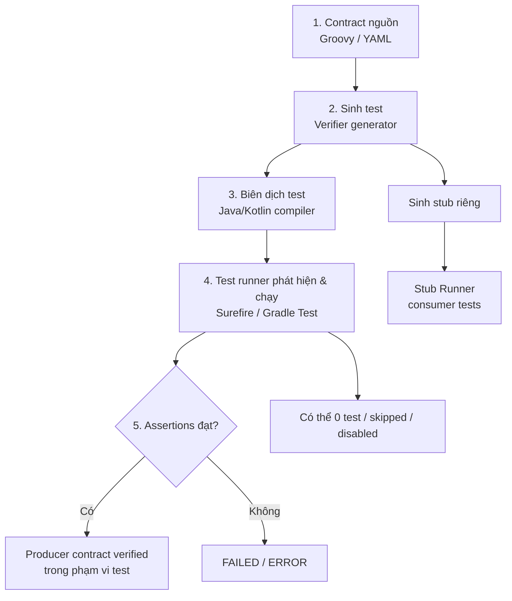
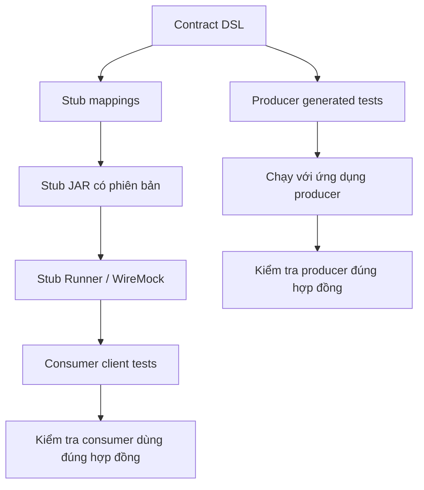

# Phân biệt sinh test thành công với test thực sự chạy và đạt

## 1. Mục tiêu: đừng nhầm «có test» với «đã kiểm chứng producer»

Trong **Spring Cloud Contract**, nhóm phát triển mô tả hành vi HTTP hoặc thông điệp bằng **Groovy DSL** hay **YAML DSL**. **Spring Cloud Contract Verifier** chuyển hợp đồng thành mã kiểm thử để xác minh **producer**; hợp đồng cũng có thể tạo stub để **Stub Runner** phục vụ kiểm thử phía **consumer**. Khi tích hợp CI, nhiều nhóm thấy dòng thông báo «BUILD SUCCESS» hoặc thư mục chứa generated tests và kết luận API đã tương thích.

Kết luận đó có thể sai. Một test có thể **được sinh ra thành công** nhưng:

- Chưa bao giờ được **biên dịch** do build dừng sớm.
- Đã biên dịch nhưng **không được test runner phát hiện** vì cấu hình JUnit, tên lớp hoặc bộ lọc.
- Được phát hiện nhưng **bị skip/disable**.
- Đã chạy nhưng **thất bại** ở setup, assertion hoặc hạ tầng.
- Đã chạy và đạt, nhưng matcher quá rộng hoặc mock không đúng phạm vi, nên **chưa bảo vệ hành vi consumer thực sự dùng**.

Vì vậy, không chỉ hỏi «Plugin có sinh ra test không?». Cần hỏi **«Generated test nào đã chạy, đã kiểm tra điều gì, và kết quả được ghi ở đâu?»**

**Sau bài này, người học có thể** phân biệt các giai đoạn sinh, biên dịch, khám phá, thực thi và kiểm tra assertion; đọc báo cáo Maven/Gradle; tìm nguyên nhân test bằng không hoặc bị bỏ qua; cấu hình cổng kiểm soát CI; và xác minh producer–consumer qua cả generated tests lẫn stub.

## 2. Năm mốc xác minh riêng biệt



| Mốc | Bằng chứng phù hợp | Những điều **chưa** được chứng minh |
|---|---|---|
| **Đọc được contract** | Không lỗi parse, thấy số contract nguồn mong đợi | Chưa chắc đã sinh mã kiểm thử |
| **Sinh test thành công** | Có class Java/Kotlin test mới ở output build | Chưa chắc compile, discovery, execute |
| **Biên dịch thành công** | Test compilation hoàn tất | Chưa chắc lớp được JUnit/TestNG nhận diện |
| **Thực thi test** | Báo cáo chứa **tên generated test**, số test thực chạy lớn hơn 0, không bị skip | Chưa chắc assertions đều đạt |
| **Test đạt** | Với đúng generated test: `failures = 0`, `errors = 0`, `skipped = 0`, có assertion cần thiết | Chưa chứng minh mọi consumer, dữ liệu hoặc môi trường |
| **Sinh stub thành công** | Có mapping hoặc `-stubs.jar` | **Không** chứng minh producer thật đáp ứng hợp đồng |
| **Consumer test đạt** | Test client chạy với Stub Runner và assert hành vi consumer | Không thay thế generated producer verification |

**Định nghĩa thành công trong bài:** một hợp đồng được tính là đã được **producer verification** khi generated test tương ứng **được sinh đúng, biên dịch, thực thi và đạt** trên producer thật trong phạm vi base test đã thiết lập. Không chỉ dựa vào exit code chung của pipeline.

## 3. Ví dụ hợp đồng và generated test cần kiểm chứng

Giả sử `order-service` có endpoint:

```http
GET /api/orders/42
Accept: application/json
```

Consumer cần mã trạng thái `200` và các trường JSON `id`, `state`, `currency`. Một hợp đồng Groovy:

```groovy
import org.springframework.cloud.contract.spec.Contract

Contract.make {
    description 'Lấy đơn hàng đã thanh toán'
    name 'shouldReturnPaidOrder'

    request {
        method GET()
        url '/api/orders/42'
        headers {
            header 'Accept', 'application/json'
        }
    }

    response {
        status OK()
        headers {
            contentType(applicationJson())
        }
        body(
            id: 42,
            state: 'PAID',
            currency: 'VND'
        )
    }
}
```

Đặt trong thư mục hợp đồng nguồn mà plugin đang quét, chẳng hạn `src/test/resources/contracts/orders/get-paid-order.groovy`. Khi generator chạy đúng, nó sinh mã test tương ứng. **Minh họa logic** của generated test (không phải mã nguyên văn do mọi phiên bản plugin tạo):

```java
// Pseudocode minh họa cấu trúc assertion của generated test.
class ShouldReturnPaidOrderTest extends ContractVerifierBase {
    @Test
    void shouldReturnPaidOrder() {
        given()
            .header("Accept", "application/json")
        .when()
            .get("/api/orders/42")
        .then()
            .statusCode(200)
            .body("id", equalTo(42))
            .body("state", equalTo("PAID"))
            .body("currency", equalTo("VND"));
    }
}
```

Mã test thực tế có thể sử dụng Rest Assured MockMvc, Rest Assured trực tiếp, WebTestClient hoặc framework/mode khác, và tên class sinh ra cũng có thể khác. **Không sửa generated test để làm xanh build**; hãy sửa hợp đồng, producer hoặc base test/fixture theo nguyên nhân.

### 3.1. Một ví dụ tương đương bằng YAML

```yaml
description: Lấy đơn hàng đã thanh toán
request:
  method: GET
  url: /api/orders/42
  headers:
    Accept: application/json
response:
  status: 200
  headers:
    Content-Type: application/json
  body:
    id: 42
    state: PAID
    currency: VND
```

Groovy và YAML đều là **nguồn sinh test**, không phải test runner. Cùng nội dung DSL nhưng pipeline thiếu bước thực thi vẫn không tạo bằng chứng rằng producer đã tuân thủ hợp đồng.

## 4. Mốc 1: plugin có tìm được hợp đồng nguồn không?

Trước khi quan tâm test có chạy hay không, phải bảo đảm **đúng file nguồn** được phát hiện:

- File nằm trong thư mục contract mà plugin được cấu hình quét; theo bố cục thông dụng của producer Maven là `src/test/resources/contracts/`.
- Định dạng Groovy/YAML hợp lệ, tên file và package hợp lý.
- Contract không bị bỏ qua bởi profile, cấu hình include/exclude hoặc module build sai.
- Nếu repository đa module, lệnh build chạy **đúng module producer** chứa contract.
- Log generator không chỉ báo thành công chung mà phải cho thấy test/source tương ứng được tạo.

Một file `get-paid-order.groovy` bị đặt nhầm dưới `src/main/resources/` hoặc trong module khác có thể hoàn toàn không tham gia quá trình sinh test. Build vẫn có thể xanh vì **không có test hợp đồng nào được đưa vào bước tiếp theo**.

### 4.1. Đừng chỉ nhìn một thư mục build không rỗng

Thư mục output build có thể chứa **mã sinh từ lần chạy trước**. Vì vậy, nên dùng một build sạch khi xác minh lần đầu hoặc khi nghi ngờ cache/stale output:

```bash
# Maven: ví dụ thực hiện trong module producer.
mvn clean verify

# Gradle (Linux/macOS hoặc Git Bash):
./gradlew clean test
```

Trên Windows, Gradle wrapper thường được chạy bằng `gradlew.bat`. Các lệnh trên là **quy trình tham khảo**, không phải bằng chứng chúng đã được chạy trong bài học. Kiểm tra log xem plugin/Gradle task sinh test có thực sự tham gia lifecycle được chọn hay chưa.

## 5. Mốc 2: «Generate success» không đồng nghĩa «Compile success»

Plugin có thể tạo ra một class Java nhưng compiler vẫn báo lỗi vì:

- Class được sinh kế thừa `ContractVerifierBase` nhưng base class không tồn tại hoặc sai package.
- Thiếu dependency Rest Assured, Spring Boot Test hoặc engine test phù hợp.
- Generated test dùng JUnit 5 nhưng dự án chỉ có dependency/configuration cho JUnit 4 hoặc ngược lại.
- Phiên bản Java, compiler, Spring Boot và Spring Cloud Contract không tương thích.
- Chữ ký helper method mà contract dùng qua `execute(...)` hoặc `byCommand(...)` không có trong base class.

Một thông báo «Generated tests successfully» chỉ có nghĩa generator hoàn thành công việc của nó. Nếu `testCompile` hoặc `test-compile` lỗi, **test chưa được thực thi**.

### 5.1. Cấu hình base test cần khớp với test mode

Ví dụ Maven plugin (đoạn cấu hình minh họa, giả định dự án đã quản lý phiên bản tương thích):

```xml
<plugin>
    <groupId>org.springframework.cloud</groupId>
    <artifactId>spring-cloud-contract-maven-plugin</artifactId>
    <version>REPLACE_WITH_COMPATIBLE_VERSION</version>
    <extensions>true</extensions>
    <configuration>
        <baseClassForTests>
            com.example.orders.contract.ContractVerifierBase
        </baseClassForTests>
        <testFramework>JUNIT5</testFramework>
        <testMode>MOCKMVC</testMode>
    </configuration>
</plugin>
```

Ví dụ base test phù hợp với Spring MVC và MockMvc:

```java
package com.example.orders.contract;

import io.restassured.module.mockmvc.RestAssuredMockMvc;
import org.junit.jupiter.api.BeforeEach;
import org.springframework.beans.factory.annotation.Autowired;
import org.springframework.boot.test.autoconfigure.web.servlet.AutoConfigureMockMvc;
import org.springframework.boot.test.context.SpringBootTest;
import org.springframework.web.context.WebApplicationContext;

@SpringBootTest(webEnvironment = SpringBootTest.WebEnvironment.MOCK)
@AutoConfigureMockMvc
public abstract class ContractVerifierBase {

    @Autowired
    WebApplicationContext context;

    @BeforeEach
    void setup() {
        RestAssuredMockMvc.webAppContextSetup(context);
    }
}
```

Trong hệ thống thật, cần thêm fixture/mock hoặc database test để `GET /api/orders/42` trả một đơn hàng đã `PAID`. Ví dụ chỉ mô tả phần khởi tạo HTTP test; nếu không chuẩn bị dữ liệu, generated test có thể **chạy nhưng thất bại**.

**Lưu ý:** `REPLACE_WITH_COMPATIBLE_VERSION` phải được thay bằng phiên bản plugin thực tế tương thích với Spring Cloud/Spring Boot của dự án trước khi build. Cấu hình ở đây không phải POM đầy đủ.

## 6. Mốc 3: test runner có thực sự phát hiện generated tests?

Đây là điểm gây nhầm lẫn nhiều nhất. Generated Java test có thể compile không lỗi, nhưng runner **không khám phá** được test. Một build chạy `mvn test` hoặc `gradlew test` có thể báo thành công dù có **0 contract tests được thực thi**.

### 6.1. Kiểm tra framework/engine

Với **JUnit 5**:

- Test dùng annotation `org.junit.jupiter.api.Test`.
- Runtime phải có **JUnit Jupiter test engine** phù hợp.
- Maven Surefire/Failsafe được cấu hình tương thích với JUnit Platform; nhiều dự án dùng Surefire dòng 3.x.
- Với Gradle, task `test` cần dùng **JUnit Platform** khi chạy Jupiter tests, ví dụ `useJUnitPlatform()`.

Ví dụ Gradle Java/Groovy DSL cho task test:

```groovy
tasks.named('test', Test) {
    useJUnitPlatform()
}
```

Đây chỉ là **một mảnh cấu hình** cho Gradle; dự án vẫn cần plugin Spring Cloud Contract và dependency test cần thiết. Nếu dùng JUnit 4, TestNG hoặc framework khác, cấu hình runner phải phù hợp.

### 6.2. Bộ lọc tên lớp và source set

Test runner có thể giới hạn lớp dựa trên quy ước tên, include/exclude hoặc profile. Nếu tên generated class không nằm trong pattern mà Surefire/Gradle Test dùng, test có thể **được compile nhưng không được chạy**.

Đối chiếu:

1. Tên class được sinh **thực tế** và vị trí output test.
2. Quy tắc include/exclude của Surefire/Gradle.
3. Class đó có trong **test classpath/source set** mà runner chạy hay không.
4. Engine và annotation test có tương thích không.
5. Báo cáo có **tên class** hay chỉ liệt kê những unit test viết tay.

Không nên chỉ dựa vào số «Tests run: 200» của cả project; đó có thể là 200 unit tests **không chứa bất kỳ generated contract test nào**.

### 6.3. Mã exit 0 với 0 tests: cần chính sách rõ

Một pipeline có thể thành công khi không tìm thấy test, tùy plugin/runner, cấu hình và phiên bản. Bởi vậy:

- Có thể cấu hình **fail khi không có test** tại module cần bảo vệ; với Maven Surefire, xem tùy chọn `failIfNoTests` theo phiên bản dự án.
- Với Gradle, đừng chỉ dựa vào việc task `test` có trạng thái `SUCCESS`, `UP-TO-DATE` hoặc `NO-SOURCE`; phải có báo cáo hoặc bằng chứng test được thực thi/được kiểm tra từ cache hợp lệ.
- Trong repository đa module, không nên bật chính sách «mọi module đều phải có test» một cách mù quáng nếu có module chỉ chứa tài nguyên; áp dụng gate tại **module producer** và cho **tập contract tests**.

## 7. Mốc 4: test đã được chạy nhưng có bị skip/disable không?

### 7.1. Ba trạng thái rất khác nhau

| Dạng | Ví dụ | Kết luận |
|---|---|---|
| **Không được phát hiện** | Báo cáo không có generated test class | Chưa biết test chạy hay không; cần điều tra |
| **Được phát hiện nhưng skipped** | `Tests run: 1 ... Skipped: 1` | Test **chưa xác minh** producer |
| **Executed và passed** | `Tests run: 1 ... Skipped: 0, Failures: 0, Errors: 0` | Có bằng chứng test đã thực thi và đạt |

Với JUnit, annotation `@Disabled` hoặc điều kiện runtime có thể khiến test bị bỏ qua. Ngoài ra, build có thể chủ động skip test qua tham số hoặc task configuration.

### 7.2. Các trường hợp Maven dễ bỏ sót

| Tham số/cấu hình | Ảnh hưởng thường gặp |
|---|---|
| `-DskipTests` | Bỏ chạy test tại các plugin hỗ trợ cờ này; quá trình compile test có thể vẫn xảy ra |
| `-Dmaven.test.skip=true` | Có thể bỏ qua cả biên dịch và thực thi test, tùy plugin Maven liên quan |
| `-Dtest=...` | Chỉ chạy các test khớp bộ lọc được chỉ định |
| `<skipTests>true</skipTests>` trong Surefire config | Test trong phạm vi plugin bị bỏ qua |
| Maven profile không kích hoạt plugin hoặc đổi include/exclude | Tập contract tests có thể không được chạy |

Không kết luận một pipeline đạt chỉ vì lệnh `mvn package -DskipTests` trả exit code 0. Lệnh ấy có thể vẫn tạo JAR và stub, nhưng **không cung cấp bằng chứng producer contract tests đã chạy và đạt**.

Với Gradle, `-x test` loại task `test` khỏi quá trình thực hiện. Nếu build dùng task riêng cho generated tests, phải kiểm tra chính xác task nào bị loại. Việc bật `--continue` hoặc cơ chế cache không thay thế việc đọc **kết quả test**.

## 8. Mốc 5: test có chạy và các assertions có đạt không?

Giả sử generated test đã chạy. Cần phân biệt:

- **Failure:** assertion không thỏa hợp đồng, ví dụ producer trả `state = PENDING` thay vì `PAID` hoặc `HTTP 404` thay vì `200`.
- **Error:** test không hoàn thành đúng do lỗi runtime/setup, ví dụ Spring context không khởi tạo, kết nối database test lỗi, base class thiếu bean.
- **Skipped/disabled:** không thực thi assertion.
- **Passed:** test đã chạy đủ những assertion nó chứa và không báo failure/error.

**Passed không có nghĩa test bao phủ mọi thứ.** Một hợp đồng chỉ assert `status OK()` có thể pass dù response JSON mất trường `currency`. Matcher `byRegex('.*')` trên `state` cũng có thể pass với giá trị nghiệp vụ sai. Vì vậy, sau khi xác nhận **test executed and passed**, cần kiểm tra rằng assertion có ý nghĩa với consumer. Bước kiểm tra chiều sâu học thuật/độ bao phủ này khác với xác minh trạng thái chạy kỹ thuật.

### 8.1. Ví dụ lỗi hợp đồng thật

Hợp đồng cam kết:

```json
{"id":42,"state":"PAID","currency":"VND"}
```

Nhưng producer trả:

```json
{"id":42,"state":"PENDING","currency":"VND"}
```

Nếu generated test thực thi assertion `state == "PAID"`, kết quả phải **FAILED**. Đây là trường hợp **hành vi producer không đáp ứng hợp đồng**, không phải lý do để cập nhật YAML/Groovy thành `PENDING` ngay lập tức. Trước khi đổi contract, cần xem consumer có dựa vào `PAID` và thay đổi API có hợp lệ không.

Ngược lại, nếu producer trả `404` vì database test không chứa order ID `42`, cần kiểm tra setup fixture. Không nên nới lỏng matcher hoặc xóa assertion để che đi lỗi chuẩn bị trạng thái.

## 9. Đọc bằng chứng Maven: Surefire và Failsafe

Maven thường chạy unit/contract tests qua **Surefire** ở phase `test`. Một số dự án phân loại kiểm thử integration qua **Failsafe** ở các phase `integration-test`/`verify`. Vị trí report phụ thuộc cấu hình dự án.

Đường dẫn thường gặp:

```text
order-service/
└── target/
    ├── generated-test-sources/
    │   └── ...                    # mã test sinh ra
    ├── test-classes/
    │   └── ...                    # bytecode test đã biên dịch
    ├── surefire-reports/
    │   ├── TEST-...xml           # báo cáo máy đọc
    │   └── ...txt                # tóm tắt
    └── failsafe-reports/
        └── ...                   # nếu project dùng Failsafe
```

**Chú ý:** không phải mọi project đều có cả hai thư mục report, và output generated source có thể nằm ở đường dẫn khác. Hãy dựa trên cấu hình plugin đang dùng.

Ví dụ một dòng **minh họa kết quả** từ runner:

```text
Running com.example.orders.contract.ShouldReturnPaidOrderTest
Tests run: 1, Failures: 0, Errors: 0, Skipped: 0
```

Ý nghĩa:

1. Tên class đúng là **generated contract test** cần chứng minh.
2. Số test **đã chạy khác 0**.
3. Với test này, số **failures/errors/skipped đều bằng 0**.

Đây là **log ví dụ**, không phải kết quả build thực tế đã chạy trong bài. Trong CI, cần **lưu report** và đối chiếu tên class/method đúng với hợp đồng vừa thay đổi.

### 9.1. Vì sao chỉ kiểm tra exit code chưa đủ?

Một lệnh `mvn clean verify` có thể trả `BUILD SUCCESS` vì:

- Plugin generator đã chạy nhưng không tìm thấy hợp đồng.
- Surefire bị cấu hình skip.
- Generated tests được đặt ngoài test classpath hoặc bị exclude.
- Chỉ unit tests thường chạy và pass.
- Mô-đun producer chưa được chọn trong lệnh build đa module.

Mặt khác, nếu report ghi `Tests run: 1` nhưng `Skipped: 1`, điều đó cũng **không phải xác minh producer**.

### 9.2. Không đếm tổng test của toàn repo thay cho contract tests

Ví dụ tổng kết:

```text
Tests run: 125, Failures: 0, Errors: 0, Skipped: 0
```

Số `125` không đủ để xác nhận một generated test cho `get-paid-order.groovy` đã được thực thi. Pipeline cần xác nhận **ít nhất một test class/method thuộc contract cụ thể**, hoặc có một bước kiểm tra toàn bộ generated contract tests mong đợi xuất hiện trong báo cáo.

## 10. Đọc bằng chứng Gradle

Với Gradle, task sinh test và task thực thi test là những bước cần được nhận diện riêng. Tên task/plugin có thể thay đổi theo phiên bản và cách tổ chức source set; với cấu hình thông dụng, plugin có thể tạo task sinh contract tests như `generateContractTests`, sau đó task `test` hoặc một task test chuyên biệt thực thi.

Lệnh minh họa:

```bash
./gradlew clean test
```

Gradle thường xuất báo cáo tại:

```text
build/
├── generated-test-sources/     # vị trí cụ thể tùy plugin
├── test-results/
│   └── test/
│       └── TEST-...xml
└── reports/
    └── tests/
        └── test/
            └── index.html
```

Trên Windows dùng wrapper phù hợp. Đừng suy luận rằng task `generateContractTests` báo `SUCCESS` là test `test` đã chạy; đó là hai bước khác nhau. Nếu task `test` dùng cache và hiện `UP-TO-DATE`, cần quyết định chính sách CI có cho phép dùng kết quả kiểm thử đã được xác thực từ cache hay cần chạy sạch; dù chọn cách nào, **không được đánh đồng mã nguồn test sinh ra với kết quả đã thực thi**.

### 10.1. Kiểm tra một class cụ thể

Khi nghi ngờ lớp generated test không được phát hiện, có thể lọc và chạy đúng lớp bằng công cụ test của dự án, ví dụ Gradle:

```bash
./gradlew test --tests 'com.example.orders.contract.ShouldReturnPaidOrderTest'
```

Tên class trong lệnh chỉ là **ví dụ**; phải thay bằng tên generated class thực tế. Nếu filter không khớp, Gradle thường báo không tìm thấy test cho bộ lọc thay vì âm thầm chứng minh test pass; tuy nhiên cần kiểm tra exit code và report theo phiên bản task.

## 11. Vai trò của base test và fixture trong kết quả thực thi

Một generated test có thể chạy nhưng thất bại do **trạng thái producer chưa được thiết lập**, chứ không phải do API thay đổi.

Ví dụ, contract `GET /api/orders/42` yêu cầu `state=PAID`. Test có thể cần fixture:

```text
Trước test:
  order 42 -> PAID, currency VND
  order 9999 -> không tồn tại

Trong test:
  GET /api/orders/42

Kỳ vọng:
  HTTP 200
  id = 42
  state = PAID
  currency = VND

Sau test:
  không để rò rỉ state sang kịch bản tiếp theo
```

Base class thường thiết lập Spring context, MockMvc/Rest Assured hoặc WebTestClient; có thể dùng `@BeforeEach`, Mockito, database test, `@Sql` hay fixture helper để chuẩn bị dữ liệu.

**Những điều cần phân biệt khi đọc lỗi:**

- `NoSuchBeanDefinitionException` hoặc lỗi Spring context: lỗi setup/di wiring; test có thể không tới assertion hợp đồng.
- `404` thay vì `200`: có thể thiếu fixture ID `42`, sai route hoặc producer thật đổi hành vi.
- `200` nhưng `state=PENDING`: có thể fixture sai hoặc producer không đáp ứng trạng thái cam kết.
- Test chỉ chạy khi chạy riêng, fail khi chạy toàn bộ: có thể rò rỉ state/transaction/cache hoặc tác động từ parallel test.
- Test bị skip toàn bộ: phải xử lý discovery/configuration, không phải sửa business logic.

Một setup đủ tin cậy phải **tái lập trên local và CI**, không phụ thuộc vào database production, thời gian thực không kiểm soát hay thứ tự những test trước đó.

## 12. Sinh stub thành công khác với producer test đạt

Đây là hai nhánh riêng xuất phát từ cùng contract:



Ví dụ:

- Hợp đồng mô tả `GET /api/orders/42` trả `state=PAID`.
- Plugin sinh WireMock mapping trả đúng `PAID`.
- Stub Runner chạy mapping này và consumer test pass.
- **Nhưng producer thật đã bị đổi để trả `PENDING`.**

Nếu không chạy generated producer test, cả việc «stub đã đóng gói thành công» lẫn «consumer test với stub pass» đều **không phát hiện được lỗi trong producer thật**. Ngược lại, producer test pass không chứng minh consumer xử lý đúng body lỗi hoặc phiên bản schema mới; vẫn cần consumer test với stub tương ứng.

Với thông điệp (messaging), verifier có thể sinh test kích hoạt producer qua `triggeredBy(...)` hoặc mô hình `input`/`outputMessage`. Việc **sinh test cho message** cũng không đồng nghĩa test đã kích hoạt và xác minh message; cần test binder/transport setup và bằng chứng rằng test thực sự chạy.

## 13. Xây «quality gate» CI chống xác minh giả

Một cổng kiểm soát tối thiểu tại producer nên yêu cầu:

1. **Nguồn hợp đồng hiện diện và được chọn đúng:** kiểm tra tập hợp hợp đồng mà module producer phải hỗ trợ.
2. **Sinh mã thành công:** generator không báo lỗi và xuất test cho những contract mong đợi.
3. **Biên dịch thành công:** generated tests có mặt trong test classpath.
4. **Test discovery thành công:** có các generated test class/method tương ứng trong báo cáo.
5. **Thực thi thật:** số test **executed > 0**, không phải mọi test đều skipped/disabled.
6. **Kết quả đạt:** failures/errors bằng 0 cho các generated tests cần bảo vệ.
7. **Không skip ngầm:** không chấp nhận `skipTests` hoặc loại task test trong pipeline xác minh.
8. **Artifact/consumer:** chỉ phát hành stub sau khi producer verification đạt; consumer test tải đúng version stub và assert hành vi client.

### 13.1. Ví dụ cách tách các bước trong pipeline

```text
Producer CI
  1. Checkout code + contracts
  2. Resolve dependencies + build producer
  3. Generate/compile/execute contract tests
  4. Inspect test reports:
       - Expected generated contract tests present?
       - Any skipped or zero executed?
       - Any failure/error?
  5. Nếu tất cả đạt: package/publish stubs

Consumer CI
  6. Resolve đúng artifact -stubs.jar
  7. Stub Runner khởi động stub
  8. Consumer tests gọi client thực và assert response/behavior
  9. Gate kết quả khi nâng phiên bản hợp đồng
```

**Đừng dùng số lượng generated test file cố định** làm gate nếu generator có thể sinh nhiều phương thức từ một file contract hoặc thay đổi cách đặt tên theo phiên bản. Hãy có cơ chế liên hệ **contract ID/kịch bản → generated test class/method hoặc test report** phù hợp với dự án, rồi phát hiện khi tập thực thi bị thu hẹp bất ngờ.

### 13.2. Chỉ «mã exit khác 0» hay cần kiểm tra report?

Cả hai:

- **Mã exit khác 0** cho thấy lệnh build/test lỗi và phải chặn publish.
- **Report của generated tests** giúp loại trừ trường hợp build success vì không có test nào chạy.

Nếu CI aggregator gộp report của nhiều module, cần đối chiếu module producer và lớp generated; đừng để số test của module khác che lấp việc contract tests ở module này đã bị skip.

## 14. Ma trận chẩn đoán: build thành công nhưng chưa đáng tin

| Hiện tượng | Suy luận đúng | Việc cần làm |
|---|---|---|
| `generateTests` thành công, không thấy report | Chỉ có bằng chứng sinh test | Chạy đúng task/phase test, kiểm tra discovery |
| Mã generated test có mặt nhưng `testCompile` lỗi | Test chưa chạy | Sửa base class, dependency, framework |
| Maven báo `BUILD SUCCESS` với `-DskipTests` | Build không xác minh producer | Chạy lại không skip, kiểm tra report |
| Surefire `Tests run: 0` | Không có test được thực thi trong phạm vi này | Kiểm tra engine, naming, includes, module |
| Tổng project có 100 tests pass nhưng thiếu generated class | Contract verification chưa được chứng minh | Lọc report theo tên lớp/method hợp đồng |
| Generated class có `Skipped: 1` | Không kiểm tra assertion | Gỡ nguyên nhân skip/disabled |
| Generated test có `Errors: 1` | Lỗi runtime/setup hoặc thực thi | Xem stack trace và tiền điều kiện |
| Generated test có `Failures: 1` | Assertion không đạt | So sánh expected/actual và fixture |
| Generated test có `Failures: 0` nhưng không assert body | Pass chỉ với những gì đã mô tả | Bổ sung cam kết quan trọng với consumer |
| Stub JAR được publish dù tests skip | Artifact không có bằng chứng producer đáp ứng | Đặt gate trước publish |
| Consumer dùng stub version cũ | Chưa kiểm tra thay đổi mới | Pin/cập nhật version cần thử |
| Gradle task `NO-SOURCE` | Task không thấy nguồn test tương ứng | Kiểm tra source set, task dependencies, plugin |

## 15. Bài thực hành: chứng minh cả «generated» và «executed + passed»

**Bối cảnh:** `order-service` có contract `get-paid-order.groovy`, consumer `checkout-service` sử dụng stub được phát hành. Mục tiêu là thu thập bằng chứng kiểm thử thay vì chỉ nhìn `BUILD SUCCESS`.

### 15.1. Các bước tại producer

1. Viết hợp đồng `GET /api/orders/42`, mong `200` và body có `id=42`, `state=PAID`, `currency=VND`.
2. Thiết lập `ContractVerifierBase` và fixture để request thực trong test trả order `42`.
3. Dùng một lần build sạch, ví dụ `mvn clean verify` hoặc task Gradle tương đương; không bật skip tests.
4. Tìm **generated test source** tương ứng với contract và xác nhận code có assertion `state=PAID`.
5. Xác nhận test compile thành công và **class đó** xuất hiện trong báo cáo Surefire/Gradle Test.
6. Kiểm tra `executed > 0` và `failures=errors=skipped=0` cho generated test.
7. Cố ý sửa producer trả `state=PENDING` **chỉ trong môi trường test** rồi chạy lại. Generated test đúng nghĩa phải **FAILED**; nếu vẫn pass, có thể chưa chạy hoặc assertion không đủ.
8. Khôi phục producer đúng `PAID`; chạy lại để thấy test **PASSED** với report tương ứng.
9. Chỉ sau khi producer verification đạt, đóng gói và phát hành stub artifact có phiên bản.

### 15.2. Các bước tại consumer

1. Cấu hình Stub Runner dùng đúng phiên bản `order-service-<version>-stubs.jar` vừa phát hành.
2. Chạy consumer test gọi **HTTP client của ứng dụng** đến stub URL.
3. Assert consumer parse được `state=PAID` và xử lý trường `currency=VND` như nghiệp vụ yêu cầu.
4. Cố ý đổi request của client để nó gọi sai endpoint hoặc kỳ vọng sai schema; xác nhận consumer test phát hiện.
5. Ghi lại hai bằng chứng tách biệt: **producer generated test report** và **consumer test report**.

### 15.3. Bảng tự kiểm tra

| Câu hỏi | Trả lời |
|---|---|
| Có file Java được sinh nhưng không có report test, đã verify producer chưa? | **Chưa**; chỉ biết bước sinh mã |
| Generated class compile được nhưng Surefire ghi 0 tests, có pass không? | **Không**; chưa được chạy |
| Có 20 unit tests pass, 1 generated test skipped, có đủ không? | **Không**; hợp đồng tương ứng chưa được xác minh |
| Generated test chạy và pass nhưng chỉ assert status `200`, có bảo vệ JSON `state` không? | **Không**; cần assertion về `state` |
| Stub Runner trả đúng body mẫu, có chứng minh producer thật trả đúng không? | **Không**; phải chạy producer verification |
| Producer verification pass, có chứng minh consumer xử lý đúng không? | **Không**; phải chạy consumer test với stub |
| Test fail khi cố ý sửa `PAID` thành `PENDING` chứng minh được điều gì? | Assertion liên quan được thực thi và có khả năng phát hiện sai khác ấy |

## 16. Checklist nghiệm thu kỹ thuật

- [ ] Đúng module và thư mục chứa contract được plugin quét.
- [ ] Sinh được test source tương ứng với **từng contract/kịch bản cần bảo vệ**.
- [ ] Test source được biên dịch; base test, dependencies và test mode phù hợp.
- [ ] Runner JUnit/TestNG được cấu hình đúng và khám phá lớp generated.
- [ ] Không có `skipTests`, `maven.test.skip`, `-x test` hoặc include/exclude vô tình loại generated test.
- [ ] Report ghi rõ tên generated test và **executed > 0**; không bị skip/disabled.
- [ ] Failures/errors bằng 0 và có assertion quan trọng với consumer.
- [ ] Fixture/mock/state producer được thiết lập rõ ràng, test độc lập và tái lập được.
- [ ] Lỗi assertion được phân biệt với lỗi setup hoặc lỗi thiếu test discovery.
- [ ] Stub được đóng gói/phát hành **sau khi** producer contract verification đạt.
- [ ] Consumer test chạy với Stub Runner và artifact phiên bản phù hợp, không chỉ kiểm tra WireMock khởi động.
- [ ] CI lưu report và chặn pipeline nếu tập contract tests bất ngờ biến mất, bị skip hoặc thất bại.

**Kết luận:** «Sinh test thành công» là **bước chuẩn bị kiểm thử**, không phải kết quả kiểm thử. Chỉ khi generated test được **biên dịch, phát hiện, thực thi và đạt những assertion có ý nghĩa**, ta mới có bằng chứng producer đáp ứng hợp đồng **trong phạm vi đã kiểm tra**. Kết hợp bằng chứng đó với consumer tests dùng Stub Runner mới giúp CI phát hiện thay đổi API không tương thích mà không tạo cảm giác an toàn giả.
