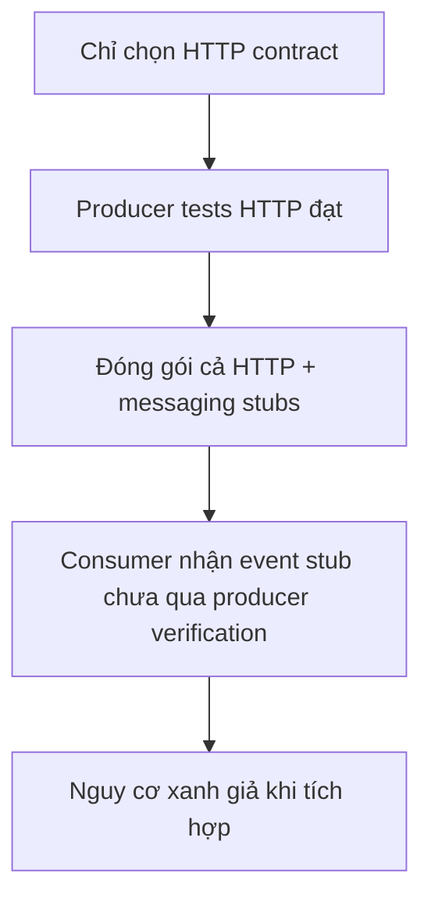
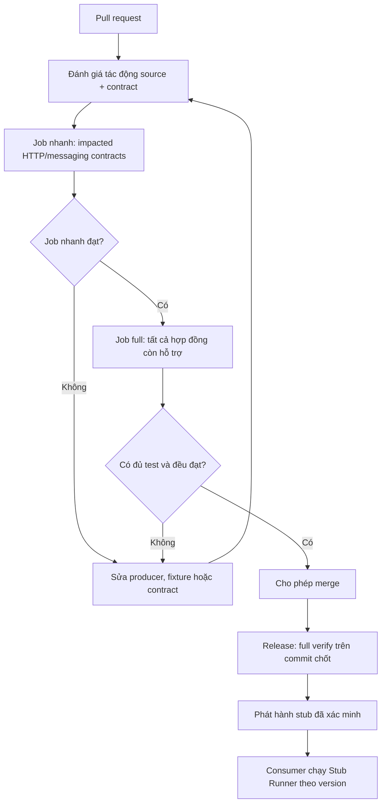

# Chọn tập hợp đồng cần xác minh trong từng lần build

## 1. Vì sao phải chủ động chọn tập hợp đồng?

Một producer có thể phục vụ nhiều consumer qua HTTP API và đồng thời phát sự kiện cho các hệ thống khác. Khi số lượng hợp đồng tăng từ vài tệp lên hàng trăm tệp, việc sinh và chạy toàn bộ producer verification tests ở mọi thao tác phát triển có thể tốn thời gian. Tuy nhiên, bỏ qua hợp đồng để tăng tốc build lại có nguy cơ khiến một thay đổi API phá vỡ consumer mà không bị phát hiện.

**Spring Cloud Contract** cho phép mô tả hành vi HTTP hoặc thông điệp bằng Groovy/YAML DSL, sinh test trên producer bằng **Contract Verifier**, tạo stub để consumer dùng **Stub Runner**, và đưa cả hai phía vào CI/CD. Trong chuỗi này, câu hỏi **“build đang xác minh những hợp đồng nào?”** phải có câu trả lời rõ ràng, kiểm chứng được.

Ví dụ, `payment-service` có các hợp đồng:

- HTTP tra cứu, tạo và hoàn tiền cho thanh toán.
- HTTP API cũ còn được một đối tác sử dụng.
- Sự kiện `PaymentCaptured` và `PaymentRefunded`.
- Những hợp đồng đang được đề xuất nhưng chưa có implementation tương ứng.

Một pull request chỉ sửa `PaymentController` có thể cần vòng kiểm tra HTTP nhanh, trong khi build trước khi phát hành một bản producer mới phải bảo vệ **mọi cam kết còn được hỗ trợ**. Vì thế phải phân biệt **lọc để có phản hồi nhanh** với **đảm bảo độ bao phủ cần thiết trước khi phát hành**.

Sau bài này, bạn có thể:

1. Xác định tập hợp đồng cần xử lý từ repository hoặc artifact bên ngoài.
2. Hiểu ý nghĩa `contractsDirectory`, `contractsDslDir`, `includedFiles`, `excludedFiles`, `ignoredFiles` và `contractsPath` theo ngữ cảnh Maven/Gradle.
3. Thiết kế luồng build nhanh, build đầy đủ và build phát hành với tiêu chí không bỏ sót contract.
4. Kiểm tra **contract được chọn → test được sinh → test thực sự chạy → stub được phát hành**.
5. Tránh những lỗi “build xanh nhưng không sinh test”, phát hành stub chưa được producer xác minh hoặc chỉ kiểm tra hợp đồng của consumer mới.

## 2. Bốn tập hợp khác nhau trong một lần build

Không nên gọi chung mọi thứ là “các contract đã chạy”. Hãy tách:

| Tập hợp | Diễn giải | Câu hỏi kiểm tra |
| --- | --- | --- |
| **Nguồn contract** | Tất cả định nghĩa Groovy/YAML hiện có trong thư mục nguồn hoặc artifact đã lấy. | Build đọc contract từ đâu, phiên bản nào? |
| **Contract được chọn** | Những định nghĩa đi qua quy tắc path/include/exclude và trạng thái xử lý. | Tệp nào thực sự được Verifier xem xét? |
| **Generated producer tests** | Mã kiểm thử được Verifier tạo từ contract có thể sinh test. | Có bao nhiêu test/class được tạo, chúng dùng base class nào? |
| **Executed producer tests** | Những bài test được Maven/Gradle và test engine thực sự chạy. | Có test bị skip, không phát hiện hoặc bị loại bằng filter không? |
| **Published stubs** | Những mapping/artifact được đóng gói để consumer sử dụng. | Stub nào tương ứng với contract **đã được xác minh**, ở phiên bản nào? |

Một contract có thể **được chọn** nhưng không sinh producer test vì được đánh dấu *in progress*; hoặc test có thể được sinh ra nhưng không được test engine phát hiện. Ngược lại, một job chỉ chạy một nhóm test bằng JUnit/Surefire filter **không có nghĩa generator đã chọn đúng nhóm contract**.

Ví dụ kiểm kê minh họa:

```text
Nguồn:      16 định nghĩa
Được chọn:   8 định nghĩa HTTP
Sinh test:   8 trường hợp xác minh tương ứng (ví dụ)
Thực thi:    8 test đạt, 0 bị bỏ qua
Phát hành:   CHƯA — đây chỉ là vòng kiểm tra PR thu gọn
```

**Không mặc định số file bằng số test**: một file DSL có thể chứa nhiều định nghĩa, còn generator có thể nhóm nhiều test method vào một test class. Phải kiểm tra output thật và kết quả test runner, không suy số test chỉ từ số file.

## 3. Tổ chức contract để dễ chọn phạm vi

Một cấu trúc nguồn **giả định** của `payment-service`:

```text
payment-service/
└── src/test/resources/contracts/
    └── payment-service/
        ├── http/
        │   ├── get-payment.groovy
        │   ├── create-payment.yml
        │   ├── refund-payment.groovy
        │   └── legacy/
        │       └── get-payment-v1.yml
        ├── messaging/
        │   ├── payment-captured.groovy
        │   └── payment-refunded.yml
        └── draft/
            └── payment-authorization-v2.groovy
```

Thư mục `http/` và `messaging/` giúp nhìn được phạm vi và cấu hình base test riêng. Thư mục `legacy/` **không đồng nghĩa được phép bỏ kiểm thử**: nếu consumer còn phụ thuộc API v1 thì hợp đồng v1 vẫn phải nằm trong build xác minh tương thích.

Thư mục `draft/` chỉ là ví dụ tổ chức workflow; **đặt tên thư mục không tự chuyển contract sang trạng thái in-progress**. Nhóm phải có quy tắc review và cấu hình xử lý hợp đồng chưa hoàn thiện. Tốt nhất là không đưa một contract chưa được thực hiện vào tập hợp bắt buộc của nhánh phát hành, đồng thời không dùng bộ lọc tùy ý để che các contract đã cam kết.

### Nguồn nào là “bản sự thật”?

- **Contract nằm cùng repository producer:** nguồn là commit đang build; đơn giản để liên kết thay đổi mã và test.
- **Contract nằm ở repository dùng chung:** producer phải lấy đúng commit hoặc artifact version, xác định đúng đường dẫn bên trong gói và quyền sở hữu contract.
- **Contract lấy từ artifact repository:** cần khóa version hoặc digest rõ ràng nếu mục tiêu là build có thể tái hiện.

Tránh dùng ký hiệu “luôn bản mới nhất” như một cách duy nhất cho release gate, vì hai lần build cùng commit producer có thể lấy hai tập hợp đồng khác nhau.

## 4. Thiết kế chiến lược build theo mức độ rủi ro

Một chiến lược phù hợp không chỉ dựa vào “chạy ít nhất có thể”, mà còn dựa vào mức độ ảnh hưởng:

| Loại build | Tập contract đề xuất | Mục tiêu | Có đủ để phát hành producer/stub chính thức? |
| --- | --- | --- | --- |
| **Kiểm tra cục bộ nhanh** | Một domain hoặc một nhóm HTTP/messaging đang sửa. | Phản hồi ngắn khi lập trình. | **Không**, trừ khi chính sách phát hành có gate đầy đủ khác. |
| **PR: impacted contracts** | Nhóm liên quan đến module, API hoặc topic thay đổi; thêm các contract của consumer phụ thuộc. | Phát hiện sớm lỗi chính. | **Chưa đủ** nếu chỉ dựa trên chọn lọc. |
| **PR: compatibility gate đầy đủ** | Tất cả contract còn hỗ trợ của producer. | Chặn thay đổi phá vỡ API ở các nhóm không đụng trực tiếp. | Có thể là một gate bắt buộc. |
| **Nightly/định kỳ** | Tất cả contract + integration tests chuyên sâu tùy thiết kế. | Tìm lỗi liên kết, dependency, data, thời gian. | Hữu ích, nhưng không thay thế gate trước phát hành nếu có thay đổi sau đó. |
| **Release hoặc publish stubs** | **Tất cả contract được tuyên bố hỗ trợ** trong chính phiên bản phát hành. | Đảm bảo artifact stub đại diện cho producer đã được xác minh. | **Bắt buộc theo chính sách đề xuất.** |

Khi một PR thay đổi một DTO được dùng bởi HTTP và event, việc chỉ chọn thư mục HTTP rất dễ bỏ sót một consumer messaging. Khi một PR sửa cấu hình serialization chung hoặc một exception handler, tác động có thể lan sang nhiều endpoint. Vì vậy **phân tích phạm vi theo tên file source code không thể chứng minh chính xác tập consumer bị ảnh hưởng**; phải có một vòng full contract gate trước khi chấp nhận thay đổi không tương thích.

Nguyên tắc quản trị: **job nhỏ có thể xanh sớm, nhưng không được gắn nhãn “an toàn phát hành” khi job bao phủ đầy đủ chưa đạt**.

## 5. Maven: chọn contract bằng `includedFiles` và `excludedFiles`

Trong Maven plugin Spring Cloud Contract, các tùy chọn quan trọng là:

| Thuộc tính plugin | Chức năng | Lưu ý |
| --- | --- | --- |
| `contractsDirectory` | Thư mục chứa nguồn contract cục bộ, thường là `src/test/resources/contracts` nếu không cấu hình khác. | Chọn thư mục nguồn, **không phải** danh sách test đã sinh. |
| `includedFiles` | Các pattern tệp cần đưa vào xử lý. | Dùng khi contract cùng nằm trong một cây thư mục lớn. |
| `excludedFiles` | Các pattern tệp không được đưa vào xử lý. | Không dùng để ẩn các contract còn phải hỗ trợ. |
| `ignoredFiles` | Trong tài liệu Maven plugin, phục vụ trường hợp muốn đánh dấu các test sinh ra là ignored. | **Khác** với loại contract khỏi tập xử lý; kiểm tra hành vi theo phiên bản. |
| `failOnNoContracts` | Khi bật, thiếu contract/stub cần xử lý sẽ gây lỗi thay vì bỏ qua im lặng. | Hữu ích để chống filter sai thành tập rỗng. |
| `failOnInProgress` | Có thể làm build thất bại khi gặp contract *in progress*. | Giữ gate phát hành nghiêm ngặt. |
| `baseClassForTests`, `baseClassMappings` | Chỉ định setup cho generated producer tests. | Có thể cần các base class khác nhau cho HTTP và messaging. |

### 5.1. Maven: ví dụ chỉ chọn nhóm HTTP

Đoạn XML sau là **phần `configuration` nằm trong Spring Cloud Contract Maven plugin**, chưa phải tệp `pom.xml` hoàn chỉnh:

```xml
<configuration>
    <contractsDirectory>
        ${project.basedir}/src/test/resources/contracts
    </contractsDirectory>
    <includedFiles>
        <includedFile>**/http/**</includedFile>
    </includedFiles>
    <failOnNoContracts>true</failOnNoContracts>
    <failOnInProgress>true</failOnInProgress>
    <testFramework>JUNIT5</testFramework>
    <baseClassForTests>
        com.example.payment.contract.HttpContractBase
    </baseClassForTests>
</configuration>
```

Mục đích của `**/http/**` là chọn các contract bên dưới nhánh HTTP của cây ví dụ. Pattern phải được kiểm chứng trên **cấu trúc thật** và theo cách plugin của phiên bản đang dùng diễn giải path. Sau khi cấu hình, hãy xem danh sách test được sinh để chắc cả `get-payment.groovy` và `create-payment.yml` đều được xử lý; đừng đoán kết quả chỉ từ cú pháp glob.

Muốn loại những file đã được nhóm đồng ý **không thuộc phạm vi build đặc biệt này**, Maven plugin cũng có `excludedFiles`. Ví dụ cấu trúc minh họa:

```xml
<excludedFiles>
    <excludedFile>**/draft/**</excludedFile>
</excludedFiles>
```

Khi dùng đồng thời include/exclude, hãy kiểm tra tập kết quả thực sự. Không dùng `excludedFiles` để lờ đi `legacy/get-payment-v1.yml` nếu API v1 vẫn được hỗ trợ. Cũng không được giả định rằng một tài liệu JSON được tham chiếu bằng `body(file(...))` có thể bị xóa khỏi workspace chỉ vì filter chỉ chọn file Groovy: **contract được chọn vẫn phải truy cập đủ payload phụ thuộc**.

### 5.2. Cấu hình profile cho nhiều kiểu build

Một cách làm là tạo các Maven profile, ví dụ `contract-http` và `contract-all`. Mỗi profile chứa cấu hình plugin/nguồn contract thích hợp. Đừng kích hoạt đồng thời hai profile có cấu hình chồng lấn rồi giả định cấu hình sẽ ghép như ý.

Phần minh họa cho hai cấu hình khác nhau:

```text
Profile contract-http:
  contractsDirectory = src/test/resources/contracts
  includedFiles      = **/http/**
  failOnNoContracts  = true
  mục đích           = fast feedback, KHÔNG publish stub

Profile contract-all:
  contractsDirectory = src/test/resources/contracts
  includedFiles      = không giới hạn các contract đang được hỗ trợ
  failOnNoContracts  = true
  failOnInProgress   = true
  mục đích           = full compatibility gate, cho phép publish khi xanh
```

Với cấu hình đã tạo tương ứng, các lệnh có thể là:

```bash
./mvnw -B clean verify -Pcontract-http
./mvnw -B clean verify -Pcontract-all
```

Đây là **ví dụ lệnh cho dự án có Maven Wrapper và hai profile được định nghĩa**. Không tự động thêm các profile vào một dự án khác mà chưa kiểm tra cấu hình hiện có. Dùng `clean` giúp giảm nguy cơ generated tests cũ còn sót trong build khi thay đổi filter; một build không sạch cần kiểm soát cache và incremental generation một cách riêng.

### 5.3. Maven source không nhất thiết nằm trong producer

Nếu contract được tải từ artifact chung, bạn có thể cần `contractsMode`, `contractDependency`, `contractsRepositoryUrl`, `contractsPath` và sau đó `includedFiles` cho topic phù hợp:

```xml
<configuration>
    <contractsMode>REMOTE</contractsMode>
    <contractsRepositoryUrl>https://repo.example.test/maven</contractsRepositoryUrl>
    <contractDependency>
        <groupId>com.example.contracts</groupId>
        <artifactId>platform-contracts</artifactId>
        <version>1.4.2</version>
    </contractDependency>
    <contractsPath>/</contractsPath>
    <includedFiles>
        <includedFile>**/payment-service/**</includedFile>
        <includedFile>**/payment-captured/**</includedFile>
    </includedFiles>
    <failOnNoContracts>true</failOnNoContracts>
</configuration>
```

**Các tên, URL và version trên đều là giả định.** Phải dùng artifact thật và quyền truy cập hợp lệ của dự án. `contractsPath` xác định nhánh bên trong gói contract đã tải, còn `includedFiles` tiếp tục lọc các file trong phạm vi đó. Nếu `contractsPath` sai, không có hợp đồng nào được chọn; đây phải là lỗi CI, không phải lý do tắt `failOnNoContracts`.

Trong môi trường có nhiều producer cùng gửi event vào một topic, tài liệu Spring Cloud Contract cũng mô tả việc dùng `includedFiles` để chọn contract theo topic từ repository chung. Điều quan trọng là **chọn những contract liên quan đến producer này**, không tự chạy tất cả contract của các producer khác rồi phải mock những hành vi mình không sở hữu.

## 6. Gradle: chọn thư mục nguồn bằng `contractsDslDir`

Trong Gradle plugin, trường `contractsDslDir` chỉ định thư mục chứa contract. Bố cục mặc định của nhiều bản Gradle plugin là `src/contractTest/resources/contracts`, **không nhất thiết trùng đường dẫn mặc định Maven**. Vì thế đừng sao chép đoạn cấu hình Maven sang Gradle rồi giả định generator sẽ tự thấy mọi file.

Ví dụ các mảnh cấu hình `build.gradle` dùng **Gradle Groovy DSL**:

```groovy
plugins {
    id 'java'
    id 'org.springframework.cloud.contract' version 'REPLACE_WITH_COMPATIBLE_VERSION'
}

contracts {
    contractsDslDir = file('src/contractTest/resources/contracts')
    testFramework = 'JUNIT5'
    baseClassForTests = 'com.example.payment.contract.ContractBase'
}
```

Đây là mảnh cấu hình cần kết hợp với dependency test, version Spring Boot/Contract tương thích, repositories và source set của dự án. Nó đặt **nguồn đầy đủ** mà plugin sẽ đọc, không phải lệnh chạy riêng từng test.

Nếu thiết kế repo có nhánh source riêng `http/` và chỉ muốn một **build kiểm thử nhanh**, có thể dùng một cấu hình độc lập:

```groovy
contracts {
    contractsDslDir =
        file('src/contractTest/resources/contracts/http')
    testFramework = 'JUNIT5'
    baseClassForTests =
        'com.example.payment.contract.HttpContractBase'
}
```

Trường hợp chọn thư mục con khác có thể làm thay đổi package/đường dẫn tương đối của generated tests, do đó phải kiểm tra mapping base class, các tài nguyên được tham chiếu và cách đóng gói stub. Không tái sử dụng cấu hình này để publish toàn bộ API nếu nhánh messaging hoặc legacy vẫn được cam kết.

### `ignoredFiles` không phải “cứ nhanh là bỏ qua”

Tài liệu Gradle plugin có thuộc tính `ignoredFiles` sử dụng Ant-style pattern để đánh dấu những tệp không cần xử lý trong phạm vi plugin. Ví dụ cấu hình minh họa:

```groovy
contracts {
    contractsDslDir = file('src/contractTest/resources/contracts')
    ignoredFiles = ['**/experimental/**']
}
```

Chỉ dùng pattern như vậy cho những nguồn đã được phân loại **không thuộc phạm vi cần xác minh** theo chính sách được duyệt. Hành vi chi tiết của `ignoredFiles` và contract-level `ignored()` có thể khác nhau giữa Maven/Gradle hoặc phiên bản plugin; hãy xác nhận bằng output generator và test reports. **Không coi “ignored” tương đương “được producer xác minh”.**

Maven `includedFiles/excludedFiles` và Gradle `contractsDslDir/ignoredFiles` không phải cặp tham số đối xứng hoàn toàn. Nếu tài liệu plugin đang dùng không hỗ trợ filter include theo đúng cách mong muốn, đừng tự invent một tên thuộc tính Gradle. Hãy bố trí source directory phù hợp hoặc tổ chức một bước copy/chọn tệp vào **thư mục build tạm riêng** trước khi chạy generator; tránh xóa hoặc sửa contract nguồn.

### Chạy Gradle và xác minh test engine

Theo đời plugin, `generateContractTests` là task sinh test và `check` thường chạy các bước xác minh liên quan. Ví dụ:

```bash
./gradlew clean generateContractTests
./gradlew clean check
```

**Sinh test không phải chạy test.** Chạy task generation riêng chỉ giúp kiểm tra có mã nguồn test được tạo; `check` hoặc các task test được cấu hình mới thực hiện verification. Phải nhìn báo cáo test; nếu task test bị `SKIPPED` hoặc `NO-SOURCE`, không thể nói contract đã được xác minh.

## 7. Contract HTTP và messaging có thể cần setup khác nhau

Ví dụ producer xử lý cả REST và sự kiện:

| Nhóm | Hành vi | Cấu hình kiểm thử cần có |
| --- | --- | --- |
| `http/` | `GET /api/payments/PAY-1001` trả `200` với JSON trạng thái `PAID`. | Spring MVC/MockMvc hoặc WebTestClient, fixture giao dịch. |
| `http/` | `POST /api/payments/PAY-2002/capture` trả `409` khi bị từ chối. | Fixture trạng thái `REJECTED`, exception mapping. |
| `messaging/` | Phát `PaymentCaptured` đến destination đã thỏa thuận. | Trigger, verifier messaging và test binder/adapter phù hợp. |
| `messaging/` | Phát `PaymentRefunded` sau hoàn tiền. | Fixture hoàn tiền, hệ thống nhận message do test kiểm soát. |

Một hợp đồng HTTP mẫu:

```yaml
description: Tra cứu giao dịch đã thanh toán
name: get_paid_payment
request:
  method: GET
  urlPath: /api/payments/PAY-1001
response:
  status: 200
  headers:
    Content-Type: application/json
  body:
    paymentId: PAY-1001
    status: PAID
```

Một messaging contract Groovy minh họa:

```groovy
import org.springframework.cloud.contract.spec.Contract

Contract.make {
    name 'payment_captured_event'
    input {
        triggeredBy('emitPaymentCaptured()')
    }
    outputMessage {
        sentTo('payments.captured')
        body([
            eventType: 'PaymentCaptured',
            paymentId: 'PAY-1001',
            orderId: 'ORD-2001'
        ])
    }
}
```

Để contract messaging thực sự chạy, base class phải cung cấp trigger `emitPaymentCaptured()` và wiring/verifier cần thiết. Đừng chỉ bật toàn bộ nhóm messaging rồi chấp nhận tất cả bị skip vì thiếu setup. Nếu một build gom HTTP và messaging, có thể phải cấu hình `baseClassMappings` (Maven/Gradle theo phiên bản) để map từng nhóm sang lớp base đúng; nếu tách thành hai job, mỗi job vẫn phải kiểm tra phần mình sở hữu và một gate tổng hợp đảm bảo tất cả đều đạt trước phát hành.

## 8. `includedFiles` khác với `baseClassMappings` và test filtering

Ba cơ chế dễ bị nhầm:

**A. Lọc contract tại nguồn**

```text
includedFiles = **/http/**
=> Chỉ những contract phù hợp pattern được đưa vào quá trình xử lý.
```

**B. Chọn lớp base cho generated tests**

```text
baseClassMappings:
  .*http.*      => HttpContractBase
  .*messaging.* => MessagingContractBase
=> Vẫn có thể sinh test từ CẢ HAI nhóm; mỗi nhóm có setup riêng.
```

**C. Lọc test khi thực thi**

```text
Chạy nhóm test theo tên/class/tag của JUnit/Surefire/Gradle:
=> Contract có thể đã được sinh test nhưng một phần test KHÔNG được chạy.
```

Vì vậy khi báo cáo độ bao phủ cho một release gate, cần biết cả **danh sách contract đã chọn** lẫn **những test sinh từ chúng có thực sự được thực thi**. Việc sử dụng `-Dtest=...` của Surefire hoặc `--tests ...` của Gradle chỉ là lọc test runner, **không làm thay đổi tập hợp đồng đầu vào của Verifier**.

## 9. Cẩn thận với `ignored` và `inProgress`

Spring Cloud Contract hỗ trợ các trạng thái đặc biệt cho hợp đồng. Chẳng hạn:

```groovy
import org.springframework.cloud.contract.spec.Contract

Contract.make {
    inProgress()
    // Phần request/response của contract đang được phát triển...
}
```

Hoặc YAML có thể dùng `inProgress: true` theo phiên bản DSL hỗ trợ. **Contract in progress có thể sinh stub nhưng không sinh test producer**, nên consumer có thể nhận stub mô phỏng một hành vi producer chưa thực hiện. Đây là công cụ phối hợp tạm thời, không phải chứng cứ tính tương thích đã được kiểm tra.

Tương tự, contract-level `ignored()` hoặc `ignored: true` chỉ có ý nghĩa khi nhóm thực sự muốn bỏ qua contract và hiểu tác động của nó. Đừng đổi một contract không đạt thành `ignored` để “sửa” CI xanh.

Đối với build phát hành:

- Không được có **contract đang hỗ trợ** bị loại âm thầm bởi filter/include/exclude/ignore.
- Cần có cơ chế fail khi gặp contract chưa xác minh, ví dụ `failOnInProgress=true` ở plugin được hỗ trợ.
- Cần có bảng kiểm kê bao nhiêu contract in progress/ignored và lý do rõ ràng; nếu policy không cho phép, **chặn phát hành**.
- Nếu sản phẩm phát hành stub cho hành vi chưa có producer verification, phải công bố rõ đây là stub tạm, không gọi nó là cam kết đã triển khai.

## 10. Incremental generation không phải là chọn contract theo rủi ro

Một số đời Maven plugin có `incrementalContractTests`: khi bật, generator chỉ tạo lại test khi thấy contract đã thay đổi so với build trước. Đây là **tối ưu công việc sinh mã**, không phải một chính sách “chỉ cần chạy hợp đồng của file mới sửa”.

Phân biệt:

| Tình huống | Hệ quả |
| --- | --- |
| Contract không đổi nhưng code producer đổi logic response | **Vẫn cần chạy test đã sinh** để phát hiện phá vỡ contract. |
| Build dùng cache/generated sources cũ | Có thể chạy test không tương ứng với bộ contract hiện tại nếu quy trình cache sai. |
| Filter thay đổi từ HTTP sang all trên cùng thư mục build | Các generated sources còn sót hoặc thiếu test có thể tạo kết quả sai. |
| Build sạch từ commit + artifact contract đã khóa version | Dễ đối chiếu nguồn contract, test sinh ra và kết quả chạy hơn. |

Đừng đánh đồng thông báo “generate tasks UP-TO-DATE” với “mọi cam kết producer đều được xác minh”. Mỗi release gate cần báo cáo **test thực thi** trên code producer tương ứng. Khi thay đổi phạm vi, làm sạch generated output hoặc tổ chức build directory riêng để ngăn test cũ/new lẫn nhau.

## 11. Phát hành stub: tập test và tập mapping phải nhất quán

Một producer có thể được kiểm thử với chỉ contract HTTP trên PR, trong khi artifact stub có thể được đóng gói theo cấu hình khác. Điều nguy hiểm là:



Đây là **tình huống cần tránh**, không phải quy trình hợp lệ để phát hành. Trước khi publish, phải bảo đảm tập contract dùng sinh stub và tập contract có producer verification đạt được đối chiếu. Không tự giả định cùng một filter được áp dụng cho **mọi goal** (`generateTests`, `convert`, `generateStubs`) của Maven hoặc mọi task Gradle: tài liệu cho thấy các goal/task có tham số riêng tùy phiên bản.

Quy trình khuyến nghị:

1. Khóa commit producer và version nguồn contract.
2. Sinh và chạy producer verification cho **tất cả contract được tuyên bố hỗ trợ**.
3. Kiểm tra test được phát hiện và không có contract quan trọng bị ignore/in-progress/skip.
4. Sinh/đóng gói stub từ **cùng tập contract đã kiểm chứng**.
5. Kiểm tra nội dung artifact stub và metadata/version; phát hành vào artifact repository.
6. Consumer dùng Stub Runner lấy **phiên bản stub cụ thể** và chạy test qua mã client thật.

Nếu doanh nghiệp chủ ý phát hành chỉ **một nhóm** stub (ví dụ HTTP v1) thành một artifact khác, phải coi đó là một artifact có phạm vi rõ ràng, được producer verification đầy đủ **cho chính phạm vi ấy** và được consumer chấp nhận.

## 12. CI: nhanh ở PR, đầy đủ trước khi merge/release

Ví dụ sơ đồ:



Một cấu hình CI **giả lập** (cú pháp hệ thống CI cần điều chỉnh cho nền tảng thật):

```yaml
jobs:
  contract-fast:
    on: pull_request
    command: "./mvnw -B clean verify -Pcontract-http"
    required_for_early_feedback: true
    publishes_stubs: false

  contract-full:
    on: [pull_request, release]
    command: "./mvnw -B clean verify -Pcontract-all"
    required_for_merge_or_release: true
    publishes_stubs_after_success: true
```

Đây là **pseudocode minh họa policy**, không phải workflow GitHub Actions/Jenkins/GitLab CI có thể chạy nguyên văn. Các profile phải được định nghĩa thực sự, cũng như bước publish artifact. Nếu CI chạy song song, các job nên dùng workspace hoặc output directory độc lập để tránh cache generated test nhiễm chéo.

### Những số liệu nên công bố trong log CI

| Số liệu | Tác dụng |
| --- | --- |
| Commit producer và contract version/source | Tái hiện được build. |
| Đường dẫn và pattern contract được chọn | Chứng minh phạm vi đang xác minh. |
| Danh sách contract/thư mục được chọn | Phát hiện glob nhầm, thiếu nhóm hoặc chưa thêm file mới. |
| Số generated test class/method | Kiểm tra generator thật sự tạo code. |
| Số test executed/passed/failed/skipped | Phân biệt “build xanh” với “không chạy test”. |
| Contract ignored/in progress | Phát hiện stub tạm hoặc cam kết bị bỏ qua. |
| Danh sách mapping/artifact stub được xuất bản | Đối chiếu với tập contract đã qua verification. |

Nếu plugin không trực tiếp xuất danh sách contract được chọn theo định dạng mà CI cần, có thể bổ sung một **bước kiểm kê có kiểm soát** dựa trên nguồn/đường dẫn đã biết, rồi đối chiếu với generated tests. Đây là một công cụ hỗ trợ QA quy trình, không được coi là đã chạy producer test chỉ vì kiểm kê khớp.

## 13. Cách kiểm tra một filter trước khi tin tưởng

Giả sử `payment-service` có tám hợp đồng HTTP và ba contract messaging đang hỗ trợ:

**Thí nghiệm 1 — Chỉ chọn HTTP.** Cấu hình include `**/http/**`. Kiểm tra generated tests có hành vi `GET /api/payments/...`, `POST /api/payments/...` nhưng **không** có test messaging. Bảo đảm số test HTTP thực thi khác 0.

**Thí nghiệm 2 — Chọn tất cả.** Bỏ filter trong profile full. Kiểm tra test HTTP **và** messaging được sinh/chạy, mỗi nhóm có base test phù hợp; không có `NO-SOURCE` hoặc skip không giải thích được.

**Thí nghiệm 3 — Filter sai.** Cố tình đặt một pattern không khớp trong môi trường thử. Build cần phát hiện không có contract/test. Nếu pipeline vẫn báo “đạt” và không test nào chạy, cần bổ sung guard và chính sách số test tối thiểu.

**Thí nghiệm 4 — Producer phá vỡ response.** Đổi trường `status` thành `state` trong response của producer nhưng giữ contract cũ. Full gate phải thất bại; nếu chỉ chạy messaging test nên không phát hiện lỗi, điều đó chứng minh lý do cần gate tổng thể.

**Thí nghiệm 5 — Hành vi chưa làm xong.** Thêm contract mới đang in-progress. Build fast có thể dùng nó làm stub theo chính sách thử nghiệm, nhưng gate phát hành phải phát hiện và xử lý trạng thái chưa xác minh, không tự coi nó là producer verification đạt.

**Thí nghiệm 6 — Kiểm tra artifact.** Sau full gate thành công, liệt kê mapping và kiểm tra stub HTTP/messaging phù hợp với tập đã xác minh. Consumer phải dùng artifact có version cụ thể chứ không mặc định lấy bản latest.

### Chẩn đoán những lỗi thường gặp

| Triệu chứng | Nguyên nhân có thể | Cách xử lý |
| --- | --- | --- |
| Maven báo không có contract | Sai `contractsDirectory`, pattern include hoặc `contractsPath`. | Kiểm tra source/artifact và đường dẫn thực; giữ `failOnNoContracts`. |
| Chỉ một vài contract được sinh | `includedFiles/excludedFiles` ngoài ý muốn hoặc file chưa được commit. | Đối chiếu cây contract và generated output. |
| Build xanh nhưng 0 test | Generated source không được compiler/test engine nhận, task test bị skip, filter quá hẹp. | Kiểm tra báo cáo Maven Surefire/Gradle Test; fail CI khi số test không hợp lệ. |
| HTTP đạt nhưng messaging mất khỏi report | Chỉ chọn HTTP hoặc base class messaging chưa được cấu hình. | Full gate bao phủ cả messaging và dùng base mapping phù hợp. |
| Test cũ còn xuất hiện sau khi đổi filter | Generated sources/cache chưa được dọn. | Clean build hoặc output directory riêng khi thay scope. |
| Stub chứa hành vi chưa implemented | Contract in progress sinh stub nhưng không sinh producer test. | Không publish như verified; bật gate in-progress và kiểm kê mapping. |
| Consumer thấy stub cũ | Dùng artifact version cũ hoặc “latest” không cập nhật như dự kiến. | Ghim version và xác minh tọa độ artifact. |
| CI ngẫu nhiên lỗi do repository hợp đồng | Tải artifact động, quyền/mạng không ổn định. | Pin version, cache có quản trị, kiểm tra quyền và retry tải có giới hạn. |

## 14. Bài tập thực hành

Một `payment-service` có các contract:

```text
contracts/payment-service/
├── http/
│   ├── get-payment.yml
│   ├── create-payment.groovy
│   ├── capture-payment.yml
│   ├── refund-payment.groovy
│   └── legacy/get-payment-v1.yml
├── messaging/
│   ├── payment-captured.groovy
│   └── payment-refunded.yml
└── draft/
    └── payment-authorization-v2.groovy
```

API v1 vẫn có một consumer đối tác sử dụng. Contract draft chưa có triển khai trong producer. Các hợp đồng còn lại đều đã được review và được hứa hỗ trợ.

**Yêu cầu:**

1. Định nghĩa tập contract nào nên chạy ở build kiểm tra nhanh HTTP và tập nào bắt buộc có trong release gate. Giải thích vì sao `legacy/get-payment-v1.yml` không được bỏ trong full gate.
2. Viết phần `configuration` của Maven plugin để chọn `**/http/**` khi chạy profile `contract-http`, bật `failOnNoContracts` và chọn base class HTTP phù hợp.
3. Viết cấu hình Gradle dùng `contractsDslDir` cho tập nguồn đầy đủ; nếu muốn chạy chỉ một thư mục con, trình bày cách cô lập output và vẫn giữ gate đầy đủ.
4. Giải thích vì sao `baseClassMappings` không thay thế `includedFiles`; một cấu hình ánh xạ HTTP/messaging có tác dụng gì?
5. Xây dựng ma trận ba job: PR nhanh, full compatibility gate và release. Job nào được phép publish artifact stub? Điều kiện bắt buộc trước khi publish là gì?
6. Giả sử `includedFiles` được đặt nhầm khiến không có generated test nào nhưng Maven vẫn báo success. Đề xuất guard kỹ thuật và tiêu chí CI để phát hiện.
7. Xử lý `payment-authorization-v2.groovy` chưa implemented: có nên dùng `inProgress()` và phát hành stub ra kênh chính thức không? Nêu rõ rủi ro xanh giả.
8. Mô tả tình huống producer sửa serializer chung làm thay đổi cả HTTP response và event payload. Vì sao chỉ chạy HTTP theo source diff không đủ bảo đảm tương thích?
9. Sau full verify, đối chiếu generated tests, test reports và stub mappings. Giải thích cách chứng minh consumer đang dùng cùng version contract đã được producer xác minh.

**Tự đánh giá:** câu trả lời tốt tách **phạm vi nguồn**, **tập được chọn**, **test đã sinh**, **test được chạy** và **stub đã publish**. Nó không dùng filter để che giấu contract thất bại, không tuyên bố an toàn phát hành khi chỉ chạy một tập con, và có cách bắt được trường hợp 0 test.

## 15. Ghi nhớ

- **Chọn tập contract là quyết định về độ bao phủ**, không chỉ là tối ưu tốc độ.
- Maven có `contractsDirectory`, `includedFiles`, `excludedFiles` và tùy chọn kiểm soát không có contract; Gradle có `contractsDslDir`, `ignoredFiles` và cách chọn source phù hợp. Kiểm tra chính xác API plugin theo phiên bản dự án.
- **Filter contract khác filter test runner**. Một test được sinh mà không thực thi không bảo vệ producer.
- **Build nhanh có thể chọn tập con**, nhưng trước merge/release nên có full producer verification cho **mọi contract còn cam kết hỗ trợ**, kể cả legacy và messaging.
- **Incremental generation, cache, ignored và in-progress** không được biến thành lối tắt che giấu những contract chưa được xác minh.
- Trước khi publish stub cho Stub Runner, đối chiếu **nguồn contract → generated tests → executed tests → artifact** trên cùng phiên bản và kiểm tra cả nhánh lỗi.

### Tài liệu tham khảo

- [Spring Cloud Contract — Maven Project](https://docs.spring.io/spring-cloud-contract/reference/maven-project.html): cấu hình plugin và producer verification tests.
- [Spring Cloud Contract — Maven generateTests Goal](https://docs.spring.io/spring-cloud-contract/docs/current/spring-cloud-contract-maven-plugin/generateTests-mojo.html): `includedFiles`, `excludedFiles`, `ignoredFiles`, `failOnNoContracts`, `failOnInProgress` và incremental generation.
- [Spring Cloud Contract — Gradle Project](https://docs.spring.io/spring-cloud-contract/reference/gradle-project.html): `contractsDslDir`, `ignoredFiles`, `generateContractTests` và test source sets.
- [Spring Cloud Contract — Common Contract Repository](https://docs.spring.io/spring-cloud-contract/reference/howto/how-to-common-repo-with-contracts.html): lọc contract theo producer/topic khi dùng repository chung.
- [Spring Cloud Contract — Contract DSL, Ignoring Contracts and In Progress](https://docs.spring.io/spring-cloud-contract/reference/project-features-contract/common-top-elements.html): ý nghĩa `ignored` và `inProgress`.
- [Spring Cloud Contract — Stub Runner](https://docs.spring.io/spring-cloud-contract/reference/project-features-stubrunner.html): dùng artifact stub đã phát hành trong consumer tests.
