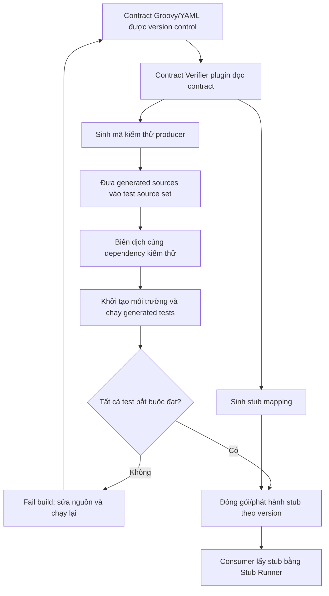
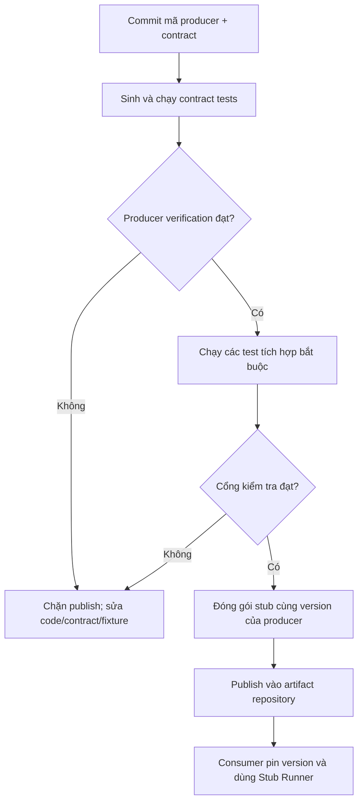

# Quản lý mã được sinh trong hệ thống build

Trong **Spring Cloud Contract**, hợp đồng Groovy/YAML không chỉ là tài liệu mô tả API. **Contract Verifier** đọc các hợp đồng, **sinh mã kiểm thử phía producer**, để hệ thống build biên dịch và chạy các test ấy trên ứng dụng thực tế. Cùng nguồn hợp đồng đó còn có thể được dùng để tạo stub cho consumer kiểm thử bằng **Stub Runner**. Nếu quản lý mã sinh không đúng cách, một pipeline có thể báo thành công dù không có contract test nào chạy, hoặc phát hành stub mô tả hành vi mà producer không thực hiện được.

Bài này thuộc chương **Contract Verifier** của module **SPRING_CLOUD_CONTRACT**. Ta sẽ tập trung vào cách hệ thống build quản lý đầu vào, mã được sinh, kết quả test và artifact stub; cách tích hợp Maven/Gradle; phương pháp xử lý mã sinh bị lỗi; và cách đảm bảo CI phát hiện thay đổi API không tương thích. Các ví dụ dùng Spring Boot, HTTP contract và Groovy DSL; nguyên tắc quản lý build cũng áp dụng khi dùng YAML DSL hoặc message contract với thiết lập tương ứng.

Sau bài học, bạn có thể:

- Phân biệt **hợp đồng nguồn**, **test được sinh**, **mã producer**, **stub mapping** và **artifact phát hành**.
- Giải thích thứ tự các bước tạo nguồn test, biên dịch, chạy test và đóng gói stub trong một build.
- Cấu hình nguyên tắc cơ bản cho Maven và hiểu cách làm tương đương với Gradle.
- Quản lý vị trí thư mục generated sources, chính sách Git, clean, cache và phiên bản công cụ.
- Phát hiện tình huống build xanh nhưng generated contract tests không được chạy.
- Điều tra một generated test fail mà không sửa trực tiếp mã do plugin sinh.
- Tạo một cổng CI chỉ cho phép phát hành stub khi producer thực sự đáp ứng hợp đồng.

## 1. Mã được sinh nằm ở đâu trong bức tranh kiểm thử hợp đồng?

Giả sử `OrderService` là **consumer**, cần gọi `InventoryService` là **producer** để giữ hàng. Hai nhóm thống nhất rằng `POST /api/v1/reservations` với đầu vào hợp lệ phải trả `201` và một `reservationId`.

Trong Spring Cloud Contract, ta có nhiều lớp tài sản:

| Tài sản | Nguồn gốc | Ai sử dụng? | Có nên sửa trực tiếp? |
| --- | --- | --- | --- |
| Contract Groovy/YAML | Do nhóm phát triển thống nhất và quản lý phiên bản | Contract Verifier, reviewer, quy trình CI | **Có**, qua review theo nhu cầu consumer |
| Controller/service producer | Mã ứng dụng thực thi API | Ứng dụng chạy thật, producer contract tests | **Có**, khi cần đáp ứng hợp đồng |
| Generated contract test | Plugin sinh từ contract | Test compiler, JUnit/test runner | **Không**; sửa contract, fixture hoặc cấu hình generator |
| Stub mapping | Sinh từ contract hoặc được đóng gói theo cấu hình stub | Stub Runner, WireMock và consumer tests | Không sửa file sinh rồi coi đó là nguồn sự thật |
| Stub artifact có version | Hệ thống build đóng gói và phát hành | Consumer CI, kho artifact | Tạo lại từ commit đã xác minh, không chỉnh tay sau phát hành |
| Báo cáo test | Maven/Gradle và test runner tạo khi chạy | Developer, CI, reviewer | Đọc và lưu làm bằng chứng; không coi là nguồn contract |

**Nguồn sự thật đối với hành vi tích hợp là contract đã được hai phía đồng thuận**, không phải lớp Java được sinh một lần trong thư mục `target` hay `build`. Hệ thống build phải có khả năng tạo lại cùng bộ test từ cùng đầu vào.

## 2. Luồng từ contract nguồn đến kết quả build



Cần phân biệt **hai đường** trong sơ đồ:

1. **Đường producer verification:** contract → Java/Groovy test được sinh → biên dịch → thực thi trên producer → kết quả pass/fail.
2. **Đường stub:** contract → stub mappings → đóng gói artifact → consumer chạy thử. Đây là các bản mô phỏng, **không** phải bằng chứng độc lập rằng mã producer đáp ứng hợp đồng.

Không nên nghĩ “plugin đã sinh file test” đồng nghĩa “test đã chạy”. Sinh file, biên dịch file và chạy file là **ba bước khác nhau**, có thể thất bại hoặc bị bỏ qua độc lập.

## 3. Ví dụ đầu vào: một contract HTTP

Giả sử dự án producer dùng cấu trúc Maven phổ biến:

```text
inventory-service/
├── pom.xml
├── src/
│   ├── main/java/...
│   └── test/
│       ├── java/com/example/inventory/ContractVerifierBase.java
│       └── resources/
│           └── contracts/
│               ├── reserve-stock-success.groovy
│               └── reserve-stock-insufficient.groovy
└── target/                          # Build output, do công cụ tạo
```

Nội dung ví dụ tại `src/test/resources/contracts/reserve-stock-success.groovy`:

```groovy
import org.springframework.cloud.contract.spec.Contract

Contract.make {
    name 'reserve_stock_success'
    description 'OrderService giữ 2 đơn vị hàng trước bước thanh toán'

    request {
        method 'POST'
        url '/api/v1/reservations'
        headers {
            contentType(applicationJson())
        }
        body([
            sku     : 'SKU-001',
            quantity: 2
        ])
    }

    response {
        status 201
        headers {
            contentType(applicationJson())
        }
        body([
            reservationId: 'RES-100',
            status       : 'HELD'
        ])
    }
}
```

Đây là một API giả định để học; `201`, tên đường dẫn, schema và mã ID phải được hai nhóm thống nhất trong dự án thật. Trong ví dụ, ID phản hồi cố định nhằm minh họa cơ chế test. Nếu producer tạo ID động, nên dùng matcher hoặc fixture phù hợp thay vì buộc mọi lần chạy phải trả `RES-100`.

### Mã được sinh sẽ làm gì?

Sau khi đọc contract, Verifier sinh test có **ý nghĩa tương đương**:

```text
Given: Môi trường producer có SKU-001 đủ 2 đơn vị
When:  Gửi POST /api/v1/reservations
       Body: {"sku":"SKU-001","quantity":2}
Then:  HTTP status = 201
       Content-Type = application/json
       JSON body có reservationId = RES-100 và status = HELD
```

**Đây không phải bản sao mã Java thực tế do plugin sinh.** Tên lớp, import, helper, thư viện assertion, cách bootstrap và đường dẫn đầu ra phụ thuộc phiên bản Spring Cloud Contract cùng cấu hình build.

## 4. Maven: nối generator vào vòng đời build

Trong producer dùng Maven, plugin `spring-cloud-contract-maven-plugin` thường đảm nhiệm việc đọc contract và sinh test, còn `spring-cloud-starter-contract-verifier` cung cấp các thư viện phục vụ kiểm thử. Ví dụ phần cấu hình cần ghép vào `pom.xml` hiện có:

```xml
<dependencies>
    <dependency>
        <groupId>org.springframework.boot</groupId>
        <artifactId>spring-boot-starter-test</artifactId>
        <scope>test</scope>
    </dependency>
    <dependency>
        <groupId>org.springframework.cloud</groupId>
        <artifactId>spring-cloud-starter-contract-verifier</artifactId>
        <scope>test</scope>
    </dependency>
</dependencies>

<build>
    <plugins>
        <plugin>
            <groupId>org.springframework.cloud</groupId>
            <artifactId>spring-cloud-contract-maven-plugin</artifactId>
            <version>${spring-cloud-contract.version}</version>
            <extensions>true</extensions>
            <configuration>
                <testFramework>JUNIT5</testFramework>
                <testMode>MOCKMVC</testMode>
                <baseClassForTests>
                    com.example.inventory.ContractVerifierBase
                </baseClassForTests>
            </configuration>
        </plugin>
    </plugins>
</build>
```

Đoạn XML trên **không phải POM độc lập**; phải kết hợp với phần quản lý phiên bản và dependencies của dự án. Thuộc tính phiên bản Spring Cloud Contract cần được định nghĩa trong build và tương thích với dòng Spring Boot/Spring Cloud đang sử dụng. Không chọn một phiên bản chỉ vì “mới nhất” rồi giả định plugin, JUnit và Java đều tương thích.

| Cấu hình | Vai trò |
| --- | --- |
| `spring-cloud-contract-maven-plugin` | Thực hiện các bước sinh test/stub theo cấu hình plugin |
| `spring-cloud-starter-contract-verifier` | Dependency kiểm thử cho những thành phần cần ở phía producer |
| `testFramework = JUNIT5` | Yêu cầu test được sinh theo JUnit 5 |
| `testMode = MOCKMVC` | Kiểm thử HTTP qua Spring MVC test support, không cần mở cổng thật |
| `baseClassForTests` | Chỉ ra lớp chuẩn bị Spring context và dữ liệu cho test được sinh |
| `extensions = true` | Kích hoạt tích hợp Maven theo cách plugin hỗ trợ |

Với source contract ở vị trí thông dụng `src/test/resources/contracts`, Maven có thể sinh mã kiểm thử vào khu vực như `target/generated-test-sources/contracts`. Đây là **thư mục output**, không phải nơi viết tay contract. Vị trí chính xác tùy cấu hình `generatedTestSourcesDir` hoặc tùy phiên bản plugin; cần đọc log build và cấu hình của dự án thay vì cứng hóa đường dẫn trong mọi quy trình.

### Những pha Maven liên quan

Maven có vòng đời gồm các pha như `generate-test-sources`, `test-compile`, `test`, `package` và `verify`. Plugin tạo test phải được nối đúng vào lifecycle; test compiler và runner phải nhìn thấy mã được sinh.

```text
src/test/resources/contracts/*.groovy
              │
              ▼
       generate-test-sources
              │  Sinh test Java/Groovy
              ▼
           test-compile
              │  Biên dịch test với dependencies
              ▼
              test
              │  Surefire/JUnit thực thi
              ▼
             verify
              │  Kiểm tra kết quả build
              ▼
   (release/publish: bước được cấu hình riêng)
```

Một lệnh kiểm tra phổ biến khi **dự án đã được cấu hình**:

```bash
mvn -B -ntp clean verify
```

`clean` xóa output cũ, còn `verify` đi qua các pha cần thiết của lifecycle mặc định. Tuy nhiên, **lệnh này không bảo đảm contract test được chạy nếu plugin chưa được gắn đúng, test bị skip hoặc runner không phát hiện lớp test sinh ra**. Do đó cần kiểm tra log và báo cáo test sau khi chạy.

## 5. Lớp cơ sở của generated tests: ai chuẩn bị môi trường?

Test được sinh không biết tự kết nối đến controller hay chuẩn bị dữ liệu nghiệp vụ nếu chưa được cấu hình. Với producer sử dụng Spring MVC và chế độ `MOCKMVC`, một cách thường gặp là dùng lớp base:

```java
package com.example.inventory;

import io.restassured.module.mockmvc.RestAssuredMockMvc;
import org.junit.jupiter.api.BeforeEach;
import org.springframework.beans.factory.annotation.Autowired;
import org.springframework.boot.test.context.SpringBootTest;
import org.springframework.test.context.ActiveProfiles;
import org.springframework.web.context.WebApplicationContext;

@SpringBootTest(webEnvironment = SpringBootTest.WebEnvironment.MOCK)
@ActiveProfiles("contract")
public abstract class ContractVerifierBase {

    @Autowired
    private WebApplicationContext context;

    @BeforeEach
    void setUp() {
        RestAssuredMockMvc.webAppContextSetup(context);
    }
}
```

Lớp base được đặt trong **`src/test/java` do nhóm quản lý**. Nó là **mã viết tay** và cần được version control, khác với file test do generator tạo trong `target`. Mã ví dụ giả định bộ dependency hỗ trợ RestAssured MockMvc; với WebFlux, message contract hoặc test mode khác, cách bootstrap cần thay đổi cho phù hợp.

Để kiểm kịch bản giữ hàng, lớp base hoặc setup test liên quan còn phải cung cấp fixture:

- `SKU-001` tồn tại và còn đủ số lượng.
- Dữ liệu trước mỗi test độc lập với test trước.
- Nếu handler cần dữ liệu từ dịch vụ ngoài, test double được chuẩn bị một cách có chủ đích mà không mock mất phần hành vi producer cần kiểm.
- Nếu ID `RES-100` được cố định trong response mẫu, producer test phải có cách sinh/trả đúng dữ liệu này; nếu không, nên dùng response matcher cho ID động.

Lỗi rất phổ biến: test sinh được, nhưng base class thiếu hoặc có sai package khiến **test-compile fail**. Một lỗi khác là base class khởi chạy được nhưng không gắn RestAssured vào đúng context khiến test không gọi đúng controller. Đừng sửa file generated Java để chữa các vấn đề ấy; hãy sửa **base class hoặc build configuration**.

## 6. Gradle: cùng nguyên tắc, task và thư mục có thể khác

Trong dự án Gradle, Spring Cloud Contract cung cấp plugin tương ứng để sinh contract tests và stub. Cách nối vào task graph khác Maven: Gradle dùng **task dependencies** và **source sets**, không dùng trực tiếp các pha Maven.

Một phác thảo cấu hình Groovy DSL của Gradle:

```groovy
plugins {
    id 'java'
    id 'org.springframework.cloud.contract' version '<compatible-version>'
}

dependencies {
    testImplementation 'org.springframework.boot:spring-boot-starter-test'
    testImplementation 'org.springframework.cloud:spring-cloud-starter-contract-verifier'
}

contracts {
    baseClassForTests = 'com.example.inventory.ContractVerifierBase'
    testFramework = 'JUNIT5'
    testMode = 'MOCKMVC'
}
```

Đây là **ví dụ định hướng**; cú pháp các tùy chọn plugin, tên task được tạo, cách khai báo version và dependency management cần đối chiếu với phiên bản Spring Cloud Contract/Gradle thực tế. Không sao chép nguyên mẫu sang build dùng Kotlin DSL hoặc Spring WebFlux rồi cho rằng đã hoạt động.

Với Gradle, có thể kiểm tra danh sách task và chạy chuỗi kiểm thử đã nối vào `check`:

```bash
./gradlew tasks --all
./gradlew clean check
```

Trên Windows có thể dùng `gradlew.bat`. Các dự án Gradle thường sinh mã trong thư mục con của `build`, ví dụ `build/generated-test-sources/contracts`, nhưng **không nên giả định đường dẫn/tên task luôn bất biến** qua các phiên bản. Điều cần xác minh là:

1. Task tạo test thực sự được chạy khi gọi `check` hoặc task CI tương ứng.
2. Output của task được bổ sung vào test source set để compiler nhìn thấy.
3. JUnit/test runner thực thi các test được sinh.
4. Test failure làm task và pipeline thất bại.
5. Task sinh stub và xuất bản artifact chỉ được phép hoàn tất theo chính sách release đã thống nhất.

**So sánh Maven và Gradle:** cả hai đều phải tạo test từ contract nguồn, biên dịch, chạy test và lưu kết quả; điểm khác là cơ chế điều phối công việc và cách đặt tên nhiệm vụ/thư mục output.

## 7. Vị trí source và generated output trong repository

Một chính sách dễ hiểu là:

```text
Repository (nên commit):
  src/main/...                        # Mã producer
  src/test/java/...                   # Base class và test viết tay
  src/test/resources/contracts/...    # Contract nguồn Groovy/YAML
  pom.xml hoặc build.gradle           # Cấu hình plugin, dependency và version

Build output (thường KHÔNG commit):
  target/generated-test-sources/...   # Maven generated tests
  target/...-stubs.jar                # Artifact được tạo khi build
  target/surefire-reports/...         # Báo cáo Maven test
  build/generated-test-sources/...    # Gradle generated tests
  build/reports/tests/...             # Báo cáo Gradle test
```

Lý do không thường xuyên commit generated tests:

- **Tránh hai nguồn sự thật:** thay contract nhưng quên cập nhật bản test sinh đã commit khiến repository có hai phiên bản khác nhau.
- **Giảm diff không cần thiết:** một thay đổi DSL nhỏ có thể tạo rất nhiều thay đổi mã Java không có ý nghĩa review.
- **Dễ tái tạo:** người khác và CI sinh lại mã với phiên bản plugin đã khóa, thay vì dựa trên file sinh từ máy cá nhân.
- **Tránh sai lệch với plugin mới:** mã sinh cũ có thể không còn phản ánh cách generator hiện tại biên dịch/kiểm tra hợp đồng.

Quy tắc Git phổ biến là ignore các thư mục build output như `target/` và `build/`. Đây là **chính sách khuyến nghị**, không phải luật bắt buộc của Spring Cloud Contract: một số tổ chức có thể lưu bản snapshot mã sinh nhằm kiểm toán hoặc phục vụ môi trường không có generator. Nếu làm vậy, phải có cơ chế kiểm tra tự động rằng snapshot đúng bằng kết quả sinh lại từ contract nguồn và phiên bản công cụ được khóa.

### Những gì vẫn nên review trong pull request

Reviewer cần nhìn được:

1. **Contract nguồn** đã thay đổi những request, response hoặc matcher nào.
2. **Mã producer** có thực hiện đúng cam kết hay không.
3. **Base class/fixture** có đảm bảo test thực sự chạy trên đường xử lý phù hợp hay không.
4. **Cấu hình build** có khiến test được sinh, được thực thi và báo lỗi chính xác không.
5. **Ảnh hưởng consumer:** thay đổi nào có thể phá vỡ consumer đang dùng phiên bản cũ.

Generated Java có thể được đọc để chẩn đoán, nhưng file đó không phải nơi thực hiện thay đổi lâu dài.

## 8. Làm thế nào để build có thể tái lập được?

Một build đáng tin cậy phải có khả năng lấy **cùng mã nguồn và contract** để sinh lại test và chạy ra kết quả tương đương, trừ các biến động ngoại cảnh được kiểm soát rõ ràng.

| Đầu vào cần quản lý | Vấn đề khi không cố định | Biện pháp |
| --- | --- | --- |
| Phiên bản Spring Cloud Contract | Generator sinh code/matcher khác nhau | Dùng version phù hợp, quản lý tập trung |
| Phiên bản Spring Boot, JDK, JUnit | Lỗi biên dịch hoặc test runner khác nhau | Đồng bộ build toolchain ở local và CI |
| Revision của contract | Producer và consumer kiểm các thỏa thuận khác nhau | Gắn revision hoặc artifact version rõ ràng |
| Dữ liệu fixture | Test pass trên máy này nhưng fail ở máy khác | Dùng dữ liệu test xác định, reset được |
| Locale/timezone/clock | Regex ngày giờ hoặc logic hết hạn không ổn định | Thiết lập timezone và clock trong test |
| Dependency ngoài | Dịch vụ ngoài chậm, mất kết nối hoặc trả dữ liệu mới | Cô lập phụ thuộc không nằm trong phạm vi contract |
| Build cache | Dùng lại output cũ dù contract đã đổi | Đảm bảo input/output được khai báo và cache invalidation đúng |

Nếu contract được tải từ repository hoặc artifact bên ngoài, việc dùng version động như `latest` khiến hai lần build cùng commit có thể sinh ra test từ **hai bộ contract khác nhau**. Với CI kiểm chứng tương thích, nên cố định revision/version đầu vào, sau đó nâng version qua quy trình review.

### Clean build và incremental build

Khi sửa contract, build incremental có thể chạy nhanh nhờ cache. Nhưng nếu nghi generator không nhận file mới, có thể thực hiện **clean build** để loại bỏ stale output. Trong CI release hoặc khi điều tra lỗi khác biệt local/CI, clean build thường là bước chẩn đoán quan trọng.

Điều này không có nghĩa mọi CI luôn phải vô hiệu hóa cache. Vấn đề là **cache phải biết contract và cấu hình generator là input**. Không nên cache thư mục generated sources rồi tự chép ngược vào build mà không kiểm tra contract đầu vào.

## 9. Đừng để “BUILD SUCCESS” che mất 0 contract test

Một pipeline Maven/Gradle có thể thành công dù không kiểm tra được hợp đồng, ví dụ:

- File contract đặt sai thư mục hoặc plugin trỏ nhầm `contractsDslDir`.
- Plugin chưa được áp dụng/kích hoạt trong module producer.
- Bước sinh test không được nối vào lifecycle/task graph.
- Test runner lọc mất tên lớp generated, không nhận JUnit 5 hoặc thiếu dependency engine.
- Test bị bỏ qua bởi cấu hình `skipTests`, `maven.test.skip`, exclude pattern hoặc một task CI chỉ build artifact mà không chạy test.
- Contract có thay đổi nhưng generator dùng output cache cũ.

Vì vậy, sau khi chạy build, **đếm số test được sinh và số test thực thi**. Cả hai phải được xem xét:

| Trạng thái | Diễn giải | Hành động |
| --- | --- | --- |
| Không có generated source dù có contract | Generator chưa chạy hoặc không tìm thấy contract | Kiểm tra nguồn contract, plugin và log |
| Có generated source nhưng không biên dịch | Source set/compiler chưa thấy output hoặc dependency lỗi | Kiểm task/phase test-compile và thư viện |
| Biên dịch được nhưng 0 test chạy | Test discovery hoặc runner bị cấu hình sai | Kiểm JUnit/Surefire/Gradle test task, bộ lọc |
| Test chạy nhưng luôn pass vì base class trả mock response cố định | Không kiểm chứng implementation producer | Đảm bảo đi qua controller/đường phát message thật |
| Test chạy, có failure khi implementation lệch contract | Tín hiệu mong đợi của verification | Sửa producer hoặc thương lượng thay đổi hợp đồng |

### Một bước kiểm tra file được sinh trong CI

Ở dự án Maven dùng vị trí output mặc định và sinh test Java, có thể thêm **kiểm tra minh họa**:

```bash
mvn -B -ntp clean verify

# Chỉ áp dụng khi dự án thực sự sinh Java tại đường dẫn này.
test -d target/generated-test-sources/contracts
find target/generated-test-sources/contracts -type f -name '*.java' | grep -q .
```

Lệnh trên giúp phát hiện thư mục rỗng, nhưng **chưa chứng minh JUnit đã thực thi test**. Cần kết hợp báo cáo test (thường là `target/surefire-reports` đối với Maven Surefire) và xác nhận những lớp generated tương ứng thực sự được runner chạy. Khi dự án cấu hình đường dẫn khác, sinh ngôn ngữ khác hoặc dùng một task/runner khác, phải sửa điều kiện kiểm tra theo thực tế.

## 10. Khi generated test fail, sửa ở đâu?

Đọc một lỗi contract test theo chuỗi **contract nguồn → mã sinh → fixture/base class → producer implementation**.

Ví dụ contract yêu cầu `201 Created` nhưng implementation trả:

```java
return ResponseEntity.ok(reservationResponse);
```

Producer test có thể fail vì HTTP status là `200`, dù body vẫn chứa `reservationId`. Cách sửa đúng nếu hai phía đã thống nhất `201` là thay implementation:

```java
return ResponseEntity.status(201).body(reservationResponse);
```

**Không nên sửa** assertion `201` thành `200` trong file generated test. Generator có thể viết lại file ở build sau; quan trọng hơn, làm vậy bỏ qua cam kết mà consumer đang phụ thuộc.

Một số trường hợp khác:

| Dấu hiệu lỗi | Nơi cần kiểm tra | Cách xử lý đúng |
| --- | --- | --- |
| Generated test không được tạo | Contract path, plugin/task configuration | Đưa contract vào nguồn đúng hoặc sửa cấu hình build |
| Generated test thiếu import hoặc không compile | Plugin version, JDK, test framework, dependencies | Đồng bộ phiên bản và dependency; tránh sửa code sinh |
| Lỗi `ClassNotFound` với lớp base | `baseClassForTests` và package Java | Sửa cấu hình hoặc lớp base viết tay |
| Test không khởi tạo Spring context | Profile test, bean, datasource hoặc dependency ngoài | Sửa fixture/config của test |
| Test nhận `404` do SKU mẫu không tồn tại | Fixture nghiệp vụ | Chuẩn bị SKU có tồn kho hoặc cập nhật contract nếu kịch bản đã đổi |
| Test fail vì ID/timestamp động | Contract dùng literal quá chặt | Dùng matcher phù hợp bảo đảm của consumer |
| Test fail khi đổi từ `409` sang `200` | Implementation hoặc thỏa thuận nghiệp vụ | Xem xét tác động consumer; không tự sửa contract cho xanh |
| Test pass nhưng ứng dụng thật sai | Contract thiếu kịch bản/assertion hoặc test chỉ gọi mock | Bổ sung hợp đồng, kiểm đường chạy và integration test |

### Mã sinh chỉ là bằng chứng để chẩn đoán

Đọc file generated có ích để xác định:

- Test gửi request nào và theo thứ tự nào.
- Giá trị `consumer/producer` được chuyển thành matcher hay literal như thế nào.
- Test kế thừa base class nào.
- Những assertion nào được sinh từ `bodyMatchers`.
- Có phải generator tạo test cho một contract mà ta không ngờ tới không.

Tuy nhiên, thay đổi cần được áp dụng vào **contract nguồn, plugin config, base test, fixture hoặc producer code**. Sau khi sửa, xóa output cũ hoặc chạy generation lại, rồi kiểm tra kết quả mới.

## 11. Không để test sinh tự động tạo ra phụ thuộc thứ tự

Generated tests thường là **các kịch bản độc lập**. Nếu một test tạo reservation mới rồi test khác giả định reservation đó tồn tại, pipeline có thể pass trên một máy và fail khi chạy song song hoặc đảo thứ tự.

Để tránh:

1. Tạo dữ liệu cần thiết trong setup/fixture của từng test hoặc từng lớp với phạm vi được kiểm soát.
2. Reset database, transaction hoặc test double khi test làm thay đổi trạng thái.
3. Dùng clock được kiểm soát cho kịch bản hết hạn.
4. Không dựa vào port, database hoặc thư mục temp dùng chung nếu nhiều job CI chạy đồng thời.
5. Nếu cần kiểm chuỗi `create → confirm → get`, viết **integration test nhiều bước** có truyền ID từ bước trước sang bước sau.

Contract tests kiểm giao diện quan sát được; chúng không thay thế kiểm thử đồng thời, giao dịch, bảo mật, độ bền lưu trữ hoặc idempotency. Build pipeline nên chạy các lớp kiểm thử đó theo mức rủi ro.

## 12. Stub cũng là output của build và cần được version hóa

Spring Cloud Contract có thể tạo mapping stub và đóng gói thành một artifact có classifier `stubs`. Ví dụ:

```text
com.example:inventory-service:1.4.0:stubs
artifact: inventory-service-1.4.0-stubs.jar
```

Tên artifact ở đây chỉ là ví dụ. Tọa độ và repository chính xác được dự án cấu hình, và không phải mọi cấu hình plugin đều tự upload artifact khi chạy `verify`.

### Vì sao phải gắn artifact với bản build đã xác minh?

Stub mô phỏng những hành vi contract mô tả. Nếu build tạo stub nhưng **producer test không chạy**, consumer có thể nhận được một bản giả lập trả `201` trong khi producer thật trả `200`. Khi đó consumer test xanh nhưng tích hợp thật vẫn lỗi.

Quy trình nên là:



Không dùng cùng một version bất biến để thay đổi nội dung artifact nhiều lần mà không có quy trình snapshot phù hợp: consumer cần truy lại **đúng stub đã thử**. Với bản release ổn định, version và nguồn tạo artifact phải có thể truy vết đến commit và pipeline kiểm thử.

## 13. Ví dụ cổng CI cho producer dùng Maven

Giả sử dự án có `pom.xml` đã tích hợp Verifier và JUnit 5, một job GitHub Actions cơ bản:

```yaml
name: Verify producer contracts

on:
  pull_request:
  push:
    branches: [main]

jobs:
  verify:
    runs-on: ubuntu-latest
    steps:
      - uses: actions/checkout@v4
      - uses: actions/setup-java@v4
        with:
          distribution: temurin
          java-version: '21'
          cache: maven

      - name: Generate, compile and execute tests
        run: mvn -B -ntp clean verify

      - name: Check expected generated test directory
        shell: bash
        run: |
          # Điều chỉnh đường dẫn và định dạng theo cấu hình thực tế.
          test -d target/generated-test-sources/contracts
          find target/generated-test-sources/contracts -type f -name '*.java' | grep -q .
```

Job trên minh họa **đầu mối của một cổng kiểm tra**, chưa phải toàn bộ pipeline phát hành. Bước kiểm tra file generated chỉ hữu ích khi đã xác nhận plugin của dự án sinh Java tại đúng đường dẫn đó. Cũng nên thu thập và phân tích báo cáo JUnit/Surefire để bảo đảm generated tests **thực sự chạy**, không chỉ tồn tại.

Trong thực tế có thể bổ sung:

- Chính sách bắt buộc job contract verification pass trước khi merge.
- Kiểm tra số lượng và tên generated tests so với danh sách contract kỳ vọng.
- Test tích hợp/bảo mật/đồng thời ngoài contract khi nghiệp vụ đòi hỏi.
- Lưu báo cáo và log test ở CI để truy vết lỗi.
- Job publish artifact/stub tách riêng, chỉ được kích hoạt từ commit/version đã vượt qua các cổng cần thiết.
- Consumer CI tải **đúng bản stub version** đã công bố, không tùy tiện lấy một bản latest động.

**Đừng đưa tài khoản hoặc token kho artifact vào contract hay file generated test**. Thông tin xác thực cho publish cần được quản lý bằng secret của CI và cấp quyền tối thiểu.

## 14. Những tình huống nâng cấp công cụ cần kiểm tra

Khi nâng phiên bản Java, Spring Boot, Spring Cloud Contract, Maven/Gradle hoặc JUnit, hãy kiểm tra cả **khả năng sinh mã** và **khả năng thực thi mã sinh**:

| Thay đổi | Rủi ro | Việc nên làm |
| --- | --- | --- |
| Nâng Spring Cloud Contract plugin | Mã sinh hoặc matcher có thể thay đổi | Clean build, xem generated tests và stub mappings |
| Chuyển JUnit 4 sang JUnit 5 | Test runner có thể không phát hiện test, base class dùng annotation sai | Đồng bộ `testFramework`, dependency và test runner |
| Nâng JDK hoặc language level | Lỗi compiler/runtime của lớp sinh | Đồng bộ toolchain local và CI |
| Đổi test mode sang MockMvc/WebTestClient/EXPLICIT | Base class cũ không còn phù hợp | Sửa bootstrap và xác minh request đi qua đúng thành phần |
| Đổi vị trí contract | Generator có thể không đọc file mới | Kiểm nguồn contract và số test được sinh |
| Đổi tên package hay lớp base | Generated test không compile hoặc không setup được | Cập nhật cấu hình base class |
| Đổi nhánh release/version stub | Consumer lấy nhầm mapping | Pin artifact version và kiểm nội dung JAR |
| Bật parallel test hoặc cache mới | Lỗi dữ liệu chung, output stale | Cô lập fixture và xác nhận input/output của task |

Một lần chạy xanh không đủ nếu sau nâng cấp số test sinh ra giảm bất thường. So sánh **số contract**, **số generated tests**, **số test thực thi** và **kịch bản trong stub** trước/sau nâng cấp. Không mặc định số test luôn bằng số file: một file có thể chứa nhiều contract, hoặc cách sinh class/method thay đổi theo phiên bản.

## 15. Quy trình gỡ lỗi khi build xanh nhưng consumer vẫn thất bại

Giả sử `OrderService` gọi stub và nhận đúng `reservationId`, nhưng khi kết nối `InventoryService` thật, ứng dụng gặp lỗi do producer đổi trường thành `holdId`.

Hãy lần lượt hỏi:

1. **Contract nguồn có thực sự yêu cầu `reservationId` không?** Nếu không, đây là khoảng trống thiết kế hợp đồng.
2. **Contract đó có được generator đọc không?** Kiểm log, thư mục output và danh sách test được sinh.
3. **Generated test có chạy không?** Xem báo cáo Surefire/Gradle và phát hiện filter/skip.
4. **Test đã đi qua producer thật ở lớp thích hợp chưa?** Đừng để base class tự tạo response giả luôn đúng.
5. **Consumer dùng stub version nào?** Có thể họ đang kiểm bằng artifact cũ không tương ứng với producer vừa phát hành.
6. **Thay đổi API có phá vỡ hành vi ngoài contract không?** Bổ sung kịch bản và test phù hợp nếu cần.

Những câu hỏi này phân biệt hai nguyên nhân rất khác nhau: **pipeline không thực thi cam kết đã có**, hoặc **cam kết không bao phủ điều consumer thực sự cần**. Cả hai cần được sửa tại nguồn, không phải bằng chỉnh tay generated test.

## 16. Những sai lầm phổ biến và cách phòng tránh

| Sai lầm | Hệ quả | Cách xử lý |
| --- | --- | --- |
| Commit generated tests như nguồn sự thật thứ hai | Test sinh và contract có thể lệch nhau | Commit DSL và mã base/fixture; sinh test trong build |
| Sửa Java generated khi test fail | Thay đổi mất ở lần sinh sau | Sửa contract, fixture hoặc implementation |
| Chỉ chạy bước generate rồi tuyên bố pass | Chưa biên dịch và thực thi test | Chạy đủ test task/phase và xem báo cáo |
| Plugin không chạy nhưng build vẫn xanh | Không có bảo vệ hợp đồng | Kiểm số generated tests và executed tests |
| Test class không được runner phát hiện | 0 contract test dù source tồn tại | Kiểm JUnit, Surefire/Gradle include/exclude |
| Cache mã sinh không theo input contract | Dùng test cũ sau khi đổi DSL | Khai báo input/output đúng, clean để xác minh |
| Base class mock sẵn toàn bộ response | Test không đi qua implementation producer | Chỉ mock dependency ngoài phạm vi, giữ đường xử lý cần kiểm |
| Fixture dùng dữ liệu môi trường chung | CI thất bại không ổn định | Dùng dữ liệu test cô lập, reset được |
| Nâng plugin mà không kiểm số lượng test | Test có thể bị mất hoặc thay matcher | So sánh nguồn, output, report và stub |
| Publish stub dù producer tests fail/skip | Consumer kiểm thử với một lời hứa chưa được xác minh | Chặn publish nếu verification không đạt |
| Consumer luôn lấy latest stub | CI khó tái hiện lỗi | Pin version, quản lý lịch nâng cấp |
| Dùng matcher quá rộng để “cho test xanh” | Regression không bị phát hiện | Kiểm đúng thuộc tính consumer phụ thuộc |

## 17. Checklist quản lý generated sources trong build

- [ ] Contract nguồn Groovy/YAML nằm trong repository hoặc nguồn version hóa có revision xác định.
- [ ] Có plugin Spring Cloud Contract Verifier tương thích với Spring Boot/JDK/build tool.
- [ ] Bước generation nối vào lifecycle/task graph được CI thực thi.
- [ ] Generated tests được đưa vào đúng test source set và biên dịch thành công.
- [ ] JUnit/test runner thực thi generated tests; CI không bỏ qua chúng.
- [ ] Có cách phát hiện **0 generated tests** hoặc số test giảm bất thường.
- [ ] Base class/fixture nằm trong mã test được version control, không nằm trong output generated.
- [ ] Test gọi controller hoặc message path của producer thay vì tự trả response giả giống contract.
- [ ] Generated output và báo cáo test được quản lý như build artifacts, không trở thành nguồn sự thật.
- [ ] Cache có cơ chế invalidation khi contract, plugin hoặc cấu hình thay đổi.
- [ ] Local và CI sử dụng công cụ, dependency, timezone và dữ liệu thử nghiệm nhất quán.
- [ ] Khi test fail, sửa DSL/fixture/implementation/config và sinh lại, không sửa file generated.
- [ ] Stub artifact được đóng gói từ phiên bản đã xác minh, có tọa độ version truy vết được.
- [ ] Consumer test lấy đúng phiên bản stub bằng Stub Runner.
- [ ] Các kiểm thử nghiệp vụ vượt phạm vi contract vẫn được chạy khi hệ thống yêu cầu.

### Bài tập thực hành

Bạn duy trì producer `InventoryService` cung cấp endpoint giữ hàng cho `OrderService`. Nhóm đã có file `reserve-stock-success.groovy` trong `src/test/resources/contracts` và controller trả `201` cùng `reservationId`.

Hãy thực hiện:

1. Vẽ sơ đồ các bước từ contract nguồn → generated tests → test compilation → test execution → stub artifact.
2. Trong một dự án Spring Boot dùng Maven, tích hợp plugin Contract Verifier, dependency kiểm thử và một `ContractVerifierBase` chạy controller qua MockMvc.
3. Chuẩn bị dữ liệu fixture cho `SKU-001`. Chạy `mvn -B -ntp clean verify` và xác minh số lớp test được sinh, test nào thực thi.
4. Xác định thư mục output generated của **dự án của bạn**. Giải thích vì sao không nên chỉnh sửa/commit test sinh ra trong thư mục ấy.
5. Cố ý sửa controller để trả `200` thay vì `201`. Quan sát generated test fail, rồi sửa **implementation** mà không thay assertion trong test sinh.
6. Xóa hoặc đổi tên đường dẫn contract trong cấu hình build để tạo tình huống 0 generated tests. Thiết kế cổng CI giúp phát hiện tình huống này dù phần build còn lại thành công.
7. Thay response từ `reservationId` sang `holdId`. Xác định đây là thay đổi tương thích hay không dựa trên nhu cầu `OrderService` và sửa đúng vị trí khi hai nhóm đã thống nhất.
8. Chạy lại clean build sau khi đổi matcher/fixture; kiểm tra test đã sinh mới và báo cáo tương ứng.
9. Đóng gói stub từ bản build đã xác minh; dùng Stub Runner trong consumer test với tọa độ artifact version cụ thể.
10. So sánh quy trình Maven với một dự án Gradle: chỉ ra task/source set tương ứng và cách xác minh generated tests thực sự chạy.

**Tiêu chí hoàn thành:** bạn có thể phân biệt **file nào nhóm viết, file nào plugin sinh, phần nào test runner thực thi, bước nào được phép publish stub**, và chứng minh pipeline không chỉ “sinh code” mà đã thực sự kiểm tra producer đối với những contract được consumer phê duyệt.

## Tài liệu tham khảo

- [Spring Cloud Contract — Reference](https://docs.spring.io/spring-cloud-contract/reference/): hướng dẫn Contract Verifier, build plugins, producer tests và stub artifacts.
- [Spring Cloud Contract — Maven Project](https://docs.spring.io/spring-cloud-contract/reference/using.html): tham khảo thiết lập dự án producer và plugin; khi dùng phải chọn tài liệu phù hợp phiên bản đang chạy.
- [Maven — Introduction to the Build Lifecycle](https://maven.apache.org/guides/introduction/introduction-to-the-lifecycle.html): quan hệ giữa các pha generate-test-sources, test-compile, test và verify.
- [Gradle — Java Plugin](https://docs.gradle.org/current/userguide/java_plugin.html): test source sets, nhiệm vụ build/test và cách kết nối task.
