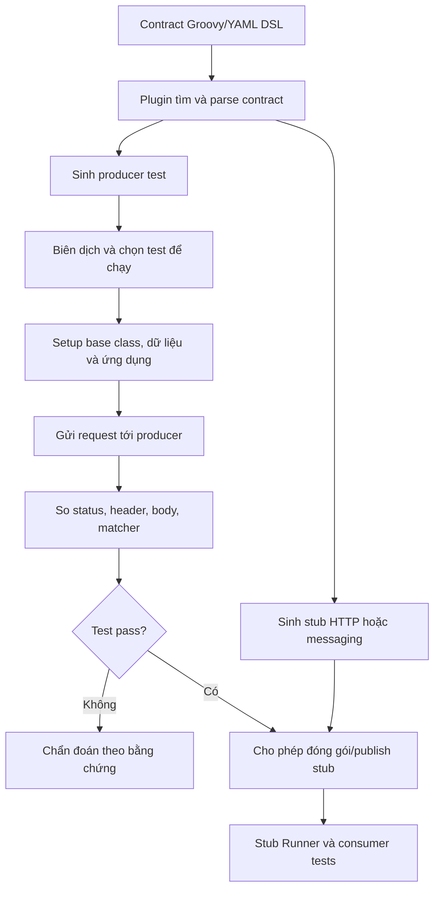
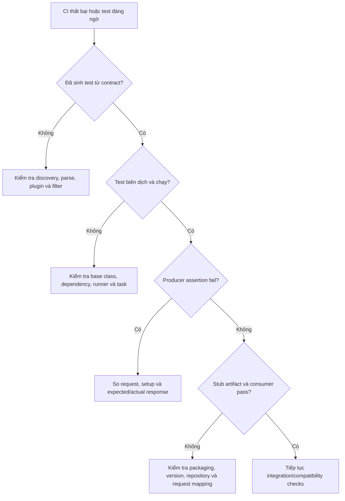

# Điều tra lỗi từ hợp đồng nguồn đến kết quả kiểm thử

## 1. Lỗi Contract Verifier là lỗi ở đâu?

Trong **Spring Cloud Contract**, producer và consumer thống nhất hành vi HTTP hoặc thông điệp bằng **Groovy/YAML DSL**. Từ contract, **Contract Verifier** sinh các bài kiểm thử phía **producer** để đối chiếu lời hứa với triển khai thật. Cùng nguồn hợp đồng còn có thể tạo stub để consumer dùng với **Stub Runner**; CI ghép các bước này nhằm phát hiện sớm thay đổi API không tương thích.

Một thông báo `BUILD FAILURE` không đủ để kết luận producer đã phá vỡ hợp đồng. Lỗi có thể xảy ra trước khi gửi bất kỳ request nào:

- Tệp contract không được phát hiện do đường dẫn hoặc bộ lọc.
- Groovy/YAML DSL không parse hoặc không hợp lệ về cấu trúc.
- Bước sinh test gặp matcher/giá trị không được hỗ trợ.
- Generated test không biên dịch hoặc không chạy vì thiếu base class, dependency, JUnit/test framework.
- Test chạy nhưng dữ liệu thử, security, controller, HTTP status hoặc JSON response không khớp contract.
- Producer test đã pass nhưng bước đóng gói stub, phân phối artifact hoặc consumer test thất bại.

Để điều tra đúng, phải đi **từ nguồn hợp đồng tới hiện vật được sinh, rồi tới kết quả thực thi**. Nếu sửa response của producer trước khi biết generated test có chạy hay chưa, ta có thể làm hỏng API chỉ để che một lỗi cấu hình.

**Mục tiêu bài học:** truy tìm một kịch bản từ DSL đến generated test và báo cáo kiểm thử; phân biệt lỗi hợp đồng, lỗi hạ tầng kiểm thử, lỗi implementation và lỗi stub; thu thập bằng chứng để sửa đúng nguyên nhân và thiết lập cổng kiểm tra CI đáng tin cậy.

## 2. Bản đồ điều tra: mỗi bước có một bằng chứng



| Điểm quan sát | Bằng chứng nên tìm | Nếu không có thì nghĩ tới |
| --- | --- | --- |
| **Nguồn contract** | Đúng file `.groovy`/`.yml`, request/response/matcher | Sai bài, sai ngữ nghĩa hoặc file không nằm trong phạm vi build |
| **Discover/parse** | Log plugin cho thấy contract được đọc | Sai thư mục, include/exclude, extension, cú pháp |
| **Generate** | Generated test và mappings/stubs xuất hiện | DSL không hợp lệ hoặc plugin/task chưa được chạy |
| **Compile** | Generated test biên dịch, class/base class được resolve | Thiếu dependency, sai package, version, Java/JUnit |
| **Execute** | Báo cáo có **số lượng test đã chạy** và test name | Test task không được gọi, bị skip, filter sai |
| **Assertion** | Expected/actual, request, response, stack trace có vị trí lỗi | Sai triển khai, setup, data, matcher hoặc test mode |
| **Artifact** | Stubs JAR chứa mapping của đúng contract/version | Packaging/publishing khác với producer verification |
| **Consumer** | Stub Runner tải đúng artifact và client gọi đúng port | Sai version, coordinate, repository, request match |

**Một build xanh với 0 contract tests không đồng nghĩa API đáp ứng hợp đồng.** Ngược lại, việc consumer test xanh với stub cũ cũng không chứng minh producer hiện tại vẫn tuân thủ hợp đồng. Mỗi cột trên cần được xác minh độc lập khi xảy ra sự cố.

## 3. Ví dụ xuyên suốt: một hợp đồng và một thay đổi phá vỡ

Giả sử `order-service` cung cấp endpoint tra cứu đơn hàng. Consumer `checkout-service` phụ thuộc vào `orderId` và `status`. Tệp nguồn tại:

```text
src/test/resources/contracts/orders/get-confirmed-order.groovy
```

Nội dung:

```groovy
import org.springframework.cloud.contract.spec.Contract

Contract.make {
    description 'Tra cứu đơn hàng đã xác nhận'

    request {
        method GET()
        url '/api/orders/42'
        headers {
            accept(applicationJson())
        }
    }

    response {
        status OK()
        headers {
            contentType(applicationJson())
        }
        body([
            orderId: 42,
            status : 'CONFIRMED'
        ])
    }
}
```

**Lời hứa có thể quan sát được** của kịch bản này là:

| Trường hợp | Contract mong đợi |
| --- | --- |
| Method + path | `GET /api/orders/42` |
| Request header | `Accept: application/json` |
| HTTP response | `200 OK` |
| Response header | `Content-Type: application/json` |
| JSON field | `orderId` dạng số, ví dụ `42` |
| JSON field | `status` dạng chuỗi `CONFIRMED` |

Giả sử một commit đã sửa DTO/serializer, khiến producer hiện trả:

```http
HTTP/1.1 200 OK
Content-Type: application/json

{"orderId":42,"state":"CONFIRMED"}
```

Producer vẫn trả HTTP `200` nhưng **đổi tên `status` thành `state`**. Đây có khả năng là breaking change, bởi consumer cũ vẫn đọc `status`. Nếu Contract Verifier chạy đúng kịch bản gốc, generated test phải phát hiện sai khác ở body. Nếu test vẫn xanh, phải điều tra xem test đã sinh/chạy chưa hoặc assertion có đang kiểm tra `status` như mong đợi không; không vội kết luận “SCC bỏ sót lỗi”.

### Bảng truy ngược từ một failure

```text
Nguồn:
  contracts/orders/get-confirmed-order.groovy
          ↓
Contract Verifier sinh test:
  test cho GET /api/orders/42
          ↓
Setup:
  base class chạy controller/HTTP và seed đơn 42
          ↓
Request thực tế:
  GET /api/orders/42, Accept: application/json
          ↓
Actual:
  {"orderId":42,"state":"CONFIRMED"}
          ↓
Expected:
  body có orderId=42 và status="CONFIRMED"
          ↓
Kết luận:
  producer response khác contract đã cam kết
```

Đường dẫn generated sources, tên class và cách hiện assertion phụ thuộc plugin/build tool. Sơ đồ là **dòng bằng chứng**, không phải cam kết về tên file được sinh nguyên văn.

## 4. Phân loại lỗi trước khi sửa mã

| Nhóm lỗi | Triệu chứng thường gặp | Bước điều tra đầu tiên |
| --- | --- | --- |
| **Contract discovery** | Không có generated tests cho file mới | Kiểm tra source root, include/exclude, cấu hình plugin và log |
| **DSL syntax/parse** | Groovy/YAML parser báo line, indentation hoặc property lỗi | Đọc đúng tệp nguồn, so cú pháp với DSL version đang dùng |
| **Generation** | Plugin báo không sinh được test/stub hoặc matcher không hỗ trợ | Xác định construct/field gây lỗi, kiểm tra version plugin |
| **Compilation** | `cannot find symbol`, thiếu base class, import hoặc dependency | Kiểm tra generated sources, package, JDK, test framework |
| **Test setup** | Không load được Spring context, DB, bean, port | Kiểm tra base class, test mode, dữ liệu và môi trường |
| **Request mismatch** | Producer nhận `404`/`405`/`415` thay vì status dự kiến | So method/path/query/headers/body test thực sự gửi |
| **Response mismatch** | Fail ở `statusCode`, `Content-Type`, JSONPath, matcher | So expected/actual và log response thật |
| **Flaky** | Local pass, CI fail; chạy từng test pass, cả suite fail | Kiểm tra trạng thái chia sẻ, thời gian, dữ liệu, port, thứ tự |
| **Stub/consumer** | Producer test pass nhưng Stub Runner không phục vụ đúng response | Kiểm tra version artifact, mapping, request và repository |

Đừng chữa lỗi phân phối stub bằng cách sửa contract producer, cũng đừng dùng `@Disabled` hoặc skip test để làm CI xanh khi chưa hiểu nguyên nhân. Mỗi lỗi thuộc một tầng cụ thể và cần bằng chứng tương ứng.

## 5. Bước đầu tiên: tạo một lần chạy có thể tái hiện

Trước khi đọc hàng trăm dòng log, ghi lại bối cảnh:

1. **Commit/branch** chứa contract và producer code đang kiểm tra.
2. **Phiên bản** JDK, Spring Boot, Spring Cloud, Spring Cloud Contract và build plugin.
3. **Đường dẫn contract** cùng định dạng Groovy hoặc YAML.
4. **Lệnh build** đang được dùng và tác vụ nào thực sự chạy generated tests.
5. **Tên test fail**, message ngắn nhất thể hiện khác biệt expected/actual.
6. **Test data và môi trường**: mock controller hay HTTP server thật, DB in-memory/test container, security filters, port và configuration profile.

Với Maven trong dự án đã cấu hình `spring-cloud-contract-maven-plugin`, chạy lại cùng vòng đời mà CI sử dụng:

```bash
# Linux/macOS: ưu tiên Maven Wrapper được commit cùng dự án
./mvnw -B clean verify

# Khi cần chi tiết thêm về lỗi plugin/đường dẫn dependency:
./mvnw -B -e clean verify
```

Trên Windows có thể dùng `mvnw.cmd`. `-e` giúp hiện thêm stack trace khi Maven gặp lỗi; chỉ bật debug log rộng hơn nếu cần vì có thể sinh rất nhiều thông tin hoặc vô tình chứa dữ liệu nhạy cảm.

Với Gradle, cần kiểm tra tác vụ do phiên bản plugin Contract Verifier đăng ký:

```bash
./gradlew tasks --all
./gradlew clean check --stacktrace
```

Các task sinh test/stub và việc chúng được nối vào `check` hoặc `build` tùy phiên bản, plugin và cấu hình dự án. **Không coi `check` là bằng chứng contract tests đã chạy** khi chưa xem task graph và báo cáo. Với module đa dự án, phải chọn đúng producer module, không nhầm với consumer hoặc module tổng hợp.

### Đừng bỏ qua số lượng bài test

Sau build, ghi lại:

```text
Discovered contracts: <số đã xác minh từ log/output>
Generated contract tests: <số class/method hoặc kịch bản>
Executed contract tests: <số thực sự chạy>
Failures: <số>
Skipped: <số>
```

Đây là mẫu báo cáo để tự điền, không phải format log bắt buộc của plugin. Nếu producer có mười contract đang được cam kết nhưng generated test chạy 0, phải coi đó là **lỗi mất vùng kiểm thử**, kể cả khi build thành công. Mặt khác, số tệp DSL không nhất thiết bằng số method test vì một file có thể biểu diễn nhiều tình huống.

## 6. Truy tệp DSL nguồn: path, request, response và matcher

Mở đúng contract được chỉ ra trong lỗi hoặc nhận diện theo request đang fail. Với `get-confirmed-order.groovy` ở mục 3, ghi ra một bảng ngắn:

| Điều kiện nguồn | Giá trị bắt buộc hoặc matcher | Phía bị kiểm tra |
| --- | --- | --- |
| Request `method` | `GET` | Input generated producer test gửi |
| Request `url` | `/api/orders/42` | Input generated producer test gửi |
| Request `Accept` | `application/json` | Input generated producer test gửi |
| Response `status` | `200` | Response producer thực phải đáp ứng |
| Response `Content-Type` | `application/json` | Response producer thực phải đáp ứng |
| Response `$.orderId` | `42` theo hợp đồng mẫu | Generated assertion |
| Response `$.status` | `CONFIRMED` | Generated assertion |

Nếu người sửa code cho rằng `state` mới là đúng, cần xem **thỏa thuận phiên bản API**: contract có thể đang cố tình bảo vệ consumer cũ. Không tự sửa DSL theo DTO mới chỉ để test pass. Nếu hợp đồng đã lỗi thời do một migration được tất cả consumer chấp nhận, phải sửa contract có review, cập nhật consumer và stub, rồi chạy kiểm thử hai phía.

### Trường hợp nguồn dùng YAML DSL

Một YAML tương ứng:

```yaml
description: Tra cứu đơn hàng đã xác nhận
request:
  method: GET
  url: /api/orders/42
  headers:
    Accept: application/json
response:
  status: 200
  headers:
    Content-Type: application/json
  body:
    orderId: 42
    status: "CONFIRMED"
```

Khi chẩn đoán YAML, chú ý **thụt lề, dấu nháy, null và kiểu scalar**. `orderId: 42` khác `orderId: "42"`; nếu đổi thành string, producer có thể trả cùng ký tự “42” mà vẫn vi phạm schema JSON. Tương tự, `status: "CONFIRMED"` trong `body` khác `response.status: 200` ở cấp HTTP. Cần giữ đúng vị trí của mỗi thuộc tính.

### Matcher và giá trị động

Trong Groovy DSL, một response động có thể dùng:

```groovy
response {
    status OK()
    headers {
        contentType(applicationJson())
    }
    body([
        orderId: 42,
        status : 'CONFIRMED',
        requestId: $(consumer('req-demo-123'),
                     producer(regex('req-[A-Za-z0-9-]+')))
    ])
}
```

Ở **response**, `consumer('req-demo-123')` là giá trị ví dụ mà stub có thể trả, còn `producer(regex(...))` là điều kiện generated producer test dùng cho response thực. Nếu test đòi `requestId` phải bằng đúng `req-demo-123`, cần kiểm tra liệu matcher đã được sinh và áp dụng đúng chưa, hay đã vô tình chuyển sang equality khi sửa DSL.

Ở **request**, vai trò đảo theo công việc kiểm thử: phía `producer` cung cấp giá trị mẫu để generated test gửi, phía `consumer` thường cung cấp matcher mà stub dùng để nhận request. Do đó lỗi matcher có thể dẫn đến **request sai được tạo ra** hoặc **response hợp lệ bị test từ chối**. Đừng đảo `consumer(...)` và `producer(...)` khi debug.

## 7. Kiểm tra bước khám phá hợp đồng và sinh test

Nếu nguồn contract tồn tại nhưng không có test:

1. Xác nhận file thuộc đúng **source root** mà plugin đang dùng, thường là `src/test/resources/contracts` nếu không cấu hình khác.
2. Kiểm tra phần mở rộng (`.groovy`, `.yml`/`.yaml` tùy cấu hình và phiên bản hỗ trợ).
3. Kiểm tra các **include/exclude filters**; một pattern sai có thể làm contract biến mất khỏi tập input.
4. Kiểm tra plugin đã được khai báo ở đúng **producer module** và các task/goal sinh test thực sự được chạy.
5. Đọc thông báo parser hoặc generation, phân biệt “không phát hiện file” với “đã phát hiện nhưng không chuyển được DSL”.

Ví dụ, một tập contract có thư mục `orders/` nhưng include chỉ chọn `payments/**`. Kết quả có thể là 0 test cho orders mà không có lỗi parser. Đổi JSON response trong application không giải quyết được thiếu sót đó.

### Cú pháp hợp lệ chưa chắc mang đúng ý nghĩa

Các trường hợp điển hình:

| Trường hợp | Loại lỗi | Cách xử lý |
| --- | --- | --- |
| YAML `response` bị thụt vào dưới `request` | Cấu trúc sai / parse hoặc validate | Chỉnh vị trí cấu trúc, đọc error line |
| Groovy dùng helper không có ở phiên bản đang chạy | Compilation/evaluation DSL | Kiểm tra DSL API và plugin version |
| JSON body mẫu có số dạng chuỗi | Hợp đồng sai kiểu nhưng vẫn parse | Làm rõ schema consumer dùng |
| `response.matchers` khai báo dưới `request` | Matcher sai phía | So generated assertion và stub mapping |
| Regex bị escape sai giữa Groovy/YAML | Matcher khác dự kiến | So pattern trong generated test và mapping |
| Hai tệp Groovy/YAML cùng mô tả một request | Trùng/đụng tình huống | Dùng một nguồn chính thức cho từng kịch bản |

**Nguyên tắc:** Nếu generation fail, phải sửa contract hoặc cấu hình plugin. Nếu generation thành công nhưng assertion không bảo vệ hành vi quan trọng, phải sửa ý định DSL rồi xác minh lại. Mã generated chỉ là **đầu ra tạm**, không phải nơi sửa lâu dài.

## 8. Mở generated test để tìm khác biệt

Khi test đã được sinh, hãy mở **đúng class/method tương ứng contract**. Với Maven, generated sources thường nằm ở vùng output `target/`; với Gradle là vùng `build/`. **Tên thư mục, package, method và framework test cụ thể có thể khác theo plugin version và test mode**; hãy dựa vào build log, không đoán một đường dẫn tuyệt đối.

Generated test của ví dụ ở mục 3 sẽ có **ý nghĩa tương đương** với mã giả sau:

```java
// PSEUDOCODE: không phải mã Verifier bảo đảm sinh nguyên văn.
given()
    .header("Accept", "application/json")
.when()
    .get("/api/orders/42")
.then()
    .statusCode(200)
    .body("orderId", equalTo(42))
    .body("status", equalTo("CONFIRMED"));
```

Đọc mã test đã sinh để trả lời:

- Nó gửi **đúng method, URL, query, header, body** của contract không?
- Có dùng **test base class** được khai báo không?
- Assertion có kiểm tra HTTP status, `Content-Type` và **JSONPath cần thiết** không?
- Một field động được match bằng regex/type hay bị so bằng dữ liệu mẫu?
- Test có thực sự chạy qua controller/HTTP của producer, hay môi trường bị mock sai?

Khi một assertion fail, đọc **đường dẫn JSONPath** và expected/actual cụ thể. Ví dụ lỗi nói `$.status` không tồn tại khác với lỗi nói `$.status` có giá trị `PENDING` thay vì `CONFIRMED`. Lỗi thứ nhất thường gợi ý đổi tên hoặc thiếu field; lỗi thứ hai gợi ý sai trạng thái dữ liệu hoặc nghiệp vụ.

### Đừng sửa file sinh tự động

Nếu sửa generated test trực tiếp, lần chạy build tiếp theo có thể ghi đè mọi thay đổi. Nguồn sửa đúng thường là:

- Contract DSL, nếu yêu cầu đã thống nhất cần đổi.
- Cấu hình plugin/DSL parser, nếu sinh test sai phạm vi.
- Test base class/setup, nếu request không đến đúng producer hoặc dữ liệu không chuẩn.
- Producer code, nếu implementation vi phạm hợp đồng.

Trong trường hợp cần assertion phức tạp ngoài DSL, bổ sung test producer riêng để kiểm tra bất biến nghiệp vụ, thay vì sửa mã generated trong `target/` hoặc `build/`.

## 9. Kiểm tra base class và môi trường producer test

Generated test chỉ có thể xác minh producer nếu được **chạy trong môi trường thực sự phục vụ request đúng cách**. Một bản contract hợp lệ có thể fail vì không có ứng dụng để gọi, sai cổng hoặc dữ liệu test không tồn tại.

### 9.1. Base class làm gì?

Trong dự án Spring Boot, một lớp cấu hình test thường đảm nhiệm:

- Khởi tạo application context/controller cần được kiểm thử.
- Cấu hình MockMvc/Rest Assured MockMvc hoặc HTTP thực theo test mode.
- Thiết lập authentication/header nếu contract yêu cầu luồng bảo mật.
- Chuẩn bị database hoặc mock dependency có hành vi xác định.
- Làm sạch state giữa các kịch bản để test độc lập và tái lập.

Ví dụ **mô hình khung**, không phải lớp có thể copy vào mọi dự án:

```java
// Minh họa trách nhiệm của base class, không phải template hoàn chỉnh.
@SpringBootTest
class ContractTestBase {

    @BeforeEach
    void prepareOrder42() {
        // Seed một đơn 42 với trạng thái CONFIRMED vào test database
        // hoặc cấu hình service mock đúng với contract.
    }
}
```

Trong mã thực, cần import các annotation phù hợp, tiêm dữ liệu/service và cấu hình MockMvc/Rest Assured theo cách test được plugin sinh. Nếu chọn MockMvc test mode mà chỉ chạy `@SpringBootTest`, có thể vẫn thiếu thiết lập request specification; nếu chọn HTTP test mode, lại cần một server và base URI/port phù hợp. **Đừng coi đoạn khung trên là base class hoàn chỉnh.**

### 9.2. Triệu chứng setup và cách phân biệt

| Triệu chứng | Khả năng cao | Bằng chứng cần kiểm tra |
| --- | --- | --- |
| `ClassNotFoundException` / không tìm thấy base class | Sai `baseClassForTests` hoặc package | Tên class và đường dẫn trong generated test |
| `ApplicationContext` không khởi tạo | Bean thiếu, cấu hình test sai, DB không kết nối | Root cause trong stack trace Spring |
| `Connection refused` | HTTP server không chạy/cổng sai | Base URI, port, lifecycle server |
| `404 Not Found` khi contract mong `200` | Route sai, controller chưa load hoặc dữ liệu 42 không có | Request thực, handler mapping, seed DB |
| `401/403` thay `200` | Security filter/credentials không đúng | Header auth, profile security, filter chain |
| `500` | Exception trong controller/service, dependency, DB | Stack trace phía server và request ID |
| Local pass nhưng CI fail | DB/locale/timezone/profile khác, test phụ thuộc thứ tự | So environment và dữ liệu đầu vào |

Ví dụ: `GET /api/orders/42` trả `404` không nhất thiết có nghĩa producer đã đổi API sang status lỗi. Nếu **test fixture** không seed đơn 42, `404` có thể là phản hồi nghiệp vụ hoàn toàn hợp lệ cho **dữ liệu khác**, nhưng vẫn sai với điều kiện kịch bản contract đang được kiểm tra. Cần làm dữ liệu thử tái lập được trước khi kết luận code API sai.

### 9.3. Đừng mock mất chính hành vi đang kiểm chứng

Nếu kiểm thử contract cho endpoint `POST /api/payments` nhưng base class mock controller để luôn trả response mẫu, test có thể pass dù controller thật và logic validation đã bị phá vỡ. Mock dependency nội bộ có thể hợp lý cho test contract tầng web, nhưng phải hiểu **ranh giới kiểm chứng**: response thực từ controller vẫn phải được gọi, còn các bất biến ở DB/payment gateway cần integration test riêng.

## 10. Điều tra assertion fail theo lớp giao thức

Khi generated test **đã chạy**, hãy đọc message và xác định assertion fail đầu tiên. Không dựa vào hàng cuối cùng “There are test failures” để đoán nguyên nhân.

### 10.1. HTTP status

Ví dụ contract mong `200` nhưng actual `404`:

```text
Expected: HTTP 200
Actual:   HTTP 404
Request:  GET /api/orders/42
```

Kiểm tra theo thứ tự: endpoint có được đăng ký không; request path/query đúng không; dữ liệu 42 có tồn tại không; security có can thiệp không; exception mapper có biến lỗi nội bộ thành `404` không. **Không đổi contract sang `404`** chỉ để pass nếu consumer đã được hứa nhận `200` với dữ liệu được seed.

### 10.2. Header và Content-Type

Nếu body là JSON nhưng response header là `text/plain`, HTTP client có thể deserialize sai. Kiểm tra:

- Controller có `produces = application/json` hoặc cơ chế serialization tương đương?
- Header `Accept` mà generated test gửi là gì?
- Có gateway/filter hoặc error handler trả HTML/JSON khác với luồng dự kiến?
- Matcher Content-Type có xét tham số charset theo kỳ vọng của API không?

Đừng so sánh header không liên quan quá chặt (ví dụ ID trace thay đổi mỗi lần) chỉ để phản ánh một snapshot. Ràng buộc header nào consumer dùng, và match những giá trị động bằng quy tắc phù hợp.

### 10.3. JSON body và JSONPath

Với ví dụ đổi `status` thành `state`, đây là body mà contract mong đợi:

```json
{"orderId":42,"status":"CONFIRMED"}
```

```json
{"orderId":42,"state":"CONFIRMED"}
```

Sự khác biệt cần tìm là **thiếu khóa `status`** trong response, không phải lỗi JSON parser nếu cả hai đều là JSON hợp lệ. So sánh kiểu dữ liệu: `orderId: 42` (number) khác `orderId: "42"` (string), kể cả hai nhìn giống nhau trong log không định dạng.

Nếu response có một mảng `items`, phải phân biệt matcher đếm **phần tử** với matcher chỉ kiểm tra **nút array**. Một generated assertion kiểm tra `$.items[0].status` không chứng minh mọi phần tử đều hợp lệ. Lỗi assertion có thể phản ánh hợp đồng quá lỏng hoặc quá chặt, không chỉ mã producer.

### 10.4. Dynamic values và matcher hai phía

Một trường như `requestId`, `createdAt` hoặc ID tạo mới có thể thay đổi. Trong **response**:

- Stub có thể dùng giá trị mẫu phía `consumer`.
- Generated producer test dùng matcher phía `producer` để chấp nhận nhiều giá trị hợp lệ.

Nếu test fail vì timestamp khác đúng một giá trị mẫu, kiểm tra DSL có dùng **equality ngoài ý muốn** không. Nếu test pass với `requestId` sai format, kiểm tra matcher có quá rộng hoặc bị đặt sai path/side không.

Trong **request**, phần producer thường cung cấp dữ liệu mẫu để generated test gửi, trong khi phần consumer matcher dùng khi stub nhận request từ client. Nếu các giá trị này bị đảo, generated request có thể không đại diện cho một input hợp lệ.

### 10.5. Ngôn ngữ, encoding và thời gian

Một test chỉ fail trên CI có thể do:

- Định dạng ngày giờ phụ thuộc timezone của JVM.
- Dấu phẩy, dấu chấm hoặc tên tháng phụ thuộc locale.
- Chuỗi tiếng Việt được đọc với encoding khác.
- Clock/time-dependent value khiến assertion equality thay đổi theo thời điểm.

Giải pháp thường là dùng dữ liệu thời gian cố định trong fixture, chuẩn hóa timezone khi contract yêu cầu, hoặc matcher cho kiểu/định dạng thay vì so một timestamp hiện tại. **Không biến mọi assertion thành regex `.*`**, vì như vậy sẽ che sai khác nghiệp vụ.

## 11. Điều tra lỗi từ request thật: đừng chỉ nhìn response

Contract Verifier sinh request từ `request` của DSL. Nếu request sai, response fail là **triệu chứng phía sau**. Đối chiếu ba nguồn:

1. **Contract nguồn:** method, path, query, headers, body và example values.
2. **Generated test:** request specification mà mã test thực sự xây.
3. **Producer log/trace:** request mà ứng dụng thực sự nhận và handler nào xử lý.

Một bảng thường hữu ích:

| Nguồn lỗi | Expected request | Actual request | Hệ quả |
| --- | --- | --- | --- |
| Sai path | `/api/orders/42` | `/orders/42` | `404` trước khi vào controller |
| Sai method | `GET` | `POST` | `404/405` tùy routing |
| Sai query | `?status=CONFIRMED` | `?status=PENDING` | Producer trả dữ liệu khác hợp đồng |
| Thiếu `Content-Type` | `application/json` | Không có hoặc `text/plain` | `415`/binding sai |
| Thiếu `Accept` | `application/json` | `text/html` | Response media type khác |
| Dữ liệu thử sai | `orderId=42` đã seed | DB rỗng | `404` |
| Auth thiếu | Có credential test hợp lệ | Không có token/cookie | `401/403` |

Lưu ý: không phải mọi sai khác đều sinh cùng HTTP status. `404`, `405` hay `415` phụ thuộc routing, content negotiation, handler và cấu hình ứng dụng. Đọc log và response thật thay vì đoán theo status duy nhất.

### Không log dữ liệu nhạy cảm để debug

Khi thu thập request/response, **ẩn token, cookie, password và dữ liệu cá nhân**. Giữ lại path, status, tên header, schema JSON, test name, request ID vô danh hoặc correlation ID an toàn. Không tải log sản xuất chứa bí mật vào artifact CI công khai.

## 12. Producer test xanh, consumer vẫn thất bại: đi theo nhánh stub

Nếu producer contract tests đã pass, nhưng consumer gọi Stub Runner lại nhận `404` hoặc response sai, **đừng coi đó ngay là lỗi Contract Verifier**. Phải truy theo chuỗi phân phối stub:

```text
Contract DSL ở producer
    ├── Generated producer tests → kiểm tra implementation
    └── Generated mappings/response files
             → stubs JAR có version
             → Maven local hoặc artifact repository
             → Stub Runner tải đúng tọa độ
             → WireMock nhận request từ consumer
             → consumer assertion
```

### Bằng chứng cần đối chiếu

| Bước | Câu hỏi |
| --- | --- |
| Sinh stub | Có mapping phù hợp `GET /api/orders/42` không? |
| Đóng gói | Mapping và body file có nằm trong `*-stubs.jar` không? |
| Version | Stubs JAR có được sinh từ cùng commit/contract đã kiểm chứng không? |
| Repository | Artifact có thể tải ở chế độ `LOCAL`/`REMOTE` đúng cấu hình không? |
| Stub Runner | `ids` chỉ đúng group, artifact, version, classifier và cổng không? |
| WireMock | Request client gửi có match method/path/query/header/body của mapping không? |
| Consumer | Client có kết nối đúng base URL/port và deserialize response đúng không? |

Ví dụ cấu hình consumer dùng Stub Runner:

```java
import org.springframework.cloud.contract.stubrunner.StubRunnerProperties;
import org.springframework.cloud.contract.stubrunner.spring.AutoConfigureStubRunner;

@AutoConfigureStubRunner(
    ids = "com.example:order-service:1.2.0:stubs:9090",
    stubsMode = StubRunnerProperties.StubsMode.LOCAL
)
class OrderClientContractTest {
    // Client của ứng dụng phải thực sự trỏ về stub port 9090.
    // Thêm các test và assertion của consumer.
}
```

Đây chỉ là **khung cấu hình**, chưa phải lớp test đầy đủ. `LOCAL` cần artifact trong Maven local; chạy ở CI khác máy có thể phải dùng `REMOTE` và repository phù hợp. Nếu cổng cố định `9090` đã bị chiếm, cần dùng cổng khác hoặc cơ chế cấp cổng động và truyền cổng thực tế cho client.

Có thể dùng JDK kiểm tra artifact được download hoặc xây cục bộ:

```bash
jar tf order-service-1.2.0-stubs.jar
```

Không đoán tên mapping trong JAR: cấu trúc phụ thuộc plugin/version và cách đóng gói. Hãy đối chiếu **request matcher và response được nạp**, không chỉ sự tồn tại của một file bất kỳ.

### Phân biệt hai loại HTTP 404

- **404 được contract định nghĩa:** WireMock đã match một mapping, trả HTTP `404` cùng mã lỗi nghiệp vụ như `ORDER_NOT_FOUND`.
- **404 vì không có mapping:** WireMock không tìm được stub phù hợp; client có thể vẫn nhận HTTP `404`, nhưng body/header khác hợp đồng.

Nếu consumer test chỉ assert `status = 404`, nó có thể **pass giả** do mapping không match. Hãy kiểm tra thêm `Content-Type`, `code` hoặc dữ liệu cam kết để phân biệt.

### Lỗi stub không có nghĩa producer test chưa từng pass

Producer test và consumer test có **phạm vi** khác nhau. Producer có thể tuân thủ một contract, nhưng consumer CI vẫn đang tải stub từ version cũ. Hoặc producer đúng nhưng consumer gửi header không khớp với mapping. Truy ngược theo artifact/version giúp tìm chính xác bước bị lệch.

## 13. Lỗi hợp đồng messaging: xem trigger, destination và payload

Spring Cloud Contract cũng hỗ trợ kiểm thử **hợp đồng thông điệp**. Không thể dùng quy trình chẩn đoán chỉ dành cho HTTP để suy ra mọi lỗi messaging. Contract có thể mô tả message đầu vào/đầu ra, header, destination và cơ chế trigger; generated producer test sẽ dùng cách kiểm tra phù hợp với công nghệ messaging được cấu hình.

Nếu producer test thông điệp fail, hãy lần theo:

1. **Contract DSL:** phần input/output, trigger, destination, headers và body có đúng yêu cầu consumer không?
2. **Generated test:** nó kích hoạt hành vi bằng method/trigger nào, và lắng nghe message ở đâu?
3. **Test infrastructure:** binder, broker giả/thật, topic/queue, serialization và consumer group có được cấu hình đúng không?
4. **Actual event:** event có phát không, phát đến đúng destination không, đúng header/content type/schema không?
5. **Assertion:** lỗi ở việc không có message, sai metadata hay nội dung payload khác matcher?

Ví dụ consumer đợi `OrderConfirmed` trên destination `orders.confirmed` nhưng producer thật phát đến `orders.created`. Body JSON có thể hoàn toàn giống contract, nhưng luồng messaging vẫn **không tương thích**. Ngược lại, một timeout “không nhận được message” có thể do broker chưa sẵn sàng, listener chưa đăng ký hoặc thiếu trigger, chưa chắc do domain event đổi schema.

| Triệu chứng | Khả năng cần kiểm tra |
| --- | --- |
| Không nhận được message | Trigger chưa gọi, sai destination, listener/binder chưa sẵn sàng |
| Message đến nhưng matcher fail | Sai header, event type, schema, giá trị hoặc kiểu |
| Test flake theo thứ tự chạy | Queue/topic cũ còn dữ liệu, consumer group chia sẻ, retry/delay |
| Consumer stub test pass nhưng producer không phát event thật | Stub event chỉ là mô phỏng; producer test/broker integration vẫn cần chạy |

Không coi WireMock HTTP mapping là bằng chứng messaging contract đã chạy. Việc xác minh message, broker và eventual consistency cần test mode và hạ tầng tương ứng với dự án.

## 14. Điều tra thất bại trên CI: thu đủ bằng chứng, không chỉ log cuối

Một pipeline tốt phải cho phép truy từ **test failed** ngược về **contract nguồn**, sau đó xác định thay đổi ở producer hay cấu hình build. Mỗi lần CI fail nên giữ:

- **Commit hash** của producer, contract và stub artifact nếu chúng ở các repository khác nhau.
- Tên contract, tên generated test/method, test report và số lượng test chạy/skip.
- Phiên bản Spring Boot, Spring Cloud Contract, JDK, build wrapper và relevant dependency versions.
- Request và response **đã ẩn thông tin nhạy cảm**: status, headers quan trọng, JSON schema/field, expected/actual.
- Stack trace phần **root cause**; log setup Spring context, DB, broker nếu lỗi xuất hiện trước assertion.
- Artifacts phát hành/được tải: `group:artifact:version:stubs` và nơi lấy.

### Hai cổng chất lượng không được bỏ qua

**Cổng producer:** generated contract tests phải **thực sự chạy** và pass trước khi một stubs JAR của revision đó được xem là đã xác minh. Nếu test fail, không publish stub thành một phiên bản release đáng tin cậy.

**Cổng consumer:** consumer tests phải dùng đúng stubs artifact/version đã được thống nhất và gửi request qua client thật. Nếu consumer thất bại, xác định là do stub không tải được, không khớp request hay consumer xử lý sai response.

Một sơ đồ ra quyết định:



### Khi một test bị flaky

Lỗi chỉ xảy ra trên CI hoặc khi chạy toàn bộ suite thường liên quan đến state:

- Dữ liệu DB test không được cleanup, ID mẫu tồn tại từ test trước.
- Port cố định bị chiếm khi nhiều job hoặc test chạy song song.
- WireMock scenario state hoặc request journal dùng chung chưa reset.
- Timestamp được tạo bằng giờ hiện tại và so sánh chính xác.
- Message broker giữ event cũ; thứ tự/timing bất đồng bộ thay đổi.
- Different locale/timezone, JDK hoặc dependency khiến serialization khác.

Điều tra bằng cách chạy lại **đúng test fail** với cùng fixture, sau đó chạy cả nhóm để xác định sự phụ thuộc thứ tự. Không đánh dấu test flaky rồi bỏ qua vô thời hạn. Với mỗi test contract, trạng thái ban đầu cần xác định được và independent với lần chạy trước.

## 15. Bài thực hành điều tra từ source tới test report

**Tình huống:** Nhóm checkout báo một PR làm màn hình trạng thái đơn hàng trống. CI producer có dòng tổng hợp “1 test failed”, trong khi developer thấy API vẫn trả HTTP `200`.

Thông tin:

```text
Contract source:
  src/test/resources/contracts/orders/get-confirmed-order.groovy
Expected request:
  GET /api/orders/42
  Accept: application/json
Expected response:
  200, Content-Type: application/json
  {"orderId":42,"status":"CONFIRMED"}

Actual producer response:
  200, Content-Type: application/json
  {"orderId":42,"state":"CONFIRMED"}
```

### Nhiệm vụ A. Xác định nguyên nhân và cách sửa

1. Liệt kê từng điều kiện expected và actual; xác định assertion có khả năng fail đầu tiên.
2. Phân biệt “HTTP status đúng” với “toàn bộ response đúng contract”.
3. Nếu consumer phiên bản hiện tại vẫn đọc `status`, chọn cách sửa producer hay contract? Giải thích.
4. Sau khi sửa, chạy lại producer test và kiểm tra stub cho consumer có phản ánh cùng contract không.

**Gợi ý:** Trường `status` đã biến mất; `state` không phải tên thay thế tương thích với mọi consumer. Trong khi contract còn hiệu lực, phương án thường an toàn là **khôi phục `status`** hoặc có giai đoạn chuyển tiếp cung cấp cả hai theo thỏa thuận. Không đơn phương đổi contract để CI xanh mà chưa xác nhận các consumer.

### Nhiệm vụ B. Chẩn đoán khi build xanh nhưng bug vẫn lọt

Giả sử cùng PR có thông báo:

```text
BUILD SUCCESS
Executed contract tests: 0
```

Hãy kiểm tra lần lượt source root, bộ lọc include/exclude, plugin, task sinh code, JUnit runner và số test thực sự chạy. Đề xuất cách làm CI **fail nếu không có test bắt buộc**. Đây là lỗi mất vùng bảo vệ kiểm thử, không phải bằng chứng producer tương thích.

### Nhiệm vụ C. Chẩn đoán khi producer pass nhưng consumer fail

Producer test đã pass sau khi khôi phục `status`, nhưng consumer gọi Stub Runner và nhận HTTP `404` với body không có `ORDER_NOT_FOUND`.

Hãy xác minh:

1. Consumer có tải đúng stubs JAR/version được build từ commit mới không?
2. Mapping cho `GET /api/orders/42` có trong artifact không?
3. Client gửi đúng path, query và `Accept` không?
4. Stub Runner có mở đúng cổng mà HTTP client đang dùng không?
5. HTTP `404` đến từ contract lỗi nghiệp vụ hay chỉ do WireMock **không có mapping khớp**?

**Gợi ý:** Một response `404` không có body nghiệp vụ trong khi contract cho `GET /api/orders/42` trả `200` thường gợi ý request miss mapping hoặc lấy nhầm stub, chưa đủ bằng chứng để sửa producer. Kiểm tra artifact và request thật trước.

### Nhiệm vụ D. Chuyển sang YAML, giữ nguyên ý nghĩa

Chuyển contract ở mục 3 sang YAML DSL, sau đó kiểm tra generated assertions có còn bảo vệ `orderId` là số, `status` là chuỗi `CONFIRMED` và HTTP `200` không. Cố ý sửa YAML thành:

```yaml
body:
  orderId: "42"
  state: "CONFIRMED"
```

Giải thích vì sao hai thay đổi này **không tương đương** với hợp đồng gốc, dù cả hai body JSON nhìn có vẻ chứa thông tin đơn hàng.

## 16. Checklist điều tra Contract Verifier

- [ ] Đã xác định đúng contract Groovy/YAML nguồn, commit và version plugin đang chạy.
- [ ] Biết hợp đồng đã được phát hiện và parse thành công hay chưa.
- [ ] Generated test có tồn tại, biên dịch và **thực sự chạy** không; số lượng test có hợp lý không.
- [ ] Test base class, test mode, Spring context, security và dữ liệu thử đã được chuẩn bị đúng.
- [ ] Đã so request từ DSL với generated request và request producer nhận thực tế.
- [ ] Đã phân loại lỗi status/header/body/JSONPath/matcher theo expected/actual.
- [ ] Giá trị động được match đúng phía consumer/producer; dữ liệu mẫu không bị khóa vô lý.
- [ ] Nếu là messaging, đã đối chiếu trigger, destination, headers, payload và broker/test binder.
- [ ] Không sửa generated test trực tiếp, không skip một failure chưa hiểu và không đổi contract chỉ để build xanh.
- [ ] Nếu producer test pass nhưng consumer fail, đã đối chiếu stubs JAR, version, repository, cổng và WireMock request matching.
- [ ] Đã phân biệt `404` nghiệp vụ với `404` do không có stub mapping.
- [ ] CI ghi nhận test report, số test chạy, artifact version và bằng chứng debug đã được ẩn bí mật.
- [ ] Đã chạy lại sau khi sửa và kiểm tra cả producer verification lẫn consumer flow liên quan.

**Ghi nhớ:** Điều tra lỗi Spring Cloud Contract là quá trình **truy nguyên từ contract nguồn đến generated test, request/response thật và báo cáo kiểm thử**. Khi test chưa sinh hoặc chưa chạy, phải sửa luồng build; khi request/setup sai, phải sửa môi trường; khi response producer vi phạm lời hứa, phải sửa triển khai hoặc thống nhất thay đổi hợp đồng; khi Stub Runner sai, phải kiểm tra artifact và mapping. Cách phân tầng này giúp CI phát hiện lỗi API thực sự mà không làm giảm chất lượng hợp đồng chỉ để test xanh.
