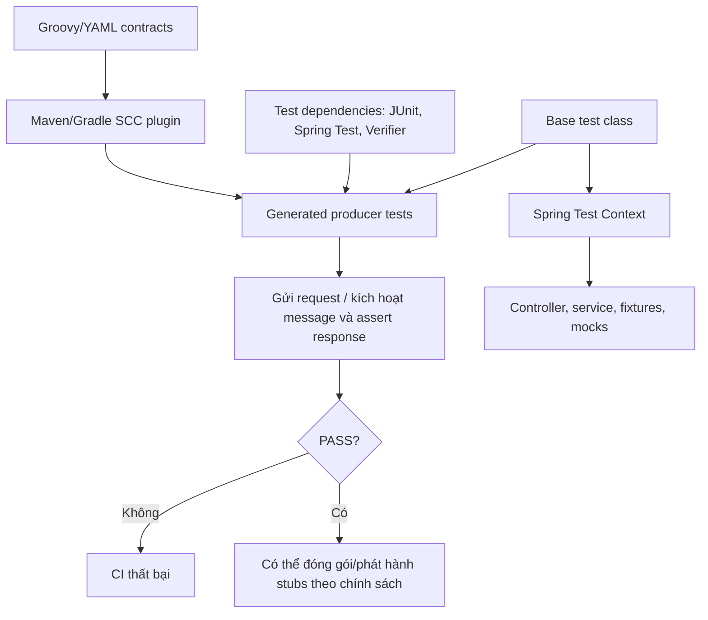

# Cấu hình test context và dependency cần thiết

## 1. Base test giải quyết vấn đề gì?

Trong **Spring Cloud Contract (SCC)**, consumer và producer thống nhất giao diện HTTP hoặc thông điệp bằng **Groovy/YAML DSL**. Từ đó, plugin Maven/Gradle có thể **sinh producer verification tests** và **stub**. Consumer dùng **Stub Runner** để chạy kiểm thử với stub, còn CI giúp phát hiện sớm thay đổi API không tương thích.

Tuy nhiên, generated test **không tự biết** cách khởi động ứng dụng Spring Boot của bạn. Nó không tự chọn profile thử nghiệm, tạo database, khởi tạo bộ lọc bảo mật, kết nối HTTP test client hay giả lập broker. Nếu thiếu **test context** và **test dependencies**, test có thể không biên dịch, không tìm thấy endpoint hoặc trả kết quả khác mong muốn mặc dù file contract hợp lệ.

**Base test** (lớp cơ sở cho generated tests) là nơi nối công cụ sinh test với môi trường kiểm thử thật của producer. Bài trong chương **Base test** này tập trung vào hai câu hỏi:

1. **Cấu hình test context thế nào** để generated tests gọi đúng controller hoặc service, có beans và trạng thái dữ liệu thích hợp?
2. **Dependency nào thực sự cần** trong production, build và test classpath để sinh và thực thi test?

Sau bài, bạn sẽ có thể dựng một cấu hình producer mẫu với **JUnit 5 + Spring Boot + MockMvc**, hiểu lựa chọn **EXPLICIT** khi cần HTTP thực, xác định yêu cầu khác của messaging, kiểm tra generated source/test reports và tổ chức CI. Các snippet là **khung minh họa**, phải chọn phiên bản SCC tương thích với Spring Boot/Spring Cloud và điều chỉnh package, source set, data fixture theo dự án thực tế.

## 2. Phân biệt production runtime, build time và test runtime

Một sai lầm phổ biến là cho rằng thêm `spring-cloud-starter-contract-verifier` vào ứng dụng sẽ tự sinh và chạy test. Thực tế, cần phân biệt ba giai đoạn:

| Thành phần | Nhiệm vụ | Nơi cấu hình phổ biến | Có cần trong ứng dụng production? |
|---|---|---|---|
| `spring-boot-starter-web` hoặc WebFlux/messaging starter | Ứng dụng thực sự phục vụ API hoặc phát/nhận thông điệp | `implementation` / dependency ứng dụng | **Có**, nếu ứng dụng sử dụng |
| SCC Maven plugin / Gradle plugin | Đọc contract, sinh test và stub trong quá trình build | `<build><plugins>` / `plugins {}` | **Không** |
| `spring-cloud-starter-contract-verifier` | Hỗ trợ **chạy producer verification tests** | `<scope>test</scope>` / `testImplementation` | **Không** nếu chỉ dùng trong test |
| `spring-boot-starter-test` | JUnit, Spring Test, assertion/mocking và hỗ trợ test | Test dependency | **Không** |
| Test base + fixtures | Dựng Spring context, HTTP test setup, database/mock trước test | `src/test/java` hoặc source set test tương ứng | **Không** |
| Generated producer tests | Gửi/kích hoạt tương tác và xác minh producer theo contract | Generated test sources | **Không** |
| Stub artifact | Chứa hành vi mô phỏng từ contract | Artifact phát hành có version | **Không phải** producer runtime |
| `spring-cloud-starter-contract-stub-runner` | Chạy stub trong **consumer tests** | Test dependency của consumer | **Thông thường không** |
| CI workflow | Chạy build/test, chặn lỗi và phát hành artifact | Pipeline, không phải thư viện JVM | Không áp dụng |

**Điểm then chốt:** plugin sinh mã chạy ở **build time**; Verifier là thư viện phục vụ **test runtime**. Hai thứ đều khác những thư viện production như Spring MVC hoặc HTTP client.

## 3. Ba lớp cấu hình cần khớp nhau



Để một generated test hoạt động, cần có đủ:

1. **Contract DSL hợp lệ:** phương thức, URL/payload đầu vào, status/header/body hoặc message đầu ra.
2. **Cấu hình generate:** plugin thấy đúng contract, sinh test với đúng framework và test mode, biết base class nào phải kế thừa.
3. **Cấu hình execute:** test classpath có JUnit/Spring Test/Verifier, base class dựng môi trường, ứng dụng trả response thật và test runner thực sự chạy generated tests.

Vì vậy, **sinh ra test thành công** khác với **chạy test thành công**. Và **test chạy nhưng không đi qua đúng đường xử lý producer** cũng chưa chứng minh được cam kết giao tiếp.

## 4. Contract HTTP mẫu để kiểm tra toàn bộ đường dây

Giả sử producer `order-service` phục vụ endpoint tra cứu đơn. Một contract YAML dưới đây mô tả **tình huống đơn tồn tại**; giá trị chỉ dùng làm ví dụ học tập.

```yaml
name: order_found
description: "Consumer tra cứu một đơn hàng đã thanh toán"
request:
  method: GET
  url: /api/orders/42
  headers:
    Accept: application/json
response:
  status: 200
  headers:
    Content-Type: application/json
  body:
    id: 42
    status: PAID
    currency: VND
    totalAmount: 125000
```

Producer test phải gọi `GET /api/orders/42` và kiểm tra status/header/body đã thỏa thuận. Nếu producer trả `404` vì test database chưa có đơn `42`, lỗi có thể nằm ở **fixture**. Nếu fixture đã có nhưng controller trả status hoặc JSON sai, đó có thể là **vi phạm contract**.

Không nên sửa `response.status: 200` thành `404` chỉ để làm xanh CI trước khi phân biệt hai nguyên nhân.

## 5. Maven: dependency test và build plugin là hai cấu hình khác nhau

Các đoạn dưới đây là **phần trọng tâm của `pom.xml`**, không phải POM hoàn chỉnh. Dự án cần Spring Boot parent hoặc dependency management, Spring Cloud BOM tương thích, repository và phiên bản Maven plugin phù hợp.

### 5.1. Dependency của ứng dụng và test

```xml
<dependencies>
    <!-- Ví dụ: producer HTTP dùng Spring MVC -->
    <dependency>
        <groupId>org.springframework.boot</groupId>
        <artifactId>spring-boot-starter-web</artifactId>
    </dependency>

    <!-- JUnit 5, Spring Test và công cụ test Boot -->
    <dependency>
        <groupId>org.springframework.boot</groupId>
        <artifactId>spring-boot-starter-test</artifactId>
        <scope>test</scope>
    </dependency>

    <!-- Hỗ trợ chạy generated producer contract tests -->
    <dependency>
        <groupId>org.springframework.cloud</groupId>
        <artifactId>spring-cloud-starter-contract-verifier</artifactId>
        <scope>test</scope>
    </dependency>
</dependencies>
```

Với ví dụ này, `spring-boot-starter-web` phục vụ controller khi ứng dụng chạy. Hai starter ở `test` phục vụ **chạy test** và không nên đi vào application runtime artifact. Nếu producer sử dụng WebFlux hoặc messaging, chọn starter production phù hợp thay vì cố thêm Web starter chỉ để có test.

### 5.2. Plugin sinh test và ánh xạ base class

```xml
<build>
    <plugins>
        <plugin>
            <groupId>org.springframework.cloud</groupId>
            <artifactId>spring-cloud-contract-maven-plugin</artifactId>
            <version>REPLACE_WITH_COMPATIBLE_SCC_VERSION</version>
            <extensions>true</extensions>
            <configuration>
                <baseClassForTests>
                    com.example.orders.contract.ContractTestBase
                </baseClassForTests>
                <testFramework>JUNIT5</testFramework>
                <testMode>MOCKMVC</testMode>
            </configuration>
        </plugin>
    </plugins>
</build>
```

Ý nghĩa các tùy chọn:

- `baseClassForTests`: **tên đầy đủ kèm package** của lớp cơ sở generated tests sẽ kế thừa.
- `testFramework = JUNIT5`: chọn cách sinh test cho JUnit 5; phải có test engine/framework phù hợp.
- `testMode = MOCKMVC`: sinh test tương tác với HTTP boundary thông qua MockMvc, **không mở cổng HTTP thật**.
- `extensions=true`: cấu hình mẫu cho Maven plugin như tài liệu SCC mô tả; hãy kiểm tra lifecycle/plugin với phiên bản sử dụng.

**Lưu ý về phiên bản:** một số tài liệu SCC cũ nêu JUnit 4 là mặc định; tài liệu tham số Maven plugin hiện hành cho `generateTests` nêu `JUNIT5` và `MOCKMVC`. Vì thế **đặt explicit và kiểm tra generated source** đáng tin cậy hơn suy đoán theo ví dụ khác phiên bản. Phiên bản Maven plugin phải được chọn tương thích; không giả định dependency BOM tự quyết định version cho build plugin.

### 5.3. Không đặt Verifier vào `compile` chỉ vì nó chạy lúc “runtime”

Verifier có thể được nạp **khi chạy test**, nhưng đó là **test runtime**. Nếu chỉ dùng cho producer verification, đặt `scope=test`. Đồng thời **không** đặt SCC Maven plugin vào `dependencies` rồi mong Maven tự gọi generate task: plugin phải ở **build plugins** theo cơ chế của công cụ build.

## 6. Gradle: tách `plugins`, `implementation` và `testImplementation`

Với Gradle Groovy DSL, cấu hình khái niệm:

```groovy
plugins {
    id 'java'
    id 'org.springframework.boot' version 'REPLACE_WITH_BOOT_VERSION'
    id 'org.springframework.cloud.contract' version 'REPLACE_WITH_SCC_VERSION'
}

repositories {
    mavenCentral()
}

dependencies {
    implementation 'org.springframework.boot:spring-boot-starter-web'
    testImplementation 'org.springframework.boot:spring-boot-starter-test'
    testImplementation 'org.springframework.cloud:spring-cloud-starter-contract-verifier'
}

contracts {
    baseClassForTests = 'com.example.orders.contract.ContractTestBase'
    testFramework = 'JUNIT5'
    testMode = 'MockMvc'
    // Nếu chọn vị trí này, cấu hình đường dẫn contract tường minh:
    contractsDslDir = file('src/test/resources/contracts')
}

tasks.withType(Test).configureEach {
    useJUnitPlatform()
}
```

Đây là **ví dụ để phân biệt vai trò**, chưa gồm toàn bộ Spring Cloud dependency management và các thiết lập source set/task của từng phiên bản. Gradle plugin có thể tổ chức generated tests trong **`contractTest` source set/task** riêng, vì vậy phải kiểm tra task nào thực sự chạy JUnit Platform, và classpath nào chứa các dependency cần cho generated tests. Không mặc định rằng cứ chạy `test` là `contractTest` cũng đã chạy.

Đường dẫn contract mặc định **có thể khác giữa Maven và Gradle**. Ví dụ thường gặp là `src/test/resources/contracts` với Maven, trong khi Gradle SCC thường dùng `src/contractTest/resources/contracts` theo cấu hình mặc định của plugin. Nếu chọn một cấu trúc khác, khai báo `contractsDslDir` đúng phiên bản plugin để generator không đọc nhầm thư mục rỗng.

Với `build.gradle.kts`, cú pháp Kotlin DSL sẽ khác; không dán nguyên Groovy DSL vào Kotlin build script.

## 7. Ví dụ base class đầy đủ cho JUnit 5 + Spring Boot + MockMvc

Giả sử ứng dụng có `@SpringBootApplication` trong package cha phù hợp và controller thật đã được đăng ký như Spring bean. Đặt file:

```text
order-service/
  src/
    main/java/com/example/orders/...
    test/java/com/example/orders/contract/ContractTestBase.java
    test/resources/contracts/order-found.yml
```

Tùy cấu hình Gradle, folder contract/test source set có thể khác; cấu trúc ở trên chỉ là lựa chọn phù hợp khi đã thiết lập generator đọc đúng chỗ.

### 7.1. Lớp cơ sở tích hợp Spring context

```java
package com.example.orders.contract;

import io.restassured.module.mockmvc.RestAssuredMockMvc;
import org.junit.jupiter.api.BeforeEach;
import org.springframework.beans.factory.annotation.Autowired;
import org.springframework.boot.test.context.SpringBootTest;
import org.springframework.test.context.ActiveProfiles;
import org.springframework.web.context.WebApplicationContext;

@SpringBootTest(webEnvironment = SpringBootTest.WebEnvironment.MOCK)
@ActiveProfiles("contract")
public abstract class ContractTestBase {

    @Autowired
    private WebApplicationContext webApplicationContext;

    @BeforeEach
    void setUpMockMvc() {
        RestAssuredMockMvc.webAppContextSetup(webApplicationContext);
    }
}
```

Giải thích từng phần:

- `@SpringBootTest` yêu cầu **Spring Test** khởi tạo application context để các bean ứng dụng được đưa vào bài test. `webEnvironment = MOCK` phù hợp với test mode MockMvc, không phải real HTTP server.
- `@ActiveProfiles("contract")` chọn **profile test do dự án định nghĩa**. Nếu không có profile tương ứng hoặc không cần, bỏ annotation; nó không tự tạo cấu hình an toàn.
- `WebApplicationContext` là context chứa cấu hình web/controller liên quan.
- `@BeforeEach` (JUnit 5) được thực thi trước mỗi generated test khi generated class kế thừa lớp cơ sở và test runner hỗ trợ đúng lifecycle.
- `RestAssuredMockMvc.webAppContextSetup(...)` gắn Rest Assured MockMvc vào web context để request của generated tests được xử lý theo cấu hình.
- `abstract` thể hiện base class chỉ dùng làm **lớp cha**, không phải test suite chạy trực tiếp.

Ví dụ **chưa** chuẩn bị bản ghi đơn hàng. Nếu controller phụ thuộc database, cần bổ sung fixture/test configuration. Nếu context thiếu bean, ứng dụng Spring Boot chính không được tìm thấy, hoặc generated test không kế thừa đúng base class, chỉ thêm annotation vẫn không làm test chạy được.

### 7.2. Gắn fixture trước request mà không trộn vào DSL

Một phiên bản mở rộng có thể thêm bean fixture do **nhóm triển khai**:

```java
@Autowired
private OrderContractFixture fixture;

@BeforeEach
void setUp() {
    fixture.resetTestOrders();                 // Chỉ trên DB test cô lập
    fixture.savePaidOrder(42L, 125000L, "VND");
    RestAssuredMockMvc.webAppContextSetup(webApplicationContext);
}
```

Đây là **đoạn chèn minh họa** cho lớp trên, không phải một lớp Java độc lập. `OrderContractFixture`, `resetTestOrders` và `savePaidOrder` **không phải API của SCC**; người học phải viết chúng, đăng ký thành Spring bean qua test configuration hoặc cơ chế phù hợp, và bảo đảm chỉ tác động test database/test schema.

Trong contract, giữ `request` và `response` diễn đạt hành vi quan sát được, không đặt các lệnh insert/update database vào Groovy/YAML chỉ vì cần `200`. Các tình huống `404`/`409` phải được chuẩn bị fixture phù hợp và có request phân biệt hoặc setup riêng.

### 7.3. Test context được tái sử dụng nhưng fixture phải độc lập

Spring Test thường **cache ApplicationContext** giữa các bài test để tiết kiệm thời gian. Điều đó không đồng nghĩa dữ liệu trong database hay state của singleton bean tự được reset. Nếu test có tác động dữ liệu, cache hoặc mock, phải dọn lại hoặc cô lập trạng thái trước mỗi bài test.

Khi các contract có fixture mâu thuẫn hoặc chi phí setup lớn, có thể dùng **base class riêng theo nhóm contract**, với `packageWithBaseClasses` hoặc `baseClassMappings` nếu phiên bản plugin hỗ trợ. Cần kiểm tra **thứ tự ưu tiên** của các tùy chọn mapping so với `baseClassForTests`; không mặc định mọi generated test đều kế thừa một class khi đã bật mapping.

## 8. Chọn `standaloneSetup` hay `webAppContextSetup`?

Hai cách khởi tạo Rest Assured MockMvc khác nhau về mức độ bao phủ:

| Cách | Mục tiêu | Ưu điểm | Giới hạn cần biết |
|---|---|---|---|
| `standaloneSetup(controller)` | Dựng MockMvc quanh controller cụ thể | Nhanh, dễ cô lập | Có thể bỏ qua cấu hình ứng dụng thật: filter, exception handler, security, converter |
| `webAppContextSetup(context)` | Dùng Spring WebApplicationContext của test | Gần hơn với cấu hình MVC thực tế | Tốn thời gian khởi tạo context; vẫn không chạy qua socket thật |
| `EXPLICIT` + real HTTP | Gửi request qua cổng mạng của ứng dụng test | Kiểm tra lớp HTTP và cấu hình server theo môi trường thử nghiệm | Cần quản lý port, startup, cleanup và dependency ngoài |

Ví dụ **standalone** tối giản về ý tưởng:

```java
@BeforeEach
void setUp() {
    // Controller/service mock là đối tượng nhóm tự chuẩn bị.
    RestAssuredMockMvc.standaloneSetup(orderController);
}
```

Cách này phù hợp nếu test muốn tập trung vào hợp đồng của controller và có mock dependency do nhóm kiểm soát. Nhưng **không tự chứng minh** behavior của security filter, validation, `@ControllerAdvice` hay cấu hình serialization trong app thật nếu chúng không được thêm vào setup.

Với `webAppContextSetup`, cũng cần kiểm tra xem filter chain/security, converter và các thành phần liên quan đã được tích hợp đúng chưa. Nếu consumer phụ thuộc hành vi của security, hãy thiết kế test phù hợp, đừng giả định mọi HTTP filter luôn được thực thi chỉ vì context khởi động thành công.

## 9. Khi nào nên chuyển sang test mode `EXPLICIT`?

`MOCKMVC` không mở TCP listener; generated tests được gửi qua MockMvc. Nếu ứng dụng cần **context path**, reverse-proxy behavior, server filter, cookie/redirect hoặc các đặc tính chỉ thể hiện khi thực sự gửi HTTP, có thể cân nhắc `EXPLICIT`. Trong mode này, test phải **khởi động HTTP server** trên một cổng và cấu hình Rest Assured gửi request tới cổng đó.

Maven plugin (minh họa phần thay đổi):

```xml
<configuration>
    <baseClassForTests>
        com.example.orders.contract.RealHttpContractTestBase
    </baseClassForTests>
    <testFramework>JUNIT5</testFramework>
    <testMode>EXPLICIT</testMode>
</configuration>
```

Base class minh họa với Spring Boot server thực trong test:

```java
package com.example.orders.contract;

import io.restassured.RestAssured;
import org.junit.jupiter.api.BeforeEach;
import org.springframework.boot.test.context.SpringBootTest;
import org.springframework.boot.test.web.server.LocalServerPort;

@SpringBootTest(
    webEnvironment = SpringBootTest.WebEnvironment.RANDOM_PORT
)
public abstract class RealHttpContractTestBase {

    @LocalServerPort
    private int port;

    @BeforeEach
    void setUpRealHttp() {
        RestAssured.baseURI = "http://localhost";
        RestAssured.port = port;
    }
}
```

Những lưu ý:

- `@LocalServerPort` ở package trên thuộc các phiên bản Spring Boot hiện đại; dự án cũ có thể khác.
- Generated test phải được sinh với `EXPLICIT`; nếu nó vẫn dùng MockMvc, cấu hình Rest Assured HTTP port không giúp gì.
- `RestAssured.baseURI` và `RestAssured.port` là **global static state**; chạy nhiều bài test đồng thời trên port khác nhau có thể gây race condition. Hãy cô lập cấu hình hoặc điều phối parallelism phù hợp.
- Cần chuẩn bị fixture trước request và làm sạch side effect. Real HTTP có thể dùng thread/transaction khác, không nên mặc định `@Transactional` trên test sẽ rollback toàn bộ thay đổi server thực hiện.
- `RANDOM_PORT` giúp giảm xung đột cổng, nhưng test vẫn phụ thuộc Spring context và các dependency ngoài cần được dựng chính xác.

**Không chọn `EXPLICIT` chỉ vì nghe “sát production hơn”.** Chọn mode theo những đặc tính hợp đồng thực sự cần bảo vệ và chi phí/độ ổn định test có thể chấp nhận.

## 10. Producer dùng WebFlux hoặc messaging cần test context khác

### 10.1. WebFlux

Ứng dụng reactive có thể dùng **`WEBTESTCLIENT`** test mode thay cho MockMvc. Cần có Spring WebFlux/WebTestClient dependencies phù hợp và base test cấu hình reactive application/test client theo tài liệu phiên bản plugin.

Không nên sao chép `RestAssuredMockMvc.webAppContextSetup` từ ví dụ Spring MVC vào một dự án chỉ dùng WebFlux rồi giả định generated tests sẽ hoạt động. Cơ chế test request, application context và test mode phải **đồng bộ**.

### 10.2. Messaging contract

Với message contract, `input`/`outputMessage` trong DSL mô tả cách kích hoạt và nội dung thông điệp được phát. Base test có thể cần:

- Khởi tạo Spring messaging context và các bean producer/broker hoặc test binder.
- Cấu hình `@AutoConfigureMessageVerifier` trên base class theo tài liệu SCC.
- Khai báo các phương thức do `triggeredBy` gọi, đồng thời chuẩn bị dữ liệu/điều kiện để producer phát đúng message.
- Có dependency messaging phù hợp với hệ thống: Spring Integration, Cloud Stream, JMS hoặc Camel; đôi khi cần test binder/broker test riêng.

Ví dụ khái niệm:

```java
// Pseudocode: cấu trúc minh họa, chưa đủ imports/beans.
@SpringBootTest
@AutoConfigureMessageVerifier
public abstract class MessagingContractTestBase {

    @Autowired
    private OrderPublisher publisher;

    public void emitOrderPaid() {
        publisher.publishPaidOrderForTest(42L);
    }
}
```

Trong đó `OrderPublisher` và `publishPaidOrderForTest` là **API dự án tự xây dựng**, không do SCC cung cấp. Không copy đoạn này vào project không có messaging configuration rồi mong kiểm thử chạy. Cần xem generated test thực sự gọi method nào và chọn đúng destination của broker/channel.

Messaging verification không tự bảo đảm delivery order, retry, exactly-once, transaction outbox hay broker production hoạt động; các yêu cầu đó cần kiểm thử tích hợp/độ bền riêng.

## 11. Thiết kế test context và dữ liệu sao cho CI ổn định

### 11.1. Chọn profile, properties và bean phù hợp

`@ActiveProfiles("contract")` giúp tách cấu hình thử nghiệm nếu project có profile tương ứng. Trong một ứng dụng thực tế, nhóm có thể cần thay database URL, message broker, token provider, clock hoặc downstream client. Tuy nhiên:

- Không dùng credential production hoặc kết nối vào database production.
- Không để test phụ thuộc vào network/service live có thể mất kết nối.
- Không tắt security/validation một cách vô tình nếu chúng là phần giao diện consumer phụ thuộc.
- Không tùy tiện thay toàn bộ producer bằng một mock HTTP server; test như thế có thể chỉ chứng minh mock tuân thủ contract.

### 11.2. Dữ liệu fixture: không phụ thuộc thứ tự và tính ngẫu nhiên

Một fixture tốt phải **deterministic**, **isolated**, **repeatable** và đủ nhỏ để đọc hiểu. Test case `GET /api/orders/42` cần bảo đảm đơn `42` tồn tại đúng trạng thái; case `GET /api/orders/9999` cần bảo đảm `9999` không tồn tại. Nếu dùng cùng database và dọn dữ liệu không đúng, việc chạy test song song có thể tạo lỗi ngẫu nhiên.

Tùy dự án, có thể dùng test container/schema riêng, `@Sql`, fixture service, mock repository, reset in-memory DB hoặc cơ chế phù hợp. Với `@Transactional`, phải xem transaction boundary và HTTP test mode; rollback không tự bao phủ message, cache, HTTP server thread hoặc service bên ngoài.

### 11.3. Test context khởi động thành công chưa đủ

Một Spring context có thể load thành công nhưng controller trả `404` vì mapping sai, trả `401` vì thiếu test authentication hoặc trả `500` vì repository lỗi. Trong trường hợp đó, cần chẩn đoán theo các lớp:

1. **Build/generation:** plugin có đọc đúng contract và sinh test không?
2. **Test discovery:** JUnit engine/task có tìm và chạy generated test không?
3. **Context:** Spring beans, profile, controller, security filter đã được cấu hình đúng chưa?
4. **Fixture:** trạng thái dữ liệu/mocks trước request có đúng không?
5. **Implementation:** producer có trả status/headers/body đúng hợp đồng không?

**Không sửa contract chỉ để “làm xanh test” trước khi xác định lớp lỗi.**

## 12. Kiểm tra generated test và dependency classpath

### 12.1. Kiểm tra bằng Maven

Các lệnh tham khảo khi làm việc trên **một dự án producer đã có cấu hình đầy đủ**:

```bash
./mvnw clean test
./mvnw dependency:tree -Dincludes=org.springframework.cloud
```

Khi muốn chạy đầy đủ vòng tích hợp/đóng gói stub theo cấu hình Maven SCC, có thể dùng:

```bash
./mvnw clean verify
```

Không phải mọi project đều có Maven wrapper `mvnw`, và test/contract goals có thể được gắn lifecycle khác tùy plugin phiên bản/cấu hình. Cần đọc build log để biết **generateTests**, biên dịch test và **thực thi generated tests** đã diễn ra. `dependency:tree` chủ yếu liệt kê project dependencies, không phải danh sách build plugin; phải kiểm tra cả cấu hình `<build><plugins>`.

### 12.2. Kiểm tra bằng Gradle

Các lệnh tham khảo:

```bash
./gradlew generateContractTests
./gradlew contractTest
./gradlew check
./gradlew dependencies --configuration testRuntimeClasspath
```

Task `contractTest`, source set và classpath có thể khác tùy phiên bản/plugin/build. `testRuntimeClasspath` không nhất thiết là classpath của **contractTest source set** nếu plugin dùng bộ nguồn riêng. Hãy xem task thực tế, dependency graph và test report. Trong CI, cần chạy **bài test đã sinh**, không chỉ gọi task sinh file.

### 12.3. Checklist nhanh khi kiểm tra đầu ra

- Tìm được generated test source và biết test class **extends** base class nào.
- Generated test sử dụng **MockMvc**, **WebTestClient** hay **Rest Assured real HTTP** đúng với cấu hình mode.
- JUnit 5 test được test engine/task nhận diện; không báo `0 tests` rồi coi là pass.
- Base class được biên dịch và có mặt trong classpath của generated tests.
- Fixture và Spring application context được dựng trước khi request chạy.
- Có test report cho ít nhất một tình huống thật, bao gồm assertion status/header/body.
- CI đỏ khi cố tình cho producer trả sai (kiểm tra trong môi trường test an toàn, không thay đổi production).
- Artifact stub chỉ được công nhận “đã xác minh” theo chính sách khi producer test của đúng build đạt.

## 13. Các lỗi cấu hình thường gặp

| Hiện tượng | Nguyên nhân có thể | Cách xác minh và khắc phục |
|---|---|---|
| Không xuất hiện generated test | Plugin chưa chạy, sai thư mục contract | Kiểm tra plugin/task và `contractsDslDir`/đường dẫn thực |
| Generated test không compile | Thiếu Verifier/test dependency hoặc sai JUnit framework | Kiểm tra test classpath, imports, `testFramework` |
| Generated test không kế thừa base | Sai `baseClassForTests`, có mapping ưu tiên cao hơn | Mở generated source và đối chiếu FQN |
| `NoSuchBeanDefinitionException` | Spring context thiếu bean hoặc test config sai | Kiểm tra package scan, `@Import`, profile |
| `No tests found` | JUnit runner/task/source set không khớp | Kiểm tra Gradle `contractTest` hoặc Maven Surefire configuration |
| `GET` trả `404` dù controller tồn tại | Sai mapping/context path, MockMvc chưa setup | Kiểm tra controller mapping và `webAppContextSetup` |
| `401`/`403` ngoài mong muốn | Security context/filters khác dự kiến | Dựng auth fixture, test filter chain đúng |
| `500` do dữ liệu thiếu | Fixture hoặc mock chưa dựng | Kiểm tra seed/reset và service phụ thuộc |
| Local xanh, CI đỏ | Profile, DB, clock, port, task khác | Cố định môi trường và ghi log context/fixtures |
| Test xanh với standalone nhưng production lỗi | Không đi qua security/formatter/advice thật | Dùng web app context/real HTTP hoặc bổ sung integration tests |
| Test đỏ khi chạy song song | Context/Rest Assured static state/DB dùng chung | Cô lập dữ liệu, điều phối parallelism |
| Consumer test xanh nhưng producer mới sai | Consumer vẫn dùng stub cũ | Chạy producer verification và quản lý phiên bản stub |

## 14. Bài tập: dựng base test cho ba hợp đồng

**Bối cảnh:** producer `payment-service` cung cấp:

- `GET /api/payments/PAY-101` → `200`, body có `state: AUTHORIZED` khi giao dịch tồn tại.
- `GET /api/payments/PAY-999` → `404`, body có `code: PAYMENT_NOT_FOUND` khi giao dịch vắng mặt.
- `POST /api/payments/PAY-202/capture` → `409`, body có `code: ALREADY_CAPTURED` khi giao dịch đã được capture.

### Yêu cầu

1. Chọn **JUnit 5 + MockMvc**, liệt kê dependency production và test trong Maven/Gradle.
2. Cấu hình SCC plugin với `baseClassForTests` và `testMode = MOCKMVC`.
3. Viết `PaymentContractTestBase` dùng `@SpringBootTest`, `WebApplicationContext` và `RestAssuredMockMvc.webAppContextSetup(...)`.
4. Đề xuất fixture có các hành động `authorizedPaymentExists`, `paymentDoesNotExist`, `capturedPaymentExists` và bảo đảm chúng chỉ chạy trong test environment.
5. Trình bày cách kiểm tra generated tests gọi controller thật và assert các status/body đã thỏa thuận.
6. Chỉ ra điều consumer test với Stub Runner chứng minh được và điều nó **không** chứng minh được về producer hiện tại.

### Hướng dẫn lời giải

Bảng phân loại:

| Thành phần | Cấu hình thích hợp |
|---|---|
| API production của `payment-service` | `spring-boot-starter-web` |
| JUnit + Spring Test | `spring-boot-starter-test` với test scope |
| Contract verification runtime | `spring-cloud-starter-contract-verifier` với test scope |
| Sinh test/stub | SCC Maven/Gradle build plugin |
| Test context | `@SpringBootTest(webEnvironment = MOCK)` |
| Kết nối HTTP test | `RestAssuredMockMvc.webAppContextSetup(context)` |
| Chuẩn bị trạng thái | Fixture/helper do nhóm viết, chạy trước mỗi test |
| Consumer dùng stub | `spring-cloud-starter-contract-stub-runner` với test scope ở consumer |

Nếu muốn biến bài tập thành dự án chạy được, hãy chọn phiên bản Boot/Cloud/SCC tương thích, bảo đảm contract nằm đúng thư mục, fixture service tồn tại, test configuration cô lập và generated source được test runner nhận diện.

Một kết quả `GET /PAY-999` trả đúng `404` **không đủ** nếu controller trong test luôn trả `404` cho mọi giao dịch. Cần có ít nhất một tình huống thành công để bảo vệ nhánh khác, và thêm integration/business tests nếu cần kiểm tra side effect của lệnh capture.

## 15. Checklist trước khi merge

- [ ] Plugin build và Verifier/test dependencies được khai báo **đúng vai trò**.
- [ ] Phiên bản Spring Boot, Spring Cloud, Spring Cloud Contract và test framework tương thích.
- [ ] Contract nằm đúng nơi plugin đọc; generated tests xuất hiện.
- [ ] `baseClassForTests` đúng fully qualified class name; generated tests thực sự kế thừa class đó.
- [ ] `testFramework`, `testMode`, Spring context và HTTP client phù hợp với nhau.
- [ ] JUnit test runner/task chạy generated tests; không bị skip hoặc báo `0 tests`.
- [ ] Application context chứa các controller/beans cần thiết; security/validation được kiểm tra khi consumer phụ thuộc.
- [ ] Database, mocks, time/roles/broker được cấu hình **cô lập và tái lập**.
- [ ] Fixture được setup trước mỗi bài test, không phụ thuộc thứ tự hoặc parallelism.
- [ ] Các nhánh lỗi và thành công có assertion status, headers/body hoặc message phù hợp.
- [ ] Stub phát hành có version và consumer test dùng Stub Runner trên đúng artifact.
- [ ] CI thất bại khi producer lệch contract; unit/integration/security tests bổ sung các phần chưa bao phủ.

## 16. Ghi nhớ và tài liệu tham khảo

**Base test là cầu nối giữa hợp đồng và ứng dụng producer trong môi trường kiểm thử.** File Groovy/YAML DSL xác định hành vi được kỳ vọng; build plugin sinh test/stub; **Verifier và Spring Test/JUnit** cung cấp thư viện chạy test; test base dựng context, test client và fixture; generated producer tests xác minh implementation. **Stub Runner** ở consumer là một nhánh kiểm thử riêng, không thay thế việc xác minh producer.

Một `@SpringBootTest` hoặc `baseClassForTests` đúng tên chưa đủ: generated test phải sử dụng đúng mode, có dependency/classpath, chạy qua đúng đường xử lý và đưa ra assertion thực tế. Trong CI, cần truy vết đúng contract, producer build, test report và stub artifact trước khi tuyên bố tương thích.

**Nguồn chính thức** (hãy đối chiếu với phiên bản SCC của dự án):

- [Spring Cloud Contract — Developing Your First Application: base test class](https://docs.spring.io/spring-cloud-contract/reference/getting-started/first-application.html).
- [Spring Cloud Contract — Maven Project: testMode, baseClassForTests, baseClassMappings](https://docs.spring.io/spring-cloud-contract/reference/maven-project.html).
- [Spring Cloud Contract — Gradle Project: contracts, test tasks và base class](https://docs.spring.io/spring-cloud-contract/reference/gradle-project.html).
- [Spring Cloud Contract — Messaging: AutoConfigureMessageVerifier](https://docs.spring.io/spring-cloud-contract/reference/project-features-messaging.html).
- [Spring Cloud Contract — Maven Plugin generateTests parameters](https://docs.spring.io/spring-cloud-contract/docs/current/spring-cloud-contract-maven-plugin/generateTests-mojo.html).

