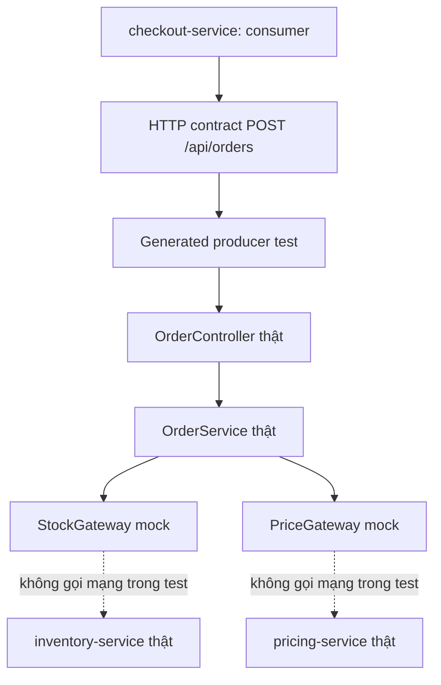
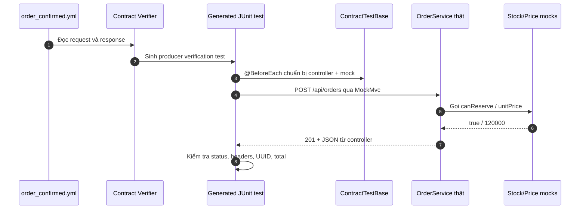
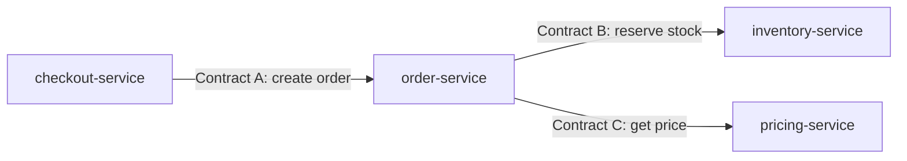
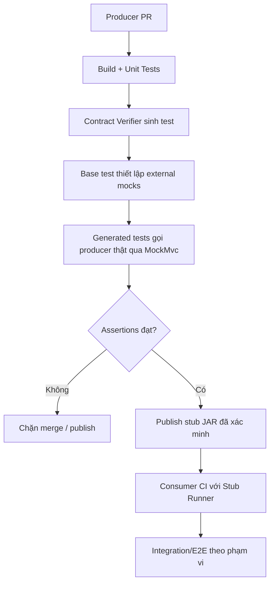

# Mock cộng tác viên ngoài ranh giới hợp đồng

> **Chương:** Base test  
> **Module:** Spring Cloud Contract (`SPRING_CLOUD_CONTRACT`) — kiểm thử hợp đồng producer–consumer với Groovy/YAML DSL, sinh producer test, phát hành stub, dùng Stub Runner và kiểm tra tương thích API trong CI.

## Mục tiêu học tập

Sau bài này, bạn có thể:

1. Xác định **ranh giới hợp đồng** của một HTTP API và phân biệt thành phần cần kiểm tra thật với **cộng tác viên ngoài ranh giới** có thể giả lập.
2. Viết **base test** cho Spring Cloud Contract Verifier dùng **Mockito** để thay thế client kết nối tới hệ thống ngoài, nhưng vẫn thực thi controller và logic producer liên quan.
3. Thiết lập `RestAssuredMockMvc.standaloneSetup(...)` trong `@BeforeEach` để generated tests có môi trường chạy ổn định.
4. Biết khi nào **standalone MockMvc** đủ và khi nào nên dùng **Spring application context** với mock bean.
5. Tránh các anti-pattern như mock luôn HTTP endpoint được kiểm tra, để mock trả giá trị mặc định không chủ đích hoặc làm test phụ thuộc mạng thật.
6. Phân tích vì sao producer contract test **PASS** chưa bảo đảm mọi tương tác ngoài API cũng đúng, và cách kết hợp Stub Runner, integration test, CI để kiểm soát thay đổi không tương thích.

## 1. Bài toán: kiểm tra producer mà không phụ thuộc cả hệ thống

Giả sử kiến trúc đặt hàng có bốn thành phần:

- `checkout-service`: **consumer** gọi API tạo đơn.
- `order-service`: **producer** cung cấp `POST /api/orders`.
- `inventory-service`: dịch vụ ngoài kiểm tra còn hàng.
- `pricing-service`: dịch vụ ngoài trả đơn giá sản phẩm.

`order-service` cần hỏi hai dịch vụ cuối trước khi tạo response cho consumer. Yêu cầu HTTP mẫu:

```http
POST /api/orders HTTP/1.1
Content-Type: application/json
Accept: application/json

{
  "sku": "SKU-001",
  "quantity": 2
}
```

Response đã cam kết:

```http
HTTP/1.1 201 Created
Content-Type: application/json

{
  "orderId": "aa37ba22-4b69-4d20-89e4-7dd3748f1420",
  "status": "CONFIRMED",
  "sku": "SKU-001",
  "quantity": 2,
  "total": 240000
}
```

`orderId` là UUID động; `status`, `sku`, `quantity` và `total` phải đúng trong tình huống kiểm thử. Nếu test producer thật sự gọi `inventory-service` và `pricing-service` qua mạng, test dễ bị ảnh hưởng bởi timeout, token hết hạn, dữ liệu staging thay đổi hoặc một dịch vụ khác đang ngừng hoạt động.

**Giải pháp trong base test:** giữ HTTP endpoint và phần logic `order-service` muốn bảo vệ, nhưng thay **cổng gọi hệ thống bên ngoài** bằng mock có hành vi xác định.



Ở sơ đồ, dấu nét đứt nhấn mạnh **mock thay điểm tích hợp**, không thực hiện lời gọi mạng thật trong producer contract test. Ứng dụng production vẫn phải có adapter thật cho hai gateway.

## 2. Ranh giới hợp đồng là gì?

**Ranh giới hợp đồng** là phần giao tiếp đã được producer và consumer thống nhất, ví dụ:

- HTTP method, path/query, request headers/body.
- HTTP status, response headers/body và kiểu dữ liệu.
- Giá trị hoặc mẫu dữ liệu producer phải trả theo request.
- Với messaging: destination, headers, payload và điều kiện tạo thông điệp.

Với `order-service`, hợp đồng đang được kiểm chứng là **API HTTP gửi cho `checkout-service`**, không phải tính khả dụng của `inventory-service` hoặc `pricing-service`.

### 2.1. Phân biệt thành phần

| Thành phần | Vai trò trong bài | Cách xử lý trong producer contract test |
| --- | --- | --- |
| `OrderController` | Nhận request, mapping HTTP, serialize response | **Chạy thật** qua MockMvc |
| `OrderService` | Kiểm tra điều kiện và tính tổng tiền theo dữ liệu phụ thuộc | **Chạy thật** trong kịch bản này |
| `StockGateway` | Port do `order-service` dùng để hỏi tồn kho ngoài hệ thống | **Mockito mock** |
| `PriceGateway` | Port do `order-service` dùng để hỏi giá ngoài hệ thống | **Mockito mock** |
| `inventory-service` / `pricing-service` thật | Hệ thống ngoài ranh giới đang kiểm tra | **Không khởi động, không gọi HTTP thật** |
| Contract Verifier | Sinh producer verification tests từ DSL | **Chạy thật** |
| Stub Runner ở `checkout-service` | Cho consumer dùng stub đã xác minh | **Chạy ở suite consumer riêng** |

Ranh giới nào nên giả lập còn phụ thuộc mục tiêu test. Nếu bạn **chỉ** muốn kiểm tra ánh xạ HTTP ở controller và toàn bộ nghiệp vụ đã có unit test, việc stub một service nội bộ đôi khi chấp nhận được. Tuy nhiên, trong bài này `total` là một phần quan trọng của response, nên để `OrderService` chạy thật giúp tránh tình trạng test chỉ kiểm tra một response đã được mock sẵn.

**Không mock chính HTTP handler mà bạn cần xác minh.** Nếu toàn bộ response được Mockito trả trực tiếp, test sẽ ít giá trị trong việc phát hiện sai routing, serialization, header, trạng thái HTTP hoặc lỗi mapping do triển khai.

## 3. Phân tách dependency bằng port/interface

Muốn mock một phụ thuộc bên ngoài sạch sẽ, nên cho code nghiệp vụ phụ thuộc vào **interface** thay vì gọi HTTP trực tiếp trong một phương thức dài.

Cấu trúc ví dụ:

```text
src/
├── main/java/com/example/orders/
│   ├── OrdersApplication.java
│   ├── OrderController.java
│   ├── OrderService.java
│   ├── StockGateway.java
│   └── PriceGateway.java
└── test/
    ├── java/com/example/orders/
    │   └── ContractTestBase.java
    └── resources/contracts/
        └── order_confirmed.yml
```

Ở môi trường chạy thật, sẽ có adapter gọi các external service và implement hai gateway; phần này nằm **ngoài mục tiêu của ví dụ contract test**, nhưng phải được bổ sung nếu muốn chạy ứng dụng production.

### 3.1. Port kiểm tra tồn kho

File `StockGateway.java`:

```java
package com.example.orders;

public interface StockGateway {
    boolean canReserve(String sku, int quantity);
}
```

### 3.2. Port tra cứu đơn giá

File `PriceGateway.java`:

```java
package com.example.orders;

public interface PriceGateway {
    long unitPrice(String sku);
}
```

Việc đặt tên `Gateway` hoặc `Port` không quan trọng bằng nguyên tắc: **logic của producer chỉ biết giao diện**; adapter thật có thể gọi REST, gRPC, database hoặc message broker, còn base test có thể đưa vào mock.

### 3.3. Logic nghiệp vụ giữ thật

File `OrderService.java`:

```java
package com.example.orders;

import java.util.UUID;
import org.springframework.stereotype.Service;

@Service
public class OrderService {

    private final StockGateway stockGateway;
    private final PriceGateway priceGateway;

    public OrderService(
            StockGateway stockGateway,
            PriceGateway priceGateway) {
        this.stockGateway = stockGateway;
        this.priceGateway = priceGateway;
    }

    public CreatedOrder create(String sku, int quantity) {
        if (quantity <= 0) {
            throw new IllegalArgumentException("quantity must be positive");
        }
        if (!stockGateway.canReserve(sku, quantity)) {
            throw new IllegalStateException("insufficient stock");
        }

        long price = priceGateway.unitPrice(sku);
        long total = Math.multiplyExact(price, (long) quantity);

        return new CreatedOrder(
            UUID.randomUUID().toString(),
            "CONFIRMED",
            sku,
            quantity,
            total
        );
    }

    public record CreatedOrder(
        String orderId,
        String status,
        String sku,
        int quantity,
        long total
    ) {}
}
```

Trong tình huống chuẩn, `StockGateway` trả `true` và `PriceGateway` trả `120000`; service **tự tính** `total = 120000 × 2 = 240000`. Vì vậy contract test còn có cơ hội phát hiện việc producer trả nhầm tổng tiền.

Để giữ ví dụ ngắn, các nhánh `IllegalArgumentException` và `IllegalStateException` chưa được ánh xạ sang HTTP `400` hoặc `409`; Spring có thể mặc định trả lỗi server nếu chúng không được xử lý. Muốn cam kết response lỗi, hãy bổ sung `@ControllerAdvice` hoặc exception mapping rõ ràng và **contract cho từng nhánh**.

### 3.4. Controller thật được đưa vào MockMvc

File `OrderController.java`:

```java
package com.example.orders;

import org.springframework.http.HttpStatus;
import org.springframework.http.MediaType;
import org.springframework.web.bind.annotation.PostMapping;
import org.springframework.web.bind.annotation.RequestBody;
import org.springframework.web.bind.annotation.ResponseStatus;
import org.springframework.web.bind.annotation.RestController;

@RestController
public class OrderController {

    private final OrderService orderService;

    public OrderController(OrderService orderService) {
        this.orderService = orderService;
    }

    @PostMapping(
        path = "/api/orders",
        consumes = MediaType.APPLICATION_JSON_VALUE,
        produces = MediaType.APPLICATION_JSON_VALUE
    )
    @ResponseStatus(HttpStatus.CREATED)
    public OrderService.CreatedOrder create(
            @RequestBody CreateOrderRequest request) {
        return orderService.create(request.sku(), request.quantity());
    }

    public record CreateOrderRequest(String sku, int quantity) {}
}
```

Endpoint tiếp nhận JSON, gọi service thật và để Spring MVC serialize record thành JSON. Như vậy test có thể kiểm tra method/path, `201`, `Content-Type` và body.

**Chưa có database hoặc transaction thật** trong ví dụ. Producer contract test này bảo vệ một giao tiếp HTTP theo fixture, không chứng minh đơn hàng đã lưu vào persistence.

## 4. Định nghĩa contract để biết mình đang kiểm tra gì

Tạo file `src/test/resources/contracts/order_confirmed.yml` ở dự án producer:

```yaml
name: order_confirmed
description: "Checkout tao don khi ton kho va gia deu hop le"

request:
  method: POST
  url: /api/orders
  headers:
    Content-Type: application/json
    Accept: application/json
  body:
    sku: SKU-001
    quantity: 2

response:
  status: 201
  headers:
    Content-Type: application/json
  body:
    orderId: aa37ba22-4b69-4d20-89e4-7dd3748f1420
    status: CONFIRMED
    sku: SKU-001
    quantity: 2
    total: 240000
  matchers:
    body:
      - path: $.orderId
        type: by_regex
        predefined: uuid
```

Contract mô tả **một tình huống có đủ hàng và giá cố định**. `orderId` là UUID sinh mới nên dùng matcher, còn `status`, `sku`, `quantity` và `total` được giữ nguyên giá trị phải kiểm chứng trong tình huống này.

Có hai phần cần tách:

1. **Producer verification:** test tự sinh gửi `POST /api/orders` và kiểm tra triển khai controller/service trả đúng response, kể cả `total: 240000`.
2. **Consumer stub:** stub server chấp nhận request đúng contract và trả UUID **mẫu** cùng các field cố định. Producer không cần trả đúng UUID mẫu.

Nếu producer tự ý đổi `total` thành `2` hoặc `status` thành `PENDING`, generated test phải thất bại. Nếu chỉ sửa số tồn kho trong mock để service đi vào nhánh lỗi, test cũng sẽ thất bại, nhưng đó có thể là do **fixture không còn phù hợp**, không phải do API không tương thích.

### 4.1. Groovy DSL tương đương

Có thể mô tả cùng tương tác bằng `order_confirmed.groovy`:

```groovy
org.springframework.cloud.contract.spec.Contract.make {
    name 'order_confirmed'

    request {
        method 'POST'
        url '/api/orders'
        headers {
            contentType(applicationJson())
            header 'Accept': 'application/json'
        }
        body(sku: 'SKU-001', quantity: 2)
    }

    response {
        status 201
        headers {
            contentType(applicationJson())
        }
        body(
            orderId: 'aa37ba22-4b69-4d20-89e4-7dd3748f1420',
            status: 'CONFIRMED',
            sku: 'SKU-001',
            quantity: 2,
            total: 240000
        )
        bodyMatchers {
            jsonPath('$.orderId', byRegex(
                '[0-9a-fA-F]{8}-[0-9a-fA-F]{4}-[0-9a-fA-F]{4}-[0-9a-fA-F]{4}-[0-9a-fA-F]{12}'
            ))
        }
    }
}
```

Hai ví dụ YAML/Groovy **biểu diễn cùng một contract**. Trong dự án thực hành, chỉ lưu **một** phiên bản vào thư mục `contracts` để không sinh test/stub trùng.

## 5. Base test: mock gateway, giữ endpoint và service thật

Spring Cloud Contract Maven/Gradle plugin có thể sinh test từ contract, nhưng generated test cần một lớp cơ sở để biết **khởi tạo môi trường nào** và **chuẩn bị phụ thuộc nào**.

Tạo `src/test/java/com/example/orders/ContractTestBase.java`:

```java
package com.example.orders;

import io.restassured.module.mockmvc.RestAssuredMockMvc;
import org.junit.jupiter.api.BeforeEach;

import static org.mockito.Mockito.mock;
import static org.mockito.Mockito.when;

public abstract class ContractTestBase {

    @BeforeEach
    public void setUp() {
        // Chỉ mock những port đi ra ngoài order-service.
        StockGateway stockGateway = mock(StockGateway.class);
        PriceGateway priceGateway = mock(PriceGateway.class);

        // Fixture khớp với request trong contract.
        when(stockGateway.canReserve("SKU-001", 2))
            .thenReturn(true);
        when(priceGateway.unitPrice("SKU-001"))
            .thenReturn(120_000L);

        // Hai lớp xử lý producer vẫn là instance thật.
        OrderService orderService =
            new OrderService(stockGateway, priceGateway);
        OrderController controller =
            new OrderController(orderService);

        RestAssuredMockMvc.standaloneSetup(controller);
    }
}
```

Giải thích từng phần:

- `@BeforeEach` chạy trước mỗi generated test (khi test kế thừa base class với JUnit 5), để mỗi test bắt đầu từ fixture xác định.
- `mock(StockGateway.class)` và `mock(PriceGateway.class)` tạo cộng tác viên giả, **không gọi network**.
- `when(...).thenReturn(...)` đặt hành vi cho **đúng đối số** mà producer sẽ gọi.
- `new OrderService(...)` giữ phép tính tổng tiền và quyết định trạng thái trong code thật.
- `new OrderController(...)` giữ HTTP mapping và JSON serialization thực thi qua MockMvc.
- `RestAssuredMockMvc.standaloneSetup(controller)` tạo môi trường gọi controller không cần khởi động cổng HTTP thật.

Vì base class là `abstract`, nó không phải bài test độc lập. Test được sinh sẽ **kế thừa** nó theo cấu hình verifier.

### 5.1. Vì sao nên tạo mock mới trong từng test?

Mockito mock có trạng thái stubbing và lịch sử lời gọi. Nếu nhiều test dùng chung một singleton mock được cấu hình lại không kiểm soát, test này có thể ảnh hưởng test khác. Tạo hai mock mới trong `@BeforeEach` cho mỗi lần chạy giúp:

- Không mang theo invocation từ test trước.
- Không lệ thuộc thứ tự chạy test.
- Dễ gắn fixture theo contract đang kiểm chứng.
- Giảm tác động từ test chạy song song (dù vẫn cần chú ý các cấu hình tĩnh của RestAssuredMockMvc).

Với nhiều kịch bản, chỉ dùng một fixture chung `SKU-001` có thể **không đủ**. Khi thêm contract `SKU-002` hoặc response hết hàng, hãy tổ chức các base class, setup theo nhóm hoặc dữ liệu kiểm thử cho từng contract; không làm tất cả gateway trả cùng một giá trị mặc định vì điều đó dễ tạo kết quả sai.

### 5.2. Mockito mặc định trả gì khi chưa stub?

Với mock không có `when(...)` tương ứng, Mockito thường trả:

- `false` cho boolean.
- `0` cho kiểu số primitive.
- `null` cho object (tùy loại và default Answer).

Ví dụ, nếu generated test gọi `canReserve("SKU-002", 2)` nhưng base test chỉ stub `canReserve("SKU-001", 2)`, mock có thể trả `false` và service vào nhánh lỗi. Đó là **lỗi fixture**, không nhất thiết là hành vi sai của producer.

Tránh "chữa cháy" bằng:

```java
when(stockGateway.canReserve(anyString(), anyInt()))
    .thenReturn(true);
```

khi hợp đồng của bạn cần phân biệt hàng đủ và hết hàng theo SKU. Dùng matcher Mockito quá rộng có thể che mất lỗi truyền sai SKU hoặc quantity vào gateway. Với tình huống đã biết, stub theo **đối số cụ thể** giúp phát hiện các sai lệch đó gián tiếp.

Nếu dự án dùng nhiều dữ liệu, có thể tạo **fixture builder có tên rõ ràng**, hoặc cho mock trả theo một bảng giá trị nhỏ. Cần ưu tiên dễ hiểu và tái lập hơn số dòng ngắn nhất.

## 6. Nối base class với Spring Cloud Contract Verifier

Plugin Maven phải biết lớp generated test cần kế thừa. Với producer đã có Spring Boot, BOM Spring Cloud **tương thích** và dependency HTTP/MVC phù hợp, cấu hình minh họa:

```xml
<!-- Trong <dependencies> -->
<dependency>
    <groupId>org.springframework.cloud</groupId>
    <artifactId>spring-cloud-starter-contract-verifier</artifactId>
    <scope>test</scope>
</dependency>

<!-- Trong <build><plugins> -->
<plugin>
    <groupId>org.springframework.cloud</groupId>
    <artifactId>spring-cloud-contract-maven-plugin</artifactId>
    <version>${spring-cloud-contract.version}</version>
    <extensions>true</extensions>
    <configuration>
        <testFramework>JUNIT5</testFramework>
        <testMode>MOCKMVC</testMode>
        <baseClassForTests>com.example.orders.ContractTestBase</baseClassForTests>
    </configuration>
</plugin>
```

Lưu ý đây là **POM fragment**, chưa phải project Maven chạy độc lập. Cần khai báo property `spring-cloud-contract.version`, starter Spring MVC, dependency test của Spring Boot và các thành phần Mockito/Rest Assured MockMvc theo phiên bản Spring Boot/Spring Cloud đang sử dụng.

| Cấu hình | Vai trò |
| --- | --- |
| `spring-cloud-starter-contract-verifier` | Các dependency test của verifier |
| `spring-cloud-contract-maven-plugin` | Sinh test/stub từ contract |
| `<testFramework>JUNIT5</testFramework>` | Sinh test tương thích JUnit 5 |
| `<testMode>MOCKMVC</testMode>` | Sử dụng test mode MockMvc |
| `<baseClassForTests>...` | Generated test kế thừa class setup đúng |
| `<extensions>true</extensions>` | Để plugin tham gia Maven lifecycle theo cấu hình |

Với Gradle, nguyên tắc tương tự: cần cấu hình Contract Verifier plugin, khai báo base class và dependency test tương ứng. Đừng suy ra chỉ cần import Mockito là plugin đã tự đọc contract và thực thi test.

### 6.1. Pipeline trong một lượt build



Ở đây **test chạy trong producer**, không gọi ứng dụng consumer thật. Mock chỉ cung cấp dữ liệu bên ngoài để triển khai producer tạo response.

## 7. Một generated test kiểm tra điều gì?

Từ `order_confirmed.yml`, test sinh ra về bản chất sẽ:

1. Gửi `POST /api/orders`.
2. Kèm `Content-Type: application/json`, `Accept: application/json` và request body hợp đồng.
3. Dùng `ContractTestBase` để khởi tạo controller và mock gateway.
4. Nhận response do controller/service tạo.
5. Kiểm tra HTTP `201`, response header `Content-Type: application/json`.
6. Kiểm tra `orderId` có định dạng UUID.
7. Kiểm tra `status: CONFIRMED`, `sku: SKU-001`, `quantity: 2`, `total: 240000`.

Trong thực tế, mã generated test có thể dùng Rest Assured MockMvc, JSONPath, Hamcrest hoặc các API khác tùy plugin/version. **Không nên viết tay một test giả lập thay cho generated test rồi tuyên bố verifier đã chạy**.

### 7.1. Lỗi cần bị bắt

Giả sử developer đổi logic:

```java
long total = price;  // Sai: quên nhân quantity
```

Với mock `unitPrice("SKU-001") = 120000` và request `quantity = 2`, service trả `total = 120000` thay vì `240000`. Generated producer test phải **FAIL** vì total trong contract không còn đúng.

Hoặc producer đổi:

```java
return new CreatedOrder(
    UUID.randomUUID().toString(),
    "PENDING",             // Sai so với CONFIRMED
    sku, quantity, total
);
```

Generated test phải **FAIL** do status nghiệp vụ khác. Đây chính là lý do ta không nên mock luôn `OrderService` cho tình huống đang muốn bảo vệ logic tạo response.

### 7.2. Lỗi mà test chưa chứng minh được

Producer contract test mẫu **không chứng minh**:

- Adapter thật gọi `inventory-service` đúng URL/token hoặc xử lý timeout.
- Giá trả từ `pricing-service` thật có chính xác với mọi sản phẩm không.
- Hệ thống đã giữ hàng hoặc lưu đơn bền vững trong DB.
- Hai lần gọi tạo hai UUID **khác nhau**.
- Mọi trường hợp hết hàng, lỗi giá, mạng chập chờn đều trả status phù hợp.
- Authentication, filter, interceptor hay gateway production hoạt động nếu test dùng MockMvc standalone.

Đây là phạm vi của các **integration test**, **service-component test** hoặc **end-to-end test** bổ sung. Contract test tập trung vào **lời hứa giao tiếp** được mô tả trong DSL.

## 8. Vì sao không mock luôn lớp cần kiểm chứng?

Một anti-pattern phổ biến:

```java
OrderService orderService = mock(OrderService.class);

when(orderService.create("SKU-001", 2))
    .thenReturn(new OrderService.CreatedOrder(
        "aa37ba22-4b69-4d20-89e4-7dd3748f1420",
        "CONFIRMED",
        "SKU-001",
        2,
        240000L
    ));

RestAssuredMockMvc.standaloneSetup(
    new OrderController(orderService)
);
```

Test này **vẫn có thể có giá trị** khi mục tiêu chỉ là kiểm tra HTTP mapping/serialization của controller và service đã được kiểm thử độc lập. Nhưng trong bài toán đang yêu cầu `order-service` trả đúng tổng tiền và trạng thái theo kết quả các gateway, mock luôn `OrderService` sẽ biến phần lớn response thành **dữ liệu do chính test định nghĩa**. Khi phép tính trong `OrderService` bị sửa sai, contract test dạng này không thấy được.

Do đó, quyết định mock phải bám vào **mục đích kiểm thử**:

| Mục tiêu | Có thể mock? | Lưu ý |
| --- | --- | --- |
| HTTP mapping, header, serialization của controller | Có thể mock service ở dưới controller | Chỉ chứng minh controller layer |
| HTTP behavior **và** logic tính total ở producer | Nên giữ service thật | Mock các adapter/gateway bên ngoài |
| Kết nối producer tới DB thật | Không mock repository trong test này | Dùng integration test/Testcontainers |
| Tương thích API của một dịch vụ ngoài | Dùng stub/contract riêng hoặc chạy integration test | Mockito mock tự viết không chứng minh external API thật tương thích |

Cách đặt ranh giới đúng là một quyết định thiết kế test, không phải quy tắc tuyệt đối "mọi service đều phải thật" hay "mọi dependency đều phải mock".

## 9. Mock cộng tác viên trong Spring context khi nào?

`RestAssuredMockMvc.standaloneSetup(...)` nhanh nhưng không dựng toàn bộ Spring application context. Nếu contract phụ thuộc vào các thành phần như:

- Spring Security filter chain.
- `@ControllerAdvice` / exception handler được khai báo là bean.
- Validation, Jackson configuration hoặc custom serializer.
- Interceptor, controller advice, message converters.
- Cấu hình bean ảnh hưởng trực tiếp tới HTTP behavior.

thì test nên chạy **với Spring context thực sự**, nhưng vẫn mock các cổng external để không gọi mạng.

Ví dụ **lựa chọn thay thế** cho base class ở mục 5, dùng Spring Framework có `@MockitoBean` (chẳng hạn các phiên bản Spring Framework 6.2+):

```java
package com.example.orders;

import io.restassured.module.mockmvc.RestAssuredMockMvc;
import org.junit.jupiter.api.BeforeEach;
import org.springframework.beans.factory.annotation.Autowired;
import org.springframework.boot.test.context.SpringBootTest;
import org.springframework.test.context.bean.override.mockito.MockitoBean;
import org.springframework.web.context.WebApplicationContext;

import static org.mockito.Mockito.when;

@SpringBootTest
public abstract class ContractTestBase {

    @Autowired
    WebApplicationContext context;

    @MockitoBean
    StockGateway stockGateway;

    @MockitoBean
    PriceGateway priceGateway;

    @BeforeEach
    public void setUp() {
        when(stockGateway.canReserve("SKU-001", 2))
            .thenReturn(true);
        when(priceGateway.unitPrice("SKU-001"))
            .thenReturn(120_000L);

        RestAssuredMockMvc.webAppContextSetup(context);
    }
}
```

Điểm khác so với `standaloneSetup`:

- Spring context tạo bean `OrderController` và `OrderService`.
- `@MockitoBean` cung cấp bean giả cho hai interface gateway, thay vì gọi external adapter thật.
- `webAppContextSetup(context)` dựng MockMvc từ cấu hình web trong context.
- `@SpringBootTest` chỉ khả thi nếu project đã có lớp `@SpringBootApplication`, dependency tương ứng và cấu hình context phù hợp.

**Chú ý phiên bản:** `@MockitoBean` có trong các dòng Spring Test mới (Spring Framework 6.2 trở lên). Dự án cũ có thể dùng `@MockBean` của Spring Boot, nhưng annotation đó đã bị deprecate trong các dòng Boot mới; hãy chọn cách tương thích với stack thực tế. Không trộn hai biến thể base class trong cùng project mà không chủ đích.

Ngay cả khi dùng context, việc áp dụng **Spring Security filter chain** cho MockMvc có thể cần cấu hình riêng (ví dụ `springSecurity()` hoặc auto-config test phù hợp). Hãy kiểm tra generated test có thực sự đi qua filter/advice/serialization cần bảo vệ; chỉ nhìn thấy `@SpringBootTest` chưa đủ.

### 9.1. Lựa chọn giữa standalone và context

| Tiêu chí | MockMvc standalone | Spring context + mock bean |
| --- | --- | --- |
| Khởi động | Nhanh, tạo controller thủ công | Chậm hơn, tạo Spring context |
| Constructor wiring | Test tự dựng | Spring dependency injection |
| HTTP mapping | Có | Có |
| Custom Jackson, filter, Security | Chỉ có những gì test cấu hình thủ công | Có thể kiểm tra cấu hình thực theo test setup |
| Mock external gateway | Mockito instance thông thường | `@MockitoBean` / annotation tương thích |
| Phù hợp nhất | Contract API đơn giản, ít cấu hình | Contract phụ thuộc hạ tầng Spring thực |

Không cần mở database thật hoặc gọi network thật chỉ vì chọn Spring context. Nếu một component không nằm trong phạm vi contract và cần cô lập, dùng mock/test double có chủ đích.

## 10. Fixtures: dữ liệu mock là một phần thiết kế kiểm thử

Một mock không chỉ giúp test nhanh; nó định nghĩa **điều kiện tiền đề** của một tương tác. Với contract `order_confirmed`, fixture là:

```text
Input HTTP:  sku=SKU-001, quantity=2
Stock:       canReserve(SKU-001, 2) -> true
Price:       unitPrice(SKU-001) -> 120000
Expected:    HTTP 201, status=CONFIRMED, total=240000
```

Nếu bạn thêm contract thứ hai cho `SKU-002` với đơn giá khác, cần setup fixture có phân biệt:

```java
when(stockGateway.canReserve("SKU-002", 1))
    .thenReturn(true);
when(priceGateway.unitPrice("SKU-002"))
    .thenReturn(75_000L);
```

Khi generated test gọi đúng request thứ hai, producer trả total `75000`; các tình huống vẫn độc lập.

**Không làm fixture quá "thông minh":** base class không nên tự tính expected response rồi đưa trực tiếp vào controller mock, vì như vậy bạn kiểm chứng chính dữ liệu do test tạo ra chứ không kiểm tra logic producer. Fixture nên **cung cấp đầu vào**; implementation cần **tạo đầu ra**.

### 10.1. Gom fixture theo nhóm contract

Khi hợp đồng tăng lên nhiều tình huống:

- Một base class chung có thể chuẩn bị dữ liệu thường dùng.
- Các contract trong thư mục con có thể dùng base class theo convention hoặc mapping plugin tùy cấu hình.
- Với Spring context, một test configuration có thể cung cấp fake/test double chia sẻ.
- Với database, dùng transaction rollback, cleanup hoặc dữ liệu seed xác định; không để test phụ thuộc dữ liệu còn sót từ lượt trước.
- Tên fixture nên bộc lộ ý nghĩa nghiệp vụ như `withEnoughStock("SKU-001", 2)` thay vì một `setupEverything()` khó đoán.

Không phải lúc nào thêm nhiều Mockito `when` cũng tốt. Khi fixture có quá nhiều nhánh/logic, một **fake in-memory nhỏ** có thể đơn giản và ít gây lỗi hơn.

### 10.2. Có nên verify lời gọi mock trong base test?

Thông thường generated contract tests tập trung vào **kết quả HTTP**, không phải số lần gọi nội bộ. Có thể viết integration/unit test riêng để xác nhận `StockGateway.canReserve(...)` được gọi với đúng đối số khi quy tắc nghiệp vụ yêu cầu.

Nếu đưa quá nhiều `Mockito.verify(...)` vào base test:

- Contract dễ bị ràng buộc vào cách triển khai nội bộ.
- Refactor từ hai lời gọi gateway thành một batch call có thể làm test đỏ dù API consumer không thay đổi.
- Base test có thể khó dùng cho nhiều contract với đường đi khác nhau.

Hãy ưu tiên assertion trên **observable behavior**. Chỉ verify tương tác nội bộ khi chính nó mang tính bất biến của nghiệp vụ hoặc là mục đích của một test khác.

## 11. Thực hành làm hỏng API để kiểm tra base test

Để bảo đảm mock không làm "xanh giả", hãy chạy thử các thay đổi có chủ đích trong branch thử nghiệm.

### Thử nghiệm A: sai tổng tiền

Giữ fixture `120000` và request `quantity: 2`. Đổi phép tính trong `OrderService`:

```java
long total = price; // Bỏ quên quantity
```

**Mong đợi:** producer verification FAIL ở `total`. Nếu vẫn PASS, hãy kiểm tra test có dùng `OrderService` thật không, contract có assertion `total` không và generated test có thực thi không.

### Thử nghiệm B: sai HTTP status

Đổi `@ResponseStatus(HttpStatus.CREATED)` thành `@ResponseStatus(HttpStatus.OK)`.

**Mong đợi:** generated test FAIL vì contract yêu cầu `201`.

### Thử nghiệm C: mock bên ngoài ném lỗi

Trong một test/fixture riêng:

```java
when(priceGateway.unitPrice("SKU-001"))
    .thenThrow(new RuntimeException("pricing unavailable"));
```

**Mong đợi:** producer đi vào nhánh lỗi tương ứng. Nhưng đừng tự giả định `503 Service Unavailable`: controller ví dụ chưa có exception handler, nên response có thể là `500` hoặc exception chưa được xử lý. Chỉ thêm **error contract** sau khi implementation đã quy định cách ánh xạ lỗi và response body cụ thể.

### Thử nghiệm D: request khác fixture

Gửi `SKU-999` trong generated test nhưng chỉ setup `SKU-001`. Mockito có thể trả default, khiến request thất bại.

**Kết luận:** nguyên nhân là thiếu fixture hoặc contract/test setup không đồng bộ, không nhất thiết là lỗi tương thích API. Không nên sửa YAML hoặc response expected chỉ để test xanh trước khi hiểu nguyên nhân.

## 12. Khi nào không nên mock một hệ thống phụ thuộc?

Mock external collaborator giúp test độc lập và dễ tái lập, nhưng có mặt trái: **hành vi giả lập có thể lệch khỏi dịch vụ thật**.

Ví dụ `PriceGateway.unitPrice("SKU-001")` trả một `long` trong test, nhưng API giá thật đã đổi từ số sang chuỗi hoặc đổi endpoint; producer contract test sẽ không phát hiện vì không hề gọi HTTP tới `pricing-service`.

Các loại kiểm thử bổ sung cần thiết:

| Rủi ro | Kiểm thử phù hợp |
| --- | --- |
| Order HTTP API không khớp điều checkout mong đợi | **Producer contract verification** của `order-service` |
| Adapter `PriceGateway` gửi sai URL/header tới pricing | Adapter integration test với stub được kiểm chứng |
| `pricing-service` đã đổi response trái hợp đồng của `order-service` | **Contract test** giữa `order-service` (consumer của pricing) và `pricing-service` (producer) |
| ORM/query của order database sai | Repository integration test với database kiểm thử |
| Các dịch vụ không kết nối được trong staging | Integration/E2E smoke test |
| Đặt hàng thành công nhưng luồng thanh toán tổng thể hỏng | End-to-end test một số nghiệp vụ trọng yếu |

**Một dịch vụ có thể vừa là producer vừa là consumer.** Trong bài này `order-service` là **producer** đối với `checkout-service`, nhưng lại là **consumer** của `inventory-service` và `pricing-service`. Mỗi ranh giới có thể có hợp đồng riêng.



Contract A được kiểm tra bằng base test đang xây dựng; contract B/C cần thêm những bộ kiểm thử tương ứng. Mockito không thay thế sự đảm bảo từ B/C.

## 13. Vòng đời stub và Stub Runner ở consumer

Sau khi producer verification đạt, Maven/Gradle có thể sinh **stub JAR** từ contract HTTP. Ví dụ producer build:

```bash
mvn clean verify
mvn clean install
```

Giả sử producer có tọa độ:

```text
com.example:order-service:1.0.0
```

Stub artifact thường được đóng gói với classifier `stubs`:

```text
com.example:order-service:1.0.0:stubs
```

Consumer test có thể dùng Stub Runner:

```java
@SpringBootTest(properties = {
    "orders.base-url=http://localhost:8090"
})
@AutoConfigureStubRunner(
    ids = "com.example:order-service:1.0.0:stubs:8090",
    stubsMode = StubRunnerProperties.StubsMode.LOCAL
)
class CheckoutOrderContractTest {

    @Autowired
    CheckoutClient checkoutClient;

    @Test
    void docDuocResponseTaoDon() {
        OrderResult result =
            checkoutClient.createOrder("SKU-001", 2);

        UUID.fromString(result.orderId());
        assertEquals("CONFIRMED", result.status());
        assertEquals(240000L, result.total());
    }
}
```

Đoạn này là minh họa: các class `CheckoutClient`, `OrderResult`, dependency/import và property `orders.base-url` phải được triển khai trong dự án consumer. Chế độ `LOCAL` giả định artifact stub đã được cài vào Maven local repository.

**Quan hệ ba mức test:**

- **Base test của producer:** mock inventory/pricing để test `OrderController` và `OrderService` thật với contract A.
- **Consumer test với Stub Runner:** khởi chạy stub của `order-service` để test `checkout-service` không cần order-service thật.
- **Integration/E2E:** kiểm tra adapter thật, database, broker, hạ tầng và luồng sản xuất khi cần.

Consumer-side Stub Runner **không chạy lại producer implementation**. Nó dùng artifact stub đã chọn. Vì vậy phải kiểm chứng producer trước khi publish stub và chọn đúng phiên bản ở consumer CI.

## 14. Quy trình CI hợp lý với mock ngoài ranh giới



Các bước kiểm tra quan trọng:

1. **Producer CI:** chạy `mvn clean verify` hoặc lifecycle phù hợp, không skip contract tests; kiểm tra test report có generated tests thực sự được thực thi.
2. **Phạm vi mock:** tài liệu hóa gateway nào là external; không thay toàn bộ implementation producer bằng mock để làm test xanh.
3. **Fixtures:** giữ kết quả mock có thể tái lập, phù hợp request hợp đồng.
4. **Phát hành stub:** chỉ publish artifact có version sau khi producer verification và các test bắt buộc PASS.
5. **Consumer CI:** dùng Stub Runner với phiên bản stub cụ thể; không mặc định các runner chia sẻ `~/.m2`.
6. **Kiểm thử biên khác:** có contract/integration test giữa order với inventory/pricing, cộng test hạ tầng cần thiết.

Trong CI phân tán, dùng Maven-compatible artifact repository hoặc truyền stub artifact qua job; sử dụng `StubsMode.REMOTE` khi cần tải stub từ kho từ xa. Đừng dùng stub mới tạo nhưng chưa được producer kiểm chứng làm bằng chứng bảo đảm API.

### 14.1. Phân biệt lỗi contract và lỗi fixture

| Hiện tượng | Nguyên nhân có thể | Cách xử lý |
| --- | --- | --- |
| Test nhận `500` thay `201` | Gateway mock chưa stub đúng input, service ném exception | So request sinh ra với `when(...)` |
| Test nhận `201` nhưng `total` sai | Phép tính sai hoặc mock đơn giá sai fixture | Đối chiếu invariant và giá trong fixture |
| Generated test không gọi controller | `baseClassForTests` sai, test mode sai hoặc setup không chạy | Kiểm tra plugin, class path và output test |
| Build xanh dù implementation bị cố tình phá | Test không sinh, bị skip hoặc controller/service bị mock | Đọc test reports; thực hiện thử nghiệm fail có chủ đích |
| Standalone test xanh nhưng staging 401 | Security filter không có trong standalone setup | Dùng context/integration test với Security thật |
| Test cũ xanh, adapter pricing production bị hỏng | Mock không gọi pricing thật | Thêm contract/integration test cho boundary B/C |
| Consumer chạy stub nhưng nhận 404 | Request không khớp WireMock mapping | So method/path/headers/body với contract |
| Không tìm được stub trong CI | Chưa install/publish hoặc chọn sai version | Kiểm tra tọa độ artifact và repository |

## 15. Quy tắc chọn mock và các anti-pattern

### Các quy tắc nên tuân thủ

- **Bắt đầu từ mục tiêu kiểm thử, rồi chọn ranh giới mock**; đừng chọn mock vì "càng nhanh càng tốt".
- **Giữ code producer thật** cho hành vi HTTP mà consumer phụ thuộc.
- **Mock ở interface/port ngoài ranh giới**, không buộc test dựng HTTP client thật chỉ để rồi monkey-patch nội bộ.
- **Chỉ đưa dữ liệu tiền đề qua mock**, để logic producer tự xây response.
- **Stub cụ thể theo request** khi input có ý nghĩa; tránh `any()` quá rộng nếu nó che lỗi truyền tham số.
- **Dùng matcher contract cho field động** như UUID, không sửa code nghiệp vụ để sinh ID cố định cho mọi response.
- **Không xem PASS là đủ** nếu generated test không thực sự được chạy hoặc thiếu assertion quan trọng.
- **Thêm test ngoài ranh giới** cho adapter, security, broker, DB và workflow.

### Anti-pattern cần tránh

| Anti-pattern | Vấn đề |
| --- | --- |
| Mock `OrderController` và trả sẵn JSON | Không xác minh mapping/serialization thật |
| Mock `OrderService` dù đang muốn test total | Lỗi tính tiền có thể bị che |
| Mock cả external client lẫn serializer rồi so response tự tạo | Test gần như chỉ kiểm tra fixture |
| Trả `true` cho mọi `canReserve` | Không phân biệt SKU/số lượng, dễ mất tín hiệu hết hàng |
| Fixture phụ thuộc network staging | Test giòn, khó tái lập |
| Xem base test như production wiring | Standalone không chứng minh bean/filter/transaction production |
| Publish stub dù producer tests bị skip | Consumer dùng dữ liệu giả lập chưa có bảo đảm |
| Sửa contract theo output sai để CI xanh | Consumer cũ có thể bị phá tương thích |

## 16. Bài tập thực hành

**Bài 1 — Xác định ranh giới.** Trong sơ đồ ở mục 1, hãy nêu thành phần nào cần thực thi thật khi kiểm tra hợp đồng giữa checkout và order, thành phần nào có thể mock. Nếu mục tiêu đổi thành kiểm tra adapter `PriceGateway` gọi đúng HTTP API, quyết định mock có thay đổi không?

**Bài 2 — Xây base test.** Từ `OrderService` và `OrderController` ở mục 3, tạo `ContractTestBase` với `@BeforeEach`. Mock `StockGateway` để `canReserve("SKU-001", 2)` trả `true`, mock `PriceGateway` trả `120000`, rồi cấu hình `RestAssuredMockMvc.standaloneSetup(...)`.

**Bài 3 — Thử breaking change.** Đổi `total = price * quantity` thành `total = price`. Chạy generated producer test. Kết quả dự đoán là gì? Nếu PASS, những thành phần nào có thể đã bị mock hoặc assertion nào có thể thiếu?

**Bài 4 — Thêm tình huống hết hàng.** Tạo một contract mới cho SKU không đủ tồn kho. Thiết kế response status/body có ý nghĩa (ví dụ `409 Conflict`) và bổ sung exception handler tương ứng trước khi kỳ vọng generated test PASS. Đừng chỉ làm `StockGateway` trả `false` rồi mặc định Spring sẽ trả `409`.

**Bài 5 — Dùng Spring context.** Chuyển base test từ standalone MockMvc sang `@SpringBootTest` + `@MockitoBean`. Kiểm tra Spring context tạo `OrderController`/`OrderService` thật, hai gateway là bean mock và điều kiện security/serialization quan trọng được đưa vào test setup.

**Bài 6 — Producer vừa là consumer.** Nêu cách xây contract test thứ hai cho quan hệ `order-service → pricing-service`. Vì sao việc mock `PriceGateway` trong contract A không đủ để phát hiện pricing-service đổi `unitPrice` từ số sang chuỗi?

**Bài 7 — Thiết kế CI.** Lập pipeline gồm producer verification, publish stub, consumer Stub Runner test và integration test adapter. Chỉ ra bước nào phải fail khi `OrderService` trả sai `total`, và bước nào phát hiện adapter gọi pricing sai URL.

### Gợi ý kiểm tra kết quả

- Bài 1: Contract A cần endpoint order thật; hai gateway ngoài ranh giới có thể mock. Với adapter pricing, phải kiểm tra code adapter thật và dùng stub/producer test của pricing phù hợp.
- Bài 2: Generated test phải nhận `201`, `CONFIRMED`, `quantity: 2` và `total: 240000`, với `orderId` khớp UUID.
- Bài 3: Producer contract test phải FAIL; nếu không, kiểm tra setup, fixture, generated test và test reports.
- Bài 4: Cần error mapping rõ ràng, không suy đoán status của exception mặc định.
- Bài 5: `@MockitoBean` áp dụng theo phiên bản hỗ trợ; context test cần thực sự kích hoạt thành phần Spring muốn bảo vệ.
- Bài 6: `order-service` đóng vai consumer của pricing, cần kiểm tra tương thích ở boundary khác.
- Bài 7: Producer verification bảo vệ total; adapter integration/contract test bảo vệ giao tiếp với pricing.

## 17. Tóm tắt

**Mock cộng tác viên ngoài ranh giới hợp đồng** là một cách làm producer contract test nhanh, ổn định và có thể tái lập. Trong ví dụ này, `order-service` là producer của API tạo đơn; test chạy `OrderController` và `OrderService` thật, còn `StockGateway` và `PriceGateway` được giả lập để không gọi tới dịch vụ ngoài.

Spring Cloud Contract Verifier sinh test từ Groovy/YAML DSL; **base test** chuẩn bị môi trường MockMvc và fixtures, cho phép generated test đối chiếu HTTP behavior thật với hợp đồng. Sau khi producer verification PASS, stub JAR được phát hành để consumer kiểm tra qua **Stub Runner**. Trên CI, vẫn cần thêm những test ở các ranh giới khác để phát hiện adapter hỏng, cấu hình bảo mật sai hoặc lỗi tích hợp thực tế.

Điều cần nhớ không phải "mock tất cả" hay "không mock gì cả", mà là: **giữ thật hành vi đang cam kết với consumer, giả lập các phụ thuộc nằm ngoài mục tiêu test, và có bằng chứng kiểm thử riêng cho những phụ thuộc đã giả lập**.

## Tài liệu tham khảo

- [Spring Cloud Contract — Getting Started: First Application](https://docs.spring.io/spring-cloud-contract/reference/getting-started/first-application.html) — cách cấu hình base test, sinh producer tests và stub.
- [Spring Cloud Contract — Maven Project](https://docs.spring.io/spring-cloud-contract/reference/maven-project.html) — plugin Maven và test generation.
- [Spring Cloud Contract — Contract DSL](https://docs.spring.io/spring-cloud-contract/reference/project-features-contract.html) — Groovy/YAML contract và nội dung hợp đồng.
- [Spring Cloud Contract — Dynamic Properties](https://docs.spring.io/spring-cloud-contract/reference/project-features-contract/dsl-dynamic-properties.html) — matcher cho UUID và những field động.
- [Spring Cloud Contract — Stub Runner Core](https://docs.spring.io/spring-cloud-contract/reference/project-features-stubrunner/stub-runner-core.html) — test consumer với stub artifact.
- [Spring Framework — MockitoBean](https://docs.spring.io/spring-framework/reference/testing/annotations/integration-spring/annotation-mockitobean.html) — thay thế bean trong Spring test context.
