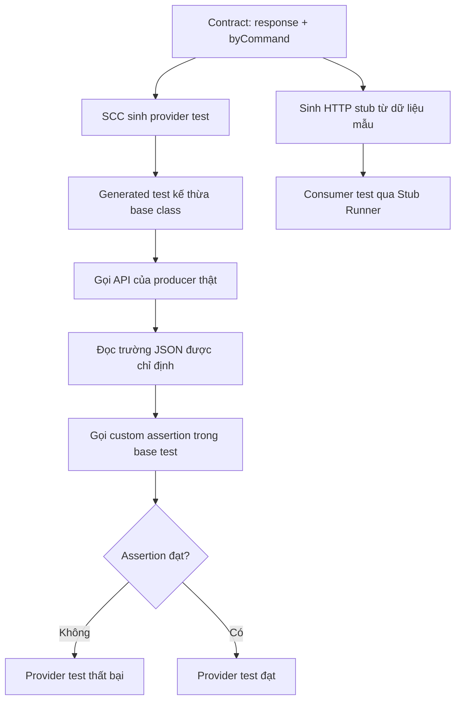
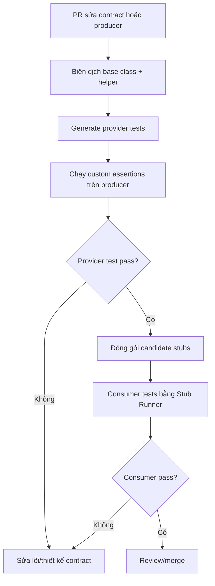

# Viết phương thức hỗ trợ cho custom assertion trong base test Spring Cloud Contract

Trong **Spring Cloud Contract (SCC)**, contract Groovy/YAML diễn tả hành vi mà **producer** phải cung cấp cho **consumer**. Công cụ có thể sinh **provider verification test** từ hợp đồng và đóng gói **stub** để consumer kiểm thử bằng **Stub Runner**. Đối với nhiều API, việc kiểm tra HTTP status, header, giá trị JSON chính xác hoặc regex đã đủ. Nhưng đôi khi một trường dữ liệu cần **quy tắc xác minh khó diễn tả bằng matcher thông thường**: ID phải phù hợp một định dạng và có checksum, timestamp phải parse được thành thời điểm hợp lệ, số tiền phải đúng đơn vị và không âm, hoặc mã nghiệp vụ phải qua một hàm kiểm tra riêng.

Đó là lúc **custom assertion** phát huy tác dụng. Thay vì đặt tất cả logic vào file contract, ta giữ contract ngắn gọn và cho generated test gọi một **phương thức hỗ trợ trong base test**. Bài thuộc chương **Base test** này tập trung vào cách tổ chức, triển khai và kiểm tra phương thức đó với **Groovy DSL**, cách diễn đạt tương ứng bằng **YAML DSL** khi phiên bản SCC hỗ trợ, cùng những giới hạn khi sử dụng với HTTP stubs, messaging và CI.

Ví dụ xuyên suốt: `order-producer` trả đơn hàng có `orderId` động, `createdAt` theo UTC và `totalMinor` là số tiền nguyên theo đơn vị nhỏ nhất. `order-consumer` sử dụng API ấy.

## 1. Base test và custom assertion giải quyết hai vấn đề khác nhau

**Base test** là lớp cha được cấu hình để các bài test do Spring Cloud Contract sinh ra sử dụng. Nó thường chuẩn bị HTTP test mode, context ứng dụng, mock dependency hoặc fixture. **Custom assertion** là phương thức trong lớp cha (hoặc phương thức truy cập được từ đó) kiểm tra một quy tắc cụ thể và **làm bài test thất bại** khi dữ liệu không hợp lệ.

Ví dụ những việc mỗi thành phần thực hiện:

| Thành phần | Trách nhiệm | Ví dụ |
| --- | --- | --- |
| Contract Groovy/YAML | Khai báo request, response, matcher cần kiểm tra | `GET /api/orders/1001` trả 200, JSON chứa `orderId` |
| Base test | Cung cấp setup mà generated test kế thừa | Khởi tạo MockMvc, chuẩn bị test clock hoặc dependency giả |
| Phương thức custom assertion | Xác minh giá trị theo quy tắc ứng dụng | `assertValidOrderId(value)` |
| Generated provider test | Gửi request đến producer và gọi assertion | Đọc `$.orderId` rồi kiểm tra bằng phương thức hỗ trợ |
| Stubs JAR | Chứa response mẫu/mapping để consumer thử giao tiếp | Trả JSON mẫu có `orderId: "ORD-123456"` |
| Consumer test | Kiểm tra client sử dụng stub đúng | Deserialize JSON và xử lý trường `orderId` |

**Base test không phải phần code sẽ chạy trong consumer service.** Một phương thức `assertValidOrderId` nằm ở test source của producer không tự được đóng gói thành logic chạy trong Stub Runner.



Trong sơ đồ, phần **custom assertion nằm ở đường kiểm chứng producer**. Stub vẫn cần dữ liệu mẫu có ý nghĩa và consumer test cần assertion riêng ở phía consumer.

## 2. Khi nào cần custom assertion thay vì exact, regex hoặc byType?

Không phải mọi trường đều cần viết hàm Java riêng. Hãy bắt đầu bằng matcher đơn giản nhất thể hiện đúng cam kết.

| Yêu cầu kiểm chứng | Cách ưu tiên | Khi nào cần custom assertion? |
| --- | --- | --- |
| Trạng thái phải là `CREATED` | Exact `"CREATED"` | Hầu như không cần |
| HTTP status phải là 201 | Exact status trong contract | Không cần |
| ID có dạng `ORD-` + 6 chữ số | `byRegex` | Khi ID còn checksum/quy tắc nghiệp vụ mà regex khó mô tả |
| Trường phải có kiểu number | `byType` | Khi cần số nguyên, không âm, nằm trong giới hạn nghiệp vụ |
| Timestamp có khuôn dạng cố định | Regex hoặc matcher thời gian phù hợp | Khi cần parse ngày giờ thật, kiểm tra UTC hoặc giới hạn khoảng |
| Mã có checksum | Custom assertion | Khi cần thuật toán xác minh chữ số kiểm tra |
| Một field phụ thuộc vào field khác | Test nghiệp vụ hoặc assertion trên dữ liệu đủ ngữ cảnh | Khi matcher riêng một JSONPath không nhìn được toàn bộ quan hệ |
| Giá tiền tính từ đơn hàng | Exact nếu input cố định, unit test | Khi cần một quy tắc kiểm tra đặc thù; không nới lỏng exact vô cớ |

**Quy tắc chọn công cụ:** dùng `byRegex` cho hình dạng chuỗi, dùng matcher kiểu dữ liệu cho kiểu, dùng exact cho kết quả đã biết, và dùng phương thức Java khi cần **logic kiểm tra không thể biểu đạt rõ bằng matcher DSL**. Đừng viết một custom assertion chỉ để kiểm tra điều có thể viết ngắn bằng một regex thông thường.

### 2.1. Ví dụ khác biệt giữa “đúng định dạng” và “đúng ngữ nghĩa”

Regex:

```regex
^[0-9]{4}-[0-9]{2}-[0-9]{2}T[0-9]{2}:[0-9]{2}:[0-9]{2}[.][0-9]{3}Z$
```

Nó kiểm tra hình dạng timestamp UTC có ba chữ số mili giây, nhưng có thể chấp nhận `2026-99-99T99:99:99.123Z`. Một phương thức dùng `Instant.parse` có thể xác minh thêm rằng timestamp là một thời điểm thực.

Ngược lại, nếu API **bắt buộc trả một thời điểm xác định** cho dữ liệu test cố định, matcher “parse được” vẫn quá lỏng. Khi ấy dùng `Clock.fixed` hoặc fixture xác định và assert giá trị chính xác.

## 3. Cơ chế byCommand trong Groovy DSL

Một cách thường dùng trong **Spring Cloud Contract Groovy DSL** là phương thức `byCommand(...)` bên trong `bodyMatchers`. Nó chỉ định cho generated test gọi một phương thức kiểm tra riêng.

Ví dụ contract `src/test/resources/contracts/http/get-order.groovy`:

```groovy
import org.springframework.cloud.contract.spec.Contract

Contract.make {
    description 'Đơn hàng trả ID hợp lệ, thời điểm UTC và số tiền không âm'

    request {
        method GET()
        url '/api/orders/1001'
        headers {
            header('Accept', 'application/json')
        }
    }

    response {
        status OK()
        headers {
            contentType(applicationJson())
        }
        body(
            orderId: 'ORD-123456',
            status: 'CREATED',
            createdAt: '2026-11-24T03:15:30.123Z',
            totalMinor: 125000,
            currency: 'VND'
        )
        bodyMatchers {
            jsonPath('$.orderId',
                byCommand('assertValidOrderId($it)'))
            jsonPath('$.createdAt',
                byCommand('assertValidUtcTimestamp($it)'))
            jsonPath('$.totalMinor',
                byCommand('assertValidMinorUnits($it)'))
        }
    }
}
```

Các chi tiết quan trọng:

- `body` chứa **response mẫu** để sinh stub có dữ liệu dự đoán được.
- `bodyMatchers` khai báo những quy tắc phía producer cần kiểm tra đối với response thật.
- `jsonPath('$.orderId', ...)` chỉ rõ trường dữ liệu sẽ được trích.
- `byCommand('assertValidOrderId($it)')` yêu cầu generated test sử dụng phương thức kiểm tra tương ứng.
- `$it` là placeholder cho **giá trị được lấy từ kết quả matching**; nó không phải một biến Groovy cần tự khai báo trong contract.
- `status` và `currency` không có custom matcher ở ví dụ, nên vẫn được mô tả bằng dữ liệu kỳ vọng cố định.
- Tên phương thức `assertValidOrderId` phải khớp với phương thức mà generated test có thể gọi từ base class.

**Điểm cần phân biệt:** `byCommand` không khiến Spring Cloud Contract tự biết cách kiểm tra nội dung phương thức. Nó yêu cầu **chính người phát triển** viết phần Java/Groovy assertion có thể truy cập được khi generated test chạy.

### 3.1. Chọn phạm vi dữ liệu được truyền vào phương thức

Ở ví dụ trên, mỗi lệnh nhận **một field JSONPath**:

| JSONPath | Giá trị mẫu | Phương thức |
| --- | --- | --- |
| `$.orderId` | `ORD-123456` | `assertValidOrderId` |
| `$.createdAt` | `2026-11-24T03:15:30.123Z` | `assertValidUtcTimestamp` |
| `$.totalMinor` | `125000` | `assertValidMinorUnits` |

Một phương thức chỉ nhận `$.totalMinor` **không tự biết** `$.currency` hay tổng các item. Nếu cần đối chiếu nhiều field, nên thiết kế test có đủ ngữ cảnh (ví dụ assertion toàn bộ response ở test riêng), hoặc dùng cơ chế hỗ trợ phù hợp với phiên bản/test mode đang sử dụng. Không giả định một lệnh `byCommand` trên một field có thể tự động truy cập toàn bộ response.

## 4. Tạo base class để generated tests kế thừa

Giả sử producer là ứng dụng Spring Boot dùng HTTP test mode dựa trên **MockMvc**. Ví dụ cấu trúc:

```text
order-producer/
├── pom.xml
└── src/
    ├── main/java/com/example/order/...
    └── test/
        ├── java/com/example/order/contract/
        │   └── OrderContractBase.java
        └── resources/contracts/http/
            └── get-order.groovy
```

Trong Maven, plugin `spring-cloud-contract-maven-plugin` có thể được cấu hình để generated tests kế thừa một base class:

```xml
<plugin>
    <groupId>org.springframework.cloud</groupId>
    <artifactId>spring-cloud-contract-maven-plugin</artifactId>
    <extensions>true</extensions>
    <configuration>
        <baseClassForTests>com.example.order.contract.OrderContractBase</baseClassForTests>
    </configuration>
</plugin>
```

Đây là **phần cấu hình trọng tâm**, không phải `pom.xml` hoàn chỉnh. Dự án cần phiên bản Spring Cloud Contract tương thích với Spring Boot, dependency kiểm thử như `spring-cloud-starter-contract-verifier` và cấu hình test framework thích hợp.

Nếu nhóm có nhiều kiểu contract (HTTP, messaging, các nhóm fixture khác nhau), cần xem chiến lược cấu hình base class cho từng nhóm do phiên bản/plugin hỗ trợ. Không mặc định mọi generated test đều kế thừa lớp này nếu build đang dùng cơ chế phân nhóm khác.

### 4.1. Base class tối giản với MockMvc

Tệp `src/test/java/com/example/order/contract/OrderContractBase.java`:

```java
package com.example.order.contract;

import io.restassured.module.mockmvc.RestAssuredMockMvc;
import org.junit.jupiter.api.BeforeEach;
import org.springframework.beans.factory.annotation.Autowired;
import org.springframework.boot.test.autoconfigure.web.servlet.AutoConfigureMockMvc;
import org.springframework.boot.test.context.SpringBootTest;
import org.springframework.test.web.servlet.MockMvc;

@SpringBootTest
@AutoConfigureMockMvc
public abstract class OrderContractBase {

    @Autowired
    private MockMvc mockMvc;

    @BeforeEach
    public void setUpContractHttp() {
        RestAssuredMockMvc.mockMvc(mockMvc);
    }

    // Các custom assertions sẽ được bổ sung ở những phần sau.
}
```

Ý nghĩa:

1. `@SpringBootTest` khởi tạo context ứng dụng producer cho bài kiểm thử.
2. `@AutoConfigureMockMvc` cung cấp MockMvc để gửi request vào web layer.
3. `RestAssuredMockMvc.mockMvc(mockMvc)` cấu hình HTTP test mode khi generated tests dùng RestAssuredMockMvc.
4. `@BeforeEach` bảo đảm phần setup chạy trước mỗi test theo JUnit Jupiter.
5. Class `abstract` vì nó là lớp hỗ trợ cho generated tests, không cần tự là một test class.

**Lưu ý phiên bản:** API HTTP test mode, JUnit và cách plugin sinh mã phụ thuộc vào Spring Cloud Contract/Spring Boot đang dùng. Nếu generated tests sử dụng một phương thức HTTP test khác, hãy điều chỉnh base setup cho phù hợp. Đừng sao chép cả MockMvc và WebTestClient/RestAssured setup cùng lúc mà không biết generated tests đang sử dụng loại nào.

### 4.2. Kiểm tra đường nối từ plugin tới base class

Sau khi sinh test, xác minh lớp test được sinh có quan hệ với `OrderContractBase` hoặc được cấu hình gọi đúng phương thức hỗ trợ. Nếu generated test không kế thừa lớp mong đợi, lỗi “cannot find symbol” hoặc thiếu setup có thể xuất hiện.

Không thêm helper vào `src/main/java` chỉ để giải quyết thiếu symbol nếu logic ấy chỉ phục vụ test. Giữ phương thức kiểm tra ở `src/test/java` để không đưa các dependency JUnit/assertion vào runtime của producer.

## 5. Viết phương thức kiểm tra ID bằng custom assertion

Bắt đầu bằng yêu cầu `orderId` là **chuỗi** có dạng `ORD-` và đúng sáu chữ số. Trong base class:

```java
import static org.junit.jupiter.api.Assertions.assertTrue;

public void assertValidOrderId(Object value) {
    assertTrue(
        value instanceof String,
        "orderId phải là JSON string, actual=" + value
    );

    String orderId = (String) value;
    assertTrue(
        orderId.matches("^ORD-[0-9]{6}$"),
        "orderId không đúng mẫu ORD-######: " + orderId
    );
}
```

Đoạn trên là **phương thức đặt trong thân `OrderContractBase`**, không phải một class Java độc lập. Import `assertTrue` ở đầu file nếu chưa có.

Tại sao tham số là `Object` thay vì luôn là `String`? Generated test có thể chuyển kết quả JSONPath theo kiểu mà HTTP test framework trả về. Dùng `Object` và kiểm tra kiểu ở đầu hàm giúp thông báo lỗi rõ ràng hơn khi giá trị không phải chuỗi. Nếu đã xác nhận generated test truyền `String` ở phiên bản đang dùng, bạn có thể dùng chữ ký cụ thể hơn.

**Custom assertion phải làm test fail khi dữ liệu sai.** Hàm chỉ `return false` mà generated test không assert kết quả có thể khiến bài kiểm tra không thất bại. Dùng JUnit assertions hoặc ném `AssertionError` khi phát hiện vi phạm.

### 5.1. Regex có đủ không?

Với quy tắc chỉ có tiền tố và sáu chữ số, có thể dùng DSL thuần:

```groovy
bodyMatchers {
    jsonPath('$.orderId',
        byRegex('^ORD-[0-9]{6}$'))
}
```

Đây có thể là lựa chọn **đơn giản hơn** so với Java helper. Custom assertion có ý nghĩa hơn khi phải xác minh **checksum**, một quy tắc ký tự có điều kiện hoặc kiểm tra dữ liệu nghiệp vụ không thể thể hiện rõ qua regex.

Ví dụ một yêu cầu nâng cao: chữ số cuối của mã phải là checksum được tính từ năm chữ số đầu. Khi ấy một phương thức Java có thể parse mã, tính checksum và nêu rõ nguyên nhân sai. Không nên trình bày regex `^ORD-[0-9]{6}$` như bằng chứng đã xác minh được checksum.

## 6. Viết phương thức kiểm tra timestamp UTC hợp lệ

Regex kiểm tra hình dạng timestamp nhưng có thể bỏ lọt tháng hoặc ngày sai. Một custom assertion có thể dùng `java.time` để parse.

Trong thân `OrderContractBase`:

```java
import static org.junit.jupiter.api.Assertions.assertTrue;
import static org.junit.jupiter.api.Assertions.fail;
import java.time.Instant;
import java.time.format.DateTimeParseException;

public void assertValidUtcTimestamp(Object value) {
    assertTrue(
        value instanceof String,
        "createdAt phải là JSON string, actual=" + value
    );

    String timestamp = (String) value;
    assertTrue(
        timestamp.endsWith("Z"),
        "createdAt phải có hậu tố Z để biểu thị UTC: " + timestamp
    );

    try {
        Instant.parse(timestamp);
    } catch (DateTimeParseException ex) {
        fail("createdAt không parse được thành Instant: " + timestamp, ex);
    }
}
```

Phương thức kiểm tra:

- Giá trị JSON thực sự là một **chuỗi**.
- Chuỗi có hậu tố `Z` theo quy ước API.
- `Instant.parse(...)` chấp nhận được thời điểm có ý nghĩa.

Nó **không** ép chính xác ba chữ số mili giây. Nếu đó cũng là cam kết, bổ sung kiểm tra độ dài phần giây (ví dụ pattern nghiêm ngặt) hoặc dùng `DateTimeFormatter` được cấu hình rõ. Nếu API chấp nhận nhiều offset biểu thị cùng một instant, không nên bắt buộc `endsWith("Z")`; hãy điều chỉnh assertion theo chính sách thực tế.

### 6.1. Đừng dùng đồng hồ thật để tạo test không ổn định

Một assertion như “timestamp phải bằng `Instant.now()`” thường không phù hợp vì thời gian có thể thay đổi giữa lúc server tạo giá trị và lúc test chạy.

Nếu hợp đồng cần thời gian **chính xác** cho fixture:

```java
import java.time.Clock;
import java.time.Instant;
import java.time.ZoneOffset;

Clock clock = Clock.fixed(
    Instant.parse("2026-11-24T03:15:30.123Z"),
    ZoneOffset.UTC
);
```

Inject clock này vào producer khi chạy test, rồi so sánh với instant cố định. Nếu chỉ cần timestamp **hợp lệ**, parse bằng `Instant` có thể đủ. Nếu cần “nằm trong 5 phút gần đây”, test có thể so sánh với **clock được inject**, không phụ thuộc ngầm vào timezone/đồng hồ của máy CI.

## 7. Viết phương thức kiểm tra số tiền theo đơn vị nhỏ nhất

Giả sử contract quy định `totalMinor` là một số nguyên không âm, đơn vị nhỏ nhất theo tiền tệ đã công bố. Một helper có thể kiểm tra kiểu số và tính nguyên về mặt toán học.

Trong `OrderContractBase`:

```java
import static org.junit.jupiter.api.Assertions.assertTrue;
import java.math.BigDecimal;

public void assertValidMinorUnits(Object value) {
    assertTrue(
        value instanceof Number,
        "totalMinor phải là JSON number, actual=" + value
    );

    BigDecimal amount;
    try {
        amount = new BigDecimal(value.toString());
        amount.toBigIntegerExact();
    } catch (NumberFormatException | ArithmeticException ex) {
        throw new AssertionError(
            "totalMinor phải là số nguyên hữu hạn: " + value, ex
        );
    }

    assertTrue(
        amount.signum() >= 0,
        "totalMinor không được âm: " + amount
    );
}
```

Giải thích:

- `value instanceof Number` tránh chấp nhận một JSON string `"125000"` như số.
- `new BigDecimal(value.toString())` giúp đánh giá giá trị theo thập phân thay vì tự cộng/trừ bằng `double`.
- `toBigIntegerExact()` từ chối những giá trị có **phần lẻ toán học**.
- `amount.signum() >= 0` từ chối giá trị âm.
- Một phương thức kiểm tra kiểu và miền giá trị như vậy **chưa xác minh công thức tính tổng tiền**. Nếu input cố định có tổng phải đúng `125000`, cần exact assertion hoặc test tính toán riêng.

Cần lưu ý: một JSON parser có thể chuyển `125000` thành `Integer`, `Long` hoặc một lớp số khác. Phương thức trên chấp nhận các kiểu `Number`; nếu API yêu cầu phân biệt **token JSON integer** với `125000.0`, hãy bổ sung kiểm thử ở cấp dữ liệu/serializer thích hợp. Phép kiểm tra số nguyên toán học không tự bảo đảm representation nguyên văn của JSON.

### 7.1. Tránh kiểm tra sai đơn vị

`totalMinor: 125000` không nói hết ý nghĩa nếu không có `currency` hoặc định nghĩa đơn vị. Ví dụ một hệ thống quy định `totalMinor` luôn là số đơn vị nhỏ nhất của tiền tệ tương ứng. Nếu producer vô tình gửi `1250.00` nhưng giữ tên field cũ, một matcher “là số không âm” có thể vẫn chấp nhận.

Đối với một kịch bản tính tiền xác định, hãy giữ kiểm tra chính xác kết quả hoặc bổ sung bài test tính toán nghiệp vụ. Custom assertion nên **tăng độ chính xác kiểm tra**, không làm mờ cam kết đã có.

## 8. Ghép các phương thức vào một base class hoàn chỉnh

Bên dưới là ví dụ tự chứa hơn để thấy các helper cùng tồn tại trong một lớp. Cấu hình HTTP test giả định generated tests sử dụng RestAssuredMockMvc và JUnit Jupiter.

```java
package com.example.order.contract;

import static org.junit.jupiter.api.Assertions.assertTrue;
import static org.junit.jupiter.api.Assertions.fail;

import io.restassured.module.mockmvc.RestAssuredMockMvc;
import java.math.BigDecimal;
import java.time.Instant;
import java.time.format.DateTimeParseException;
import org.junit.jupiter.api.BeforeEach;
import org.springframework.beans.factory.annotation.Autowired;
import org.springframework.boot.test.autoconfigure.web.servlet.AutoConfigureMockMvc;
import org.springframework.boot.test.context.SpringBootTest;
import org.springframework.test.web.servlet.MockMvc;

@SpringBootTest
@AutoConfigureMockMvc
public abstract class OrderContractBase {

    @Autowired
    private MockMvc mockMvc;

    @BeforeEach
    public void setUpContractHttp() {
        RestAssuredMockMvc.mockMvc(mockMvc);
    }

    public void assertValidOrderId(Object value) {
        assertTrue(value instanceof String,
            "orderId phải là chuỗi: " + value);
        String id = (String) value;
        assertTrue(id.matches("^ORD-[0-9]{6}$"),
            "orderId sai định dạng: " + id);
    }

    public void assertValidUtcTimestamp(Object value) {
        assertTrue(value instanceof String,
            "createdAt phải là chuỗi: " + value);
        String text = (String) value;
        assertTrue(text.endsWith("Z"),
            "createdAt phải sử dụng UTC suffix Z: " + text);
        try {
            Instant.parse(text);
        } catch (DateTimeParseException ex) {
            fail("createdAt không hợp lệ: " + text, ex);
        }
    }

    public void assertValidMinorUnits(Object value) {
        assertTrue(value instanceof Number,
            "totalMinor phải là JSON number: " + value);

        BigDecimal amount;
        try {
            amount = new BigDecimal(value.toString());
            amount.toBigIntegerExact();
        } catch (NumberFormatException | ArithmeticException ex) {
            throw new AssertionError(
                "totalMinor phải là số nguyên hữu hạn: " + value, ex);
        }
        assertTrue(amount.signum() >= 0,
            "totalMinor không được âm: " + amount);
    }
}
```

Cách tổ chức này hữu ích cho bài học, nhưng trong hệ thống lớn có thể tách **pure validation logic** sang một lớp test helper riêng, còn base class chỉ cung cấp các phương thức mỏng để generated tests gọi. Như vậy logic kiểm tra được unit test độc lập, base class ngắn và dễ bảo trì.

**Hãy xem mã generated test thực tế** sau khi chạy plugin. Kiểu tham số, cách gọi phương thức và HTTP test setup có thể khác giữa các phiên bản SCC/test mode. Ví dụ trên trình bày một cấu hình dùng phổ biến, không bảo đảm là cấu hình mặc định của mọi dự án.

## 9. YAML DSL: khai báo custom command tương ứng

Với các phiên bản Spring Cloud Contract YAML DSL hỗ trợ `by_command`, ý định tương ứng có thể được biểu diễn bằng `response.matchers.body`.

```yaml
description: "Đơn hàng trả ID hợp lệ, thời điểm UTC và số tiền không âm"
request:
  method: GET
  url: /api/orders/1001
  headers:
    Accept: application/json
response:
  status: 200
  headers:
    Content-Type: application/json
  body:
    orderId: ORD-123456
    status: CREATED
    createdAt: "2026-11-24T03:15:30.123Z"
    totalMinor: 125000
    currency: VND
  matchers:
    body:
      - path: $.orderId
        type: by_command
        value: 'assertValidOrderId($it)'
      - path: $.createdAt
        type: by_command
        value: 'assertValidUtcTimestamp($it)'
      - path: $.totalMinor
        type: by_command
        value: 'assertValidMinorUnits($it)'
```

Mối tương ứng:

| Groovy DSL | YAML DSL | Ý nghĩa |
| --- | --- | --- |
| `bodyMatchers { ... }` | `response.matchers.body` | Matcher cho response body |
| `jsonPath('$.orderId', ...)` | `path: $.orderId` | Chọn field bằng JSONPath |
| `byCommand('assertValidOrderId($it)')` | `type: by_command` và `value: 'assertValidOrderId($it)'` | Yêu cầu gọi helper |
| `body(orderId: 'ORD-123456')` | `body: orderId: ORD-123456` | Giá trị mẫu |

Một số phiên bản của SCC có thể khác nhau về **schema matcher YAML và cách tạo mã lệnh**. Vì vậy, chỉ coi ví dụ là đúng trong dự án sau khi plugin parse được YAML, sinh test có lời gọi helper đúng và chạy test pass/fail như mong đợi. Không được kết luận chỉ từ việc file YAML parse thành công.

**Không đưa cả bản Groovy và YAML tương đương vào cùng đường dẫn discovery** của một build, vì có thể tạo các contract test/stub trùng kịch bản.

## 10. Custom assertion không đồng nghĩa thay đổi HTTP stub

Đây là khác biệt dễ bỏ sót nhất.

Với response matcher:

```groovy
body(
    orderId: 'ORD-123456',
    status: 'CREATED'
)
bodyMatchers {
    jsonPath('$.orderId',
        byCommand('assertValidOrderId($it)'))
}
```

Hai hướng sử dụng là:

1. **Producer verification:** generated test gửi request đến producer, đọc `$.orderId` từ response thật rồi gọi `assertValidOrderId(...)` trong base class.
2. **Consumer stub:** Stub Runner/WireMock trả **response mẫu** với `orderId: "ORD-123456"` theo contract. Nó không gọi phương thức Java `assertValidOrderId` khi consumer nhận response.

Nếu muốn HTTP stub nhận **nhiều giá trị request** khác nhau, phải dùng request matcher được SCC chuyển thành stub mapping (ví dụ regex cho request body/header) hoặc cấu hình stub thích hợp. Việc thêm Java method vào base class không làm server WireMock tự hiểu cách match request.

Nếu muốn consumer xác minh ID ở response, consumer test phải có assertion riêng hoặc dùng client/model validation phù hợp. **Phương thức trong base class phía producer không tự được phân phối sang consumer.**

### 10.1. Khi nào không nên chọn byCommand?

- Khi một regex ngắn như `^ORD-[0-9]{6}$` đã biểu đạt đủ quy tắc.
- Khi cần match request của consumer tại WireMock runtime, thay vì generated provider assertion.
- Khi muốn xác minh hành vi kéo dài qua nhiều request, ví dụ retry 503 rồi 200.
- Khi cần xác minh nhiều field liên quan mà một JSONPath đơn lẻ không mang đủ ngữ cảnh.
- Khi logic phải chia sẻ cho nhiều dịch vụ chạy runtime, không chỉ cho test source của producer.

Trong các tình huống đó, hãy chọn matcher DSL, bài test tích hợp hoặc validator nghiệp vụ thích hợp.

## 11. Thiết kế phương thức hỗ trợ dễ hiểu và dễ bảo trì

Một custom assertion tốt nên có bốn đặc điểm: **nhận đầu vào rõ ràng, không có side effect, fail có ý nghĩa và kiểm thử độc lập được**.

### 11.1. Đặt tên theo quy tắc cần bảo vệ

Nên:

```text
assertValidOrderId(value)
assertValidUtcTimestamp(value)
assertValidMinorUnits(value)
assertValidCountryCode(value)
```

Tránh:

```text
check(value)
doTest(value)
validateAll(value)
assertSomething(value)
```

Tên cần cho reviewer hiểu **giá trị nào** và **quy tắc nào** đang được kiểm tra. Nếu phương thức chỉ dùng để parse một timestamp, nên đặt tên `assertParseableUtcTimestamp` hoặc `assertValidUtcTimestamp`, không đặt `assertExactCreatedAt` vì dễ đánh lừa mức độ bảo vệ.

### 11.2. Tránh side effect và phụ thuộc bên ngoài

**Không** để custom assertion:

- Ghi dữ liệu vào database.
- Gọi API bên ngoài không kiểm soát.
- Dựa vào `Thread.sleep` để chờ giá trị “ổn định”.
- Đọc múi giờ mặc định của máy rồi diễn giải timestamp khác nhau theo môi trường.
- Tự sửa response hay ghi đè giá trị actual trước khi kiểm tra.

Nếu cần quy tắc có dữ liệu đối chiếu, hãy cung cấp fixture/dữ liệu test xác định. Nếu cần truy vấn một repository thật, cân nhắc đặt kiểm tra ở integration test riêng hoặc inject test double đã kiểm soát.

### 11.3. Thông báo lỗi phải chỉ ra lý do

So sánh:

```text
Assertion failed: expected true but was false
```

với:

```text
orderId sai định dạng: ORD-A23456; expected ^ORD-[0-9]{6}$
```

Thông báo thứ hai rút ngắn thời gian debug. Khi thông báo lỗi chứa dữ liệu response, tránh đưa token, email, thông tin khách hàng hoặc dữ liệu nhạy cảm vào log CI. Với dữ liệu nhạy cảm, chỉ báo **tên field và quy tắc vi phạm**.

### 11.4. Giữ phạm vi kiểm tra hẹp

Một phương thức `assertValidOrderId` không nên âm thầm kiểm tra thêm toàn bộ trạng thái đơn hàng, currency và việc phân quyền. Quy tắc có nhiều khía cạnh nên được chia rõ hoặc thực hiện trong test nghiệp vụ có tên mô tả đúng.

Có thể áp dụng kiểu “một field, một quy tắc” cho các assertion cơ bản. Khi cần kiểm tra quan hệ giữa các field, hãy viết test có đầy đủ dữ liệu đầu vào/đầu ra thay vì giả vờ một JSONPath đơn lẻ là đủ.

## 12. Unit test chính các phương thức custom assertion

Generated provider tests chỉ chạy các helper với những dữ liệu producer trả ở kịch bản hiện có. Để chắc chắn validator của chính bạn không quá lỏng, nên viết **unit tests cho helper**, gồm dữ liệu hợp lệ, không hợp lệ và giá trị biên.

Ví dụ với JUnit Jupiter, giả sử `OrderContractBase` không có setup tốn kém trong constructor và helper không phụ thuộc context:

```java
import static org.junit.jupiter.api.Assertions.assertDoesNotThrow;
import static org.junit.jupiter.api.Assertions.assertThrows;

import org.junit.jupiter.api.Test;

class OrderAssertionTest {

    private final OrderAssertions assertions = new OrderAssertions();

    @Test
    void acceptsValidOrderId() {
        assertDoesNotThrow(
            () -> assertions.assertValidOrderId("ORD-123456"));
    }

    @Test
    void rejectsMalformedOrderId() {
        assertThrows(AssertionError.class,
            () -> assertions.assertValidOrderId("ORD-12A456"));
        assertThrows(AssertionError.class,
            () -> assertions.assertValidOrderId("ORD-12345"));
    }

    @Test
    void rejectsInvalidTimestamp() {
        assertThrows(AssertionError.class,
            () -> assertions.assertValidUtcTimestamp(
                "2026-99-99T99:99:99.123Z"));
    }

    @Test
    void rejectsNegativeAmount() {
        assertThrows(AssertionError.class,
            () -> assertions.assertValidMinorUnits(-1));
    }
}
```

Trong đoạn trên, `OrderAssertions` là **lớp helper thuần do nhóm tạo thêm** để chứa ba phương thức, không phải class có sẵn của SCC. Có thể di chuyển nội dung ba phương thức từ base class sang helper, rồi trong `OrderContractBase` ủy quyền:

```java
private final OrderAssertions assertions = new OrderAssertions();

public void assertValidOrderId(Object value) {
    assertions.assertValidOrderId(value);
}
```

Nhờ vậy test helper không cần khởi động Spring application context hoặc MockMvc. **Một lớp base test có nhiều annotation Spring không phải lựa chọn lý tưởng cho unit test thuần.**

Ma trận kiểm tra gợi ý:

| Helper | Trường hợp nên pass | Trường hợp phải fail |
| --- | --- | --- |
| `assertValidOrderId` | `ORD-123456` | `ORD-12345`, `ORD-A23456`, null, số |
| `assertValidUtcTimestamp` | `2026-11-24T03:15:30.123Z` | Tháng 99, chuỗi không có `Z` theo quy ước, null |
| `assertValidMinorUnits` | `125000`, `0` | `-1`, `12.5`, chuỗi `"125000"` |
| Assertion tiền theo nghiệp vụ (nếu có) | Tổng tiền đúng từ fixture | Tổng sai một đơn vị nhỏ nhất |

Nếu helper chấp nhận dữ liệu mà consumer không thể xử lý, generated test có thể cho tín hiệu xanh sai. Test helper chính là cách giảm nguy cơ đó.

## 13. Debug lỗi generated test liên quan đến byCommand

Một số triệu chứng hay gặp:

| Triệu chứng | Nguyên nhân có thể | Cách xử lý |
| --- | --- | --- |
| `cannot find symbol: assertValidOrderId` | Generated test không thấy phương thức trong base | Kiểm tra `baseClassForTests`, package, tên method, quyền truy cập |
| `method cannot be applied to given types` | Chữ ký method không hợp kiểu giá trị được sinh | Mở generated test, xem kiểu tham số, điều chỉnh phù hợp |
| `MissingMethodException` trong ngữ cảnh Groovy | Command gọi sai tên/chữ ký | Kiểm tra lệnh `byCommand` và method có thể truy cập |
| `NullPointerException` trong helper | Không xử lý giá trị null | Check null/kiểu trước khi cast hoặc parse |
| Test báo assertion fail với ID hợp lệ | Regex/quy tắc quá cứng, có khoảng trắng hay dạng ID mới | Đối chiếu cam kết thật trước khi nới matcher |
| Không thấy custom assertion được gọi | Contract không được sinh test hoặc matcher đặt sai vị trí | Kiểm tra cấu hình plugin, generated tests và log |
| Stub Runner vẫn trả response dù helper sai | Helper chỉ dùng phía provider verification | Chạy provider tests riêng; đừng kỳ vọng WireMock gọi Java helper |
| Test chỉ fail trên CI | Timezone, locale, clock, fixture hoặc test mode khác nhau | Thiết lập môi trường xác định và tránh phụ thuộc ngầm |

Khi gặp lỗi, thứ tự chẩn đoán hữu ích:

1. Xác minh contract ở đường dẫn mà plugin thực sự quét.
2. Tìm generated test có tên tương ứng.
3. Kiểm tra generated test kế thừa base class mong muốn.
4. Tìm lời gọi `assertValidOrderId(...)` / `assertValidUtcTimestamp(...)`.
5. Xem tham số được truyền vào thuộc kiểu gì.
6. Chạy lại test với fixture xác định.
7. Đối chiếu stub mapping để đảm bảo sample vẫn đúng.
8. Chỉ sửa contract/implementation sau khi hiểu nguyên nhân.

Đừng đơn giản đổi mọi helper thành `return true` hoặc bỏ matcher để CI xanh: việc ấy xóa cơ chế bảo vệ tương thích mà bài test được tạo ra để cung cấp.

## 14. Ranh giới với messaging và consumer contract tests

Spring Cloud Contract còn hỗ trợ message contracts với `input`, `outputMessage` và `label`. Custom assertion trong **HTTP response body** không tự động áp dụng cho message consumer hoặc broker.

Ví dụ một message contract có thể mô tả:

```groovy
import org.springframework.cloud.contract.spec.Contract

Contract.make {
    description 'Phát OrderCreated với eventId và orderId'

    label 'order_created_v1'

    input {
        triggeredBy('publishOrderCreated()')
    }

    outputMessage {
        sentTo('orders.created')
        body(
            eventId: 'EVT-123456',
            orderId: 'ORD-123456'
        )
    }
}
```

Producer verification của messaging cần hook `publishOrderCreated()` và message verifier/binder phù hợp. Nếu muốn custom assertion trên message payload, phải dùng **khả năng matcher/command của messaging DSL và test mode tương ứng**, không mặc định cú pháp JSONPath body matcher của HTTP được dùng y nguyên trong mọi cấu hình.

Ở phía consumer, Stub Runner có thể kích hoạt message stub bằng `label`; consumer test vẫn phải assert listener đã nhận và xử lý đúng. Một helper Java trong `OrderContractBase` không tự chạy ở listener của consumer.

**Cơ chế tái sử dụng hợp lý:** tách logic kiểm tra thuần vào thư viện kiểm thử dùng chung khi nhiều dự án thực sự cần, nhưng mỗi phía vẫn phải có test gọi helper đúng ngữ cảnh. Đừng chia sẻ các dependency test qua API runtime chỉ vì tiện cho một contract.

## 15. Tích hợp custom assertion vào CI

Một luồng CI có thể gồm các bước:



Với dự án Maven đã cấu hình plugin SCC và dependency phù hợp:

```bash
mvn clean verify
```

Một build xanh **không đủ** nếu plugin không sinh test hoặc byCommand không xuất hiện ở generated test. CI nên xác minh:

- Hợp đồng được phát hiện và generated tests thực sự chạy.
- Generated test kế thừa base class đúng.
- Từng `byCommand` gọi đúng method và phát hiện giá trị sai.
- Các helper được unit test với dữ liệu biên.
- Test setup sử dụng clock, locale và timezone có chủ đích.
- Candidate stubs JAR chứa response mẫu phù hợp contract.
- Consumer tests dùng **stub version đúng** với producer đang được đánh giá.
- Không để code custom assertion cần thiết chỉ xuất hiện trên máy cá nhân mà thiếu trong commit.

### 15.1. Kiểm chứng thay đổi gây lỗi có chủ đích

| Thay đổi trong producer | Kết quả mong đợi |
| --- | --- |
| `orderId: ORD-123456` → `ORD-12A456` | `assertValidOrderId` fail |
| `createdAt` → `2026-99-99T99:99:99.123Z` | `assertValidUtcTimestamp` fail |
| `totalMinor: 125000` → `-1` | `assertValidMinorUnits` fail |
| `status: CREATED` → `UNKNOWN` | Exact assertion trong contract fail |
| Response bỏ `orderId` | Generated test/matcher phải phát hiện thiếu trường |
| Đổi tên helper nhưng quên sửa `byCommand` | Sinh/biên dịch test phải báo lỗi |
| Consumer parse JSON theo cấu trúc cũ | Consumer test với candidate stub phải cảnh báo |

Nếu một trường hợp đáng lẽ thất bại nhưng vẫn pass, hãy kiểm tra **generated test thực tế**, không chỉ kiểm tra file Groovy/YAML có tồn tại.

## 16. Bài tập thực hành và tự đánh giá

Chuẩn bị một `order-producer` dùng Spring Cloud Contract và một `order-consumer` chạy Stub Runner. Thực hiện từng bước:

1. **Contract cơ bản:** Tạo Groovy contract cho `GET /api/orders/1001` trả 200, JSON với `orderId`, `status`, `createdAt` và `totalMinor`.
2. **Base class:** Tạo `OrderContractBase` trong `src/test/java`. Cấu hình `baseClassForTests` và HTTP test mode thích hợp.
3. **Custom assertions:** Viết ba method `assertValidOrderId`, `assertValidUtcTimestamp` và `assertValidMinorUnits`, mỗi method có thông báo lỗi rõ ràng.
4. **Nối vào DSL:** Thêm `byCommand('assertValidOrderId($it)')` và các command tương ứng trong `response.bodyMatchers`.
5. **Producer verification:** Chạy generated tests. Cố tình trả ID sai, timestamp không parse được, số tiền âm; ghi nhận đúng method làm test fail.
6. **So sánh với matcher DSL:** Thay helper ID bằng `byRegex('^ORD-[0-9]{6}$')` và giải thích vì sao cách ngắn hơn có thể đủ với quy tắc đơn giản.
7. **YAML:** Viết phiên bản dùng `type: by_command` ở nhánh thử nghiệm, kiểm tra generated test thực tế và không để hai contract tương đương cùng active.
8. **Unit test helper:** Tách validation thuần vào `OrderAssertions`, thử pass/fail với null, kiểu dữ liệu sai, số lẻ, ID thiếu chữ số, timestamp sai.
9. **Consumer stub:** Đóng gói stubs JAR; dùng Stub Runner gọi endpoint và xác nhận consumer parse được response mẫu. Nêu rõ vì sao helper của producer không tự chạy ở đây.
10. **CI:** Nối provider verification, helper unit tests và consumer tests vào pipeline với candidate artifact đúng version; thử phá vỡ một quy tắc để kiểm tra cổng CI.

Bảng tự kiểm tra:

| Mục tiêu | Bằng chứng hoàn thành |
| --- | --- |
| Hiểu base test | Biết class nào được generated tests kế thừa và setup ra sao |
| Biết viết custom command | `byCommand` trỏ đúng method, sử dụng `$it` đúng ý nghĩa |
| Helper có assertion hữu ích | Fail bằng AssertionError/JUnit khi dữ liệu sai |
| Hiểu giới hạn `byCommand` | Không nhầm phương thức producer-side với Stub Runner runtime |
| Tránh kiểm tra quá lỏng | Không dùng helper “luôn đúng”; giữ exact khi cần |
| Test helper độc lập | Có ca pass, fail, null và ranh giới |
| Debug đúng công cụ | Xem generated test/mapping khi gặp lỗi |
| CI đủ hai phía | Provider verification và consumer tests dùng candidate stubs |

**Kết luận:** phương thức hỗ trợ trong **base test** giúp mở rộng khả năng kiểm chứng hợp đồng Spring Cloud Contract khi một giá trị cần **quy tắc assertion riêng**. Hãy dùng `byCommand` để kết nối contract với helper có thể truy cập, viết helper thuần và fail rõ ràng, kiểm tra generated producer tests thật sự gọi nó, rồi dùng Stub Runner để kiểm tra consumer với response mẫu. Custom assertion không thay thế matcher DSL đơn giản, không tự xác minh mọi quan hệ nghiệp vụ và không tự chạy trong HTTP stub; chính việc hiểu đúng các giới hạn đó giúp CI phát hiện thay đổi API không tương thích một cách đáng tin cậy.
