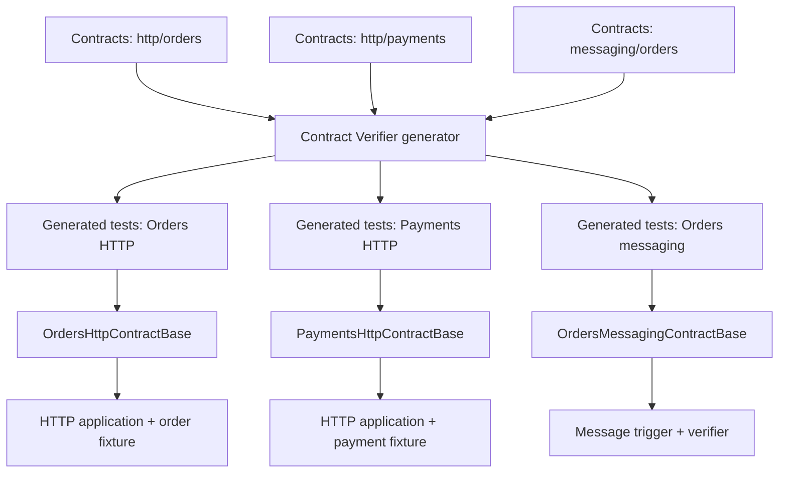
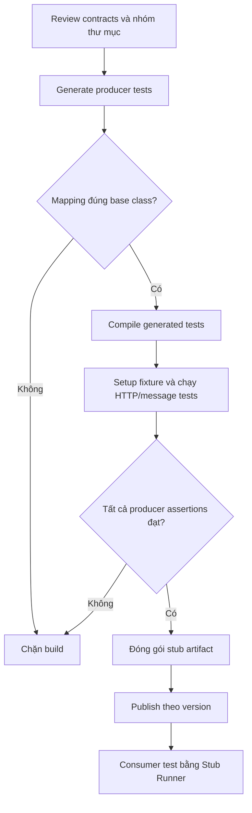

# Chia base class theo nhóm nghiệp vụ hoặc loại giao tiếp

## 1. Khi một base test không còn phù hợp với tất cả hợp đồng

Trong module **SPRING_CLOUD_CONTRACT**, Spring Cloud Contract giúp producer và consumer thống nhất hành vi HTTP hoặc thông điệp bằng **Groovy/YAML DSL**. Từ hợp đồng, **Contract Verifier** sinh kiểm thử phía producer; các stub đã xác minh có thể được đóng gói, phát hành theo phiên bản và dùng qua **Stub Runner**. Kết hợp producer tests và consumer tests trong CI giúp phát hiện sớm những thay đổi API không tương thích.

Generated producer test cần một **base test class** để chuẩn bị ứng dụng, cấu hình cách gửi request hoặc kích hoạt message, tạo fixture và cung cấp các helper được hợp đồng tham chiếu. Với một dịch vụ chỉ có vài endpoint HTTP, dùng chung một base class thường đủ. Nhưng khi một producer phục vụ nhiều miền nghiệp vụ hoặc vừa xử lý HTTP vừa phát thông điệp, một base class chứa mọi fixture và mọi loại kết nối sẽ trở nên khó hiểu, chậm, dễ gây rò rỉ trạng thái giữa các bài test.

Ví dụ dịch vụ thương mại điện tử có ba nhóm hợp đồng:

- **HTTP đơn hàng**: `GET /api/orders/{id}`, `POST /api/orders`; cần fixture đơn hàng, kho và REST/MockMvc.
- **HTTP thanh toán**: `POST /api/payments`; cần fixture thanh toán, cấu hình cổng thanh toán giả và dữ liệu số dư.
- **Thông điệp đơn hàng**: phát `ORDER_CREATED` đến `orders.events`; cần phương thức kích hoạt và cơ chế quan sát message.

Ba nhóm này không nhất thiết nên dùng cùng một lớp nền. Spring Cloud Contract hỗ trợ ánh xạ các nhóm hợp đồng tới **những base class khác nhau**. Mục tiêu không phải tạo thêm lớp cho đủ số lượng, mà là đặt đúng hạ tầng kiểm thử tại đúng ranh giới tích hợp.

Sau bài này, bạn có thể:

1. Quyết định khi nào nên tách base class theo **nghiệp vụ**, khi nào theo **loại giao tiếp**.
2. Tổ chức thư mục hợp đồng và lớp nền để nhóm test không ảnh hưởng nhau.
3. Cấu hình `baseClassMappings` hoặc `packageWithBaseClasses` để Contract Verifier chọn đúng lớp nền.
4. Phân biệt vai trò của `baseClassForTests`, base class mapping, generated test class và hợp đồng nguồn.
5. Đọc generated test và log CI để xác minh lớp nền thực sự được chọn.
6. Tránh những lỗi như regex ánh xạ chồng lấp, fixture dùng chung không an toàn và test message chạy nhầm môi trường HTTP.

## 2. Base test class làm gì, và không làm gì?

Khi sinh producer test, Contract Verifier tạo mã kiểm chứng hành vi được mô tả bằng DSL. Lớp nền do nhóm producer viết cung cấp **ngữ cảnh chạy**:

| Trách nhiệm của base class | Ví dụ HTTP | Ví dụ messaging |
| --- | --- | --- |
| Khởi tạo môi trường | Spring context, MockMvc, cổng test server | Spring context, message binder/test transport |
| Chuẩn bị fixture | Đơn `ord-1001`, khách hàng, tồn kho | Message/event đầu vào, aggregate để phát sự kiện |
| Cấu hình công cụ kiểm thử | Rest Assured MockMvc hoặc HTTP client phù hợp | Message verifier, trigger và nơi quan sát output |
| Cung cấp helper | Tạo ID, chuẩn bị tài nguyên kiểm thử | `publishOrderCreated()` để kích hoạt event |
| Cô lập trạng thái | Dọn dữ liệu trước/sau test | Làm rỗng message queue/test channel phù hợp |

**Base class không định nghĩa thay hợp đồng.** Mã trạng thái HTTP `201`, header `Location`, JSON body, destination `orders.events` hoặc payload message phải đến từ những hợp đồng đã được producer/consumer thống nhất. Nếu cần sửa expected behavior, hãy sửa DSL sau khi xem xét cam kết API, không chỉnh test base để che đi hành vi sai.

Base class cũng **không phải HTTP stub**. Stub Runner phục vụ consumer test với những mapping đã được tạo; base class chủ yếu giúp **generated producer tests** thực thi trên producer thật. Consumer thường không cần kế thừa base class của producer.

### 2.1. Sơ đồ quan hệ



Một hợp đồng có thể sinh một test method trong một generated class chứa nhiều methods. Cách phân nhóm methods/classes phụ thuộc phiên bản và cấu hình generator. **Ánh xạ base class quyết định lớp mà generated test kế thừa, không cam kết số lượng generated classes.**

## 3. Chọn trục phân chia: nghiệp vụ hay giao tiếp?

### 3.1. Chia theo miền nghiệp vụ

Nên chia theo nghiệp vụ khi nhiều hợp đồng dùng **cùng công nghệ kiểm thử**, nhưng có fixture hoặc dependency chuyên biệt:

- `OrdersHttpContractBase` chuẩn bị sản phẩm `SKU-001`, đơn `ord-1001` và tồn kho.
- `PaymentsHttpContractBase` chuẩn bị hóa đơn, giao dịch `pay-1001` và service thanh toán giả.
- `CustomersHttpContractBase` chuẩn bị customer/account fixture và phân quyền cần thiết.

Lợi ích: lớp nền nhỏ, dễ hiểu; lỗi thanh toán ít làm ảnh hưởng đến kiểm thử đơn hàng. Một bài test chỉ cần dữ liệu phục vụ đúng hành vi mà nó xác minh.

**Không cần** tạo base class cho từng endpoint hoặc từng hợp đồng nếu chúng cùng chia sẻ một bộ fixture và cách gọi API. Tách quá nhỏ khiến cấu hình `baseClassMappings` phức tạp hơn lợi ích nhận được.

### 3.2. Chia theo loại giao tiếp

Nên chia theo **HTTP** và **messaging** khi cơ chế kích hoạt/quan sát khác nhau:

| Góc nhìn | HTTP base | Messaging base |
| --- | --- | --- |
| Test bắt đầu bằng gì? | Gửi request HTTP | Kích hoạt producer hoặc đưa message vào input |
| Cần setup gì? | MockMvc, WebTestClient hoặc test server/REST client | Binder, message verifier, consumer/producer test channel |
| Assertion chính | HTTP status, header, body | Destination, header và payload message |
| Fixture trọng tâm | Entity/controller/security data | Event source, message input và output |
| Lỗi setup điển hình | `404` vì thiếu bản ghi | Không có message vì trigger chưa được định nghĩa |

Một lớp nền messaging **không tự chuyển** generator HTTP sang chế độ kiểm thử message; nó chỉ cung cấp cấu hình và helper để generated message test chạy đúng. Ngược lại, một base class MockMvc không thể tự xác minh event gửi qua broker nếu thiếu cơ chế quan sát message.

### 3.3. Kết hợp hai trục

Trong hệ thống có nhiều domain và nhiều loại giao tiếp, bố cục kết hợp thường dễ quản lý hơn:

| Nhóm hợp đồng | Base class đề xuất | Vì sao? |
| --- | --- | --- |
| `http/orders` | `OrdersHttpContractBase` | Fixture đơn hàng + MockMvc |
| `http/payments` | `PaymentsHttpContractBase` | Fixture giao dịch + MockMvc |
| `messaging/orders` | `OrdersMessagingContractBase` | Kích hoạt và quan sát event đơn hàng |
| `messaging/payments` | `PaymentsMessagingContractBase` | Event thanh toán và retry scenario phù hợp |

Chỉ tách khi có khác biệt thật sự về setup/fixture. Nếu nhiều nhóm chỉ cần cùng HTTP client, hãy đặt **thiết lập kỹ thuật chung trong một superclass hỗ trợ** và giữ fixture nghiệp vụ ở những subclass riêng.

## 4. Tổ chức thư mục hợp đồng và base classes

Giả sử producer dùng Maven và Contract Verifier đọc hợp đồng từ thư mục `src/test/resources/contracts`:

```text
orders-producer/
  src/
    test/
      resources/
        contracts/
          http/
            orders/
              get_order_success.groovy
              get_order_not_found.yml
            payments/
              create_payment_success.groovy
              create_payment_declined.groovy
          messaging/
            orders/
              order_created_event.groovy
      java/
        com/example/contract/
          HttpContractBase.java
          OrdersHttpContractBase.java
          PaymentsHttpContractBase.java
          OrdersMessagingContractBase.java
        com/example/contract/fixture/
          OrderFixtures.java
          PaymentFixtures.java
```

Đây là **layout minh họa**, không phải tên thư mục bắt buộc. Với Gradle, contracts root mặc định có thể khác Maven; đường dẫn nguồn, package và output của generated tests còn phụ thuộc cấu hình plugin. Điều phải xác minh sau khi build: **mọi hợp đồng đã được quét và từng nhóm được ánh xạ đến lớp nền mong muốn**.

### 4.1. Đặt tên theo ranh giới hành vi

| Tên | Được dùng để làm gì? |
| --- | --- |
| `http/orders/get_order_success.groovy` | File mô tả hành vi HTTP |
| `name 'get_order_success'` | Định danh tình huống hợp đồng |
| `com.example.contract.OrdersHttpContractBase` | Lớp Java cung cấp setup của nhóm hợp đồng |
| `baseClassFQN` | Cấu hình chọn lớp nền theo regex |
| `generated test method` | Phương thức do Contract Verifier sinh từ hợp đồng |

Không nên suy từ tên `name` hoặc endpoint rằng plugin tự chọn `OrdersHttpContractBase`. **Cơ chế chọn base class dựa vào cấu hình hoặc quy ước thư mục**, không tự hiểu miền nghiệp vụ thông qua ý nghĩa của tên API.

## 5. Cấu trúc base class với phần dùng chung và phần chuyên biệt

### 5.1. Lớp nền kỹ thuật chung cho các hợp đồng HTTP

Giả sử dự án sử dụng **JUnit 5**, Spring Boot và chế độ HTTP **MockMvc**. Một lớp nền chung có thể khởi tạo cách gửi HTTP request cho generated test:

```java
package com.example.contract;

import io.restassured.module.mockmvc.RestAssuredMockMvc;
import org.junit.jupiter.api.BeforeEach;
import org.springframework.beans.factory.annotation.Autowired;
import org.springframework.boot.test.autoconfigure.web.servlet.AutoConfigureMockMvc;
import org.springframework.boot.test.context.SpringBootTest;
import org.springframework.test.web.servlet.MockMvc;

@SpringBootTest
@AutoConfigureMockMvc
public abstract class HttpContractBase {

    @Autowired
    private MockMvc mockMvc;

    @BeforeEach
    protected void configureHttpClient() {
        RestAssuredMockMvc.mockMvc(mockMvc);
    }
}
```

Lớp này chịu trách nhiệm **kỹ thuật HTTP**, không chuẩn bị một đơn hàng hoặc giao dịch thanh toán cụ thể. Nó được viết thủ công trong test source của producer.

Để chạy ví dụ, dự án còn cần dependency tương thích với `RestAssuredMockMvc`, cấu hình Spring Boot/MockMvc và plugin test framework phù hợp. Nếu generator đang dùng HTTP test mode `EXPLICIT` với server thật, hoặc một test mode khác, phải dùng base class tương ứng thay vì sao chép setup MockMvc này.

### 5.2. Base class theo nghiệp vụ đơn hàng

```java
package com.example.contract;

import com.example.contract.fixture.OrderFixtures;
import org.junit.jupiter.api.BeforeEach;
import org.springframework.beans.factory.annotation.Autowired;

public abstract class OrdersHttpContractBase extends HttpContractBase {

    @Autowired
    private OrderFixtures orderFixtures;

    @BeforeEach
    protected void prepareOrderData() {
        orderFixtures.reset();
        orderFixtures.existingOrder("ord-1001", "SKU-001", 2);
        orderFixtures.ensureMissing("ord-missing");
    }
}
```

`OrderFixtures` và các phương thức `reset`, `existingOrder`, `ensureMissing` là **helper giả định do dự án tự hiện thực**, không phải API có sẵn của Spring Cloud Contract. Helper phải tạo dữ liệu ổn định, không phụ thuộc database từ lần chạy trước; khi dùng database thật, chú ý transaction, ID và cleanup.

Generated tests cho các hợp đồng trong nhóm `http/orders` sẽ kế thừa `OrdersHttpContractBase` nếu mapping đã được cấu hình đúng. Các bài test có thể kiểm tra:

- `GET /api/orders/ord-1001 -> 200` với body đã cam kết.
- `GET /api/orders/ord-missing -> 404` với mã lỗi.
- `POST /api/orders` với fixture tồn kho tương ứng.

Nếu `reset()` xoá dữ liệu dùng chung một cách thiếu kiểm soát và nhiều bài test chạy song song, suite có thể ngẫu nhiên lỗi. Ưu tiên dữ liệu tách biệt theo test/transaction hoặc cơ chế reset có khả năng chạy đồng thời theo thiết kế test environment.

### 5.3. Base class theo nghiệp vụ thanh toán

```java
package com.example.contract;

import com.example.contract.fixture.PaymentFixtures;
import org.junit.jupiter.api.BeforeEach;
import org.springframework.beans.factory.annotation.Autowired;

public abstract class PaymentsHttpContractBase extends HttpContractBase {

    @Autowired
    private PaymentFixtures paymentFixtures;

    @BeforeEach
    protected void preparePaymentData() {
        paymentFixtures.prepareAcceptedPayment("pay-1001");
        paymentFixtures.prepareDeclinedPayment("pay-declined");
    }
}
```

`PaymentFixtures` là helper **của ứng dụng minh họa**. Khác với đơn hàng, nhóm thanh toán có thể cần thay thế cổng thanh toán ngoài bằng test double phù hợp để producer test ổn định, nhưng response trả từ **controller/service của producer** vẫn phải được kiểm tra thật. Không nên mock chính endpoint đang được hợp đồng bảo vệ rồi kết luận đã kiểm chứng producer.

### 5.4. Nguyên tắc kế thừa

```text
HttpContractBase                      <- MockMvc/client chung
    |-- OrdersHttpContractBase         <- OrderFixtures
    |-- PaymentsHttpContractBase       <- PaymentFixtures

OrdersMessagingContractBase           <- Message trigger/verifier
```

Giữ chiều kế thừa ngắn và rõ nghĩa. Khi một base class có quá nhiều `@BeforeEach` và helper không liên quan, hãy cân nhắc chuyển sang composition hoặc fixture helper thay vì tiếp tục tạo các lớp cha nhiều tầng.

## 6. Cấu hình Maven: ánh xạ tường minh bằng `baseClassMappings`

Spring Cloud Contract Maven plugin cho phép khai báo một danh sách `baseClassMapping`, mỗi mục có:

- `contractPackageRegex`: regex dùng để nhận diện **package/đường dẫn nhóm hợp đồng** theo cách plugin diễn giải.
- `baseClassFQN`: **fully qualified class name** của lớp nền mà generated tests được kế thừa.

Ví dụ `pom.xml` rút gọn:

```xml
<build>
  <plugins>
    <plugin>
      <groupId>org.springframework.cloud</groupId>
      <artifactId>spring-cloud-contract-maven-plugin</artifactId>
      <extensions>true</extensions>
      <configuration>
        <testFramework>JUNIT5</testFramework>
        <testMode>MOCKMVC</testMode>

        <baseClassForTests>
          com.example.contract.HttpContractBase
        </baseClassForTests>

        <baseClassMappings>
          <baseClassMapping>
            <contractPackageRegex>.*http.*orders.*</contractPackageRegex>
            <baseClassFQN>com.example.contract.OrdersHttpContractBase</baseClassFQN>
          </baseClassMapping>
          <baseClassMapping>
            <contractPackageRegex>.*http.*payments.*</contractPackageRegex>
            <baseClassFQN>com.example.contract.PaymentsHttpContractBase</baseClassFQN>
          </baseClassMapping>
          <baseClassMapping>
            <contractPackageRegex>.*messaging.*orders.*</contractPackageRegex>
            <baseClassFQN>com.example.contract.OrdersMessagingContractBase</baseClassFQN>
          </baseClassMapping>
        </baseClassMappings>
      </configuration>
    </plugin>
  </plugins>
</build>
```

**Đây là đoạn cấu hình minh họa**, chưa phải `pom.xml` dùng được ngay. Plugin cần phiên bản, dependencies, cách tổ chức contract root và test setup tương thích với dự án. Các regex được viết theo **tên nhóm có chứa `http/orders` hoặc `messaging/orders`**; quy tắc regex thực tế so khớp **contract package**, không dựa vào URL HTTP. Phải **xem generated test sau khi build** để xác nhận từng regex nhận đúng nhóm trong phiên bản/plugin hiện tại.

### 6.1. Các trường hợp mapping mong đợi

| Nhóm hợp đồng | Regex được kỳ vọng khớp | Base class được chọn |
| --- | --- | --- |
| `http/orders/get_order_success.groovy` | `.*http.*orders.*` | `OrdersHttpContractBase` |
| `http/payments/create_payment_success.groovy` | `.*http.*payments.*` | `PaymentsHttpContractBase` |
| `messaging/orders/order_created_event.groovy` | `.*messaging.*orders.*` | `OrdersMessagingContractBase` |
| Nhóm không khớp mapping nào | Không có | `HttpContractBase` **fallback** trong ví dụ |

**Cảnh báo về fallback:** `baseClassForTests` được dùng khi không có mapping chuyên biệt phù hợp. Nếu một hợp đồng message mới nằm ở `messaging/payments` nhưng không có mapping, nó có thể nhận **HTTP base** theo fallback, dẫn đến generated tests thiếu message setup hoặc không chạy đúng. Do đó, khi nhóm hợp đồng đã phân biệt theo giao thức, cần review và kiểm tra danh sách mapping bao phủ mọi nhóm; **fallback không thay thế bước kiểm tra mapping**.

### 6.2. Ưu tiên cấu hình

Trong các lựa chọn base class được Spring Cloud Contract hỗ trợ, thứ tự ưu tiên khái quát là:

1. **`baseClassMappings`** — ánh xạ tường minh theo regex khi có kết quả khớp.
2. **`packageWithBaseClasses`** — suy lớp nền theo quy ước thư mục khi được cấu hình.
3. **`baseClassForTests`** — một lớp nền chung dùng làm fallback.

Quy tắc này mô tả cách chọn lớp nền; **không được xem nó là quyền bảo đảm rằng một regex chồng lấp sẽ được chọn theo thứ tự mà người viết mong muốn**. Hãy tạo pattern rõ ràng, hạn chế overlap và xác minh source được sinh.

## 7. Cấu hình theo quy ước với `packageWithBaseClasses`

Ngoài mapping tường minh, Spring Cloud Contract hỗ trợ chọn tên base class theo **quy ước vị trí hợp đồng**.

Ví dụ, nếu đặt:

```xml
<configuration>
  <packageWithBaseClasses>com.example.contract</packageWithBaseClasses>
</configuration>
```

và một hợp đồng nằm trong cấu trúc thư mục có các phần cuối `foo/bar/baz`, framework có thể suy ra base class như `BarBazBase` nằm trong package `com.example.contract` theo quy ước được mô tả trong tài liệu Spring Cloud Contract.

Điểm quan trọng: quy ước này sử dụng **các phần cuối của đường dẫn/package hợp đồng** để tạo tên lớp, không tự động chọn `OrdersHttpContractBase` chỉ vì endpoint chứa `orders`. Nếu muốn đặt tên base class hoàn toàn theo domain/transport, `baseClassMappings` thường rõ ràng hơn.

### 7.1. Khi nào nên dùng quy ước?

Quy ước phù hợp khi:

- Nhiều nhóm có **cấu trúc thư mục nhất quán**.
- Nhóm chấp nhận tên base class theo thuật toán của framework.
- Muốn giảm số lượng mapping cần viết tay.
- Có quy trình kiểm tra generated sources để phát hiện thiếu base class.

Mapping tường minh phù hợp hơn khi:

- Tên base class có ý nghĩa nghiệp vụ không khớp thuật toán đặt tên mặc định.
- Một số nhóm HTTP dùng fixture đặc biệt, các nhóm messaging dùng hạ tầng khác.
- Cần giữ tên Java hiện có mà không muốn đổi toàn bộ contract folders.
- Dự án đang di chuyển từ một base class chung sang nhiều base class và cần chuyển đổi từng phần.

Không nên bật đồng thời nhiều cơ chế mà không hiểu thứ tự ưu tiên. Dù tên lớp có được suy theo quy ước, **lớp đó vẫn phải tồn tại trong test classpath và phù hợp với test framework**.

## 8. Cấu hình Gradle cho các nhóm base class

Với **Gradle plugin** của Spring Cloud Contract, ý tưởng ánh xạ tương tự: chọn `baseClassForTests` dùng chung, rồi khai báo `baseClassMappings` cho các nhóm riêng. Ví dụ Groovy DSL cho `build.gradle`:

```groovy
contracts {
    testFramework = 'JUNIT5'
    baseClassForTests = 'com.example.contract.HttpContractBase'

    baseClassMappings {
        baseClassMapping('.*http.*orders.*',
                         'com.example.contract.OrdersHttpContractBase')
        baseClassMapping('.*http.*payments.*',
                         'com.example.contract.PaymentsHttpContractBase')
        baseClassMapping('.*messaging.*orders.*',
                         'com.example.contract.OrdersMessagingContractBase')
    }
}
```

Đây là cấu hình **tham khảo**, giả định dự án đã áp dụng plugin Gradle đúng phiên bản và được tổ chức theo những nhóm tương ứng. Cấu trúc `contracts { ... }` và các entry `baseClassMapping(...)` được dùng trong các phiên bản plugin hỗ trợ tính năng này; nên kiểm tra tài liệu của **phiên bản dự án** và việc Gradle nhận cấu hình.

Sau khi cấu hình, những bước thường dùng là:

```bash
./gradlew generateContractTests
./gradlew contractTest
```

Task và liên kết lifecycle có thể khác theo phiên bản/plugin. `generateContractTests` chỉ chứng minh công cụ đã tạo mã; `contractTest` cần **thực thi** generated tests và được kiểm tra qua kết quả report.

Với Maven, chuỗi tương ứng trong một dự án đã cấu hình có thể là:

```bash
./mvnw -B spring-cloud-contract:generateTests
./mvnw -B clean verify
```

Không chạy các lệnh trên khi chưa có môi trường build phù hợp. Các đoạn lệnh là **hướng dẫn thực hành**, không phải bằng chứng rằng ví dụ trong bài đã được build.

## 9. Base class messaging khác HTTP như thế nào?

Một hợp đồng thông điệp có thể được mô tả bằng Groovy DSL:

```groovy
import org.springframework.cloud.contract.spec.Contract

Contract.make {
    name 'order_created_event'
    label 'order_created'

    input {
        triggeredBy('publishOrderCreated()')
    }

    outputMessage {
        sentTo('orders.events')
        body([
            eventType: 'ORDER_CREATED',
            orderId  : 'ord-1001'
        ])
    }
}
```

Trong ví dụ, `publishOrderCreated()` **không phải** phương thức framework tự cung cấp. Đây là helper mà nhóm producer phải hiện thực để generated test kích hoạt hành vi phát message.

### 9.1. Skeleton của messaging base class

```java
package com.example.contract;

import org.springframework.beans.factory.annotation.Autowired;
import org.springframework.boot.test.context.SpringBootTest;

@SpringBootTest
public abstract class OrdersMessagingContractBase {

    @Autowired
    private OrderEventTestDriver orderEventTestDriver;

    public void publishOrderCreated() {
        orderEventTestDriver.publishOrderCreatedFor("ord-1001");
    }
}
```

`OrderEventTestDriver` và `publishOrderCreatedFor(...)` là **thành phần giả định do nhóm hiện thực**, không có sẵn trong Spring Cloud Contract. Trong dự án thật, driver sẽ gọi hành vi ứng dụng để phát event, còn cơ chế message verifier/binder hoặc test transport phải cho phép generated test quan sát **đúng message thực tế**.

Điều cần bảo vệ:

- Trigger dùng fixture có thể tái lập, không tự tạo dữ liệu ngẫu nhiên thiếu kiểm soát.
- Output event được phát đến destination theo contract, với header/body đã thỏa thuận.
- Không vô tình kiểm tra một message giả do chính test driver gửi thẳng tới verifier, bỏ qua logic producer cần xác minh.
- Với nhiều event trong cùng test, dọn message queue/test channel giữa các trường hợp để tránh kết quả sót từ test trước.

### 9.2. Base mapping không thay đổi `testMode` toàn cục

**Cần phân biệt hai mức cấu hình:**

| Cấu hình | Điều nó quyết định | Điều nó không tự làm |
| --- | --- | --- |
| `baseClassMappings` | Generated test kế thừa lớp nền nào | Không chuyển đổi mọi test sang một HTTP test mode khác |
| `baseClassForTests` | Lớp nền fallback | Không cung cấp tự động mọi fixture |
| `testMode` | Phương pháp kiểm thử HTTP được generator dùng theo cấu hình plugin | Không biến HTTP thành messaging hoặc ngược lại |
| Message test setup | Cơ chế kích hoạt/quan sát message | Không tự bảo đảm delivery, retry, ordering của broker thật |

Nếu cùng một producer cần cả HTTP MockMvc và HTTP server thật với các test mode **khác nhau**, chỉ tách base class là chưa đủ. Có thể cần điều chỉnh cấu hình generator, tách nhóm build/source set/module hoặc thiết kế test infrastructure cho nhất quán. Với messaging, cũng cần lựa chọn binder/verifier cụ thể; không thể giả định mọi message test đều chạy được chỉ nhờ một lớp `@SpringBootTest`.

## 10. Bài toán fixture và độc lập kiểm thử

Tách base class có tác dụng lớn nhất khi giảm **rủi ro trạng thái ngầm**:

| Vấn đề | Khi dùng một base class quá rộng | Khi chia phù hợp |
| --- | --- | --- |
| Fixture khởi tạo | Mọi test có thể tạo cả đơn, thanh toán, message | Mỗi nhóm chỉ tạo dữ liệu cần thiết |
| Thời gian chạy | Tăng thời gian setup và chi phí dependency | Giảm setup không liên quan |
| Điều tra lỗi | Không rõ lỗi thuộc dữ liệu miền nào | Có thể truy nhanh về base class nhóm |
| Test chạy song song | Test nhóm này có thể xóa fixture nhóm khác | Dễ đặt isolation boundary riêng |
| Mock và stub nội bộ | Một mock bị thay đổi ảnh hưởng nhiều nhánh | Mock/fixture theo mục đích kiểm thử |
| Bảo trì | Lớp có nhiều điều kiện `if` theo tên contract | Lớp nhỏ, có trách nhiệm rõ |

### 10.1. Tránh sửa dữ liệu toàn cục không an toàn

Ví dụ, `OrdersHttpContractBase` có một `@BeforeEach` xóa toàn bộ bảng orders, trong khi `PaymentsHttpContractBase` cần tham chiếu đến đơn hàng từ cùng database. Nếu hai nhóm chạy song song, hành vi trở nên không ổn định.

Các lựa chọn giúp giảm rủi ro:

1. Dùng database/schema hoặc namespace riêng cho từng suite nếu cần.
2. Tạo ID fixture riêng theo test và cleanup theo phạm vi dữ liệu đó.
3. Dùng transaction/rollback khi phù hợp với cách test gọi ứng dụng (không giả định rollback có hiệu lực qua mọi boundary).
4. Hạn chế state mutable hoặc static/global configuration dùng chung.
5. Tắt parallel execution cho nhóm chưa bảo đảm isolation thay vì để test thỉnh thoảng thất bại.

Mục tiêu không phải làm mọi test độc lập hoàn toàn khỏi framework, mà là mỗi test có **tiền điều kiện rõ ràng, có thể chuẩn bị và tái lập**.

### 10.2. Kiểm tra bảo mật theo nhóm

Hợp đồng HTTP cho endpoint yêu cầu xác thực có thể cần base class tạo session, mock principal hoặc test token phù hợp. Không nên để tất cả HTTP tests tự động chạy với tài khoản quản trị; điều đó có thể khiến hợp đồng `401`/`403` không được kiểm chứng đúng.

Có thể chia:

- `PublicOrdersHttpBase` cho API công khai.
- `AuthenticatedOrdersHttpBase` cho API yêu cầu danh tính.
- `AdminOrdersHttpBase` cho API quản trị.

Chỉ tách thêm khi những nhóm này có **khác biệt rõ trong fixture bảo mật** và consumer xử lý các nhánh khác nhau. Không tắt filter bảo mật chỉ để test xanh.

## 11. Cách xác nhận ánh xạ đã hoạt động thật

**Không kết luận thành công chỉ vì `pom.xml`/`build.gradle` có `baseClassMappings`.** Hãy xem generated source:

1. Chạy bước sinh test của producer bằng plugin hiện hành.
2. Tìm generated test tương ứng với `http/orders/get_order_success.groovy`.
3. Xem lớp được sinh có kế thừa `OrdersHttpContractBase` không.
4. Tìm test tương ứng với `http/payments/create_payment_success.groovy` và xác nhận kế thừa `PaymentsHttpContractBase`.
5. Tìm test từ `messaging/orders/order_created_event.groovy`; xác nhận kế thừa `OrdersMessagingContractBase` và gọi đúng trigger.
6. Kiểm tra số hợp đồng được quét và test được sinh — không bỏ sót contract.
7. Chạy test và xem số pass/fail/skip trong build report.

Ví dụ cấu trúc generated source (chỉ minh họa, **không phải mã nguyên văn generator**):

```java
package com.example.generated.http.orders;

import org.junit.jupiter.api.Test;
import com.example.contract.OrdersHttpContractBase;

public class OrdersContractVerifierTest extends OrdersHttpContractBase {
    @Test
    void validate_get_order_success() {
        // Generated code: request GET và các assertions theo contract.
    }
}
```

Tên package, class và method thực tế phụ thuộc plugin và thông tin contract. Chi tiết quan trọng cần kiểm tra là dòng `extends OrdersHttpContractBase` và **assertions đúng với hợp đồng**.

### 11.1. Kiểm tra theo bảng ánh xạ

| Contract | Base class mong đợi | Base class thấy trong generated source | Kết quả |
| --- | --- | --- | --- |
| `http/orders/get_order_success` | `OrdersHttpContractBase` | Người học tự điền | PASS/FAIL |
| `http/payments/create_payment_success` | `PaymentsHttpContractBase` | Người học tự điền | PASS/FAIL |
| `messaging/orders/order_created_event` | `OrdersMessagingContractBase` | Người học tự điền | PASS/FAIL |

Nếu nhìn thấy `HttpContractBase` ở hàng messaging, hãy kiểm tra regex package, vị trí file và cấu hình mapping. Đừng sửa generated test trực tiếp: file đó sẽ bị ghi đè ở lần generate tiếp theo.

## 12. Lỗi thường gặp khi chia base class

| Triệu chứng | Nguyên nhân có thể | Cách xử lý |
| --- | --- | --- |
| Generated test HTTP kế thừa messaging base | Regex mapping quá rộng hoặc nhầm thư mục | Tách pattern theo giao thức và kiểm tra output |
| Một nhóm hợp đồng vẫn dùng fallback | Regex không khớp package như người viết nghĩ | Xem contract package thực tế, sửa pattern |
| Compile error: không tìm thấy base class | `baseClassFQN` sai package, lớp không nằm trong test classpath | Kiểm tra FQCN, package declaration, test dependencies |
| Compile error: không tìm thấy helper | Helper ở base khác hoặc visibility không phù hợp | Chuyển helper về đúng lớp, dùng `protected`/`public` khi cần |
| Test đơn hàng fail `404` dù kỳ vọng `200` | Fixture `ord-1001` chưa được tạo | Kiểm tra `OrdersHttpContractBase`/`OrderFixtures` |
| Test messaging fail vì thiếu trigger | `triggeredBy(...)` trỏ tới method không tồn tại/không truy cập được | Hiện thực trigger trong messaging base |
| Test messaging pass nhưng producer không phát event đúng | Test driver bỏ qua logic producer hoặc verifier quan sát sai kênh | Kiểm tra tuyến phát message và setup verifier |
| Test bất ổn khi chạy song song | Reset DB hoặc message queue ảnh hưởng nhóm khác | Dùng fixture độc lập, test isolation phù hợp |
| Một hợp đồng mới không được sinh test | Contracts directory/filter/plugin cấu hình sai | Xác nhận việc quét hợp đồng và số generated tests |
| CI xanh dù 0 producer tests | Lifecycle/test runner không thực thi generated sources | Kiểm tra test engine và build report |
| Test HTTP dùng chế độ khác với base class | `testMode`/client setup không khớp | Đồng bộ cấu hình plugin và cách khởi tạo client |

### 12.1. Phân biệt lỗi mapping và lỗi nghiệp vụ

Nếu generated class không tìm thấy `OrdersHttpContractBase`, đây là lỗi **compile/configuration**. Nếu class đúng nhưng request `GET /api/orders/ord-1001` trả `404`, đây có thể là lỗi **fixture hoặc producer behavior**. Nếu test đạt nhưng consumer vẫn lỗi khi nhận stub mới, cần xem **consumer test và hợp đồng được dùng**, không chỉ base class.

Kiểm tra theo trình tự:

```text
Contract được quét?
    -> Regex/group map vào đúng base class?
       -> Generated class compile và helper truy cập được?
          -> Fixture / test transport đã sẵn sàng?
             -> Producer test assertion đạt?
                -> Stub được tạo và consumer test chạy?
```

Mỗi tầng giải quyết một vấn đề khác. Không nên thay HTTP status hay body của hợp đồng để sửa lỗi package hoặc fixture.

## 13. Tích hợp việc phân nhóm base class vào CI

Một pipeline producer có thể áp dụng quy trình:



Trong CI cần lưu:

- Version của Spring Cloud Contract plugin/test framework.
- Danh sách contracts được phát hiện và nhóm mapping tương ứng.
- Generated test class → base class thực tế đã chọn.
- Số bài test đã sinh, đã chạy, pass/fail/skip.
- Artifact stub được tạo/phát hành với tọa độ và phiên bản xác định.

Khi thêm `messaging/payments` vào dự án, CI nên báo rõ nhóm mới **chưa có mapping phù hợp** thay vì âm thầm để nó nhận HTTP fallback. Điều này có thể được thực hiện bằng kiểm tra generated test mappings trong quy trình build/review hoặc quy ước kiểm chứng riêng của nhóm.

Việc tách base class **không thay đổi giao diện công bố cho consumer**. Nó giúp producer verification ổn định hơn; consumer vẫn phải kiểm tra logic ứng dụng với stub đúng version và hợp đồng có đủ nhánh quan trọng.

## 14. Bài thực hành: tổ chức hợp đồng cho Orders, Payments và Event

### 14.1. Bối cảnh

Một producer có năm hợp đồng:

| Contract | Tiền điều kiện chính | Kết quả quan sát |
| --- | --- | --- |
| `http/orders/get_order_success.groovy` | `ord-1001` tồn tại | `200`, JSON đơn |
| `http/orders/get_order_not_found.yml` | `ord-missing` không tồn tại | `404 ORDER_NOT_FOUND` |
| `http/payments/create_payment_success.groovy` | Tài khoản và giao dịch hợp lệ | `201`, JSON thanh toán |
| `http/payments/create_payment_declined.groovy` | Cổng thanh toán từ chối theo fixture | `409`, mã lỗi từ chối |
| `messaging/orders/order_created_event.groovy` | Trigger tạo đơn thành công | Event `ORDER_CREATED` |

### 14.2. Yêu cầu thực hành

1. Tạo ba lớp nền `OrdersHttpContractBase`, `PaymentsHttpContractBase` và `OrdersMessagingContractBase`. Cho hai lớp HTTP kế thừa `HttpContractBase`, còn messaging base có trigger và verifier phù hợp.
2. Chỉ rõ helper nào do nhóm tự hiện thực, ví dụ `OrderFixtures` và `PaymentFixtures`, không nhầm chúng với API của framework.
3. Dùng `baseClassMappings` để ánh xạ ba nhóm hợp đồng; thêm fallback có chủ đích.
4. Sinh producer tests; ghi lại tên lớp/method được tạo và base class thực sự được chọn.
5. Chạy producer verification với fixture độc lập; mô tả cách ngăn nhóm thanh toán làm mất dữ liệu nhóm đơn hàng.
6. Cố tình chuyển `order_created_event.groovy` vào `messaging/payments` mà không thêm mapping; quan sát base fallback và sửa quy tắc.
7. Chạy consumer tests bằng Stub Runner với version stub đã xác minh, đảm bảo các nhánh `200`, `404`, `201` và `409` được xử lý đúng.

### 14.3. Câu hỏi tự kiểm tra

**Câu 1.** Vì sao không đặt mọi helper HTTP và messaging vào cùng `BaseContractTest`?

**Đáp án:** Dễ tạo fixture dư thừa, tăng phụ thuộc, xung đột state và làm khó chẩn đoán. Khi setup/transport khác nhau, nên tách theo ranh giới cần thiết.

**Câu 2.** `baseClassMappings` có tự đổi `testMode` từ MockMvc sang gọi HTTP server thật cho một nhóm không?

**Đáp án:** Không. Nó chọn lớp nền kế thừa. Chế độ kiểm thử và hạ tầng client phải được cấu hình phù hợp trong plugin/build.

**Câu 3.** Nếu một hợp đồng không khớp regex nào thì sao?

**Đáp án:** Khi cấu hình có `baseClassForTests` làm fallback, generator có thể dùng lớp nền đó. Đây không nhất thiết là lựa chọn đúng; cần kiểm tra mapping coverage.

**Câu 4.** Thay `name` của hợp đồng từ `get_order_success` thành `get_order_valid` có tự đổi base class không?

**Đáp án:** Không, trừ khi hệ thống có quy tắc ánh xạ liên quan đến cách tổ chức file/package bị thay đổi. Ánh xạ thông thường dựa trên contract package/đường dẫn nhóm, không dựa vào tên `name` nghiệp vụ.

**Câu 5.** Vì sao `publishOrderCreated()` cần xuất hiện trong messaging base?

**Đáp án:** Generated message test cần một cách gọi hành vi producer để phát event, trong khi test framework không tự tạo phương thức nghiệp vụ này.

### 14.4. Tài liệu tham khảo

- [Spring Cloud Contract — Maven Project: Using Different Base Classes for Contracts](https://docs.spring.io/spring-cloud-contract/reference/maven-project.html): `baseClassForTests`, `packageWithBaseClasses` và `baseClassMappings`.
- [Spring Cloud Contract — Gradle Project: Different Base Classes for Contracts](https://docs.spring.io/spring-cloud-contract/reference/gradle-project.html): cách phân nhóm và thực thi `contractTest`.
- [Spring Cloud Contract — Getting Started](https://docs.spring.io/spring-cloud-contract/reference/getting-started/first-application.html): vai trò của base test khi chạy generated producer tests.

### Checklist trước khi chốt kiến trúc base test

- [ ] Đã xác định các miền nghiệp vụ và loại giao tiếp cần hạ tầng kiểm thử khác nhau.
- [ ] Không tạo base class riêng cho từng contract nếu chúng dùng chung setup.
- [ ] Thư mục hợp đồng rõ ràng, được plugin scan đúng.
- [ ] `baseClassMappings` hoặc `packageWithBaseClasses` được cấu hình theo cơ chế đã chọn.
- [ ] Regex ánh xạ không chồng lấp ngoài ý muốn, bao phủ các nhóm cần thiết.
- [ ] Base class FQCN tồn tại và nằm trong test classpath.
- [ ] HTTP base phù hợp `testMode`, messaging base có trigger/verifier thích hợp.
- [ ] Fixture có thể tái lập và được cô lập giữa các bài test.
- [ ] Đã xem generated source để xác nhận `extends` đúng base class.
- [ ] Producer tests **được thực thi và đạt**, không chỉ được sinh.
- [ ] Stub artifact có phiên bản rõ ràng; consumer test chạy trên Stub Runner.

**Ghi nhớ:** chia base test theo **nhóm nghiệp vụ** giúp fixture gọn và giảm phụ thuộc; chia theo **loại giao tiếp** giúp HTTP và messaging có cách kích hoạt/quan sát đúng. `baseClassMappings` ánh xạ các nhóm đến lớp nền phù hợp, nhưng phải xác minh bằng generated source và kết quả producer tests. Khi tổ chức đúng, bộ hợp đồng trở nên dễ bảo trì, dễ truy vết và đáng tin cậy hơn trong CI.
