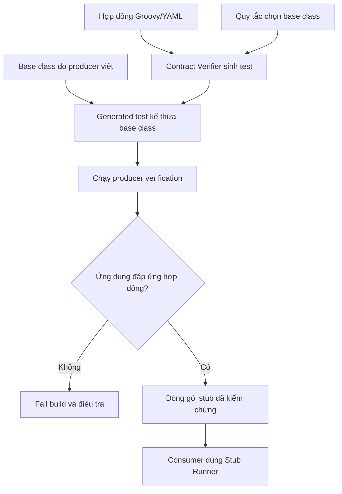
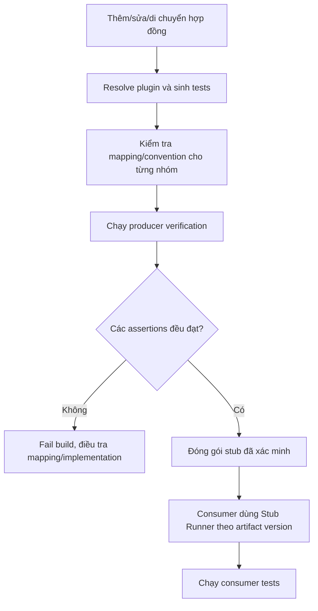

# Ánh xạ bằng tên package và cấu hình tường minh

## 1. Bối cảnh: một producer có nhiều cách khởi tạo kiểm thử

**Spring Cloud Contract** cho phép các nhóm định nghĩa hợp đồng giao tiếp HTTP hoặc thông điệp bằng Groovy/YAML DSL. Từ hợp đồng, **Contract Verifier** sinh kiểm thử phía **producer**; khi producer đáp ứng hợp đồng, build có thể đóng gói stub để **consumer** chạy thử bằng Stub Runner và tích hợp toàn bộ quy trình vào CI.

Một kiểm thử producer được sinh ra không thể tự biết cách khởi động ứng dụng, nạp dữ liệu hoặc gọi nghiệp vụ của dự án. Nó thường cần một **base test class** do nhóm producer viết. Base class chuẩn bị test context, HTTP client hoặc message trigger, và generated test sẽ kế thừa class đó.

Giả sử `Order Service` cung cấp:

- HTTP API công khai `/api/orders/{id}`, dùng MockMvc và fixture đơn hàng.
- HTTP API nội bộ `/internal/orders/{id}`, cần ngữ cảnh bảo mật và fixture riêng.
- Thông điệp `OrderCreated`, cần phương thức trigger và cấu hình theo dõi message.

Nếu tất cả các bài kiểm thử đều kế thừa một class cha mặc định, class đó có thể phải chứa những cấu hình không liên quan nhau. Ngược lại, nếu chọn sai base class, generated test có thể không compile, không khởi động hoặc chạy trong môi trường sai.

**Vấn đề của bài này:** Spring Cloud Contract cần biết **mỗi nhóm hợp đồng phải kế thừa base class nào**. Hai chiến lược quan trọng là **ánh xạ dựa trên quy ước tên package** và **ánh xạ bằng cấu hình tường minh**.

Sau bài học, bạn có thể:

1. Phân biệt `baseClassForTests`, `packageWithBaseClasses` và `baseClassMappings`.
2. Hiểu vai trò của tên package, đường dẫn hợp đồng và tên đầy đủ của base class.
3. Cấu hình một dự án Maven/Gradle có nhiều nhóm kiểm thử.
4. Đọc generated test để xác minh đúng base class đã được chọn.
5. Tránh các lỗi regex chồng lấn, package không nhất quán, môi trường test sai và pipeline bỏ qua kiểm thử hợp đồng.

## 2. Base test class đứng ở đâu trong quy trình sinh test?

Xét hợp đồng Groovy DSL cho một request HTTP:

```groovy
import org.springframework.cloud.contract.spec.Contract

Contract.make {
    description 'Lấy thông tin một đơn hàng'
    request {
        method GET()
        url '/api/orders/42'
    }
    response {
        status OK()
        headers {
            contentType(applicationJson())
        }
        body(
            orderId: 42,
            status: 'CREATED'
        )
    }
}
```

Trong môi trường producer, plugin đọc hợp đồng rồi sinh test tương ứng. Dưới đây là **hình thức minh họa**, không phải mã Java mà mọi phiên bản plugin tạo ra nguyên văn:

```java
public class Validate_get_order extends PublicHttpContractBase {

    @Test
    public void validate_get_order() throws Exception {
        // Gửi GET /api/orders/42 tới ứng dụng trong test context.
        // Kiểm tra status 200 và JSON body.
    }
}
```

`PublicHttpContractBase` cung cấp môi trường HTTP, còn phần test được sinh thực hiện những bước xuất phát từ hợp đồng.



**Base class không phải một stub.** Nó chỉ được dùng khi chạy generated producer tests; consumer không cần biết tên class cha mà producer đã dùng để xác minh hợp đồng.

## 3. Cần phân biệt ba loại tên dễ gây nhầm

Giả sử project có cấu trúc:

```text
src/test/
  resources/
    contracts/
      public_http/
        get_order.groovy
      internal_http/
        get_internal_order.groovy
      messaging/
        order_created.groovy
  java/
    com/example/contracts/base/
      PublicHttpContractBase.java
      InternalHttpContractBase.java
      MessagingContractBase.java
```

Có ít nhất ba thông tin:

| Khái niệm | Ví dụ | Dùng để làm gì? |
| --- | --- | --- |
| **Vị trí tệp hợp đồng** | `contracts/public_http/get_order.groovy` | Phân nhóm tương tác mà generator đọc |
| **Package của generated test** | Tên package do plugin suy ra/tạo theo cấu hình | Tổ chức lớp kiểm thử sinh tự động |
| **FQN của base class** | `com.example.contracts.base.PublicHttpContractBase` | Class cha mà generated test phải kế thừa |

**FQN (Fully Qualified Name)** bao gồm package và tên lớp. Nếu tệp Java khai báo:

```java
package com.example.contracts.base;

public abstract class PublicHttpContractBase {
}
```

thì FQN là `com.example.contracts.base.PublicHttpContractBase`, không phải đường dẫn `src/test/java/com/example/contracts/base/PublicHttpContractBase.java`.

Một **tên thư mục** như `public_http` cũng không tự động là một Java package hợp lệ hoặc một base class name. Cách plugin chuyển vị trí hợp đồng thành package generated test và cách áp dụng quy ước phải được kiểm tra theo phiên bản Spring Cloud Contract trong dự án.

## 4. Ba cách chọn base class

| Cơ chế | Ý tưởng | Trường hợp phù hợp | Điều cần kiểm tra |
| --- | --- | --- | --- |
| `baseClassForTests` | Chỉ định một class cha chung | Tất cả hợp đồng dùng cùng test context | Generated tests có thật sự kế thừa đúng class? |
| `packageWithBaseClasses` | Dựa trên **quy ước tên package/base class** để chọn lớp cha | Nhiều nhóm tuân theo một quy tắc tên thống nhất | Quy ước tên được plugin áp dụng cho từng contract package là gì? |
| `baseClassMappings` | Khai báo **regex nhóm hợp đồng → FQN cụ thể** | Nhóm có tên tùy ý hoặc cần base class không theo quy ước | Regex khớp đúng một nhóm? FQN có tồn tại? |

Không có lựa chọn nào luôn tốt nhất. Điều quan trọng là **phù hợp với cách dự án tổ chức hợp đồng và môi trường test**, đồng thời dễ review khi thêm nhóm mới.

### 4.1. Trường hợp đơn giản: `baseClassForTests`

Ví dụ Maven:

```xml
<configuration>
    <testFramework>JUNIT5</testFramework>
    <testMode>MOCKMVC</testMode>
    <baseClassForTests>com.example.contracts.base.HttpContractBase</baseClassForTests>
</configuration>
```

Khi tất cả các hợp đồng đều là HTTP trên cùng ứng dụng Spring MVC, cách này dễ bảo trì. Nhưng nếu nhóm messaging đòi phương thức trigger riêng, việc gom mọi thứ vào `HttpContractBase` sẽ gây phụ thuộc không cần thiết và dễ làm setup sai.

## 5. Ánh xạ bằng tên package: `packageWithBaseClasses`

`packageWithBaseClasses` là cách cấu hình **nơi chứa các base class được chọn bằng quy ước**, thay vì liệt kê riêng từng hợp đồng hoặc từng regex. Generator sử dụng cấu trúc package của hợp đồng và quy tắc đặt tên base class mà phiên bản plugin hỗ trợ để xác định class cha.

Ví dụ một phần cấu hình Maven:

```xml
<configuration>
    <testFramework>JUNIT5</testFramework>
    <testMode>MOCKMVC</testMode>
    <packageWithBaseClasses>com.example.contracts.base</packageWithBaseClasses>
</configuration>
```

Với Gradle Groovy DSL, ý tưởng tương ứng:

```groovy
contracts {
    packageWithBaseClasses = 'com.example.contracts.base'
}
```

**Điều cần hiểu chính xác:** `packageWithBaseClasses` **không phải là FQN của một base class đơn lẻ**. Nó cho biết namespace chứa những base class mà generator sẽ tìm theo convention.

### 5.1. Quy ước tên có lợi gì?

Nếu dự án áp dụng một quy tắc đặt tên nhất quán, có thể thêm một nhóm hợp đồng mới mà không phải khai báo thêm từng ánh xạ regex. Ví dụ, dự án có nhóm hợp đồng `public_http`, `internal_http` và `messaging`, và chủ động đặt base class theo **quy ước generator nhận diện**.

Lợi ích:

- Ít cấu hình mapping trùng lặp khi số nhóm lớn.
- Tên nhóm và tên base class phản ánh cùng một tổ chức.
- Dễ tự động hóa ở dự án có convention được kiểm soát tập trung.

Đánh đổi:

- Đổi tên package/thư mục hợp đồng có thể làm thay đổi base class được chọn.
- Tên base class phải theo **đúng quy tắc mà phiên bản plugin thực hiện**, không chỉ theo cảm nhận “tên này trông hợp lý”.
- Nếu nhóm không phù hợp quy ước hoặc cần override đặc biệt, mapping tường minh thường dễ hiểu hơn.

### 5.2. Không tự đoán tên class được suy ra

Giả sử nhóm muốn dùng:

```text
public_http   -> PublicHttpContractBase
internal_http -> InternalHttpContractBase
messaging     -> MessagingContractBase
```

Đây là **bảng tên mong muốn của nhóm dự án**, không phải khẳng định rằng mọi phiên bản Spring Cloud Contract tự suy ra đúng các tên trên khi bật `packageWithBaseClasses`. Quy tắc biến đổi tên từ contract package thành tên class (ví dụ viết hoa chữ cái, nối các cấp package hoặc thêm hậu tố) cần được kiểm tra bằng tài liệu đúng release và kết quả generated source.

Nếu không thể đặt tên base class theo convention, **đừng ép cấu trúc nhóm vào một giả định**; hãy dùng `baseClassMappings` để khai báo FQN trực tiếp.

## 6. Ánh xạ tường minh bằng `baseClassMappings`

Với mapping tường minh, mỗi nhóm có một rule gồm:

- `contractPackageRegex`: regex để nhận diện package/vị trí nhóm hợp đồng mà plugin sử dụng.
- `baseClassFQN`: tên class cha đầy đủ, đúng với `package` trong source Java/Kotlin.

Ví dụ cấu hình Maven trong plugin Spring Cloud Contract:

```xml
<plugin>
    <groupId>org.springframework.cloud</groupId>
    <artifactId>spring-cloud-contract-maven-plugin</artifactId>
    <version>${spring-cloud-contract.version}</version>
    <extensions>true</extensions>
    <configuration>
        <testFramework>JUNIT5</testFramework>
        <testMode>MOCKMVC</testMode>
        <baseClassMappings>
            <baseClassMapping>
                <contractPackageRegex>.*public_http.*</contractPackageRegex>
                <baseClassFQN>com.example.contracts.base.PublicHttpContractBase</baseClassFQN>
            </baseClassMapping>
            <baseClassMapping>
                <contractPackageRegex>.*internal_http.*</contractPackageRegex>
                <baseClassFQN>com.example.contracts.base.InternalHttpContractBase</baseClassFQN>
            </baseClassMapping>
            <baseClassMapping>
                <contractPackageRegex>.*messaging.*</contractPackageRegex>
                <baseClassFQN>com.example.contracts.base.MessagingContractBase</baseClassFQN>
            </baseClassMapping>
        </baseClassMappings>
    </configuration>
</plugin>
```

Ở đây, property `${spring-cloud-contract.version}` phải được định nghĩa trong project/parent POM và được căn phù hợp với **Spring Cloud Contract dependencies do Spring Cloud BOM quản lý**. Import BOM quản lý các dependency, không tự chọn phiên bản Maven plugin.

Ví dụ cấu hình Gradle Groovy DSL:

```groovy
contracts {
    baseClassMappings {
        baseClassMapping(
            '.*public_http.*',
            'com.example.contracts.base.PublicHttpContractBase'
        )
        baseClassMapping(
            '.*internal_http.*',
            'com.example.contracts.base.InternalHttpContractBase'
        )
        baseClassMapping(
            '.*messaging.*',
            'com.example.contracts.base.MessagingContractBase'
        )
    }
}
```

Đoạn trên giả định module đã áp dụng Spring Cloud Contract Gradle plugin phiên bản phù hợp. Gradle Kotlin DSL dùng cú pháp khác; cần đối chiếu API extension tương ứng trước khi chuyển đổi.

### 6.1. Vì sao FQN tường minh dễ kiểm soát?

Không cần tên base class trùng với tên package hợp đồng. Ví dụ nhóm `internal_http` có thể dùng base class tên `com.example.security.AdminContractVerificationBase`. Chỉ cần thay FQN trong rule:

```xml
<baseClassMapping>
    <contractPackageRegex>.*internal_http.*</contractPackageRegex>
    <baseClassFQN>com.example.security.AdminContractVerificationBase</baseClassFQN>
</baseClassMapping>
```

Điều này phù hợp khi nhiều nhóm dùng một base class chung, nhóm có cấu trúc package kế thừa lịch sử hoặc tên class không thể/không muốn đổi để theo convention.

**Nhược điểm:** Mỗi khi thêm nhóm, đổi package hoặc di chuyển hợp đồng, phải review lại mapping. Nếu quên, generator có thể chọn fallback khác hoặc không tạo đúng lớp cha như mong đợi.

## 7. Chọn chiến lược dựa trên đặc điểm dự án

Hãy xét các tình huống:

| Đặc điểm dự án | Lựa chọn nên cân nhắc | Lý do |
| --- | --- | --- |
| Một module với vài hợp đồng HTTP | `baseClassForTests` | Đơn giản, dễ đọc |
| Nhiều package tuân thủ convention chính thức và ổn định | `packageWithBaseClasses` | Ít khai báo thủ công |
| Nhiều nhóm có class cha mang tên lịch sử/khác convention | `baseClassMappings` | Chỉ rõ FQN, ít giả định |
| Nhóm HTTP công khai và bảo mật có setup khác nhau | `baseClassMappings` hoặc convention được xác minh | Đảm bảo dùng đúng context |
| Hợp đồng thông điệp cần trigger riêng | Base class messaging, được ánh xạ rõ ràng | Test cần gọi logic phát message |
| Thêm nhiều nhóm theo từng khách hàng/tenant | Cân nhắc convention nếu có tổ chức tên chặt chẽ | Giảm cấu hình lặp, nhưng cần quy trình kiểm tra nhóm mới |

Không nên cấu hình đồng thời cả ba cơ chế chỉ để “phòng trường hợp lỗi”. Khi nhiều chiến lược cùng có hiệu lực, **quy tắc ưu tiên/fallback có thể phụ thuộc phiên bản plugin**; nếu chưa nắm chính xác, hãy chọn một chiến lược chủ đạo, loại bỏ cấu hình dư và đọc generated tests.

### 7.1. Lưu ý về thứ tự và regex chồng lấn

Hai rule:

```text
.*http.*
.*internal_http.*
```

có thể cùng khớp nhóm `internal_http`. Nếu class cha cho HTTP public khác với HTTP internal, đây là nguy cơ. Tốt hơn là cấu trúc nhóm và regex sao cho **một contract chỉ khớp một rule**.

Đừng dựa ngầm vào thứ tự của các `baseClassMapping` khi chưa kiểm tra thứ tự ưu tiên trong tài liệu đúng phiên bản. Một thay đổi version hoặc thay đổi thứ tự rule có thể đưa generated test sang base class khác.

### 7.2. Regex khớp với cái gì?

Tên `contractPackageRegex` nói đến **package** của hợp đồng trong quá trình sinh test; nó không nhất thiết so khớp với một chuỗi đường dẫn raw dùng dấu `/` hoặc `\` mà bạn nhìn thấy trong file explorer.

Ví dụ `.*public_http.*` là pattern khá dễ đọc trong minh họa, nhưng trước khi áp dụng thực tế nên:

1. Kiểm tra đường dẫn hợp đồng và package generated test.
2. Xác minh package/đường dẫn mà bản plugin dùng trong bước matching.
3. Chạy sinh test với một hợp đồng đại diện.
4. Mở class sinh ra và xác nhận `extends` đúng FQN.
5. Bổ sung kiểm tra tự động để phát hiện sai ánh xạ khi đổi tên nhóm.

Nếu plugin dùng tên package dạng dấu chấm, một regex phụ thuộc `/public_http/` sẽ không khớp như mong đợi.

## 8. Ví dụ base test class cho các nhóm

### 8.1. HTTP public: khởi tạo MockMvc

Một base class HTTP có thể dùng Spring Boot Test và RestAssuredMockMvc:

```java
package com.example.contracts.base;

import io.restassured.module.mockmvc.RestAssuredMockMvc;
import org.junit.jupiter.api.BeforeEach;
import org.springframework.beans.factory.annotation.Autowired;
import org.springframework.boot.test.autoconfigure.web.servlet.AutoConfigureMockMvc;
import org.springframework.boot.test.context.SpringBootTest;
import org.springframework.test.web.servlet.MockMvc;

@SpringBootTest(webEnvironment = SpringBootTest.WebEnvironment.MOCK)
@AutoConfigureMockMvc
public abstract class PublicHttpContractBase {

    @Autowired
    protected MockMvc mockMvc;

    @BeforeEach
    protected void configureClient() {
        RestAssuredMockMvc.mockMvc(mockMvc);
    }
}
```

Mẫu này dành cho môi trường Spring MVC và test mode hỗ trợ RestAssuredMockMvc. Hãy cấu hình `testFramework`/`testMode`, phiên bản plugin và test dependencies đồng nhất. Việc khai báo base class chưa tự chuẩn bị dữ liệu `orderId=42` hoặc bảo đảm controller trả response đúng.

### 8.2. HTTP internal: cần ngữ cảnh xác thực đúng

```java
package com.example.contracts.base;

import org.springframework.test.context.ActiveProfiles;

@ActiveProfiles("contract-internal")
public abstract class InternalHttpContractBase
        extends PublicHttpContractBase {

    // Chuẩn bị fixture và cơ chế xác thực phù hợp các
    // hợp đồng internal mà producer thực sự phải đáp ứng.
}
```

Đây chỉ là bộ khung. Profile `contract-internal` và cách tạo principal/token là trách nhiệm dự án; class trên **không tự có quyền admin**. Nếu vô hiệu hóa hết security filter để test xanh, những hợp đồng về `401`/`403` có thể không còn được kiểm chứng đúng.

Việc base internal kế thừa base public nhằm tái sử dụng MockMvc chỉ hợp lý nếu chúng thực sự dùng chung test context. Nếu không, nên trích helper chung và để hai base class độc lập.

### 8.3. Messaging: cung cấp trigger

Hợp đồng thông điệp ví dụ:

```groovy
import org.springframework.cloud.contract.spec.Contract

Contract.make {
    description 'Phat OrderCreated khi tao don hang'
    label 'order_created'
    input {
        triggeredBy('publishOrderCreated()')
    }
    outputMessage {
        sentTo('orders.created')
        body(
            eventType: 'OrderCreated',
            orderId: 42
        )
    }
}
```

Base class messaging minh họa:

```java
package com.example.contracts.base;

import org.springframework.beans.factory.annotation.Autowired;
import org.springframework.boot.test.context.SpringBootTest;
import org.springframework.cloud.contract.verifier.messaging.boot.AutoConfigureMessageVerifier;

@SpringBootTest
@AutoConfigureMessageVerifier
public abstract class MessagingContractBase {

    @Autowired
    protected OrderApplicationService orderApplicationService;

    public void publishOrderCreated() {
        orderApplicationService.publishOrderCreated(42L);
    }
}
```

`OrderApplicationService` và `publishOrderCreated` là **các API giả định của ứng dụng** cần triển khai. Bộ kiểm thử còn cần cấu hình message verifier/binder/transport thích hợp để quan sát sự kiện. `triggeredBy` không tự sinh logic phát message.

Nhóm messaging khác HTTP public/internal ở **môi trường kiểm thử** chứ không chỉ ở tên thư mục. Đó là lý do ánh xạ base class đúng có ý nghĩa.

## 9. Khi nào package mapping tự động trở nên nguy hiểm?

Giả sử nhóm đổi tên thư mục:

```text
contracts/public_http/get_order.groovy
```

thành:

```text
contracts/public_api/get_order.groovy
```

Nội dung HTTP contract không đổi. Tuy nhiên:

- Với `packageWithBaseClasses`, việc đổi package có thể khiến generator tìm một **base class khác theo convention**.
- Với `baseClassMappings` dùng `.*public_http.*`, hợp đồng mới có thể không khớp rule cũ.
- Với `baseClassForTests` chỉ một class chung, đổi package thường ít tác động đến việc chọn class cha, nhưng vẫn có thể ảnh hưởng package generated test và các cấu hình khác.

Vì vậy, **di chuyển hợp đồng là một thay đổi build/test có ý nghĩa**, không chỉ là refactor vị trí file. Sau khi di chuyển, cần sinh lại test và kiểm tra class cha được chọn.

Tương tự, khi thêm nhóm `partner_http`, đừng chỉ thêm tệp `.groovy` rồi tin rằng test mới có môi trường hợp lệ. Cần quyết định xem nhóm này dùng public base, internal base hay base riêng; sau đó cập nhật convention hoặc mapping.

## 10. Kiểm tra generated test sau khi cấu hình

Không phải cứ `pom.xml` hoặc `build.gradle` không báo lỗi cú pháp thì mapping đã đúng. **Bằng chứng chính là source test được sinh và kết quả chạy test.**

Các lệnh **tham khảo để chạy trong dự án thực** sau khi đã cấu hình đầy đủ:

```bash
./mvnw clean verify
./mvnw help:effective-pom
```

```bash
./gradlew clean test
./gradlew tasks --all
```

Các lệnh trên không được chạy trong quá trình biên soạn bài này. Mục đích:

- `help:effective-pom` giúp xem cấu hình Maven plugin thực tế sau khi hợp nhất parent/build.
- `tasks --all` cho biết task generator mà plugin Gradle phiên bản đang dùng cung cấp.
- `verify` hoặc `test` có thể thực thi generated producer tests khi plugin và lifecycle/task wiring được thiết lập đúng.

### 10.1. Ma trận xác minh lớp cha

| Hợp đồng | Base class mong đợi | Generated `extends` | Kết luận |
| --- | --- | --- | --- |
| `public_http/get_order.groovy` | `PublicHttpContractBase` | `PublicHttpContractBase` | PASS mapping |
| `internal_http/get_internal_order.groovy` | `InternalHttpContractBase` | `InternalHttpContractBase` | PASS mapping |
| `messaging/order_created.groovy` | `MessagingContractBase` | `PublicHttpContractBase` | FAIL mapping |

Đây là **dữ liệu ví dụ**. Ở dòng cuối, test messaging có thể kế thừa một base HTTP không có `publishOrderCreated()`, dẫn đến lỗi biên dịch hoặc không thể quan sát thông điệp.

Nếu generated test có tên package khó hiểu hoặc extends một class ngoài dự định:

1. Kiểm tra hợp đồng đang ở đường dẫn nào.
2. Kiểm tra cấu hình có hiệu lực: `baseClassForTests`, `packageWithBaseClasses`, `baseClassMappings`.
3. Kiểm tra regex chồng lấn và class fallback.
4. Kiểm tra `package` trong source base class và FQN trong plugin.
5. Sinh test lại bằng build sạch, đọc source mới và chạy test.

**Đừng sửa source generated test bằng tay.** Nó có thể bị ghi đè ở lần sinh tiếp theo. Hãy sửa cấu hình, vị trí hợp đồng hoặc base class nguồn.

## 11. Những lỗi thường gặp và hướng chẩn đoán

| Triệu chứng | Nguyên nhân có thể | Hướng xử lý |
| --- | --- | --- |
| `cannot find symbol: SomeBase` | FQN sai, class không tồn tại hoặc không nằm trên test classpath | Kiểm tra package, source set và module |
| Test sinh ra extends sai base | Convention/package hoặc regex không khớp như mong đợi | Đối chiếu đường dẫn và generated source |
| Test có base class nhưng không chạy | Task bị skip, không có test discoverable hoặc test framework cấu hình sai | Kiểm tra số lượng generated/executed tests |
| `NullPointerException` ở MockMvc setup | Spring context hoặc injection không đúng | Kiểm tra `@SpringBootTest`, `@AutoConfigureMockMvc`, `testMode` |
| `401`/`403` bất ngờ trong test internal | Thiếu user/token/permission hoặc setup bảo mật khác môi trường cần xác minh | Kiểm tra request hợp đồng, filter và principal test |
| Messaging test không thấy sự kiện | Trigger không gọi nghiệp vụ hoặc verifier/binder sai | Kiểm tra method, destination và test transport |
| Thêm package mới nhưng test không có base đúng | Chưa cập nhật convention/mapping | Cập nhật rule rồi sinh lại test |
| Cấu hình nhiều chiến lược cho kết quả khó hiểu | Mức ưu tiên không được xác minh theo version | Đơn giản hóa config; đọc tài liệu và output |

### 11.1. Base class không có trên test classpath

Thí dụ cấu hình khai báo:

```xml
<baseClassFQN>com.example.contracts.base.InternalHttpContractBase</baseClassFQN>
```

Nhưng file Java lại khai báo:

```java
package com.example.testbase;
```

Vậy FQN thực tế không còn giống cấu hình. Đổi package/class hoặc cập nhật mapping cho trùng nhau; **đừng sửa generated test**.

### 11.2. Regex quá rộng dẫn đến “đúng build, sai ngữ cảnh”

Một test `internal_http` có thể compile và chạy với `PublicHttpContractBase` nếu hai base có API giống nhau. Điều đó còn nguy hiểm hơn lỗi compile, vì test có thể bỏ sót filter bảo mật hay fixture của luồng internal. Vì vậy ngoài việc test có chạy, cần kiểm tra **lớp cha được chọn** và **môi trường thật sự được khởi tạo**.

## 12. Thiết kế CI để không bị “xanh giả”

Một pipeline producer phù hợp có thể:



Những bước nên có:

- **Pin phiên bản** Spring Boot, Spring Cloud BOM, Spring Cloud Contract dependencies và plugin phù hợp.
- **Kiểm tra generated tests** cho từng nhóm khi thay đổi folder/package hoặc cấu hình mapping.
- **Xác minh test count**: số generated tests và số thực thi không được bất ngờ về 0.
- **Giữ fixture ổn định**: test public, internal và messaging không tạo phụ thuộc ngầm vào thứ tự chạy.
- **Không bypass security** chỉ để hợp đồng internal đạt.
- **Chặn phát hành stub khi producer verification fail**; consumer phải kiểm thử với stub artifact đúng phiên bản.
- **Giữ integration/E2E tests** cho các vấn đề môi trường ngoài phạm vi hợp đồng.

Base class mapping **không thay thế hợp đồng**: một base đúng chỉ giúp chạy test đúng ngữ cảnh; assertion về status, header, body và message vẫn phải đến từ hợp đồng được duy trì bởi producer/consumer.

## 13. Bài thực hành: chọn convention hay mapping tường minh?

Giả sử một producer có ba nhóm:

```text
contracts/
  public_api/
    create_order.groovy
  backoffice/
    approve_order.groovy
  events/
    order_created.groovy
```

Và các base classes đã tồn tại:

```text
com.example.testbase.PublicApiBase
com.example.security.BackOfficeVerificationBase
com.example.events.OrderMessageContractBase
```

**Yêu cầu:**

1. Giải thích vì sao `baseClassForTests` duy nhất có thể không phù hợp.
2. Nếu áp dụng `packageWithBaseClasses`, cần kiểm chứng điều gì trước khi dùng tên class đã có?
3. Viết `baseClassMappings` Maven tường minh cho ba nhóm.
4. Nếu đổi `backoffice` thành `internal_admin`, cấu hình nào cần review và vì sao?
5. Sau khi chạy generator, phải đọc gì để chứng minh mapping đúng?

**Gợi ý đáp án mục 3:**

```xml
<baseClassMappings>
    <baseClassMapping>
        <contractPackageRegex>.*public_api.*</contractPackageRegex>
        <baseClassFQN>com.example.testbase.PublicApiBase</baseClassFQN>
    </baseClassMapping>
    <baseClassMapping>
        <contractPackageRegex>.*backoffice.*</contractPackageRegex>
        <baseClassFQN>com.example.security.BackOfficeVerificationBase</baseClassFQN>
    </baseClassMapping>
    <baseClassMapping>
        <contractPackageRegex>.*events.*</contractPackageRegex>
        <baseClassFQN>com.example.events.OrderMessageContractBase</baseClassFQN>
    </baseClassMapping>
</baseClassMappings>
```

Gợi ý giải thích: (1) public API, backoffice và messaging có setup khác nhau; (2) phải xác minh **convention chính xác của plugin** có tìm đúng tên class hiện hữu, không được chỉ đoán từ tên thư mục; (4) cả convention và regex có thể bị ảnh hưởng khi đổi package; (5) cần đọc generated test `extends`, package/FQN và chạy producer verification thực sự.

## 14. Checklist trước khi merge

- Đã phân biệt **contract path**, **generated test package**, **base class FQN**?
- Dự án dùng một cơ chế chọn base class chủ đạo hay nhiều cơ chế có ưu tiên/fallback đã được kiểm chứng?
- Nếu dùng `packageWithBaseClasses`, quy tắc tên class của plugin phiên bản đang dùng có được xác minh?
- Nếu dùng `baseClassMappings`, regex có phân biệt nhóm và tránh chồng lấn?
- Base class có trên test classpath và cung cấp đúng Spring context, MockMvc, auth hoặc message trigger?
- Generated tests của mỗi nhóm có **extends đúng class** và được chạy đầy đủ?
- Refactor tên folder/package có kèm kiểm tra mapping, thay vì chỉ nhìn vào nội dung hợp đồng?
- CI chỉ phát hành stub sau khi producer verification đạt, rồi chạy consumer test bằng Stub Runner?

**Tài liệu để tra cứu phiên bản cụ thể:** [Spring Cloud Contract — Maven plugin](https://docs.spring.io/spring-cloud-contract/reference/maven-project.html), [Spring Cloud Contract — Gradle plugin](https://docs.spring.io/spring-cloud-contract/reference/gradle-project.html), [Contract Verifier](https://docs.spring.io/spring-cloud-contract/reference/project-features-contract.html). Các chi tiết **quy ước tên base class, thứ tự ưu tiên mapping và cú pháp plugin** cần được đối chiếu với phiên bản thực tế của dự án.

**Ghi nhớ:** `packageWithBaseClasses` chọn base test dựa trên **quy ước tên package**; `baseClassMappings` chọn bằng **regex nhóm hợp đồng và FQN tường minh**; `baseClassForTests` đặt một base class chung. Muốn bảo vệ API bằng Spring Cloud Contract, không chỉ cấu hình mà phải **đọc generated test để xác nhận lớp cha**, chạy producer verification thực và công bố stub đã xác minh cho consumer.
