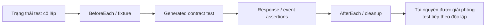
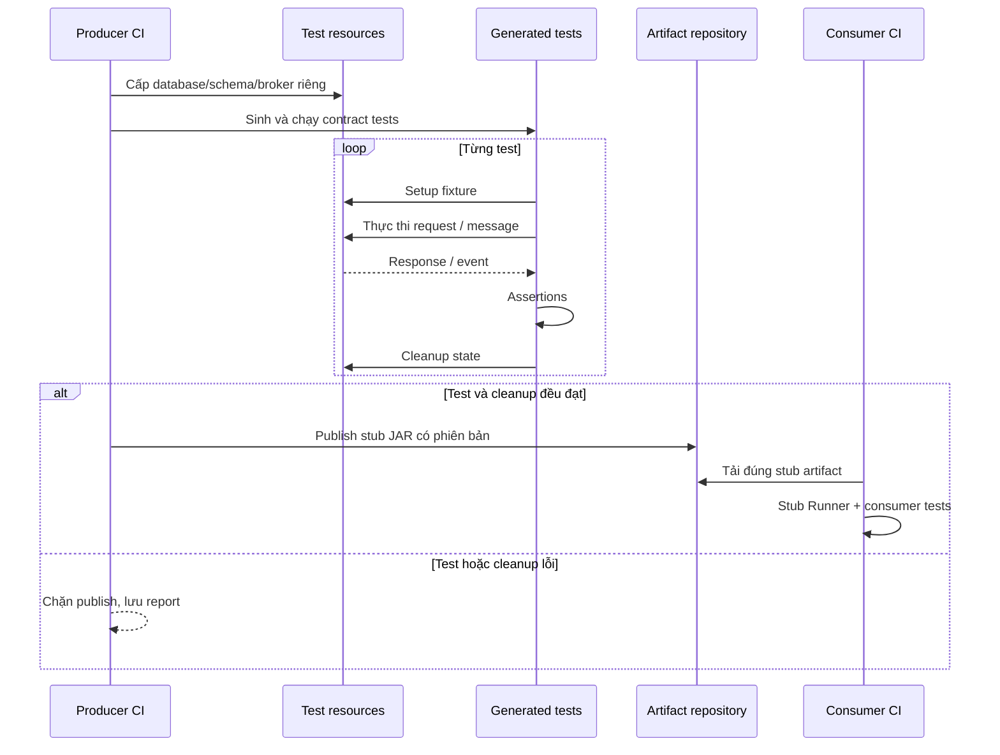

# Dọn trạng thái sau kiểm thử và tránh ảnh hưởng chéo

## 1. Bối cảnh: một hợp đồng đúng vẫn có thể cho kết quả kiểm thử không ổn định

Trong **Spring Cloud Contract**, producer công bố hành vi HTTP hoặc thông điệp bằng **Groovy DSL** hay **YAML DSL**. **Spring Cloud Contract Verifier** sinh kiểm thử phía producer; cùng nguồn hợp đồng có thể sinh stub để **Stub Runner** phục vụ consumer test. Trong CI, hai phía cần được kiểm tra để phát hiện thay đổi API không tương thích.

Giả sử producer có API:

```http
GET /api/orders/42
Accept: application/json
```

Hợp đồng yêu cầu phản hồi:

```json
{
  "id": 42,
  "state": "PAID",
  "totalAmount": 120000
}
```

Generated producer test có thể chạy đạt khi thực thi riêng nhưng thất bại khi chạy sau một test khác. Chẳng hạn test trước đã chuyển đơn hàng `42` thành `REFUNDED`, giữ một bản ghi trong cache hoặc để lại mock có hành vi trả lỗi. Ngược lại, test hợp đồng có thể làm bẩn database, session hoặc hàng đợi, khiến những test chạy sau nó thất bại.

**Dọn trạng thái sau kiểm thử** (*teardown/cleanup*) là đưa tài nguyên dùng trong test về trạng thái không ảnh hưởng các test khác. **Tránh ảnh hưởng chéo** (*test isolation*) là thiết kế sao cho kết quả một test không phụ thuộc những test trước, thứ tự thực thi hoặc hoạt động song song của các test khác.

Kết quả mong muốn: **mỗi hợp đồng chạy độc lập, có tiền điều kiện rõ, có bằng chứng về kết quả và không làm thay đổi môi trường của hợp đồng tiếp theo**.

## 2. Phân biệt setup, teardown và cô lập

Ba khái niệm liên quan nhưng không thay thế nhau:

| Khái niệm | Khi nào? | Mục tiêu | Ví dụ |
|---|---|---|---|
| **Setup** | Trước test | Tạo tiền điều kiện dự đoán được | Order `42` tồn tại, `state=PAID` |
| **Teardown** | Sau test | Thu dọn những tài nguyên test đã tạo hoặc thay đổi | Xóa record test, đóng client, dừng stub server |
| **Isolation** | Trong toàn vòng đời | Ngăn test dùng chung trạng thái có thể làm lệch kết quả | Database/schema riêng, namespace riêng, dữ liệu không trùng |

Một vòng đời lý tưởng:



**Setup tốt không làm teardown trở nên thừa.** Một test có thể tạo thêm payment attempt, file tạm hoặc message trong quá trình gọi API. Ngược lại, **teardown tốt không thay thế setup**: nếu test bắt đầu từ dữ liệu bất định, kết quả vẫn có thể sai trước khi cleanup được thực hiện.

Một số trạng thái toàn cục **không nên dùng chung ngay từ đầu** thay vì cố gắng dọn sau test: database production, queue thực, cache của môi trường chia sẻ, port cố định dễ xung đột, file của người dùng và biến môi trường của cả tiến trình.

## 3. Những nguồn trạng thái gây ảnh hưởng chéo

| Nguồn | Dấu hiệu rò rỉ | Biện pháp phù hợp |
|---|---|---|
| **Database** | Test sau đọc thấy bản ghi đã được test trước tạo/sửa | Rollback phù hợp, seed + cleanup, database/schema riêng |
| **Mockito mock/spy** | Lần gọi hoặc stub cũ ảnh hưởng test mới | Stub mới mỗi test, reset theo cơ chế test framework |
| **Spring singleton bean** | Counter, mutable collection, flag bị giữ trong context cache | Tránh mutable global state hoặc reset trong lifecycle |
| **HTTP test globals** | Base URI, cookie/filter/request spec của Rest Assured bị giữ | Cấu hình theo test, reset thiết lập toàn cục nếu đã sửa |
| **Cache** | Trả dữ liệu `PAID` cũ dù database đổi | Cache riêng hoặc xóa đúng key trước/sau test |
| **Security context** | User/role từ test trước còn tồn tại | Thiết lập và xóa security context; dùng test security support |
| **Clock, locale, timezone** | Test chỉ lỗi theo giờ hoặc múi giờ | Inject `Clock` cố định, tránh đổi global default |
| **Message broker** | Test sau nhận event từ test trước | Topic/queue/group riêng, ack/drain có kiểm soát |
| **WireMock/stub server** | Request journal/mapping/scenario còn giữ state | Reset server, mapping, request journal và scenario khi cần |
| **File tạm** | File tồn tại dẫn đến test sau bỏ qua bước tạo | Temp directory riêng và tự động dọn |
| **System properties** | Feature flag hoặc cấu hình của JVM bị thay đổi | Restore giá trị cũ; hạn chế sửa global state |

**Không có một lệnh cleanup duy nhất** xử lý hết mọi loại trạng thái. Phải xác định tài nguyên được chia sẻ trước khi chọn kỹ thuật dọn và cơ chế cô lập.

## 4. Một contract sinh test có thể bị ảnh hưởng như thế nào?

Ví dụ contract Groovy cho đơn đã thanh toán:

```groovy
import org.springframework.cloud.contract.spec.Contract

Contract.make {
    description 'Lấy đơn hàng PAID để hiển thị ở checkout'

    request {
        method GET()
        url '/api/orders/42'
        headers {
            header 'Accept', 'application/json'
        }
    }

    response {
        status OK()
        headers {
            contentType(applicationJson())
        }
        body(
            id: 42,
            state: 'PAID',
            totalAmount: 120000
        )
    }
}
```

YAML DSL diễn tả cùng kịch bản:

```yaml
description: Lấy đơn hàng PAID
request:
  method: GET
  url: /api/orders/42
  headers:
    Accept: application/json
response:
  status: 200
  headers:
    Content-Type: application/json
  body:
    id: 42
    state: PAID
    totalAmount: 120000
```

Hai file trên là **hai cách minh họa**; trong dự án thật thường chọn **một** cho cùng kịch bản để tránh generated tests trùng lặp. DSL mô tả request/response, **không tự tạo order 42 và không dọn dữ liệu**. Nếu generated test kế thừa base class, base class cần khởi tạo trạng thái producer và kiểm soát những side effect sau khi request chạy.

Một test khác có thể gọi `POST /api/orders/42/pay` và tạo payment attempt. Nếu order `42` đang bị sửa trong cùng database, contract `GET` có thể trả `PENDING`, `REFUNDED` hoặc sai tổng tiền. Đây là lý do cần quản lý **toàn bộ vòng đời trạng thái**, không chỉ assertion HTTP.

## 5. JUnit 5: `@BeforeEach` và `@AfterEach` trong base test

Spring Cloud Contract Verifier có thể cấu hình các generated test kế thừa một **base class** do nhóm phát triển viết. Với JUnit Jupiter, lifecycle method của base class được áp dụng cho test kế thừa theo cơ chế JUnit.

| Annotation/cơ chế | Mục đích | Điều cần lưu ý |
|---|---|---|
| `@BeforeEach` | Thiết lập trạng thái trước từng test method | Test phải có tiền điều kiện xác định |
| `@AfterEach` | Dọn tài nguyên sau từng test method | Phải xử lý cả khi assertion test thất bại |
| `@BeforeAll`/`@AfterAll` | Quản lý tài nguyên dùng chung cho class | Không thích hợp cho state cần độc lập từng method |
| `try/finally` | Giải phóng resource ngay trong một phạm vi thao tác | Hữu ích khi tạo tài nguyên giữa chừng |
| `@Sql` | Dựng/dọn dữ liệu database bằng script ở lifecycle Spring Test | Cần hiểu transaction và thứ tự chạy |
| `@DirtiesContext` | Đánh dấu Spring context không thể tái sử dụng | Tốn chi phí; không phải công cụ xóa database |

**Tách trách nhiệm:** `@BeforeEach` tạo môi trường hợp lệ; `@AfterEach` dọn những thứ không tự biến mất như static state hay tài nguyên ngoại vi. Không nên đặt lời gọi xóa dữ liệu vào từng contract DSL, vì contract là mô tả hành vi, còn base test là nơi quản lý hạ tầng kiểm thử.

### 5.1. Ví dụ base class cho MockMvc

Giả sử ứng dụng dùng Spring MVC, JUnit 5 và Rest Assured MockMvc. Một base class có thể thiết lập context và mock trước từng generated test:

```java
package com.example.orders.contract;

import com.example.orders.api.OrderView;
import com.example.orders.service.OrderQueryService;
import io.restassured.module.mockmvc.RestAssuredMockMvc;
import org.junit.jupiter.api.AfterEach;
import org.junit.jupiter.api.BeforeEach;
import org.springframework.beans.factory.annotation.Autowired;
import org.springframework.boot.test.autoconfigure.web.servlet.AutoConfigureMockMvc;
import org.springframework.boot.test.context.SpringBootTest;
import org.springframework.test.context.bean.override.mockito.MockitoBean;
import org.springframework.web.context.WebApplicationContext;

import static org.mockito.Mockito.when;

@SpringBootTest(webEnvironment = SpringBootTest.WebEnvironment.MOCK)
@AutoConfigureMockMvc
public abstract class ContractVerifierBase {

    @Autowired
    private WebApplicationContext context;

    @MockitoBean
    private OrderQueryService orderQueryService;

    @BeforeEach
    protected void prepareContract() {
        RestAssuredMockMvc.webAppContextSetup(context);
        when(orderQueryService.findById(42L))
            .thenReturn(new OrderView(42L, "PAID", 120000L));
    }

    @AfterEach
    protected void cleanupContract() {
        // Chỉ cần nếu test đã sử dụng cấu hình static của RestAssuredMockMvc.
        RestAssuredMockMvc.reset();
    }
}
```

**Giới hạn quan trọng của ví dụ:**

- `OrderQueryService` và `OrderView` là class **giả định của ứng dụng**, không có sẵn trong Spring Cloud Contract.
- `@MockitoBean` có ở **Spring Framework 6.2+**; với stack cũ hơn, dự án có thể sử dụng cơ chế `@MockBean` phù hợp với phiên bản Spring Boot của mình.
- Spring Test Mockito support thường cấu hình reset mock sau từng test; `@AfterEach` ở đây dọn **cấu hình Rest Assured MockMvc**, không thay thế cơ chế quản lý mock. Nếu mock được tạo thủ công hoặc được giữ ngoài context, cần cơ chế reset riêng.
- Annotation, `testMode`, dependency và phiên bản JUnit của verifier phải khớp nhau. Ví dụ dùng `MOCKMVC`, không tự áp dụng cho WebFlux hoặc real-port test.
- Mock chỉ mô phỏng dependency tại biên HTTP. Nó không kiểm thử toàn bộ repository/transaction của producer.

### 5.2. Reset mock khác với xóa dữ liệu

Ví dụ một mock được cấu hình trả `PAID` nhưng test sau cần ném exception cho `404`. Nếu mock không được reset, hành vi cũ có thể làm test sau không đúng kỳ vọng. Tránh `Mockito.reset(...)` tùy tiện ở cuối test khi framework đã quản lý reset; làm vậy có thể che tương tác mà test khác cần kiểm tra hoặc khiến việc debug khó hơn.

**Quan trọng hơn:** reset Mockito không xóa cache, không rollback database, không xóa message broker và không restore biến môi trường của JVM.

### 5.3. Nếu setup hoặc teardown ném exception

Thông thường JUnit vẫn gọi `@AfterEach` khi test body thất bại, nhưng không nên thiết kế cleanup phụ thuộc vào một biến chỉ được gán sau khi setup hoàn tất. Hãy viết cleanup **idempotent**: gọi lặp lại được và an toàn khi tài nguyên chưa tạo thành công.

Ví dụ:

```java
private AutoCloseable subscription;

@BeforeEach
void setup() {
    subscription = createSubscriptionForTest();
}

@AfterEach
void cleanup() throws Exception {
    if (subscription != null) {
        subscription.close();
        subscription = null;
    }
}
```

`createSubscriptionForTest()` ở đây là hàm minh họa do dự án cung cấp. Với một tài nguyên có thể được mở giữa test, `try/finally` hoặc `try-with-resources` ngay quanh phạm vi sử dụng thường giúp giải phóng rõ ràng hơn.

## 6. Dọn database bằng `@Sql`: trước và sau mỗi test

Nếu producer contract test phải đi qua repository và database thật, mock toàn bộ service có thể làm bỏ sót lỗi persistence. Khi đó, dùng **database dành riêng cho test** với script fixture là một lựa chọn.

### 6.1. Tổ chức script trong dự án

Ví dụ nguồn test:

```text
src/test/
├── java/com/example/orders/contract/
│   └── DbContractVerifierBase.java
└── resources/
    ├── contracts/orders/get-paid-order.groovy
    └── contract-fixtures/
        ├── seed-paid-order.sql
        └── cleanup-order.sql
```

Các script trong sơ đồ chỉ là ví dụ bạn có thể tạo **trong dự án thực tế**. Bài này không tạo thêm file ngoài Markdown được giao.

File `seed-paid-order.sql`:

```sql
-- Chỉ chạy trên database kiểm thử.
DELETE FROM payment_attempts WHERE order_id = 42;
DELETE FROM orders WHERE id = 42;

INSERT INTO orders (id, state, total_amount)
VALUES (42, 'PAID', 120000);
```

File `cleanup-order.sql`:

```sql
-- Dọn bản ghi phụ thuộc trước; đúng thứ tự khóa ngoại.
DELETE FROM payment_attempts WHERE order_id = 42;
DELETE FROM orders WHERE id = 42;
```

Đây là schema minh họa; tên bảng, thứ tự xóa và FK phải phù hợp database thật. **Không** chạy những script dọn dữ liệu trên database production hoặc môi trường chia sẻ.

### 6.2. Base test dùng `@Sql`

```java
package com.example.orders.contract;

import io.restassured.module.mockmvc.RestAssuredMockMvc;
import org.junit.jupiter.api.BeforeEach;
import org.springframework.beans.factory.annotation.Autowired;
import org.springframework.boot.test.autoconfigure.web.servlet.AutoConfigureMockMvc;
import org.springframework.boot.test.context.SpringBootTest;
import org.springframework.test.context.jdbc.Sql;
import org.springframework.web.context.WebApplicationContext;

@SpringBootTest(webEnvironment = SpringBootTest.WebEnvironment.MOCK)
@AutoConfigureMockMvc
@Sql(
    scripts = "/contract-fixtures/seed-paid-order.sql",
    executionPhase = Sql.ExecutionPhase.BEFORE_TEST_METHOD
)
@Sql(
    scripts = "/contract-fixtures/cleanup-order.sql",
    executionPhase = Sql.ExecutionPhase.AFTER_TEST_METHOD
)
public abstract class DbContractVerifierBase {

    @Autowired
    private WebApplicationContext context;

    @BeforeEach
    protected void setupMockMvc() {
        RestAssuredMockMvc.webAppContextSetup(context);
    }
}
```

Với Spring Test, `@Sql` có thể chạy script trước và sau từng test method theo `executionPhase` tương ứng. Cấu hình test verifier phải trỏ tới đúng base class.

**Điểm thiết kế cần xem xét:** seed script ở đây xóa và tạo lại order ID `42` trước test; cleanup script xóa bản ghi sau test. Đây là **hai lớp bảo vệ**, không phải vì cleanup bảo đảm sẽ chạy được trong mọi tình huống hạ tầng hỏng. Khi suite bị kill đột ngột, teardown có thể không hoàn tất; lần chạy tiếp theo vẫn phải có một cơ chế đảm bảo trạng thái đầu vào sạch.

### 6.3. Xóa theo ID hay xóa toàn bộ bảng?

Xóa đúng các dòng test tạo là lựa chọn giảm rủi ro khi database test có nhiều fixture, nhưng nếu test tạo thêm dữ liệu với ID phát sinh, cần ghi nhận các ID đó hoặc dùng namespace riêng. `DELETE FROM orders` không điều kiện có thể làm hỏng test khác hoặc tài nguyên chia sẻ khi chạy song song.

Nếu cần kiểm thử song song hoặc nhiều pipeline dùng chung một database, **schema/database riêng cho từng job** thường đáng tin hơn việc dọn bảng dùng chung. Với container database riêng và vòng đời ngắn, việc hủy container sau suite có thể là lớp cleanup bổ sung.

## 7. Rollback transaction: hữu ích nhưng có giới hạn

Trong Spring Test, một test có `@Transactional` với test-managed transaction thường được **rollback sau khi test kết thúc** theo cơ chế framework. Đây là cách cô lập dữ liệu thuận tiện cho nhiều kịch bản.

Tuy nhiên, **không mặc nhiên coi rollback là cleanup toàn bộ**:

- Với `@SpringBootTest(webEnvironment = RANDOM_PORT)` hoặc `DEFINED_PORT`, request HTTP được xử lý trong ngữ cảnh máy chủ có thể dùng **thread/transaction riêng**; transaction của phương thức test không nhất thiết bao trùm các ghi dữ liệu của request.
- Tương tác với message broker, hệ thống file, cache, service ngoài hoặc gửi email **không được hoàn tác** bởi transaction JDBC.
- Code có transaction độc lập như `REQUIRES_NEW` hoặc tác vụ bất đồng bộ có thể commit ngoài transaction của test.
- Script `@Sql` có transaction mode riêng; cần hiểu nó chạy trong transaction nào và khi nào commit.
- Tùy database, DDL hoặc thay đổi sequence/identity có thể không được rollback theo cách bạn kỳ vọng.

### 7.1. Bảng chọn chiến lược

| Loại test | Chiến lược phù hợp | Rủi ro phải chú ý |
|---|---|---|
| Repository test trong transaction của test | Rollback tự động | Không kiểm tra được side effect ngoài transaction |
| MockMvc + service/repository chung context | Rollback hoặc setup/cleanup có thể phù hợp | Cần xác minh transaction thực tế của code |
| HTTP qua cổng thật | Database test riêng + cleanup/rollback được thiết kế rõ | Server xử lý transaction khác |
| Event/messaging | Destination riêng, dọn/ack message | Rollback JDBC không thu hồi event đã phát |
| Integration test với service ngoài | Stub hoặc resource namespace riêng | Side effect từ hệ thống ngoài không rollback |

**Đừng chỉ đoán từ annotation.** Khi test phải bảo vệ một hành vi có ghi dữ liệu, hãy quan sát trạng thái sau request và sau test để chứng minh cơ chế cleanup hoạt động.

## 8. Spring application context được cache: lợi ích và rủi ro

Spring Test có thể **cache `ApplicationContext`** giữa nhiều test class để giảm chi phí khởi động. Đây là tối ưu có ích, nhưng bean singleton trong context có thể giữ mutable state nếu code không được thiết kế cẩn thận.

Ví dụ một bean có trường `List<String> events` được dùng làm giả lập event store. Test A thêm một event và không xóa; test B thấy event đó dù database đã rollback. Dùng `@Transactional` không giải quyết state nằm trong bộ nhớ Java.

### 8.1. Khi nào dùng `@DirtiesContext`?

`@DirtiesContext` báo rằng context đã bị thay đổi và không nên tái sử dụng. Nó hữu ích khi test thay đổi cấu hình/bean của context theo cách khó khôi phục, nhưng **tốn chi phí khởi tạo lại Spring**. Không nên gắn `@DirtiesContext` cho tất cả generated tests chỉ để che một cache hoặc singleton có thiết kế chưa tốt.

Ưu tiên:

1. Tránh mutable global state trong service.
2. Inject dependency có phạm vi rõ (clock, cache, client) và reset đúng đối tượng.
3. Dùng `@DirtiesContext` có chủ đích khi context thực sự không còn sạch và không thể khôi phục đáng tin.

**Chú ý:** `@DirtiesContext` cũng không tự dọn dữ liệu đã ghi ra database ngoài, file hệ thống hoặc broker.

## 9. Rest Assured, mock HTTP, security và cấu hình toàn cục

Generated contract tests có thể dùng Rest Assured MockMvc, Rest Assured cho HTTP cổng thật hoặc WebTestClient. Những thư viện này có các đối tượng cấu hình/chia sẻ khác nhau.

- Nếu test thay đổi **base URI, authentication, filters, cookies hoặc request specification** toàn cục, test sau có thể thừa hưởng. Cần khôi phục hoặc cấu hình riêng từng test.
- Với Rest Assured MockMvc, `RestAssuredMockMvc.reset()` có thể dọn cấu hình static mà thư viện quản lý. **Reset HTTP client không xóa database hoặc cache**.
- Nếu dùng WireMock server tự dựng trong integration tests, cần reset những **request journal, stub mappings hoặc scenario state** mà test đã thay đổi, hoặc tạo instance riêng.
- Với Spring Security test, principal và security context cần được thiết lập theo kịch bản và làm sạch theo lifecycle của hỗ trợ Spring Security; không dựa vào user từ test trước.
- Không để credential thật trong fixture, log hoặc test report.

### 9.1. System property và feature flag phải được restore

Nếu một test buộc phải sửa `System.setProperty(...)`, phải lưu giá trị cũ và restore:

```java
private String oldValue;

@BeforeEach
void setFeatureFlag() {
    oldValue = System.getProperty("orders.feature.strict");
    System.setProperty("orders.feature.strict", "true");
}

@AfterEach
void restoreFeatureFlag() {
    if (oldValue == null) {
        System.clearProperty("orders.feature.strict");
    } else {
        System.setProperty("orders.feature.strict", oldValue);
    }
}
```

**Cảnh báo:** System properties là trạng thái **toàn JVM**. Ngay cả khi restore trong `@AfterEach`, test khác chạy **đồng thời** vẫn có thể đọc giá trị tạm thời. Tốt hơn là inject configuration/feature flag theo context hoặc cô lập execution khi thật sự cần chỉnh global state. Tương tự, không nên sửa default timezone/locale toàn tiến trình trong các contract tests chạy song song.

## 10. Messaging: cleanup không chỉ là xóa message

Spring Cloud Contract hỗ trợ kiểm thử thông điệp thông qua `input`, `outputMessage` và các cơ chế kích hoạt như `triggeredBy(...)`. Trong các test messaging, trạng thái rò rỉ có thể nằm ở:

- Event chưa được tiêu thụ trong topic/queue.
- Consumer group offset, redelivery và retry.
- Subscription/listener còn sống.
- Dead-letter queue hoặc outbox row tồn tại từ test trước.
- Asynchronous task vẫn đang chạy sau khi assertion kết thúc.

Ví dụ ý tưởng hợp đồng:

```groovy
import org.springframework.cloud.contract.spec.Contract

Contract.make {
    name 'shouldPublishOrderPaid'
    label 'order_paid'

    input {
        triggeredBy('publishOrderPaidForContract()')
    }

    outputMessage {
        sentTo('orders.paid')
        headers {
            header('eventType', 'OrderPaid')
        }
        body(
            orderId: 42,
            state: 'PAID'
        )
    }
}
```

Method `publishOrderPaidForContract()` là hàm do dự án triển khai và generated test gọi, không phải lời hứa rằng broker tự dọn dữ liệu. Base test cần thiết lập binder/destination/trigger phù hợp. Dùng **destination hoặc consumer group riêng**, correlation ID duy nhất và cơ chế **đợi có điều kiện** để phân biệt message của test hiện tại với message cũ.

### 10.1. Các lỗi tinh vi trong test bất đồng bộ

Nếu test gửi event, assert thấy event rồi kết thúc ngay, một tác vụ xử lý phụ có thể vẫn đang ghi database hoặc gửi message mới. Cleanup chạy quá sớm sẽ xung đột với tác vụ này, gây lỗi ngẫu nhiên ở test kế tiếp.

Giải pháp: đợi điều kiện hoàn tất có giới hạn, đảm bảo subscription được đóng, dùng unique test namespace và dọn outbox/message liên quan. **`Thread.sleep(2000)` không chứng minh hệ thống đã hết side effect**; thời gian thực thi CI có thể khác máy phát triển.

## 11. Cleanup trong consumer test dùng Stub Runner

Stub Runner giúp consumer kiểm thử với stub do producer phát hành, thường dựa trên WireMock cho HTTP. **Stub Runner không tự tạo và cũng không dọn dữ liệu trong database producer**: nó mô phỏng hành vi ở biên giao tiếp.

Tuy nhiên, consumer test vẫn có state cần quản lý:

- Cổng HTTP stub và server lifecycle, tránh xung đột port.
- Request journal để kiểm tra số lần gọi; cần tách theo từng test khi assertion đếm request.
- Scenario state hoặc mapping được thay đổi trong test.
- HTTP client của consumer có base URL, cookie, cache hoặc token có thể bị giữ.
- Dữ liệu của consumer trong database riêng, nếu consumer ghi trạng thái sau khi nhận stub response.

Ví dụ, consumer test A gọi `GET /api/orders/42` rồi xác nhận request journal có đúng một lần gọi. Nếu consumer test B dùng chung journal mà không reset, kết quả có thể thành hai lần dù client B đúng. Khi cần kiểm chứng số lần gọi, hãy reset journal theo cách Stub Runner/WireMock đang được cấu hình hỗ trợ hoặc dùng stub instance riêng.

**Đừng nhầm reset stub với xác minh producer.** Producer generated tests phải chạy với ứng dụng thật và fixture riêng; consumer stub test chỉ xác minh consumer xử lý hợp đồng như mong đợi.

## 12. Chạy song song: cleanup không khắc phục được tranh chấp đang diễn ra

Giả sử hai contract tests đều dùng order `42` trong cùng database:

```text
Test A: seed order 42 PAID ───────── đọc order 42 ─── cleanup
Test B:       seed order 42 PENDING ── đọc order 42 ── cleanup
```

Ngay cả khi **cả hai có `@AfterEach` hoặc cleanup `@Sql`**, chúng vẫn có thể thay đổi dữ liệu của nhau **trong lúc đang chạy**. Đây là **race condition**, không phải lỗi “quên dọn sau test”.

Những biện pháp đáng tin cậy:

1. **Resource riêng:** database/schema/container, ID và namespace độc lập cho từng test hoặc CI job.
2. **Không dùng mutable singleton:** dependency có state được inject theo scope phù hợp.
3. **Đồng bộ có chủ đích:** với JUnit Jupiter, các test có thể dùng `@ResourceLock` cho tài nguyên chung mà tất cả test tham gia đều tuân thủ. Cách này không ngăn tác nhân ngoài JUnit hoặc CI job khác.
4. **Giới hạn parallel:** tắt parallel cho nhóm contract tests không thể cô lập ngay; đây là biện pháp tạm thời, không phải thay thế thiết kế state.
5. **Dùng ephemeral services:** database/test broker/container riêng để mỗi pipeline không ảnh hưởng nhau.

**Đối với kịch bản phải dùng ID cố định từ contract**, không nhất thiết sửa ID thành số ngẫu nhiên nếu generated test/fixture cần determinism. Có thể cô lập **toàn bộ database/schema** của job hoặc chọn ID riêng theo nhóm kịch bản, bảo đảm request và response cùng dùng một ID.

## 13. Đừng để cleanup che giấu lỗi assertion

Một anti-pattern là bắt exception rồi bỏ qua:

```java
@AfterEach
void cleanup() {
    try {
        deleteTemporaryData();
    } catch (Exception ignored) {
        // Sai: có thể để lại trạng thái bẩn cho test sau.
    }
}
```

Nếu cleanup thất bại, test suite cần **biết** điều đó. Có thể ghi log có ngữ cảnh, đính kèm lỗi cleanup mà không làm mất lỗi assertion gốc, và dùng cơ chế framework để report nhiều lỗi khi phù hợp. Không trả «PASSED» một cách đánh lừa khi dữ liệu test đã rò rỉ.

Với tài nguyên critical như external database/queue, cleanup cũng cần xử lý khi test runner bị dừng không bình thường: hủy container, TTL cho dữ liệu test, cron dọn namespace test riêng hoặc cleanup ở cấp pipeline. Đây là **lớp bảo vệ thứ hai**; không thay thế lifecycle từng test.

### 13.1. Teardown nên idempotent và giới hạn phạm vi

- Xóa một resource đã không còn tồn tại phải được xử lý an toàn.
- Đóng subscription/client đã đóng không được phá hỏng tài nguyên của test khác.
- Không dùng `DELETE FROM orders` cho database chia sẻ khi chỉ cần dọn order test.
- Không reset toàn bộ broker hay cache production để làm cho test xanh.
- Nếu cleanup cần quyền đặc biệt, chỉ cấp quyền trong môi trường test cô lập.

## 14. Quy trình chẩn đoán khi «chạy riêng xanh, chạy cả suite đỏ»

| Triệu chứng | Giả thuyết ưu tiên | Cách xác minh |
|---|---|---|
| `200` trở thành `404` | Order fixture bị test khác xóa | Kiểm tra seed/cleanup và request ID |
| Kỳ vọng `PAID` nhưng nhận `REFUNDED` | State database hoặc cache tồn dư | So sánh DB/cache ngay trước request |
| Assertion đếm 1 request nhưng thấy 2 | WireMock journal chưa reset | Kiểm tra journal và lifecycle stub |
| Test chỉ fail khi chạy song song | Resource chung bị tranh chấp | Chạy tuần tự để xác lập giả thuyết, sau đó cô lập |
| Mock trả exception từ test trước | Mock không reset hoặc stub sai | Kiểm tra reset policy và `@BeforeEach` |
| Message test nhận event sai | Queue/topic còn event cũ | Dùng correlation ID, destination riêng, consumer group riêng |
| Test pass local, fail CI | Dữ liệu, timing, timezone hoặc container khác | Thu thập fixture snapshot, log và test reports |
| Test fail khi chạy sau class khác | Spring context cache/singleton có state | Kiểm tra bean mutable, cache hoặc static fields |
| Xóa DB nhưng test vẫn đọc dữ liệu cũ | Persistence context/second-level cache | Kiểm tra transaction, flush/clear và cache invalidation |
| Cleanup thất bại nhưng suite vẫn xanh | Exception cleanup bị nuốt | Chặn lỗi, ghi report rõ nguyên nhân |

Trình tự điều tra:

1. Xác nhận generated test **thực sự được runner thực thi** chứ không chỉ được sinh.
2. Ghi lại **request và trạng thái trước request**: database, mock, clock, security, cache.
3. Xác định side effect của test đang chạy và của các test có thể chạy trước/sau.
4. Kiểm tra teardown **sau assertion và cả khi test fail**.
5. Chạy lại ở thứ tự khác hoặc chạy song song trong **môi trường test cô lập** để phát hiện race condition.
6. Sửa nguyên nhân ở fixture/lifecycle, không xóa assertion hợp đồng hoặc nới matcher để che lỗi.

## 15. Quy trình CI bảo đảm không ảnh hưởng chéo



Checklist CI ở mức kỹ thuật:

- **Provision:** tạo resource test riêng và xác nhận không trỏ nhầm production.
- **Run:** sinh/biên dịch/thực thi generated producer tests, không dùng cờ skip và không chấp nhận 0 tests khi phải có contract tests.
- **Isolate:** seed deterministic fixture, khóa/không song song nhóm chưa cô lập được.
- **Tear down:** giải phóng resource theo từng test và hủy ephemeral services khi kết thúc job.
- **Inspect:** lưu báo cáo cho từng generated test, bao gồm failures/errors/skipped và lỗi cleanup.
- **Publish:** chỉ phát hành stub sau khi producer verification đạt; chạy consumer tests với đúng stub version.
- **Protect compatibility:** nếu thay đổi error status, body, message hoặc schema, chạy test của consumer liên quan trước khi chấp nhận thay đổi API.

Không đồng nhất **«stub đã sinh ra»** với **«producer verification đã đạt»**. Một stub có thể được đóng gói trong khi producer test bị skip, hoặc producer test đã chạy nhưng không dọn state dẫn tới kết quả không ổn định.

## 16. Bài thực hành: phát hiện và loại bỏ ảnh hưởng chéo

**Bối cảnh:** `checkout-service` dùng `order-service` để đọc đơn và gọi thanh toán. Một test tạo payment attempt cho order `42`. Một contract khác kiểm tra `GET /api/orders/42` phải trả `PAID`. Chạy từng test thì xanh nhưng chạy chung đôi lúc nhận `PENDING` hoặc thêm payment attempts.

**Yêu cầu**: mỗi test bắt đầu với order `42` ở `PAID` và không có payment attempt tồn dư; một contract `GET /api/orders/9999` phải luôn trả `404`. Stub Runner vẫn cần phục vụ consumer mà không dựa vào database producer thật.

Thực hiện:

1. Liệt kê tài nguyên dùng chung: bảng `orders`, `payment_attempts`, cache, mock service, broker và HTTP client config.
2. Viết hợp đồng Groovy cho `GET /api/orders/42` với response `200 + PAID` và hợp đồng YAML cho `GET /api/orders/9999` với `404 + ORDER_NOT_FOUND`.
3. Tạo base class thích hợp: MockMvc + mock hoặc Spring Test + database fixture. Thiết lập trước mỗi test các ID/kết quả mong đợi.
4. Dùng `@AfterEach` hoặc `@Sql(AFTER_TEST_METHOD)` dọn những resource test đã tạo. Đảm bảo teardown an toàn khi request thất bại giữa chừng.
5. Cố ý bỏ cleanup cho payment attempt, chạy thứ tự A→B và B→A; quan sát sự khác nhau **trong môi trường test**, không sửa contract chỉ để test xanh.
6. Khôi phục cleanup, rồi chạy nhiều lần để phát hiện trạng thái chưa được reset (cache, broker, singleton).
7. Nếu chạy song song vẫn lỗi, cô lập schema/container hoặc khóa tài nguyên chung; đừng chỉ thêm `Thread.sleep(...)`.
8. Kiểm tra report: generated producer tests phải thực thi và đạt, không bị skipped; cleanup không báo lỗi.
9. Phát hành stub JAR có phiên bản sau khi producer verification đạt. Consumer test với Stub Runner xác nhận nhánh `200` và `404` bằng client ứng dụng thực.

### 16.1. Tự đánh giá

| Câu hỏi | Kết luận |
|---|---|
| `@AfterEach` luôn chạy nếu JVM bị kill giữa test không? | **Không.** Cần resource isolation và cleanup ở cấp job khi thích hợp |
| Có `@Transactional` là toàn bộ HTTP request/queue được rollback không? | **Không.** Transaction của test có phạm vi giới hạn |
| Reset Mockito có xóa database không? | **Không.** Mock state và persistent state là hai nguồn khác nhau |
| Dùng `@DirtiesContext` mọi test có phải cách tối ưu? | **Không.** Rất tốn chi phí và không dọn external resource |
| Chạy tuần tự xanh, chạy song song đỏ thì có đủ chỉ cần teardown không? | **Không.** Test có thể tranh chấp resource **trong khi đang chạy** |
| Consumer test qua Stub Runner có cần seed database producer không? | **Không.** Stub mô phỏng response; producer verification dùng fixture riêng |
| Cleanup lỗi nhưng assertion pass, có nên cho publish stub không? | **Không nên.** Kết quả không bảo đảm môi trường test sạch và tin cậy |

## 17. Checklist review base test và cleanup

- [ ] Mỗi generated contract test có fixture độc lập và trạng thái đầu vào xác định.
- [ ] `@BeforeEach`, `@AfterEach` hoặc Spring Test lifecycle được cấu hình đúng với test framework.
- [ ] Cleanup idempotent, chạy được cả khi test body thất bại và không xóa dữ liệu ngoài phạm vi test.
- [ ] Database dùng riêng cho test; các script `@Sql`, transaction và thứ tự xóa phù hợp schema.
- [ ] Không giả định rollback tự động bao phủ HTTP request cổng thật, message hay service ngoài.
- [ ] Mock, cache, singleton, security context, clock và HTTP client global configuration được reset/cô lập khi cần.
- [ ] Message broker có destination/group/correlation ID phù hợp và xử lý eventual completion.
- [ ] Stub Runner/WireMock journal hoặc scenario state được reset nếu consumer test dùng chung instance.
- [ ] Resource chạy song song không ghi đè nhau; việc chia sẻ được kiểm soát thay vì chỉ dựa vào teardown.
- [ ] Lỗi cleanup được báo cáo, không bị nuốt exception.
- [ ] Test vẫn ổn định khi chạy riêng, cả suite, đổi thứ tự hoặc chạy song song theo chính sách dự án.
- [ ] CI chạy generated producer tests thực sự, lưu report, chỉ publish stub sau khi verification đạt.
- [ ] Consumer tests dùng đúng stub version và kiểm tra hành vi client, gồm các nhánh lỗi quan trọng.

**Kết luận:** Dọn trạng thái sau kiểm thử là một bước cần thiết, nhưng **test isolation mới là mục tiêu**. Khi base test dựng dữ liệu xác định, hoàn nguyên resource đúng phạm vi và tránh tranh chấp song song, Spring Cloud Contract có thể kiểm tra producer bằng những kết quả ổn định. Kết hợp producer verification với Stub Runner và CI sẽ giúp phát hiện thay đổi API không tương thích thay vì những lỗi ngẫu nhiên do các test ảnh hưởng chéo.
