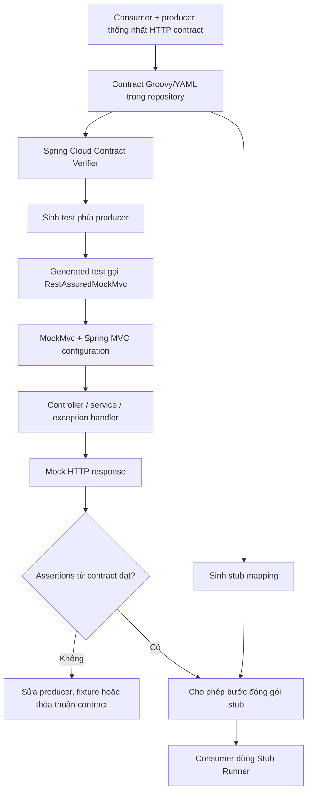

# Kiểm thử controller bằng MockMvc

Khi một consumer gửi HTTP request tới producer, điều cần bảo vệ không chỉ là việc phương thức Java chạy được mà còn là **hợp đồng HTTP quan sát được**: method, URL, header, JSON request, status code, JSON response và các trường hợp lỗi. Spring Cloud Contract giúp nhóm phát triển định nghĩa các cam kết này bằng Groovy/YAML DSL và sinh test phía producer. Với ứng dụng Spring MVC, **MockMvc** là một cách thực thi generated tests mà không cần mở một cổng HTTP thật.

Bài này thuộc chương **Kiểm thử HTTP** của module **Spring Cloud Contract**. Ta sẽ nối ba thành phần thường bị nhầm lẫn: **hợp đồng** do producer–consumer thống nhất, **MockMvc** đưa request qua tầng Spring MVC trong tiến trình kiểm thử, và **Contract Verifier** sinh assertion để kiểm xem producer có đáp ứng hợp đồng hay không. Sau khi producer test đạt, cùng tập contract có thể dùng để tạo stub cho consumer qua **Stub Runner** và trở thành cổng phát hiện thay đổi API không tương thích trong CI.

Sau bài học, bạn có thể:

- Giải thích MockMvc kiểm thử những phần nào của tầng HTTP và những phần nào nó không kiểm.
- Cấu hình Spring Cloud Contract Verifier dùng `testMode = MOCKMVC` và JUnit 5.
- Viết contract Groovy/YAML cho một endpoint, rồi tổ chức base class để generated tests chạy trên controller.
- Chọn giữa **web application context** và **standalone controller setup** phù hợp mục tiêu kiểm thử.
- Chuẩn bị fixture, test double và security setup sao cho test vừa tái lập vừa có ý nghĩa.
- Kiểm các nhánh `201`, `400`, `404`, `409`, matcher dữ liệu động và header response.
- Chẩn đoán lỗi sinh test, biên dịch, chạy test, sai HTTP mapping hoặc báo cáo CI xanh giả.

## 1. MockMvc là gì trong bối cảnh kiểm thử hợp đồng?

**Spring MockMvc** là công cụ từ Spring Test để gửi request mô phỏng vào tầng **Spring MVC** mà không phải chạy server network thực. Request vẫn đi qua các thành phần MVC được cấu hình trong bài test, chẳng hạn `DispatcherServlet`, handler mapping, argument resolution, validation, converter JSON và exception handler.

Một request minh họa:

```http
POST /api/v1/reservations HTTP/1.1
Content-Type: application/json
Accept: application/json

{"sku":"SKU-001","quantity":2}
```

Producer có thể trả:

```http
HTTP/1.1 201 Created
Content-Type: application/json
Location: /api/v1/reservations/RES-100

{"reservationId":"RES-100","status":"HELD"}
```

Nếu `OrderService` phụ thuộc vào `201`, `reservationId` và `status` để tiếp tục thanh toán, contract phải bảo vệ các giá trị đó. Contract Verifier sinh request và assertions; MockMvc thực hiện request trong ngữ cảnh Spring MVC của producer.

### MockMvc không phải một HTTP server thật

| Lớp cần kiểm | MockMvc trong Spring application context | Những gì cần test khác |
| --- | --- | --- |
| `@RequestMapping`, `@PostMapping`, path variables | Có thể kiểm | Deployment routing tại ingress/gateway |
| JSON serialization/deserialization | Có thể kiểm qua message converters được cấu hình | Khác biệt codec trong runtime khác, nếu có |
| `@Valid`, validation, `@ControllerAdvice` | Có thể kiểm khi được cấu hình | Quy trình lỗi xuyên nhiều dịch vụ |
| HTTP status và headers từ controller/filter | Có thể kiểm | Hành vi reverse proxy, load balancer, HTTP server thật |
| Spring Security filters | Có thể kiểm khi MockMvc được thiết lập với filter chain | TLS, cookie browser, authentication xuyên hệ thống |
| Service/repository thật | Tùy cách dựng context và mock dependencies | Database/transaction/concurrency thật ở môi trường tích hợp |
| Mạng, socket, TLS, timeout ngoài tiến trình | Không | Test HTTP thực với server khởi động trên port |
| Browser redirects và lưu cookie | Không tự động mô phỏng đầy đủ | Browser/end-to-end hoặc HTTP client test có cookie jar |

**Điểm then chốt:** MockMvc có thể là kiểm thử controller sát runtime Spring MVC, nhưng độ sâu của nó **phụ thuộc cách bạn dựng test**. Nếu chỉ dùng controller với service giả, contract có thể pass dù business service thật có lỗi. Nếu dùng gần như toàn bộ Spring context và database test, phạm vi kiểm tra rộng hơn nhưng build thường nặng hơn.

## 2. Contract Verifier và MockMvc phối hợp như thế nào?



Đây là **luồng logic**, không phải lời khẳng định mọi build tự động publish stub sau khi chạy test. Việc đóng gói và phát hành artifact phải được cấu hình riêng và phụ thuộc vào các cổng xác minh bắt buộc.

### Vai trò các thành phần

| Thành phần | Nhiệm vụ |
| --- | --- |
| Contract Groovy/YAML | Định nghĩa request và response consumer được phép dựa vào |
| Spring Cloud Contract Verifier | Sinh test từ hợp đồng và dữ liệu dùng tạo stub |
| Generated JUnit test | Phát request và kiểm status, header, body theo contract |
| RestAssuredMockMvc | Cầu nối DSL kiểm thử HTTP với Spring MockMvc |
| `MockMvc` | Điều phối request qua Spring MVC không qua socket |
| Base class của generated tests | Thiết lập Spring context, MockMvc và fixture |
| CI | Chạy test, báo fail khi producer không còn đáp ứng contract |

Một contract được sinh thành Java test không đảm bảo đã được thực thi. Cần xác nhận generator tạo file, build biên dịch được và JUnit thật sự chạy lớp test được sinh.

## 3. Một contract HTTP hoàn chỉnh cho endpoint giữ hàng

Giả sử `InventoryService` là producer, `OrderService` là consumer. Đường dẫn giả định:

```text
POST /api/v1/reservations
```

Consumer cần một lần giữ hai đơn vị `SKU-001`. Khi thành công, producer trả `201`, trạng thái `HELD`, ID mới và Location.

Ví dụ file:

```text
src/test/resources/contracts/reservations/create-reservation-success.groovy
```

Nội dung Groovy DSL:

```groovy
import org.springframework.cloud.contract.spec.Contract

Contract.make {
    name 'order_create_reservation_success'
    description '''
        OrderService yêu cầu InventoryService giữ hai sản phẩm SKU-001.
        Consumer cần reservationId và status HELD để đi tiếp bước thanh toán.
    '''

    request {
        method 'POST'
        url '/api/v1/reservations'
        headers {
            contentType(applicationJson())
            header('Accept', 'application/json')
        }
        body([
            sku     : 'SKU-001',
            quantity: 2
        ])
    }

    response {
        status 201
        headers {
            contentType(applicationJson())
            header('Location', '/api/v1/reservations/RES-100')
        }
        body([
            reservationId: 'RES-100',
            status       : 'HELD'
        ])
    }
}
```

Các giá trị trong ví dụ là **thỏa thuận giả định**, không phải các status/field Spring Cloud Contract bắt buộc mọi API sử dụng. `RES-100` được cố định để minh họa fixture; nếu producer tạo ID động, cần matcher như phần sau.

### Đọc contract theo ba lớp

1. **Định danh và ngữ nghĩa:** `name` cùng `description` giải thích consumer nào cần kịch bản và để làm gì.
2. **Request matching:** method, URL, header và body mô tả lời gọi mà producer cần hỗ trợ.
3. **Response assertions:** status `201`, `Content-Type`, `Location` và JSON body mô tả kết quả được cam kết.

Khi chạy ở chế độ MockMvc, generated test không gọi `http://localhost:8080`. Nó tạo request MockMvc cho `POST /api/v1/reservations` vào Spring MVC test context đã được base class thiết lập.

## 4. Mô tả cùng kịch bản bằng YAML DSL

Spring Cloud Contract cũng hỗ trợ YAML DSL, chẳng hạn:

```yaml
name: order_create_reservation_success
description: OrderService giữ hàng trước bước thanh toán
request:
  method: POST
  url: /api/v1/reservations
  headers:
    Content-Type: application/json
    Accept: application/json
  body:
    sku: SKU-001
    quantity: 2
response:
  status: 201
  headers:
    Content-Type: application/json
    Location: /api/v1/reservations/RES-100
  body:
    reservationId: RES-100
    status: HELD
```

Đây là **cách biểu diễn thay thế**, không phải contract thứ hai cần đặt cạnh file Groovy có cùng method, URL và response. Nếu cả hai cùng được generator đọc, build có thể tạo test và stub mappings trùng nhau. Chọn định dạng phù hợp quy ước dự án.

Với dữ liệu động, YAML có cơ chế matcher riêng. Không dán biểu thức Groovy như `$(consumer(...), producer(...))` vào chuỗi YAML rồi mặc định nó sẽ được hiểu như DSL Groovy. Dù viết định dạng nào, hãy xác minh test và stub thực tế được sinh từ contract.

## 5. Cấu hình Maven để sinh test MockMvc

Trong Maven producer, plugin `spring-cloud-contract-maven-plugin` chịu trách nhiệm sinh test từ nguồn contract. Dependency `spring-cloud-starter-contract-verifier` và `spring-boot-starter-test` cung cấp các thành phần phục vụ thực thi test, tùy dependency management của dự án.

Một đoạn cấu hình minh họa cho `pom.xml`:

```xml
<dependencies>
    <dependency>
        <groupId>org.springframework.boot</groupId>
        <artifactId>spring-boot-starter-test</artifactId>
        <scope>test</scope>
    </dependency>
    <dependency>
        <groupId>org.springframework.cloud</groupId>
        <artifactId>spring-cloud-starter-contract-verifier</artifactId>
        <scope>test</scope>
    </dependency>
</dependencies>

<build>
    <plugins>
        <plugin>
            <groupId>org.springframework.cloud</groupId>
            <artifactId>spring-cloud-contract-maven-plugin</artifactId>
            <version>VERSION_COMPATIBLE_WITH_YOUR_PROJECT</version>
            <extensions>true</extensions>
            <configuration>
                <testFramework>JUNIT5</testFramework>
                <testMode>MOCKMVC</testMode>
                <baseClassForTests>
                    com.example.inventory.ContractVerifierBase
                </baseClassForTests>
            </configuration>
        </plugin>
    </plugins>
</build>
```

Đây **không phải POM hoàn chỉnh**. `VERSION_COMPATIBLE_WITH_YOUR_PROJECT` là placeholder cần thay bằng phiên bản hợp lệ, đồng bộ với Spring Boot/Spring Cloud, JDK và dependency management hiện có. Nếu dự án cấu hình contract source, test source directory hoặc version ở nơi khác, cần điều chỉnh tương ứng.

| Thuộc tính | Mục đích |
| --- | --- |
| `testMode = MOCKMVC` | Sinh test dùng tầng MockMvc thay vì gọi HTTP trên cổng thật |
| `testFramework = JUNIT5` | Sinh test theo JUnit 5 |
| `baseClassForTests` | Nơi generated test kế thừa để thiết lập context, MockMvc và fixture |
| `extensions = true` | Kích hoạt cơ chế tích hợp plugin phù hợp với Maven |
| Thư mục `src/test/resources/contracts` | Vị trí nguồn contract thông dụng, có thể cấu hình lại |

Trong một dự án Maven được cấu hình đúng, `mvn clean verify` thường đi qua các bước tạo test source, biên dịch test và thực thi JUnit. **Không được mặc định build xanh nghĩa là có contract test**: plugin có thể chưa đọc nguồn hoặc test runner có thể đã skip.

### Vị trí mã sinh

Một bố cục tham khảo:

```text
inventory-service/
├── pom.xml
├── src/main/java/com/example/inventory/
│   └── ... controller, service, DTO ...
├── src/test/java/com/example/inventory/
│   └── ContractVerifierBase.java         # Viết tay, nên quản lý trong Git
├── src/test/resources/contracts/
│   └── reservations/
│       └── create-reservation-success.groovy  # Contract nguồn
└── target/
    ├── generated-test-sources/contracts/ # Test do plugin sinh, đường dẫn có thể cấu hình
    └── surefire-reports/                 # Báo cáo JUnit/Surefire
```

Tên và vị trí chính xác của output có thể thay đổi theo version và cấu hình. Đừng sửa file Java được sinh trong `target`: thay đổi ở đó sẽ bị ghi đè lần build sau. Hãy sửa contract, lớp base, fixture hoặc mã producer theo nguyên nhân lỗi.

## 6. Base class với Spring context và MockMvc

Generated test cần biết **MockMvc nào** sẽ nhận request và **Spring context nào** chứa controller. Với hệ thống Spring MVC muốn kiểm qua các converter, advice và filter được cấu hình, cách thông dụng là dùng `@SpringBootTest` cùng `@AutoConfigureMockMvc`.

Ví dụ lớp `src/test/java/com/example/inventory/ContractVerifierBase.java`:

```java
package com.example.inventory;

import io.restassured.module.mockmvc.RestAssuredMockMvc;
import org.junit.jupiter.api.BeforeEach;
import org.springframework.beans.factory.annotation.Autowired;
import org.springframework.boot.test.autoconfigure.web.servlet.AutoConfigureMockMvc;
import org.springframework.boot.test.context.SpringBootTest;
import org.springframework.test.context.ActiveProfiles;
import org.springframework.test.web.servlet.MockMvc;

@SpringBootTest
@AutoConfigureMockMvc
@ActiveProfiles("contract")
public abstract class ContractVerifierBase {

    @Autowired
    private MockMvc mockMvc;

    @BeforeEach
    void setUpMockMvc() {
        RestAssuredMockMvc.mockMvc(mockMvc);
    }
}
```

Ví dụ giả định ứng dụng Spring Boot đã có controller được component scan, test runtime tương thích với RestAssured MockMvc và dùng JUnit 5. Tùy version, cách cấu hình RestAssuredMockMvc có thể được cung cấp qua `webAppContextSetup(...)` hoặc `standaloneSetup(...)`; cần chọn **một cách** nhất quán với test mode và version của dự án.

**Vì sao phải gắn MockMvc trong base class?** Generated tests dùng RestAssuredMockMvc để thực hiện request. Nếu base class không khởi tạo đúng, test có thể không tìm được thiết lập MockMvc hoặc không đi qua controller mong đợi.

### Khi nào dùng `webAppContextSetup(...)`?

Một biến thể dùng `WebApplicationContext`:

```java
package com.example.inventory;

import io.restassured.module.mockmvc.RestAssuredMockMvc;
import org.junit.jupiter.api.BeforeEach;
import org.springframework.beans.factory.annotation.Autowired;
import org.springframework.boot.test.context.SpringBootTest;
import org.springframework.web.context.WebApplicationContext;

@SpringBootTest
public abstract class ContractVerifierBase {

    @Autowired
    private WebApplicationContext context;

    @BeforeEach
    void setUpMockMvc() {
        RestAssuredMockMvc.webAppContextSetup(context);
    }
}
```

Đoạn này là **phương án thay thế**, không phải lớp thứ hai phải có đồng thời. Nó giúp kết nối RestAssuredMockMvc tới Spring web context, nhưng mức tích hợp các filter (đặc biệt Spring Security) phải được kiểm tra theo cách xây dựng MockMvc thực tế. Khi cần giữ các filter đã cấu hình bởi `@AutoConfigureMockMvc`, cách inject `MockMvc` rồi gắn vào RestAssuredMockMvc thường rõ ràng hơn.

### Đừng mặc định hai cách setup tương đương về bảo mật

MockMvc được tạo bằng `@AutoConfigureMockMvc` có thể tự đưa các servlet filters của ứng dụng vào đường chạy. Nếu bạn tự tạo MockMvc từ context bằng builder hoặc dùng standalone setup, cần xác định bộ filter và Spring Security filter chain có thật sự được áp dụng hay không. Một contract chạy không qua security filter có thể pass dù endpoint production yêu cầu token.

## 7. Standalone setup: kiểm controller ở phạm vi hẹp hơn

Một hướng khác là dùng `RestAssuredMockMvc.standaloneSetup(controller)`, thường phù hợp khi cần kiểm **HTTP mapping và chuyển đổi request/response của một controller** với các dependency được kiểm soát.

Ví dụ minh họa cấu trúc:

```java
package com.example.inventory;

import io.restassured.module.mockmvc.RestAssuredMockMvc;
import org.junit.jupiter.api.BeforeEach;
import org.springframework.beans.factory.annotation.Autowired;
import org.springframework.boot.test.context.SpringBootTest;

@SpringBootTest
public abstract class ContractVerifierBase {

    @Autowired
    private ReservationController reservationController;

    @BeforeEach
    void setUpMockMvc() {
        RestAssuredMockMvc.standaloneSetup(reservationController);
    }
}
```

Ở đây `ReservationController` là lớp **giả định** trong ứng dụng minh họa; nó không phải lớp có sẵn của Spring Cloud Contract. Test vẫn khởi động Spring context vì ví dụ dùng `@SpringBootTest` để inject controller, nhưng MockMvc được xây theo cách **standalone cho controller đó**, nên không nhất thiết sử dụng đầy đủ bộ MVC configuration/filter/advice giống như web application context.

| Cách setup | Ưu điểm | Điều phải thận trọng |
| --- | --- | --- |
| `standaloneSetup(controller)` | Nhẹ hơn ở tầng MockMvc, kiểm logic mapping controller tập trung | Có thể thiếu global advice, security filters, converters tùy chỉnh nếu không đăng ký |
| `webAppContextSetup(context)` | Dùng cấu hình Spring MVC từ context | Cần kiểm việc áp dụng filter và mọi bean cần thiết |
| `@AutoConfigureMockMvc` + inject `MockMvc` | Dễ tích hợp Boot MVC setup và filter chain theo cấu hình test | Khởi động Spring context có thể tốn tài nguyên; cần cô lập dependency ngoài |

**Quy tắc lựa chọn:** nếu contract bao gồm security, validation, exception mapping hoặc Jackson configuration mà consumer thật sự phụ thuộc, setup hẹp phải bổ sung tương ứng. Nếu chỉ muốn bảo vệ định dạng response của một controller và đã kiểm rõ các phần bị thay thế, standalone có thể phù hợp.

## 8. Chuẩn bị fixture: test phải có dữ liệu để producer trả đúng

MockMvc không tự tạo SKU `SKU-001` hoặc một reservation trong database. Nếu request tạo giữ hàng trả `409 INSUFFICIENT_STOCK` do dữ liệu test không có tồn kho, generated test `201` sẽ thất bại dù controller có thể xử lý đúng theo nghiệp vụ.

Một phương án fixture có thể gồm:

| Thành phần cần chuẩn bị | Trường hợp thành công | Trường hợp lỗi |
| --- | --- | --- |
| SKU | `SKU-001` tồn tại | `SKU-EMPTY` tồn tại nhưng hết hàng |
| Số lượng sẵn có | Ít nhất 2 | Bằng 0 hoặc dưới lượng yêu cầu |
| Trạng thái reservation trước test | Chưa có reservation theo khóa idempotency | Không có lượt giữ mới |
| ID trả về | ID cố định qua fixture hoặc matcher cho ID động | Thường không có `reservationId` thành công |
| Clock | Có thể cố định nếu contract liên quan hết hạn | Mốc giả cho hết hạn/boundary |

### Chọn test double có chủ đích

Có hai chiến lược phổ biến:

1. **Gần producer thật:** khởi động Spring context, repository test và những bean nội bộ cần thiết; chỉ cô lập hệ thống ngoài như payment gateway hoặc message broker khi chúng không thuộc đối tượng kiểm thử.
2. **Giới hạn ở controller boundary:** thay service bằng test double có phản hồi xác định, kiểm URI, JSON binding, validation và exception handler. Cách này nhanh hơn nhưng **không** xác minh implementation thực của business service.

Nếu service bị mock để luôn trả `201` và JSON mẫu, generated test vẫn có thể pass dù code nghiệp vụ của producer không hoạt động. Vì thế phải ghi rõ **phạm vi lớp được kiểm** và bổ sung integration test với service thật cho các cam kết liên quan trạng thái.

### Test cần chạy độc lập và tái lập

- Dữ liệu test phải được reset trước mỗi kịch bản hoặc sau test theo chính sách rõ.
- Nếu request sinh ID tự động, đừng so literal ID trừ khi fixture làm nó xác định.
- Nếu dùng thời hạn, tiêm `Clock` có thể kiểm soát thay vì phụ thuộc thời gian máy CI.
- Không phụ thuộc vào thứ tự các generated tests.
- Không lấy dữ liệu thật của khách hàng hoặc token thật đưa vào contract.
- Khi chạy song song, mỗi test cần dữ liệu/namespace đủ cô lập.

Lỗi “test pass trên máy tôi nhưng fail trên CI” thường liên quan fixture, thứ tự test, timezone hoặc dependency ngoài, không chỉ bản thân MockMvc.

## 9. Generated test kiểm điều gì trong ví dụ `201`?

Một test được sinh từ contract thành công về mặt ý tưởng sẽ:

1. Tạo JSON request từ `body` của contract.
2. Đặt method `POST`, URL `/api/v1/reservations` và những headers đã mô tả.
3. Gọi endpoint qua RestAssuredMockMvc và Spring MVC.
4. Đối chiếu status `201`, `Content-Type`, `Location` và các field JSON trong response.

Để thấy rõ ý nghĩa của một số assertion, đây là **test MockMvc viết tay minh họa**, không phải mã Verifier bắt buộc sinh:

```java
import static org.springframework.test.web.servlet.request.MockMvcRequestBuilders.post;
import static org.springframework.test.web.servlet.result.MockMvcResultMatchers.*;

mockMvc.perform(post("/api/v1/reservations")
        .contentType("application/json")
        .accept("application/json")
        .content("{\"sku\":\"SKU-001\",\"quantity\":2}"))
    .andExpect(status().isCreated())
    .andExpect(header().string(
        "Location", "/api/v1/reservations/RES-100"))
    .andExpect(jsonPath("$.reservationId").value("RES-100"))
    .andExpect(jsonPath("$.status").value("HELD"));
```

Mã trên là một **đoạn minh họa đặt trong method test có sẵn `mockMvc`**, không phải file Java hoàn chỉnh có thể biên dịch độc lập. Plugin thực tế có thể sinh mã dùng RestAssuredMockMvc, các matcher và naming conventions khác. Không lấy sự khác biệt cú pháp giữa test sinh và ví dụ viết tay làm tiêu chí đánh giá hợp đồng.

### Nếu chỉ sửa response status?

Giả sử controller đổi từ `201` sang `200` mà không sửa contract. Generated producer test phải phát hiện sai lệch nếu đã chạy tới controller đúng. Không nên sửa assertion `201` trong file generated Java để cho build xanh; hãy xác định API đã đổi có được consumer chấp thuận hay không.

### Nếu controller trả JSON number thay vì string?

Ví dụ response đổi từ:

```json
{"reservationId":"RES-100","status":"HELD"}
```

sang:

```json
{"reservationId":100,"status":"HELD"}
```

Consumer deserializer có thể bị ảnh hưởng vì kiểu JSON đã đổi. Contract cần dùng kiểu dữ liệu/matcher đủ chặt để phát hiện. Một regex quá rộng hoặc test chỉ kiểm status sẽ bỏ sót thay đổi này.

## 10. Dữ liệu động: không buộc producer tạo cùng ID mọi lần

Khi producer sinh mã reservation, phản hồi có thể là `RES-4817`, `RES-4818`, v.v. Trong **response** của Groovy DSL, có thể để stub trả một ID mẫu cho consumer và để producer test kiểm định dạng:

```groovy
response {
    status 201
    headers {
        contentType(applicationJson())
        header('Location',
               $(consumer('/api/v1/reservations/RES-100'),
                 producer(regex('/api/v1/reservations/RES-[0-9]+'))))
    }
    body([
        reservationId: $(consumer('RES-100'),
                         producer(regex('RES-[0-9]+'))),
        status       : 'HELD'
    ])
}
```

Đây là **mảnh response DSL**, dùng để thay phần `response` trong contract đầy đủ ở mục 3.

Trong response:

| Giá trị | Tác động |
| --- | --- |
| `consumer('RES-100')` | Stub trả giá trị mẫu ổn định để consumer test dùng |
| `producer(regex('RES-[0-9]+'))` | Generated producer test chấp nhận ID hợp định dạng |
| `status = HELD` | Vẫn phải đúng giá trị nghiệp vụ đã cam kết |

Lưu ý: hai regex độc lập cho `Location` và `reservationId` chưa đảm bảo chúng **chứa cùng ID**. Nếu consumer cần lấy Location để tra cứu chính tài nguyên vừa tạo, hãy bổ sung assertion về quan hệ hai giá trị hoặc một integration test thực hiện bước GET kế tiếp. Regex chỉ kiểm **hình thức**, không chứng minh ID đã được lưu hoặc có thể truy cập.

## 11. Kiểm các nhánh lỗi bằng MockMvc

Contract testing không chỉ bảo vệ phản hồi thành công. Với API giữ hàng, consumer thường cần phân biệt:

| Trường hợp | Request | Status ví dụ | Body lỗi ví dụ | Quyết định của consumer |
| --- | --- | --- | --- | --- |
| Tạo giữ hàng thành công | `SKU-001`, quantity 2 | `201` | `HELD`, reservation ID | Tiếp tục thanh toán |
| Quantity không hợp lệ | `SKU-001`, quantity 0 | `400` | `INVALID_QUANTITY` | Hiển thị lỗi đầu vào |
| SKU không tồn tại | `SKU-MISSING` | `404` | `SKU_NOT_FOUND` | Không tiếp tục |
| Không đủ hàng | `SKU-EMPTY`, quantity 2 | `409` | `INSUFFICIENT_STOCK` | Dừng/đề nghị thay số lượng |

Đây là **quy ước API mẫu**. `400`, `404`, `409` và tên error code phải được producer–consumer thống nhất chứ không phải giá trị mặc định của Contract Verifier.

### Contract cho lượng hàng không hợp lệ

```groovy
import org.springframework.cloud.contract.spec.Contract

Contract.make {
    name 'create_reservation_invalid_quantity'
    description 'OrderService nhận lỗi rõ ràng khi số lượng không hợp lệ'

    request {
        method 'POST'
        url '/api/v1/reservations'
        headers {
            contentType(applicationJson())
        }
        body([
            sku     : 'SKU-001',
            quantity: 0
        ])
    }

    response {
        status 400
        headers {
            contentType(applicationJson())
        }
        body([
            code: 'INVALID_QUANTITY'
        ])
    }
}
```

Để test này pass, producer phải có cách thực hiện validation và map lỗi thành response thỏa hợp đồng. Có thể qua `@Valid`, constraint annotation, service validation hoặc `@ControllerAdvice` tùy thiết kế.

### Contract cho không đủ hàng

```groovy
import org.springframework.cloud.contract.spec.Contract

Contract.make {
    name 'create_reservation_insufficient_stock'
    description 'OrderService không được tiếp tục thanh toán khi kho thiếu hàng'

    request {
        method 'POST'
        url '/api/v1/reservations'
        headers {
            contentType(applicationJson())
        }
        body([
            sku     : 'SKU-EMPTY',
            quantity: 2
        ])
    }

    response {
        status 409
        headers {
            contentType(applicationJson())
        }
        body([
            code: 'INSUFFICIENT_STOCK'
        ])
    }
}
```

Trong MockMvc test, `@ControllerAdvice` hoặc exception mapping phù hợp phải được bật trong context/standalone setup nếu response lỗi của ứng dụng dựa vào chúng. Không nên mock ngay cả exception handler rồi kết luận đã kiểm đúng error mapping.

### Tránh stub mappings bị chồng chéo

Nếu contract thành công dùng request matcher quá rộng, nó có thể khớp cả request `SKU-EMPTY`. Khi phát hành stub, hai kịch bản có thể cùng khớp một request nhưng trả `201` và `409` khác nhau. Phân biệt request bằng fixture value/matcher có ý nghĩa với consumer hoặc mô hình hóa trạng thái stub rõ ràng; **tên file khác nhau không giải quyết xung đột matching**.

## 12. Header, query, path parameter và nội dung request

MockMvc contract test có thể kiểm nhiều chi tiết HTTP khác ngoài JSON body. Một số trường hợp:

| Tình huống | Contract nên mô tả | Điều nên xem trong generated test |
| --- | --- | --- |
| Tìm reservation theo ID | `GET /api/v1/reservations/{id}` dưới dạng literal mẫu hoặc path matcher | Đường dẫn test gửi có ID fixture hợp lệ |
| Query option | `urlPath` và `queryParameters` | Query được gắn vào request đúng định dạng |
| Header bắt buộc | `X-Correlation-Id` hoặc header nghiệp vụ | Header xuất hiện đúng trong MockMvc request |
| Xác thực | `Authorization` hoặc security context phù hợp | Security filter thực sự chạy và không bị vô hiệu hóa ngoài ý muốn |
| JSON request | `Content-Type` và các trường body | Converter/validation xử lý đúng wire format |
| Cookie | `Cookie` ở request hoặc `Set-Cookie` ở response | Cách test mô tả tên, giá trị và thuộc tính cần cam kết |

Ví dụ một URL query:

```groovy
request {
    method 'GET'
    urlPath('/api/v1/reservations/RES-100') {
        queryParameters {
            parameter 'includeHistory': 'true'
        }
    }
}
```

Đây là **mảnh request DSL**, không phải một contract hoàn chỉnh. Việc tách query ra khỏi path giúp hợp đồng dễ đọc và tránh áp regex cả URL khi không cần.

### Path parameter trong Spring MVC không tự xuất hiện trong contract

Trong controller, bạn có thể dùng `@GetMapping("/api/v1/reservations/{reservationId}")` và `@PathVariable`. Trong contract, phải mô tả request path **cụ thể hoặc matcher**. Chỉ viết chuỗi `"{reservationId}"` trong URL contract mà không thiết lập matcher sẽ không mặc nhiên khiến stub hiểu một biến động như Spring MVC.

## 13. Kiểm Spring Security bằng MockMvc: có và không có filter

Khi producer có security, cách tạo MockMvc ảnh hưởng lớn đến ý nghĩa test. Nếu controller bảo vệ bằng security filter chain, một generated contract test không gửi token có thể nhận `401` hoặc `403` thay vì response `201`.

Có ba hướng xử lý tùy mục tiêu:

1. **Kiểm đúng security contract:** gửi credentials/test token phù hợp và giữ filter chain hoạt động; lập các contract `401/403` khi consumer phụ thuộc vào phản hồi đó.
2. **Cô lập security có chủ đích:** thiết lập test-only authentication principal để kiểm controller boundary, nhưng ghi rõ rằng contract test này không xác minh token parsing hoặc security policy thực tế.
3. **Tách lớp kiểm thử:** producer contract test kiểm HTTP semantics phù hợp, còn security integration tests kiểm filter chain và các nhánh bảo mật.

Một số cấu hình `@AutoConfigureMockMvc(addFilters = false)` sẽ **bỏ servlet filters** ra khỏi đường test; dùng chỉ khi thật sự muốn bỏ phạm vi filter, không phải như một cách làm xanh test thiếu authentication. Tương tự, standalone MockMvc không tự đảm bảo SecurityFilterChain đầy đủ.

Lưu ý về trạng thái HTTP:

- `401 Unauthorized` thường liên quan thiếu hoặc không hợp lệ credentials.
- `403 Forbidden` thường liên quan đã được nhận diện nhưng không đủ quyền, dù cách trả có thể phụ thuộc chính sách ứng dụng.
- `404 Not Found` đôi khi được chọn để tránh tiết lộ tài nguyên thuộc tenant khác.

Tất cả lựa chọn phải phản ánh **thỏa thuận API và chính sách bảo mật** của producer, không tự suy từ framework.

## 14. Khi nào cần một test HTTP chạy trên cổng thật?

MockMvc rất hiệu quả để kiểm phần lớn HTTP contract của Spring MVC, nhưng có các lớp hành vi ngoài phạm vi:

- TLS/HTTPS, chứng chỉ, reverse proxy, ingress và URL rewrite.
- Timeout và lỗi socket/network.
- HTTP server compression/chunking, cấu hình connector đặc thù.
- Hành vi thực của browser đối với redirect, cookie `Secure`, `SameSite` và CORS trong ngữ cảnh khác site.
- Kết nối tới dependency ngoài, transaction đa hệ thống và giao nhận message.

Nếu producer dùng **Spring WebFlux** thuần, MockMvc không phải công cụ mặc định phù hợp để xác minh WebFlux; cần chọn chế độ test và công cụ phù hợp như WebTestClient theo phiên bản Spring Cloud Contract đang dùng. Với servlet-based Spring MVC, `MOCKMVC` là một lựa chọn thường gặp.

| Công cụ/phạm vi | Khi nào phù hợp |
| --- | --- |
| MockMvc + Contract Verifier | Bảo vệ HTTP contract ở Spring MVC boundary, nhanh và không mở port |
| Spring Boot test với server ngẫu nhiên và HTTP client | Cần đi qua container mạng thực hoặc kiểm một số cấu hình server |
| Browser/E2E | Cookie, redirect, CORS và tương tác người dùng thực |
| Integration test DB/message | Kiểm trạng thái dữ liệu, side effect hoặc workflow xuyên dịch vụ |
| Stub Runner ở consumer | Kiểm mã consumer xử lý đúng phản hồi đã mô phỏng |

Không cần biến mọi contract thành E2E test: hãy chọn **lớp kiểm đúng với rủi ro**, đồng thời hiểu rõ giới hạn của từng lớp.

## 15. Viết contract cho một tương tác hay cả chuỗi?

Một contract HTTP có thể chứng minh `POST` trả `201` và `reservationId` đúng định dạng. Nhưng nó **không tự chứng minh**:

- Gọi `GET /reservations/{id}` sau đó trả đúng reservation vừa tạo.
- Gọi confirm hai lần không trừ hàng hai lần.
- Cạnh tranh đồng thời không tạo overselling.
- Reservation tự hết hạn khi qua `expiresAt`.
- Transaction rollback khi lưu một phần bị lỗi.

Ví dụ kiểm thử tích hợp nhiều bước:

```text
Given: SKU-001 còn hàng; kho dữ liệu ở trạng thái sạch
When:
  1. POST /api/v1/reservations
  2. Trích reservationId thực từ response
  3. GET /api/v1/reservations/{reservationId}
Then:
  - POST trả 201
  - GET trả 200
  - ID trả ở bước GET bằng ID ở bước POST
  - Trạng thái và số lượng hàng phù hợp quy tắc nghiệp vụ
```

Có thể thực hiện test nhiều bước bằng MockMvc viết tay, nhưng **đó là một integration test bổ sung**, không có nghĩa Spring Cloud Contract tự nối nhiều contract độc lập thành một chuỗi có trạng thái.

## 16. Chẩn đoán khi generated MockMvc test thất bại

Khi test fail, hãy tìm đúng lớp lỗi trước khi thay đổi code:

| Triệu chứng | Nguyên nhân có thể | Cách kiểm và sửa |
| --- | --- | --- |
| Không có file generated | Plugin chưa đọc nguồn contract hoặc thư mục sai | Kiểm nguồn `contracts`, log generator và build config |
| Generated test không biên dịch | Sai version JUnit, thiếu dependency, base class không tìm thấy | Kiểm plugin, classpath, `baseClassForTests` và package |
| `NullPointerException` hoặc RestAssured MockMvc chưa khởi tạo | Base class không gắn MockMvc trước test | Đặt setup đúng JUnit lifecycle và test mode |
| Response `404` cho endpoint đã viết | Sai mapping, thiếu controller bean hoặc request path | Kiểm `@RequestMapping`, context path và MockMvc setup |
| `401/403` bất ngờ | Security filter chạy nhưng không có authentication fixture | Gửi credential/test principal phù hợp; không tắt filter tùy tiện |
| `415 Unsupported Media Type` | Request `Content-Type` hoặc converter không phù hợp | Kiểm media type và Jackson/message converters |
| `406 Not Acceptable` | `Accept` và produces/serializer không khớp | Kiểm content negotiation và mapping |
| `400` vì validation | JSON/DTO không hợp lệ hoặc fixture sai | Kiểm request body, `@Valid` và handler |
| `500` do bean/dependency ngoài | Spring context/service chưa được chuẩn bị | Sửa test doubles, datasource và dependency |
| `200` thay vì `201` | Producer trả sai status so với contract | Sửa controller hoặc thương lượng thay đổi |
| Body khác vì ID ngẫu nhiên | Contract dùng literal quá chặt | Dùng matcher đúng định dạng hoặc fixture xác định |
| Local pass, CI fail | Clock, timezone, DB dùng chung, order-dependent tests | Làm test độc lập, reset dữ liệu, cố định clock |
| Build xanh nhưng 0 contract test | Test runner không nhận lớp sinh hoặc build skip | Kiểm JUnit reports, surefire config và số tests |

### Quy trình gỡ lỗi ngắn

1. Tìm file contract nguồn và điều khoản assertion đang fail.
2. Xác nhận plugin đọc đúng contract và generated test được biên dịch, thực thi.
3. Đọc generated test để biết request thực sự được tạo; **không sửa trực tiếp file generated**.
4. Xem response MockMvc thực tế (status, headers, body, lỗi exception).
5. Phân loại nguyên nhân: fixture, MVC configuration, security, producer code hay contract không còn đúng.
6. Sửa tại nguồn tương ứng, sinh lại test và chạy toàn bộ bộ contract cần thiết.

## 17. Xem log MockMvc nhưng tránh phụ thuộc chi tiết của test generator

Trong một test MockMvc viết tay, có thể dùng `andDo(print())` để in request và response. Với generated tests, cách log phụ thuộc công cụ và phiên bản; hãy dùng chế độ debug, báo cáo test và kết quả response của RestAssuredMockMvc khi cần.

Không nên coi tên lớp/phương thức Java được plugin sinh là một API ổn định. Chúng có thể thay đổi khi đổi `name` contract, cấu hình package hoặc nâng phiên bản plugin. Nếu CI chỉ nhận một pattern tên test hẹp, một lần nâng cấp có thể khiến test không chạy dù generator vẫn tạo file.

**Nguyên tắc quản lý generated sources:** commit contract, base class và test fixtures; coi mã sinh, compiled tests và báo cáo trong `target`/`build` là build output. Khi cần điều tra, đọc mã sinh để hiểu assertion, nhưng để generator tái tạo nó.

## 18. CI: chứng minh rằng contract được sinh và thực thi

Trong dự án Maven đã có cấu hình đầy đủ, chạy:

```bash
mvn -B -ntp clean verify
```

Một job CI mẫu với GitHub Actions:

```yaml
name: Verify HTTP contracts

on:
  pull_request:
  push:
    branches: [main]

jobs:
  contract-tests:
    runs-on: ubuntu-latest
    steps:
      - uses: actions/checkout@v4
      - uses: actions/setup-java@v4
        with:
          distribution: temurin
          java-version: '21'
          cache: maven

      - name: Run producer contract verification
        run: mvn -B -ntp clean verify
```

Workflow trên giả định JDK 21 phù hợp với dự án và plugin/fixture đã được cấu hình. Nó chưa tự cấu hình việc publish stub, chưa đếm generated tests và chưa thay thế các kiểm thử tích hợp khác.

### Những tín hiệu phải kiểm sau build

| Tín hiệu | Vì sao quan trọng? |
| --- | --- |
| Có contract nguồn trong module | Tránh build một module không phải producer dự kiến |
| Có generated contract tests | Generator thực sự đọc contract |
| Generated tests được biên dịch | Dependency và base class đúng |
| JUnit/Surefire chạy số test hợp lý | Không xanh giả do skip hoặc filter |
| Test pass trên controller/fixture phù hợp | Producer đáp ứng cam kết ở phạm vi kiểm thử |
| Stub artifact đúng version | Consumer dùng lại đúng giao diện đã được xác minh |
| Consumer tests dùng Stub Runner | Consumer xử lý các response mà producer đã thỏa thuận |

Nếu muốn kiểm thư mục generated sources trong CI, hãy dựa trên **đường dẫn output thực tế của phiên bản plugin**. Một check như `find target/generated-test-sources/contracts -name '*.java'` có thể hữu ích ở dự án này nhưng sai ở dự án đã cấu hình thư mục khác. Chỉ xác minh file tồn tại cũng chưa đủ: phải đọc báo cáo JUnit/Surefire để biết test có **thực sự thực thi**.

### Không publish stub trước khi producer được xác minh

Một stub trả `201` theo contract ngay cả khi producer thật hiện đang trả `200`. Nếu publish stub khi producer tests bị bỏ qua, consumer có thể test xanh nhưng tích hợp production thất bại. Do đó, bảo đảm rằng bước release stub chỉ chạy từ commit/version đã đạt các cổng producer verification và kiểm thử bắt buộc khác.

## 19. Khi dùng Gradle thay Maven

Nguyên tắc không thay đổi: plugin đọc contract, sinh test nguồn, đưa test vào source set, biên dịch và chạy bằng test runner.

Một ví dụ cấu hình ý tưởng trên Gradle Groovy DSL:

```groovy
plugins {
    id 'java'
    id 'org.springframework.cloud.contract' version 'VERSION_COMPATIBLE'
}

dependencies {
    testImplementation 'org.springframework.boot:spring-boot-starter-test'
    testImplementation 'org.springframework.cloud:spring-cloud-starter-contract-verifier'
}

contracts {
    baseClassForTests = 'com.example.inventory.ContractVerifierBase'
    testFramework = 'JUNIT5'
    testMode = 'MOCKMVC'
}
```

Đoạn trên là **phác thảo cần tùy chỉnh** theo plugin/Gradle version, dependency management và cách khai báo `contracts` chính xác của dự án. Với Gradle, có thể dùng các task phù hợp và chạy `./gradlew clean check` sau khi đã xác nhận các task generate/verify contract được nối đúng.

Không chạy đồng thời hai hệ build cho cùng dự án nếu không có lý do; chọn cách dự án đang sử dụng. Trên Windows, Gradle wrapper tương ứng thường là `gradlew.bat`.

## 20. Checklist kiểm thử controller với MockMvc

- [ ] Có contract mô tả request và response mà consumer thật sự cần.
- [ ] Producer là ứng dụng Spring MVC, phù hợp với test mode `MOCKMVC`.
- [ ] Plugin Spring Cloud Contract Verifier được cấu hình đúng phiên bản và test framework.
- [ ] Generated test kế thừa base class đúng package/tên.
- [ ] Base class gắn RestAssuredMockMvc với MockMvc đã thiết lập trước test.
- [ ] MockMvc setup phù hợp phạm vi: standalone hay web application context.
- [ ] Filters, advice, validation và converters cần bảo vệ thật sự tham gia bài test.
- [ ] Fixture có SKU/reservation phù hợp, reset được, không phụ thuộc thứ tự test.
- [ ] Không dùng ID/timestamp cố định khi producer tạo giá trị động mà consumer không yêu cầu cố định.
- [ ] Có contract cho nhánh thành công và các lỗi quan trọng: `400`, `404`, `409` hoặc theo quy ước API.
- [ ] Contract request matcher không khiến stub thành công khớp cả nhánh lỗi.
- [ ] Generated tests được sinh, biên dịch và chạy trong CI; không có kết quả xanh giả với 0 test.
- [ ] Khi generated test fail, sửa contract/fixture/config/producer code thay vì sửa file sinh.
- [ ] Có integration/security/E2E tests cho những cam kết nằm ngoài phạm vi MockMvc.
- [ ] Artifact stub chỉ được phát hành từ version producer đã được xác minh; consumer dùng đúng version qua Stub Runner.

### Bài tập thực hành

Bạn triển khai `InventoryService` cho `OrderService` với API `POST /api/v1/reservations`. Các điều kiện ví dụ:

- `sku = SKU-001`, `quantity = 2` → `201`, body `status = HELD` và `reservationId` hợp định dạng `RES-[0-9]+`.
- `quantity = 0` → `400`, body `code = INVALID_QUANTITY`.
- `sku = SKU-MISSING` → `404`, body `code = SKU_NOT_FOUND`.
- `sku = SKU-EMPTY`, `quantity = 2` → `409`, body `code = INSUFFICIENT_STOCK`.

**Yêu cầu:**

1. Viết contract Groovy cho trường hợp thành công; mô tả method, URL, Content-Type, status, Location và body.
2. Thay ID response cố định bằng consumer sample và producer regex. Giải thích MockMvc test sẽ kiểm điều gì và stub sẽ trả gì.
3. Tạo ba contract lỗi theo dữ liệu fixture khác nhau; xác định các nhánh response `400/404/409`.
4. Tạo `ContractVerifierBase` dùng `@SpringBootTest`, `@AutoConfigureMockMvc` và RestAssuredMockMvc để đưa generated tests qua Spring MVC.
5. Chuẩn bị fixture đủ hàng, hết hàng và không có SKU; chứng minh tests có thể chạy lại mà không phụ thuộc thứ tự.
6. Cố tình sửa controller từ `201` thành `200`; quan sát generated test fail, phân tích vì sao việc sửa file generated là sai.
7. Kích hoạt validation và một `@ControllerAdvice` nếu ứng dụng dùng chúng; kiểm contract `400` thực sự đi qua error mapping.
8. Nếu endpoint có Spring Security, chạy một test với filter chain hoạt động và một test bảo mật cho trường hợp thiếu authentication. So sánh kết quả với standalone setup.
9. Chạy `mvn -B -ntp clean verify` hoặc task Gradle tương ứng trong dự án đã cấu hình; kiểm số test sinh và test được thực thi.
10. Phát hành stub từ build đã đạt, dùng Stub Runner phía consumer để kiểm một nhánh thành công và một nhánh lỗi; mô tả giới hạn của stub đối với dữ liệu tồn kho thật.

**Tiêu chí hoàn thành:** bạn giải thích được đường đi **contract → generated test → RestAssuredMockMvc → MockMvc → controller → assertion**, xác định đúng lớp cần sửa khi test fail và bảo đảm pipeline thực sự kiểm tra những cam kết mà consumer phụ thuộc.

## Tài liệu tham khảo

- [Spring Cloud Contract Reference](https://docs.spring.io/spring-cloud-contract/reference/): khái niệm producer verification, test modes, build plugins và stub.
- [Spring Cloud Contract — HTTP Contracts](https://docs.spring.io/spring-cloud-contract/reference/project-features-contract/http.html): cú pháp Groovy/YAML DSL cho request và response HTTP.
- [Spring Framework — MockMvc](https://docs.spring.io/spring-framework/reference/testing/mockmvc.html): cấu hình, request builders, result matchers và các giới hạn của MockMvc.
- [Spring Boot — Testing Spring Boot Applications](https://docs.spring.io/spring-boot/reference/testing/spring-boot-applications.html): `@SpringBootTest`, `@AutoConfigureMockMvc` và cấu hình test Spring MVC.
