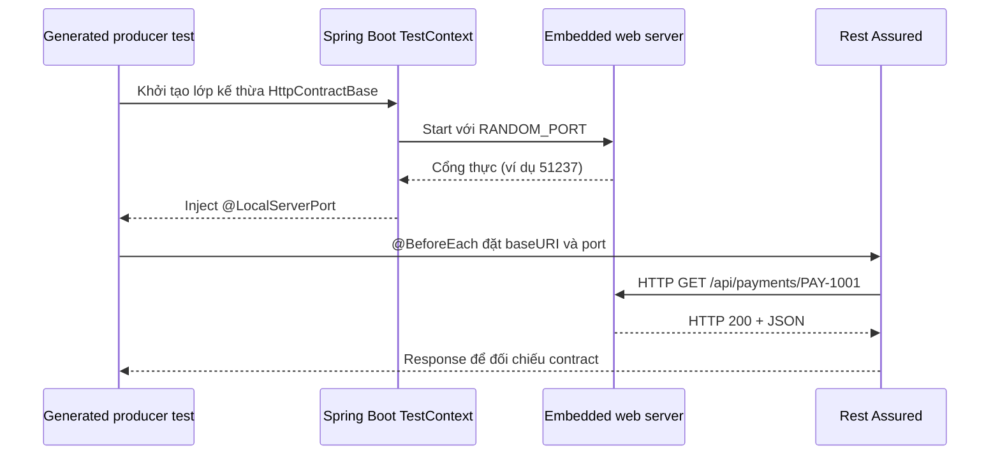
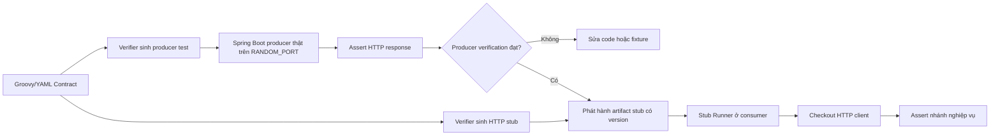
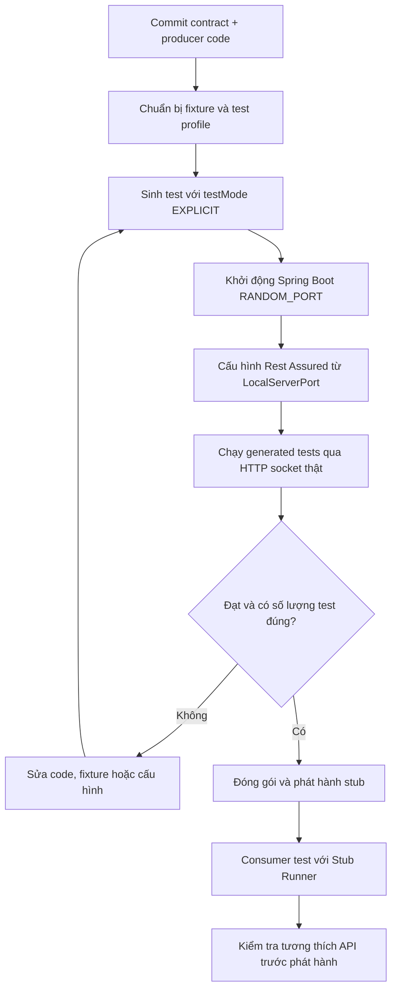

# Kiểm thử qua HTTP thật với ứng dụng chạy trên cổng ngẫu nhiên

## 1. Khi nào cần gửi HTTP thật trong producer contract test?

Giả sử `checkout-service` là **consumer** và `payment-service` là **producer** của HTTP API tra cứu thanh toán. Checkout yêu cầu:

```http
GET /api/payments/PAY-1001 HTTP/1.1
Accept: application/json
```

Producer cam kết trả `200 OK` cùng JSON chứa mã giao dịch, mã đơn, trạng thái `PAID` và tiền tệ `VND`. Với **Spring Cloud Contract**, nhóm mô tả cam kết này bằng **Groovy DSL hoặc YAML DSL**, sinh test kiểm tra producer, phát hành stub cho consumer sử dụng qua **Stub Runner**, rồi chạy các bước trong CI để phát hiện thay đổi API không tương thích.

Nhưng **producer test gửi request vào đâu?** Có hai cách kiểm thử HTTP thường gặp:

- **Mock HTTP layer:** ví dụ `MockMvc` gọi vào Spring MVC thông qua môi trường test mà không cần mở một cổng TCP thực.
- **HTTP thật (explicit mode):** ứng dụng producer được khởi động với một web server lắng nghe trên cổng, còn bài test phát HTTP request qua socket đến `http://localhost:<cổng-đang-chạy>`.

Chủ đề của bài này là cách thứ hai: **Spring Cloud Contract Verifier sinh test ở chế độ `EXPLICIT`, ứng dụng Spring Boot chạy `RANDOM_PORT`, và lớp base cấu hình HTTP client dùng đúng cổng thực tế**. Đây là producer verification; nó không đồng nghĩa phải triển khai ứng dụng lên môi trường staging, và cũng không phải cấu hình port của Stub Runner phía consumer.

### Mục tiêu học tập

Sau bài này, bạn có thể giải thích được sự khác biệt giữa `MOCKMVC` và `EXPLICIT`, viết contract HTTP đơn giản, cấu hình Maven/Gradle để sinh test qua socket thật, xây dựng `ContractBase` với `@SpringBootTest(webEnvironment = RANDOM_PORT)` và `@LocalServerPort`, cô lập dữ liệu, xác minh request/response, xử lý lỗi thường gặp và đưa test vào CI.

## 2. Hai lớp lựa chọn độc lập: framework và HTTP test mode

Trong Spring Cloud Contract, **test framework** và **test mode** không phải một.

| Khía cạnh | Cấu hình ví dụ | Tác động |
| --- | --- | --- |
| Framework của test sinh ra | `testFramework = JUNIT5` hoặc `SPOCK` | Quyết định cú pháp JUnit Jupiter hay Spock và test engine. |
| Chế độ gửi HTTP | `testMode = MOCKMVC` | Sử dụng cơ chế kiểm thử HTTP MockMvc, không cần TCP listener. |
| Chế độ gửi HTTP | `testMode = WEBTESTCLIENT` | Dùng WebTestClient theo khả năng plugin, thường phù hợp kiểm thử WebFlux không cần socket thật. |
| Chế độ gửi HTTP | `testMode = EXPLICIT` | Gửi HTTP request thực đến ứng dụng đang chạy trên một cổng. |
| Cổng web server của Spring Boot test | `webEnvironment = RANDOM_PORT` | Khởi động web server và cho hệ điều hành chọn cổng khả dụng. |
| Địa chỉ HTTP client | `RestAssured.baseURI` và `RestAssured.port` | Nói cho test được sinh biết phải gửi request đến server nào. |

Bạn có thể chọn **JUnit 5 + EXPLICIT**, **Spock + EXPLICIT**, hoặc **JUnit 5 + MOCKMVC** nếu plugin và classpath hỗ trợ. Chọn `JUNIT5` **không tự kích hoạt HTTP thật**; chọn `RANDOM_PORT` **không tự đổi test mode của Spring Cloud Contract**.

### So sánh hai kiểu xác minh

| Tiêu chí | MockMvc | EXPLICIT qua HTTP thật |
| --- | --- | --- |
| Server socket thực | Không | Có |
| Tốc độ thường gặp | Nhanh hơn do không cần web server thực | Có thêm chi phí khởi động và giao tiếp TCP |
| Kiểm tra routing/controller/JSON | Có, tùy cách khởi tạo context | Có, qua request HTTP |
| Kiểm tra hành vi phụ thuộc container/socket | Bị giới hạn ở lớp mock | Phù hợp hơn để kiểm tra phần hành vi thực tế của web server |
| Cần biết cổng server | Không | Có, qua `@LocalServerPort` hoặc cơ chế tương đương |
| Phù hợp khi | Chỉ cần xác minh contract ở lớp Spring MVC | Cần request thật, context path, filter/container behavior hoặc stack HTTP |

**HTTP thật không đồng nghĩa end-to-end toàn hệ thống.** Server có thể chạy thật, nhưng database, gateway ngân hàng, message broker hoặc API ngoài vẫn có thể — và thường nên — được thay bằng fixture/test double để test lặp lại được. Ngược lại, nếu muốn xác minh cả database thật, cần provision database kiểm thử riêng và coi đó là phạm vi integration test rộng hơn.

## 3. Cổng ngẫu nhiên nghĩa là gì?

Trong Spring Boot:

```java
@SpringBootTest(
    webEnvironment = SpringBootTest.WebEnvironment.RANDOM_PORT
)
```

Spring Boot khởi động web server cho test trên một **cổng khả dụng** do hệ điều hành cấp. Đây thường là cơ chế tương đương cấu hình `server.port=0`.

Ví dụ các lần chạy:

```text
Lần chạy A: http://localhost:51237
Lần chạy B: http://localhost:54811
Lần chạy C: http://localhost:50726
```

Các số trên chỉ là **minh họa**, không phải cổng cố định phải sử dụng. Cổng thực được biết sau khi web server khởi động.

**Lợi ích:**

1. Giảm nguy cơ đụng cổng `8080` khi máy phát triển đã chạy một producer khác.
2. Cho phép các job CI độc lập cùng khởi động server trong các môi trường phù hợp.
3. Không cần sửa contract khi đổi port hoặc hệ điều hành.
4. Khuyến khích phân biệt **path của API** với **host/port của test environment**.

**Giới hạn:** random port không tự cô lập database, thư mục temp, cổng management, queue hoặc dữ liệu dùng chung. Nó cũng không thay thế việc giải phóng tài nguyên sau test. Hệ điều hành có thể từ chối bind nếu hết cổng hoặc môi trường hạn chế, nên vẫn cần kiểm tra log khởi động khi có lỗi.

## 4. Một hợp đồng HTTP không khóa host và port

Giả sử Payment trả trạng thái của một giao dịch mẫu `PAY-1001`:

```json
{
  "paymentId": "PAY-1001",
  "orderId": "ORD-2001",
  "status": "PAID",
  "amount": 250000,
  "currency": "VND"
}
```

### 4.1. Groovy DSL

Ví dụ contract đặt trong thư mục contract của producer:

```groovy
import org.springframework.cloud.contract.spec.Contract

Contract.make {
    name 'get_paid_payment_over_http'
    description 'Tra cứu giao dịch đã thanh toán qua HTTP'

    request {
        method 'GET'
        urlPath '/api/payments/PAY-1001'
        headers {
            header 'Accept': 'application/json'
        }
    }

    response {
        status 200
        headers {
            contentType(applicationJson())
        }
        body([
            paymentId: 'PAY-1001',
            orderId: 'ORD-2001',
            status: 'PAID',
            amount: 250000,
            currency: 'VND'
        ])
    }
}
```

Contract chỉ chứa **HTTP method, path, headers, status và body**. Không cần đặt `localhost:8080` hay `localhost:51237` vào URL, bởi đó là chi tiết môi trường kiểm thử do HTTP client quyết định.

Tại sao dùng `urlPath`? Spring Cloud Contract cho phép `url(...)` với URL tương đối hoặc tuyệt đối; với contract cần độc lập với host, `urlPath(...)` làm rõ rằng cam kết tập trung vào **đường dẫn**. Khi cần query parameters, khai báo riêng theo DSL. Nếu API có context path, path phải phản ánh chính đường dẫn HTTP mà client thực sự gọi, trình bày ở phần 10.

### 4.2. YAML DSL tương đương

```yaml
description: Tra cứu giao dịch đã thanh toán qua HTTP
name: get_paid_payment_over_http
request:
  method: GET
  urlPath: /api/payments/PAY-1001
  headers:
    Accept: application/json
response:
  status: 200
  headers:
    Content-Type: application/json
  body:
    paymentId: PAY-1001
    orderId: ORD-2001
    status: PAID
    amount: 250000
    currency: VND
```

Groovy và YAML là **hai cách biểu diễn cùng một kịch bản**. Chọn một định nghĩa chính trong dự án thay vì lưu cả hai tạo ra test trùng lặp. Việc chọn DSL không quyết định test sử dụng socket thật; **`testMode = EXPLICIT`** mới là cấu hình liên quan.

## 5. Maven: sinh producer verification tests ở chế độ EXPLICIT

Giả sử producer là ứng dụng Spring Boot sử dụng Maven và JUnit Jupiter. Các phần quan trọng gồm:

1. Phụ thuộc test phù hợp cho Spring Boot, Spring Cloud Contract Verifier và HTTP client được generator sử dụng.
2. Plugin Spring Cloud Contract phiên bản tương thích với Spring Boot và JDK.
3. `testMode` chọn `EXPLICIT`.
4. `testFramework` chọn `JUNIT5` nếu generator của phiên bản đó hỗ trợ.
5. `baseClassForTests` trỏ đến lớp test base chuẩn bị web server/HTTP client.

Ví dụ **đoạn cấu hình ghép vào `pom.xml`**, không phải một POM đầy đủ:

```xml
<!-- Bên trong <dependencies> -->
<dependency>
    <groupId>org.springframework.boot</groupId>
    <artifactId>spring-boot-starter-test</artifactId>
    <scope>test</scope>
</dependency>
<dependency>
    <groupId>org.springframework.cloud</groupId>
    <artifactId>spring-cloud-starter-contract-verifier</artifactId>
    <scope>test</scope>
</dependency>

<!-- Bên trong <build><plugins> -->
<plugin>
    <groupId>org.springframework.cloud</groupId>
    <artifactId>spring-cloud-contract-maven-plugin</artifactId>
    <version>REPLACE_WITH_COMPATIBLE_SCC_VERSION</version>
    <extensions>true</extensions>
    <configuration>
        <testFramework>JUNIT5</testFramework>
        <testMode>EXPLICIT</testMode>
        <baseClassForTests>
            com.example.payment.contract.HttpContractBase
        </baseClassForTests>
    </configuration>
</plugin>
```

Hãy thay placeholder bằng version tương thích và quản lý các version dependency qua BOM/parent theo dự án. Kiểm tra test engine và Maven Surefire/Failsafe theo lifecycle hiện có. **Không trộn tùy ý các dòng Spring Boot, Spring Cloud Contract hoặc JUnit khác nhau.**

Trong một bố cục Maven thường gặp, hợp đồng nằm dưới `src/test/resources/contracts/`; plugin sinh code test trong khu vực generated sources dưới `target/`. Không sửa file test sinh ra trực tiếp, vì generator sẽ ghi lại chúng ở lần build tiếp theo.

Lệnh kiểm tra thực hành trên **dự án đã cấu hình đầy đủ**:

```bash
./mvnw -B clean verify
```

Lệnh này phải làm hơn việc sinh file: cần xác nhận Maven đã **biên dịch và thực thi generated producer tests**. Kết quả `BUILD SUCCESS` khi test bị skip hoặc số test thực thi bằng 0 không đủ chứng minh producer đáp ứng hợp đồng.

## 6. Gradle: cấu hình HTTP thật thay cho MockMvc

Với Gradle Groovy DSL, cấu hình trọng tâm:

```groovy
plugins {
    id 'java'
    id 'org.springframework.cloud.contract' version 'REPLACE_WITH_COMPATIBLE_SCC_VERSION'
}

dependencies {
    testImplementation 'org.springframework.boot:spring-boot-starter-test'
    testImplementation 'org.springframework.cloud:spring-cloud-starter-contract-verifier'
}

contracts {
    testFramework = 'JUNIT5'
    testMode = 'EXPLICIT'
    baseClassForTests = 'com.example.payment.contract.HttpContractBase'
}

tasks.withType(Test).configureEach {
    useJUnitPlatform()
}
```

Đây là **mảnh cấu hình**; dự án thật cần Spring Boot plugin, dependency management/BOM, repositories và các source set tương thích. Dòng `useJUnitPlatform()` có ý nghĩa khi dùng JUnit Jupiter hoặc các test engine chạy trên JUnit Platform.

Vị trí contract của Gradle plugin phụ thuộc phiên bản và `contractsDslDir`; một số bố cục dùng `src/contractTest/resources/contracts`, khác Maven. Không giả định chỉ cần dán ví dụ Gradle là plugin tự đọc được các file contract ở vị trí bất kỳ.

Lệnh thông dụng khi project đã được thiết lập:

```bash
./gradlew clean check
```

Để điều tra việc sinh mã test riêng, có thể xem task `generateContractTests` theo phiên bản Gradle plugin. **Sinh code không đồng nghĩa đã chạy test**. Xem test report cùng log build, đảm bảo test qua HTTP thật sử dụng `EXPLICIT`.

## 7. Base class: kết nối Rest Assured với cổng web server thực

Đây là **phần quyết định** để HTTP thật đến đúng ứng dụng đang được test. Với Spring Boot hiện đại và JUnit 5:

```java
package com.example.payment.contract;

import io.restassured.RestAssured;
import org.junit.jupiter.api.BeforeEach;
import org.springframework.boot.test.context.SpringBootTest;
import org.springframework.boot.test.web.server.LocalServerPort;
import org.springframework.test.context.ActiveProfiles;
import com.example.payment.PaymentApplication;

@SpringBootTest(
    classes = PaymentApplication.class,
    webEnvironment = SpringBootTest.WebEnvironment.RANDOM_PORT
)
@ActiveProfiles("contract")
public abstract class HttpContractBase {

    @LocalServerPort
    protected int port;

    @BeforeEach
    void configureHttpClient() {
        RestAssured.baseURI = "http://localhost";
        RestAssured.port = port;
    }
}
```

**Các điều kiện để ví dụ chạy được:**

- `PaymentApplication` là lớp cấu hình Spring Boot thực của producer; thay package/tên phù hợp với dự án.
- Project có dependency Spring Boot Test, JUnit Jupiter và Rest Assured do bộ kiểm thử cần sử dụng.
- Profile `contract` đã được ứng dụng cấu hình để tránh phụ thuộc database/HTTP API bên ngoài không kiểm soát.
- Plugin Verifier có `testMode = EXPLICIT` và `baseClassForTests` trỏ đúng `com.example.payment.contract.HttpContractBase`.
- Nếu ứng dụng đang dùng Spring Boot đời cũ, package của `@LocalServerPort` có thể là `org.springframework.boot.web.server.LocalServerPort`. Đừng trộn import giữa các dòng phiên bản.

### Giải thích trình tự khởi tạo



`@LocalServerPort` chỉ được biết khi test context/web server đã khởi động; vì vậy setup HTTP client ở `@BeforeEach` phù hợp hơn việc tự đặt một port cố định khi khai báo biến. `RestAssured.baseURI` và `RestAssured.port` được dùng chung để tạo địa chỉ đích, ví dụ `http://localhost:51237/api/payments/PAY-1001`.

Một cách tương đương là đặt `RestAssured.baseURI = "http://localhost:" + port` trong `@BeforeEach`. **Không nên vừa ghép port vào `baseURI` vừa vô tình giữ một `RestAssured.port` toàn cục đã thiết lập ở test khác**, vì dễ dẫn đến endpoint sai. Với ví dụ này, ta thống nhất baseURI không chứa port và đặt port riêng.

### Vì sao không dùng RestAssuredMockMvc?

Ở chế độ MockMvc, base class thường gọi `RestAssuredMockMvc.standaloneSetup(...)` hoặc `RestAssuredMockMvc.webAppContextSetup(...)`. Nhưng bài này chọn **EXPLICIT**: generated tests cần gửi socket HTTP thật và lớp base phải cấu hình **`io.restassured.RestAssured`**, không chỉ thiết lập MockMvc. Sự nhầm lẫn này khiến test có thể báo lỗi kết nối, không sử dụng đúng web server hoặc chỉ kiểm tra một lớp khác với mục tiêu.

## 8. Fixture và cấu hình cho web server thật

Khởi động Spring Boot web server thật **không có nghĩa phải gọi database hoặc gateway thật**. Hợp đồng ví dụ yêu cầu `PAY-1001` trả thông tin cố định. Producer test phải tự chuẩn bị trạng thái để endpoint trả đúng JSON.

### Phương án A: thay repository/adapter bằng mock trong test profile

Nếu `PaymentController` dùng `PaymentQuery` để đọc giao dịch, có thể thay bean `PaymentQuery` bằng mock trong test context, rồi chuẩn bị kết quả:

```java
// Phác thảo dùng Spring Framework có @MockitoBean;
// kiểu PaymentQuery/PaymentView là kiểu ứng dụng giả định.
@MockitoBean
PaymentQuery paymentQuery;

@BeforeEach
void setupFixture() {
    Mockito.when(paymentQuery.findById("PAY-1001"))
        .thenReturn(new PaymentView(
            "PAY-1001", "ORD-2001", "PAID", 250000L, "VND"
        ));
}
```

Đoạn trên là **mảnh mã minh họa đưa vào lớp test phù hợp**, không phải class độc lập. `@MockitoBean` thuộc hệ sinh thái Spring Test đời mới; các ứng dụng Spring Boot cũ có thể dùng `@MockBean`. Chọn annotation theo phiên bản được quản lý trong dự án và cấu hình cách mock được reset theo lifecycle test.

Ưu điểm của mock tại **ranh giới truy cập dữ liệu**: controller, HTTP stack, JSON serializer và exception mapping vẫn chạy qua real server; database thật không cần có mặt. Tuy nhiên điều đó **không kiểm tra SQL/JPA mapping**. Cần integration test riêng nếu hành vi truy vấn dữ liệu là phần quan trọng.

### Phương án B: database riêng cho test

Khi muốn kiểm tra mapping JPA, transaction và truy vấn thực, cấp database test riêng (ví dụ Testcontainers), chạy migration và seed dữ liệu xác định:

```sql
INSERT INTO payments (
    payment_id, order_id, status, amount, currency
) VALUES (
    'PAY-1001', 'ORD-2001', 'PAID', 250000, 'VND'
);
```

Chỉ chạy câu lệnh ở **database kiểm thử** và bảo đảm test chạy lại không bị lỗi khóa trùng. Với HTTP qua socket thật, request có thể được xử lý ở transaction/thread khác transaction setup của test; đừng giả định `@Transactional` + rollback trên test method sẽ bảo vệ hoặc hiển thị dữ liệu đúng trong mọi trường hợp.

### Cô lập các phụ thuộc ngoài

Nếu controller gọi ngân hàng, dịch vụ thuế, config server hoặc message broker, hãy thay chúng bằng fake/mock/stub test server hoặc cấu hình test profile chỉ kết nối endpoint được quản lý. Nếu để test HTTP thật kết nối một API production, kết quả sẽ không tái hiện được và có nguy cơ tạo side effect. **HTTP thật ở đầu vào producer không đòi hỏi HTTP thật tới mọi dependency ở đầu ra.**

## 9. Generated test có hình dạng ra sao?

Ở chế độ `EXPLICIT`, generated producer test thường sử dụng Rest Assured HTTP client để gửi request đến base URL đã cấu hình trong lớp base. Phác thảo **viết tay để minh họa hành vi**, không phải source code chính xác mà mọi phiên bản Verifier đều sinh ra:

```java
import static io.restassured.RestAssured.given;
import static org.hamcrest.Matchers.equalTo;

@Test
void shouldReturnPaidPayment() {
    given()
        .header("Accept", "application/json")
    .when()
        .get("/api/payments/PAY-1001")
    .then()
        .statusCode(200)
        .contentType("application/json")
        .body("paymentId", equalTo("PAY-1001"))
        .body("orderId", equalTo("ORD-2001"))
        .body("status", equalTo("PAID"))
        .body("currency", equalTo("VND"));
}
```

Ví dụ giả định test kế thừa `HttpContractBase` đã cấu hình Rest Assured và có dependency JUnit/Hamcrest phù hợp. Test producer thực tế phải kiểm tra cả `amount` nếu đó là cam kết; generated code và cách assert có thể khác giữa các phiên bản Spring Cloud Contract.

**Quan trọng:** không sửa trực tiếp generated test để gán port đang chạy. Nếu generator sinh lại sau `clean`, mọi chỉnh sửa thủ công sẽ mất. Hãy cấu hình `testMode` và `HttpContractBase` — đây mới là vị trí duy trì hành vi.

## 10. Context path, reverse proxy và đường dẫn API

Giả sử producer có:

```properties
server.servlet.context-path=/billing
```

Khi đó endpoint thực có thể là:

```text
http://localhost:<random-port>/billing/api/payments/PAY-1001
```

Contract phải mô tả **request path thực sự** mà client dự kiến sử dụng. Ví dụ:

```groovy
request {
    method 'GET'
    urlPath '/billing/api/payments/PAY-1001'
}
```

Tài liệu Spring Cloud Contract minh họa việc dùng `EXPLICIT` để gửi request qua socket thật khi cần kiểm tra context path. Nếu controller chỉ mapping `/api/payments/{id}`, đó là đường dẫn **bên trong** ứng dụng; context path `/billing` là tiền tố khi HTTP client gọi. Đừng ngầm bỏ prefix ở producer test rồi vô tình phát hành stub cho path khác mà consumer sử dụng.

**Lưu ý thực tế:** nếu API gateway thêm prefix nhưng producer thật không có prefix đó, hãy xác định hợp đồng đang sở hữu đường dẫn **trực tiếp vào producer** hay **đường dẫn qua gateway**. Không tự thêm `/billing` vào mọi contract chỉ vì gateway công bố đường dẫn khác; cần kiểm tra đúng ranh giới chịu trách nhiệm. Test HTTP trực tiếp tới producer không tự kiểm tra routing của API gateway bên ngoài.

## 11. HTTP, HTTPS, host và port phải đồng bộ

Ví dụ base class sử dụng `http://localhost` vì giả định server test chạy HTTP không có TLS. Nếu producer test chạy HTTPS, hãy cấu hình đúng scheme và chứng chỉ kiểm thử:

```java
@BeforeEach
void configureHttpsClient() {
    RestAssured.baseURI = "https://localhost";
    RestAssured.port = port;
    // Cấu hình truststore/chứng chỉ test theo policy dự án.
}
```

Mảnh mã này **chưa đủ để chạy HTTPS** nếu server và truststore chưa được cấu hình. Không tắt kiểm tra TLS một cách vô điều kiện rồi coi đó là kiểm thử security production. Nếu dùng mTLS, HTTP test cần chứng chỉ client hợp lệ do môi trường test quản lý.

Các trường hợp thường nhầm:

- `server.port=0` / `RANDOM_PORT`: web application port.
- `management.server.port`: cổng quản trị/Actuator **có thể khác**. Test API phải gọi port ứng dụng, không tự lấy port management.
- `RestAssured.port`: cổng HTTP client dùng; **không khởi động server**.
- Port của WireMock hay Stub Runner: cổng của **stub server**, không phải cổng producer verification.
- `https://localhost:<port>`: chỉ đúng khi web server thực sự chấp nhận TLS.

## 12. Tránh race condition và test song song với Rest Assured

`RestAssured.baseURI` và `RestAssured.port` là **cấu hình tĩnh dùng chung trong JVM**. Nếu hai lớp generated tests chạy **song song** trong cùng một process, mỗi lớp có một `@SpringBootTest(RANDOM_PORT)` khác nhau, chúng có thể ghi đè lẫn nhau:

```text
Test A: RestAssured.port = 51237
Test B: RestAssured.port = 54811
Test A: gửi GET -> vô tình gọi 54811
```

Đây là một ví dụ kinh điển của flaky test. Để tránh:

1. Nếu generator dùng cấu hình Rest Assured toàn cục như ví dụ, **không chạy song song** những test sửa `baseURI/port` trong cùng JVM, hoặc cô lập chúng theo process.
2. Có thể gom generated tests chia sẻ một Spring TestContext/server khi phù hợp, nhưng vẫn phải kiểm soát fixture và trạng thái test.
3. Nếu cần song song thực sự, thiết kế HTTP client/request specification **theo từng test** và bảo đảm plugin/generator có cơ chế sử dụng nó; đừng sửa generated code trực tiếp rồi để generator ghi đè.
4. Không phụ thuộc một port cố định chỉ để né vấn đề static configuration — đó lại tạo rủi ro đụng cổng giữa các job CI.

Tương tự, database, MockBean chung, in-memory repository và file tạm cũng phải được cô lập khi chạy concurrent. **Cổng ngẫu nhiên chỉ giải quyết một loại xung đột tài nguyên.**

## 13. Phân biệt producer HTTP thật và consumer Stub Runner

Hai loại server có thể cùng xuất hiện trong quy trình nhưng phục vụ hai mục tiêu khác nhau:



**Producer:** khi chạy `EXPLICIT`, Verifier gửi HTTP tới **payment-service đang chạy thật** trên random port trong tiến trình/không gian test.

**Consumer:** Stub Runner khởi động **stub server** từ artifact đã sinh. Checkout HTTP client được cấu hình gửi request tới địa chỉ stub do Stub Runner cung cấp, không gửi tới `@LocalServerPort` của producer test.

Ví dụ cấu hình consumer minh họa:

```java
@SpringBootTest(properties = {
    "payment.base-url=http://localhost:6565"
})
@AutoConfigureStubRunner(
    ids = "com.example:payment-service:1.4.2:stubs:6565",
    stubsMode = StubRunnerProperties.StubsMode.LOCAL
)
class CheckoutClientContractTest {

    @Autowired
    CheckoutService checkoutService;

    @Test
    void confirmsAnOrderOnlyAfterPaymentIsPaid() {
        assertThat(checkoutService.canConfirm("ORD-2001"))
            .isTrue();
    }
}
```

Đây là **ví dụ rút gọn**: cần import, dependency, fixture và lớp `CheckoutService` thật. Port `6565` ở đây là **port stub cố định được chọn minh họa cho consumer test**, không phải port producer ngẫu nhiên; trong CI chạy song song, nên ưu tiên phát hiện cổng stub động nếu thiết kế cho phép để tránh đụng cổng. Consumer test chỉ có giá trị khi `CheckoutService` thực sự gọi HTTP client đã được trỏ tới stub, chứ không mock luôn client đó.

## 14. Debug khi kiểm thử HTTP thật thất bại

| Triệu chứng | Nguyên nhân thường gặp | Cách xác minh và sửa |
| --- | --- | --- |
| `Connection refused` | Server chưa khởi động, sai cổng, sai scheme hoặc cấu hình client chưa chạy. | Xem log server, `@LocalServerPort`, `@BeforeEach` và `RestAssured.baseURI/port`. |
| Test vẫn gọi `localhost:8080` | Hard-code port trong test/contract hoặc chưa cấu hình Rest Assured. | Dùng `RANDOM_PORT` + `@LocalServerPort`, bỏ port trong contract. |
| `@LocalServerPort` bằng 0/không inject | Test context chưa chạy web environment thật, import sai phiên bản hoặc setup quá sớm. | Dùng `@SpringBootTest(RANDOM_PORT)`, import đúng, cấu hình client ở `@BeforeEach`. |
| Spring Boot khởi động được nhưng HTTP 404 | Sai path, context path, version prefix hoặc controller không được scan. | Xem HTTP request thật và mapping Spring; kiểm tra path contract so với API công bố. |
| HTTP 401/403 thay vì 200 | Security filter thật đang hoạt động; thiếu token/test auth. | Dùng token/cấu hình auth test phù hợp, không bỏ security nếu là phần contract. |
| HTTP 500 trong khi MockMvc test đạt | Khác biệt exception handler, filter, serializer, config hoặc dependency khi chạy server thật. | Xem log server và kiểm tra production-like TestContext. |
| Local xanh, CI lỗi cổng | Hard-code port, test song song ghi đè static Rest Assured config hoặc môi trường chặn bind. | Không hard-code, cô lập process, cấu hình lifecycle/test parallel rõ ràng. |
| Server đúng cổng nhưng SSL handshake lỗi | Client dùng HTTP/HTTPS sai hoặc truststore không phù hợp. | Đồng bộ scheme, chứng chỉ và test TLS config. |
| Test có HTML error page thay vì JSON | Container/gateway/exception mapping trả response khác contract. | Kiểm tra status, headers, body thực và vùng code chịu trách nhiệm. |
| Build xanh dù generator không sinh test | Contract nằm sai nguồn, filter sai, skip tests hoặc thiếu engine. | Kiểm tra số generated tests và báo cáo test; fail CI nếu không chạy test mong đợi. |
| Server chạy nhưng không có dữ liệu `PAY-1001` | Fixture/database hoặc mock chưa được chuẩn bị ở test profile. | Seed dữ liệu xác định hoặc inject fake/mock adapter. |

### Debug theo trình tự

1. **Kiểm tra plugin** có `testMode=EXPLICIT` chứ không phải chế độ MockMvc.
2. **Kiểm tra TestContext** có `RANDOM_PORT` và server thực sự bind thành công.
3. **In port có kiểm soát** trong log test (không log token/secrets); xác định Rest Assured gửi đến đúng host/scheme/port.
4. **Kiểm tra method, path, headers, body** của request thật; đặc biệt xem context path và URL encoding.
5. **Kiểm tra fixture/test profile**: dữ liệu có được setup và visible trong transaction của HTTP request không?
6. **Kiểm tra response thực**: status, Content-Type, JSON fields có đúng contract không? Nếu không, tìm ở controller, serializer, security hoặc exception handling.
7. **Kiểm tra test report**: có generated tests được thực thi không? Có lớp nào bị skipped/NO-SOURCE không?

Lỗi test producer do không kết nối server thường là lỗi **test setup/HTTP infrastructure**, không tự chứng minh API production vi phạm hợp đồng. Ngược lại, response `200` với `status=FAILED` khi contract hứa `PAID` là lỗi hành vi producer thật hoặc dữ liệu fixture, cần điều tra để phân biệt.

## 15. Tổ chức CI để tái hiện kết quả

Quy trình đề xuất:



Các nguyên tắc:

- **Không sử dụng cổng cố định** cho producer verification. Truyền cổng thật vào client bằng cơ chế test framework.
- **Không phụ thuộc database staging/production**; dùng mock/fake hoặc database dành riêng cho test, có dữ liệu và migration xác định.
- **Không gọi API bên thứ ba live** chỉ để chứng minh inbound HTTP contract; cô lập outbound dependencies.
- **Không chạy đồng thời các test tranh chấp cấu hình Rest Assured tĩnh** trong cùng JVM.
- **Chạy generated tests thực sự**, kiểm tra số lượng passed/failed/skipped và fail khi không có contract hợp lệ.
- **Chỉ phát hành stub sau producer verification đạt** từ cùng commit/bộ contract, có version rõ ràng.
- **Đánh giá thời gian chạy:** EXPLICIT có chi phí khởi động server, nên dùng MockMvc ở những kịch bản phù hợp và có gate HTTP thật khi cần, nhưng không gọi một subset test là đã bảo vệ toàn bộ API nếu còn contract khác chưa chạy.

Trong hệ thống multi-module, cân nhắc mỗi module producer sở hữu `ContractBase` và profile riêng. Không để một module dùng `@LocalServerPort` của server khác hoặc vô tình lấy generated tests của module không tương ứng.

## 16. Bài thực hành: tra cứu thanh toán trên cổng ngẫu nhiên

Bạn phát triển `payment-service` bằng Spring Boot với API:

```text
GET /api/payments/PAY-1001
GET /api/payments/PAY-9999
```

Quy tắc đã thống nhất:

- `PAY-1001` tồn tại, thuộc `ORD-2001`, có trạng thái `PAID`, số tiền `250000 VND`.
- `PAY-9999` không tồn tại, trả `404` cùng JSON lỗi có `code=PAYMENT_NOT_FOUND` nếu đó là response API đã được hai bên thỏa thuận.
- Producer phải được kiểm thử **bằng HTTP thật qua socket** và không cần gọi database production.

**Nhiệm vụ:**

1. Viết Groovy contract `GET /api/payments/PAY-1001` trả HTTP 200, header JSON và các trường nghiệp vụ như đã mô tả.
2. Viết YAML DSL tương đương cho cùng contract, nhưng chỉ giữ **một định nghĩa** làm nguồn thật trong repository.
3. Cấu hình Maven plugin với `testMode=EXPLICIT`, `testFramework=JUNIT5` và `baseClassForTests`. Giải thích vì sao chỉ có `testFramework=JUNIT5` thì chưa chắc test chạy HTTP thật.
4. Viết `HttpContractBase` có `@SpringBootTest(webEnvironment=RANDOM_PORT)`, `@LocalServerPort` và `@BeforeEach` đặt Rest Assured tới đúng server. Tại sao không hard-code `8080`?
5. Dùng mock/fake `PaymentQuery` hoặc database test riêng tạo fixture `PAY-1001`. Giải thích giới hạn của mỗi cách.
6. Thêm contract `PAY-9999` trả `404 PAYMENT_NOT_FOUND`. Kiểm tra HTTP status và body thực tế qua server đang chạy.
7. Thử chạy hai test class với server random port khác nhau song song. Xác định nguy cơ nếu cả hai cùng ghi `RestAssured.port` và đề xuất cơ chế cô lập.
8. Đặt `server.servlet.context-path=/billing`. Chỉnh path contract để request đến đúng endpoint HTTP; kiểm tra khác biệt giữa đường dẫn trực tiếp vào producer và đường dẫn công bố qua gateway.
9. Trong CI, kiểm tra có generated test, số test được thực thi, producer verification đạt và consumer dùng Stub Runner trên artifact đã phát hành.

**Tự đánh giá:** bài làm đúng khi HTTP request của test thực sự đi qua socket đến **ứng dụng producer**, cổng được lấy sau khi server khởi động, fixture ổn định, contract độc lập với host và không nhầm cổng producer với cổng stub của consumer.

## 17. Ghi nhớ

- **HTTP thật trong Spring Cloud Contract Verifier** sử dụng `testMode=EXPLICIT`: generated test gửi request qua socket thay vì MockMvc.
- **Cổng ngẫu nhiên** đến từ `@SpringBootTest(webEnvironment=RANDOM_PORT)`; đọc cổng thực tế bằng `@LocalServerPort`.
- Lớp base cấu hình `RestAssured.baseURI` và `RestAssured.port` **trước khi test gửi request**; không viết cứng port vào Groovy/YAML contract.
- **testFramework** (JUnit/Spock), **testMode** (MOCKMVC/EXPLICIT/WEBTESTCLIENT), **DSL** (Groovy/YAML) là những quyết định khác nhau.
- HTTP thật xác minh nhiều hành vi của web server nhưng không chứng minh toàn bộ database, gateway hay dịch vụ ngoài; vẫn phải quản lý fixture và test integration riêng.
- Rest Assured có cấu hình tĩnh: cẩn thận khi chạy nhiều test class song song với những cổng khác nhau.
- Sinh test chưa phải thực thi test. Chỉ phát hành stub và cho consumer dùng **Stub Runner** khi producer verification thực sự đã chạy đạt theo phạm vi cam kết.

### Tài liệu tham khảo

- [Spring Cloud Contract — Project Features, Explicit Mode và Context Paths](https://docs.spring.io/spring-cloud-contract/docs/current/reference/html/project-features.html): chế độ `EXPLICIT`, base class, Rest Assured và context path.
- [Spring Cloud Contract — Maven Project](https://docs.spring.io/spring-cloud-contract/reference/maven-project.html): `testMode`, `testFramework` và plugin sinh producer verification tests.
- [Spring Cloud Contract — Gradle Project](https://docs.spring.io/spring-cloud-contract/reference/gradle-project.html): cấu hình Gradle, test source và tasks.
- [Spring Boot — Testing Spring Boot Applications](https://docs.spring.io/spring-boot/reference/testing/spring-boot-applications.html): chạy server thật bằng `RANDOM_PORT` và đọc cổng bằng `@LocalServerPort`.
- [Spring Cloud Contract — Stub Runner](https://docs.spring.io/spring-cloud-contract/reference/project-features-stubrunner.html): consumer dùng artifact stub từ producer.
