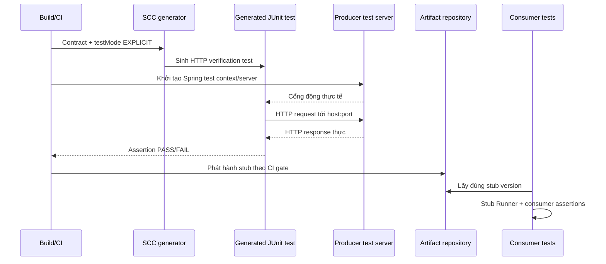

# Chọn chế độ explicit và cấu hình địa chỉ producer

## 1. Khi nào cần kiểm thử qua HTTP thực?

Trong kiến trúc nhiều dịch vụ, **producer** cung cấp API HTTP hoặc phát thông điệp, còn **consumer** dựa vào giao diện đó để hoạt động. **Spring Cloud Contract (SCC)** giúp các nhóm định nghĩa tương tác bằng **Groovy/YAML DSL**, sinh **producer verification tests**, đóng gói **stub** để consumer kiểm thử bằng **Stub Runner**, và tích hợp các bước vào **CI** nhằm phát hiện thay đổi API không tương thích.

Khi dùng hợp đồng HTTP, generated test cần gửi request tới producer và so khớp response thực với kỳ vọng đã khai báo. Vấn đề là *gửi request bằng cách nào*:

- Với **`MOCKMVC`**, test làm việc với Spring MVC qua MockMvc, không cần một HTTP server thực mở cổng mạng.
- Với **`WEBTESTCLIENT`**, test dùng WebTestClient theo chế độ được generator hỗ trợ, thường phù hợp với ứng dụng reactive.
- Với **`EXPLICIT`**, generated test gửi **HTTP request thực qua socket** đến địa chỉ mà test cấu hình; producer phải đang lắng nghe và sẵn sàng nhận request.

Bài thuộc chương **Kiểm thử HTTP** của mô-đun **SPRING_CLOUD_CONTRACT** và tập trung vào quyết định **chọn `EXPLICIT`**, xác định **địa chỉ producer**, kết nối generated tests với test server, xử lý context path và chẩn đoán lỗi kết nối.

**Sau bài học, bạn sẽ có thể:**

1. Phân biệt test mode với vị trí chứa contract và môi trường chạy ứng dụng.
2. Chọn `EXPLICIT` khi cần kiểm chứng hành vi HTTP thật hoặc producer không dùng Spring MVC.
3. Cấu hình SCC Maven/Gradle plugin để sinh test đúng mode và đúng base class.
4. Dùng Spring Boot `RANDOM_PORT` + `@LocalServerPort` để cấp địa chỉ cho Rest Assured mà không hard-code `8080`.
5. Kết hợp `baseURI`, `port`, `basePath` và đường dẫn trong contract mà không lặp prefix.
6. Phân biệt lỗi kết nối, lỗi routing, lỗi fixture và vi phạm contract; kiểm tra kết quả trong CI.

> **Nguyên tắc:** `EXPLICIT` không phải tên của một môi trường production. Nó là **chế độ sinh producer tests dùng HTTP thực**. Cách an toàn phổ biến là chạy producer **trong môi trường kiểm thử cô lập** trên cổng động, không gửi test có side effect tới dịch vụ production.

## 2. So sánh `MOCKMVC`, `WEBTESTCLIENT` và `EXPLICIT`

| Tiêu chí | `MOCKMVC` | `WEBTESTCLIENT` | `EXPLICIT` |
|---|---|---|---|
| Cơ chế gọi | Test qua Spring MockMvc | Test qua WebTestClient phù hợp cấu hình | HTTP request thật tới socket |
| Cần server bind cổng TCP? | Không | Tùy dạng WebTestClient được cấu hình | **Có** |
| Producer phù hợp | Spring MVC | Spring WebFlux/reactive | Spring MVC, WebFlux, framework khác hoặc server độc lập |
| Điều cần base test chuẩn bị | Web application context/MockMvc | WebTestClient + context/binding thích hợp | **Server đang chạy + host/port/protocol chính xác** |
| Đường đi mạng thật | Không | Tùy cấu hình | Có kết nối HTTP tới địa chỉ đích |
| Độ phức tạp | Thường thấp hơn | Tùy stack reactive | Thường cao hơn vì server lifecycle, cổng và kết nối |
| Giới hạn chính | Không kiểm chứng mọi đặc tính của socket/container HTTP | Không tự bảo đảm đi qua socket thực | Không tự bảo đảm đã đi qua gateway/load balancer/TLS production |

Chọn mode dựa trên mục tiêu:

- **Giữ `MOCKMVC`** nếu ứng dụng dùng Spring MVC, hợp đồng chủ yếu ràng buộc controller/HTTP mapping và test không cần socket thật.
- **Cân nhắc `WEBTESTCLIENT`** cho ứng dụng reactive khi công cụ/phiên bản đang dùng hỗ trợ và có test setup phù hợp.
- **Chọn `EXPLICIT`** khi cần request HTTP thực, server không dựa vào Spring MVC, hoặc phải kiểm tra behavior phụ thuộc server/container và context path theo phương án tài liệu SCC mô tả.

Không nên chọn `EXPLICIT` chỉ vì nghe giống “kiểm thử tích hợp hơn”. Test HTTP thực **có chi phí thiết lập và nguy cơ không ổn định cao hơn**; chỉ dùng khi mang lại bằng chứng mà chế độ nhẹ hơn không cung cấp.

### 2.1. `EXPLICIT` không đồng nghĩa end-to-end

Một test dùng `EXPLICIT` có thể chạy trên `localhost` và dùng database/mocks trong test profile. Nó kiểm tra producer qua HTTP thật nhưng **không nhất thiết** đi qua API Gateway, service discovery, reverse proxy, network policy, TLS ở biên, hoặc hạ tầng production.

Để kiểm tra đầy đủ các thành phần đó, cần integration/end-to-end/deployment tests thích hợp. Contract testing tập trung bảo vệ **giao diện giao tiếp đã thỏa thuận** ở những tình huống được khai báo.

## 3. HTTP request đi tới producer bằng địa chỉ nào?

Khi generated tests chạy bằng Rest Assured ở `EXPLICIT`, có thể hình dung đích gửi request như:

```text
scheme + host + port + optional base path + path của contract
```

Ví dụ:

```text
scheme       = http
host         = localhost
port         = 58321
basePath     = (rỗng)
contractPath = /api/orders/42

URL đích = http://localhost:58321/api/orders/42
```

Các thành phần phục vụ mục đích khác nhau:

| Thành phần | Ví dụ | Nơi quyết định |
|---|---|---|
| **Protocol** | `http` / `https` | `RestAssured.baseURI` và cấu hình server |
| **Host** | `localhost`, `127.0.0.1`, DNS test server | `RestAssured.baseURI` |
| **Port** | `58321` được cấp động | `@LocalServerPort` và `RestAssured.port` |
| **Base path** | `/order-api` nếu tổ chức cấu hình dùng prefix riêng | `RestAssured.basePath`, nếu thật sự cần |
| **Contract URL/path** | `/api/orders/42` | `request.url` hoặc `urlPath` trong Groovy/YAML DSL |
| **Query** | `?include=items` | URL/query parameters của contract |

Trong ứng dụng Spring Boot dùng cổng động, **không nên hard-code `8080`**. Spring Boot có thể bind vào một cổng ngẫu nhiên còn trống, và test nhận cổng thực bằng `@LocalServerPort`. Nếu Rest Assured vẫn gửi tới `8080`, generated test có thể gặp `Connection refused` hoặc gọi nhầm một server khác trên máy.

### 3.1. Địa chỉ producer khác địa chỉ Stub Runner

Hai URL dưới đây thường thuộc **hai quy trình riêng**:

- **Producer test dùng `EXPLICIT`:** Rest Assured gọi **producer thật** đang chạy ở cổng test.
- **Consumer test dùng Stub Runner:** HTTP client của consumer gọi **stub server** mô phỏng, có thể dùng cổng động khác.

Dùng cổng Stub Runner làm `RestAssured.port` của producer test sẽ khiến bài “xác minh producer” thực ra gọi mock. Đó là lỗi nghiêm trọng: test có thể xanh vì stub khớp chính contract, còn implementation producer không hề được kiểm tra.

## 4. Contract HTTP mẫu để kiểm chứng producer

Giả sử producer `order-service` có API lấy chi tiết đơn hàng. File minh họa `order-found.yml`:

```yaml
name: order_found
description: "Consumer lấy chi tiết đơn đã thanh toán"
request:
  method: GET
  url: /api/orders/42
  headers:
    Accept: application/json
response:
  status: 200
  headers:
    Content-Type: application/json
  body:
    id: 42
    state: PAID
    totalAmount: 125000
```

Hợp đồng này **không chứa hostname hay cổng của producer**. Nó mô tả request và response ở cấp giao diện. Test mode và địa chỉ đích được cấu hình trong **plugin + base test + môi trường test**, không trộn địa chỉ ngẫu nhiên của CI vào YAML hợp đồng.

Điều này giúp cùng một contract được dùng để:

1. Sinh producer test chạy với `EXPLICIT` ở cổng server của build.
2. Sinh stub mapping cho consumer dùng qua Stub Runner.
3. Giữ kỳ vọng `200`, `state: PAID` và `totalAmount` nhất quán giữa hai phía.

**Điều kiện dữ liệu:** producer test cần fixture bảo đảm đơn `42` tồn tại và có trạng thái tương ứng. `EXPLICIT` chỉ đổi cách **gửi request**, không tự tạo database hoặc mock nghiệp vụ.

## 5. Cấu hình Maven plugin với `testMode = EXPLICIT`

Trên producer dùng Maven, một cấu hình trọng tâm có thể là:

```xml
<build>
    <plugins>
        <plugin>
            <groupId>org.springframework.cloud</groupId>
            <artifactId>spring-cloud-contract-maven-plugin</artifactId>
            <version>REPLACE_WITH_COMPATIBLE_SCC_VERSION</version>
            <extensions>true</extensions>
            <configuration>
                <baseClassForTests>
                    com.example.orders.contract.RealHttpContractBase
                </baseClassForTests>
                <testFramework>JUNIT5</testFramework>
                <testMode>EXPLICIT</testMode>
            </configuration>
        </plugin>
    </plugins>
</build>
```

Đây là **đoạn plugin minh họa**, không phải toàn bộ POM chạy được. Ý nghĩa của các mục:

- `spring-cloud-contract-maven-plugin`: công cụ build đọc contract và sinh test/stub.
- `testMode=EXPLICIT`: generated test sử dụng HTTP thực thay vì MockMvc.
- `testFramework=JUNIT5`: sinh test theo JUnit 5; test runner phải thực sự chạy JUnit 5.
- `baseClassForTests`: fully qualified class name của lớp **generated tests kế thừa**.
- `REPLACE_WITH_COMPATIBLE_SCC_VERSION`: placeholder, phải thay bằng phiên bản Spring Cloud Contract tương thích với Spring Boot/Spring Cloud của dự án.

Trong `<dependencies>`, thư viện hỗ trợ chạy producer test nên nằm ở **test scope**:

```xml
<dependencies>
    <dependency>
        <groupId>org.springframework.boot</groupId>
        <artifactId>spring-boot-starter-web</artifactId>
    </dependency>
    <dependency>
        <groupId>org.springframework.boot</groupId>
        <artifactId>spring-boot-starter-test</artifactId>
        <scope>test</scope>
    </dependency>
    <dependency>
        <groupId>org.springframework.cloud</groupId>
        <artifactId>spring-cloud-starter-contract-verifier</artifactId>
        <scope>test</scope>
    </dependency>
</dependencies>
```

Nếu Rest Assured core chưa có trên **test classpath** theo dependency tree của dự án, bổ sung `io.rest-assured:rest-assured` ở scope `test` với phiên bản tương thích theo dependency management. Không nên mặc định dự án nào cũng có cùng cây phụ thuộc transitive.

**Phân biệt:** Verifier và Rest Assured hỗ trợ **chạy test**, còn Maven plugin dùng để **sinh test**. Không đặt plugin vào dependencies của ứng dụng rồi kỳ vọng Maven tự sinh test.

### 5.1. Kiểm tra mode thật sự được sinh

Sau build, hãy kiểm tra generated Java test trong thư mục generated test sources của cấu hình Maven. Với `EXPLICIT`, test nên dùng Rest Assured **gửi request HTTP**, không dùng `RestAssuredMockMvc`. Nếu generated code vẫn gọi `RestAssuredMockMvc`, có khả năng:

- Plugin chưa áp dụng cấu hình `EXPLICIT`.
- Task generate chưa chạy lại sau khi đổi mode.
- Test được sinh từ plugin hoặc module khác.
- Một cấu hình profile/parent khác đã ghi đè.

Cách kiểm tra tốt nhất là **generated source + test report**, không chỉ là nhìn thấy `<testMode>EXPLICIT</testMode>` trong POM.

## 6. Cấu hình Gradle plugin tương đương

Nếu producer dùng Gradle Groovy DSL:

```groovy
plugins {
    id 'java'
    id 'org.springframework.boot' version 'REPLACE_WITH_BOOT_VERSION'
    id 'org.springframework.cloud.contract' version 'REPLACE_WITH_SCC_VERSION'
}

repositories {
    mavenCentral()
}

dependencies {
    implementation 'org.springframework.boot:spring-boot-starter-web'
    testImplementation 'org.springframework.boot:spring-boot-starter-test'
    testImplementation 'org.springframework.cloud:spring-cloud-starter-contract-verifier'
}

contracts {
    testMode = 'EXPLICIT'
    testFramework = 'JUNIT5'
    baseClassForTests = 'com.example.orders.contract.RealHttpContractBase'
}
```

Đây cũng là **cấu hình trọng tâm**, chưa gồm các phần quản lý phiên bản, BOM và task/source set tùy dự án. Với Gradle Kotlin DSL (`build.gradle.kts`), cú pháp phải đổi tương ứng; không dán nguyên `build.gradle` Groovy DSL vào Kotlin DSL.

Tùy plugin/version, contract tests có thể nằm trong một source set/task **`contractTest`** riêng. Khi đó:

- Generated tests phải nằm đúng source set.
- Test dependencies phải có mặt trong classpath của task chạy contract tests.
- `useJUnitPlatform()` phải được cấu hình cho task JUnit 5 cần thiết.
- CI phải thực sự chạy task `contractTest` hoặc task khác được plugin gắn lifecycle phù hợp.

Không kết luận `./gradlew test` mặc nhiên chạy mọi generated contract test; kiểm tra task graph và test report của **đúng phiên bản plugin**.

## 7. Base test JUnit 5 cho Spring Boot chạy cổng động

Đây là phương án phổ biến khi producer là ứng dụng Spring Boot:

1. Khởi động **Spring Boot HTTP server thật** trong test context.
2. Yêu cầu Spring Boot dùng **`RANDOM_PORT`**, tránh xung đột với service khác.
3. Đọc cổng đang lắng nghe qua **`@LocalServerPort`**.
4. Cấu hình Rest Assured gửi generated request tới **`localhost:<port>`**.
5. Dựng dữ liệu test/fixture trước mỗi request.

Giả sử package ứng dụng là `com.example.orders`. Lớp `RealHttpContractBase` (điều chỉnh imports/package theo Spring Boot version):

```java
package com.example.orders.contract;

import com.example.orders.OrderServiceApplication;
import io.restassured.RestAssured;
import org.junit.jupiter.api.AfterEach;
import org.junit.jupiter.api.BeforeEach;
import org.springframework.boot.test.context.SpringBootTest;
import org.springframework.boot.test.web.server.LocalServerPort;
import org.springframework.test.context.ActiveProfiles;

@SpringBootTest(
    classes = OrderServiceApplication.class,
    webEnvironment = SpringBootTest.WebEnvironment.RANDOM_PORT
)
@ActiveProfiles("contract")
public abstract class RealHttpContractBase {

    @LocalServerPort
    private int serverPort;

    @BeforeEach
    void setUpRealHttp() {
        RestAssured.baseURI = "http://localhost";
        RestAssured.port = serverPort;
        RestAssured.basePath = "";
    }

    @AfterEach
    void tearDownRestAssured() {
        RestAssured.reset();
    }
}
```

**Những điểm quan trọng:**

- `@SpringBootTest(webEnvironment=RANDOM_PORT)` **khởi động một HTTP server thật** trong test JVM trên cổng hệ điều hành cấp.
- `@LocalServerPort` lấy **cổng đã bind thành công**, khác với việc tự dự đoán một cổng trống.
- `RestAssured.baseURI` và `RestAssured.port` chỉ định **địa chỉ producer**, không phải Stub Runner.
- `RestAssured.basePath=""` trong ví dụ vì `request.url` đã chứa toàn bộ path mong đợi, không cần prefix bổ sung.
- `@ActiveProfiles("contract")` là tên profile **do dự án cấu hình**, không phải profile tự có của Spring Cloud Contract.
- `@AfterEach` gọi `RestAssured.reset()` để giảm rò rỉ cấu hình khi chạy tuần tự. Nó **không** giải quyết an toàn thread nếu chạy tests song song.

**Giới hạn của mã:** `OrderServiceApplication` là class Spring Boot ứng dụng do nhóm cung cấp; phải có ở project. Ví dụ còn thiếu fixture dữ liệu và các cấu hình phụ thuộc database/security của ứng dụng. Không tự copy vào repository khác rồi cho rằng nó compile mà chưa điều chỉnh.

### 7.1. Vì sao `@BeforeEach` chạy trước generated tests?

Generated producer test được cấu hình **kế thừa** `RealHttpContractBase`. Khi test runner dùng JUnit 5 đúng cách, lifecycle method `@BeforeEach` ở base class được gọi trước mỗi test method kế thừa. Do đó, Rest Assured có URL đích chính xác trước khi test gửi request.

Nếu generated class **không extends** lớp này, cấu hình trong base class sẽ không chạy. Đừng chỉ kiểm tra file base class có tồn tại; hãy xem generated source và test report.

### 7.2. Lưu ý về static state và parallel tests

`RestAssured.baseURI`, `RestAssured.port` và `RestAssured.basePath` là **cấu hình static toàn cục**. Khi các generated tests chạy song song trong cùng JVM với nhiều server/port khác nhau, test A có thể ghi đè địa chỉ test B.

Có thể xử lý bằng cách:

- **Chạy các tests dùng Rest Assured global configuration theo thứ tự tuần tự**.
- Cô lập chúng vào các test JVM/fork riêng.
- Sử dụng thiết lập request specification riêng được hỗ trợ nếu generated code/test mode cho phép.
- Bảo đảm toàn bộ tests trong cùng JVM dùng đúng một server port và cấu hình thống nhất, đồng thời không thay đổi globals khi đang chạy song song.

Không coi `RestAssured.reset()` ở `@AfterEach` là cơ chế tránh race condition khi parallelism vẫn bật.

## 8. Gắn fixture vào base class mà không phá vỡ contract

Contract `order_found.yml` yêu cầu producer trả đơn `42` đã thanh toán. Base class phải bảo đảm điều kiện đó đúng **trước request**. Một cách mở rộng (snippet thêm vào lớp trên):

```java
// API do nhóm tự định nghĩa, không phải của SCC.
@Autowired
private OrderContractFixtures fixtures;

@BeforeEach
void prepareOrderAndHttp() {
    fixtures.resetContractOrders();
    fixtures.savePaidOrder(42L, 125000L);

    RestAssured.baseURI = "http://localhost";
    RestAssured.port = serverPort;
    RestAssured.basePath = "";
}
```

Đây là **ví dụ bổ sung**, không chèn nguyên cùng với method `setUpRealHttp()` mà quên quyết định thứ tự setup; nên gộp logic vào một `@BeforeEach` hoặc phân định rõ trách nhiệm nếu nhiều method cùng dùng lifecycle.

`OrderContractFixtures`, `resetContractOrders` và `savePaidOrder` do nhóm **tự xây dựng**. Phải đăng ký bean/test configuration thích hợp và làm việc trên **test database/schema/container**, không chạy xóa dữ liệu thật. Nếu có contract `404` khác, fixture phải bảo đảm ID không tồn tại.

### 8.1. Real HTTP ảnh hưởng transaction như thế nào?

Một HTTP request thực thường được server xử lý ở **thread/transaction khác** với test method. Vì vậy, đặt `@Transactional` lên test không đủ bảo đảm dữ liệu do server ghi được rollback theo test. Khi test tạo hoặc cập nhật dữ liệu:

- Chuẩn bị seed có thể truy cập được từ transaction của server.
- Dọn dữ liệu theo phạm vi test sau khi chạy hoặc dùng database/container cô lập.
- Tránh dựa vào thứ tự thực thi hoặc trạng thái còn sót.
- Dựng clock, mock downstream, authentication và cache có thể tái lập.

Nếu producer trả `404` vì fixture chưa commit bản ghi mà server cần thấy, đó là lỗi **setup/transaction visibility** cần phân biệt với lỗi mapping API.

## 9. Context path, base path và đường dẫn hợp đồng

Đây là một trong những nguyên nhân phổ biến khiến `EXPLICIT` trả `404` dù server đang chạy.

Giả sử ứng dụng Spring Boot cấu hình:

```yaml
server:
  servlet:
    context-path: /order-api
```

Endpoint trong controller là `/api/orders/42`, vậy path từ phía HTTP client có thể là:

```text
/order-api/api/orders/42
```

Có **hai chiến lược** và không nên trộn lẫn:

### Chiến lược A — Contract chứa cả context path

```yaml
request:
  method: GET
  url: /order-api/api/orders/42
response:
  status: 200
```

Base class giữ:

```java
RestAssured.baseURI = "http://localhost";
RestAssured.port = serverPort;
RestAssured.basePath = "";
```

Khi đó generated tests gọi đúng `/order-api/api/orders/42`. Stub mappings từ contract có thể cũng chứa prefix đó. Tài liệu Spring Cloud Contract về **Working with Context Paths** trình bày chính cách tiếp cận contract bao gồm context path với `EXPLICIT`.

### Chiến lược B — Contract dùng path logic, base test thêm prefix

Contract:

```yaml
request:
  method: GET
  url: /api/orders/42
response:
  status: 200
```

Base class thử cấu hình:

```java
RestAssured.baseURI = "http://localhost";
RestAssured.port = serverPort;
RestAssured.basePath = "/order-api";
```

Đây là một **phương án tổ chức đường dẫn có điều kiện**, cần kiểm tra generated request thực tế với **phiên bản Rest Assured/SCC** đang dùng. Nó cũng có nghĩa **stub sinh từ contract có thể không tự mang prefix `/order-api`**. Nếu consumer thật gọi có prefix, cách này có nguy cơ tạo khác biệt giữa producer tests và stub, nên phải review kỹ với nhóm consumer.

**Không được vừa đưa `/order-api` vào `request.url`, vừa thêm `RestAssured.basePath="/order-api"`**, vì request có thể thành `/order-api/order-api/api/orders/42`.

### Bảng kiểm tra path cuối cùng

| Contract URL | Rest Assured basePath | Đường dẫn kỳ vọng khi gọi | Nhận xét |
|---|---|---|---|
| `/api/orders/42` | `""` | `/api/orders/42` | Không có context path |
| `/order-api/api/orders/42` | `""` | `/order-api/api/orders/42` | Prefix nằm trong contract |
| `/api/orders/42` | `/order-api` | `/order-api/api/orders/42` | Cần kiểm tra stub khác biệt |
| `/order-api/api/orders/42` | `/order-api` | Có thể lặp prefix | **Không nên dùng** |

Tùy servlet context path, WebFlux `spring.webflux.base-path`, reverse proxy hoặc gateway, đường dẫn người dùng cuối nhìn thấy có thể khác path server nội bộ. Contract phải diễn đạt đúng **giao diện mà consumer thực sự gọi**. Đừng thử “sửa” mọi lỗi `404` bằng cách đổi `basePath` không có căn cứ.

## 10. Producer chạy ngoài Spring Boot test context

`EXPLICIT` không bắt buộc producer phải là Spring MVC hoặc chính ứng dụng Spring Boot. Spring Cloud Contract có hướng dẫn producer không dùng Spring, ví dụ một server Javalin được khởi động từ test base.

Các bước tư duy:

1. Chọn hoặc yêu cầu hệ điều hành cấp **một cổng test phù hợp**.
2. **Khởi động server thật** trên cổng đó trong `@BeforeEach` hoặc lifecycle của test suite.
3. Chỉ tiếp tục sau khi server đã bind và sẵn sàng nhận request.
4. Truyền địa chỉ thật (`scheme/host/port`) cho Rest Assured.
5. Đóng server và dọn trạng thái sau test.

Pseudocode minh họa, không phải class Javalin/SCC có thể biên dịch ngay:

```java
@BeforeEach
void startProducer() {
    server = startTestServerOnAvailablePort();
    int actualPort = server.boundPort();

    RestAssured.baseURI = "http://localhost";
    RestAssured.port = actualPort;
}

@AfterEach
void stopProducer() {
    server.stop();
    RestAssured.reset();
}
```

**Không nên** tìm “cổng trống” rồi đợi lâu mới bind vì giữa hai thao tác cổng có thể bị process khác chiếm (race). Nếu framework cho phép bind cổng `0` rồi đọc cổng được cấp, đó thường là cách vững chắc hơn. Và không dùng server production bên ngoài làm mục tiêu test có tạo/xóa dữ liệu, trừ khi tổ chức có môi trường cô lập riêng được phép và quy trình bảo vệ phù hợp.

## 11. WebFlux với `EXPLICIT`

Ứng dụng reactive có thể chạy server HTTP thực và được xác minh bằng `EXPLICIT`. Tài liệu Spring Cloud Contract có phần **WebFlux with Explicit Mode**, trong đó plugin sử dụng `testMode=EXPLICIT` còn base test chuẩn bị Rest Assured và producer đang lắng nghe trên cổng.

Không nên dùng `RestAssuredMockMvc.webAppContextSetup(...)` trong một dự án WebFlux thuần rồi hy vọng nó trở thành HTTP thực; đó là API cho MockMvc. Nếu chọn `EXPLICIT`, generated test cần gọi **socket** và địa chỉ producer phải chính xác.

Dù WebFlux hay MVC, các câu hỏi vẫn giống nhau:

- Server đã sẵn sàng trước request?
- Đúng host, protocol, port và context/base path?
- Request/response body đúng định dạng và codec?
- Test fixture có độc lập không?
- Generated test và CI có thực sự chạy đúng mode?

## 12. HTTP thật: chú ý TLS, authentication, gateway và proxy

### 12.1. HTTP so với HTTPS

Nếu test server chỉ bật HTTP, `RestAssured.baseURI` phải dùng `http://`. Cấu hình `https://` cho một cổng không nói TLS có thể gây lỗi handshake thay vì lỗi hợp đồng.

Nếu thực sự muốn xác minh HTTPS/TLS, test environment cần certificate/truststore được cấu hình hợp lệ. Không nên mặc định tắt xác minh chứng chỉ hoặc bật `relaxedHTTPSValidation()` cho mọi test; hành vi đó có thể che lỗi cấu hình bảo mật.

### 12.2. Authentication và authorization

Request thật có thể đi qua security filter chain. Nếu `GET /api/orders/42` trả `401` thay vì `200`, cần xem:

- Contract đã khai báo Authorization/cookie/header mà consumer cần chưa?
- Test profile có cấu hình security như đã thỏa thuận không?
- Generated test có gửi credentials phù hợp môi trường test không?
- Dữ liệu quyền/role của fixture có đúng không?

Không nên tắt mọi security chỉ để test xanh nếu authentication là một phần giao diện mà consumer phụ thuộc.

### 12.3. Gateway và reverse proxy

Một test `EXPLICIT` tới `localhost` thường gọi **thẳng producer**. Nó không tự đi qua gateway, service discovery, load balancer hoặc WAF. Nếu hợp đồng bảo vệ đường dẫn public đã rewrite qua gateway, cần lựa chọn kiến trúc kiểm thử đúng và có integration tests ở lớp gateway.

Việc đặt `baseURI` thành URL gateway staging có thể đổi mục tiêu test từ producer local sang môi trường chia sẻ. Điều đó tạo phụ thuộc network, phiên bản, dữ liệu và thậm chí side effect. Phải có quy trình được duyệt riêng, không lấy làm cấu hình mặc định của producer contract tests.

## 13. Chẩn đoán lỗi thường gặp ở `EXPLICIT`

| Hiện tượng | Khả năng gây lỗi | Bước kiểm tra |
|---|---|---|
| `Connection refused` | Server chưa khởi động, sai cổng hoặc host | Kiểm tra `@SpringBootTest(RANDOM_PORT)`, `@LocalServerPort`, log bind |
| `UnknownHostException` | Host cấu hình sai/DNS không giải quyết được | Kiểm tra `baseURI` và môi trường mạng |
| `SSLHandshakeException` | `https` và certificate/truststore sai | Xác minh protocol/TLS config, không vô hiệu hóa kiểm tra |
| Request đi vào service khác | Dùng cổng `8080` cố định hoặc Stub Runner port | Lấy cổng thật, log URL đích |
| HTTP `404` khi server sẵn sàng | Sai context path, basePath, URL hoặc routing | In final request path, kiểm tra prefix không lặp |
| HTTP `401/403` | Thiếu authentication/role hoặc filter khác | Kiểm tra header và Spring Security setup |
| HTTP `500` | Fixture/DB/dependency lỗi hoặc producer thật có bug | Xem stack trace, seed/reset, implementation |
| Test chạy riêng xanh, cả suite đỏ | `RestAssured` static state/fixture dùng chung | Kiểm tra parallelism, fork, cleanup |
| `0 tests` nhưng build xanh | Task/JUnit engine không phát hiện test | Xem generated source và test report |
| Generated code vẫn gọi MockMvc | `EXPLICIT` không thực sự áp dụng | Kiểm tra plugin config, regenerate và compile |
| Producer test xanh nhưng consumer mới lỗi | Stub không đúng version hoặc thiếu ca test | Chạy consumer tests trên stub version đã xác minh |
| Timeout | Server chưa sẵn sàng, routing/DB chậm hoặc deadlock | Log startup, request, dependency và timeout thực |
| Kết quả khác local/CI | Port/profile/clock/database/network thay đổi | Cô lập môi trường và ghi nhận thông số quan trọng |

### 13.1. Phân biệt lỗi kết nối và sai lệch hợp đồng

- **Lỗi kết nối**: chưa có HTTP response để so khớp; cần sửa server lifecycle/địa chỉ/TLS.
- **Response `404` ngoài mong muốn**: có HTTP response, nhưng sai đường dẫn hoặc trạng thái dữ liệu/API; cần điều tra cả routing và fixture.
- **Response `200` nhưng body sai**: request đã tới producer; kiểm tra assertion, serialization và logic triển khai.
- **Consumer test xanh với stub**: chỉ xác minh client ứng xử đúng với **stub**, không bảo đảm producer đã qua producer verification.

Không sửa `response.status` hoặc xóa assertion để “làm xanh” một bài test đang bị `Connection refused`; lỗi nằm ngoài nghĩa hợp đồng.

## 14. Chạy và kiểm tra trong CI

Một pipeline tối thiểu cho producer HTTP:

1. **Checkout contract và implementation** cùng phiên bản/commit đã được review.
2. **Dựng môi trường test cô lập**: profile `contract`, test database, stub downstream hoặc container cần thiết.
3. **Sinh producer tests** bằng SCC plugin với `testMode=EXPLICIT`.
4. **Khởi chạy server thật** ở `RANDOM_PORT` hoặc một cơ chế cổng thử nghiệm tương đương.
5. **Chạy generated tests** và truyền host/port thực cho Rest Assured từ base class.
6. **Chặn CI khi test đỏ**, kể cả lỗi kết nối hoặc mismatch status/headers/body; không bỏ qua test.
7. **Đóng gói và phát hành stub có version** theo chính sách nhóm khi producer verification của đúng build đạt.
8. **Chạy consumer tests qua Stub Runner** với artifact version phù hợp và những assertion consumer thực sự cần.



### 14.1. Lệnh Maven/Gradle tham khảo

Khi **dự án đầy đủ** đã có wrapper và plugin phù hợp, có thể dùng:

```bash
./mvnw clean verify
```

Hoặc với Gradle:

```bash
./gradlew generateContractTests
./gradlew contractTest
```

Các tên task, lifecycle binding và test source set cần xác minh trên đúng build/phiên bản. `generateContractTests` chỉ sinh test; `contractTest` thường là task thực thi contract tests nếu plugin tạo source set riêng. Nếu task chưa tồn tại, không được xem việc không chạy là PASS.

**Bài này không yêu cầu chạy build**; các lệnh chỉ để người học áp dụng trong môi trường phù hợp. Bước rà soát nội dung và QA học thuật chuyên sâu thuộc quy trình tiếp theo.

### 14.2. Kiểm tra đầu ra thực tế

- Có generated tests trong thư mục build phù hợp?
- Generated test extends `RealHttpContractBase`?
- Generated test gọi Rest Assured HTTP thay vì MockMvc?
- `@LocalServerPort` có cổng khác 0 và server đã bind?
- Request path thực khớp contract và không có prefix trùng?
- Có assertion cho status, headers, body?
- Test report có số test thực chạy, không phải `0`?
- CI đỏ nếu sửa sai trạng thái trả về trong môi trường thử nghiệm?
- Stub artifact có liên kết version với producer build đã xác minh?

## 15. Bài tập: từ `MOCKMVC` sang `EXPLICIT` có kiểm soát

**Bối cảnh:** producer `billing-service` có API:

```http
GET /api/invoices/501 HTTP/1.1
Accept: application/json
```

Response đúng theo hợp đồng:

```http
HTTP/1.1 200 OK
Content-Type: application/json

{"invoiceId":501,"state":"ISSUED"}
```

Ứng dụng trước đây chạy producer tests ở `MOCKMVC`, nay cần kiểm thử qua HTTP thực để kiểm tra routing và cấu hình server. Spring Boot có thể cấp cổng ngẫu nhiên.

**Yêu cầu:**

1. Viết contract YAML cho `GET /api/invoices/501` với `200`, JSON `invoiceId` và `state`.
2. Cấu hình Maven hoặc Gradle plugin với `testMode=EXPLICIT`, `testFramework=JUNIT5` và một base class FQN.
3. Viết base test `@SpringBootTest(webEnvironment=RANDOM_PORT)` và cấu hình `RestAssured.baseURI`, `port` từ `@LocalServerPort`.
4. Giả sử ứng dụng thêm `server.servlet.context-path=/billing`. Nêu hai cách tổ chức contract path/basePath và cách tránh prefix kép.
5. Đề xuất fixture bảo đảm invoice `501` tồn tại trước test.
6. Giải thích vì sao dùng cổng Stub Runner cho producer verification là sai.
7. Mô tả một lỗi `Connection refused` và một lỗi `404`, cách phân biệt nguyên nhân.
8. Đề xuất CI gate và kiểm tra generated test/report.

### Gợi ý cấu hình

```yaml
name: invoice_issued
request:
  method: GET
  url: /api/invoices/501
  headers:
    Accept: application/json
response:
  status: 200
  headers:
    Content-Type: application/json
  body:
    invoiceId: 501
    state: ISSUED
```

Nếu contract ở dạng trên và không có context path, base class có thể đặt:

```java
RestAssured.baseURI = "http://localhost";
RestAssured.port = serverPort;
RestAssured.basePath = "";
```

Khi server có context path `/billing`, cần quyết định **contract path đã gồm prefix hay chưa**, rồi kiểm chứng request cuối cùng. Người học cũng phải chứng minh `EXPLICIT` gọi **server producer đang chạy trong test**, chứ không gọi stub.

### Thang tự kiểm

| Câu hỏi | Kết quả đạt |
|---|---|
| Mode nào được plugin dùng để sinh test? | `EXPLICIT` |
| Ai khởi động và sở hữu server? | Base test/test context hoặc lifecycle test đã cấu hình |
| Cổng được lấy từ đâu? | `@LocalServerPort` hoặc API framework trả cổng đã bind |
| Rest Assured gọi ai? | Producer HTTP server thật |
| Địa chỉ có ổn định giữa các máy CI không? | Không hard-code cổng; lấy cổng thực |
| Ai cung cấp invoice `501`? | Fixture/test data của producer |
| Ai kiểm tra response `200` và JSON? | Generated producer verification test |
| Ai dùng stub để kiểm thử client? | Consumer tests với Stub Runner |

## 16. Checklist trước khi chốt `EXPLICIT`

- [ ] Chọn `EXPLICIT` vì cần HTTP thực hoặc producer framework không phù hợp MockMvc; đã xem xét lựa chọn nhẹ hơn.
- [ ] Maven/Gradle SCC plugin thật sự sinh test theo `testMode=EXPLICIT`.
- [ ] Test framework/runner phù hợp JUnit 5 (hoặc framework đang dùng).
- [ ] Generated test kế thừa đúng base class.
- [ ] Server được khởi động trên cổng thử nghiệm và sẵn sàng trước request.
- [ ] `baseURI` có đúng host/scheme; `port` lấy từ server đã bind.
- [ ] `basePath` và `request.url` không chồng lấn context path.
- [ ] Cổng producer khác và không bị nhầm với cổng stub của Stub Runner.
- [ ] Test profile/fixture/database/mocks/security được cô lập và có thể tái lập.
- [ ] Lưu ý `RestAssured` global static state khi chạy song song.
- [ ] HTTP/TLS/authentication/gateway được kiểm thử ở đúng lớp, không suy diễn từ `EXPLICIT` local.
- [ ] Generated test thực sự gọi producer và assert status/header/body.
- [ ] CI fail khi mismatch hoặc lỗi kết nối; không có test bị skip ngoài chủ đích.
- [ ] Artifact stub được phát hành đúng version sau producer verification theo quy trình.
- [ ] Consumer test qua Stub Runner không được coi là thay thế producer verification.

## 17. Ghi nhớ và tài liệu tham khảo

**`EXPLICIT` là chế độ sinh kiểm thử hợp đồng HTTP dùng request thật tới producer đang chạy trên socket.** Nó không mặc nhiên có nghĩa production hay end-to-end. Cấu hình quan trọng nhất là **địa chỉ producer**: host, protocol, cổng thực và path. Với Spring Boot, `@SpringBootTest(webEnvironment=RANDOM_PORT)` kết hợp `@LocalServerPort` và Rest Assured là phương án thực tế, giúp tránh hard-code cổng và tăng tính tái lập của CI.

Spring Cloud Contract vẫn phân vai rõ: **Groovy/YAML DSL** mô tả điều consumer cần; **build plugin** sinh test/stub; **base class** thiết lập test server/fixture; **generated producer tests** kiểm tra response thật; **Stub Runner** giúp consumer xác minh với stub mô phỏng. Chỉ khi các giai đoạn chạy đúng phiên bản và có CI gate, nhóm mới có bằng chứng đáng tin cậy để phát hiện thay đổi API không tương thích.

Tài liệu chính thức để đối chiếu theo phiên bản SCC và Spring Boot dự án:

- [Spring Cloud Contract — Working with Context Paths](https://docs.spring.io/spring-cloud-contract/reference/project-features-flows/context-paths.html).
- [Spring Cloud Contract — Provider Contract Testing with a Non-Spring Application](https://docs.spring.io/spring-cloud-contract/reference/using/provider-contract-testing-non-spring.html).
- [Spring Cloud Contract — WebFlux with Explicit Mode](https://docs.spring.io/spring-cloud-contract/reference/project-features-flows/feature-webflux-explicit.html).
- [Spring Cloud Contract — Maven Project: testMode and baseClassForTests](https://docs.spring.io/spring-cloud-contract/docs/current/reference/html/maven-project.html).
- [Spring Cloud Contract — Maven Plugin generateTests: configuration parameters](https://docs.spring.io/spring-cloud-contract/docs/current/spring-cloud-contract-maven-plugin/generateTests-mojo.html).

