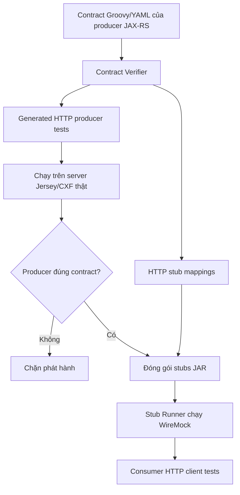
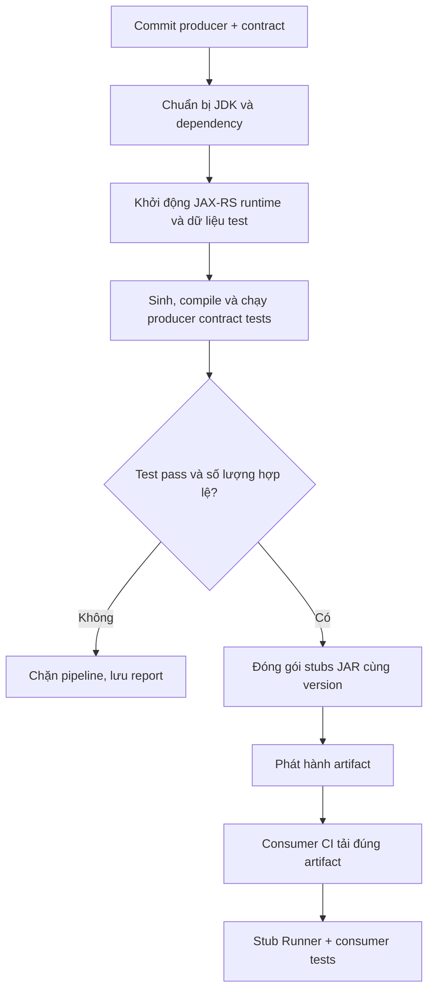

# Điều kiện kiểm thử JAX-RS theo môi trường ứng dụng

## 1. JAX-RS có gì khác khi dùng Spring Cloud Contract?

**Spring Cloud Contract** giúp producer và consumer thống nhất hành vi của API qua hợp đồng viết bằng **Groovy/YAML DSL**. Contract Verifier sinh kiểm thử phía producer, còn stub được sinh và phát hành để consumer dùng qua **Stub Runner**. Nhờ tích hợp CI, việc đổi HTTP status, đường dẫn, header hoặc JSON body có thể được phát hiện trước khi các dịch vụ triển khai độc lập.

Với một ứng dụng HTTP dùng **JAX-RS** (Jakarta RESTful Web Services, trước đây là Java API for RESTful Web Services), endpoint thường khai báo bằng `@Path`, `@GET`, `@POST`, `@Produces`, `@Consumes` và các `Provider`. Đây là mô hình khác với Spring MVC dựa trên `@RestController` và `@GetMapping`. Vì thế, **chế độ sinh test mặc định dành cho Spring MVC không phải lúc nào cũng phù hợp với JAX-RS**.

Ví dụ, producer sử dụng Jersey hoặc Apache CXF để triển khai `GET /api/orders/42`. Một generated test dựa vào Spring MVC `MockMvc` có thể không tìm được route của Jersey dù ứng dụng khi chạy thật vẫn trả HTTP `200`. Cách kiểm tra thích hợp thường là **khởi động runtime JAX-RS và gửi request HTTP thật** bằng một test client, trừ khi phiên bản Spring Cloud Contract và JAX-RS runtime có chế độ kiểm thử trực tiếp được hỗ trợ, cấu hình đúng.

**Mục tiêu của bài:**

1. Phân biệt HTTP contract với framework xử lý HTTP và chọn test mode phù hợp.
2. Chuẩn bị đúng server, port, context path, JAX-RS application path, JSON provider, filter và dữ liệu thử.
3. Chạy generated producer tests để kiểm tra API JAX-RS thật thay vì chỉ kiểm tra mock không đại diện.
4. Dùng stubs JAR và Stub Runner kiểm tra consumer độc lập, hiểu những giới hạn của test.
5. Thiết kế cổng CI phát hiện API không tương thích và chẩn đoán lỗi theo từng tầng.

## 2. Hợp đồng HTTP là độc lập với cách triển khai tài nguyên

Giả sử một producer tên `order-service` có endpoint:

```http
GET /api/orders/42
Accept: application/json
```

Và phải trả:

```http
HTTP/1.1 200 OK
Content-Type: application/json

{"orderId":42,"status":"CONFIRMED"}
```

Consumer không cần biết endpoint được xây bằng `@RestController` hay `@Path`. Họ quan tâm **method, URL, header, status và body mà client thực sự quan sát**. Vì vậy có thể dùng cùng một hợp đồng cho Spring MVC hoặc JAX-RS:

```groovy
import org.springframework.cloud.contract.spec.Contract

Contract.make {
    description 'Tra cứu đơn hàng đã xác nhận'

    request {
        method GET()
        url '/api/orders/42'
        headers {
            accept(applicationJson())
        }
    }

    response {
        status OK()
        headers {
            contentType(applicationJson())
        }
        body([
            orderId: 42,
            status : 'CONFIRMED'
        ])
    }
}
```

Tệp thường đặt dưới nguồn contract của producer, ví dụ:

```text
src/test/resources/contracts/orders/get-confirmed-order.groovy
```

**Điểm cần tách bạch:** Groovy DSL ở trên mô tả giao thức, còn **test mode và base class** quyết định generated test sẽ thực thi request trên môi trường nào. Nếu test gửi nhầm URL hoặc không khởi động JAX-RS servlet, lỗi `404` không tự chứng minh contract đã sai.

### Cùng kịch bản bằng YAML DSL

```yaml
description: Tra cứu đơn hàng đã xác nhận
request:
  method: GET
  url: /api/orders/42
  headers:
    Accept: application/json
response:
  status: 200
  headers:
    Content-Type: application/json
  body:
    orderId: 42
    status: "CONFIRMED"
```

Groovy và YAML là **hai cách diễn đạt thay thế** của kịch bản này. Không giữ cả hai bản trong cùng vùng contract được plugin quét sau khi chuyển đổi, vì có thể phát sinh kiểm thử và mapping trùng. Lưu ý `orderId: 42` là số JSON, không phải chuỗi `"42"`.

## 3. Ma trận chọn môi trường kiểm thử

Không thể chọn test mode chỉ theo việc code có annotation `@Path`: phải xem **framework runtime nào thực sự xử lý request**.

| Producer/runtime | Cách xác minh thích hợp | Điều kiện quan trọng |
| --- | --- | --- |
| Spring Boot + **Spring MVC** | `MockMvc` nếu plugin hỗ trợ và cấu hình đúng | Test chạy trong Spring MVC dispatcher, không cần mở cổng thật |
| Spring Boot + **Jersey JAX-RS** | HTTP thật với embedded servlet/server là lựa chọn an toàn, dễ quan sát | Jersey servlet/container được đăng ký; port, path, provider đúng |
| Spring Boot + **Apache CXF JAX-RS** | HTTP thật với runtime CXF đã khởi động | CXF servlet/application path, providers và security filters được nạp |
| Ứng dụng **Jakarta EE/JAX-RS** trên server/container | HTTP thật tới deployment dành cho test | Container đã deploy xong, có URL xác định, dữ liệu được seed |
| JAX-RS resource chạy trong **test container chuyên biệt** | Test framework của JAX-RS nếu được Spring Cloud Contract/plugin hỗ trợ | Xem tài liệu đúng plugin version và tích hợp runner |
| Spring WebFlux | `WebTestClient` nếu plugin hỗ trợ | Đây là reactive Spring, **không đồng nhất với JAX-RS** |

Trong các ví dụ tiếp theo, ta chọn **chế độ gửi HTTP thực đến server JAX-RS đang chạy**. Với Spring Cloud Contract, tên cấu hình được dùng phổ biến cho luồng HTTP thực là **`EXPLICIT`** (generated tests qua Rest Assured); một số phiên bản/hệ sinh thái có thêm các lựa chọn JAX-RS chuyên biệt. Hãy **kiểm tra tên test mode và API của đúng phiên bản plugin** trước khi cấu hình: không mặc định mọi phiên bản đều có cùng enum hoặc cùng khả năng kiểm thử JAX-RS in-process.

### Vì sao MockMvc thường không đủ cho Jersey/CXF?

`MockMvc` mô phỏng luồng Spring MVC. Nếu route HTTP thực tế được đăng ký ở Jersey/CXF thay vì Spring MVC `DispatcherServlet`, một generated test MockMvc có thể không đi qua `@Path` resource, `ContainerRequestFilter`, `ExceptionMapper` hoặc JSON provider của JAX-RS như triển khai thật. Có thể có những tích hợp riêng, nhưng chúng phải được chứng minh bằng cấu hình/test thực tế chứ không tự suy rằng hai framework dùng chung dispatcher.

**Quy tắc lựa chọn:** Nếu mục tiêu là kiểm tra response JAX-RS mà consumer thật sẽ nhận, hãy ưu tiên request qua **HTTP boundary của runtime JAX-RS thật** khi không có lý do và cơ chế được hỗ trợ rõ ràng để kiểm thử in-process.

## 4. Điều kiện về server, port và đường dẫn

Một request generated test chỉ thành công khi nó đi đúng tới endpoint được deploy.

### 4.1. URL cuối cùng được ghép từ nhiều lớp

Ví dụ một server có:

| Lớp cấu hình | Giá trị minh họa | Ý nghĩa |
| --- | --- | --- |
| Scheme và host | `http://localhost` | Nơi producer test kết nối |
| Cổng test | `49152` | Cổng động server đã mở |
| Context path | `/shop` | Prefix của ứng dụng web nếu có |
| JAX-RS application path | `/api` | Ví dụ `@ApplicationPath("/api")` hoặc servlet mapping tương đương |
| Resource path | `/orders` | Ví dụ `@Path("/orders")` |
| Method path | `/{id}` | Ví dụ `@Path("/{id}")` |

Khi ghép lại, URL có thể là:

```text
http://localhost:49152/shop/api/orders/42
```

Nhưng `contract.request.url` nên diễn đạt **đường dẫn mà consumer quan sát theo thỏa thuận**. Nếu `/shop` chỉ là prefix dành riêng cho môi trường deploy test, base path của client có thể được cấu hình để sinh request đúng. Nếu `/api` là phần ổn định của API công khai, nên đưa nó vào contract. **Không nhân đôi prefix** bằng cách vừa đặt `/api` trong contract, vừa ép client thêm `/api` lần nữa.

### 4.2. Những lỗi về URL dễ nhầm

- Generated test gọi `/api/orders/42` nhưng JAX-RS chỉ được deploy ở `/rest/orders/42`.
- Contract có `/api`, base path của Rest Assured cũng có `/api`, thành `/api/api/orders/42`.
- Test dùng cổng `8080` cố định nhưng server đang chạy cổng ngẫu nhiên.
- Test gọi HTTP trong khi deployment chỉ nhận HTTPS.
- Runtime JAX-RS chưa khởi động xong khi generated test bắt đầu.
- Reverse proxy trong production thêm prefix/header mà test nhắm trực tiếp servlet không mô phỏng.

Trong debug, hãy ghi lại **URL được gọi thực sự**, cổng mà server đã bind, dispatcher/servlet được đăng ký, và request log phía producer. `404` có thể là lỗi routing chứ không phải dữ liệu nghiệp vụ.

### 4.3. Readiness và vòng đời ứng dụng

Kiểm thử với server thật cần bảo đảm:

1. Runtime JAX-RS khởi động hoàn chỉnh trước request đầu tiên.
2. Port, host, base path được truyền đến generated test.
3. Dữ liệu thử có sẵn trước khi gọi endpoint.
4. Sau suite, server và hạ tầng test được đóng/cleanup đúng.

Với embedded Spring Boot có thể dùng `@SpringBootTest(webEnvironment = RANDOM_PORT)`. Với server Jakarta EE chạy ngoài JVM, thường cần bước deploy/health check và cấu hình HTTP base URI riêng; `@SpringBootTest` không thể tự khởi động một server ngoài Spring.

## 5. Ví dụ resource JAX-RS và những thành phần phải được nạp

Trong một ứng dụng Spring Boot dùng Jersey, một resource có thể được khai báo theo API Jakarta REST như sau:

```java
import java.util.Map;
import jakarta.ws.rs.GET;
import jakarta.ws.rs.Path;
import jakarta.ws.rs.PathParam;
import jakarta.ws.rs.Produces;
import jakarta.ws.rs.core.MediaType;
import jakarta.ws.rs.core.Response;
import org.springframework.stereotype.Component;

@Component
@Path("/orders")
@Produces(MediaType.APPLICATION_JSON)
public class OrderResource {

    @GET
    @Path("/{id}")
    public Response getOrder(@PathParam("id") long id) {
        if (id == 42L) {
            return Response.ok(Map.of(
                "orderId", 42,
                "status", "CONFIRMED"
            )).build();
        }

        return Response.status(Response.Status.NOT_FOUND)
            .entity(Map.of("code", "ORDER_NOT_FOUND"))
            .build();
    }
}
```

Nếu runtime cấu hình JAX-RS application path `/api`, thì `@Path("/orders")` và `@Path("/{id}")` tạo đường dẫn phục vụ mong muốn là `/api/orders/42`. Chú ý: **resource tồn tại trong classpath chưa đủ để route hoạt động**. Jersey phải được đăng ký và runtime cần JSON provider thích hợp cho các đối tượng/map trả về.

Ví dụ một cách đăng ký Jersey với Spring Boot:

```java
import org.glassfish.jersey.server.ResourceConfig;
import org.springframework.stereotype.Component;

@Component
public class JerseyConfig extends ResourceConfig {
    public JerseyConfig() {
        register(OrderResource.class);
        // Đăng ký ExceptionMapper, filter, JSON provider khác nếu cần.
    }
}
```

Application path có thể được cấu hình riêng cho Jersey bằng cấu hình runtime hoặc annotation tương ứng, **không nên khai báo chồng nhiều prefix khác nhau**. Ví dụ với Spring Boot + Jersey theo các phiên bản có hỗ trợ property tương ứng:

```properties
spring.jersey.application-path=/api
```

Đoạn Java ở trên là **ví dụ minh họa resource**; một dự án chạy thực tế cần chọn dependency Jersey/CXF, provider JSON, registration và Spring Boot/Jakarta version tương thích. Với Spring Boot 2.x và các thư viện JAX-RS cũ, có thể cần namespace `javax.ws.rs.*` thay vì `jakarta.ws.rs.*`. **Không trộn `javax` và `jakarta`** tùy tiện trong một ứng dụng; phải nhất quán với runtime và bộ thư viện được sử dụng.

### Những thành phần JAX-RS ảnh hưởng response

| Thành phần | Ví dụ | Nếu thiếu hoặc không được chạy |
| --- | --- | --- |
| Resource registration | `OrderResource` được Jersey quản lý | Request nhận `404` do không có route |
| Application path | `/api` | Generated test gọi sai URL |
| JSON provider | Jackson/Jersey JSON integration phù hợp | `406`/`500` hoặc body/media type sai |
| `@Consumes`, `@Produces` | `application/json` | `415` hoặc `406` khi request negotiation sai |
| `ExceptionMapper` | Đổi exception thành body lỗi nghiệp vụ | Actual `500`/HTML thay vì `404` JSON đã cam kết |
| Request/response filters | Authentication, correlation ID | Test bỏ qua authorization hoặc thiếu header |
| Dữ liệu và service layer | Đơn 42 có trạng thái `CONFIRMED` | `404`/state khác expected dù route đúng |

Đặc biệt, test tầng JAX-RS thực phải đi qua những lớp mà consumer quan sát. Nếu controller/service bị mock để luôn trả response giống contract, một bài kiểm thử có thể pass nhưng chưa chứng minh converter/filter/security chain production hoạt động đúng.

## 6. Cấu hình Contract Verifier để gửi HTTP thật

Ví dụ phần cấu hình liên quan trong `pom.xml` của producer đã có Spring Boot và các dependency JAX-RS phù hợp:

```xml
<dependency>
    <groupId>org.springframework.cloud</groupId>
    <artifactId>spring-cloud-starter-contract-verifier</artifactId>
    <scope>test</scope>
</dependency>

<build>
    <plugins>
        <plugin>
            <groupId>org.springframework.cloud</groupId>
            <artifactId>spring-cloud-contract-maven-plugin</artifactId>
            <version>${spring-cloud-contract.version}</version>
            <extensions>true</extensions>
            <configuration>
                <testMode>EXPLICIT</testMode>
                <baseClassForTests>com.example.orders.ContractVerifierBase</baseClassForTests>
            </configuration>
        </plugin>
    </plugins>
</build>
```

Đây là **trích đoạn cấu hình**, chưa phải một `pom.xml` hoàn chỉnh. Property `spring-cloud-contract.version` phải được định nghĩa theo phiên bản tương thích với Spring Boot/Spring Cloud đang dùng; dependency management/BOM, JUnit, Rest Assured và runtime Jersey/CXF cũng phải đầy đủ. Cấu hình `EXPLICIT` thể hiện **ý định sinh HTTP-level tests thay vì MockMvc**. Nếu version plugin không nhận giá trị này hoặc có API khác, đọc thông báo cấu hình và dùng giá trị mà phiên bản đó hỗ trợ.

### Base class cho embedded Spring Boot

Với phiên bản Spring Boot hỗ trợ `@LocalServerPort` và JUnit 5, base class có thể được tổ chức như sau:

```java
package com.example.orders;

import io.restassured.RestAssured;
import org.junit.jupiter.api.BeforeEach;
import org.springframework.boot.test.context.SpringBootTest;
import org.springframework.boot.test.web.server.LocalServerPort;

@SpringBootTest(webEnvironment = SpringBootTest.WebEnvironment.RANDOM_PORT)
public abstract class ContractVerifierBase {

    @LocalServerPort
    int port;

    @BeforeEach
    void configureHttpClient() {
        RestAssured.baseURI = "http://localhost";
        RestAssured.port = port;
        RestAssured.basePath = "";
    }
}
```

Ý định của lớp trên:

1. Khởi động **ứng dụng Spring Boot thật** với embedded server trên cổng ngẫu nhiên.
2. Đợi Spring test context và server khởi tạo xong.
3. Truyền cổng đã mở cho Rest Assured trước khi generated test thực thi request.
4. Để test gọi URL tương đối từ contract, ví dụ `/api/orders/42`.

**Giới hạn của ví dụ:** Đây là khung khi generated tests của phiên bản plugin dùng HTTP qua Rest Assured và kế thừa base class kiểu JUnit 5. Nếu plugin sinh JUnit 4, cần dùng lifecycle annotation tương ứng; nếu Spring Boot version cũ thì package `@LocalServerPort` có thể khác. Hãy mở generated test để xác nhận base class và request client thực tế, thay vì copy cấu hình rồi mặc định nó phù hợp mọi phiên bản.

`RestAssured.baseURI`, `RestAssured.port` và `RestAssured.basePath` là các cấu hình tĩnh có thể ảnh hưởng nhiều test chạy chung JVM. Nếu contract tests được chạy **song song** với ứng dụng/test khác sử dụng các giá trị tĩnh này, cần cô lập JVM, tắt parallelization hoặc cấu hình request specification tách biệt theo khả năng generated test. Không dùng cổng động nhưng lại hard-code `8080` ở bất kỳ nơi nào khác.

### Chuẩn bị dữ liệu thử

Hợp đồng `GET /api/orders/42` giả định có đơn 42 ở trạng thái `CONFIRMED`. Nếu gọi database thật dành cho test, cần seed và cleanup đúng:

```text
Given: đơn 42 tồn tại với status = CONFIRMED
When:  GET /api/orders/42, Accept: application/json
Then:  HTTP 200 và JSON { orderId: 42, status: "CONFIRMED" }
```

Cách seed phụ thuộc kiến trúc (test repository, migration/SQL fixture, test container hoặc service mock phù hợp). **Không giả định `@Transactional` trên test sẽ rollback mọi ghi nhận** nếu request đi qua HTTP thật trên thread/transaction riêng. Cần thiết kế fixture theo transaction và lifecycle thực tế.

### Trường hợp server JAX-RS nằm ngoài Spring Boot

Nếu producer chạy trên Jakarta EE server/servlet container độc lập, không nên dùng `@SpringBootTest` để “giả” rằng server đã có. Thay vào đó, base class cần nhận `contract.base-url` hoặc biến môi trường tương đương từ pipeline:

```text
Deploy JAX-RS WAR/app vào test container
  → chờ health/readiness
  → lấy scheme, host, port và context path
  → cấu hình HTTP client của generated tests
  → chạy verification
  → thu report, dọn container và test data
```

Tên property truyền URL và cách khởi tạo request client là quyết định của project/test harness; không có một `@LocalServerPort` áp dụng cho mọi ứng dụng Java EE. Với Apache CXF hoặc Jersey chạy embedded ngoài Spring Boot, nguyên tắc vẫn là phải **thật sự khởi động runtime cung cấp endpoint** và điều khiển vòng đời của nó.

## 7. Điều kiện request: Accept, Content-Type, query và auth

JAX-RS runtime sử dụng content negotiation và provider để xử lý dữ liệu. Những phần này đặc biệt quan trọng khi contract test gọi HTTP thật.

### GET và header `Accept`

Trong ví dụ tra cứu, contract gửi:

```http
GET /api/orders/42 HTTP/1.1
Accept: application/json
```

Nếu resource có `@Produces(MediaType.APPLICATION_JSON)` nhưng thiếu JSON provider, producer có thể không serialise được body đúng. Nếu client gửi `Accept: application/xml`, runtime có thể trả `406 Not Acceptable` theo cấu hình. Đây không phải lỗi status nghiệp vụ; cần đọc request header và provider registration trước khi sửa contract.

### POST với `@Consumes`

Ví dụ một API tạo đơn:

```http
POST /api/orders HTTP/1.1
Content-Type: application/json
Accept: application/json

{"customerId":"cust-123","quantity":2}
```

Khi JAX-RS resource có `@Consumes(MediaType.APPLICATION_JSON)`, request không cung cấp Content-Type phù hợp có thể nhận `415 Unsupported Media Type`. Nếu contract chỉ khai báo body mà quên header, test có thể fail do negotiation chứ không phải logic tạo đơn. Với JSON body, cần bảo vệ cả type dữ liệu, field bắt buộc và matcher do consumer sử dụng.

### Security filter

Nếu API yêu cầu `Authorization` hoặc cookie, phải quyết định contract test có mục tiêu kiểm chứng luồng **đã xác thực** hay các lỗi `401`/`403`. Với HTTP thật, filter chain thường chạy; cần cung cấp token/identity test hợp lệ hoặc cấu hình auth cho môi trường test một cách minh bạch.

Nếu tắt toàn bộ security để bài test `200` chạy, kết quả đó **không bảo vệ giao diện security**. Thay vì vô hiệu hóa bảo mật mà không ghi nhận, hãy tạo các kịch bản riêng cho `401`/`403` nếu consumer phụ thuộc và thực thi test qua đúng tầng xử lý.

## 8. Response lỗi và JAX-RS ExceptionMapper

Một producer có thể ném exception khi tài nguyên không tồn tại. Trong JAX-RS, `ExceptionMapper` cho phép ánh xạ loại exception thành `Response` có HTTP status và body đúng giao diện.

Ví dụ một lỗi nghiệp vụ:

```java
public class OrderNotFoundException extends RuntimeException {
    public OrderNotFoundException(long id) {
        super("Order not found: " + id);
    }
}
```

Một mapper minh họa:

```java
import java.util.Map;
import jakarta.ws.rs.ext.ExceptionMapper;
import jakarta.ws.rs.ext.Provider;
import jakarta.ws.rs.core.MediaType;
import jakarta.ws.rs.core.Response;

@Provider
public class OrderNotFoundMapper
        implements ExceptionMapper<OrderNotFoundException> {

    @Override
    public Response toResponse(OrderNotFoundException error) {
        return Response.status(Response.Status.NOT_FOUND)
            .type(MediaType.APPLICATION_JSON)
            .entity(Map.of(
                "code", "ORDER_NOT_FOUND",
                "message", "Không tìm thấy đơn hàng"
            ))
            .build();
    }
}
```

Với Jersey, cần bảo đảm mapper được runtime khám phá hoặc đăng ký, ví dụ thông qua `ResourceConfig.register(OrderNotFoundMapper.class)`. Với CXF hoặc Jakarta EE server, cách đăng ký provider có thể khác. Một mapper đặt trên classpath nhưng **không được runtime nạp** sẽ khiến response lỗi không giống hợp đồng.

Contract cho lỗi:

```groovy
import org.springframework.cloud.contract.spec.Contract

Contract.make {
    description 'Không tìm thấy đơn hàng 999'

    request {
        method GET()
        url '/api/orders/999'
        headers {
            accept(applicationJson())
        }
    }

    response {
        status NOT_FOUND()
        headers {
            contentType(applicationJson())
        }
        body([
            code: 'ORDER_NOT_FOUND',
            message: 'Không tìm thấy đơn hàng'
        ])
    }
}
```

Test này kiểm tra **response thực sự trả ra** khi dữ liệu 999 không tồn tại, không chỉ kiểm tra method `toResponse` riêng lẻ. Nếu runtime trả một trang HTML lỗi hoặc `500`, cần điều tra provider, mapper registration, request routing và root exception.

### Đừng nhầm HTTP 404 với thiếu route

Hai trường hợp có thể cùng HTTP `404` nhưng ý nghĩa hoàn toàn khác:

| Trường hợp | Nguồn | Cách xác minh |
| --- | --- | --- |
| **404 nghiệp vụ** | Endpoint JAX-RS đã nhận request, xác định đơn không tồn tại | JSON có `code = ORDER_NOT_FOUND` và `Content-Type` đã cam kết |
| **404 routing** | Không có servlet/resource path phù hợp | Kiểm tra URL, application path, resource registration, log dispatcher |

Một generated test chỉ assert `status = 404` có thể pass dù endpoint chưa được đăng ký. Nếu consumer phụ thuộc vào JSON lỗi, phải đưa `code`/content type vào contract.

### Chú ý filter và exception bên ngoài JAX-RS resource

Một response `401` do security filter hoặc `502` do reverse proxy tạo có thể không đi qua `ExceptionMapper`. Nếu hợp đồng được công bố bao gồm các response ấy, chọn môi trường kiểm thử có chạy **đúng thành phần tạo response**, hoặc thêm integration test phù hợp. Test resource đơn lẻ không bảo đảm response cuối cùng sau gateway giống production.

## 9. Đường chạy generated producer test cho JAX-RS

Sau khi chọn HTTP-level test mode và base class phù hợp:

```bash
# Producer Maven, với wrapper và plugin đã cấu hình
./mvnw clean verify
```

Maven chỉ là ví dụ. Với Gradle, cũng cần cấu hình plugin `org.springframework.cloud.contract` và lựa chọn test mode có hỗ trợ gửi HTTP thật trong phiên bản hiện tại, rồi chạy các task contract-test thích hợp. Có thể kiểm tra:

```bash
./gradlew tasks --all
./gradlew clean check
```

**Không mặc định** mọi phiên bản plugin đều nối đầy đủ generated tests vào `check` hoặc `verify`; phải xem output sinh mã, report và số test thực sự chạy.

Một generated test phía producer của kịch bản `GET /api/orders/42` có ý nghĩa gần như:

```java
// MÃ MINH HỌA: không phải class được plugin bảo đảm sinh nguyên văn.
given()
    .header("Accept", "application/json")
.when()
    .get("/api/orders/42")
.then()
    .statusCode(200)
    .body("orderId", equalTo(42))
    .body("status", equalTo("CONFIRMED"));
```

Những điều cần kiểm tra **trên mã được sinh thực tế**:

1. Test dùng **HTTP client phù hợp**, không vô tình gọi Spring MVC `MockMvc` khi API do Jersey/CXF triển khai.
2. Base class thực sự được kế thừa/chạy setup trước khi test gửi request.
3. Port thực tế từ server test được đưa vào request, không rơi về cổng mặc định.
4. URL contract không bị thêm/bỏ context path.
5. Header `Accept` và các header auth quan trọng vẫn được gửi.
6. Assertion kiểm tra cả status, header, body và kiểu dữ liệu cần thiết.

### Cách đọc lỗi ở từng tầng

| Triệu chứng | Tầng cần kiểm tra trước |
| --- | --- |
| Không có generated tests | Source root, bộ lọc hợp đồng, plugin và task sinh mã |
| Generated test không compile | Test base class, JUnit version, Rest Assured dependency, Java namespace |
| `Connection refused` | JAX-RS server chưa chạy hoặc sai host/port |
| `404` không có JSON nghiệp vụ | Context path, `@Path`/application path, route/resource registration |
| `405 Method Not Allowed` | Method HTTP trong contract không khớp resource |
| `406 Not Acceptable` | `Accept` và `@Produces`/provider |
| `415 Unsupported Media Type` | `Content-Type`, `@Consumes` và request body |
| `401` hoặc `403` | Auth filter/identity, không tự sửa contract thành response lỗi |
| `500` | Exception, JSON serialization, provider, DB hoặc mapper |
| `200` nhưng body sai tên field/kiểu | DTO, JSON serializer, producer implementation hoặc contract đã cam kết |
| Test pass local, fail CI | Port, startup timing, profile, data, JDK, namespace hoặc parallelism |

Một case đáng chú ý là `200` nhưng response có `state` thay vì `status`. Test phải **phát hiện sự khác biệt contract**; đổi contract sang `state` chỉ để test xanh có thể làm hỏng consumer vẫn dùng `status`. Trước khi sửa contract, xác nhận thay đổi API đã được thống nhất với các consumer liên quan.

## 10. Kiểm thử response động và matcher hai phía

Khi producer sinh ID, timestamp hoặc trace ID, không nên khóa response vào một giá trị ngẫu nhiên chỉ vì nó xuất hiện trong dữ liệu mẫu. Với Spring Cloud Contract:

- **Request:** phía `producer` thường cung cấp một ví dụ cụ thể để generated test gửi; phía `consumer` có thể chứa matcher mà stub dùng để nhận request.
- **Response:** phía `consumer` cung cấp mẫu mà stub trả; phía `producer` có thể chứa matcher để generated test chấp nhận giá trị động hợp lệ.

Ví dụ response có request ID:

```groovy
response {
    status OK()
    headers {
        contentType(applicationJson())
    }
    body([
        orderId: 42,
        status: 'CONFIRMED',
        requestId: $(consumer('req-demo-42'),
                     producer(regex('req-[A-Za-z0-9-]+')))
    ])
}
```

Từ ví dụ đó:

- WireMock stub có thể trả `requestId = req-demo-42` để consumer test ổn định.
- Producer JAX-RS thật được phép trả `req-a123` hoặc `req-b456` nếu thỏa matcher.
- Response có `status = FAILED` vẫn không hợp lệ trong kịch bản xác nhận, vì trường này được kiểm tra bằng giá trị chính xác.

Nếu `requestId` được thêm bởi `ContainerResponseFilter`, test HTTP thật sẽ có khả năng quan sát header/body sau khi filter chạy; một test gọi trực tiếp resource method có thể bỏ qua filter và cho kết quả không đại diện. Đảm bảo request sample của producer test thỏa matcher phía consumer tương ứng để hai nửa hợp đồng không mâu thuẫn.

## 11. Các loại môi trường và mức độ chứng minh

| Môi trường | Độ trung thực | Rủi ro bỏ sót | Khi nào phù hợp |
| --- | --- | --- | --- |
| Unit test resource method trực tiếp | Thấp ở tầng HTTP | Bỏ routing, JSON provider, filters và mapping status | Nhanh, kiểm tra logic đơn giản |
| JAX-RS in-process test framework | Trung bình, phụ thuộc runtime và setup | Có thể bỏ gateway, DB hoặc servlet configuration thật | Kiểm thử resource/provider với framework tương ứng |
| Embedded HTTP server (Jersey/CXF) | Cao ở giao diện HTTP producer | Không có ingress/proxy, có thể dùng DB mock | **Lựa chọn thực dụng cho generated contract tests** |
| Deployed server trong test container | Gần deployment hơn | Chưa chắc có đầy đủ hạ tầng production | Khi JAX-RS dùng application server hoặc cấu hình servlet phức tạp |
| Staging/E2E qua gateway | Cao ở luồng hệ thống | Chậm, phụ thuộc nhiều service, khó cô lập | Kiểm tra routing, auth, proxy, phân phối |

**Không phải “test HTTP thật” là đã kiểm chứng mọi nghiệp vụ.** Producer contract test có thể chạy qua Jersey thật nhưng vẫn mock repository hoặc payment gateway. Để bảo vệ transaction, persistence, retry hay concurrency, cần integration/E2E test với các thành phần thích hợp.

### Điều kiện môi trường nào nên giữ giống production?

- **JAX-RS implementation/provider** tương thích với deployment thật.
- **Path/servlet/filter/ExceptionMapper** mà consumer thực sự đi qua.
- **JSON serialization** có cùng quy tắc tên field, số, ngày giờ, nullability.
- **Security** và identity test, nếu contract bảo vệ các nhánh `401`/`403` hoặc header.
- **Encoding và locale** khi ảnh hưởng response được cam kết.
- **Data fixture** tái lập được, không phụ thuộc một DB cá nhân.

Những khác biệt được phép (ví dụ port ngẫu nhiên, database test riêng) phải được cấu hình rõ ràng và **không thay đổi ý nghĩa HTTP** mà contract kiểm tra.

## 12. Consumer không cần chạy JAX-RS để dùng stub HTTP

Một giá trị quan trọng của Spring Cloud Contract là **consumer kiểm thử độc lập với framework của producer**. Nếu producer JAX-RS đã xác minh contract và phát hành stubs JAR, consumer có thể là Spring MVC, Spring WebFlux, một ứng dụng Java khác hoặc ứng dụng dùng HTTP client không phụ thuộc Jersey/CXF.

Luồng tổng quát:



Ví dụ consumer Spring Boot sử dụng Stub Runner:

```java
import org.springframework.cloud.contract.stubrunner.StubRunnerProperties;
import org.springframework.cloud.contract.stubrunner.spring.AutoConfigureStubRunner;

@AutoConfigureStubRunner(
    ids = "com.example:order-service:1.3.0:stubs:9090",
    stubsMode = StubRunnerProperties.StubsMode.LOCAL
)
class OrderClientContractTest {
    // Cấu hình HTTP client của consumer gọi http://localhost:9090.
    // Test GET /api/orders/42, kiểm tra orderId=42, status=CONFIRMED.
}
```

Đây là phần cấu hình minh họa, chưa phải test hoàn chỉnh; dự án cần dependency Stub Runner, test framework và code client/assertion. `LOCAL` yêu cầu artifact đã có trong Maven local repository. Trên CI độc lập, thường cần repository từ xa và chế độ tải phù hợp. Có thể dùng cổng động thay `9090` nếu nhiều test chạy song song, nhưng phải truyền đúng cổng cho consumer client.

**Không nhầm JAX-RS server với WireMock:** Stub Runner phục vụ response từ mapping, không khởi chạy Jersey/CXF hoặc chạy business logic của producer. Consumer test với stub pass chỉ chứng minh client xử lý một lời hứa HTTP đã mô phỏng; generated producer test mới chứng minh triển khai JAX-RS thực đáp ứng lời hứa đó.

### Những tình huống consumer nên kiểm thử

| Trường hợp | Response stub | Consumer cần xác minh |
| --- | --- | --- |
| Đơn tồn tại | `200`, `orderId/status` | Deserialize JSON và xử lý trạng thái |
| Không có đơn | `404`, `code = ORDER_NOT_FOUND` | Hiển thị nhánh lỗi đúng, không coi là thành công |
| Sai yêu cầu | `400`, JSON lỗi validation | Hiển thị lỗi field hoặc message phù hợp |
| Không có quyền | `401`/`403` | Xử lý xác thực/phân quyền theo giao thức |
| Dịch vụ tạm thời lỗi | `503`, có thể có `Retry-After` | Retry/backoff theo chính sách, tránh vòng lặp |

Nếu nhiều mapping có cùng method/path mà không có điều kiện phân biệt, hãy thiết kế request và dữ liệu ví dụ rõ ràng. Stub HTTP không tự suy ra trạng thái DB thật; có thể cần WireMock scenario/fake service cho luồng nhiều bước, nhưng đó là cơ chế kiểm thử riêng phải được thiết lập có chủ đích.

## 13. Xây một pipeline CI có thể tái lập

Một pipeline dành cho producer JAX-RS nên có ít nhất các giai đoạn:



**Cổng 1 — Discovery và execution:** Plugin phải phát hiện đúng tệp contract và generated tests phải **thực sự chạy**. Một build xanh với `0 contract tests` không đủ điều kiện để tuyên bố API tương thích.

**Cổng 2 — Runtime phù hợp:** Test phải gọi đúng server Jersey/CXF/Jakarta EE được deploy. Nếu mode không tương ứng, generated tests có thể fail giả ở `404` hoặc pass do mock sai tầng.

**Cổng 3 — Artifact:** Stubs JAR phải được sinh từ **cùng revision contract** đã được producer test xác minh, gắn group/artifact/version/classifier rõ ràng. Không dùng stub viết tay không còn đồng bộ với contract.

**Cổng 4 — Consumer:** CI consumer tải đúng version stubs JAR và gọi stub qua HTTP client thật. Nếu consumer fail, phân biệt stub không tải được, request không match và code client deserialize/xử lý sai.

**Cổng 5 — Các yêu cầu ngoài contract:** Nếu triển khai cần chạy với gateway, CORS, DB transaction hay broker, đặt integration/E2E test riêng. Không gọi một producer contract test là kiểm thử toàn bộ hệ thống.

### Các giá trị cần ghi trong CI log

- Version JDK, Spring Boot, Spring Cloud Contract và runtime JAX-RS.
- Test mode được cấu hình, base class và framework HTTP client của generated tests.
- Host/port/base path thực tế (không ghi secrets), application path và context path.
- Số contract được phát hiện, số generated tests, số đã thực thi, failed/skipped.
- Test report với expected/actual đã ẩn credential, token và dữ liệu nhạy cảm.
- Artifact stub đã tạo và artifact version mà consumer tải.

### Đối chiếu trường hợp CI khác local

| Local pass, CI fail vì... | Kiểm tra |
| --- | --- |
| Cổng mặc định khác | Có dùng `@LocalServerPort` hoặc cấu hình đúng port không? |
| Deployment chưa sẵn sàng | Job đã chờ health/readiness trước verification chưa? |
| Context path khác | CI có thêm `/shop` hoặc servlet mapping khác không? |
| Khác Java namespace | `javax.ws.rs` và `jakarta.ws.rs` có tương thích runtime không? |
| JSON serialization khác | Provider và module Jackson có giống version không? |
| Dữ liệu thử khác | Đơn 42 có được seed và cleanup mỗi lần chạy không? |
| Security profile khác | Filter chạy và token test có hợp lệ không? |
| Test chạy song song | Port, Rest Assured static config và database fixture có bị chia sẻ không? |

## 14. Những lỗi chọn sai môi trường và cách xử lý

### Lỗi 1: Dùng MockMvc cho resource Jersey

**Biểu hiện:** Generated test nhận `404`, dù mở ứng dụng rồi gọi `curl` vào cổng thật thì endpoint trả `200`.

**Điều tra:** Xem generated test import/khởi tạo request của framework nào. Nếu đang chạy qua MockMvc nhưng route thuộc Jersey, chuyển sang test mode HTTP thật được plugin hỗ trợ; khởi động đúng embedded server và truyền port vào Rest Assured. Không sửa URL contract chỉ để MockMvc tìm thấy một route khác.

### Lỗi 2: Nhân đôi `/api`

**Biểu hiện:** Contract mong `/api/orders/42` nhưng request thực tế đến `/api/api/orders/42` và trả `404`.

**Điều tra:** Kiểm tra `spring.jersey.application-path`, `RestAssured.basePath`, context path và `request.url`. Mỗi prefix chỉ được áp dụng ở lớp có trách nhiệm; không thay cả ba chỗ cùng lúc.

### Lỗi 3: Server chưa sẵn sàng hoặc sai cổng

**Biểu hiện:** `Connection refused` hoặc test treo chờ.

**Điều tra:** Kiểm tra server lifecycle, giá trị port thực, host/container networking, readiness. Đừng đổi matcher hoặc response body để sửa lỗi kết nối mạng.

### Lỗi 4: Có JSON nhưng Content-Type hoặc body sai

**Biểu hiện:** Producer trả HTML lỗi, `406`, `415` hoặc JSON field bị đổi tên.

**Điều tra:** Kiểm tra `@Produces`, `@Consumes`, provider registration, `ExceptionMapper`, serializer và request headers. So giá trị actual với contract. Nếu DTO thay `status` thành `state` thì đây có thể là breaking change, không phải vấn đề port.

### Lỗi 5: Test xanh nhưng bỏ qua security

**Biểu hiện:** Contract test `200` pass nhưng integration qua gateway trả `401`.

**Điều tra:** Xác định security filter/gateway có nằm trong môi trường producer contract test không. Nếu consumer dựa vào nhánh authorization, cần test chạy qua đúng filter và những contract `401`/`403` thích hợp.

### Lỗi 6: Stub Runner trả 404 không có JSON lỗi

**Biểu hiện:** Consumer test định kiểm tra `ORDER_NOT_FOUND` nhưng nhận một `404` khác.

**Điều tra:** Kiểm tra artifact version, mapping đã nạp, method/path/header mà consumer gửi và cổng của Stub Runner. `404` do **không có mapping match** khác `404` nghiệp vụ mà contract khai báo; assert cả mã lỗi và Content-Type để tránh pass giả.

## 15. Bài thực hành: cùng contract, hai môi trường JAX-RS

### Đề bài

Nhóm xây `order-service` bằng JAX-RS/Jersey. Có hai môi trường kiểm thử:

- **Môi trường A:** Spring Boot embedded server, cổng ngẫu nhiên; Jersey sử dụng application path `/api`; resource có `@Path("/orders")`.
- **Môi trường B:** Jakarta EE server chạy ngoài process test, ứng dụng deploy dưới context root `/shop` và JAX-RS application path `/api`.

Consumer `checkout-service` dùng `GET /api/orders/42` để đọc `status = CONFIRMED`. Nếu đơn không tồn tại, producer trả `404` với `code = ORDER_NOT_FOUND`.

**Yêu cầu thực hiện:**

1. Viết Groovy hoặc YAML contract cho `GET /api/orders/42` và một contract riêng cho `GET /api/orders/999`.
2. Ở môi trường A, cấu hình generated producer tests dùng **HTTP thật**, khởi động server qua `RANDOM_PORT` và lấy port trong base class.
3. Ở môi trường B, xác định URL triển khai thực như `http://host:port/shop/api/orders/42`, tạo quy trình deploy/readiness và cấu hình request base URI/path để vẫn kiểm tra đúng contract đã thống nhất.
4. Xác nhận Jersey đăng ký resource, JSON provider và `ExceptionMapper`, rồi chạy thử `200` và `404` qua HTTP client.
5. Cố tình bỏ `/api` hoặc thêm `/api` hai lần, ghi nhận lỗi, xác định đó là lỗi test configuration hay producer contract.
6. Đổi producer JSON từ `status` thành `state` mà không đổi contract; xác nhận generated producer test phát hiện.
7. Sinh stubs JAR, cho consumer chạy Stub Runner với version đã kiểm chứng, kiểm tra hai nhánh thành công và không tìm thấy.
8. Ghi lại test reports, số test đã chạy, artifact version và môi trường test; đề xuất hai cổng CI để tránh phát hành khi tests chưa thực thi.

### Bảng kỳ vọng

| Thử nghiệm | Kết quả cần thấy | Bài học |
| --- | --- | --- |
| A gọi `/api/orders/42` trên đúng port | `200`, `orderId=42`, `status=CONFIRMED` | Embedded Jersey HTTP hoạt động |
| B gọi `/shop/api/orders/42` trên URL deployment | `200` cùng body | Context root chỉ thay cách truy cập test/deploy |
| Gọi `/api/orders/999` trên A | `404`, `code=ORDER_NOT_FOUND` | Kiểm tra lỗi nghiệp vụ, không phải 404 route |
| Test gọi sai prefix | `404` hoặc route mismatch | Cần sửa base URI/path hoặc deployment, không tùy tiện đổi contract |
| Producer đổi `status` sang `state` | Producer test **phải fail** | Contract bảo vệ field mà consumer đang dùng |
| Consumer dùng Stub Runner đúng artifact | Client xử lý `200`/`404` đúng | Stub bảo vệ logic consumer độc lập với JAX-RS |
| Producer tests không chạy nhưng build xanh | Cổng CI **phải đánh dấu lỗi phạm vi** | Build success không đủ chứng minh tương thích |

### Câu hỏi tự đánh giá

**1. Có bắt buộc phải dùng cùng framework HTTP ở producer và consumer không?** Không. Consumer sử dụng HTTP contract và stub như giao diện; producer JAX-RS có thể phục vụ ứng dụng Spring hoặc client khác.

**2. Vì sao không dùng `MockMvc` cho mọi JAX-RS resource?** Vì MockMvc đi qua Spring MVC dispatcher, trong khi Jersey/CXF có runtime và pipeline provider/filter riêng. Nếu không có một tích hợp kiểm thử được hỗ trợ rõ ràng, HTTP thật bảo đảm request đi qua runtime JAX-RS đang triển khai.

**3. Một producer test HTTP thật pass có chứng minh DB và event broker đều đúng không?** Không. Test HTTP xác minh status/header/body trong môi trường đã cấu hình; persistence, transaction, quyền truy cập và message delivery có thể cần integration/E2E tests riêng.

**4. Tại sao cổng ngẫu nhiên an toàn hơn cổng cố định trong CI?** Nó giảm nguy cơ đụng cổng khi chạy nhiều test; nhưng generated client phải nhận đúng port, và cấu hình static chung như Rest Assured cần được cô lập khi chạy song song.

## 16. Checklist trước khi xác nhận JAX-RS contract test

- [ ] Đã xác định runtime thực tế: Jersey, CXF hoặc application server JAX-RS khác.
- [ ] Đã chọn test mode được phiên bản Spring Cloud Contract hỗ trợ và phù hợp runtime; không tự dùng MockMvc cho JAX-RS.
- [ ] Generated tests thực sự gửi HTTP tới producer đang chạy hoặc môi trường JAX-RS in-process đã được hỗ trợ, thay vì mock sai tầng.
- [ ] Port, host, context root, application path, servlet mapping và resource path tạo đúng URL contract.
- [ ] Server được khởi động/readiness trước test, đóng và dọn tài nguyên sau test.
- [ ] Resource, JSON provider, `ExceptionMapper`, filter/security được nạp đúng như phạm vi hợp đồng.
- [ ] JDK, `javax`/`jakarta` namespace, Spring Boot và plugin versions nhất quán.
- [ ] Dữ liệu test ổn định; hợp đồng thành công và lỗi có tình huống request phân biệt rõ.
- [ ] Test base class/Rest Assured và JUnit version khớp generated code; cấu hình port không xung đột khi chạy song song.
- [ ] Generated tests được sinh, biên dịch, chạy thật và assert đúng HTTP status, header, body, matcher.
- [ ] Stubs JAR được phát hành từ contract đã xác minh; consumer dùng Stub Runner với đúng version và cổng.
- [ ] CI kiểm tra số test đã thực thi, không coi `BUILD SUCCESS` với 0 contract tests là thành công.
- [ ] Những yêu cầu ngoài HTTP contract như DB transaction, broker, gateway, idempotency và concurrency có test phù hợp riêng.

**Ghi nhớ:** Với **Spring Cloud Contract trên JAX-RS**, hợp đồng HTTP vẫn mô tả điều **consumer quan sát**, nhưng **môi trường chạy generated producer tests phải đi qua đúng runtime phục vụ API**. Lựa chọn HTTP thật, cấu hình đúng port/path/provider và dữ liệu thử giúp phân biệt lỗi routing, lỗi môi trường với thay đổi API thực sự. Stub Runner và CI hoàn thiện vòng kiểm thử giữa producer và consumer, nhưng không thay thế những bài kiểm thử hệ thống vượt quá phạm vi hợp đồng.
