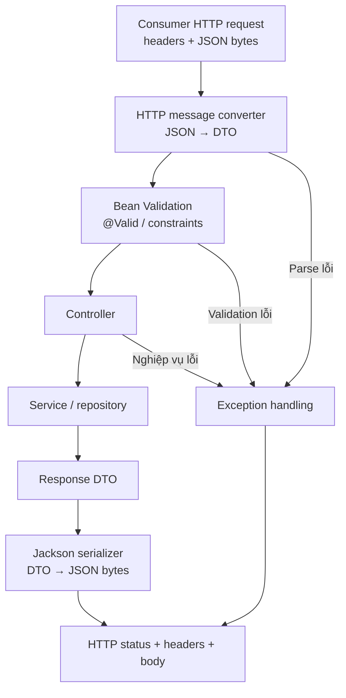
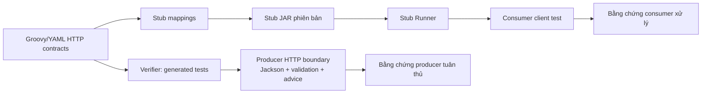
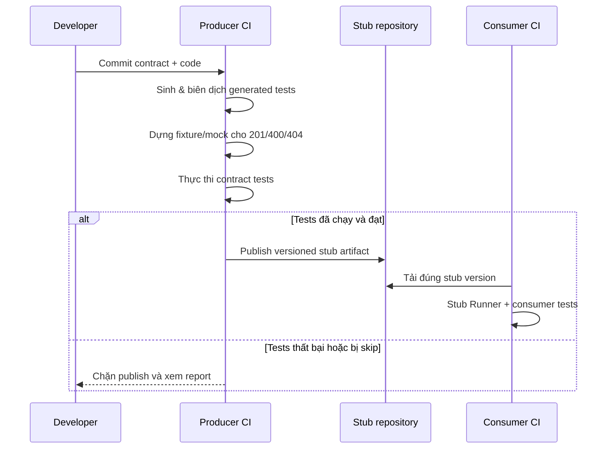

# Kiểm thử serialization, validation và exception handler

## 1. Kiểm thử hợp đồng HTTP phải đi qua ranh giới HTTP thực tế

Trong **Spring Cloud Contract**, producer công bố những hành vi mà consumer được phép dựa vào: HTTP method, URL, header, request body, status và response body. Hợp đồng viết bằng **Groovy DSL** hoặc **YAML DSL** được **Spring Cloud Contract Verifier** dùng để sinh kiểm thử phía producer và tạo stub. Consumer có thể chạy stub thông qua **Stub Runner** để kiểm tra ứng dụng của mình độc lập với producer; CI kết hợp cả hai phía để phát hiện thay đổi API không tương thích.

Ba nhóm lỗi thường bị bỏ sót khi chỉ unit test service là:

1. **Serialization/deserialization:** Java object được chuyển thành JSON (hoặc ngược lại) có đúng tên trường, kiểu dữ liệu, định dạng và cấu trúc không?
2. **Validation:** HTTP request thiếu trường, chứa giá trị không hợp lệ hoặc có định dạng sai có bị từ chối theo quy tắc API không?
3. **Exception handler:** lỗi được chuyển thành **HTTP status và error body ổn định** mà consumer hiểu được hay không?

Ví dụ, service có thể trả một `OrderCreatedResponse` hợp lệ nhưng Jackson serialize thành `{"order_id":42}` thay vì `{"orderId":42}`, làm consumer deserialize sai. Hoặc một exception nghiệp vụ bị bỏ lọt và biến thành `500` thay vì `404`. Những trường hợp này đều xảy ra ở **biên HTTP**, nơi contract test phải quan sát được kết quả.

Mục tiêu của bài: hiểu luồng xử lý, viết hợp đồng cho cả request hợp lệ và không hợp lệ, dựng base test đi qua Spring MVC, đọc đúng kết quả generated tests, rồi kiểm chứng response tương ứng trong consumer test.

## 2. Luồng HTTP: dữ liệu đi qua những lớp nào?

Một request/response Spring MVC điển hình:



Đó là sơ đồ khái quát. Trong ứng dụng thật còn có security filter, interceptor, formatter, custom converter, controller advice và logic xử lý lỗi khác. Đặc biệt, một số lỗi xác thực/phân quyền xảy ra **trước controller**, không nhất thiết đi qua `@RestControllerAdvice`.

| Tầng | Lỗi ví dụ | Biểu hiện HTTP có thể thấy |
|---|---|---|
| **Deserialization** | Body là JSON hỏng, hoặc `quantity` không đổi được sang kiểu Java mong đợi | Thường `400`; có thể được xử lý bởi `HttpMessageNotReadableException` |
| **Validation** | `quantity=0` với `@Min(1)` | `400` theo quy ước ứng dụng; `MethodArgumentNotValidException` cho `@Valid @RequestBody` |
| **Controller/service** | Order ID không tồn tại | `404` nếu handler ánh xạ đúng |
| **Business rule** | Thanh toán lại đơn đã thanh toán | `409` nếu API đã cam kết |
| **Serialization** | DTO có trường `null` bị loại khỏi JSON, tên trường đổi | Status có thể vẫn `200/201` nhưng body sai hợp đồng |
| **Infrastructure** | Không kết nối được database | Thường là lỗi server; không nên mặc nhiên chuyển thành `400` |

**Contract test kiểm tra hành vi quan sát được**, không chỉ loại exception bên trong Java. Nếu consumer cần `code=ORDER_NOT_FOUND`, test phải bảo vệ trường này thay vì chỉ xác nhận service ném `OrderNotFoundException`.

## 3. Hợp đồng ví dụ xuyên suốt: tạo và tìm đơn hàng

Giả sử `order-service` cung cấp hai endpoint:

```http
POST /api/orders
Content-Type: application/json

{"customerId":"CUS-42","quantity":2}
```

Khi thành công:

```http
HTTP/1.1 201 Created
Content-Type: application/json
Location: /api/orders/42

{"id":42,"customerId":"CUS-42","quantity":2,"state":"CREATED"}
```

Và:

```http
GET /api/orders/9999
Accept: application/json
```

Khi không tồn tại:

```http
HTTP/1.1 404 Not Found
Content-Type: application/json

{"code":"ORDER_NOT_FOUND","field":null,"message":"Order not found"}
```

**Giả định nghiệp vụ của ví dụ:**

- `customerId` là chuỗi không rỗng/không chỉ có khoảng trắng.
- `quantity` là số nguyên không được `null` và phải từ `1` trở lên.
- Khi tạo thành công, response trả mã `201` và header `Location`.
- Khi validation thất bại, trả `400` với error body có `code`, `field`, `message`.
- Khi order không tồn tại, trả `404` với mã lỗi ổn định `ORDER_NOT_FOUND`.
- API dùng **JSON camelCase**, không phải snake_case, trừ khi được chỉ rõ.

Đây là quy ước của API minh họa, **không phải default bắt buộc** của mọi ứng dụng Spring Boot. Spring Cloud Contract sẽ xác minh những gì được viết vào DSL; nó không tự quyết định error schema.

## 4. Serialization: bảo vệ JSON mà consumer thực sự nhận

### 4.1. Groovy DSL cho response thành công

Ví dụ `create-order-success.groovy`:

```groovy
import org.springframework.cloud.contract.spec.Contract

Contract.make {
    description 'Tạo đơn hàng trả JSON và Location đúng hợp đồng'

    request {
        method POST()
        url '/api/orders'
        headers {
            contentType(applicationJson())
        }
        body(
            customerId: 'CUS-42',
            quantity: 2
        )
    }

    response {
        status 201
        headers {
            contentType(applicationJson())
            header('Location', '/api/orders/42')
        }
        body(
            id: 42,
            customerId: 'CUS-42',
            quantity: 2,
            state: 'CREATED'
        )
    }
}
```

Khi generated producer test chạy qua HTTP boundary, nó phải quan sát được `201`, header `Location`, content type và cấu trúc body đã mô tả. Nếu DTO đổi `customerId` thành `customer_id` mà hợp đồng vẫn yêu cầu `customerId`, test cần chỉ ra sự khác biệt.

### 4.2. Cùng kịch bản bằng YAML DSL

```yaml
description: Tạo đơn hàng trả JSON và Location đúng hợp đồng
request:
  method: POST
  url: /api/orders
  headers:
    Content-Type: application/json
  body:
    customerId: CUS-42
    quantity: 2
response:
  status: 201
  headers:
    Content-Type: application/json
    Location: /api/orders/42
  body:
    id: 42
    customerId: CUS-42
    quantity: 2
    state: CREATED
```

Chỉ cần chọn **một định dạng hợp đồng cho cùng kịch bản** trong repository; hai đoạn trên nhằm cho thấy Groovy/YAML có thể diễn đạt tương đương. Nếu đưa cả hai vào tập contract đang quét, bạn có thể tạo kiểm thử và stub trùng hành vi.

### 4.3. Tên trường và kiểu JSON là hợp đồng công khai

Các response sau không tương đương khi consumer mong trường `quantity` dạng số:

```json
{"id":42,"quantity":2}
```

```json
{"id":"42","quantity":"2"}
```

Nếu producer đổi `quantity` từ **JSON number** sang **JSON string**, mã HTTP và hình thức ký tự có thể gần giống nhau nhưng consumer dùng Java/Kotlin/TypeScript có thể deserialize hoặc validate sai.

Jackson có thể thay đổi tên trường thông qua `@JsonProperty` hoặc naming strategy:

```java
public record OrderResponse(
        @com.fasterxml.jackson.annotation.JsonProperty("order_id")
        long orderId,
        String state) {
}
```

Record trên có thể serialize trường Java `orderId` thành JSON `order_id`. Đó là lựa chọn được phép **nếu API cam kết `order_id`**; nếu consumer hiện mong `orderId`, việc đổi naming strategy có thể là breaking change. Hợp đồng nên bảo vệ tên trường bên ngoài, không ràng buộc vào tên method/getter nội bộ một cách ngẫu nhiên.

### 4.4. `null`, thiếu trường, mảng rỗng và giá trị mặc định

Xem các body:

```json
{"discount":null,"items":[]}
```

```json
{"items":[]}
```

```json
{"discount":null,"items":null}
```

Với consumer, `discount` bằng `null` khác **không có property `discount`**; `items: []` khác `items: null`. Một cấu hình Jackson như `@JsonInclude(Include.NON_NULL)` hoặc `NON_EMPTY` có thể loại bỏ trường khỏi JSON dù Java object vẫn có thuộc tính đó.

Nếu API cam kết trả danh sách rỗng khi không có dữ liệu, hãy có contract với `body(items: [])` hoặc `body([])` đúng cấu trúc. Nếu yêu cầu field **phải vắng mặt**, hãy bổ sung assertion hoặc kịch bản phù hợp thay vì mặc định `byNull()` kiểm tra cả vắng mặt.

### 4.5. Ngày giờ, Unicode, decimal và enum

| Kiểu dữ liệu | Rủi ro khi serialize | Cam kết cần nêu |
|---|---|---|
| `Instant`/`OffsetDateTime` | Timezone, offset, millisecond precision thay đổi | ISO-8601 có offset hay UTC, độ chính xác và quy tắc parse |
| `BigDecimal` | JSON number khác JSON string, trailing zeros khác nhau | Kiểu JSON, đơn vị tiền, precision cần thiết |
| Unicode | Tên có dấu, emoji, normalization | Encoding JSON (thường UTF-8), giá trị sau parse |
| Enum | Đổi `PAID` sang `COMPLETED` | Tập giá trị consumer xử lý được |
| Boolean | `true` khác `"true"` | Đúng JSON boolean |
| Collection | `[]` khác `null` hoặc `{}` | Kiểu root hoặc property và quy tắc rỗng |

Không dùng matcher `.*` cho enum hoặc status nghiệp vụ quan trọng. Với ID/timestamp sinh động, có thể dùng matcher regex/kiểu/định dạng để giảm độ giòn, nhưng phải giữ chính xác các giá trị cố định consumer dựa vào.

## 5. Validation: kiểm tra cả request hợp lệ và bị từ chối

### 5.1. Bean Validation tại controller

Một mô hình Spring MVC có thể dùng Jakarta Bean Validation:

```java
import jakarta.validation.Valid;
import jakarta.validation.constraints.Min;
import jakarta.validation.constraints.NotBlank;
import jakarta.validation.constraints.NotNull;

public record CreateOrderRequest(
        @NotBlank(message = "customerId is required")
        String customerId,

        @NotNull(message = "quantity is required")
        @Min(value = 1, message = "quantity must be at least 1")
        Integer quantity) {
}
```

Đoạn DTO dùng annotation `@NotBlank`, `@NotNull` và `@Min`. Trong Spring MVC, các constraint này thường được thực thi cho request body khi controller khai báo `@Valid @RequestBody CreateOrderRequest` và dự án có Bean Validation provider, ví dụ dependency `spring-boot-starter-validation`.

**Nếu quên `@Valid`** trong ngữ cảnh cần kích hoạt validation của request DTO, service có thể nhận input không hợp lệ. Một unit test gọi thẳng service không nhất thiết phát hiện lỗi đó. Producer contract test đi qua controller sẽ giúp bảo vệ hành vi HTTP thực tế.

### 5.2. Groovy DSL cho trường hợp quantity không hợp lệ

Kịch bản `quantity=0` phải trả `400` với thông tin lỗi ổn định:

```groovy
import org.springframework.cloud.contract.spec.Contract

Contract.make {
    description 'quantity bằng 0 bị từ chối'

    request {
        method POST()
        url '/api/orders'
        headers {
            contentType(applicationJson())
        }
        body(
            customerId: 'CUS-42',
            quantity: 0
        )
    }

    response {
        status BAD_REQUEST()
        headers {
            contentType(applicationJson())
        }
        body(
            code: 'VALIDATION_ERROR',
            field: 'quantity',
            message: 'quantity must be at least 1'
        )
    }
}
```

Hợp đồng xác minh một request đã được **deserialization thành công** nhưng không đạt Bean Validation. Để kiểm tra việc *thiếu* `quantity`, nên dùng một contract riêng:

```yaml
description: Thiếu quantity phải trả lỗi validation
request:
  method: POST
  url: /api/orders
  headers:
    Content-Type: application/json
  body:
    customerId: CUS-42
response:
  status: 400
  headers:
    Content-Type: application/json
  body:
    code: VALIDATION_ERROR
    field: quantity
    message: quantity is required
```

Với DTO có `Integer quantity` và `@NotNull`, việc không có trường được parse thành `null` và kích hoạt constraint. Nếu dùng kiểu nguyên thủy `int`, giá trị thiếu có thể thành `0` trong một số tình huống, khiến nguyên nhân lỗi khác kỳ vọng. **Chọn kiểu DTO phù hợp với quy tắc thiếu/null của API**, rồi viết test phân biệt rõ các tình huống.

### 5.3. Một input lỗi không chứng minh mọi validation đều đúng

| Request | Điều kiện kiểm tra | Kết quả API minh họa |
|---|---|---|
| `{"customerId":"CUS-42","quantity":2}` | Hợp lệ | `201 CREATED` |
| `{"customerId":"","quantity":2}` | `@NotBlank` | `400`, lỗi `customerId` |
| `{"customerId":"  ","quantity":2}` | Không chỉ gồm khoảng trắng | `400` |
| `{"customerId":"CUS-42","quantity":0}` | `@Min(1)` | `400` |
| `{"customerId":"CUS-42"}` | Thiếu `quantity` | `400`, lỗi `quantity` |
| `{"customerId":"CUS-42","quantity":null}` | `@NotNull` | `400` |
| `{"customerId":"CUS-42","quantity":"abc"}` | Không chuyển sang `Integer` được | Thường `400` do **deserialization**, không phải `@Min` |
| JSON bị cắt giữa chừng | Body không parse được | Thường `400` do **HttpMessageNotReadableException` |

**Đừng gộp mọi lỗi thành một contract chung** nếu consumer phân biệt `field` hoặc `code`. Ngược lại, nếu consumer chỉ dựa vào một error schema tổng quát, có thể dùng một số kịch bản biên có giá trị nhất và kiểm thử đơn vị bổ sung cho toàn bộ ràng buộc validation.

## 6. Exception handler: biến lỗi Java thành hợp đồng HTTP ổn định

### 6.1. Cơ chế xử lý bằng `@RestControllerAdvice`

Một controller có thể ném `OrderNotFoundException`. Nếu không có handler phù hợp, ứng dụng có thể trả mã và body khác mong đợi, thậm chí để lộ thông tin triển khai. Một `@RestControllerAdvice` có thể ánh xạ exception sang response công khai:

```java
import org.springframework.http.HttpStatus;
import org.springframework.http.ResponseEntity;
import org.springframework.http.converter.HttpMessageNotReadableException;
import org.springframework.validation.FieldError;
import org.springframework.web.bind.MethodArgumentNotValidException;
import org.springframework.web.bind.annotation.ExceptionHandler;
import org.springframework.web.bind.annotation.RestControllerAdvice;

record ApiError(String code, String field, String message) {}

@RestControllerAdvice
public class OrderExceptionHandler {

    @ExceptionHandler(MethodArgumentNotValidException.class)
    public ResponseEntity<ApiError> handleValidation(
            MethodArgumentNotValidException ex) {

        FieldError fieldError = ex.getBindingResult()
                .getFieldErrors()
                .stream()
                .findFirst()
                .orElseThrow();

        return ResponseEntity.badRequest().body(
                new ApiError("VALIDATION_ERROR",
                        fieldError.getField(),
                        fieldError.getDefaultMessage()));
    }

    @ExceptionHandler(HttpMessageNotReadableException.class)
    public ResponseEntity<ApiError> handleUnreadableJson(
            HttpMessageNotReadableException ex) {
        return ResponseEntity.badRequest().body(
                new ApiError("MALFORMED_JSON", null, "Invalid JSON request"));
    }

    @ExceptionHandler(OrderNotFoundException.class)
    public ResponseEntity<ApiError> handleNotFound(
            OrderNotFoundException ex) {
        return ResponseEntity.status(HttpStatus.NOT_FOUND).body(
                new ApiError("ORDER_NOT_FOUND", null, "Order not found"));
    }
}
```

**Caveat quan trọng:**

- `ApiError` và `OrderNotFoundException` là **loại do dự án định nghĩa**, không phải class mặc định của Spring Cloud Contract.
- Handler chọn **field error đầu tiên** để minh họa error schema có một field. Nếu nhiều trường lỗi đồng thời, **thứ tự lỗi không phải cam kết ổn định**; hãy thiết kế danh sách lỗi có thứ tự xác định hoặc dùng contract chỉ gây một lỗi mỗi lần.
- Một bản Spring Boot dùng `ProblemDetail` và RFC 9457 thay vì DTO `ApiError` cũng hợp lệ. Khi đó, contract phải kiểm tra đúng `Content-Type`, status và cấu trúc `ProblemDetail` đã công bố; đừng trộn hai error schema trong một API mà không có kế hoạch tương thích.
- Không đưa stack trace, SQL statement, token hoặc thông tin nội bộ vào error body chỉ để dễ debug. Log nội bộ và response công khai có mục đích khác nhau.

### 6.2. Contract cho exception “không tìm thấy”

```groovy
import org.springframework.cloud.contract.spec.Contract

Contract.make {
    description 'Đơn hàng không tồn tại trả mã lỗi có thể xử lý'

    request {
        method GET()
        url '/api/orders/9999'
        headers {
            header 'Accept', 'application/json'
        }
    }

    response {
        status NOT_FOUND()
        headers {
            contentType(applicationJson())
        }
        body(
            code: 'ORDER_NOT_FOUND',
            field: null,
            message: 'Order not found'
        )
    }
}
```

Trong generated producer test, request phải đi qua controller/handler thật với trạng thái giả lập order `9999` không tồn tại. Nếu handler trả `500` hoặc body không có `code`, test cần báo thất bại.

### 6.3. Phân biệt bốn loại lỗi thường bị gộp

| Loại lỗi | Nguyên nhân | Mapping HTTP thường dùng |
|---|---|---|
| `VALIDATION_ERROR` | DTO parse được nhưng vi phạm constraint | `400 Bad Request` |
| `MALFORMED_JSON` | JSON hỏng hoặc không đọc được body | `400 Bad Request` |
| `ORDER_NOT_FOUND` | Đối tượng không tồn tại | `404 Not Found` |
| `ALREADY_PAID` | Trạng thái nghiệp vụ xung đột | `409 Conflict` |

`401 Unauthorized` và `403 Forbidden` thường có thể phát sinh từ **Spring Security filter chain** trước controller. Đừng mặc định một `@ExceptionHandler` trong controller advice sẽ định dạng được mọi lỗi security; cần cấu hình entry point/access denied handler nếu muốn một error schema chung. Tương tự, các lỗi routing như `404` do đường dẫn không tồn tại có thể không đi cùng luồng với `OrderNotFoundException` từ service.

## 7. Ví dụ controller và service để hiểu phạm vi kiểm thử

Đoạn Java dưới đây cho thấy những vị trí mà Jackson, Bean Validation và exception handler tham gia. Đây là các **mảnh mã minh họa**; dự án thật cần tổ chức thành các file/class phù hợp.

```java
import jakarta.validation.Valid;
import java.net.URI;
import org.springframework.http.ResponseEntity;
import org.springframework.web.bind.annotation.*;

record OrderCreatedResponse(long id, String customerId,
                            int quantity, String state) {}

interface OrderService {
    OrderCreatedResponse create(CreateOrderRequest request);
    OrderCreatedResponse findById(long id);
}

@RestController
@RequestMapping("/api/orders")
public class OrderController {

    private final OrderService service;

    public OrderController(OrderService service) {
        this.service = service;
    }

    @PostMapping
    public ResponseEntity<OrderCreatedResponse> create(
            @Valid @RequestBody CreateOrderRequest request) {

        OrderCreatedResponse created = service.create(request);
        return ResponseEntity.created(
                URI.create("/api/orders/" + created.id()))
                .body(created);
    }

    @GetMapping("/{id}")
    public OrderCreatedResponse findOne(@PathVariable long id) {
        return service.findById(id);
    }
}
```

Khi `POST` hợp lệ, converter tạo `CreateOrderRequest` từ JSON, Bean Validation kiểm tra, controller gọi service và Jackson serialize `OrderCreatedResponse`. Khi `quantity=0`, `@Valid` dẫn tới lỗi validation **trước khi service.create được gọi** nếu cấu hình đúng. Khi `GET` không tìm thấy, service ném exception và `@RestControllerAdvice` tạo `404`.

**Nếu chỉ mock controller** hoặc gọi thẳng service trong test, bạn có thể bỏ qua Jackson/validation/advice và không bảo vệ được HTTP contract. Với phạm vi contract này, nên dựng test qua Spring MVC boundary, ví dụ MockMvc hoặc gọi server ở cổng thật.

## 8. Base test để generated producer tests chạy đúng

### 8.1. Ví dụ `MOCKMVC` với context thực

Ví dụ dùng Spring MVC + JUnit Jupiter + Rest Assured MockMvc + Spring Framework 6.2+:

```java
package com.example.orders.contract;

import com.example.orders.api.CreateOrderRequest;
import com.example.orders.api.OrderCreatedResponse;
import com.example.orders.service.OrderNotFoundException;
import com.example.orders.service.OrderService;
import io.restassured.module.mockmvc.RestAssuredMockMvc;
import org.junit.jupiter.api.BeforeEach;
import org.springframework.beans.factory.annotation.Autowired;
import org.springframework.boot.test.autoconfigure.web.servlet.AutoConfigureMockMvc;
import org.springframework.boot.test.context.SpringBootTest;
import org.springframework.test.context.bean.override.mockito.MockitoBean;
import org.springframework.web.context.WebApplicationContext;

import static org.mockito.ArgumentMatchers.any;
import static org.mockito.Mockito.when;

@SpringBootTest(webEnvironment = SpringBootTest.WebEnvironment.MOCK)
@AutoConfigureMockMvc
public abstract class ContractVerifierBase {

    @Autowired
    private WebApplicationContext context;

    @MockitoBean
    private OrderService orderService;

    @BeforeEach
    protected void setup() {
        RestAssuredMockMvc.webAppContextSetup(context);

        when(orderService.create(any(CreateOrderRequest.class)))
            .thenReturn(new OrderCreatedResponse(
                42L, "CUS-42", 2, "CREATED"));

        when(orderService.findById(9999L))
            .thenThrow(new OrderNotFoundException(9999L));
    }
}
```

Trong mô hình này:

- Controller, HTTP converters, validation và `@RestControllerAdvice` là **code Spring thật** được nạp trong test context.
- `OrderService` là mock chỉ ở tầng nghiệp vụ/dependency, giúp kịch bản trả `201` và `404` có tiền điều kiện xác định.
- Với request `quantity=0`, test phải quan sát `400` **từ Bean Validation**; nếu controller quên `@Valid`, mock `create` có thể vẫn trả `201` và generated test phát hiện khác biệt.
- `@MockitoBean` yêu cầu Spring Framework 6.2+. Với stack cũ hơn, lựa chọn annotation/cấu hình mock phải phù hợp phiên bản Spring Boot đang dùng.
- `CreateOrderRequest` và `OrderCreatedResponse` là các DTO **của dự án minh họa**, cần thay bằng class thực tế; base class phải được plugin cấu hình làm superclass của generated tests.

Nên reset/khởi tạo mock theo lifecycle được framework hỗ trợ và cô lập fixture. Trong cấu hình Spring Mockito thông dụng, mock bean có cơ chế reset giữa tests; nếu tự tạo mock bên ngoài, cần quản lý reset riêng. Đừng dùng dữ liệu của database shared hoặc phụ thuộc thứ tự generated tests.

### 8.2. Nếu test cần kiểm tra database thật

Khi cần bảo vệ cả repository/transaction, có thể bỏ mock service và dùng test database với `@Sql`, Testcontainers hoặc fixture helper. Nhưng cần chuẩn bị order `42` và đảm bảo ID `9999` không tồn tại trước mỗi test; tránh kết quả tùy theo database dùng chung.

**Phân biệt:** mock service cho phép kiểm tra đường đi HTTP/Jackson/validation/advice. Nó **không chứng minh** repository thực truy vấn đúng. Vì thế, chọn độ sâu test theo rủi ro, và bổ sung integration tests cho persistence nếu cần.

## 9. Kiểm thử malformed JSON và type mismatch

Trường hợp JSON **hỏng cú pháp** diễn ra trước Bean Validation:

```http
POST /api/orders
Content-Type: application/json

{"customerId":"CUS-42","quantity":
```

Request thiếu phần giá trị và dấu đóng ngoặc; converter thường ném `HttpMessageNotReadableException`, sau đó handler minh họa ở mục 6 trả:

```json
{
  "code": "MALFORMED_JSON",
  "field": null,
  "message": "Invalid JSON request"
}
```

Vì việc đưa **raw malformed JSON bytes** vào body của contract DSL có thể phụ thuộc cách framework xử lý chuỗi literal và serializer, một lựa chọn rõ ràng là viết **một HTTP integration test bổ sung** với raw content:

```java
@Autowired
private MockMvc mvc;

@Test
void malformedJsonShouldHaveStableError() throws Exception {
    mvc.perform(post("/api/orders")
            .contentType(MediaType.APPLICATION_JSON)
            .content("{\"customerId\":\"CUS-42\",\"quantity\":"))
        .andExpect(status().isBadRequest())
        .andExpect(jsonPath("$.code").value("MALFORMED_JSON"))
        .andExpect(jsonPath("$.message").value("Invalid JSON request"));
}
```

Đoạn trên là **phần phương thức test minh họa**; trong class thực tế cần import `MockMvc`, `@Test`, `MediaType` và static import các method `post`, `status`, `jsonPath`.

**Không đánh đồng type mismatch với validation:** một số cấu hình Jackson có thể coercion `"2"` thành số `2`, còn `"abc"` có thể không chuyển được. Nếu API yêu cầu **từ chối** numeric string, cần cấu hình converter nghiêm ngặt và có test xác nhận, thay vì giả định parser mặc định đã thực hiện chính sách đó.

## 10. Matcher: giá trị cố định và trường động

Response thành công có thể chứa `traceId` hoặc `createdAt` sinh tại runtime. Nếu contract buộc giá trị cụ thể, producer test dễ thất bại dù API đúng. Có thể kết hợp sample cho stub và matcher cho generated producer test:

```groovy
response {
    status 201
    headers {
        contentType(applicationJson())
    }
    body(
        id: 42,
        state: 'CREATED',
        traceId: $(
            consumer('7a48d8e3-2f69-44c4-a93b-6d40517e8e63'),
            producer(regex(uuid()))
        )
    )
}
```

**Trong response**, phía consumer là ví dụ stub trả; phía producer là điều kiện để generated test kiểm tra producer thực. Nếu `state` phải là `CREATED`, giữ giá trị cố định. Nếu `traceId` chỉ cần theo dạng UUID, dùng matcher là hợp lý.

Với JSONPath, có thể dùng `bodyMatchers` cho từng trường:

```groovy
bodyMatchers {
    jsonPath('$.state', byEquality())
    jsonPath('$.traceId', byRegex(uuid()))
}
```

Không lạm dụng `byRegex('.*')` cho message/code lỗi; nó có thể bỏ lọt thay đổi mà consumer đang dựa vào. Với lỗi validation, chọn các trường **ổn định về mặt API** (ví dụ `code` và `field`); không nhất thiết khóa chặt một message đã được dịch theo locale, trừ khi consumer thực sự dùng nó làm cam kết.

## 11. Một lỗi HTTP có thể có nhiều nguyên nhân

Ví dụ producer trả `400` cho ba input:

```text
1. quantity = 0                 -> Bean Validation
2. quantity = "abc"             -> JSON deserialization
3. JSON bị cắt giữa chừng       -> JSON parsing
```

Nếu contract chỉ assert `status == 400`, test không thể chứng minh các trường hợp được phân loại đúng và error schema ổn định. Consumer có thể xử lý khác nhau theo `code`.

| Trường cần kiểm tra | Vì sao quan trọng? |
|---|---|
| **HTTP status** | Cho consumer biết lớp thành công/lỗi và chính sách retry |
| **Content-Type** | Quyết định bộ giải mã response |
| **error code** | Thường là khóa nghiệp vụ ổn định để consumer xử lý |
| **field hoặc fieldErrors** | Giúp UI chỉ đúng trường nhập sai |
| **message** | Hữu ích cho hiển thị/log nhưng có thể thay đổi theo locale nếu không cam kết cố định |
| **correlation/trace ID** | Phục vụ tra cứu lỗi, nên kiểm tra định dạng thay vì giá trị ngẫu nhiên |

Đối với `409` hoặc lỗi `5xx`, hợp đồng có thể còn yêu cầu header `Retry-After` hoặc quy tắc idempotency/retry. **Đừng suy ra mọi lỗi đều nên retry**: retry một request thay đổi trạng thái mà không có idempotency có thể tạo side effect ngoài ý muốn.

## 12. Generated producer tests và Stub Runner bảo vệ hai việc khác nhau



**Producer side:** generated test gửi `POST /api/orders` với `quantity=0` và phải thấy `400 + VALIDATION_ERROR` từ ứng dụng thật. Nếu lập trình viên bỏ `@Valid`, thay Jackson config hoặc sửa exception handler, test có khả năng phát hiện.

**Consumer side:** Stub Runner nhận request từ consumer và trả body lỗi mẫu `VALIDATION_ERROR`. Consumer test kiểm tra client hiển thị lỗi nhập liệu ở trường `quantity` và không coi đó là lỗi hệ thống không xác định.

**Không đồng nhất hai loại kiểm thử:**

- Stub trả `400` đúng không chứng minh producer thật vẫn trả `400`; cần chạy generated producer tests.
- Producer trả `400` đúng không chứng minh consumer xử lý response lỗi; cần chạy consumer test qua Stub Runner.
- Stub không tự chạy Bean Validation hay `@RestControllerAdvice` của producer. Nó trả phản hồi đã mô tả trong hợp đồng khi request khớp stub mapping.
- Generated test đã được **sinh mã** chưa chắc được test runner **thực thi**. CI phải kiểm tra report, không chỉ việc có file test và build success.

## 13. CI: kiểm thử chính các đường lỗi dễ tạo breaking change

Một quy trình tối thiểu:



### 13.1. Quality gate nên kiểm tra những gì?

1. **Contract nguồn đúng:** các kịch bản success, validation, exception được đặt trong thư mục plugin quét.
2. **Test thực thi:** generated test class/method có mặt trong báo cáo, không chỉ tồn tại trong thư mục generated sources.
3. **Không có skip giả:** số test thực thi lớn hơn 0 và không bị `skipTests`/exclude cấu hình vô tình.
4. **Assertions đạt:** status, header, JSON field/type và mã lỗi được kiểm tra theo hợp đồng.
5. **Fixture có thể tái lập:** request thành công có order test, request không tồn tại chắc chắn không có ID tương ứng; mock/reset không rò rỉ.
6. **Stub đúng version:** consumer test không vô tình chạy với mapping cũ.
7. **Chặn breaking change:** khi đổi tên JSON field, kiểu dữ liệu, status hoặc error code, cần chạy test của consumer bị ảnh hưởng trước khi chấp nhận.

### 13.2. Thử mutation để chứng minh test có sức phát hiện

Trong môi trường test cô lập, có thể tạm thay đổi code rồi chạy lại:

| Thay đổi cố ý | Kịch bản nào phải phát hiện? |
|---|---|
| Bỏ `@Valid` khỏi controller | Contract `quantity=0` phải fail nếu service vẫn trả thành công |
| Đổi `customerId` JSON thành `customer_id` | Contract success phải phát hiện thay đổi field |
| Đổi `201` sang `200` | Contract tạo đơn hàng phải fail |
| Đổi `VALIDATION_ERROR` thành `BAD_INPUT` | Contract validation phải fail |
| Bỏ handler `OrderNotFoundException` | Contract `404 + ORDER_NOT_FOUND` phải fail nếu API trả khác |
| Đổi `items: []` thành `items: null` | Contract cho danh sách rỗng phải fail |

Sau khi thử, khôi phục code. **Không sửa contract để khớp bug mới** khi chưa đánh giá tác động đến consumer. Mutation là cách kiểm tra ý nghĩa của assertion, không phải yêu cầu biến production code thành lỗi.

## 14. Chẩn đoán lỗi khi chạy HTTP contract test

| Triệu chứng | Nguyên nhân khả dĩ | Cách xử lý |
|---|---|---|
| `201` bị thay thành `400` | Request mẫu không deserialize hoặc validation fail | Đọc actual error, sửa fixture/request schema |
| `400` bị thay thành `201` | Không có `@Valid` hoặc constraint chưa kích hoạt | Kiểm tra Bean Validation provider, controller annotation |
| `404` bị thay thành `500` | Thiếu/misconfigure exception handler | Kiểm tra `@RestControllerAdvice` và exception mapping |
| `quantity=0` cho `MALFORMED_JSON` | Lỗi bị phân loại ở converter, không phải validation như dự kiến | Kiểm tra request raw JSON và cơ chế parse |
| Body đổi từ số sang chuỗi | Jackson serializer/config hoặc DTO field type thay đổi | Kiểm tra HTTP response JSON thật và contract types |
| Missing JSON field | `@JsonInclude` hoặc naming strategy, null omission | Kiểm tra DTO/serializer và yêu cầu consumer |
| Error message khác trên CI | Locale/resource bundle thay đổi | Cam kết `code/field` ổn định, cố định locale nếu message là hợp đồng |
| Test `@Valid` xanh nhưng handler không chạy | Mock sai tầng hoặc test không đi qua controller | Dùng HTTP boundary thực và xem generated test mode |
| Generated tests compile nhưng không chạy | JUnit engine, include/exclude, skip config | Kiểm tra báo cáo và tên generated class |
| Stub trả đúng nhưng producer trả khác | Chỉ kiểm thử consumer với stub cũ | Chạy producer verifier và dùng stub phiên bản mới |
| Response body đúng nhưng status sai | Handler/controller trả `ResponseEntity` không phù hợp | Kiểm tra status mapping và contract |
| Consumer lỗi deserialize khi có thêm field | Consumer strict parser/schema | Kiểm tra tương thích theo consumer thực tế, không mặc nhiên coi thêm field luôn an toàn |

## 15. Bài thực hành: bảo vệ cả ba lớp ở HTTP boundary

**Bối cảnh:** `checkout-service` gọi `order-service`. Gần đây có một thay đổi đổi error body và bỏ validation. Mục tiêu là dùng Spring Cloud Contract phát hiện sai khác trước khi phát hành.

**Nhiệm vụ và bước thực hiện:**

1. Viết contract `create-order-success.groovy` cho `POST /api/orders` với `customerId=CUS-42`, `quantity=2`; kỳ vọng `201`, `Location` và body JSON gồm `id`, `customerId`, `quantity`, `state`.
2. Viết contract `create-order-invalid-quantity.groovy` cho `quantity=0`; kỳ vọng `400`, `code=VALIDATION_ERROR` và `field=quantity`.
3. Viết `get-order-not-found.yml` cho `GET /api/orders/9999`; kỳ vọng `404` và `code=ORDER_NOT_FOUND`.
4. Triển khai controller dùng `@Valid @RequestBody`, DTO có `@NotBlank`/`@NotNull`/`@Min`, `@RestControllerAdvice` xử lý các exception theo schema công khai.
5. Chuẩn bị `ContractVerifierBase` dùng MockMvc với service mock hoặc test database; generated test phải thực sự đi qua Jackson, validation và handler.
6. Chạy generated producer tests, đọc report để xác nhận **từng contract đã được thực thi và đạt**, không chỉ sinh source thành công.
7. Cố ý bỏ `@Valid` trong môi trường test; xác minh contract validation phát hiện `201` thay vì `400`. Khôi phục `@Valid`.
8. Cố ý thay tên field `customerId` trong response; xác minh contract success phát hiện thay đổi.
9. Đóng gói stub có phiên bản **sau khi producer verification đạt**, dùng Stub Runner chạy consumer test cho cả thành công và lỗi validation/not found.
10. Đưa các bước vào CI, chặn publish khi generated tests fail hoặc bị skip, và kiểm tra phiên bản stub phía consumer.

### 15.1. Câu hỏi tự kiểm tra

- **Vì sao unit test `OrderService.create(...)` không đủ bảo vệ serialization?** Vì nó không nhất thiết đi qua Jackson và tầng HTTP.
- **`quantity="abc"` có luôn đi vào `@Min` không?** Không; nếu converter không thể parse sang `Integer` thì lỗi xảy ra trước validation.
- **Vì sao `@RestControllerAdvice` xử lý `OrderNotFoundException` không bảo đảm xử lý mọi `401`?** Vì `401` có thể được security filter chain tạo trước controller.
- **Nếu Stub Runner trả `400` đúng, đã chứng minh producer thật có `@Valid` chưa?** Chưa; stub chỉ mô phỏng response mẫu.
- **Nếu generated test pass nhưng không assert error code, việc đổi `VALIDATION_ERROR` thành `BAD_INPUT` có bị phát hiện không?** Không nhất thiết; phải có assertion về trường đó.
- **Có nên khóa đúng mọi error message không?** Chỉ khi message thực sự là cam kết ổn định; còn nếu có localization, nên bảo vệ code và cấu trúc trước.

## 16. Checklist review contract HTTP

- [ ] Có kịch bản **success**, **validation failure**, **deserialization failure** khi cần và **business exception** liên quan consumer.
- [ ] JSON request/response có đúng tên trường, kiểu dữ liệu, định dạng và quy tắc `null`/missing/empty.
- [ ] Validation được kích hoạt tại HTTP boundary, không chỉ kiểm tra service method.
- [ ] Error handler ánh xạ đúng exception sang status/header/body và không làm lộ thông tin nội bộ.
- [ ] Security/routing errors được kiểm tra tại tầng phù hợp, không giả định mọi lỗi qua controller advice.
- [ ] Matcher không rộng tới mức bỏ lọt thay đổi enum, mã lỗi hoặc JSON type.
- [ ] Base test dùng đúng test mode và chạy qua serialization/validation/advice thật.
- [ ] Fixture và mock có trạng thái đầu vào xác định, reset đúng để test độc lập.
- [ ] Generated tests thực sự **được sinh, biên dịch, phát hiện, thực thi và đạt** các assertion cần thiết.
- [ ] Stub artifact có phiên bản và consumer test dùng Stub Runner với HTTP client thật của ứng dụng.
- [ ] CI lưu test reports, chặn publish khi test bị skip hoặc fail và đánh giá breaking change trước deploy.

**Kết luận:** Một API có thể có business logic đúng mà vẫn phá vỡ hợp đồng vì JSON serialization, Bean Validation hoặc exception handler thay đổi. Hợp đồng tốt không dừng ở `status 200`: nó diễn tả chính xác **dữ liệu qua HTTP boundary và cách producer trả lỗi**, rồi được kiểm tra bằng generated producer tests và consumer tests dùng Stub Runner trong CI.
