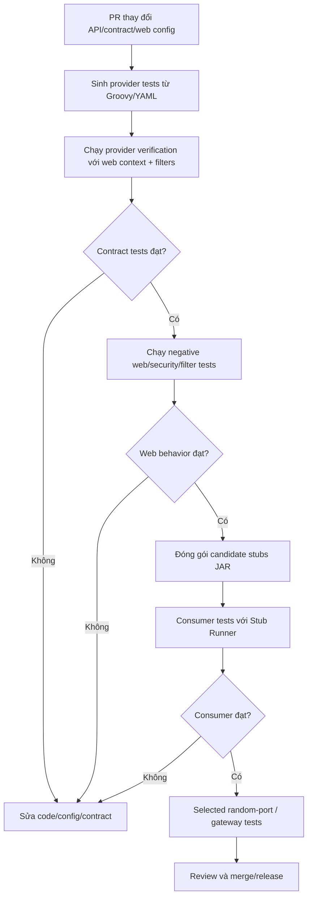

# Giới hạn khi bỏ qua filter hoặc cấu hình web thực tế trong kiểm thử HTTP

Trong **Spring Cloud Contract (SCC)**, một HTTP contract thường mô tả những gì **consumer gửi** (method, URL, header, body) và những gì **producer phải trả** (status, header, body). Từ Groovy/YAML DSL, Contract Verifier có thể sinh bài kiểm thử phía producer và tạo stub để consumer sử dụng bằng Stub Runner. Nhưng kết quả provider test phụ thuộc đáng kể vào **cách test đưa request vào ứng dụng**.

Nếu chỉ khởi tạo controller đơn lẻ, hoặc cố ý tắt servlet filters để test chạy nhanh, ta có thể bỏ qua những cơ chế quyết định hành vi HTTP thật: Spring Security, bộ lọc tenant, correlation ID, cấu hình CORS, xử lý lỗi, bộ chuyển đổi JSON, cấu hình session, servlet context path hay cấu hình chạy sau gateway. Khi đó, provider test có thể **xanh nhưng không kiểm chứng đúng ranh giới HTTP mà consumer thực sự đi qua**.

Bài thuộc chương **Kiểm thử HTTP** này tập trung vào **giới hạn khi bỏ qua filter hoặc cấu hình web thực tế**, cách thiết kế base test đáng tin cậy và cách kết hợp contract test với những lớp kiểm thử cần thiết. Ví dụ dùng `order-producer` cung cấp API đơn hàng và `order-consumer` gọi API qua HTTP.

## 1. Hiểu hai đường đi của một request

### 1.1. Đường đi của request trong môi trường sử dụng thật

Một yêu cầu HTTP có thể đi qua nhiều lớp trước khi tới controller:

```mermaid
flowchart LR
    A["Consumer HTTP client"] --> B["Gateway / reverse proxy"]
    B --> C["Web server và servlet container"]
    C --> D["Servlet Filter chain<br/>Security, tenant, tracing..."]
    D --> E["DispatcherServlet"]
    E --> F["Interceptor, binding, validation"]
    F --> G["Controller / service"]
    G --> H["JSON converter, exception handler"]
    H --> I["Response headers + status + body"]
```



Không phải ứng dụng nào cũng có tất cả các lớp trên. Ví dụ một ứng dụng không dùng API gateway thì không có bước gateway. Nhưng nếu một lớp quyết định **response mà consumer quan sát được**, nó thuộc phạm vi cần được kiểm thử thích hợp.

### 1.2. Đường đi trong provider contract test

Tùy HTTP test mode và base class, generated test có thể:

- Gọi controller qua `MockMvcBuilders.standaloneSetup(...)`: thiết lập tối giản, thường **không có toàn bộ filter chain và web configuration**.
- Gọi `MockMvc` được cấu hình từ Spring application context: có thể bao gồm cấu hình MVC và các filter được đăng ký, **nếu test không vô hiệu hóa chúng**.
- Gọi HTTP server chạy trên cổng thật trong môi trường test: kiểm tra thêm các tầng networking/container tương ứng.
- Gửi request qua một gateway hoặc reverse proxy thật trong integration/end-to-end test: kiểm tra đường đi rộng hơn.

**Một contract không tự chọn được mức thực tế của môi trường kiểm thử.** Cùng một tệp Groovy có thể pass hoặc fail khi đổi base test setup, vì phần được kiểm tra của ứng dụng đã thay đổi.

## 2. Vì sao tắt filter tạo cảm giác an toàn giả?

Giả sử API `GET /api/orders/1001` yêu cầu request có header `X-Tenant-Id: shop-01`. Một filter của ứng dụng kiểm tra tenant; nếu thiếu hoặc không đúng header, nó trả HTTP `400` cùng mã lỗi `TENANT_REQUIRED` trong ví dụ.

Trong hệ thống chạy thật:

```http
GET /api/orders/1001 HTTP/1.1
Accept: application/json
X-Tenant-Id: shop-01
```

Phản hồi:

```http
HTTP/1.1 200 OK
Content-Type: application/json

{"id":1001,"status":"CREATED"}
```

Ngược lại, nếu client không gửi header:

```http
GET /api/orders/1001 HTTP/1.1
Accept: application/json
```

Response dự kiến:

```http
HTTP/1.1 400 Bad Request
Content-Type: application/json

{"code":"TENANT_REQUIRED"}
```

Nếu provider test chỉ gọi `OrderController` mà không chạy `TenantHeaderFilter`, controller có thể trả `200` cho **cả hai request**. Một contract chỉ kiểm tra trường hợp hợp lệ vẫn xanh; điều này không chứng minh filter bắt buộc hoạt động hay API ngăn request thiếu tenant.

Hậu quả có thể nằm ở hai hướng:

| Trường hợp | Test đã bỏ filter | HTTP thực tế |
| --- | --- | --- |
| Request thiếu tenant | Trả `200` do đi thẳng tới controller | Trả `400` từ filter |
| Request có header hợp lệ | Trả `200` | Trả `200` |
| Producer vô tình xóa filter | Test success-only vẫn xanh | Có thể thay đổi hành vi bảo vệ tenant |
| Contract kỳ vọng lỗi 400 | Provider test không có filter có thể fail | HTTP thật trả đúng 400 |

**Một bài test xanh chỉ có nghĩa là thành phần được thực thi trong môi trường test đáp ứng assertion.** Nó không chứng minh mọi thành phần ở đường HTTP thật đều đã được thực thi.

## 3. Ví dụ filter ứng dụng để hiểu tác động

Đoạn dưới minh họa một servlet filter kiểm tra header tenant, **không phải cơ chế xác thực/phân quyền production**. Nó giả định Spring Boot 3+ với namespace Jakarta Servlet:

```java
import java.io.IOException;
import jakarta.servlet.FilterChain;
import jakarta.servlet.ServletException;
import jakarta.servlet.http.HttpServletRequest;
import jakarta.servlet.http.HttpServletResponse;
import org.springframework.http.MediaType;
import org.springframework.stereotype.Component;
import org.springframework.web.filter.OncePerRequestFilter;

@Component
public class TenantHeaderFilter extends OncePerRequestFilter {

    @Override
    protected void doFilterInternal(
            HttpServletRequest request,
            HttpServletResponse response,
            FilterChain chain)
            throws ServletException, IOException {

        if (request.getRequestURI().startsWith("/api/orders/")
                && !"shop-01".equals(request.getHeader("X-Tenant-Id"))) {

            response.setStatus(HttpServletResponse.SC_BAD_REQUEST);
            response.setContentType(MediaType.APPLICATION_JSON_VALUE);
            response.getWriter().write("{\"code\":\"TENANT_REQUIRED\"}");
            return;
        }

        chain.doFilter(request, response);
    }
}
```

Ở đây filter trả `400` khi header không phải `shop-01`, chỉ để minh họa một điều kiện có thể quan sát được. Trong thực tế, danh sách tenant, cách xác thực người dùng thuộc tenant, đường dẫn context path, exception handling và security policy phải được thiết kế nghiêm túc hơn. **Không dùng một header do client tự đặt làm bằng chứng phân quyền.**

Controller minh họa:

```java
import java.util.Map;
import org.springframework.http.MediaType;
import org.springframework.http.ResponseEntity;
import org.springframework.web.bind.annotation.GetMapping;
import org.springframework.web.bind.annotation.PathVariable;
import org.springframework.web.bind.annotation.RequestMapping;
import org.springframework.web.bind.annotation.RestController;

@RestController
@RequestMapping("/api/orders")
public class OrderController {

    @GetMapping("/{id}")
    public ResponseEntity<Map<String, Object>> getOrder(
            @PathVariable long id) {

        return ResponseEntity.ok()
            .contentType(MediaType.APPLICATION_JSON)
            .body(Map.of("id", id, "status", "CREATED"));
    }
}
```

Controller không tự đọc header tenant. **Khi filter có trong chuỗi xử lý**, request sai tenant bị chặn trước khi đến controller. **Khi filter bị bỏ qua**, request sai tenant đi thẳng đến controller và nhận 200. Đây là ví dụ dễ tái hiện để đánh giá chất lượng setup của provider test.

### 3.1. Test có filter không đồng nghĩa đã kiểm thử authorization thật

Filter ví dụ chỉ kiểm tra một chuỗi header, không xác minh chữ ký JWT, session, vai trò hay quyền truy cập theo từng đơn hàng. Không nên kết luận hệ thống đã an toàn chỉ vì test này pass. Với Spring Security, cần kiểm thử **SecurityFilterChain** và những luật authorization thực tế ở đúng scope.

## 4. Viết contract HTTP cho request hợp lệ

Groovy DSL cho trường hợp consumer có tenant header:

```groovy
import org.springframework.cloud.contract.spec.Contract

Contract.make {
    description 'Có tenant header hợp lệ, GET đơn hàng trả JSON 200'

    request {
        method GET()
        url '/api/orders/1001'
        headers {
            header('Accept', 'application/json')
            header('X-Tenant-Id', 'shop-01')
        }
    }

    response {
        status OK()
        headers {
            contentType(applicationJson())
        }
        body(
            id: 1001,
            status: 'CREATED'
        )
    }
}
```

Nếu test base khởi tạo controller riêng lẻ, generated provider test có thể pass vì controller vẫn trả 200 dù filter không chạy. Contract này kiểm tra được **response của request có header hợp lệ**, nhưng **không chứng minh** header ấy được bắt buộc hoặc được xác minh.

### 4.1. Thêm contract cho request sai tenant để phân biệt hành vi

Để producer phải bảo vệ hành vi lỗi, tạo contract thứ hai sử dụng cùng URL nhưng **giá trị header khác**:

```groovy
import org.springframework.cloud.contract.spec.Contract

Contract.make {
    description 'Tenant header không hợp lệ, GET đơn hàng trả mã lỗi 400'

    request {
        method GET()
        url '/api/orders/1001'
        headers {
            header('X-Tenant-Id', 'other-tenant')
        }
    }

    response {
        status BAD_REQUEST()
        headers {
            contentType(applicationJson())
        }
        body(code: 'TENANT_REQUIRED')
    }
}
```

Với filter minh họa, request `other-tenant` sẽ nhận 400. Nếu filter không được chạy trong provider verification test, controller sẽ trả 200 và bài test cho contract lỗi có khả năng **fail đúng lý do**.

Vì hai contract phân biệt bằng `X-Tenant-Id`, stub mappings có thể chọn response theo request headers mà không cần hai response xung đột cho cùng một điều kiện. Tuy nhiên, hãy **đọc WireMock mappings được sinh** để xác nhận cả hai thực sự được phân biệt và không bị mapping rộng khác che khuất.

**Lưu ý:** request **không có header** là một trường hợp khác với **header sai giá trị**. Một contract không khai báo header không có nghĩa là nó mặc định yêu cầu header vắng mặt. Muốn kiểm tra sự vắng mặt một cách chắc chắn, có thể thêm test web/integration riêng gửi request thiếu header. Đừng tạo contract lỗi thiếu header rồi mặc định Stub Runner sẽ chọn đúng stub khi có cả contract 200 dùng cùng URL.

### 4.2. YAML DSL cho contract lỗi

```yaml
description: "Tenant header không hợp lệ, GET đơn hàng trả mã lỗi 400"
request:
  method: GET
  url: /api/orders/1001
  headers:
    X-Tenant-Id: other-tenant
response:
  status: 400
  headers:
    Content-Type: application/json
  body:
    code: TENANT_REQUIRED
```

Đây là bản YAML tương đương với contract Groovy cho lỗi, **không phải một contract bổ sung cần lưu cùng kịch bản**. Chọn Groovy hoặc YAML làm bản đang chạy để tránh test/stub trùng nhau.

## 5. Ba cách cấu hình MockMvc: cùng DSL, độ bao phủ khác nhau

### 5.1. Standalone setup: nhanh nhưng chỉ có những thành phần được đưa vào

Ví dụ base test dùng standalone:

```java
import io.restassured.module.mockmvc.RestAssuredMockMvc;
import org.junit.jupiter.api.BeforeEach;
import org.springframework.test.web.servlet.setup.MockMvcBuilders;

public abstract class OrderContractStandaloneBase {

    @BeforeEach
    public void setup() {
        OrderController controller = new OrderController();

        RestAssuredMockMvc.mockMvc(
            MockMvcBuilders.standaloneSetup(controller).build()
        );
    }
}
```

Chế độ này không tự nạp toàn bộ Spring application context và những servlet filter do ứng dụng đăng ký. Có thể cấu hình `standaloneSetup` thêm một số thành phần như `ControllerAdvice`, converter, validator, interceptor hoặc filter thủ công, nhưng đó vẫn là **lựa chọn thành phần**, không phải đường xử lý đầy đủ được ứng dụng triển khai.

**Phù hợp khi:** test controller đơn giản, cần phản hồi nhanh, không phụ thuộc nhiều vào web infrastructure và đã chấp nhận giới hạn của môi trường.

**Không phù hợp làm bằng chứng duy nhất khi:** API phụ thuộc Spring Security, tenant filters, CORS, exception handler, argument resolver hoặc cấu hình web phức tạp.

### 5.2. Spring application context với MockMvc, filters được bật

Trong ứng dụng Spring Boot servlet, một base class có thể dùng:

```java
import io.restassured.module.mockmvc.RestAssuredMockMvc;
import org.junit.jupiter.api.BeforeEach;
import org.springframework.beans.factory.annotation.Autowired;
import org.springframework.boot.test.autoconfigure.web.servlet.AutoConfigureMockMvc;
import org.springframework.boot.test.context.SpringBootTest;
import org.springframework.test.web.servlet.MockMvc;

@SpringBootTest
@AutoConfigureMockMvc(addFilters = true)
public abstract class OrderContractBase {

    @Autowired
    private MockMvc mockMvc;

    @BeforeEach
    public void setUp() {
        RestAssuredMockMvc.mockMvc(mockMvc);
    }
}
```

Với cấu hình phù hợp, `MockMvc` nhận các filter được đăng ký trong test application context và dùng cấu hình MVC có trong context. `addFilters = true` là giá trị mặc định thường dùng của `@AutoConfigureMockMvc`, nhưng đặt tường minh trong ví dụ để bộc lộ ý định không tắt filter.

**Đây là mức kiểm chứng gần web application hơn standalone.** Tuy vậy nó vẫn **không khởi động một kết nối mạng thật** vào servlet container như một HTTP client ngoài tiến trình; không tự đi qua gateway/proxy/ingress của môi trường triển khai.

Một số thành phần chỉ tồn tại dưới profile production, cấu hình môi trường hoặc bean condition có thể **không xuất hiện** trong test context. Chạy `@SpringBootTest` không có nghĩa cấu hình test giống production 100%.

### 5.3. Bật Spring context nhưng vẫn bỏ filters

Dấu hiệu cần rà soát trong base test:

```java
@SpringBootTest
@AutoConfigureMockMvc(addFilters = false)
public abstract class OrderContractBase {
    // ...
}
```

`addFilters = false` thường loại servlet filters khỏi `MockMvc` do auto-configuration cung cấp. Test vẫn dùng MVC context nhưng **không kiểm chứng đường filter chain**. Nếu tất cả generated tests chỉ dùng setup này, chúng không đủ để xác minh 401/403, tracing headers hoặc tenant gate do filter tạo ra.

Không nên bật/tắt flag này chỉ để “sửa” status 401 thành 200. Hãy xác định mục đích của bài test, mô tả giới hạn của scope và bổ sung bài test chạy đúng filter chain.

### 5.4. Manual webApplicationContextSetup cũng cần chú ý filter

Khi tạo MockMvc thủ công từ context:

```java
MockMvc mvc = MockMvcBuilders
    .webAppContextSetup(webApplicationContext)
    .apply(springSecurity())
    .build();
```

Đoạn trên là ví dụ **cần import và dependency Spring Security Test phù hợp**. `springSecurity()` là cấu hình dành cho Spring Security khi bạn chủ động dựng MockMvc; các filter ứng dụng khác cũng cần được đăng ký theo cách tương thích, thay vì giả định mọi filter tự động được gắn vào builder.

Không nên coi `webAppContextSetup(...).build()` với những cấu hình thiếu filter là bằng chứng mọi request đã đi qua toàn bộ filter chain thực tế. Với Spring Boot, dùng `@AutoConfigureMockMvc` thường giảm nguy cơ bỏ quên phần wiring cơ bản; vẫn cần kiểm tra bằng test phủ định.

## 6. So sánh các mức kiểm thử HTTP

| Mức kiểm thử | Thường thực thi gì? | Thường bỏ qua gì? | Phù hợp |
| --- | --- | --- | --- |
| Standalone MockMvc | Controller và thành phần đăng ký thủ công | Filter chain đầy đủ, web app context, nhiều auto-config | Test nhanh cho behavior ở controller |
| MockMvc + `@SpringBootTest` + filters | MVC context, registered servlet filters và controller theo test config | Socket/network, proxy, TLS, ingress; khác biệt profile | Provider verification gần ứng dụng thực |
| `@WebMvcTest` slice | Một phần web layer và auto-config tương ứng | Toàn bộ service/repository, phần bean không nằm trong slice | Test web layer có mock dependency; cần kiểm tra filter/security được nạp |
| Embedded HTTP server ở random port | HTTP stack/servlet container trong ứng dụng test | Gateway production, service mesh, CDN, infra khác | Kiểm tra qua HTTP thực, cookies/compression/serialization |
| Test qua gateway/ingress | Đường mạng và cấu hình gateway được đưa vào test | Có thể vẫn thiếu dịch vụ ngoài và topology production | Kiểm tra rewrites, forwarded headers, auth ở gateway |
| Consumer test với Stub Runner | HTTP client consumer + stubs từ contract | Producer implementation, producer filters và deployment | Kiểm tra consumer dùng giao diện đã cam kết |

Không có một mức duy nhất “đúng cho mọi dự án”. Mục tiêu là **biết rõ ranh giới nào đã được kiểm chứng** và thêm mức test khi hành vi quan trọng nằm ngoài ranh giới đó.

### 6.1. WebMvcTest không tự tương đương production

`@WebMvcTest` là **test slice**: nó tập trung vào MVC component và thường dùng mocks cho dependency khác. Các filter, security config hoặc custom argument resolvers được đưa vào hay không phụ thuộc auto-configuration, bean selection và imports.

Do đó, `@WebMvcTest` có thể nhanh và phù hợp, nhưng với API phụ thuộc nhiều vào filter/authorization thì cần **kiểm tra thành phần nào thực sự chạy**. Đặc biệt, một test dùng mock service không xác minh behavior thật của tầng service.

### 6.2. MockMvc không có nghĩa đã kiểm tra network

`MockMvc` mô phỏng HTTP request ở tầng Spring MVC bằng hạ tầng test và không cần mở cổng mạng. Nó có thể chạy filter chain và converter tương ứng trong test context, nhưng không xác minh mọi chi tiết của:

- Cấu hình TLS/HTTPS, HTTP/2 và reverse proxy.
- Header bị gateway hoặc load balancer thêm, xóa hay đổi.
- Socket timeout, chuyển tiếp request và giới hạn body kích thước lớn.
- Servlet container/network-specific behavior hoặc cấu hình triển khai riêng.
- Compression và response streaming trong mọi điều kiện thực tế.

Nếu consumer phụ thuộc vào một trong các cơ chế này, thêm integration test qua **HTTP server thật** và, khi cần, qua gateway thực tế hoặc một phiên bản cấu hình tương đương.

## 7. Spring Security: 401, 403 và false green

Một ứng dụng có `SecurityFilterChain` có thể trả:

- `401 Unauthorized` khi request cần xác thực nhưng chưa có credentials hợp lệ.
- `403 Forbidden` khi principal đã được xác thực nhưng không đủ quyền hoặc khi bị chặn bởi một quy tắc bảo vệ khác (ví dụ CSRF tùy cấu hình).

Quy tắc chính xác phụ thuộc Spring Security configuration. Không nên mặc định mọi request thiếu token đều trả đúng một JSON body hoặc cùng header `WWW-Authenticate` trong mọi project.

### 7.1. Bài test không đi qua security filter chain có thể cho kết quả sai

Giả sử endpoint `GET /api/orders/1001` được bảo vệ bởi bearer token. Nếu generated test dựng controller standalone:

```text
Client không gửi Authorization
  -> standalone MockMvc chỉ gọi OrderController
  -> controller trả 200
  -> success-only contract có thể xanh
```

Nhưng đường triển khai thật:

```text
Client không gửi Authorization
  -> SecurityFilterChain
  -> trả 401
  -> controller không được gọi
```

**Contract phải diễn đạt cam kết consumer đang dựa vào, và test phải thực thi lớp quyết định cam kết đó.**

### 7.2. Viết test âm cho security ngoài contract khi cần

Một HTTP contract cho phản hồi 401 có thể viết:

```groovy
import org.springframework.cloud.contract.spec.Contract

Contract.make {
    description 'Không có thông tin xác thực thì truy vấn đơn hàng bị từ chối'

    request {
        method GET()
        url '/api/orders/1001'
    }

    response {
        status UNAUTHORIZED()
    }
}
```

Tuy nhiên nếu đồng thời có contract success cho **cùng GET/URL** nhưng success yêu cầu `Authorization`, Stub Runner có thể sinh mapping 401 quá rộng vì **không khai báo header không nhất thiết có nghĩa header phải vắng mặt**. Do đó, để kiểm tra chính xác request thiếu Authorization, thường nên viết **MockMvc/integration test trực tiếp** có assertion 401; muốn một bộ stub nhiều kịch bản thì cần điều kiện match đủ phân biệt và kiểm tra mapping.

Test Spring Security thông thường có thể dùng một request không có token:

```java
import static org.springframework.test.web.servlet.request.MockMvcRequestBuilders.get;
import static org.springframework.test.web.servlet.result.MockMvcResultMatchers.status;

@Test
void rejectsRequestWithoutToken() throws Exception {
    mockMvc.perform(get("/api/orders/1001"))
           .andExpect(status().isUnauthorized());
}
```

Test này có ý nghĩa **chỉ khi** `mockMvc` thực sự chứa SecurityFilterChain phù hợp và endpoint có rule yêu cầu xác thực. Nếu `addFilters=false`, kết quả có thể khác.

### 7.3. Header Authorization trong contract không chứng minh token hợp lệ

Một contract có `header('Authorization', 'Bearer test-token')` chỉ mô tả **chuỗi header được gửi**. Nó không tự kiểm tra chữ ký JWT, issuer, audience, expiration, roles, token revocation hay phân quyền theo ID tài nguyên.

Với producer verification, dùng **fixture credentials hợp lệ trong môi trường test** hoặc công cụ của Spring Security Test theo scope cần kiểm tra. Không hardcode bearer token production trong repository. Với Stub Runner, stub có thể match request header nhưng **không trở thành authorization server thật**.

Những test bổ sung thường có giá trị: thiếu token → 401, token không hợp lệ → 401, người dùng thiếu quyền → 403, người dùng khác tenant cố đọc đơn hàng → bị từ chối theo chính sách, và người dùng hợp lệ → 200.

## 8. ControllerAdvice và exception handling

Một cách bỏ sót khác là test controller bằng standalone setup mà **không đăng ký `@ControllerAdvice`** hoặc exception resolvers như trong ứng dụng. Ví dụ controller ném exception:

```java
@GetMapping("/{id}")
public OrderDto getOrder(@PathVariable long id) {
    return service.findOrThrow(id); // Có thể ném OrderNotFoundException
}
```

Ứng dụng có thể dùng:

```java
@RestControllerAdvice
public class ApiErrorHandler {

    @ExceptionHandler(OrderNotFoundException.class)
    ResponseEntity<Map<String, String>> notFound(
            OrderNotFoundException exception) {

        return ResponseEntity.status(404)
            .contentType(MediaType.APPLICATION_JSON)
            .body(Map.of("code", "ORDER_NOT_FOUND"));
    }
}
```

Nếu generated test không nạp advice đúng cách, request lỗi có thể không trở thành response `404` với JSON như production. Điều này ảnh hưởng trực tiếp đến consumer đang parse error code.

Với standalone MockMvc, muốn test advice phải đưa advice vào setup, ví dụ:

```java
MockMvc mvc = MockMvcBuilders
    .standaloneSetup(new OrderController(/* test service */))
    .setControllerAdvice(new ApiErrorHandler())
    .build();
```

Đây là **snippet minh họa**, cần cung cấp dependency controller phù hợp trong project. Nó chỉ đăng ký advice được chỉ định; không tự tạo lại mọi MVC configuration. Với Spring context đầy đủ, advice thường được nạp như bean nếu thành phần và scan/config đúng.

### 8.1. Contract lỗi cần test riêng

Một contract `404` có thể bảo vệ response:

```yaml
description: "Đơn hàng không tồn tại, trả 404 và mã lỗi thống nhất"
request:
  method: GET
  url: /api/orders/9999
  headers:
    X-Tenant-Id: shop-01
response:
  status: 404
  headers:
    Content-Type: application/json
  body:
    code: ORDER_NOT_FOUND
```

Muốn test này đáng tin, cần **đồng thời** có tenant filter và exception handler trong test setup. Nếu tắt filter để làm test chạy qua, bạn có thể bỏ sót logic chặn tenant. Nếu bỏ advice, error body có thể khác yêu cầu thật.

## 9. Serialization, validation và content negotiation

Không phải tất cả sự khác biệt đến từ servlet filters. **Cấu hình Spring MVC/Jackson** cũng quyết định response mà consumer nhìn thấy.

### 9.1. JSON serialization

Ví dụ DTO chứa:

```java
record OrderDto(
    long id,
    java.time.Instant createdAt,
    java.math.BigDecimal amount
) {}
```

Với cấu hình Jackson khác nhau, các giá trị có thể được serialize theo format khác nhau: timestamp là ISO string hoặc dạng số, trường null có/không xuất hiện, precision decimal khác, enum là tên hoặc dạng tùy chỉnh.

Contract:

```yaml
response:
  status: 200
  headers:
    Content-Type: application/json
  body:
    id: 1001
    createdAt: "2026-11-24T03:15:30.123Z"
    amount: "12.30"
```

Chỉ có ý nghĩa nếu producer thực sự truyền `amount` dạng **chuỗi**. Nếu Jackson serialize `BigDecimal` thành JSON number, code và contract không thống nhất; cần quyết định API định nghĩa kiểu nào, không thay test cho xanh bằng cách đổi string/number tùy tiện.

Một `ObjectMapper` được tự tạo trong standalone test chưa chắc mang các module, naming strategy, custom serializers hoặc cấu hình `spring.jackson.*` giống application context. Điều đó có thể làm test xanh hoặc đỏ theo hướng khác production.

### 9.2. Validation và argument resolution

Các yếu tố có thể bị bỏ qua hoặc cấu hình khác trong standalone/slice test:

- Bean Validation và nhóm validation thực tế.
- `@ControllerAdvice` xử lý `MethodArgumentNotValidException`.
- `@DateTimeFormat`, custom converter, argument resolver.
- Locale cho message lỗi và cách parse số/ngày.
- Mapping của enum và casing.
- Filter đọc/caching request body hoặc thêm correlation header.

Nếu contract mô tả `POST /api/orders` thiếu field phải trả `400`, nhưng test setup không dùng validator/argument resolver phù hợp, response có thể không giống production.

### 9.3. Accept và Content-Type

Giả sử consumer gửi:

```http
GET /api/orders/1001 HTTP/1.1
Accept: application/json
```

và kỳ vọng:

```http
HTTP/1.1 200 OK
Content-Type: application/json
```

Một controller standalone với converter tối giản và full web context có thể áp dụng content negotiation khác. Khi producer đổi response sang `text/plain`, consumer dùng Jackson converter có thể lỗi dù body nhìn giống JSON.

Hãy khai báo header trong contract **ở đúng phía request và response** và test với converter/content negotiation thực sự được dùng, nhất là khi API hỗ trợ nhiều media type hoặc trả `406`, `415`.

## 10. CORS, CSRF, cookie và session

Những cơ chế này đặc biệt dễ bị bỏ qua khi dùng standalone setup.

### 10.1. CORS

CORS liên quan đến cách browser cho phép mã JavaScript ở một origin truy cập tài nguyên của origin khác. Preflight `OPTIONS` có thể đi qua CORS config/filter trước controller:

```http
OPTIONS /api/orders/1001 HTTP/1.1
Origin: https://client.example.org
Access-Control-Request-Method: GET
Access-Control-Request-Headers: authorization
```

Response có thể bao gồm `Access-Control-Allow-Origin`, `Access-Control-Allow-Methods` hoặc `Access-Control-Allow-Headers` tùy cấu hình.

Một contract chỉ kiểm tra `GET` không tự bảo vệ preflight. Test bằng MockMvc có CORS config/filter thật có thể xác minh response preflight, nhưng **việc browser thực thi chính sách CORS** không được mô phỏng hoàn toàn bởi một JUnit assertion trên header. Nếu browser là consumer chính, có thể cần browser/integration test.

### 10.2. CSRF

Khi ứng dụng dùng cookie/session authentication, POST/PUT/DELETE có thể cần CSRF token theo SecurityFilterChain. Một standalone controller test bỏ filter có thể trả `201` khi không có CSRF token, trong khi request thật bị `403`.

Đừng vô hiệu hóa toàn bộ filter để làm hợp đồng POST pass. Cấu hình token hợp lệ trong producer test hoặc có test âm chuyên biệt cho request thiếu token, phù hợp chính sách security của API.

### 10.3. Cookie, session và redirects

Contract response có thể kiểm tra `Set-Cookie` hoặc `Location`, nhưng các thuộc tính như `Secure`, `HttpOnly`, `SameSite`, domain/path của cookie và chuyển hướng qua proxy còn phụ thuộc cấu hình. Session persistence và việc cookie tồn tại qua nhiều request cũng là hành vi **stateful**, một HTTP contract đơn lẻ không tự chứng minh.

Nếu consumer cần duy trì phiên đăng nhập, bổ sung test session và theo dõi cookie qua nhiều request, không chỉ kiểm tra một response đơn.

## 11. Gateway, reverse proxy, context path và forwarded headers

Ngay cả `@SpringBootTest` với filter đầy đủ cũng chưa chắc mô phỏng toàn bộ đường đi ở production.

Một gateway có thể:

- Đổi prefix từ `/public/orders/1001` thành `/api/orders/1001`.
- Thêm `X-Forwarded-Proto` hoặc `Forwarded` để ứng dụng tạo URL công khai đúng scheme/host.
- Kết thúc TLS và chuyển tiếp HTTP nội bộ.
- Xác thực token hoặc kiểm tra quota trước khi request tới producer.
- Viết lại hoặc xóa header, giới hạn body size, cấu hình cache/compression.
- Áp dụng CORS hoặc rate limiting ở lớp ngoài.

Contract nội bộ của producer có thể kiểm tra `GET /api/orders/1001`, nhưng consumer ngoài mạng gọi `GET /public/orders/1001`. Nếu gateway mapping sai, provider verification bên trong producer và Stub Runner cho consumer có thể cùng xanh, còn request end-to-end lại nhận 404.

### 11.1. Hai loại hợp đồng ở hai ranh giới khác nhau

| Ranh giới | Điều cần kiểm chứng |
| --- | --- |
| Consumer → producer nội bộ | API như producer thực sự công bố trong mạng nội bộ |
| Consumer ngoài → gateway | Public path, auth, header/host, TLS và rewrite |
| Gateway → producer | URI, header forwarding và identity context |
| Producer → dependency nội bộ | Hợp đồng giữa producer với downstream service nếu có |

Nếu gateway là một thành phần sở hữu hợp đồng công khai, hãy test ranh giới public riêng. Không dùng **provider HTTP contract ở cổng nội bộ** làm bằng chứng toàn bộ tuyến public đã đúng.

### 11.2. Context path và profile khác nhau

Một ứng dụng có thể chạy với `server.servlet.context-path=/order-service` trong deployment nhưng không có context path khi test. Hoặc feature flag production thay đổi endpoint và filters. Khi đó, test context cần cấu hình tương đương nơi hành vi công khai phụ thuộc vào các property đó.

Không cần sao chép mọi cấu hình hạ tầng vào provider test; nhưng phải nhận diện những cấu hình quyết định **giao diện mà consumer thấy** và kiểm tra chúng tại đúng tầng.

## 12. Embedded HTTP server: khi nào nên thử qua cổng thật?

Để kiểm tra HTTP stack của ứng dụng ở mức cao hơn MockMvc, có thể khởi động Spring Boot trên random port:

```java
import org.springframework.boot.test.context.SpringBootTest;

@SpringBootTest(
    webEnvironment = SpringBootTest.WebEnvironment.RANDOM_PORT
)
class OrderHttpIntegrationTest {
    // Dùng TestRestTemplate, WebTestClient hoặc HTTP client
    // phù hợp để gọi server qua localhost:randomPort.
}
```

Khi gọi HTTP qua cổng thật, test có thể bao gồm nhiều hành vi của embedded web server/servlet container hơn so với MockMvc. Một ví dụ assertion với `TestRestTemplate`:

```java
import static org.junit.jupiter.api.Assertions.assertEquals;

import org.junit.jupiter.api.Test;
import org.springframework.beans.factory.annotation.Autowired;
import org.springframework.boot.test.context.SpringBootTest;
import org.springframework.boot.test.web.client.TestRestTemplate;

@SpringBootTest(
    webEnvironment = SpringBootTest.WebEnvironment.RANDOM_PORT
)
class OrderTenantHttpIT {

    @Autowired
    private TestRestTemplate rest;

    @Test
    void rejectsMissingTenantHeader() {
        var response = rest.getForEntity(
            "/api/orders/1001", String.class
        );

        assertEquals(400, response.getStatusCode().value());
    }
}
```

Ví dụ dựa vào `TenantHeaderFilter` và controller minh họa ở trên, được nạp vào application context test. Với Spring Boot phiên bản mới, vị trí và mức hỗ trợ của các test client có thể khác; chọn một HTTP client có dependency phù hợp. Không kết luận test này dùng được nguyên xi nếu ứng dụng có thêm security/token/feature flag khác.

**Server random port vẫn chưa đi qua gateway production**. Nó kiểm tra ứng dụng ở chế độ HTTP thật trong môi trường test. Nếu có yếu tố bên ngoài (proxy, certificate, DNS, service mesh), cần tầng test tiếp theo.

## 13. Stub Runner kiểm tra consumer, không tái tạo filter producer

Spring Cloud Contract có thể sinh stubs JAR chứa WireMock mappings từ Groovy/YAML contracts. Consumer test chạy Stub Runner:

```java
import org.springframework.boot.test.context.SpringBootTest;
import org.springframework.cloud.contract.stubrunner.spring.AutoConfigureStubRunner;
import org.springframework.cloud.contract.stubrunner.spring.StubRunnerProperties;

@SpringBootTest
@AutoConfigureStubRunner(
    ids = "com.example:order-producer:1.0.0:stubs:8085",
    stubsMode = StubRunnerProperties.StubsMode.LOCAL
)
class OrderConsumerContractTest {
    // Consumer HTTP client gọi stub server tại port 8085.
}
```

Stub Runner trả phản hồi theo mapping đã sinh. Nó **không khởi động controller, SecurityFilterChain, TenantHeaderFilter hay gateway của producer**. Nếu hợp đồng không mô tả header tenant hoặc response lỗi 400, stub cũng không tự hiểu quy tắc filter thực tế.

Do đó:

| Tình huống | Provider test có filter | Consumer test với stub |
| --- | --- | --- |
| Thiếu `X-Tenant-Id` | Có thể kiểm tra producer trả 400 thật | Chỉ kiểm tra được nếu mapping/test đã mô tả điều kiện tương ứng |
| Token sai chữ ký | Cần security filter/token verification trong test | Stub không tự xác minh JWT cryptography |
| Exception handler trả JSON lỗi | Kiểm tra controller advice/handler thật | Stub trả JSON lỗi mẫu từ contract |
| Gateway rewrite sai | Không kiểm tra nếu gateway vắng mặt | Không kiểm tra nếu gateway không được mô phỏng |
| Consumer parse JSON sai | Provider test có thể vẫn pass | Consumer test nên phát hiện khi gọi client thật |

**Stub không tự làm cho provider test đáng tin hơn.** Muốn phát hiện breaking change, cần producer verification chạy qua lớp tạo ra hành vi đã cam kết và consumer test dùng candidate stubs đúng phiên bản.

## 14. Cách kiểm tra filter thực sự đã tham gia provider verification

Đừng chỉ dựa vào việc thấy annotation `@SpringBootTest`. Hãy kiểm tra có bằng chứng thực tế.

### 14.1. Test âm cho behavior do filter chịu trách nhiệm

Với filter yêu cầu tenant header:

```java
import static org.springframework.test.web.servlet.request.MockMvcRequestBuilders.get;
import static org.springframework.test.web.servlet.result.MockMvcResultMatchers.jsonPath;
import static org.springframework.test.web.servlet.result.MockMvcResultMatchers.status;

@Test
void requestWithoutTenantIsRejected() throws Exception {
    mockMvc.perform(get("/api/orders/1001"))
        .andExpect(status().isBadRequest())
        .andExpect(jsonPath("$.code").value("TENANT_REQUIRED"));
}
```

Nếu filter không chạy, endpoint demo thường trả 200 và test âm thất bại. Đây là bằng chứng cụ thể rằng web test đang bao phủ quy tắc gate. Nó có thể được viết song song với generated contract tests; không cần ép mọi chi tiết setup thành một file contract.

### 14.2. Test dương để tránh chặn nhầm request hợp lệ

```java
import static org.springframework.test.web.servlet.request.MockMvcRequestBuilders.get;
import static org.springframework.test.web.servlet.result.MockMvcResultMatchers.status;

@Test
void acceptsValidTenant() throws Exception {
    mockMvc.perform(get("/api/orders/1001")
            .header("X-Tenant-Id", "shop-01"))
        .andExpect(status().isOk());
}
```

Hai test dương và âm giúp phát hiện filter bị tắt, cấu hình sai hoặc chặn quá rộng. Với Spring Security, xây các cặp tương tự cho request có/không có credentials, role hợp lệ/không hợp lệ và tenant ownership.

### 14.3. Không dùng cơ chế test giả lập auth để kết luận JWT production hợp lệ

Ví dụ `@WithMockUser` hữu ích để kiểm tra authorization ở một số test context, nhưng nó không bắt buộc thử toàn bộ luồng xác minh bearer token thật. Nếu API công khai phụ thuộc JWT signature/issuer/audience, cần test luồng token ở mức thích hợp, dùng key/issuer test hợp lệ, không dựa duy nhất vào principal giả.

## 15. Ma trận coverage tối thiểu theo rủi ro

Không phải mọi contract đều phải chạy bốn tầng test. Nhưng mỗi yêu cầu quan trọng nên có một tầng **thực thi đúng thành phần chịu trách nhiệm**.

| Cam kết/rủi ro | Generated provider contract test | Web integration test | Network/gateway test | Consumer Stub Runner |
| --- | --- | --- | --- | --- |
| Status/body JSON của controller | Có | Khi cần xác nhận cấu hình thực | Không luôn cần | Có để consumer parse |
| Filter yêu cầu tenant | Chỉ khi filter tham gia | Nên có test dương và âm | Khi identity do gateway cấp | Stub không tự bảo vệ |
| Authentication/authorization | Nếu security chain chạy | Rất quan trọng | Nếu gateway thực hiện auth | Chỉ mô phỏng response |
| `@ControllerAdvice` + error format | Khi advice được nạp | Nên có cho nhánh lỗi | Khi proxy có error response riêng | Consumer xử lý body lỗi |
| Jackson/timezone/content negotiation | Nếu dùng converter đúng | Hữu ích với format phức tạp | Khi proxy can thiệp header | Consumer parse |
| CORS/CSRF/session | Chỉ khi cấu hình liên quan được nạp | Nên có kịch bản phù hợp | Browser/edge khi cần | Không tự xác minh browser |
| Context path và URL rewrite | Thường không bao phủ gateway | Có thể kiểm tra context path | Cần test gateway path | Stub tùy đường dẫn đã mô tả |
| Header forwarding/TLS | Không đủ | Một phần | Cần đúng ranh giới network | Không đủ |

Bảng này là **hướng dẫn lựa chọn**, không phải quy định cứng. Một dự án nội bộ không có gateway sẽ không cần test gateway. Một API chứa dữ liệu nhạy cảm nên ưu tiên phủ rủi ro authentication, authorization và tenant separation bằng test đúng tầng.

## 16. CI: ngăn false green từ test setup quá tối giản

Pipeline ví dụ:



Với Maven, nếu plugin Spring Cloud Contract và test dependencies được cấu hình đúng:

```bash
mvn clean verify
```

Lệnh này không tự bảo đảm các lớp test ở sơ đồ đều chạy. Cần xem pipeline thực tế và xác nhận generated tests, web integration tests, consumer tests và selected edge tests được nối vào lifecycle tương ứng.

**Các cổng CI nên kiểm tra:**

- Có generated contract tests thật sự được sinh và chạy; không chỉ `BUILD SUCCESS`.
- Base test dùng HTTP test mode phù hợp với những behavior cần chứng minh.
- Không có `addFilters=false` hoặc standalone setup vô tình làm mất filter/security behavior quan trọng.
- Test âm thiếu/sai header, thiếu token, thiếu CSRF hoặc sai role xuất hiện ở scope thích hợp.
- Jackson, validation, exception handler, CORS và content negotiation được nạp theo nhu cầu API.
- Candidate stubs được phát hành đúng group/artifact/version/classifier và consumer test dùng đúng artifact mới.
- Các thay đổi gateway, ingress, proxy hoặc context-path được test ở mức deployment thích hợp.
- Test setup có fixture và timezone/locale ổn định; không phụ thuộc vào service ngoài để tạo lỗi ngẫu nhiên.

### 16.1. Thử phá vỡ có chủ đích

| Thay đổi thử | Điều nên xảy ra nếu coverage đúng |
| --- | --- |
| Tắt `TenantHeaderFilter` | Negative test không tenant fail |
| Đổi điều kiện filter cho phép mọi tenant | Test tenant sai phải fail |
| Bỏ Spring Security filter chain | Test 401/403 fail |
| Xóa `@ControllerAdvice` chuyển lỗi 404 sang JSON khác | Provider/web error test fail |
| Đổi response `Content-Type` từ JSON sang text | Contract hoặc consumer decoder test fail |
| Đổi `/public/orders/*` rewrite ở gateway | Gateway/public-path test fail |
| Xóa request `X-Tenant-Id` trong contract success | Review hoặc test âm tương ứng phát hiện rủi ro; không giả định success test tự fail |
| Consumer dùng stubs JAR cũ | CI phải phát hiện version candidate không đúng hoặc cấu hình artifact lệch |

Nếu cố ý gỡ một cơ chế bảo vệ mà tất cả bài test vẫn xanh, đó là tín hiệu cần **đánh giá lỗ hổng coverage**, không phải bằng chứng cơ chế ấy không quan trọng.

## 17. Những hiểu lầm thường gặp

**“MockMvc luôn bỏ filter.”** Không đúng. MockMvc có thể chạy các servlet filters được đăng ký khi cấu hình phù hợp. Vấn đề là **chế độ setup và danh sách filter thực tế**, không phải tên công cụ.

**“Dùng @SpringBootTest thì chắc chắn giống production.”** Nó nạp application context trong môi trường test; profile, bean conditions, secret providers, runtime server, gateway và external config vẫn có thể khác.

**“Tắt addFilters để sửa lỗi 401 khiến contract test pass là hợp lý.”** Chỉ hợp lý nếu test được thiết kế chủ đích kiểm tra một phần web layer và có test khác bảo vệ security. Không được coi bài test ấy là bằng chứng endpoint public trả 200 khi thiếu auth.

**“Header Authorization trong Groovy contract đủ chứng minh bảo mật.”** Không. Nó chỉ mô tả request header; việc xác thực và phân quyền cần security chain cùng test phù hợp.

**“Stub Runner xác minh được controller filter.”** Không. Stub Runner chạy mapping từ contract và không khởi động filter thật của producer.

**“Không khai báo request header nghĩa là header phải vắng mặt.”** Trong nhiều stub mappings, vắng khai báo chỉ có nghĩa **không đặt điều kiện match** cho header đó. Muốn test thiếu header, dùng test chuyên biệt hoặc matcher diễn đạt sự vắng mặt thật rõ và xác minh mapping.

**“ControllerAdvice luôn có trong standaloneSetup.”** Không tự động. Các thành phần web phải được đăng ký đúng hoặc lấy từ context.

**“MockMvc full context cũng đã test gateway và TLS.”** Không. MockMvc không truyền qua proxy/network như client thật.

**“Build xanh đồng nghĩa không breaking change.”** Nếu plugin không sinh test, base class bỏ filters, consumer test dùng stubs cũ hoặc thiếu tình huống lỗi, CI vẫn có thể xanh sai.

## 18. Bài tập thực hành có tiêu chí kiểm chứng

Tạo một producer Spring Boot servlet với controller `GET /api/orders/{id}`, `TenantHeaderFilter` và `@ControllerAdvice` xử lý lỗi không tìm thấy. Cấu hình Spring Cloud Contract với Groovy hoặc YAML DSL và chuẩn bị consumer test có Stub Runner.

1. **Contract thành công:** Khai báo GET với `X-Tenant-Id: shop-01`, response 200 và JSON đơn hàng.
2. **Contract tenant sai:** Khai báo GET cùng URL nhưng `X-Tenant-Id: other-tenant`, response 400 có `code: TENANT_REQUIRED`. Bảo đảm hai stub mapping thực tế phân biệt được.
3. **Standalone comparison:** Chạy generated tests với base class `standaloneSetup(controller)` không đăng ký filter. Ghi nhận ca nào sai kỳ vọng và vì sao.
4. **Full context:** Chuyển base class sang `@SpringBootTest` + `@AutoConfigureMockMvc(addFilters=true)` và `RestAssuredMockMvc.mockMvc(mockMvc)`. Xác nhận status 200/400 đúng hành vi.
5. **Tắt filter có chủ đích:** Thử `addFilters=false`. Tìm dấu hiệu negative test không còn bảo vệ hành vi tenant.
6. **Request thiếu header:** Viết test MockMvc riêng không có `X-Tenant-Id` và assert 400. Giải thích vì sao một contract thiếu field header chưa tự đảm bảo điều kiện vắng header ở stub.
7. **Security:** Nếu ứng dụng dùng SecurityFilterChain, thêm test thiếu token, token không hợp lệ và đủ/thiếu quyền theo policy thực.
8. **Exception handler:** Cho controller ném `OrderNotFoundException`; yêu cầu 404 cùng JSON code. So sánh khi advice được đăng ký và khi bỏ advice khỏi standalone setup.
9. **Serialization:** Thêm field `createdAt` hoặc `amount` và kiểm tra Jackson serializer trong context tạo kiểu JSON đúng contract.
10. **Random port:** Chạy HTTP integration test với `@SpringBootTest(webEnvironment=RANDOM_PORT)` và một client gọi qua mạng test. So sánh phạm vi với MockMvc.
11. **Gateway tùy chọn:** Nếu API public đi qua gateway, thử rewrite/forwarded headers và xác minh URL consumer dùng là đường dẫn hợp đồng thực.
12. **CI:** Đóng gói candidate stubs, chạy consumer với Stub Runner và thiết lập cổng kiểm tra cho generated tests, web negative tests cùng selected integration tests.

Bảng tự đánh giá:

| Năng lực | Bằng chứng đạt |
| --- | --- |
| Phân biệt test modes | Giải thích được standalone, MockMvc context và random-port HTTP |
| Nhận diện false green | Tắt filter khiến một test vẫn xanh nhưng đường thật đổi hành vi |
| Cấu hình base test đúng | Generated tests kế thừa base và chạy web context phù hợp |
| Kiểm tra filter/security | Có cả request hợp lệ và request bị từ chối |
| Kiểm tra error handling | ControllerAdvice, content type và body lỗi được xác minh |
| Hiểu giới hạn Stub Runner | Không nhầm mapping giả với filter/implementation thật |
| Hiểu gateway boundary | Có bài test riêng nếu API public đi qua proxy/gateway |
| CI có bằng chứng | Cố ý làm hỏng filter hoặc HTTP config khiến test phù hợp fail |

**Ghi nhớ:** Spring Cloud Contract kiểm tra **hợp đồng mà test setup thực thi được**, không tự kiểm chứng những filter và cấu hình web bị bỏ qua. `standaloneSetup` có ích cho bài kiểm tra nhanh, nhưng không đủ làm bằng chứng về Spring Security, tenant rules, CORS hay gateway. Hãy chọn base test phù hợp, giữ các negative tests chạy với filter/config thực, bổ sung random-port hoặc gateway tests khi cần, và kết hợp producer verification với Stub Runner trong CI để phát hiện sớm thay đổi API không tương thích.
