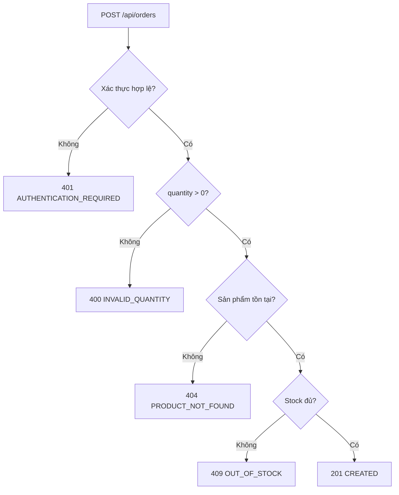
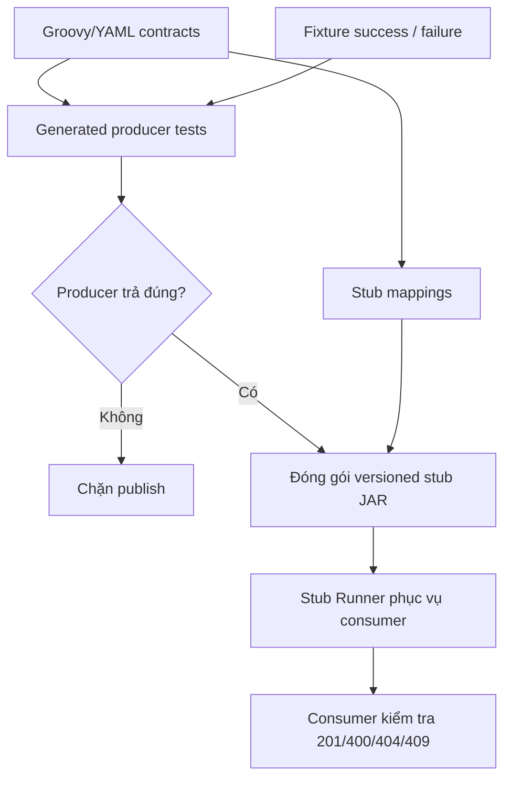

# Chuẩn bị dữ liệu cho các nhánh thành công và thất bại

## 1. Dữ liệu kiểm thử là một phần của kiểm chứng hợp đồng

Trong **Spring Cloud Contract** (module `SPRING_CLOUD_CONTRACT`), producer và consumer thống nhất hành vi tích hợp qua **Groovy DSL** hoặc **YAML DSL**. Đối với HTTP, hợp đồng mô tả method, URL, headers, request body và response gồm status, headers, body. Công cụ **Contract Verifier** dựa trên những mô tả đó để sinh kiểm thử phía producer; stub được đóng gói, phát hành theo phiên bản để consumer dùng qua **Stub Runner**. Khi tích hợp vào CI, hai phía có thể phát hiện sớm thay đổi API không tương thích.

Một generated producer test không chỉ cần **request đúng cú pháp**. Nó còn cần producer đang ở **trạng thái dữ liệu phù hợp** để request đó dẫn tới nhánh kết quả mong đợi.

Chẳng hạn, cùng một `POST /api/orders` có thể dẫn tới:

- `201 Created`: sản phẩm tồn tại, số lượng hợp lệ, tồn kho đủ.
- `400 Bad Request`: số lượng bằng 0 hoặc payload không hợp lệ.
- `409 Conflict`: sản phẩm tồn tại nhưng tồn kho không đủ.
- `401 Unauthorized`: request cần đăng nhập nhưng không có xác thực hợp lệ.

Nếu test cho nhánh `201` sử dụng dữ liệu của nhánh hết hàng, producer có thể trả `409` và generated test thất bại, dù code xử lý nghiệp vụ đúng. Ngược lại, nếu nhánh `409` được giả lập bằng cách trả sẵn JSON trong một mock ngay tại biên API, kiểm thử có thể không xác minh được logic producer thực sự đã cam kết.

**Mục tiêu bài học:** chuẩn bị dữ liệu đúng cho từng nhánh, giữ các trường hợp độc lập và tái lập được, phân biệt lỗi fixture với lỗi producer, rồi sử dụng kết quả đó trong quy trình producer verification, Stub Runner và CI.

## 2. Bắt đầu từ ma trận hành vi, không bắt đầu từ dữ liệu ngẫu nhiên

Giả sử `orders-producer` cung cấp hai API:

1. `GET /api/orders/{id}` — đọc thông tin đơn hàng.
2. `POST /api/orders` — tạo đơn từ `productId` và `quantity`.

Trong ví dụ xuyên suốt, API công bố các hành vi sau. **Endpoint, mã lỗi, tên sản phẩm và dữ liệu là giả định minh họa**, không phải chuẩn mặc định của Spring Cloud Contract.

| Kịch bản hợp đồng | Request đại diện | Trạng thái cần chuẩn bị | Response đã thỏa thuận |
| --- | --- | --- | --- |
| Đọc đơn tồn tại | `GET /api/orders/ord-1001` | Có đơn `ord-1001` ở trạng thái `CREATED` | `200`, JSON chứa `id` và `status` |
| Đọc đơn không tồn tại | `GET /api/orders/ord-missing` | Không có đơn mang ID này | `404`, `ORDER_NOT_FOUND` |
| Tạo đơn thành công | `POST /api/orders` với `SKU-IN-STOCK`, `quantity = 2` | SKU tồn tại, stock đủ, các ràng buộc khác hợp lệ | `201`, body chứa ID đơn và `CREATED` |
| Dữ liệu đầu vào không hợp lệ | `POST /api/orders` với `quantity = 0` | Payload vi phạm quy tắc validation; có thể vẫn chuẩn bị SKU hợp lệ | `400`, `INVALID_QUANTITY` |
| Hết hàng | `POST /api/orders` với `SKU-OUT-OF-STOCK`, `quantity = 2` | SKU tồn tại nhưng stock = 0 | `409`, `OUT_OF_STOCK` |
| Thiếu xác thực (nếu API yêu cầu) | Request không có credential | Security filter/config được bật | `401` hoặc hành vi xác thực đã công bố |

Ma trận làm rõ ba cột cần kiểm tra riêng:

- **Input của hợp đồng**: request mà generated producer test sẽ gửi.
- **Precondition/fixture**: trạng thái dữ liệu và phụ thuộc của ứng dụng trước khi request đến.
- **Expected outcome**: status/header/body mà producer phải trả nếu đúng hợp đồng.

> Một test có thể trả đúng HTTP status do tình cờ lỗi **khác nguyên nhân**. Vì vậy, nếu nhánh hợp đồng yêu cầu `409 OUT_OF_STOCK` thì không chỉ assert `409`; cần assert mã lỗi nghiệp vụ và chuẩn bị sản phẩm *tồn tại nhưng không đủ hàng*, tránh nhầm với `409` do trùng mã yêu cầu hoặc quy tắc khác.

### 2.1. Sơ đồ quyết định của API minh họa



Thứ tự kiểm tra ở sơ đồ chỉ là **thiết kế giả định**. Dự án thực tế có thể xác thực trước validation, trả `422` thay `400`, trả `403` cho thiếu quyền, hoặc không cung cấp `404` ở endpoint POST. Phải lấy **hành vi đã thống nhất** làm nguồn chân lý, rồi mới chọn dữ liệu kích hoạt từng nhánh.

## 3. Chọn fixture có chủ đích

**Fixture** là dữ liệu và trạng thái môi trường được chuẩn bị để test có kết quả dự đoán được. Fixture tốt bao gồm cả **dữ liệu hiện diện** và **dữ liệu phải vắng mặt**.

| Tên fixture | Trạng thái | Dùng cho |
| --- | --- | --- |
| `ord-1001` | Đơn tồn tại, `status = CREATED` | GET thành công |
| `ord-missing` | Được bảo đảm **không tồn tại** | GET 404 |
| `SKU-IN-STOCK` | Sản phẩm active, stock ≥ 2 | POST 201 |
| `SKU-OUT-OF-STOCK` | Sản phẩm active, stock = 0 | POST 409 |
| `SKU-VALID` | Sản phẩm hợp lệ | POST quantity = 0, bảo đảm lỗi đúng do validation |
| `test-user-001` | Principal hợp lệ với quyền cần thiết, nếu API có auth | Các nhánh 200/201/400/409 cần xác thực |

Một cách chuẩn bị ở mức ý tưởng:

```text
Before each producer test:
  - Dọn hoặc cô lập dữ liệu của test trước
  - Tạo order ord-1001 với status CREATED
  - Đảm bảo order ord-missing không tồn tại
  - Tạo SKU-IN-STOCK với stock 10
  - Tạo SKU-OUT-OF-STOCK với stock 0
  - Tạo SKU-VALID với thông tin sản phẩm hợp lệ
  - Thiết lập principal/test credential nếu endpoint yêu cầu
  - Cấu hình các phụ thuộc ngoài ở trạng thái xác định
```

Nếu tất cả các bài test được chạy cùng một context, thiết lập trên có thể dùng chung một helper, nhưng cần **cô lập trạng thái giữa các lần chạy**. Những test tạo đơn sẽ làm stock thay đổi; khi chạy lại, dữ liệu không còn giống lúc ban đầu nếu không có cơ chế reset hoặc rollback đúng phạm vi.

### 3.1. Một fixture không nên dựa vào ngày giờ thật

Không nên thiết lập `expiresAt = now() + 1 second` rồi hy vọng test chạy ngay trước khi hết hạn. Hãy dùng:

- Một `Clock` cố định trong test context, nếu thời gian là một phần logic.
- Các mốc thời gian tương đối rõ ràng so với `Clock` thử nghiệm.
- Một fixture đã hết hạn và một fixture còn hiệu lực với khoảng cách an toàn.

Tương tự, ID tự sinh và token ngẫu nhiên nên được **khống chế qua fixture** khi cần so khớp chính xác, hoặc dùng matcher đủ chặt cho response động. Không nên dựa vào giá trị còn sót trong database của lần chạy trước.

### 3.2. Dữ liệu thành công và thất bại phải khác đúng điều kiện

Để kiểm tra `quantity = 0` trả `400 INVALID_QUANTITY`, hãy giữ các yếu tố khác hợp lệ: `SKU-VALID` tồn tại, request có `Content-Type` đúng và quyền truy cập phù hợp. Khi đó, nếu test thất bại, bạn có cơ sở tin rằng nguyên nhân liên quan quy tắc số lượng.

Để kiểm tra `409 OUT_OF_STOCK`, hãy dùng `quantity = 2` (hợp lệ), một SKU **có tồn tại** nhưng stock = 0. Nếu dùng một SKU không tồn tại, producer có thể trả `404` và test không còn đại diện cho nhánh hết hàng.

Nguyên tắc là **mỗi kịch bản thay đổi ít tiền điều kiện nhất có thể so với nhánh chuẩn**, giúp chỉ ra chính xác điều kiện nào tạo ra sự khác biệt trong response.

## 4. Hợp đồng Groovy cho nhánh GET thành công và thất bại

### 4.1. Đơn tồn tại: `200 OK`

File `get_order_success.groovy`:

```groovy
import org.springframework.cloud.contract.spec.Contract

Contract.make {
    name 'get_order_success'
    description 'Trả đơn đã tồn tại trong dữ liệu kiểm thử'

    request {
        method GET()
        url '/api/orders/ord-1001'
    }

    response {
        status 200
        headers {
            contentType(applicationJson())
        }
        body([
            id    : 'ord-1001',
            status: 'CREATED'
        ])
    }
}
```

**Tiền điều kiện:** trước khi generated test gửi request, producer phải có đơn `ord-1001`. Nếu producer thật trả `404` vì fixture chưa được tạo, cần kiểm tra test setup trước khi kết luận endpoint sai.

### 4.2. Đơn không tồn tại: `404 Not Found`

File `get_order_not_found.groovy`:

```groovy
import org.springframework.cloud.contract.spec.Contract

Contract.make {
    name 'get_order_not_found'
    description 'Không tìm thấy đơn hàng đã yêu cầu'

    request {
        method GET()
        url '/api/orders/ord-missing'
    }

    response {
        status 404
        headers {
            contentType(applicationJson())
        }
        body([code: 'ORDER_NOT_FOUND'])
    }
}
```

**Tiền điều kiện:** `ord-missing` phải **không tồn tại**. Một giả định “ID này có lẽ chưa được tạo” không đủ: database có thể còn dữ liệu cũ hoặc các test khác đã tạo cùng ID. Fixture phải xóa đúng bản ghi test hoặc dùng kho dữ liệu tách biệt.

### 4.3. Vì sao không gom hai nhánh thành một matcher URL rộng?

Nếu một stub mapping cho GET 200 chấp nhận mọi path dạng `/api/orders/.*`, nó có thể bắt cả `/api/orders/ord-missing` và trả body thành công thay vì `404`. Stub Runner chỉ **khớp điều kiện mapping**, không tự kiểm tra order có thật trong database.

Với các nhánh có response khác nhau, nên dùng ID cố định phân biệt hoặc matcher có phạm vi không chồng lấp. Khi cần hỗ trợ tập lớn ID, cần thiết kế rõ logic/priority của stub, thay vì cho tất cả đi qua một mapping thành công.

## 5. Hợp đồng Groovy cho POST: `201`, `400` và `409`

### 5.1. Thành công: `201 Created`

File `create_order_success.groovy`:

```groovy
import org.springframework.cloud.contract.spec.Contract

Contract.make {
    name 'create_order_success'

    request {
        method POST()
        url '/api/orders'
        headers {
            contentType(applicationJson())
        }
        body([
            productId: 'SKU-IN-STOCK',
            quantity : 2
        ])
    }

    response {
        status 201
        headers {
            contentType(applicationJson())
        }
        body([
            id    : $(consumer('ord-2001'),
                      producer(regex('ord-[0-9]+'))),
            status: 'CREATED'
        ])
    }
}
```

**Fixture producer:** sản phẩm `SKU-IN-STOCK` active và có tồn kho ≥ 2. Các kiểm tra nghiệp vụ khác phải có trạng thái cho phép đặt đơn, ví dụ khách hàng được phép mua sản phẩm.

Trường `id` là ví dụ **giá trị hai phía**:

- Stub response cho consumer trả `ord-2001` để dữ liệu test có thể dự đoán.
- Generated producer test chấp nhận ID thật của đơn được tạo nếu khớp regex `ord-[0-9]+`.

Hợp đồng không tự kiểm chứng rằng đơn đã được lưu hay stock đã bị trừ chính xác. Nếu đó là yêu cầu, thêm integration assertions thích hợp. Khi cần kiểm tra header `Location` chứa đúng ID vừa sinh, phải thiết kế matcher/kiểm tra quan hệ phù hợp thay vì chỉ so khớp hai regex độc lập.

### 5.2. Dữ liệu không hợp lệ: `400 Bad Request`

File `create_order_invalid_quantity.groovy`:

```groovy
import org.springframework.cloud.contract.spec.Contract

Contract.make {
    name 'create_order_invalid_quantity'

    request {
        method POST()
        url '/api/orders'
        headers {
            contentType(applicationJson())
        }
        body([
            productId: 'SKU-VALID',
            quantity : 0
        ])
    }

    response {
        status 400
        headers {
            contentType(applicationJson())
        }
        body([
            code: 'INVALID_QUANTITY'
        ])
    }
}
```

**Fixture producer:** `SKU-VALID` phải tồn tại và hợp lệ. Mục đích là cô lập nguyên nhân thất bại tại `quantity = 0`, không khiến test nhận `404 PRODUCT_NOT_FOUND` chỉ vì sản phẩm không tồn tại.

Đối với endpoint có xác thực/CSRF, request phải cung cấp thông tin bảo mật theo **hợp đồng thực**. Nếu test trả `401` hoặc `403` trước khi validation chạy, đó có thể là lỗi setup xác thực chứ không phải sai quy tắc `quantity`.

### 5.3. Xung đột tồn kho: `409 Conflict`

File `create_order_out_of_stock.groovy`:

```groovy
import org.springframework.cloud.contract.spec.Contract

Contract.make {
    name 'create_order_out_of_stock'

    request {
        method POST()
        url '/api/orders'
        headers {
            contentType(applicationJson())
        }
        body([
            productId: 'SKU-OUT-OF-STOCK',
            quantity : 2
        ])
    }

    response {
        status 409
        headers {
            contentType(applicationJson())
        }
        body([
            code: 'OUT_OF_STOCK'
        ])
    }
}
```

**Fixture producer:** sản phẩm `SKU-OUT-OF-STOCK` phải **tồn tại** với stock = 0. Nếu producer có logic đặt trước/giữ hàng, fixture cũng phải làm sạch trạng thái reservation trước đó.

**Vì sao cần error code?** Một request có thể nhận `409` vì trùng idempotency key, lỗi version optimistic locking hoặc một xung đột khác. `code = OUT_OF_STOCK` giúp xác minh đúng nhánh mà consumer dựa vào để hiển thị thông báo “Hết hàng”.

## 6. YAML DSL cho một nhánh lỗi tương đương

Ví dụ `create_order_out_of_stock.yml`:

```yaml
name: create_order_out_of_stock
description: Không thể tạo đơn khi sản phẩm còn tồn kho bằng 0
request:
  method: POST
  url: /api/orders
  headers:
    Content-Type: application/json
  body:
    productId: SKU-OUT-OF-STOCK
    quantity: 2
response:
  status: 409
  headers:
    Content-Type: application/json
  body:
    code: OUT_OF_STOCK
```

Đây là cách biểu diễn **thay thế** cho Groovy DSL ở mục trước. Trong dự án thật, hãy chọn **một** dạng Groovy hoặc YAML cho cùng một tình huống. Nếu plugin quét cả hai file trùng nhau, có thể sinh test/mapping lặp và làm khó việc truy vết kết quả.

Chọn Groovy hay YAML **không thay đổi yêu cầu chuẩn bị fixture**: producer vẫn cần trạng thái `SKU-OUT-OF-STOCK` tồn tại nhưng stock = 0 để generated test nhận `409` từ ứng dụng thật.

## 7. Chuẩn bị fixture trong lớp nền của generated producer tests

### 7.1. Vai trò của base test class

Contract Verifier có thể sinh các phương thức test từ hợp đồng. Lớp nền do producer quản lý phải tạo môi trường thực thi. Với ứng dụng Spring MVC dùng MockMvc, ví dụ:

```java
package com.example.orders.contract;

import io.restassured.module.mockmvc.RestAssuredMockMvc;
import org.junit.jupiter.api.BeforeEach;
import org.springframework.beans.factory.annotation.Autowired;
import org.springframework.boot.test.autoconfigure.web.servlet.AutoConfigureMockMvc;
import org.springframework.boot.test.context.SpringBootTest;
import org.springframework.test.web.servlet.MockMvc;

@SpringBootTest
@AutoConfigureMockMvc
public abstract class OrdersContractBase {

    @Autowired
    private MockMvc mockMvc;

    @Autowired
    private OrdersContractFixtures fixtures;

    @BeforeEach
    protected void setUp() {
        fixtures.resetToBaseline();
        fixtures.existingOrder("ord-1001", "CREATED");
        fixtures.ensureOrderMissing("ord-missing");
        fixtures.inStockProduct("SKU-IN-STOCK", 10);
        fixtures.inStockProduct("SKU-VALID", 10);
        fixtures.outOfStockProduct("SKU-OUT-OF-STOCK");
        RestAssuredMockMvc.mockMvc(mockMvc);
    }
}
```

Ở đây, `OrdersContractFixtures` cùng các hàm `resetToBaseline`, `existingOrder`, `ensureOrderMissing`, `inStockProduct`, `outOfStockProduct` là **các helper giả định do dự án hiện thực**. Chúng **không phải API có sẵn** của Spring Cloud Contract.

Để dùng lớp này, producer cần:

1. Cấu hình Spring Cloud Contract Maven/Gradle plugin để generated tests kế thừa `com.example.orders.contract.OrdersContractBase`, chẳng hạn bằng `baseClassForTests` hoặc `baseClassMappings`.
2. Cung cấp bean `OrdersContractFixtures` trong Spring test context và triển khai cách tạo dữ liệu an toàn.
3. Có dependency MockMvc và Rest Assured MockMvc phù hợp với test mode của generator.
4. Đảm bảo controller/service và những thành phần cần thiết được nạp để producer test **chạy qua đúng ranh giới HTTP**.
5. Đảm bảo fixture được chuẩn bị trước từng generated test và các bài test không làm hỏng trạng thái của nhau.

### 7.2. Gợi ý hiện thực helper fixture

Một helper có thể thao tác với repository hoặc service chuẩn bị dữ liệu. Đây là **pseudocode Java theo API của dự án**, không phải lớp có thể copy vào mọi ứng dụng:

```java
// Các repository, entity và phương thức lưu/xóa là giả định.
public void resetToBaseline() {
    // Chỉ reset dữ liệu thuộc môi trường kiểm thử được cô lập.
    // Không được xóa dữ liệu production hoặc dữ liệu test nhóm khác.
    testDataCleaner.clearOrdersAndProductsForThisTest();
}

public void existingOrder(String id, String status) {
    orderRepository.save(testOrderFactory.order(id, status));
}

public void ensureOrderMissing(String id) {
    orderRepository.deleteById(id); // Chỉ trong DB test đã cô lập.
}

public void inStockProduct(String sku, int stock) {
    productRepository.save(testProductFactory.activeProduct(sku, stock));
}

public void outOfStockProduct(String sku) {
    inStockProduct(sku, 0);
}
```

Trong một dự án thực, cần tính đến khóa ngoại, unique constraints, sequence/ID generator, persistence context, transaction và thứ tự cleanup. Việc `deleteById` có an toàn khi bản ghi chưa tồn tại hay không phụ thuộc repository/cách triển khai; nên xây dựng helper **idempotent** để có thể chạy nhiều lần mà không gây lỗi.

Đừng dùng một câu lệnh xóa toàn bộ dữ liệu của database dùng chung chỉ để đơn giản hóa setup. Nếu CI chạy song song, fixture của test A có thể xóa dữ liệu test B.

### 7.3. Nên chuẩn bị toàn bộ fixture hay từng nhánh?

Có hai chiến lược:

| Chiến lược | Ưu điểm | Rủi ro | Khi phù hợp |
| --- | --- | --- | --- |
| **Baseline chung** cho mọi test | Cấu hình đơn giản, một nhóm fixture ổn định | Setup thừa, tăng thời gian, dễ ảnh hưởng các nhánh | Ít kịch bản, dữ liệu nhỏ |
| **Fixture chuyên biệt theo nhóm/nhánh** | Cô lập tiền điều kiện, ít dữ liệu thừa | Cần ánh xạ/setup rõ ràng | Nhiều miền, dữ liệu phức tạp, chạy song song |

Không cần cực đoan theo một hướng. Có thể tạo **baseline chung tối thiểu** (schema, dữ liệu danh mục ổn định), sau đó thêm fixture của từng nhóm test qua base class phù hợp. Với nhiều nhóm HTTP và messaging, `baseClassMappings` giúp chọn lớp nền theo thư mục hợp đồng.

## 8. Cô lập dữ liệu giữa các test: điều kiện của tính tái lập

Một kịch bản `POST /api/orders` tạo thêm bản ghi và có thể giảm stock. Nếu test tiếp theo sử dụng lại cùng SKU mà không reset, kết quả của nó phụ thuộc **thứ tự chạy**.

### 8.1. Những cách cô lập thường dùng

- **Database test riêng cho suite hoặc test class**: phù hợp khi cần gọi ứng dụng thật qua HTTP.
- **Transaction rollback**: hữu ích khi thao tác diễn ra trong cùng transaction boundary; không được giả định rollback của test sẽ cuốn cả transaction do server khác tạo.
- **Cleanup/setup theo ID của test**: xóa đúng những bản ghi của kịch bản, tránh tác động dữ liệu ngoài phạm vi.
- **Fixture idempotent**: gọi lại nhiều lần vẫn cho cùng trạng thái đầu vào.
- **Môi trường container hoặc database tạm**: tái tạo schema và phụ thuộc ở CI mà không dùng database của môi trường khác.
- **Clock/ID generator testable**: cố định mốc thời gian hoặc dùng matcher cho dữ liệu động.

### 8.2. Vì sao `@Transactional` không phải câu trả lời cho mọi test HTTP?

Trong test gọi controller bằng MockMvc cùng context, một số thao tác có thể nằm trong phạm vi transaction của test tùy cách cấu hình. Nhưng với test dùng server thật qua HTTP, request được xử lý ở thread/process khác và mở transaction riêng. `@Transactional` của phương thức test **không chắc chắn rollback dữ liệu đã commit bởi server**.

Do đó, hãy kiểm tra test mode thực tế (`MOCKMVC`, HTTP server explicit hoặc cách gọi khác), transaction boundaries và cách ứng dụng lưu dữ liệu trước khi quyết định chỉ cần annotation rollback.

### 8.3. Test song song cần ID và môi trường riêng

Nếu hai generated tests cùng dùng `ord-1001` và cùng reset bảng orders, chúng có thể xung đột khi chạy đồng thời. Các phương án:

1. Tắt parallel execution đối với nhóm chưa có isolation.
2. Đặt namespace/tenant hoặc database/schema riêng cho mỗi worker nếu kiến trúc cho phép.
3. Dùng fixture identifier riêng cho từng test và cập nhật hợp đồng/giá trị mẫu cho nhất quán.
4. Dọn theo phạm vi dữ liệu test thay vì xóa bảng toàn cục.

Mục tiêu là **cùng mã nguồn, cùng contract và cùng môi trường đã xác định phải cho cùng kết quả**, bất kể thứ tự test.

## 9. Chọn ranh giới mock đúng để test producer còn có ý nghĩa

Producer verification cần quan sát **hành vi thực tế ở ranh giới hợp đồng**. Nếu test contract `POST /api/orders` nhưng lại mock trực tiếp controller hoặc mock toàn bộ HTTP response theo đúng DSL, test có thể luôn đạt mà không phát hiện logic producer bị sửa sai.

| Thành phần | Có thể thay bằng test double? | Ghi chú |
| --- | --- | --- |
| HTTP controller/route được hợp đồng bảo vệ | Thông thường **không** | Cần thực hiện route/validation/serialization thật ở mức kiểm thử mong muốn |
| Service nghiệp vụ của producer | Tùy mục tiêu test; cần thận trọng | Mock hoàn toàn có thể làm mất kiểm chứng nhánh nghiệp vụ |
| Kho dữ liệu | Có thể dùng DB test/repository fake | Phải phản ánh đủ điều kiện tồn tại/hết hàng cần kiểm tra |
| Cổng thanh toán, hệ thống email, HTTP API ngoài | Thường có thể dùng test double | Cô lập phụ thuộc không nằm trong hợp đồng producer này |
| Authentication provider ngoài | Có thể dùng fixture/test token | Giữ nguyên hành vi security mà consumer phụ thuộc |
| Clock/UUID generator | Có thể kiểm soát trong test | Tránh phụ thuộc thời gian và số ngẫu nhiên |

Ví dụ, với nhánh hết hàng, nếu đơn vị cần kiểm chứng **controller chuyển mã lỗi nghiệp vụ thành HTTP 409**, có thể cấu hình service mock ném một lỗi domain xác định. Nhưng khi mục tiêu là kiểm chứng **quy tắc kiểm tra tồn kho**, phải để logic đó chạy thật với fixture stock = 0. Cần mô tả rõ mức kiểm thử nào đang được bảo vệ.

### 9.1. Mock không được che lỗi hợp đồng

Giả sử `OrderService` có bug: mọi số lượng đều được chấp nhận. Nếu test mock `OrderService.create(...)` để luôn trả “đã tạo”, hợp đồng `400 INVALID_QUANTITY` có thể không còn kiểm chứng quy tắc validation trong service.

Chọn một trong hai hướng có ý thức:

- Kiểm chứng validation ở **Controller/Bean Validation** nếu đó là vị trí quy tắc đầu vào được thực thi.
- Hoặc chạy **service thật** cùng test database để kiểm chứng cả điều kiện nghiệp vụ.

Không nên đồng nhất “test compile và assertion pass” với “mọi tầng nghiệp vụ đã được kiểm chứng”.

## 10. Nhánh xác thực và thứ tự kiểm tra lỗi

Đối với endpoint yêu cầu đăng nhập, một request có `quantity = 0` nhưng thiếu cookie/token có thể nhận **`401` trước khi tới validation**. Nhánh thất bại nào xuất hiện phụ thuộc vào pipeline security và controller.

### 10.1. Chuẩn bị nhánh `401`

Ví dụ hợp đồng minh họa:

```groovy
import org.springframework.cloud.contract.spec.Contract

Contract.make {
    name 'create_order_unauthenticated'

    request {
        method POST()
        url '/api/orders'
        headers {
            contentType(applicationJson())
        }
        body([
            productId: 'SKU-IN-STOCK',
            quantity : 2
        ])
    }

    response {
        status 401
        headers {
            contentType(applicationJson())
        }
        body([code: 'AUTHENTICATION_REQUIRED'])
    }
}
```

**Giới hạn quan trọng:** hợp đồng trên **không tự ràng buộc vắng mặt của mọi thông tin xác thực**. Bỏ `Authorization` khỏi request không có nghĩa mapping chỉ chấp nhận request *không có* header ấy; stub có thể khớp rộng. Nếu cần kiểm tra chính xác header/cookie **vắng mặt**, phải dùng cơ chế matcher được hỗ trợ cho điều kiện phủ định hoặc kiểm thử riêng trên producer, rồi đọc lại generated mapping.

Ngoài ra, ứng dụng Spring Security có thể trả `302` chuyển hướng tới trang đăng nhập, hoặc `403` do CSRF, thay vì `401` với JSON. Ví dụ chỉ đúng nếu API thực sự cam kết `401 AUTHENTICATION_REQUIRED`; test fixture phải bật security filter và chọn entry point phù hợp.

### 10.2. Chuẩn bị các nhánh khác khi có security

| Hợp đồng | Tiền điều kiện bảo mật |
| --- | --- |
| GET `200` | Principal có quyền đọc tài nguyên, nếu endpoint yêu cầu |
| GET `404` | Principal có quyền đọc nhưng ID không tồn tại; tránh `401/403` che nhánh `404` |
| POST `201` | Principal hợp lệ, CSRF/token phù hợp nếu cần |
| POST `400` | Principal hợp lệ để validation được gọi |
| POST `409` | Principal hợp lệ để kiểm tra stock được gọi |
| POST `401` | Không có credential, hoặc credential hết hiệu lực theo hợp đồng |

Không tắt toàn bộ bảo mật chỉ để các nhánh khác đạt: như vậy kiểm thử có thể bỏ qua một phần hành vi thực mà consumer phụ thuộc. Nếu cần tách kiểm thử business và security, phải biết rõ phạm vi từng suite.

## 11. Matcher, giá trị mẫu và tính chính xác của nhánh

Spring Cloud Contract có khái niệm **giá trị hai phía**:

- **Trong request**: `consumer(...)` mô tả điều kiện stub nhận request; `producer(...)` là giá trị mẫu generated producer test gửi.
- **Trong response**: `consumer(...)` là giá trị stub trả; `producer(...)` mô tả giá trị mà producer test chấp nhận.

Với nhánh `201` ở mục 5, `id` có thể được sinh động. Nhưng nếu trong **request** bạn viết:

```groovy
body([
    productId: $(consumer(regex('SKU-.*')),
                 producer('SKU-IN-STOCK')),
    quantity: 2
])
```

stub sẽ có khả năng nhận nhiều SKU khác nhau, bao gồm `SKU-OUT-OF-STOCK` — một SKU lẽ ra phải trả `409`. Điều này tạo **mapping chồng lấp** giữa kịch bản thành công và thất bại.

**Không dùng matcher rộng hơn phạm vi một nhánh nghiệp vụ.** Để kiểm thử nhánh success, giữ `SKU-IN-STOCK` cụ thể hoặc xây dựng matcher chỉ khớp các giá trị chắc chắn có cùng hành vi. Một stub không có database để phân biệt còn hàng/hết hàng trừ khi bạn chủ động mô hình hóa điều kiện khác.

### 11.1. Đừng biến việc “stub không khớp” thành hợp đồng lỗi nghiệp vụ

Nếu gửi `quantity = 0` mà chỉ có mapping thành công, Stub Runner có thể trả phản hồi không tìm thấy mapping. Đây **không phải bằng chứng** producer trả `400 INVALID_QUANTITY`.

Nhánh `400` cần hợp đồng riêng như mục 5.2, được producer test chạy với fixture đúng và consumer test xác minh cách xử lý error code. Tương tự, `404` do Stub Runner không tìm thấy mapping khác với `404 ORDER_NOT_FOUND` là response nghiệp vụ được hợp đồng mô tả.

## 12. Producer test đạt, consumer test cần kiểm tra điều gì?



Khi generated producer test đạt, bạn có bằng chứng rằng **producer thật**, với fixture đã chuẩn bị, trả response đúng tình huống hợp đồng. Consumer test dùng stub cần kiểm tra tiếp rằng **mã consumer thật** xử lý response đó đúng.

Ví dụ:

| Response stub | Assertion có ý nghĩa của consumer |
| --- | --- |
| `200` đọc đơn | Client giải mã đúng `id`, `status` và trả dữ liệu cho tầng gọi |
| `201` tạo đơn | Client lấy ID mới, chuyển sang trạng thái hoàn tất |
| `400 INVALID_QUANTITY` | Consumer hiển thị lỗi nhập liệu, không báo giao dịch thành công |
| `404 ORDER_NOT_FOUND` | Consumer hiển thị không tìm thấy và không dùng dữ liệu cũ |
| `409 OUT_OF_STOCK` | Consumer đề nghị chỉnh giỏ hàng hoặc số lượng |
| `401 AUTHENTICATION_REQUIRED` | Consumer yêu cầu đăng nhập/làm mới phiên theo thiết kế |

### 12.1. Stub Runner không tự tạo fixture của producer

Stub HTTP thường trả response mẫu theo mapping và không cần database của producer. Chính vì vậy, consumer tests có thể chạy độc lập với producer thật. Nhưng lợi ích này cũng là giới hạn:

- Stub trả `201` không chứng minh stock thực tế đang đủ.
- Stub trả `409` không chứng minh service thật đã kiểm tra tồn kho.
- Chỉ có **producer verification đã chạy với fixture đúng** mới liên kết stub với hành vi producer tại phiên bản đó.

Sau khi producer tests đạt, artifact có classifier `stubs` có thể được phát hành theo tọa độ như `com.example:orders-producer:1.4.2:stubs`. Consumer nên ghim phiên bản để CI tái lập được.

## 13. Chẩn đoán khi test cho nhánh sai thất bại

Một quy trình chẩn đoán hiệu quả nên đi từ **request thật** đến **tiền điều kiện** rồi mới đến assertion:

1. **Generated test đã gửi request nào?** Kiểm tra method, URL, headers, body thực tế.
2. **Ứng dụng xử lý request nào?** Có security filter, validation hoặc routing nào chặn trước business logic không?
3. **Fixture có đúng trạng thái không?** SKU, ID, stock, status, principal, thời gian?
4. **Có state bị rò từ test khác không?** Dữ liệu còn sót, transaction, cache, message hoặc mock invocation?
5. **Response thật là gì?** Status/header/body khác điều hợp đồng cam kết ở đâu?
6. **Hợp đồng có đúng thỏa thuận API không?** Chỉ sửa expected result khi API thay đổi có chủ đích và đã được consumer đồng ý.

| Triệu chứng | Khả năng cao | Nên kiểm tra |
| --- | --- | --- |
| GET success trả `404` | Thiếu fixture `ord-1001` | Helper tạo đơn, DB test, transaction |
| GET not-found trả `200` | ID `ord-missing` đã tồn tại | Cleanup, test chạy song song, dữ liệu cũ |
| POST success trả `409` | SKU còn stock = 0 hoặc reservation tồn tại | Seed stock, reset và kho test |
| POST invalid quantity trả `401` | Không có credential hợp lệ | Security fixture và auth filter |
| POST invalid quantity trả `404` | SKU không tồn tại; validation có thể chạy sau lookup | Tạo SKU hợp lệ, xem thứ tự xử lý |
| POST out-of-stock trả `400` | Payload chưa hợp lệ nên chưa tới check stock | Kiểm tra quantity, headers, validation |
| Test xanh cục bộ, lỗi ở CI | Database/clock hoặc dependency không giống nhau | Testcontainers, timezone, migrations, seed data |
| Chạy riêng đạt, chạy cả suite thất bại | Trạng thái chung bị thay đổi | Isolation, cleanup, parallel execution |
| Generated test báo khác body nhưng status đúng | Error code/schema đã thay đổi hoặc mapper trả khác | So hợp đồng, response thật và fixture |
| Stub trả nhánh khác trong consumer test | Mapping chồng lấp hoặc request không khớp | Xem WireMock mappings, body và header matchers |

### 13.1. Log ghi rõ tiền điều kiện

Trong test setup, nên ghi log chẩn đoán ở mức an toàn:

```text
contractCase=create_order_out_of_stock
productId=SKU-OUT-OF-STOCK
quantity=2
fixture.productExists=true
fixture.availableStock=0
expected.httpStatus=409
expected.errorCode=OUT_OF_STOCK
```

Log chỉ là ví dụ, không phải output mặc định của framework. Tránh log password, token thật, session ID có thể dùng ngoài test hoặc dữ liệu cá nhân. Việc ghi lại **điều kiện nhánh** giúp phân biệt lỗi test fixture với việc producer đã thay đổi hành vi.

## 14. Chuẩn hóa dữ liệu trong CI

Một pipeline producer đáng tin cậy không chỉ sinh test mà còn chạy test trên dữ liệu có thể tái lập:

```text
Checkout code + contracts
  -> Kiểm tra DSL và generated tests
  -> Khởi tạo database/test dependencies
  -> Chạy migration/schema đúng phiên bản
  -> Seed fixture theo từng nhánh
  -> Chạy producer tests cho 200/201/400/404/409
  -> Xác nhận toàn bộ tests đã được phát hiện và thực thi
  -> Đóng gói stub artifact đã xác minh
  -> Consumer tests dùng Stub Runner với stub version xác định
```

**Điều cần ghi lại trong CI:**

- Commit và phiên bản producer, Spring Cloud Contract plugin.
- Danh sách hợp đồng được quét; số generated tests được sinh/chạy.
- Test database, schema migration và cách seed fixture.
- Các nhánh thành công/thất bại đã chạy, số pass/fail/skip.
- Stub artifact được công bố khi producer verification đạt.

Nếu pipeline chạy xanh nhưng số test thực thi bằng 0, không nên đánh dấu đã kiểm chứng hợp đồng. Nếu một nhánh thất bại chỉ trên CI, hãy so sánh fixture/migration, timezone và quyền truy cập dependency trước khi thay đổi expected response trong DSL.

### 14.1. Tách kiểm tra nhánh khỏi kiểm tra tải lớn

Contract tests thường tập trung vào **hành vi tiêu biểu**. Chúng không thay thế:

- Load/stress tests với nhiều đơn hàng đồng thời.
- Kiểm thử đua tranh khi hai request cùng trừ kho.
- Security penetration tests.
- End-to-end tests với payment provider, shipping provider và broker thật.
- Kiểm thử toàn bộ tổ hợp đầu vào.

Với nhánh `409 OUT_OF_STOCK`, một fixture stock = 0 kiểm tra response khi hết hàng, **không chứng minh** producer xử lý đồng thời hai đơn cuối kho đúng. Cần kiểm thử concurrency/transaction riêng nếu đó là yêu cầu sản phẩm.

## 15. Bài thực hành: tự thiết kế dữ liệu cho API đặt chỗ

Giả sử `booking-producer` có endpoint `POST /api/reservations`, body:

```json
{
  "roomId": "room-1001",
  "nights": 2
}
```

Thỏa thuận API của bài:

- `201` với `reservationId` khi phòng còn trống và số đêm hợp lệ.
- `400 INVALID_NIGHTS` nếu `nights ≤ 0`.
- `404 ROOM_NOT_FOUND` nếu `roomId` không tồn tại và request hợp lệ.
- `409 ROOM_UNAVAILABLE` nếu phòng tồn tại nhưng đã được đặt vào khoảng thời gian kiểm thử.

### 15.1. Ma trận cần hoàn thành

| Nhánh | Room fixture | Request `nights` | Expected |
| --- | --- | --- | --- |
| Thành công | `room-1001` tồn tại và còn trống | `2` | `201` + reservation ID |
| Dữ liệu không hợp lệ | `room-1001` tồn tại | `0` | `400 INVALID_NIGHTS` |
| Không tìm thấy | `room-missing` chắc chắn không tồn tại | `2` | `404 ROOM_NOT_FOUND` |
| Xung đột | `room-booked` tồn tại và bận trong khoảng ngày test | `2` | `409 ROOM_UNAVAILABLE` |

### 15.2. Yêu cầu thực hành

1. Viết **bốn hợp đồng Groovy hoặc YAML**, mỗi hợp đồng cho một nhánh trên.
2. Chuẩn bị helper fixture tạo phòng còn trống, phòng bận và xóa/đảm bảo room thiếu không tồn tại.
3. Nếu test cần ngày đặt phòng, dùng `Clock` cố định hoặc mốc thời gian có chủ đích; không phụ thuộc “hôm nay” nếu nó làm kịch bản thay đổi theo thời gian.
4. Cho generated producer tests kế thừa một `BookingContractBase` và kiểm tra helper được gọi trước mỗi request.
5. Với nhánh `201`, sử dụng matcher thích hợp nếu `reservationId` là giá trị sinh động.
6. Chạy suite ít nhất hai lần và đảo thứ tự test để kiểm tra tính độc lập.
7. Mô phỏng một lỗi fixture: tạo `room-missing` trước khi chạy nhánh `404`. Quan sát test thất bại và giải thích vì sao **không nên** sửa hợp đồng `404` thành `201`.
8. Tạo consumer tests với Stub Runner cho `400` và `409`, xác nhận consumer hiển thị lỗi nhập liệu khác lỗi phòng đã hết.

### 15.3. Câu hỏi tự kiểm tra

**Câu 1.** Vì sao nhánh `400 INVALID_NIGHTS` nên dùng một `roomId` tồn tại?

**Đáp án:** Để cô lập điều kiện sai là số đêm, tránh nhầm với nhánh `404 ROOM_NOT_FOUND`.

**Câu 2.** Nếu generated test kỳ vọng `409` nhưng nhận `401`, nguyên nhân đầu tiên nên kiểm tra là gì?

**Đáp án:** Fixture xác thực/security setup; request có thể bị từ chối trước khi logic kiểm tra phòng đã đặt.

**Câu 3.** Stub Runner trả `409` có chứng minh hệ thống booking thật đã ghi nhận phòng bận không?

**Đáp án:** Không. Stub chỉ trả theo mapping. Producer verification phải chạy với fixture phòng bận, và integration test bổ sung kiểm tra cơ chế đặt chỗ khi cần.

**Câu 4.** Dùng `@Transactional` trong một bài test gọi server qua HTTP thật có chắc rollback được các booking do server lưu không?

**Đáp án:** Không chắc. Transaction của server có thể khác transaction của test; cần thiết kế cleanup hoặc cơ sở dữ liệu test độc lập.

**Câu 5.** Vì sao status `409` chưa đủ để kết luận kiểm tra đúng nhánh?

**Đáp án:** Có nhiều nguyên nhân dẫn đến conflict. Cần assert mã lỗi `ROOM_UNAVAILABLE` và bảo đảm fixture thực sự mô tả phòng đã được đặt.

### Checklist trước khi kết luận HTTP contract tests đáng tin cậy

- [ ] Mỗi nhánh quan trọng có request đại diện và expected response rõ ràng.
- [ ] Fixture xác định cả dữ liệu **có** và dữ liệu **phải không có**.
- [ ] Nhánh lỗi được kích hoạt đúng nguyên nhân, không bị security/validation khác che lấp.
- [ ] Generated producer test chạy trên đúng controller/service và test mode đã cấu hình.
- [ ] Dữ liệu kiểm thử có thể lặp lại và không phụ thuộc thứ tự test.
- [ ] Không dùng database/sự kiện/credential production trong test fixture.
- [ ] Matcher request không rộng đến mức nhận nhầm nhánh thành công/thất bại.
- [ ] Matcher response đủ chặt cho giá trị động, vẫn giữ các cam kết cần kiểm chứng.
- [ ] Đã chạy producer tests với fixture thật sự được thiết lập, không chỉ sinh test.
- [ ] Consumer tests dùng Stub Runner xác minh logic xử lý các status/error code.
- [ ] CI ghi lại số test chạy, phiên bản contract/stub và dừng publish khi producer tests thất bại.

**Ghi nhớ:** kiểm thử hợp đồng HTTP chỉ có ý nghĩa khi **request trong DSL**, **trạng thái dữ liệu producer** và **response được kỳ vọng** cùng mô tả một nhánh nghiệp vụ. Chuẩn bị fixture thành công, không hợp lệ, không tìm thấy và xung đột theo cách độc lập, tái lập được giúp Contract Verifier phát hiện thay đổi thật sự ở producer; stub và consumer tests sau đó bảo vệ hành vi tích hợp trên toàn chuỗi CI.
