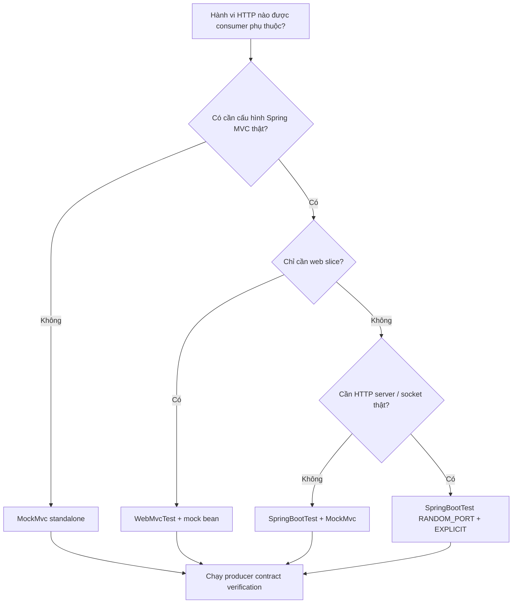
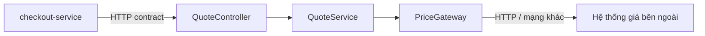
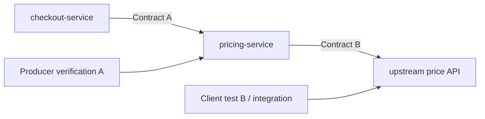
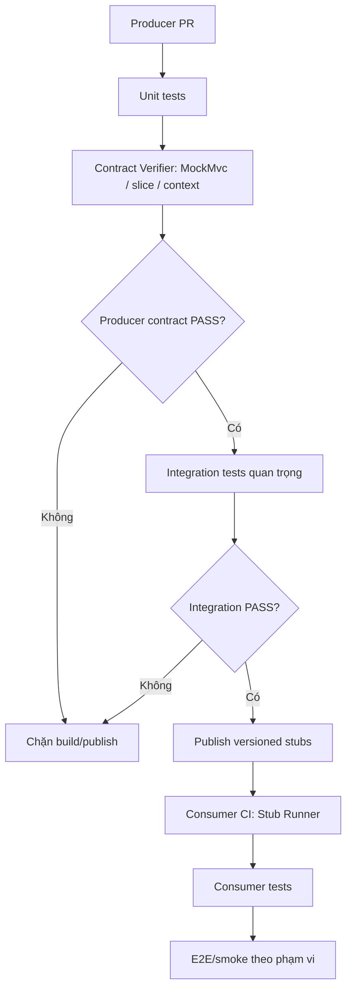

# Chọn mức độ tích hợp vừa đủ cho ranh giới HTTP

> **Chương:** Kiểm thử HTTP  
> **Module:** `SPRING_CLOUD_CONTRACT` — học kiểm thử hợp đồng giữa producer và consumer bằng Spring Cloud Contract, đặc tả hành vi với Groovy/YAML DSL, sinh test cho producer, tạo stub, dùng Stub Runner và tích hợp CI để phát hiện thay đổi API không tương thích.

## Mục tiêu học tập

Sau bài này, bạn có thể:

1. Giải thích vì sao **producer contract test không nhất thiết phải chạy toàn bộ ứng dụng và mọi hệ thống phụ thuộc**, nhưng cũng không thể chỉ kiểm tra một mock trả response có sẵn.
2. Chọn được một trong các mức tích hợp: **MockMvc standalone**, **MVC slice**, **Spring context + MockMvc**, hoặc **HTTP server thật trong test**, dựa vào hành vi HTTP mà consumer cần.
3. Xây base test cho Spring Cloud Contract Verifier, để test được sinh gọi **code producer thật trong phạm vi cần bảo vệ**.
4. Quyết định những phụ thuộc nào được mock, những thành phần nào phải được dựng trong Spring context và khi nào bắt buộc kiểm tra qua socket HTTP.
5. Cấu hình `testMode` tương ứng trong plugin, phân biệt `MOCKMVC` với `EXPLICIT` và hiểu các giới hạn của chúng.
6. Phát hiện các tình huống **test xanh giả** do bỏ qua Spring Security, filter, serializer, exception advice, gateway hoặc cấu hình production.
7. Kết nối producer verification với stub artifact, consumer Stub Runner và CI để duy trì tương thích API.

## 1. Bài toán: "đủ tích hợp" nghĩa là đủ cho điều gì?

Giả sử ứng dụng `checkout-service` (consumer) gọi `pricing-service` (producer) để lấy báo giá:

```http
POST /api/quotes HTTP/1.1
Content-Type: application/json
Accept: application/json

{
  "sku": "SKU-001",
  "units": 2
}
```

Producer cam kết trả:

```http
HTTP/1.1 201 Created
Content-Type: application/json

{
  "sku": "SKU-001",
  "units": 2,
  "total": 240000,
  "currency": "VND"
}
```

`pricing-service` cần lấy đơn giá từ một hệ thống giá bên ngoài. Trong test hợp đồng, ta muốn đảm bảo:

- Producer thực sự nhận đúng `POST /api/quotes` và đọc JSON theo kiểu dữ liệu đã cam kết.
- Logic của producer dùng đơn giá và số lượng để tạo `total`.
- HTTP status là `201`, response có `Content-Type` phù hợp và body có đủ các trường consumer cần.
- Nếu API đổi `total` thành `"240000"` hoặc `currency` thành `USD`, verification phải thất bại.

Ta **không nhất thiết** muốn phụ thuộc môi trường staging của hệ thống giá, DNS, token mạng hoặc một cơ sở dữ liệu bên ngoài chỉ để kiểm tra hợp đồng HTTP này.

Tuy nhiên, nếu hợp đồng bao gồm header bảo mật do Spring Security xử lý, cấu hình JSON tùy chỉnh, filter hoặc routing của server, test chỉ dựng thủ công một controller có thể **không đi qua các thành phần ấy**. Khi đó test xanh dù ứng dụng triển khai thực tế vẫn trả `401`, `406` hoặc sai JSON.

Vì vậy, câu hỏi thiết kế đúng không phải "*mock càng nhiều càng tốt?*" hay "*luôn chạy E2E?*", mà là:

> **Thành phần nào thực sự quyết định hành vi mà consumer đang dựa vào? Hãy dựng đủ những thành phần đó trong test, rồi cô lập các phụ thuộc không cần thiết.**

## 2. Bốn mức tích hợp HTTP thường gặp

| Mức | Cấu hình phổ biến | Gọi HTTP qua socket? | Phần được kiểm tra | Đánh đổi |
| --- | --- | --- | --- | --- |
| **1. MockMvc standalone** | `RestAssuredMockMvc.standaloneSetup(controller)` | Không | Controller được dựng thủ công, Spring MVC mapping và converter do setup cung cấp | Nhanh, nhưng không tự nạp toàn bộ cấu hình Spring |
| **2. MVC slice** | `@WebMvcTest` + `@Import` / bean mock | Không | Phần web MVC được Boot chọn cho slice, controller/advice/converter/filter phù hợp | Gọn hơn full context, nhưng có thể thiếu bean/cấu hình ngoài slice |
| **3. Spring context + MockMvc** | `@SpringBootTest` + `@AutoConfigureMockMvc` | Không | Nhiều bean và cấu hình ứng dụng thật; MockMvc gọi MVC trong process | Phạm vi rộng hơn, khởi tạo chậm hơn, vẫn không kiểm tra server/network thực |
| **4. Embedded HTTP server** | `@SpringBootTest(webEnvironment = RANDOM_PORT)` + `EXPLICIT` | Có, trên loopback | HTTP stack thực trong test, converter, filter, server, response qua socket | Tốn tài nguyên hơn; vẫn không chứng minh hạ tầng production/E2E |

Các mức này không phải một thang điểm "*càng cao luôn càng tốt*". **Chọn mức thấp nhất vẫn chứa mọi thành phần có khả năng làm thay đổi hợp đồng cần kiểm chứng.** Với API rất đơn giản, mức 1 có thể đủ. Với HTTP auth/filter, mức 2 hoặc 3 thường thích hợp hơn. Với hành vi liên quan embedded server, header thực gửi qua mạng hoặc servlet container, cân nhắc mức 4.

Một bộ test trưởng thành thường kết hợp các mức: nhiều producer contract tests ở mức 1–3 để chạy nhanh và một số integration/E2E tests cấp cao hơn cho các ranh giới cần xác nhận end-to-end.



Lưu ý: nếu cần kiểm tra **gateway ngoài ứng dụng, proxy, TLS thật, load balancer, service discovery hoặc network giữa service**, ngay cả mức 4 cũng có thể chưa đủ. Đó là lý do có integration/contract tests ở các ranh giới khác và smoke/E2E test riêng.

## 3. Xác định ranh giới HTTP trước khi viết test

Trong bài này, `checkout-service` chỉ dựa vào giao tiếp HTTP với `pricing-service`. Bên trong producer có:



**Đối tượng được kiểm chứng ở producer** nên gồm controller và những quy tắc tạo response mà consumer dựa vào. `PriceGateway` là một cổng tích hợp ra ngoài; có thể dùng Mockito để điều khiển dữ liệu giá trong contract test. Việc adapter của gateway có kết nối đúng tới hệ thống giá thật hay không cần một **contract/integration test riêng**.

### 3.1. Chọn thật hay mock?

| Thành phần | Trong contract test ví dụ | Lý do |
| --- | --- | --- |
| `QuoteController` | **Thật** | Cần kiểm tra mapping, status, request/response HTTP |
| `QuoteService` | **Thật** | Cần bảo vệ phép tính `units × unitPrice` và currency |
| `PriceGateway` | **Mock** | Cô lập hệ thống ngoài, giữ fixture xác định |
| Spring JSON converter mặc định | **Thật trong setup MockMvc** | Cần đảm bảo JSON response |
| Custom Jackson config hoặc `@ControllerAdvice` | **Đưa vào khi hợp đồng phụ thuộc** | Standalone không tự nạp cấu hình ứng dụng |
| Spring Security | **Đưa vào nếu auth là lời hứa API** | Bỏ filter có thể tạo test xanh giả |
| Database / broker / external service | **Có thể cô lập tùy mục tiêu** | Contract test không phải E2E mặc định |
| Stub Runner | **Ở consumer test** | Không thay producer-side verification |

**Không mock luôn `QuoteController` và trả sẵn HTTP 201.** Làm vậy có thể biến producer verification thành phép so sánh một fixture với chính nó.

**Không mock `QuoteService` nếu đang muốn phát hiện lỗi tính tổng tiền.** Khi chỉ kiểm tra controller serialization, việc mock service có thể là lựa chọn hợp lý, nhưng phạm vi đã thu hẹp và phải được ghi rõ.

## 4. Định nghĩa một hợp đồng dùng chung

Đặt file `src/test/resources/contracts/quote_created.yml` trong dự án **producer**:

```yaml
name: quote_created
description: "Checkout tao bao gia thanh cong"

request:
  method: POST
  url: /api/quotes
  headers:
    Content-Type: application/json
    Accept: application/json
  body:
    sku: SKU-001
    units: 2

response:
  status: 201
  headers:
    Content-Type: application/json
  body:
    sku: SKU-001
    units: 2
    total: 240000
    currency: VND
```

Đây là dữ liệu mẫu cố định, phù hợp để xác minh **một tình huống cụ thể**. Nếu producer sinh thêm `quoteId` động hoặc timestamp, hãy bổ sung response matcher đúng định dạng; đừng khóa một ID ngẫu nhiên vào giá trị mẫu.

Cùng tương tác có thể viết bằng **Groovy DSL**:

```groovy
org.springframework.cloud.contract.spec.Contract.make {
    name 'quote_created'

    request {
        method 'POST'
        url '/api/quotes'
        headers {
            contentType(applicationJson())
            header 'Accept': 'application/json'
        }
        body(
            sku: 'SKU-001',
            units: 2
        )
    }

    response {
        status 201
        headers {
            contentType(applicationJson())
        }
        body(
            sku: 'SKU-001',
            units: 2,
            total: 240000,
            currency: 'VND'
        )
    }
}
```

**Chỉ đưa một bản YAML hoặc Groovy cho cùng scenario vào thư mục contract được plugin quét.** Để cả hai sẽ dễ sinh test/stub trùng.

Hợp đồng trên bảo vệ **observable behavior** của producer. Nó không tự nói producer có dùng MockMvc, Spring context hay server thật; lựa chọn đó thuộc về **base test và test mode**.

## 5. Code producer tối thiểu để làm ví dụ

Ví dụ gồm controller, service và một port ra hệ thống giá ngoài. Các file dưới đây dùng Spring MVC và Java record (JDK 17 trở lên).

### 5.1. Port tra đơn giá

`PriceGateway.java`:

```java
package com.example.quotes;

public interface PriceGateway {
    long unitPrice(String sku);
}
```

Adapter production triển khai interface này có thể gọi một API ngoài. Chưa cần dựng adapter trong bài học vì contract đang kiểm chứng ranh giới **checkout → pricing**, không phải ranh giới **pricing → hệ thống giá**.

### 5.2. Logic nghiệp vụ thật

`QuoteService.java`:

```java
package com.example.quotes;

import org.springframework.stereotype.Service;

@Service
public class QuoteService {

    private final PriceGateway priceGateway;

    public QuoteService(PriceGateway priceGateway) {
        this.priceGateway = priceGateway;
    }

    public QuoteResponse create(String sku, int units) {
        if (units <= 0) {
            throw new IllegalArgumentException("units must be positive");
        }

        long unitPrice = priceGateway.unitPrice(sku);
        long total = Math.multiplyExact(unitPrice, (long) units);

        return new QuoteResponse(sku, units, total, "VND");
    }

    public record QuoteResponse(
        String sku,
        int units,
        long total,
        String currency
    ) {}
}
```

`Math.multiplyExact` giúp lỗi overflow được báo thay vì âm thầm quấn số. Khi pricing trả `120000` cho `SKU-001`, service tính `total = 240000` cho `units = 2`.

Các nhánh âm tính (units không hợp lệ, gateway lỗi, SKU không tồn tại) chưa có HTTP error mapping. Nếu consumer phụ thuộc `400`/`404`/`503`, cần thêm exception handler và **contract riêng**; không mặc định mọi exception Java sẽ được Spring chuyển thành mã lỗi mong muốn.

### 5.3. HTTP controller thật

`QuoteController.java`:

```java
package com.example.quotes;

import org.springframework.http.HttpStatus;
import org.springframework.http.MediaType;
import org.springframework.web.bind.annotation.PostMapping;
import org.springframework.web.bind.annotation.RequestBody;
import org.springframework.web.bind.annotation.ResponseStatus;
import org.springframework.web.bind.annotation.RestController;

@RestController
public class QuoteController {

    private final QuoteService quoteService;

    public QuoteController(QuoteService quoteService) {
        this.quoteService = quoteService;
    }

    @PostMapping(
        path = "/api/quotes",
        consumes = MediaType.APPLICATION_JSON_VALUE,
        produces = MediaType.APPLICATION_JSON_VALUE
    )
    @ResponseStatus(HttpStatus.CREATED)
    public QuoteService.QuoteResponse create(
            @RequestBody QuoteRequest request) {
        return quoteService.create(request.sku(), request.units());
    }

    public record QuoteRequest(String sku, int units) {}
}
```

`consumes`, `produces`, `@RequestBody`, `@ResponseStatus` và Jackson/message converters tham gia tạo hành vi HTTP. Tùy mức test, một phần cấu hình framework liên quan có thể được dựng thủ công hoặc được Spring context cung cấp.

## 6. Mức 1 — MockMvc standalone: kiểm tra controller với chi phí thấp

Trong dự án producer dùng Spring Cloud Contract Verifier và JUnit 5, tạo lớp cơ sở tại `src/test/java/com/example/quotes/ContractTestBase.java`:

```java
package com.example.quotes;

import io.restassured.module.mockmvc.RestAssuredMockMvc;
import org.junit.jupiter.api.BeforeEach;

import static org.mockito.Mockito.mock;
import static org.mockito.Mockito.when;

public abstract class ContractTestBase {

    @BeforeEach
    public void setUp() {
        // Phụ thuộc nằm ngoài ranh giới HTTP đang kiểm chứng.
        PriceGateway gateway = mock(PriceGateway.class);
        when(gateway.unitPrice("SKU-001")).thenReturn(120_000L);

        // Service và controller của producer vẫn là đối tượng thật.
        QuoteService service = new QuoteService(gateway);
        QuoteController controller = new QuoteController(service);

        RestAssuredMockMvc.standaloneSetup(controller);
    }
}
```

**Luồng chạy:**

1. Test do Contract Verifier sinh kế thừa `ContractTestBase`.
2. `@BeforeEach` tạo mock `PriceGateway` và stub đúng dữ liệu đầu vào.
3. Test gọi `POST /api/quotes` thông qua RestAssuredMockMvc.
4. MockMvc chuyển request tới `QuoteController` và `QuoteService` thật.
5. Service tính tổng từ mock `120000`, controller trả `201`.
6. Generated assertion so status/header/JSON body với contract.

### 6.1. Những gì mức này bắt được

- Sai HTTP method hoặc path trong controller.
- Sai `consumes`/`produces` khi các converter tương ứng được bật trong standalone setup.
- Thiếu/mis-bind request body ở các trường được test.
- Sai `@ResponseStatus` hoặc cấu trúc JSON từ controller.
- Sai `total` do code tính toán của service.
- Thay `currency` từ `VND` thành `USD` trong response.

### 6.2. Những gì mức này có thể bỏ sót

- Custom `ObjectMapper` và format JSON được cấu hình qua bean production.
- `@ControllerAdvice` không được đăng ký trong standalone setup.
- Security filter chain, JWT validation, request tracing hoặc custom filter chưa được gắn.
- Spring dependency injection/wiring của toàn ứng dụng.
- Một số servlet behavior chỉ xuất hiện khi container chạy thật.

**Ví dụ xanh giả:** production có một filter yêu cầu `X-Tenant-Id`, nhưng standalone test không dựng filter. Contract gửi request **không có header đó** mà vẫn nhận `201` trong test; production lại trả `401`/`403` hoặc mã lỗi khác theo chính sách. Đây không phải lỗi của MockMvc: **test setup đã chọn phạm vi thiếu thành phần quyết định hành vi**.

Nếu chỉ cần kiểm tra HTTP mapping và DTO đơn giản, mức 1 có thể là lựa chọn tốt. Nếu filter/advice là một phần contract, phải thêm chúng vào setup hoặc nâng mức tích hợp.

### 6.3. Không mock quá rộng trong mức 1

Trong fixture, nên stub chính xác:

```java
when(gateway.unitPrice("SKU-001")).thenReturn(120_000L);
```

Hạn chế dùng:

```java
when(gateway.unitPrice(anyString())).thenReturn(120_000L);
```

nếu test cần phát hiện producer gọi nhầm mã SKU. Giá trị trả cho mọi SKU có thể che lỗi truyền tham số từ controller sang service.

Mockito mock mặc định có thể trả `0` cho primitive hoặc `null` cho object nếu chưa stub đúng lời gọi. Test thất bại vì thiếu fixture **không nhất thiết** chứng minh API phá hợp đồng; hãy xác minh request mà generated test gửi và lời gọi gateway thực sự xảy ra.

## 7. Mức 2 — MVC slice với @WebMvcTest

`@WebMvcTest` dựng một **phần của Spring context chuyên cho web layer**. Nó thích hợp khi cần MVC configuration, controller advice, JSON binding hoặc các phần web được slice nạp, nhưng không muốn dựng toàn bộ ứng dụng.

Một **biến thể thay thế** cho `ContractTestBase` ở mức 1:

```java
package com.example.quotes;

import io.restassured.module.mockmvc.RestAssuredMockMvc;
import org.junit.jupiter.api.BeforeEach;
import org.springframework.beans.factory.annotation.Autowired;
import org.springframework.boot.test.autoconfigure.web.servlet.WebMvcTest;
import org.springframework.context.annotation.Import;
import org.springframework.test.context.bean.override.mockito.MockitoBean;
import org.springframework.test.web.servlet.MockMvc;

import static org.mockito.Mockito.when;

@WebMvcTest(QuoteController.class)
@Import(QuoteService.class)
public abstract class ContractTestBase {

    @Autowired
    MockMvc mockMvc;

    @MockitoBean
    PriceGateway priceGateway;

    @BeforeEach
    public void setUp() {
        when(priceGateway.unitPrice("SKU-001")).thenReturn(120_000L);
        RestAssuredMockMvc.mockMvc(mockMvc);
    }
}
```

Trong ví dụ:

- `@WebMvcTest(QuoteController.class)` tạo MVC slice cho controller.
- `@Import(QuoteService.class)` đưa **service thật** vào slice (mặc định slice không nhất thiết quét mọi `@Service`).
- `@MockitoBean` tạo bean giả cho `PriceGateway` để service có thể được inject.
- `MockMvc` là instance cấu hình bởi slice; RestAssuredMockMvc dùng nó để generated test gọi controller.

**Lưu ý về phiên bản:** import `@WebMvcTest` ở ví dụ trên phù hợp với dòng Spring Boot 3.x. Dòng Spring Boot 4.x đã tổ chức lại một số package test autoconfiguration (đối với MVC, ví dụ sang `org.springframework.boot.webmvc.test.autoconfigure`); hãy dùng import phù hợp phiên bản project. `@MockitoBean` cần Spring Framework 6.2+; dự án cũ có thể dùng `@MockBean` theo phiên bản Boot tương ứng, lưu ý annotation cũ đã bị deprecate ở dòng mới.

Mức 2 **không tự động tương đương production**:

- Slice chỉ nạp những bean/configuration được chọn; external service, transaction và các custom configuration khác có thể vắng mặt.
- Security auto-configuration có thể tham gia test slice, nhưng **chính sách auth đã định cấu hình ở production** không mặc nhiên giống trong mọi slice.
- Dùng `@Import`, test configuration hoặc annotation test security khi cần; phải kiểm tra generated requests thực sự đi qua chính sách quan trọng.

### 7.1. Khi nào MVC slice đáng giá?

Ví dụ `@ControllerAdvice` chuẩn hóa lỗi nghiệp vụ:

```java
@RestControllerAdvice
public class QuoteExceptionHandler {

    @ExceptionHandler(IllegalArgumentException.class)
    public ResponseEntity<ErrorResponse> badRequest(
            IllegalArgumentException ex) {
        return ResponseEntity.badRequest()
            .body(new ErrorResponse("INVALID_UNITS"));
    }

    public record ErrorResponse(String code) {}
}
```

Nếu contract quy định request `units: -1` phải trả `400` và body `{"code":"INVALID_UNITS"}`, test cần bao gồm advice thực tế. Một MVC slice có advice đó có thể hợp lý hơn standalone controller không cấu hình advice.

Đừng giả định advice trên sẽ tự được nạp trong mọi setup: kiểm tra component scanning, import và output generated test. Trong trường hợp khác, cấu hình Spring context đầy đủ có thể cần thiết.

## 8. Mức 3 — Spring context + MockMvc

Khi contract phụ thuộc nhiều bean application thật (custom JSON configuration, interceptors, controller advice, Spring Security, validation), dùng `@SpringBootTest` để dựng ứng dụng trong process, vẫn **không mở HTTP socket**.

Một base class minh họa (thay thế toàn bộ base class ở các mục trước):

```java
package com.example.quotes;

import io.restassured.module.mockmvc.RestAssuredMockMvc;
import org.junit.jupiter.api.BeforeEach;
import org.springframework.beans.factory.annotation.Autowired;
import org.springframework.boot.test.context.SpringBootTest;
import org.springframework.boot.test.autoconfigure.web.servlet.AutoConfigureMockMvc;
import org.springframework.test.context.bean.override.mockito.MockitoBean;
import org.springframework.test.web.servlet.MockMvc;

import static org.mockito.Mockito.when;

@SpringBootTest(
    webEnvironment = SpringBootTest.WebEnvironment.MOCK
)
@AutoConfigureMockMvc
public abstract class ContractTestBase {

    @Autowired
    MockMvc mockMvc;

    @MockitoBean
    PriceGateway priceGateway;

    @BeforeEach
    public void setUp() {
        when(priceGateway.unitPrice("SKU-001")).thenReturn(120_000L);
        RestAssuredMockMvc.mockMvc(mockMvc);
    }
}
```

Điều kiện để chạy:

- Project có lớp `@SpringBootApplication` và dependency Spring MVC/test phù hợp.
- Spring context có thể dựng được với tất cả dependency bắt buộc; các adapter gọi ngoài ranh giới cần được mock/cấu hình thích hợp.
- `@AutoConfigureMockMvc` nạp MockMvc theo cơ chế Spring Boot; với filter/security, cần chắc chắn những cấu hình đó thật sự tham gia test.
- `@MockitoBean` thay bean gateway để không gọi hệ thống giá ngoài.

Lưu ý import `@AutoConfigureMockMvc` trong code là dạng ở Spring Boot 3.x. Với Boot 4.x, kiểm tra namespace test MVC mới; đừng copy lẫn hai dòng Boot. **Ở cả mức 2 và 3**, generated test dùng test mode `MOCKMVC`.

### 8.1. Lợi ích và chi phí

So với standalone, full context có thể bắt lỗi:

- Bean wiring thiếu hoặc xung đột.
- Custom Jackson serializer làm đổi tên field hoặc format timestamp.
- Controller advice trả body lỗi khác lời hứa.
- Security filter yêu cầu header/token chưa được contract cung cấp.
- Servlet filter/interceptor/locale handling ảnh hưởng HTTP response.

Nhưng nó cũng có giá:

- Tốc độ dựng application context và mức sử dụng bộ nhớ tăng.
- Test có thể thất bại vì bean ở phần hoàn toàn không liên quan, nếu không được cô lập.
- Lỗi context startup có thể che mất lỗi tương thích API đang cần tìm.
- Nếu dùng mock quá nhiều, full context vẫn không bảo đảm toàn bộ hệ thống thật.

**Lời khuyên thực hành:** nâng từ mức 1 lên mức 3 khi đã có **yêu cầu quan sát được** mà mức thấp bỏ sót, không chỉ vì "full context nghe có vẻ an toàn hơn".

## 9. Mức 4 — Chạy embedded HTTP server thật

Nếu cần đi qua HTTP socket, servlet container và stack server trong test, dùng **test mode `EXPLICIT`** của Spring Cloud Contract với server chạy ở cổng ngẫu nhiên.

Một ví dụ base class minh họa:

```java
package com.example.quotes;

import io.restassured.RestAssured;
import org.junit.jupiter.api.BeforeEach;
import org.springframework.beans.factory.annotation.Autowired;
import org.springframework.boot.test.context.SpringBootTest;
import org.springframework.boot.test.web.server.LocalServerPort;
import org.springframework.test.context.bean.override.mockito.MockitoBean;

import static org.mockito.Mockito.when;

@SpringBootTest(
    webEnvironment = SpringBootTest.WebEnvironment.RANDOM_PORT
)
public abstract class ContractTestBase {

    @LocalServerPort
    int port;

    @MockitoBean
    PriceGateway priceGateway;

    @BeforeEach
    public void setUp() {
        when(priceGateway.unitPrice("SKU-001")).thenReturn(120_000L);
        RestAssured.baseURI = "http://localhost";
        RestAssured.port = port;
    }
}
```

Các điểm chính:

- `RANDOM_PORT` tránh tranh cổng khi chạy trên CI hoặc máy developer.
- Producer chạy embedded server trong quá trình test.
- Generated test gửi request bằng **Rest Assured HTTP**, không phải RestAssuredMockMvc.
- `RestAssured.port` trỏ request đến cổng local Spring Boot vừa cấp.
- `PriceGateway` vẫn có thể là mock; dùng HTTP server thật **không buộc phải khởi động mọi hệ thống ngoài**.

Khi cần custom HTTPS, proxy hoặc đường ingress khác, bài này chưa đủ; test qua local server không kiểm tra TLS termination hay routing của production gateway.

**Chú ý:** `RestAssured.baseURI` và `RestAssured.port` là cấu hình dạng static/global, có thể gây đụng độ nếu nhiều test thay đổi nó khi chạy song song. Với test suites song song, dùng cấu hình request per-test hoặc tách tiến trình/cấu hình phù hợp. Tên package `@LocalServerPort` có thể khác giữa các dòng Spring Boot; code trên minh họa dòng Boot 3.x.

### 9.1. Khi nào mức 4 là cần thiết?

Nâng lên mức 4 khi điều cần bảo vệ không thể được thể hiện đầy đủ với MockMvc, chẳng hạn:

- Header hoặc cookie do embedded container xử lý có ý nghĩa hợp đồng.
- Routing hoặc filter có hành vi khác khi request đi qua socket.
- HTTP encoding, redirect hoặc response behavior có phụ thuộc server stack.
- Muốn có một kiểm tra component-level với client HTTP thực ở bên ngoài lớp MVC.

**Nhưng:** mức 4 vẫn không xác minh external API thật, database production, broker hay proxy triển khai. Đừng gọi nó là E2E toàn hệ thống khi chỉ một Spring Boot process đang chạy.

## 10. Cấu hình plugin đúng với mức tích hợp

Với dự án producer Maven đã cấu hình Spring Boot + Spring Cloud **tương thích**, cần dependency test và plugin Contract Verifier.

Một phần POM minh họa cho các mức dùng MockMvc:

```xml
<!-- Trong <dependencies> -->
<dependency>
    <groupId>org.springframework.cloud</groupId>
    <artifactId>spring-cloud-starter-contract-verifier</artifactId>
    <scope>test</scope>
</dependency>

<!-- Trong <build><plugins> -->
<plugin>
    <groupId>org.springframework.cloud</groupId>
    <artifactId>spring-cloud-contract-maven-plugin</artifactId>
    <version>${spring-cloud-contract.version}</version>
    <extensions>true</extensions>
    <configuration>
        <testFramework>JUNIT5</testFramework>
        <testMode>MOCKMVC</testMode>
        <baseClassForTests>com.example.quotes.ContractTestBase</baseClassForTests>
    </configuration>
</plugin>
```

Đây là **POM fragment**, chưa có parent/BOM, starter MVC, `java.version` và property `spring-cloud-contract.version`. Chọn phiên bản của Spring Cloud Contract Maven plugin cùng bộ tương thích với phiên bản Spring Boot/Cloud của dự án. Không copy giá trị version từ module khác mà chưa kiểm tra.

Nếu chuyển sang **mức 4**, thay duy nhất test mode ở plugin:

```xml
<testMode>EXPLICIT</testMode>
```

và dùng base class khởi động server với Rest Assured HTTP như mục 9. **Không cấu hình `EXPLICIT` trong khi base test chỉ gọi `RestAssuredMockMvc.standaloneSetup`**: generated test sẽ dùng cách gọi khác với môi trường bạn đã chuẩn bị.

| Mức | Test setup | Plugin `testMode` |
| --- | --- | --- |
| MockMvc standalone | `RestAssuredMockMvc.standaloneSetup` | `MOCKMVC` |
| `@WebMvcTest` | `RestAssuredMockMvc.mockMvc(mockMvc)` | `MOCKMVC` |
| `@SpringBootTest` + MockMvc | `RestAssuredMockMvc.mockMvc(mockMvc)` | `MOCKMVC` |
| `@SpringBootTest(RANDOM_PORT)` | `RestAssured.port = port` | `EXPLICIT` |

Đối với ứng dụng **WebFlux/reactive**, Spring Cloud Contract có chế độ test và cơ chế setup WebTestClient phù hợp. Không áp dụng nguyên cấu hình Servlet/MockMvc cho project WebFlux rồi kỳ vọng giống nhau.

### 10.1. Mối quan hệ với test framework

`testFramework` chọn test framework của mã được sinh (ví dụ JUnit 5), còn `testMode` chọn **cách request được gửi tới producer**. Hai khái niệm khác nhau:

- `JUNIT5` **không đồng nghĩa** với MockMvc.
- `MOCKMVC` **không đồng nghĩa** test chỉ có controller; base class có thể dựng một Spring context rộng hơn.
- `EXPLICIT` nói tới request qua HTTP server trong test; không mặc nhiên kết nối mọi service ngoài.
- `baseClassForTests` chỉ định lớp cơ sở để generated tests kế thừa và dùng setup đúng.

## 11. Chạy producer verification và xác nhận test thật sự hoạt động

Trong producer đã có code, contract, POM và base class:

```bash
mvn clean verify
```

Kỳ vọng:

1. Plugin đọc `quote_created.yml`.
2. Test Java được sinh từ hợp đồng.
3. Test được biên dịch và chạy qua JUnit/Surefire theo cấu hình.
4. Request được gửi đến producer bằng test mode đã chọn.
5. Assertion kiểm tra HTTP `201`, header và các field `sku`, `units`, `total`, `currency`.
6. Nếu implementation khớp hợp đồng, build thành công.

Đừng chỉ nhìn thấy `BUILD SUCCESS`: cần kiểm tra **test reports** để chắc chắn generated tests có được thực thi. Nếu không sinh test, bị skip hoặc không được test runner nhận diện, build có thể xanh mà không bảo vệ ranh giới HTTP.

### 11.1. Thử làm hỏng hợp đồng có chủ đích

Tạm sửa `QuoteService`:

```java
long total = unitPrice; // Cố ý bỏ phép nhân units
```

Với fixture `120000` và `units: 2`, producer trả `total = 120000` thay vì `240000`. Generated contract test phải **FAIL** ở body. Phục hồi `Math.multiplyExact(unitPrice, units)` và chạy lại.

Tương tự, đổi `@ResponseStatus(CREATED)` thành `OK`: producer test phải fail vì contract mong `201`.

Nếu test không fail:

- Có phải `QuoteService` đã bị mock và trả sẵn response?
- Có phải generated test chỉ kiểm tra HTTP status, không kiểm tra `total`?
- Có phải plugin không đọc contract hoặc test bị skip?
- Có phải build đang chạy với base class/test mode khác?
- Có phải test fixture đã tự sửa theo output sai, làm mất phép đối chiếu độc lập?

Đây là cách đánh giá **chất lượng của test setup**, không chỉ tính đúng của code production.

## 12. Chọn mức tích hợp khi có yêu cầu auth và error response

### 12.1. Trường hợp API yêu cầu token hoặc tenant

Giả sử `pricing-service` có Spring Security và bắt buộc bearer token hợp lệ hoặc `X-Tenant-Id`. Nếu consumer cần nhận `401` khi không xác thực và `403` khi không có quyền, contract phải mô tả **cả tình huống thành công lẫn nhánh lỗi được cam kết**.

Mức **standalone** có thể không nạp Security filter chain. Khi đó test thành công chưa chứng minh request thật đi qua authentication/authorization.

Cân nhắc:

- `@WebMvcTest` khi có thể nạp đúng security configuration/filter cho web slice.
- `@SpringBootTest` + `@AutoConfigureMockMvc` để kiểm tra MVC cùng Spring context, filter và security phù hợp.
- `RANDOM_PORT` nếu cần kiểm tra HTTP thật đi qua embedded server.

**Không dùng token production trong contract hay CI logs.** Sử dụng token/identity thử nghiệm và cơ chế test security phù hợp. Nếu môi trường test cố tình tắt security, cần có một bộ integration/security test riêng bảo vệ hành vi đã cam kết.

### 12.2. Trường hợp error body do @ControllerAdvice tạo ra

Giả sử `units <= 0` phải trả:

```http
HTTP/1.1 400 Bad Request
Content-Type: application/json

{"code":"INVALID_UNITS"}
```

Nếu error handler là một `@RestControllerAdvice` được nạp từ context, standalone controller chưa đăng ký advice có thể trả hành vi khác. Khi có hợp đồng cho response lỗi này, hãy:

1. Định nghĩa `@ControllerAdvice`/exception handler trong producer thật.
2. Dùng mức test nạp được handler hoặc thêm handler vào standalone setup có chủ đích.
3. Viết **contract riêng** cho request `units: -1` và response `400`.
4. Kiểm tra generated assertion cho status, content type và error body.

Không đổi contract thành `500` chỉ vì standalone setup chưa nạp handler mà production vốn đã cam kết `400`.

## 13. Thời gian chạy và độ tin cậy: không có một mức tốt cho mọi API

Ưu điểm/giới hạn tổng hợp:

| Câu hỏi | Standalone | MVC slice | Full context + MockMvc | HTTP server |
| --- | --- | --- | --- | --- |
| Cần controller và conversion cơ bản? | Tốt | Tốt | Tốt | Tốt |
| Cần custom advice/converter Spring? | Phải gắn thủ công | Có thể có trong slice | Có thể kiểm tra toàn context | Có thể kiểm tra qua server |
| Cần wiring service trong Spring? | Dựng tay | `@Import`/config | Có | Có |
| Cần Security/filter thật? | Phải gắn thủ công | Tùy slice/config | Tùy config test | Tùy config test |
| Cần HTTP socket? | Không | Không | Không | Có |
| Phụ thuộc app context startup? | Không | Có, một phần | Có, rộng hơn | Có, kèm server |
| Tốc độ tương đối | Thường nhanh nhất | Thường nhanh | Chậm hơn | Thường cao nhất về chi phí |

**"Tích hợp vừa đủ" không phải "cấp thấp nhất luôn được".** Nếu endpoint phụ thuộc custom serialization, một test standalone với ObjectMapper mặc định có thể báo xanh dù production đổi tên field. Ngược lại, test qua server thật cho một controller in-memory đơn giản có thể tăng chi phí CI mà không thêm bằng chứng cần thiết.

### 13.1. Bốn câu hỏi trước khi chọn base test

1. **Consumer phụ thuộc vào điều gì?** Path, method, headers, JSON shape, auth, lỗi hay behavior liên quan container?
2. **Thành phần nào tạo ra điều đó?** Controller, serializer, advice, filter, security, embedded server hay gateway ngoài?
3. **Mức test nào dựng đúng những thành phần đó?** Standalone, slice, context hay HTTP?
4. **Những phụ thuộc nào có thể cô lập mà không làm sai hợp đồng?** External service, DB hay broker; khi cô lập phải có test ở ranh giới tương ứng.

Ghi kết quả lựa chọn vào README/test design hoặc chú thích ngắn cho base class trong project thật sẽ giúp reviewer hiểu vì sao phải dựng Spring context hoặc vì sao chỉ dùng MockMvc standalone.

## 14. Khi nào cần test ở một ranh giới khác?

`pricing-service` trong ví dụ là **producer** đối với `checkout-service`. Nhưng nó lại là **consumer** của hệ thống báo giá bên ngoài qua `PriceGateway`.

Mock `PriceGateway` giúp producer contract test tập trung và ổn định; nó **không** chứng minh adapter thật gọi đúng HTTP API của hệ thống giá.

Muốn bảo vệ cả hai chiều:

- **Contract A:** `checkout-service → pricing-service`; producer verification của `pricing-service` kiểm tra `POST /api/quotes`.
- **Contract B:** `pricing-service → upstream price API`; kiểm tra HTTP client của `PriceGateway` với stub/contract phù hợp và verification phía upstream producer.
- **Integration tests:** xác minh wiring, DB/broker, authentication và những khía cạnh không được contract bao phủ.
- **E2E smoke:** chạy một số hành trình quan trọng xuyên dịch vụ ở môi trường gần production.



Đừng kéo tất cả service vào **Contract A** nếu làm vậy khiến test phụ thuộc môi trường và thiếu tính tái lập. Mỗi ranh giới được kiểm chứng bằng một bộ test phù hợp sẽ dễ xác định nguyên nhân lỗi hơn.

## 15. Vai trò của Stub Runner sau producer verification

Sau khi producer verification đạt, Spring Cloud Contract có thể tạo stub JAR. Ví dụ:

```text
com.example:pricing-service:1.0.0:stubs
```

Consumer test có thể dùng:

```java
@SpringBootTest(
    properties = "pricing.base-url=http://localhost:8090",
    webEnvironment = SpringBootTest.WebEnvironment.NONE
)
@AutoConfigureStubRunner(
    ids = "com.example:pricing-service:1.0.0:stubs:8090",
    stubsMode = StubRunnerProperties.StubsMode.LOCAL
)
class CheckoutPricingContractTest {

    @Autowired
    PricingClient pricingClient;

    @Test
    void docDuocBaoGiaTuStub() {
        Quote quote = pricingClient.create("SKU-001", 2);

        assertEquals(240000, quote.total());
        assertEquals("VND", quote.currency());
    }
}
```

Đây là **đoạn test minh họa**; để chạy phải có `PricingClient`, `Quote`, import/dependency và cấu hình URL phù hợp. `LOCAL` yêu cầu stub đã được cài vào Maven local repository. `Stub Runner` chỉ phục vụ **consumer-side tests**, không tự chạy producer implementation.

Điều cần nhớ:

- Producer-side verification ở mức 1–4 kiểm tra **producer thật** trong phạm vi test.
- Consumer-side Stub Runner kiểm tra **client thật** gọi một **stub** đã mô tả bằng contract.
- Consumer test xanh với stub **cũ** không chứng minh producer **mới** vẫn giữ hợp đồng.
- Vì vậy CI phải chặn publish stub/artifact khi producer verification thất bại và consumer cần chọn đúng version.

## 16. Thiết kế CI: nhanh, đủ bao phủ và có bằng chứng

Một pipeline có thể tổ chức thành các cổng kiểm tra:



Maven khi plugin đã được gắn đúng lifecycle:

```bash
mvn clean verify
```

Sau khi test đạt, có thể cài stub vào Maven local hoặc publish tới artifact repository:

```bash
mvn install
```

Trong CI tách runner, `mvn install` ở máy producer **không tự chuyển stub sang máy consumer**; cần truyền artifact hoặc dùng Maven repository để consumer tải đúng version.

**Các điều kiện chặn quan trọng:**

- Contract phải được plugin tìm thấy.
- Generated tests phải được biên dịch và **thực sự chạy**, không chỉ sinh file Java.
- Không dùng `-DskipTests` để phát hành stub chưa được kiểm chứng.
- Nếu bật test mode HTTP, cổng phải được cấu hình đúng và server phải khởi động.
- Nếu dùng standalone/slice, đừng bỏ qua các thành phần làm thay đổi HTTP behavior đã cam kết.
- Test report phải thể hiện đúng số lượng contract tests dự kiến; một build chạy **0 test** không nên được xem là thành công.
- Chỉ publish stub/version sau khi các cổng producer quan trọng đạt.

### 16.1. Cân bằng tốc độ và độ tin cậy trong CI

Một chiến lược thực tế:

1. Chạy nhiều contract tests nhanh bằng MockMvc cho các API đơn giản.
2. Chạy context-level contract tests với những API phụ thuộc advice, custom JSON config hoặc security.
3. Dành một số server-level tests cho HTTP behavior thực sự cần qua socket.
4. Chạy integration test adapter, database và broker ở các ranh giới riêng.
5. Giữ một lượng E2E nhỏ nhưng có giá trị nghiệp vụ cao; không thay toàn bộ contract suite bằng E2E.

Không có ngưỡng số giây phổ quát cho từng mức; đo thời gian của **suite thực tế** và điều chỉnh dựa trên những rủi ro được phát hiện trong production.

## 17. Chẩn đoán lỗi theo mức test

| Triệu chứng | Nguyên nhân có thể | Cách điều tra |
| --- | --- | --- |
| Standalone test xanh nhưng production bị `401` | Không nạp Security filter | Dùng slice/context có Security thật hoặc security integration test |
| Standalone response JSON khác production | Custom ObjectMapper không được dùng | Nạp serializer phù hợp hoặc dùng context |
| `@WebMvcTest` không tìm thấy service | Slice không tự quét mọi service | `@Import` service cần kiểm tra hoặc mock đúng phạm vi |
| `@SpringBootTest` không tạo được context | Bean ngoài ranh giới chưa được mock/cấu hình | Dùng `@MockitoBean` hoặc test configuration phù hợp |
| Generated test nhận `404` | Method/path không đúng, test mode/base test lệch | Kiểm tra request sinh và mapping |
| Generated test nhận `415`/`406` | `Content-Type`/`Accept` không phù hợp | Xem `consumes/produces`, converter và contract |
| Test `EXPLICIT` bị connection refused | Embedded server chưa chạy hoặc port sai | Kiểm tra `RANDOM_PORT`, `@LocalServerPort` và RestAssured |
| Mức HTTP bị lỗi cổng khi chạy song song | Dùng fixed port hoặc RestAssured state dùng chung | Dùng random port và cấu hình per-test |
| Build xanh dù sai `total` | Mock service quá rộng hoặc test không chạy | Đọc generated test/report, thử mutation |
| MockMvc test không thấy lỗi từ proxy production | Proxy/TLS/ingress ở ngoài process | Bổ sung smoke/integration test qua hạ tầng tương ứng |
| Consumer test stub trả 404 | Request không khớp mapping của stub | So method, URL, header và body trong WireMock logs |
| Consumer test xanh nhưng producer mới hỏng | Stub version cũ hoặc producer verifier bị skip | Kiểm tra producer verification và version artifact |

### 17.1. Cách kiểm tra mức test có đủ bảo vệ hay không

Chọn một lỗi đã biết chắc phá hợp đồng, ví dụ đổi `currency: VND` thành `USD` trong code producer. Giữ contract không đổi rồi chạy lại:

- Nếu generated test đỏ: mức test đã bảo vệ được bất biến này.
- Nếu vẫn xanh: kiểm tra liệu code bị mock, contract thiếu assertion, generated test không chạy hoặc đang gọi nhầm instance.
- Nếu test chỉ đỏ ở mức 3 nhưng xanh ở mức 1: xem thành phần context nào tạo khác biệt (custom converter, filter, advice hoặc cấu hình khác). Dùng thông tin đó để chọn lại mức tối thiểu hợp lý.

Đây là cách làm cụ thể để đánh giá **bằng chứng kiểm thử**, thay vì chọn mức tích hợp chỉ dựa trên sở thích công nghệ.

## 18. Bài tập thực hành

**Bài 1 — Chọn mức tích hợp.** Với ba endpoint sau, hãy chọn mức thấp nhất có thể bảo vệ hành vi đã cam kết và giải thích: (a) controller trả JSON từ service in-memory; (b) response lỗi được `@ControllerAdvice` tùy chỉnh; (c) endpoint bắt buộc JWT được xác minh bằng Spring Security filter chain.

**Bài 2 — Viết standalone base test.** Từ `QuoteController`, `QuoteService` và `PriceGateway`, tạo `ContractTestBase` dùng Mockito và `RestAssuredMockMvc.standaloneSetup`. Giữ controller/service thật; stub đúng `unitPrice("SKU-001") = 120000`.

**Bài 3 — Chuyển sang MVC slice.** Thay base class bằng `@WebMvcTest(QuoteController.class)`, `@Import(QuoteService.class)`, `@MockitoBean PriceGateway` và `@Autowired MockMvc`. Giải thích vì sao Spring service cần được import trong ví dụ này.

**Bài 4 — Chuyển sang HTTP server.** Dùng `@SpringBootTest(webEnvironment = RANDOM_PORT)`, `@LocalServerPort` và `RestAssured.port`; đặt plugin `testMode = EXPLICIT`. Tại sao giữ `MOCKMVC` với setup này là cấu hình không nhất quán?

**Bài 5 — Thử breaking change.** Cố ý đổi phép tính `total` hoặc HTTP status trong producer. Chạy `mvn clean verify`. Nếu test không đỏ, nêu ít nhất bốn nguyên nhân có thể và cách chứng minh nguyên nhân thật.

**Bài 6 — Auth ngoài standalone.** Thiết kế contract cho endpoint trả `401` khi không có token. Phân tích lý do một test standalone không nạp Security filter có thể bỏ lọt hành vi này; đề xuất base test phù hợp.

**Bài 7 — Ranh giới thứ hai.** `pricing-service` dùng `PriceGateway` gọi hệ thống báo giá khác. Thiết kế một bộ contract/integration test cho adapter này. Vì sao contract A giữa checkout và pricing không tự chứng minh adapter kết nối đúng upstream?

**Bài 8 — CI.** Thiết kế pipeline có MockMvc contract tests, server-level integration test quan trọng, publish stub đã xác minh và consumer Stub Runner tests. Ghi điều kiện fail nếu build chạy 0 generated test hoặc bỏ qua producer verification.

### Gợi ý đáp án

1. (a) standalone; (b) slice có advice hoặc context; (c) context + security phù hợp, và server-level khi cần socket behavior.
2. Mock `PriceGateway`, new `QuoteService` và `QuoteController` thật, gọi `standaloneSetup`.
3. MVC slice mặc định tập trung vào web component; cần import service để giữ logic thật và mock gateway cho dependency.
4. `EXPLICIT` tạo test dùng Rest Assured HTTP; `MOCKMVC` tạo test dùng MockMvc. Base setup phải cùng cơ chế với generated test.
5. Có thể do test bị skip, plugin không đọc YAML, mock cả service, assertion thiếu, chọn sai base/test mode hoặc report không ghi nhận generated test.
6. Cần test security filter thực sự, không chỉ fake response. Mức 2/3 với security config là những lựa chọn thường phù hợp.
7. Test adapter `PriceGateway` thật gọi một upstream stub đã được kiểm chứng, kèm producer verification của upstream nếu áp dụng.
8. Không publish khi producer verification không chạy hoặc thất bại; chọn version stub rõ ràng và chuyển artifact qua repository hoặc giữa các job.

## 19. Ghi nhớ

**Mức độ tích hợp vừa đủ cho ranh giới HTTP** là mức test thấp nhất vẫn thực thi tất cả thành phần có thể ảnh hưởng đến **hành vi đã cam kết với consumer**. Spring Cloud Contract Verifier có thể chạy producer tests qua MockMvc standalone, MVC slice, Spring context hoặc HTTP server thật. Cấu hình `testMode` phải tương ứng với base test; MockMvc không chứng minh socket/network production, còn HTTP server trong test không tự chứng minh mọi dependency ngoài ứng dụng.

Giữ **controller và logic producer cần bảo vệ** ở trạng thái thật; cô lập gateway, database hoặc broker khi chúng nằm ngoài mục tiêu của contract test. Khi contract phụ thuộc Spring Security, custom serialization hoặc exception advice, hãy nâng mức tích hợp hoặc bổ sung test thích hợp. Luôn kiểm tra **generated producer tests đã thực sự chạy**, chỉ phát hành stub sau khi verification đạt, rồi kiểm thử HTTP client consumer với Stub Runner. Một số integration/E2E tests ở ranh giới khác giúp lấp những khoảng trống mà contract test không nhắm đến.

## Tài liệu tham khảo

- [Spring Cloud Contract — Reference](https://docs.spring.io/spring-cloud-contract/reference/) — tra cứu test mode và base test theo đúng phiên bản đang sử dụng.
- [Spring Cloud Contract — Maven Project](https://docs.spring.io/spring-cloud-contract/reference/maven-project.html) — sinh test, cấu hình plugin và base class.
- [Spring Cloud Contract — Getting Started](https://docs.spring.io/spring-cloud-contract/reference/getting-started/first-application.html) — luồng producer verification và stubs.
- [Spring Cloud Contract — Contract DSL](https://docs.spring.io/spring-cloud-contract/reference/project-features-contract.html) — mô tả tương tác HTTP/Groovy/YAML.
- [Spring Cloud Contract — Stub Runner Core](https://docs.spring.io/spring-cloud-contract/reference/project-features-stubrunner/stub-runner-core.html) — consumer-side tests.
- [Spring Boot — Testing Spring Boot Applications](https://docs.spring.io/spring-boot/reference/testing/spring-boot-applications.html) — `@SpringBootTest`, test slices và MockMvc.
- [Spring Framework — MockitoBean](https://docs.spring.io/spring-framework/reference/testing/annotations/integration-spring/annotation-mockitobean.html) — thay bean external dependency trong test context.
